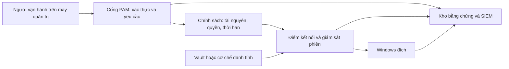

# RDP privileged session

## 1. Mục tiêu và phạm vi

Một **RDP privileged session** là phiên Remote Desktop dùng để thực hiện công việc có quyền đặc biệt trên Windows: thay đổi cấu hình hệ thống, xử lý sự cố dịch vụ, quản lý tài khoản hoặc vận hành ứng dụng nhạy cảm. Trong PAM, đơn vị cần kiểm soát là toàn bộ phiên làm việc, từ người yêu cầu đến tài khoản Windows, máy đích, thời hạn, thao tác và bằng chứng kết thúc.

Bài học thuộc chương **Windows PAM**, tập trung vào cách biến một kết nối RDP thành một phiên quản trị được cấp phép, giới hạn và truy vết. Phạm vi bao gồm tài khoản quản trị, thiết bị nguồn, cổng truy cập, credential, giám sát phiên và thu hồi quyền. Các giá trị thời gian, tên nhóm và tài nguyên trong ví dụ là thiết kế minh họa, cần điều chỉnh theo môi trường.

Sau bài học, người học có thể:

- Phân biệt quyền đi vào desktop với quyền quản trị tài nguyên bên trong desktop.
- Thiết kế đường truy cập RDP đi qua điểm kiểm soát PAM và ngăn đường đi vòng.
- Gắn người thao tác với danh tính Windows và phiên cụ thể.
- Chọn cách sử dụng credential phù hợp với kiến trúc.
- Phân biệt disconnect, logoff, hết hạn quyền và đóng phiên PAM.
- Thu thập bằng chứng đủ để xác minh ai đã làm gì, ở đâu và trong thời gian nào.
- Xử lý tình huống recording hỏng, phiên treo hoặc thu hồi chưa thành công.

## 2. Vì sao bật Remote Desktop chưa tạo thành PAM?

Giả sử kỹ sư vận hành có mật khẩu quản trị dùng chung và kết nối trực tiếp tới `app-win-01`. Máy bật NLA, dùng TLS và chỉ nhận kết nối từ mạng nội bộ. Đường truyền đã có một số lớp bảo vệ, nhưng tổ chức vẫn có thể không biết người nào sử dụng tài khoản, ai phê duyệt thay đổi hoặc mật khẩu đã được sao chép đi đâu.

PAM cần trả lời thêm các câu hỏi:

| Câu hỏi | Bằng chứng cần có |
| --- | --- |
| Ai đang thao tác? | Danh tính cá nhân, kết quả xác thực, thiết bị nguồn |
| Tại sao được vào? | Yêu cầu công việc, ticket, người phê duyệt hoặc chính sách tự phê duyệt |
| Được vào đâu? | Máy đích, môi trường, tầng quản trị và tài khoản đích |
| Được làm đến mức nào? | Vai trò, quyền ứng dụng, quyền hệ điều hành thực sự |
| Được làm trong bao lâu? | Thời điểm bắt đầu, hạn kết thúc, quy tắc gia hạn |
| Có thể dừng phiên không? | Cơ chế thu hồi, khả năng logoff trên đích và xác minh kết quả |
| Sau phiên còn gì? | Recording, log, thay đổi quyền, trạng thái credential và kết quả công việc |

Một phiên được quay video vẫn có thể dùng quyền quá rộng. Một phiên không lộ mật khẩu cho người dùng vẫn có thể cho phép họ tạo tài khoản quản trị mới. Vì vậy, bảo vệ credential, hạn chế quyền và giám sát hành vi là các lớp bổ sung cho nhau.

RDP cung cấp desktop tương tác. Nếu công việc chỉ cần một thao tác nhỏ đã có giao diện quản trị hoặc endpoint JEA được giới hạn tốt, cần đánh giá phương án đó trước khi cấp cả desktop quản trị. Quyết định dựa trên nhu cầu thao tác, khả năng giới hạn và bằng chứng có thể thu thập.

## 3. Mô hình danh tính và đường truy cập

### 3.1. Bốn đối tượng cần tách biệt

Trong một phiên PAM có thể xuất hiện các danh tính khác nhau:

1. **Người yêu cầu:** ví dụ `CORP\linh`, chịu trách nhiệm về công việc.
2. **Danh tính quản trị:** ví dụ `CORP\linh-admin` hoặc một tài khoản được vault quản lý.
3. **Thành phần kết nối:** gateway, connector hoặc máy trung gian thực hiện kết nối.
4. **Tài nguyên đích:** ví dụ `app-win-01.corp.example`, nơi quyền được thực thi.

Tài khoản dùng để đăng nhập cổng PAM không nhất thiết là tài khoản xuất hiện trong Security log của máy đích. Nếu PAM sử dụng tài khoản đích dùng chung, phải có ánh xạ rõ giữa từng người, lần cấp phát credential và phiên Windows tương ứng. Một tài khoản dùng chung không có cơ chế ánh xạ sẽ làm mất khả năng quy trách nhiệm.

Ưu tiên tài khoản quản trị định danh khi phù hợp. Nếu ứng dụng hoặc quy trình bắt buộc dùng tài khoản chung, thiết kế lease độc quyền cho cặp tài khoản–máy đích hoặc một cơ chế phân biệt phiên đã được kiểm chứng. Không để hai người cùng dùng một credential mà chỉ dựa vào thời gian gần nhau để suy ra ai thực hiện thay đổi.

### 3.2. Kiến trúc minh họa



Đây là mô hình chức năng, không quy định sản phẩm phải có đúng từng máy chủ riêng. Có giải pháp dùng native client với connector, có giải pháp cung cấp desktop qua trình duyệt, có giải pháp dùng agent trên đích. Mỗi phương án cần được kiểm chứng về xác thực, credential, recording, reconnect và chấm dứt phiên.

Nếu dùng Microsoft RD Gateway, gateway có thể tạo đường hầm được mã hóa, xác thực truy cập và áp dụng RD CAP/RD RAP để giới hạn người dùng cùng tài nguyên. MFA là tích hợp cần cấu hình; việc cài role gateway chưa tự tạo một quy trình PAM hoàn chỉnh. Xem [Remote Desktop Services — Access from anywhere](https://learn.microsoft.com/en-us/windows-server/remote/remote-desktop-services/rds-plan-access-from-anywhere).

Không mặc định RD Gateway là bộ ghi hình desktop. Khả năng recording và điều khiển phiên phải được xác định ở sản phẩm hoặc thành phần thực sự thực hiện chức năng đó.

### 3.3. Chặn đường đi vòng

Chính sách “phải đi qua PAM” chỉ có tác dụng nếu mạng và máy đích cùng thực thi:

- Chỉ cho phép nguồn kết nối RDP thuộc các connector hoặc máy quản trị đã phê duyệt.
- Kiểm soát cả đường nội bộ, VPN, mạng quản trị, IPv4 và IPv6 nếu được triển khai.
- Rà soát các máy trung gian có thể tạo kết nối tiếp tới đích.
- Tách đường break-glass, định danh riêng và giám sát như một ngoại lệ có chủ sở hữu.
- Áp dụng quy tắc tương đương cho các đích mới tạo, máy khôi phục và môi trường DR.

Chuyển RDP khỏi cổng mặc định không thay thế hạn chế nguồn. Có MFA tại cổng PAM nhưng vẫn cho phép kết nối trực tiếp tới máy đích sẽ để lại đường truy cập không chịu cùng điều kiện MFA và recording.

## 4. Bảo vệ thiết bị nguồn, đường truyền và credential

### 4.1. Thiết bị nguồn là một phần của ranh giới tin cậy

Một máy người dùng bị kiểm soát có thể bị theo dõi bàn phím, chiếm giao diện hoặc điều khiển phiên quản trị đang mở. Vì vậy, quyền đặc biệt nên bắt đầu từ máy quản trị được quản lý, được vá và đáp ứng yêu cầu thiết bị của tổ chức.

Microsoft nêu rủi ro credential trên máy nguồn và khuyến nghị dùng privileged access workstation cho tài khoản nhạy cảm. RDP thông thường cũng có thể đưa credential có khả năng tái sử dụng vào máy đích; đặc tính này khác với việc chỉ mã hóa đường truyền. Xem [Administrative tools and logon types](https://learn.microsoft.com/en-us/windows-server/identity/securing-privileged-access/reference-tools-logon-types).

Thiết kế thực hành trong bài áp dụng:

- Tách tài khoản quản trị khỏi tài khoản dùng email và duyệt web hằng ngày.
- Không nhập credential quản trị vào thiết bị chưa được quản lý.
- Kiểm tra thiết bị nguồn trước khi phát hành quyền.
- Khóa máy khi rời vị trí và yêu cầu xác thực lại khi rủi ro thay đổi.
- Giới hạn khả năng truy cập Internet từ môi trường quản trị theo nhu cầu.

Gateway hoặc vault không khắc phục được việc người dùng mở phiên từ một máy nguồn đã bị chiếm quyền.

### 4.2. NLA, TLS và MFA giải quyết các vấn đề khác nhau

NLA yêu cầu xác thực trước khi thiết lập phiên remote. NLA không đồng nghĩa với MFA và không xác nhận rằng người dùng được phê duyệt cho một thay đổi cụ thể. Xem [Enable Remote Desktop — Network Level Authentication](https://learn.microsoft.com/en-us/windows-server/remote/remote-desktop-services/remotepc/remote-desktop-allow-access).

Trong thiết kế PAM:

| Lớp | Mục đích kiểm soát | Cần xác minh |
| --- | --- | --- |
| TLS và chứng thư | Bảo vệ kênh, xác minh đầu kết nối | Tên đích, chuỗi tin cậy, thời hạn chứng thư |
| NLA | Xác thực trước khi tạo desktop | Cấu hình hiệu lực trên máy đích và client tương thích |
| MFA | Tăng độ chắc chắn về người sử dụng | Thực thi ở đúng đường truy cập, có log kết quả |
| Phê duyệt | Cho phép công việc cụ thể | Tài nguyên, tài khoản, thời hạn, lý do |
| Quyền Windows | Quyết định thao tác được thực hiện | Token, nhóm và ACL thực tế |
| Recording và audit | Tạo khả năng quan sát | Độ bao phủ, lưu trữ và đối chiếu được |

Dừng kết nối khi chứng thư không khớp kỳ vọng và xác minh nguyên nhân bằng kênh quản trị. Thói quen bỏ qua mọi cảnh báo chứng thư làm yếu khả năng nhận diện máy chủ giả hoặc sai đích.

Nếu phiên đi qua nhiều chặng, phải biết mỗi chặng xác thực với ai và được bảo vệ như thế nào. Mã hóa từ máy người dùng tới gateway không tự chứng minh rằng chặng gateway tới máy đích đáp ứng cùng yêu cầu.

### 4.3. Lựa chọn cơ chế credential

Credential injection cho phép thành phần PAM dùng bí mật từ vault để mở phiên. Cần xác minh sản phẩm không để bí mật xuất hiện trong tham số tiến trình, log hoặc file tải xuống. “Người dùng không nhìn thấy mật khẩu” chưa chứng minh bí mật không tồn tại tại connector hoặc máy đích.

Hai chế độ Windows cần phân biệt:

- **Remote Credential Guard:** dùng Kerberos, không chuyển credential tới đích; vẫn cho phép dùng danh tính người dùng trong phiên.
- **Restricted Admin:** không chuyển credential; truy cập mạng từ đích dùng danh tính máy và cần quyền administrator tại đích.

Remote Credential Guard chỉ hỗ trợ kết nối trực tiếp, không qua RD Gateway hoặc Connection Broker. Với helpdesk vào máy có thể đã bị xâm nhập, Microsoft khuyến nghị Restricted Admin. Đối chiếu điều kiện triển khai tại [Remote Credential Guard](https://learn.microsoft.com/en-us/windows/security/identity-protection/remote-credential-guard).

Quyết định kiến trúc phải dựa trên thử nghiệm tương thích của cả client, chính sách, máy đích và giải pháp PAM. Không ghép các tính năng chỉ vì tên gọi của chúng có vẻ bổ sung cho nhau. Nếu một cơ chế làm mất recording hoặc thay đổi đường kiểm soát, phải đánh giá lại thiết kế trước khi áp dụng.

## 5. Cấp đúng quyền cho phiên Windows

### 5.1. Quyền đăng nhập và quyền quản trị là hai quyết định

Cho phép người dùng vào RDP không có nghĩa là cần thêm họ vào local Administrators. Một tác vụ có thể chỉ cần quyền trên thư mục, quyền xem event hoặc quyền ứng dụng đã được ủy nhiệm.

Chính sách **Allow log on through Remote Desktop Services** quyết định quyền logon từ xa. Khi một tài khoản đồng thời thuộc phạm vi **Deny log on through Remote Desktop Services**, deny có ưu tiên. Kiểm tra cả nhóm lồng nhau và chính sách áp dụng thực tế. Xem [Deny log on through Remote Desktop Services](https://learn.microsoft.com/en-us/previous-versions/windows/it-pro/windows-10/security/threat-protection/security-policy-settings/deny-log-on-through-remote-desktop-services).

Một mô hình phân quyền minh họa:

| Nhu cầu | Quyền thiết kế | Phạm vi |
| --- | --- | --- |
| Xem thông tin ứng dụng | Quyền đọc được ủy nhiệm | Một ứng dụng trên một máy |
| Vận hành dịch vụ cụ thể | Quyền quản lý được ủy nhiệm hoặc công cụ giới hạn | Dịch vụ được chỉ định |
| Cài bản vá hệ điều hành | Quyền quản trị có thời hạn | Nhóm máy thuộc change |
| Quản trị domain | Vai trò riêng của tầng định danh | Tài nguyên định danh được phê duyệt |

Các vai trò ở bảng là yêu cầu thiết kế, không phải tên nhóm tích hợp sẵn của Windows. Cần triển khai và kiểm thử ACL, quyền dịch vụ hoặc endpoint quản trị tương ứng.

Không dùng Domain Admin để khắc phục một lỗi quyền trên member server. Cấp quyền ở tầng cao hơn nhu cầu sẽ làm tăng ảnh hưởng nếu máy đích bị xâm nhập.

### 5.2. JIT phải có nơi thực thi và nơi thu hồi

JIT có thể được thực hiện bằng membership tạm thời, tài khoản ngắn hạn hoặc entitlement do nền tảng quản lý. Cơ chế cụ thể phải ghi nhận thời hạn và có bộ phận chịu trách nhiệm thu hồi.

Đối với quyền dựa trên nhóm, cần tính đến độ trễ đồng bộ, việc tạo token khi đăng nhập và các phiên đang tồn tại. Xóa một membership không phải bằng chứng rằng token của phiên cũ đã mất quyền ngay. Đổi mật khẩu cũng không phải lệnh logoff phiên đang mở.

Vì vậy, thiết kế cần hai luồng:

1. Ngăn cấp phát hoặc đăng nhập mới sau thời hạn.
2. Kết thúc và xác minh các phiên đã được tạo theo quyền đó.

Nếu phải gia hạn, lưu quyết định gia hạn và hạn mới trước khi quyền cũ hết hạn. Không âm thầm kéo dài thời gian chỉ vì người dùng vẫn đang thao tác.

## 6. Vòng đời của một phiên RDP đặc quyền

### 6.1. Trước khi mở phiên

Người dùng chọn tài nguyên từ catalog thay vì nhập tùy ý địa chỉ đích. Yêu cầu nên chứa:

```yaml
request:
  requester: CORP\linh
  target: app-win-01.corp.example
  managedAccount: CORP\linh-admin
  purpose: Kiem tra cau hinh dich vu ung dung
  ticket: CHG-LAB-042
  requestedMinutes: 30
  accessRole: app-operations
  fileTransfer: denied
  clipboard: denied
```

Đây là schema minh họa cho yêu cầu PAM, không phải cấu hình Windows hay định dạng bắt buộc của sản phẩm.

Bộ đánh giá chính sách cần đối chiếu:

- Người dùng có thuộc vai trò được yêu cầu hay không.
- Tài nguyên có nằm trong phạm vi trách nhiệm và cùng tầng quản trị không.
- Ticket, cửa sổ bảo trì và phê duyệt có hợp lệ không.
- Thiết bị nguồn có đáp ứng yêu cầu không.
- Gateway, recorder, kho bằng chứng và cơ chế thu hồi có sẵn sàng không.
- Tài khoản hoặc credential có đang được phiên khác giữ độc quyền không.

Một yêu cầu được phê duyệt không nên được tái sử dụng vô hạn cho nhiều máy hoặc nhiều ngày. Nếu cho phép nhiều đích, phải ghi rõ tập đích và điều kiện áp dụng.

### 6.2. Khi tạo phiên

Thứ tự triển khai cần bảo đảm không có khoảng trống giữa cấp quyền và quan sát:

1. Ghi nhận quyết định cho phép cùng hạn kết thúc.
2. Chuẩn bị quyền tối thiểu và đường kết nối đúng đích.
3. Khởi tạo cơ chế thu thập bằng chứng theo chính sách.
4. Mở kết nối bằng cơ chế credential đã chọn.
5. Xác minh máy đích, tài khoản Windows và mã phiên.
6. Đánh dấu phiên đang hoạt động khi có đủ xác nhận cần thiết.

Nếu kết nối thất bại sau khi đã cấp quyền, phải hoàn tác quyền tạm và giải phóng lease. Trạng thái “chưa đăng nhập được” không có nghĩa là không còn quyền nào cần dọn.

### 6.3. Trong phiên

Người thao tác cần xác nhận danh tính và máy đích trước thay đổi đầu tiên. Thông báo phiên nên thể hiện môi trường và tài nguyên để giảm thao tác nhầm giữa production với lab.

Việc giám sát tập trung vào các hành vi lệch khỏi mục đích: tạo tài khoản mới, sửa chính sách bảo mật, tắt dịch vụ bảo vệ, thay đổi firewall hoặc khởi tạo kết nối ra đích khác. Các hành vi này có thể hợp lệ trong một số công việc, nên phải đối chiếu với yêu cầu đã duyệt.

Một desktop có local administrator không tự trở thành môi trường “chỉ cho phép vài lệnh”. Nếu cần JEA hoặc allowlist thực sự, phải có cơ chế thực thi phù hợp ngoài việc quay màn hình.

### 6.4. Khi đóng phiên

Quy trình đóng cần có các kết quả quan sát được:

- Ngăn phát hành thêm phiên theo yêu cầu đã kết thúc.
- Đóng đường truy cập tại thành phần PAM.
- Logoff hoặc kết thúc phiên tại máy đích theo chính sách.
- Gỡ entitlement, membership hoặc tài khoản tạm đã cấp.
- Giải phóng lease và xử lý credential theo chính sách vault.
- Xác nhận recording, log và kết quả công việc đã được lưu.
- Ghi rõ mọi phần thu hồi thất bại để tiếp tục xử lý.

Không đặt trạng thái `CLOSED` chỉ vì người dùng đã đóng tab trình duyệt.

## 7. Disconnect, logoff và hết hạn quyền

### 7.1. Những trạng thái thường bị nhầm

| Trạng thái | Điều đã xảy ra | Điều chưa thể kết luận |
| --- | --- | --- |
| Locked | Desktop bị khóa | Tiến trình và quyền đã kết thúc |
| Disconnected | Kênh tương tác bị ngắt | Phiên Windows đã bị logoff |
| Logged off | Phiên người dùng đã kết thúc | Không còn thay đổi bền vững nào do phiên tạo ra |
| Entitlement expired | Quyền được cấp đã hết hạn | Phiên cũ hoặc token cũ đã bị vô hiệu |
| PAM session closed | Bản ghi PAM đã đóng | Máy đích đã thực hiện đầy đủ việc thu hồi |

Windows có thể giữ phiên và chương trình chạy khi RDP bị disconnect. Các giới hạn idle, thời lượng kết nối và thời gian phiên disconnected cần được cấu hình cùng hành vi kết thúc phù hợp. Xem [Troubleshoot unexpected RDS session locks or disconnections](https://learn.microsoft.com/en-us/troubleshoot/windows-server/remote/troubleshoot-unexpected-rds-session-locks-or-disconnections).

### 7.2. Thiết kế thời hạn minh họa

Với một phiên vận hành lab:

- Quyền được cấp tối đa 30 phút.
- Cảnh báo người dùng trước hạn kết thúc.
- Phiên không có thao tác bị xử lý theo idle timeout.
- Disconnect có một khoảng chờ ngắn cho sự cố mạng.
- Reconnect chỉ được phép khi yêu cầu và danh tính vẫn hợp lệ.
- Hết hạn phải kích hoạt thu hồi, kể cả phiên đang disconnected.

Các con số này chỉ minh họa mối quan hệ giữa các lớp thời gian. Một tác vụ dài cần quy trình riêng thay vì tắt toàn bộ timeout.

Tại nhóm chính sách `Remote Desktop Session Host > Session Time Limits`, cần kiểm tra các mục về phiên active, active-but-idle, disconnected và hành vi khi đạt giới hạn. Xác minh kết quả trên máy đích, vì timeout tại gateway không chứng minh phiên Windows đã kết thúc.

### 7.3. Thu hồi thất bại là một trạng thái vận hành

Nếu connector mất liên lạc với máy đích lúc hết hạn, có thể đã chặn kết nối mới nhưng chưa logoff được phiên hiện hữu. Trạng thái đúng là `REVOKE_PENDING` hoặc `REVOKE_FAILED`, kèm thông tin phần nào đã thành công.

Bộ điều phối cần retry có giới hạn, cảnh báo người phụ trách và đối soát khi máy đích trở lại. Không bỏ qua công việc thu hồi vì yêu cầu gốc đã hết thời gian.

Kết thúc phiên người dùng cũng không xóa một service hoặc scheduled task mà người đó đã tạo. Nếu nghi ngờ lạm dụng quyền, cần điều tra các thay đổi bền vững thay vì chỉ kiểm tra danh sách phiên.

## 8. Kiểm soát clipboard, file transfer và thiết bị chuyển hướng

RDP có thể tạo các kênh phụ bên cạnh hình ảnh desktop. Với phiên quản trị nhạy cảm, cần xác định rõ những kênh nào phục vụ công việc và những kênh nào phải bị chặn.

Một chính sách minh họa:

| Kênh | Mặc định trong ví dụ | Cách đáp ứng nhu cầu hợp lệ |
| --- | --- | --- |
| Clipboard | Chặn | Ngoại lệ có thời hạn, giới hạn dữ liệu nếu được hỗ trợ |
| Drive redirection | Chặn | Kho chuyển file được phê duyệt, có quét và log |
| Printer redirection | Chặn | Luồng xuất báo cáo có kiểm soát |
| Thiết bị khác | Chặn nếu không cần | Đánh giá riêng theo tác vụ và cơ chế xác thực |

Windows có các chính sách điều khiển clipboard và drive redirection tại nhóm `Device and Resource Redirection`. Khả năng cụ thể phụ thuộc phiên bản và cấu hình. Xem [RemoteDesktopServices Policy CSP](https://learn.microsoft.com/en-us/windows/client-management/mdm/policy-csp-remotedesktopservices).

Chính sách cần thực thi ở thành phần quản lý được. Chỉ bỏ chọn clipboard trong một client cá nhân không bảo đảm người dùng không sửa lại tùy chọn.

Chặn clipboard cũng không ngăn người có quyền đọc dữ liệu tự gõ lại hoặc chụp ảnh màn hình bằng thiết bị ngoài. Mục đích là giảm kênh truyền dữ liệu không cần thiết, kết hợp với phân quyền dữ liệu và giám sát.

Nếu phải đưa gói cài đặt vào máy, dùng luồng chuyển file riêng: định danh file, kiểm tra hash, quét theo chính sách, phê duyệt và lưu kết quả. Không đưa mật khẩu hoặc dữ liệu sản xuất vào clipboard để xử lý nhanh.

## 9. Recording và bằng chứng kiểm toán

### 9.1. Recording có giá trị gì?

Recording giúp người kiểm tra xem lại bối cảnh thao tác GUI và diễn biến theo thời gian. Nó có thể hỗ trợ điều tra nhầm đích, thay đổi cấu hình và tranh chấp về hoạt động trong phiên.

Tuy nhiên, không giả định video chứa mọi hoạt động của hệ điều hành. Một tiến trình có thể chạy ngoài màn hình; hành động được thực hiện qua GUI không nhất thiết có bản ghi lệnh dễ tìm. Khả năng bắt màn hình UAC, nhiều màn hình, reconnect và chuyển giao điều khiển phụ thuộc giải pháp.

Cần thử nghiệm các tình huống này trước khi tuyên bố recording bao phủ đầy đủ. Tìm kiếm bằng OCR hoặc nhận diện lệnh là tính năng hỗ trợ phân tích, không phải bằng chứng tuyệt đối rằng một hành động không xảy ra.

### 9.2. Gói bằng chứng của phiên

Một gói bằng chứng nên liên kết:

- Yêu cầu, ticket và quyết định phê duyệt.
- Danh tính cá nhân, thiết bị nguồn và kết quả xác thực.
- Tài khoản Windows, target, connector và cơ chế truy cập.
- Các mốc tạo phiên, disconnect, reconnect, gia hạn và kết thúc.
- Recording cùng metadata thời gian và tình trạng đầy đủ.
- Sự kiện Windows và sự kiện ứng dụng liên quan.
- Kết quả gỡ quyền, giải phóng lease và xử lý credential.
- Log truy cập vào chính kho bằng chứng.

Recording có thể chứa dữ liệu nhạy cảm. Cần giới hạn người xem, kiểm soát việc xuất file và xác định thời gian lưu theo chính sách dữ liệu của tổ chức. Không mặc định quản trị viên máy đích được quyền xóa bằng chứng của phiên họ vừa thực hiện.

Hash giúp phát hiện khác biệt so với giá trị đối chiếu đáng tin cậy, nhưng không tự chứng minh nguồn gốc. Nếu một người có thể sửa cả video và hash đi kèm, cặp dữ liệu đó không tạo được bảo đảm độc lập. Thiết kế kho bằng chứng nên tách quyền sửa, quyền xem và quyền quản trị retention.

### 9.3. Khi recorder không hoạt động

Đối với nhóm tài nguyên yêu cầu recording bắt buộc, chính sách ví dụ là không mở phiên mới nếu recorder chưa sẵn sàng. Nếu recorder hỏng giữa phiên, hệ thống phát cảnh báo và thực hiện hành vi đã quy định: dừng, thu hồi hoặc chuyển sang quy trình khẩn cấp có người chịu trách nhiệm.

Không tiếp tục âm thầm rồi ghi “recording đầy đủ”. Nếu kết thúc phiên không thành công, giữ trạng thái chưa hoàn tất, lưu khoảng trống bằng chứng và theo dõi đến khi xử lý xong.

Quy trình khẩn cấp cần có danh tính riêng, lý do, phạm vi hẹp và rà soát sau sử dụng. Đường khẩn cấp là một phần được thiết kế trước, không phải thao tác mở thẳng RDP mỗi khi PAM gặp lỗi.

## 10. Tương quan log PAM với Windows

### 10.1. Không dùng một mã cho mọi lớp

Cần phân biệt ba định danh:

- **PAM session ID:** mã nghiệp vụ của giải pháp PAM.
- **Windows session ID:** số phiên trên máy đích.
- **Windows Logon ID:** định danh logon trong các sự kiện bảo mật.

Ba giá trị này không mặc nhiên bằng nhau. Windows session ID có thể được sử dụng lại sau khi phiên cũ kết thúc; Logon ID phải được đặt trong ngữ cảnh máy đích và vòng đời hệ thống. Không dùng riêng tên tài khoản làm khóa duy nhất khi có nhiều phiên.

Một bản ghi ánh xạ minh họa:

```json
{
  "pamSessionId": "pam-lab-0042",
  "requestId": "CHG-LAB-042",
  "human": "CORP\\linh",
  "targetAccount": "CORP\\linh-admin",
  "targetHost": "app-win-01.corp.example",
  "connector": "pam-connector-01",
  "windowsSessionId": 5,
  "windowsLogonId": "0x4a82d",
  "startedAt": "2026-11-27T02:00:00Z",
  "expiresAt": "2026-11-27T02:30:00Z"
}
```

Các giá trị là dữ liệu giả để minh họa. Thu thập ánh xạ bằng cơ chế đáng tin cậy của connector, agent hoặc nền tảng, rồi đối chiếu sự kiện trên đích. Đồng bộ thời gian và lưu UTC giúp giảm sai lệch khi điều tra.

### 10.2. Các nhóm sự kiện hữu ích

Event 4624 được tạo trên máy nơi logon session hình thành. Với RDP, `LogonType = 10` là dấu hiệu RemoteInteractive cần quan tâm; không coi mọi event 4624 là một desktop RDP. Xem [Event 4624](https://learn.microsoft.com/en-us/previous-versions/windows/it-pro/windows-10/security/threat-protection/auditing/event-4624).

Audit Other Logon/Logoff Events bao gồm 4778 cho reconnect và 4779 cho disconnect. Chúng hỗ trợ dựng lại diễn biến nhưng disconnect không đồng nghĩa logoff. Xem [Audit Other Logon/Logoff Events](https://learn.microsoft.com/en-us/previous-versions/windows/it-pro/windows-10/security/threat-protection/auditing/audit-other-logonlogoff-events).

Các nguồn cần đối chiếu trong thiết kế này:

| Nguồn | Giá trị khi điều tra | Giới hạn |
| --- | --- | --- |
| PAM audit | Người, yêu cầu, quyết định và mã phiên | Không thay thế trạng thái thực tế trên Windows |
| Gateway/connector | Đường kết nối, target và thời điểm | Địa chỉ nguồn trên đích có thể là connector |
| Windows Security | Logon và sự kiện bảo mật | Phụ thuộc audit policy và việc chuyển log |
| Terminal Services logs | Diễn biến dịch vụ RDP | Schema và cách diễn giải cần kiểm thử trên build sử dụng |
| EDR và ứng dụng | Tiến trình, thay đổi, hoạt động nghiệp vụ | Độ bao phủ phụ thuộc cấu hình thu thập |
| Vault audit | Lease, cấp phát và xử lý credential | Không tự chứng minh phiên Windows đã đóng |

Một event xác thực thành công ở gateway chỉ cho biết đã qua một bước tại gateway. Muốn kết luận người dùng đã vào desktop đích cần thêm xác nhận từ đích hoặc thành phần quan sát phiên.

Các cảnh báo có thể xây dựng từ mô hình này gồm: RDP từ nguồn ngoài danh sách, phiên không có yêu cầu hợp lệ, reconnect sau thời hạn, thiếu recording hoặc phiên Windows vẫn tồn tại sau thu hồi.

## 11. Lệnh quan sát trong lab

Các lệnh bên dưới là ví dụ để người học chạy trong lab được cấp quyền. Chúng không tự triển khai PAM. Thực hiện tại đúng máy và trong đúng cửa sổ quyền đã được phê duyệt.

### 11.1. Xác nhận máy và danh tính

Chạy bên trong phiên RDP:

```powershell
hostname
whoami
whoami /user
whoami /groups
whoami /priv
```

Đối chiếu hostname với yêu cầu, tài khoản với danh tính quản trị dự kiến và nhóm với phạm vi quyền đã cấp. Nếu khác kỳ vọng, dừng thay đổi và xử lý ánh xạ phiên.

Kết quả nhóm cần đọc cùng trạng thái token và UAC. Việc tên nhóm Administrators xuất hiện không có nghĩa mọi tiến trình đang chạy bằng token elevated.

### 11.2. Xem phiên Windows

Trên máy đích:

```powershell
query user
```

Từ máy quản trị đã có quyền truy vấn phù hợp:

```powershell
query user /server:app-win-01.corp.example
```

Lệnh cung cấp người dùng, session ID, trạng thái và thông tin thời gian. Quyền truy vấn cùng kết nối quản trị phải đáp ứng yêu cầu của môi trường. Xem [query user](https://learn.microsoft.com/en-us/windows-server/administration/windows-commands/query-user).

Không tự động tách cột của output này để logoff hàng loạt mà chưa xử lý tên session trống, ngôn ngữ hiển thị và lỗi truy vấn. Với tự động hóa sản xuất, ưu tiên giao diện quản lý có dữ liệu cấu trúc và kiểm thử ánh xạ.

### 11.3. Trích logon RDP gần đây bằng XML

Ví dụ chỉ đọc trên máy đích, chạy bằng tài khoản được phép đọc Security log:

```powershell
$rdpSince = (Get-Date).AddMinutes(-60)

Get-WinEvent -FilterHashtable @{
    LogName = 'Security'
    Id = 4624
    StartTime = $rdpSince
} -ErrorAction Stop | ForEach-Object {
    [xml]$rdpEventXml = $_.ToXml()
    $rdpFields = @{}

    foreach ($rdpField in $rdpEventXml.Event.EventData.Data) {
        $rdpFields[[string]$rdpField.Name] = [string]$rdpField.'#text'
    }

    if ($rdpFields['LogonType'] -eq '10') {
        [pscustomobject]@{
            TimeUtc = $_.TimeCreated.ToUniversalTime().ToString('o')
            Computer = $_.MachineName
            RecordId = $_.RecordId
            Account = '{0}\{1}' -f $rdpFields['TargetDomainName'],
                                      $rdpFields['TargetUserName']
            LogonId = $rdpFields['TargetLogonId']
            SourceAddress = $rdpFields['IpAddress']
        }
    }
}
```

Dùng tên field trong XML giúp tránh phụ thuộc vị trí cột hoặc ngôn ngữ của thông báo. Mã này chỉ lọc một nguồn chứng cứ, không xác định đầy đủ tất cả lần reconnect hoặc mọi bước xác thực. Không có kết quả có thể do không có sự kiện, thiếu audit, log đã bị ghi đè hoặc quyền đọc có vấn đề; phải phân biệt các nguyên nhân.

### 11.4. Kết thúc phiên trong bài thực hành

Người dùng nên dùng **Sign out** sau khi lưu công việc. Nếu người vận hành phiên có thẩm quyền cần logoff từ xa, trước hết truy vấn lại và xác nhận đúng target, tài khoản, session ID cùng thời điểm.

Ví dụ session ID 5 chỉ được dùng khi vừa xác minh nó là phiên lab cần kết thúc:

```powershell
logoff 5 /server:app-win-01.corp.example /v
```

Logoff có thể làm mất dữ liệu chưa lưu; quyền quản lý phiên của người khác phải được cấp phù hợp. Xem [logoff](https://learn.microsoft.com/en-us/windows-server/administration/windows-commands/logoff).

Sau lệnh, truy vấn lại để xác minh phiên đã biến mất và đối chiếu trạng thái PAM. Không tái sử dụng một session ID từ bản ghi cũ mà không kiểm tra lại.

## 12. Tình huống thực hành hoàn chỉnh

### 12.1. Bối cảnh

Linh cần kiểm tra cấu hình một dịch vụ ứng dụng trên `app-win-01`. Công việc có ticket `CHG-LAB-042`, thời lượng 30 phút và không cần đưa file ra ngoài.

Thiết kế lab có một máy quản trị, một điểm truy cập PAM, vault hoặc cơ chế danh tính tương đương, một Windows member server và nơi nhận log. Tài khoản người dùng thông thường không có quyền RDP trực tiếp vào đích. Vai trò ứng dụng được ủy nhiệm chỉ chứa các quyền cần cho bài tập; nếu buộc dùng local administrator để thử luồng, phải ghi rõ phạm vi rộng hơn này.

### 12.2. Thực hiện

1. Đăng nhập PAM bằng danh tính cá nhân và hoàn thành bước xác thực yêu cầu.
2. Chọn đúng target, vai trò, ticket và thời hạn.
3. Kiểm tra bản ghi cho phép và trạng thái recorder trước khi mở phiên.
4. Mở phiên bằng cơ chế của nền tảng, không sao chép mật khẩu ra ngoài.
5. Chạy các lệnh xác nhận hostname và danh tính.
6. Quan sát cấu hình dịch vụ nằm trong phạm vi, ghi nhận kết quả vào ticket.
7. Thử copy một chuỗi dữ liệu giả để kiểm tra clipboard bị chặn; không dùng bí mật.
8. Đóng cửa sổ RDP trong một lần thử riêng để quan sát trạng thái disconnected.
9. Reconnect khi yêu cầu còn hiệu lực và xác nhận vẫn ánh xạ đúng người với phiên.
10. Sign out để kết thúc công việc, sau đó kiểm tra thu hồi và bằng chứng.

Tách thử nghiệm hết hạn thành một phiên lab khác. Không vừa kiểm thử logoff cưỡng bức vừa thực hiện một thay đổi quan trọng có thể bị gián đoạn.

### 12.3. Kịch bản kiểm chứng kết quả

| Thử nghiệm | Kết quả thiết kế cần đạt |
| --- | --- |
| Mở từ thiết bị không đáp ứng điều kiện | Không phát hành phiên, có lý do từ chối |
| Kết nối trực tiếp ngoài đường được phép | Bị chặn và có tín hiệu giám sát thích hợp |
| Chọn máy ngoài phạm vi vai trò | Không cấp quyền |
| Đóng cửa sổ khi còn thời hạn | Trạng thái disconnect được ghi nhận đúng |
| Reconnect sau khi quyền hết hạn | Bị từ chối |
| Phiên bị disconnect đến hết hạn | Có xử lý phiên trên đích, không chỉ đóng bản ghi PAM |
| Recorder hỏng | Thực thi đúng chính sách đã định, có ghi nhận khoảng trống |
| Thu hồi thất bại do máy đích mất kết nối | Giữ trạng thái chờ xử lý và phát cảnh báo |
| Hoàn tất bình thường | Không còn phiên tương ứng, quyền tạm được gỡ và bằng chứng truy xuất được |

Bài thực hành đạt khi người học giải thích được kết quả ở cả PAM và Windows. Một ảnh chụp thông báo “session ended” trên client chưa đủ để kết luận các điều kiện thu hồi đều thành công.

## 13. Xử lý sự cố theo từng lớp

| Biểu hiện | Các điểm cần kiểm tra | Cách xử lý theo phạm vi |
| --- | --- | --- |
| Không tới được điểm truy cập | DNS, tuyến mạng, listener, chứng thư | Sửa đúng thành phần kết nối đã được phê duyệt |
| Vào PAM được nhưng không mở phiên | Vai trò, thời hạn, target, connector, lease | Đối chiếu yêu cầu và log quyết định |
| Windows từ chối logon | Quyền allow/deny, nhóm, trạng thái tài khoản | Kiểm tra chính sách hiệu lực trên đích |
| Vào desktop nhưng thiếu quyền thao tác | Token, ACL, quyền ứng dụng, UAC | Cấp đúng quyền công việc, không nâng toàn bộ vai trò |
| Sai tài khoản Windows | Mapping, cơ chế credential, cấu hình target | Dừng phiên và sửa ánh xạ trước thay đổi |
| Có video nhưng thiếu đoạn | Recorder, reconnect, lưu trữ, đồng hồ | Ghi nhận khoảng trống, xử lý theo chính sách |
| PAM báo đóng nhưng phiên còn | Hành vi disconnect, logoff, kết nối quản lý | Thực hiện và xác minh thu hồi trên đích |
| Không nối được người với event | Tài khoản chung, log thiếu, ánh xạ sai | Khôi phục tương quan từ các nguồn có chứng cứ |

Không xử lý mọi lỗi bằng cách tắt NLA, bỏ MFA, mở firewall rộng hoặc cấp Domain Admin. Mỗi lỗi thuộc một lớp khác nhau; thay đổi phải giải quyết đúng nguyên nhân và có đường quay lại.

Khi không có đủ dữ liệu, ghi rõ phần nào chưa xác minh được. Không suy diễn “không thấy event” thành “không có hoạt động” hoặc “đã đóng gateway” thành “đã thu hồi mọi quyền”.

## 14. Các lỗi thiết kế thường gặp

**Chỉ quản lý mật khẩu, bỏ quản lý phiên.** Vault giúp kiểm soát bí mật nhưng không tự xác định ai đang thao tác hoặc phiên đã hết hạn. Bổ sung lease, ánh xạ và quy trình đóng có readback.

**Cho phép máy quản trị làm trung gian tùy ý.** Người dùng có thể mở RDP tiếp từ desktop đã vào. Giới hạn đích kết nối tiếp theo và phân tầng quản trị; đừng coi lần mở phiên đầu tiên là phê duyệt mọi hoạt động sau đó.

**Dùng recording thay least privilege.** Quay video chỉ cung cấp quan sát. Hạn chế quyền ngay tại tài nguyên và kiểm soát hành vi cần thiết cho công việc.

**Đóng cổng mạng rồi đánh dấu đã logoff.** Việc ngắt đường truyền có thể để lại phiên disconnected. Theo dõi kết quả tại máy đích và xử lý trạng thái thu hồi chưa hoàn tất.

**Đổi mật khẩu nhưng bỏ phiên cũ.** Credential mới bảo vệ các lần xác thực tiếp theo theo cơ chế tương ứng; phiên đã có token vẫn cần được quản lý riêng.

**Giữ bằng chứng cùng quyền quản trị với người bị giám sát.** Nếu người thao tác có thể xóa log và recording duy nhất, điều tra sẽ phụ thuộc vào dữ liệu họ kiểm soát. Chuyển bằng chứng tới kho có quyền độc lập.

**Ngoại lệ trở thành đường vận hành hằng ngày.** Mỗi lần bypass phải có lý do và chủ sở hữu, được rà soát để khắc phục nguyên nhân. Tần suất dùng break-glass cao là tín hiệu thiết kế thông thường đang có vấn đề.

## 15. Tự kiểm tra

### Câu 1: Vì sao đã có NLA vẫn cần MFA và phê duyệt?

NLA xử lý thời điểm xác thực khi thiết lập RDP. MFA tăng độ chắc chắn về người sử dụng, còn phê duyệt gắn quyền với một công việc, đích và thời hạn. Ba cơ chế không cung cấp cùng một loại bảo đảm.

### Câu 2: Người dùng đóng tab PAM có nghĩa phiên Windows đã kết thúc không?

Không thể kết luận như vậy. Cần biết thành phần kết nối đã disconnect hay logoff, rồi kiểm tra trạng thái trên máy đích. Nếu chưa xác minh được, giữ trạng thái thu hồi chưa hoàn tất.

### Câu 3: Có thể dùng tài khoản quản trị chung mà vẫn truy vết không?

Có thể thiết kế ánh xạ từ người thật tới lease và phiên Windows, kết hợp hạn chế sử dụng đồng thời cùng bằng chứng độc lập. Nếu thiếu ánh xạ hoặc để cùng credential được dùng ngoài PAM, khả năng quy trách nhiệm sẽ suy giảm.

### Câu 4: Vì sao không cấp local administrator chỉ để người dùng đăng nhập được?

Đó là trộn quyền logon với quyền thao tác. Cần xác định quyền đăng nhập RDP và quyền công việc riêng; nếu bị deny hoặc sai policy, thêm administrator cũng có thể không giải quyết đúng vấn đề.

### Câu 5: Hết hạn nhóm JIT nhưng session còn hoạt động thì đã thu hồi xong chưa?

Chưa. Phải xác minh các phiên và token hiện hữu được xử lý theo chính sách, đồng thời ngăn đăng nhập mới. Thu hồi cần có kết quả tại nơi quyền được thực thi.

### Câu 6: Bằng chứng nào cho thấy phiên được đóng đúng?

Cần liên kết trạng thái kết thúc PAM, kết quả tại Windows, việc gỡ quyền tạm, trạng thái credential hoặc lease và tình trạng lưu bằng chứng. Mỗi kết quả phải thuộc đúng người, tài khoản, target và phiên đang xét.

## 16. Tiêu chí áp dụng vào vận hành

Một thiết kế RDP PAM có thể đưa vào vận hành khi đã chứng minh được đường truy cập hợp lệ, giới hạn quyền, danh tính của người thao tác và khả năng xử lý hết hạn trong các tình huống bình thường lẫn lỗi.

Đối với từng nhóm tài nguyên, hồ sơ thiết kế cần ghi rõ:

- Danh tính được dùng và nơi credential được xử lý.
- Thiết bị nguồn, điểm kết nối và đường mạng được chấp nhận.
- Quyền logon, quyền công việc và thời hạn của từng quyền.
- Hành vi khi disconnect, reconnect, idle và hết thời gian.
- Cơ chế recording, giới hạn quan sát và nơi giữ bằng chứng.
- Điều kiện chặn phiên, quy trình khẩn cấp và người chịu trách nhiệm.
- Cách xác minh thu hồi, retry và xử lý phiên còn tồn tại.

Kết quả cần hướng tới là một phiên quản trị có chủ thể rõ ràng, phạm vi xác định, thời hạn được thực thi và bằng chứng có thể đối chiếu độc lập. Khi các lớp này cùng hoạt động, RDP trở thành một đường truy cập đặc quyền được kiểm soát trong toàn bộ vòng đời.
