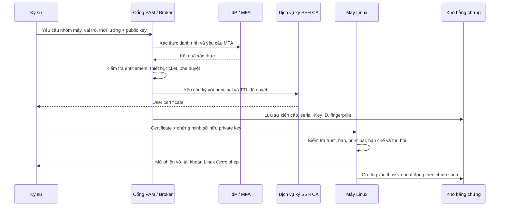

# SSH certificate

## 1. Vì sao SSH certificate hữu ích cho quản lý truy cập đặc quyền?

Giả sử đội vận hành có 40 kỹ sư và 300 máy Linux. Nếu mỗi máy lưu public key của từng người trong `authorized_keys`, việc thêm người, đổi nhiệm vụ hoặc thu hồi quyền sẽ trở thành bài toán phân phối hàng nghìn quan hệ tin cậy. Một key bị bỏ quên trên máy ít được quản lý vẫn có thể mở đường vào hệ thống sau khi chủ sở hữu đã rời đội.

SSH certificate thay đổi cách biểu diễn quan hệ đó: máy đích tin một cơ quan cấp chứng chỉ, còn người dùng nhận chứng chỉ có thời hạn cho public key của mình. Trong hệ thống quản lý truy cập đặc quyền, gọi tắt là PAM, dịch vụ cấp chứng chỉ có thể đứng sau SSO, MFA, phê duyệt và chính sách truy cập đúng lúc, tức JIT.

Ví dụ, Linh cần sửa lỗi trên nhóm máy ứng dụng production. Sau khi được duyệt, Linh nhận chứng chỉ dùng trong khoảng 15 phút, chỉ mang principal `prod-linux-ops`. Máy thuộc nhóm khác không chấp nhận principal đó. Linh đăng nhập bằng tài khoản cá nhân; quyền chạy lệnh quản trị tiếp tục được kiểm soát bằng `sudo` hoặc cơ chế phân quyền trên máy đích.

Mục tiêu của bài là thiết kế được luồng cấp, sử dụng và thu hồi SSH certificate, đồng thời nhận ra phần việc mà chứng chỉ không tự thực hiện: tạo tài khoản Linux, duyệt yêu cầu, giới hạn thời lượng phiên, ghi hình phiên hoặc kiểm soát mọi lệnh sau đăng nhập.

Trong chương này, PAM chỉ lĩnh vực **Privileged Access Management**. Linux còn có **Pluggable Authentication Modules**, cũng viết tắt là PAM; đây là cơ chế tích hợp xác thực, kiểm tra tài khoản và quản lý phiên của hệ điều hành. Hai khái niệm có liên quan khi triển khai nhưng không đồng nghĩa.

## 2. Các thành phần phải phân biệt

### 2.1. Key của người dùng và chứng chỉ của key

Một cặp key của Linh gồm private key và public key. Private key ở thiết bị của Linh, dùng để chứng minh quyền sở hữu key khi kết nối. Dịch vụ cấp chứng chỉ chỉ cần public key để ký; không có lý do thông thường nào để yêu cầu Linh gửi private key.

Chứng chỉ chứa public key cùng các thuộc tính được CA ký. Có chứng chỉ mà không có private key tương ứng chưa đủ để đăng nhập. Ngược lại, có private key nhưng không có chứng chỉ hợp lệ cũng không đủ nếu máy đích chỉ chấp nhận luồng chứng chỉ.

Không nên coi certificate như mật khẩu bí mật phải giấu bằng mọi giá. Tuy nhiên, nội dung của nó có thể tiết lộ principal, định danh yêu cầu và cấu trúc môi trường. Hãy kiểm soát việc chia sẻ và ghi log phù hợp; tuyệt đối không ghi private key vào ticket, repository hoặc log.

### 2.2. SSH CA

CA, tức Certification Authority, có một cặp key dùng để ký và xác minh chứng chỉ. Private key CA có khả năng phát hành danh tính được cả một tập máy tin cậy; mức độ bảo vệ phải cao hơn nhiều so với key của một người dùng.

Public key CA được phân phối tới bên cần xác minh. Với user certificate, bên xác minh là SSH server. Với host certificate, bên xác minh là SSH client. Việc cài public key CA ban đầu phải đi qua kênh quản lý cấu hình đáng tin cậy, có kiểm tra fingerprint và quyền thay đổi rõ ràng.

OpenSSH sử dụng định dạng certificate riêng, không phải X.509. Không thể lấy chứng chỉ HTTPS thông thường rồi đặt vào cấu hình SSH như một chứng chỉ tương đương. Cấu trúc user certificate, host certificate và các tham số ký được mô tả trong [tài liệu chính thức `ssh-keygen`](https://man.openbsd.org/ssh-keygen).

### 2.3. User certificate và host certificate

| Thành phần | User certificate | Host certificate |
|---|---|---|
| Câu hỏi được giải quyết | Ai đang xin đăng nhập? | Client đang kết nối đúng máy chủ nào? |
| Public key được ký | Key của người dùng hoặc workload | Host key của SSH server |
| Bên cần tin CA | SSH server | SSH client |
| Principal thường dùng | Tên người dùng hoặc vai trò được ánh xạ | Tên DNS của máy đích |
| Cấu hình liên quan | `TrustedUserCAKeys`, `AuthorizedPrincipalsFile` | `HostCertificate`, dòng `@cert-authority` trong known hosts |

Nên dùng CA riêng cho người dùng và máy chủ, đồng thời cân nhắc tách production với môi trường thử nghiệm. Cách tách này làm rõ trách nhiệm và giảm phạm vi ảnh hưởng nếu một dịch vụ ký bị xâm phạm. Đây là lựa chọn kiến trúc; phải triển khai việc tách trust thực tế, không chỉ đặt hai tên CA khác nhau nhưng dùng chung private key.

## 3. Một chứng chỉ cần mang những thông tin gì?

Khi đọc một certificate, cần kiểm tra cả nội dung định danh lẫn giới hạn sử dụng.

| Thuộc tính | Ý nghĩa trong vận hành | Quyết định cần quản lý |
|---|---|---|
| Public key được chứng nhận | Gắn chứng chỉ với key dùng trong phiên | Key thuộc thiết bị hoặc workload nào? |
| Signing CA | Nguồn phát hành | CA này được phép cấp cho môi trường nào? |
| Loại chứng chỉ | User hoặc host | Có đúng mục đích sử dụng không? |
| Key ID | Chuỗi định danh do bên cấp đặt | Tra ngược được người, yêu cầu và lần cấp không? |
| Serial | Số định danh chứng chỉ trong phạm vi CA | Có tránh trùng và phục vụ thu hồi chọn lọc không? |
| Principals | Danh tính hoặc vai trò mà chứng chỉ công bố | Có chính xác và đủ hẹp không? |
| Valid after / valid before | Cửa sổ chấp nhận xác thực | Có phù hợp thời lượng nhiệm vụ và sai lệch đồng hồ không? |
| Critical options | Điều kiện bắt buộc khi sử dụng | Có giới hạn nguồn kết nối hoặc lệnh không? |
| Extensions | Các khả năng phiên được cho phép | Có cần PTY, forwarding hay chạy user rc không? |

Key ID và comment của public key là hai thứ khác nhau. Key ID nằm trong dữ liệu được CA ký; comment của file key thường chỉ hỗ trợ người vận hành. Dù vậy, Key ID cũng không tự chứng minh một người đã vượt MFA: giá trị của nó phụ thuộc quy trình phát hành và log được bảo vệ.

Ví dụ quy ước nội bộ:

```text
Key ID: employee-1842:req-7f91:prod-ops
Serial: 1042
Principal: prod-linux-ops
Target scope trong yêu cầu: nhóm app-prod
```

Không nhét token SSO, mật khẩu, nội dung sự cố nhạy cảm hoặc thông tin cá nhân không cần thiết vào Key ID. Dùng mã tham chiếu để tra sang kho bằng chứng có phân quyền.

## 4. Luồng JIT từ yêu cầu đến máy Linux



Máy đích thường xác minh chữ ký và các điều kiện bằng dữ liệu đã có tại máy. Nó không nhất thiết hỏi broker hoặc IdP ở mỗi lần đăng nhập. Nhờ đó, chứng chỉ còn hiệu lực có thể tiếp tục dùng khi dịch vụ cấp tạm ngừng; đổi lại, thay đổi quyền trong IdP không tự truyền tức thời tới mọi máy.

Để luồng này đáng tin, broker phải tự quyết định principal và thời hạn dựa trên chính sách. Một API nhận tùy ý `principal=root` hoặc TTL từ client rồi ký nguyên trạng sẽ biến CA thành công cụ nâng quyền.

Mỗi yêu cầu cấp nên gắn ít nhất với danh tính đã xác thực, public key fingerprint, nhóm máy, vai trò, thời lượng, kết quả phê duyệt và phiên bản chính sách. Khi phát hành lại, hệ thống cần đánh giá quyền lại theo yêu cầu vận hành, thay vì gia hạn vô hạn từ một token cũ.

## 5. Principal không phải danh sách máy đích

Đây là ranh giới dễ thiết kế sai nhất. Trong user certificate, principal là tên được máy đích đối chiếu khi quyết định cho phép đăng nhập. Nó không mặc nhiên là điều kiện ràng buộc vào một hostname cụ thể.

Giả sử cả `app01` và `db01` đều tin cùng user CA, đồng thời cho phép principal `prod-admin`. Chứng chỉ có principal đó có thể dùng ở cả hai máy nếu các điều kiện còn lại thỏa mãn. Việc ticket ghi riêng `app01` không khiến `db01` tự biết và từ chối.

Để phạm vi thực sự khớp yêu cầu:

1. Định nghĩa principal có ý nghĩa và đủ hẹp, chẳng hạn `prod-app-ops` và `prod-db-readonly`.
2. Chỉ cấu hình máy thuộc đúng nhóm chấp nhận principal tương ứng.
3. Tách CA hoặc trust domain khi cần ranh giới mạnh hơn giữa các môi trường.
4. Kết hợp broker, bastion, mạng và kiểm tra quyền động nếu cần kiểm soát tới từng tài nguyên.
5. Kiểm thử truy cập trái phạm vi, không chỉ kiểm thử máy được phép.

Trong mô hình dùng `TrustedUserCAKeys`, nếu không cấu hình nguồn principal riêng, tên tài khoản đăng nhập cần xuất hiện trong danh sách principal. Khi dùng `AuthorizedPrincipalsFile`, principal trong chứng chỉ phải khớp một mục được cho phép cho tài khoản đích. Cơ chế này không tự tạo tài khoản Linux. Quy tắc ánh xạ và phạm vi áp dụng được mô tả trong [tài liệu `sshd_config`](https://man.openbsd.org/sshd_config).

Một role principal có thể phục vụ nhiều người nếu mỗi người đăng nhập tài khoản cá nhân và có bằng chứng phát hành riêng. Nếu mọi người đăng nhập chung `ops`, việc quy trách nhiệm sẽ phụ thuộc mạnh hơn vào liên kết serial, Key ID, broker và log phiên. Với máy nhạy cảm, ưu tiên tài khoản cá nhân hoặc một cơ chế ánh xạ danh tính được kiểm soát và kiểm toán rõ ràng.

## 6. Thực hành cấp user certificate trong lab

Các lệnh sau minh họa trên các vai trò máy riêng biệt. Chúng không phải một script chạy từ đầu đến cuối trên production. Thuật toán, đường dẫn, dịch vụ và chính sách mật mã phải phù hợp bản OpenSSH của môi trường. Dùng tài khoản và máy thử nghiệm; chuẩn bị kênh quản trị dự phòng trước khi thay đổi xác thực SSH.

### 6.1. Trên thiết bị của Linh: tạo key

```bash
ssh-keygen -t ed25519 -f ~/.ssh/id_ed25519_pam -C 'linh-device-lab'
```

Đặt passphrase khi được hỏi. Không chạy lại vào đường dẫn đã có key nếu chưa xử lý việc bảo toàn key cũ. Ed25519 là lựa chọn minh họa; môi trường có yêu cầu tương thích hoặc chính sách mật mã khác cần chọn loại key được phê duyệt.

Hai file có vai trò khác nhau:

```text
~/.ssh/id_ed25519_pam       private key, giữ trên thiết bị
~/.ssh/id_ed25519_pam.pub   public key, gửi tới broker để xin ký
```

Kiểm tra fingerprint public key trước khi liên kết với yêu cầu:

```bash
ssh-keygen -lf ~/.ssh/id_ed25519_pam.pub
```

Việc broker kiểm tra người dùng và việc thiết bị giữ private key là hai lớp khác nhau. Endpoint bị chiếm quyền vẫn có thể sử dụng key trong thời gian cho phép; TTL ngắn không thay thế quản lý thiết bị, passphrase hoặc key được bảo vệ bằng phần cứng.

### 6.2. Trên máy ký lab: tạo CA riêng cho bài thực hành

```bash
ssh-keygen -t ed25519 -f ./lab_user_ca -C 'lab-user-ca'
```

Đặt passphrase cho private key CA. Chỉ public key `lab_user_ca.pub` được đưa tới máy Linux đích. Private key `lab_user_ca` ở lại vùng ký.

Trong production, tránh giao private key CA cho từng người duyệt yêu cầu hoặc từng máy đích. Dịch vụ ký cần quyền tối thiểu, giới hạn API, tách người quản lý chính sách với người quản lý key và có log phát hành độc lập. Nếu sử dụng HSM hoặc token, kiểm tra hỗ trợ thực tế của dịch vụ ký, thư viện và thuật toán; không coi việc đặt tên thư mục là `secure` như một biện pháp bảo vệ key.

### 6.3. Ký public key đã được duyệt

Giả sử public key nhận từ Linh được lưu trên máy ký lab tại `./requests/linh_pam.pub`. CA phát hành một chứng chỉ cho principal `prod-linux-ops`:

```bash
ssh-keygen -s ./lab_user_ca \
  -I 'employee-1842:req-7f91:prod-ops' \
  -z 1042 \
  -n prod-linux-ops \
  -V -1m:+15m \
  -O clear \
  -O permit-pty \
  -O source-address=10.20.0.0/24 \
  ./requests/linh_pam.pub
```

Chứng chỉ được tạo ở `./requests/linh_pam-cert.pub`. Chuyển file này về thiết bị của Linh qua kênh được kiểm soát và lưu thành `~/.ssh/id_ed25519_pam-cert.pub`.

Trong ví dụ, `-I` đặt Key ID, `-z` đặt serial, `-n` đặt principal, `-V` đặt cửa sổ hiệu lực. Mốc bắt đầu lùi một phút để minh họa dung sai đồng hồ; vì vậy toàn cửa sổ dài khoảng 16 phút, không phải đúng 15 phút. `clear` rồi `permit-pty` mở lại PTY nhưng không cấp các forwarding mặc định. `source-address` phải khớp nguồn kết nối mà máy đích thực sự nhìn thấy, kể cả khi đi qua NAT hoặc bastion. Cú pháp các tùy chọn nằm trong [hướng dẫn ký certificate của OpenSSH](https://man.openbsd.org/ssh-keygen#CERTIFICATES).

Các giá trị principal, serial và Key ID ở đây chỉ phục vụ lab. Dịch vụ cấp thực tế phải sinh serial có kiểm soát và không tin trực tiếp các giá trị do client gửi lên.

### 6.4. Đọc chứng chỉ trước khi sử dụng

```bash
ssh-keygen -L -f ~/.ssh/id_ed25519_pam-cert.pub
```

Đối chiếu với yêu cầu đã duyệt:

- Có đúng user certificate và đúng CA fingerprint không?
- Public key có tương ứng với yêu cầu của thiết bị không?
- Key ID, serial, principal và cửa sổ hiệu lực có khớp không?
- Có đúng giới hạn nguồn kết nối và tập extension dự kiến không?

Đọc được nội dung certificate mới chỉ là kiểm tra cấu trúc và thông tin hiển thị. Kết quả đó không chứng minh máy đích tin CA, principal được cấp cho tài khoản đích hay chứng chỉ chưa bị thu hồi. Các điều kiện này cần kiểm thử tại phía xác minh.

## 7. Cấu hình máy Linux đích

### 7.1. Chuẩn bị trust và principal mapping

Giả sử tài khoản Linux `linh` đã tồn tại qua quy trình cấp tài khoản của tổ chức. Nhóm quản trị cấu hình cung cấp hai file do root quản lý:

```text
/etc/ssh/pam_user_ca.pub
    Nội dung public key của lab_user_ca, đã xác minh fingerprint

/etc/ssh/auth_principals/linh
    prod-linux-ops
```

Trong file `linh`, nội dung thực chỉ là dòng principal, không bao gồm phần mô tả hoặc thụt lề ở ví dụ trên. File và thư mục cha không được cho người dùng thường sửa. Nếu Linh có thể tự thêm principal vào mapping của mình, ranh giới giữa phê duyệt và sử dụng quyền đã bị phá vỡ.

Một đoạn cấu hình SSH server dành cho lab:

```text
PubkeyAuthentication yes
TrustedUserCAKeys /etc/ssh/pam_user_ca.pub
AuthorizedPrincipalsFile /etc/ssh/auth_principals/%u
PermitRootLogin no
AllowAgentForwarding no
AllowTcpForwarding no
AllowStreamLocalForwarding no
X11Forwarding no
LogLevel VERBOSE
```

`%u` được thay bằng tên tài khoản đăng nhập ở máy đích. Với `linh@app01`, server tra mapping của `linh`; file cho một tài khoản khác không tự áp dụng cho Linh.

Đoạn trên thêm một cách xác thực; nó chưa loại bỏ mọi cách cũ. Nếu `authorized_keys`, password hoặc một lệnh tra public key khác vẫn được chấp nhận, người dùng có thể đi theo đường đó mà không cần certificate. Cần kiểm kê cả cấu hình chính, `Include`, các khối `Match` và các nguồn key động trước khi tuyên bố đã bắt buộc JIT.

### 7.2. Chuyển sang certificate-only khi đã kiểm thử

Với phạm vi lab được thiết kế chỉ dùng certificate, có thể cân nhắc thêm:

```text
AuthorizedKeysFile none
AuthorizedKeysCommand none
PasswordAuthentication no
KbdInteractiveAuthentication no
AuthenticationMethods publickey
```

Đây là một chính sách ví dụ, không phải tập mặc định áp dụng cho mọi tổ chức. Nếu yêu cầu MFA được thực hiện ngay trên SSH server qua keyboard-interactive, việc tắt cơ chế đó sẽ mâu thuẫn với thiết kế. Trong luồng của bài, MFA được kiểm tra lúc cấp certificate; SSH server nhận certificate không đồng nghĩa tự yêu cầu MFA lại cho từng phiên.

Trên Linux, cấu hình `UsePAM` phải phù hợp chính sách tài khoản và phiên của bản phân phối. Public-key authentication có thể đi cùng các bước PAM account/session; không tắt toàn bộ PAM chỉ vì đã chuyển sang certificate. Đồng thời, kiểm tra những cơ chế xác thực bổ sung đang được bật để bảo đảm cấu hình hiệu lực đúng thiết kế.

Đừng đóng đường truy cập quản trị hiện tại trước khi xác nhận có kết nối mới thành công. Quy trình chuyển đổi nên giữ một phiên kiểm soát và kênh console dự phòng, rồi mới thu hẹp đường cũ theo kế hoạch.

### 7.3. Kiểm tra cấu hình trước khi reload

```bash
sudo /usr/sbin/sshd -t
sudo /usr/sbin/sshd -T -C user=linh,host=client.lab.internal,addr=10.20.0.25
```

Lệnh đầu kiểm tra cấu hình; lệnh sau giúp xem cấu hình hiệu lực theo điều kiện kết nối mẫu. Đường dẫn binary có thể khác trên bản phân phối. Trường `host` trong thông tin thử là phía client dùng cho đánh giá điều kiện, không phải cách gắn certificate vào hostname của server.

Chỉ reload sau khi kiểm tra thành công. Dịch vụ có thể tên `sshd` hoặc `ssh`; dùng tên thực tế của hệ thống. File trong `sshd_config.d` chỉ có tác dụng nếu cấu hình chính đã include nó. Không suy luận hiệu lực chỉ từ việc một file có tồn tại.

## 8. Kết nối bằng certificate

Trên thiết bị Linh, cấu hình client riêng cho máy lab:

```text
Host app01-pam-lab
    HostName app01.prod.example.internal
    User linh
    IdentityFile ~/.ssh/id_ed25519_pam
    CertificateFile ~/.ssh/id_ed25519_pam-cert.pub
    IdentitiesOnly yes
    ForwardAgent no
    StrictHostKeyChecking yes
    ControlMaster no
    ControlPath none
```

Kết nối:

```bash
ssh app01-pam-lab
```

`IdentityFile` chỉ tới private key; `CertificateFile` chỉ tới certificate tương ứng. `IdentitiesOnly` giúp giới hạn các danh tính client đưa ra theo cấu hình, đặc biệt khi agent có nhiều key. Ý nghĩa các lựa chọn client được nêu trong [tài liệu `ssh_config`](https://man.openbsd.org/ssh_config).

Trước khi kết nối với `StrictHostKeyChecking yes`, client phải có trust host phù hợp qua host key được phân phối trước hoặc host CA. Không xử lý lỗi kiểm tra host bằng cách tắt kiểm tra; certificate của người dùng không chứng minh danh tính máy đích.

Hai tùy chọn `ControlMaster no` và `ControlPath none` được dùng ở đây để bài kiểm thử tạo kết nối xác thực mới. Nếu dùng connection multiplexing, một lệnh SSH mới có thể mở thêm channel trên kết nối đã xác thực trước đó. Khi kiểm thử hết hạn hoặc thu hồi, việc vô tình tái sử dụng kết nối sẽ làm kết quả khó diễn giải.

Chứng chỉ trong ví dụ chỉ cấp PTY, không cấp agent hoặc port forwarding. Điều đó không biến một shell thành sandbox. Người dùng vẫn có thể thực hiện những hành động mà tài khoản Linux, mạng và các chương trình trên máy cho phép. Muốn chỉ chạy một tác vụ, cần thiết kế command wrapper hoặc cơ chế thực thi riêng và kiểm tra các đường thoát của chính tác vụ đó.

## 9. SSH certificate và quyền quản trị sau đăng nhập

Một lần xác thực SSH thành công chỉ đưa Linh vào ngữ cảnh tài khoản Linux được cho phép. Nó không tự cấp quyền root hoặc quyền `sudo`, cũng không tự giới hạn các quyền đã có của tài khoản.

Ví dụ yêu cầu thực tế là xem trạng thái và khởi động lại một dịch vụ ứng dụng. Thiết kế cần tách các quyết định:

| Quyết định | Nơi thực thi trong mô hình ví dụ |
|---|---|
| Linh còn là thành viên đội vận hành không? | IdP và broker lúc xét cấp |
| Yêu cầu có ticket và thời hạn được duyệt không? | Cổng PAM và policy engine |
| Key này được dùng vào nhóm máy ứng dụng không? | CA phát principal, máy đích kiểm tra mapping |
| Linh đăng nhập dưới tài khoản nào? | Tài khoản Linux và cấu hình SSH server |
| Linh được thực hiện hành động quản trị nào? | `sudo`, wrapper, quyền file và dịch vụ trên máy |
| Ai đã làm gì trong phiên? | Log xác thực, log thực thi và cơ chế ghi phiên |
| Khi yêu cầu kết thúc, phiên có bị đóng không? | Broker hoặc công cụ điều khiển vòng đời phiên |

Đặc biệt, nếu tài khoản `linh` vẫn nằm trong nhóm có `sudo` không giới hạn, một certificate phạm vi hẹp không tự biến quyền đó thành quyền tối thiểu. Phải quản lý cả entitlement trên máy và khả năng sử dụng các tài khoản khác.

Không cấp principal `root` như một cách thuận tiện để sửa nhanh chính sách. Quyền đăng nhập trực tiếp root làm giảm khả năng tách danh tính và hành động nâng quyền; nếu có tình huống break-glass, hãy dùng một quy trình riêng, có kiểm soát, cảnh báo và bằng chứng.

## 10. Hết hạn và thu hồi là hai cơ chế khác nhau

### 10.1. Hết hạn giới hạn lần xác thực mới

Certificate hết hạn sẽ không còn được chấp nhận cho xác thực mới nếu máy xác minh có đồng hồ đúng. Nhưng phiên đã xác thực thường không tự bị đóng chỉ vì certificate vừa qua mốc `valid before`.

Ví dụ:

```text
10:00  Certificate được cấp, hết hạn lúc 10:15
10:14  Linh đăng nhập và mở shell
10:16  Một kết nối xác thực mới bằng certificate bị từ chối
10:16  Shell mở từ 10:14 có thể vẫn hoạt động
```

Nếu chính sách yêu cầu quyền kết thúc lúc 10:15, cần thêm cơ chế quản lý phiên và tiến trình. Đừng lấy idle timeout làm bằng chứng giới hạn thời lượng tuyệt đối: người dùng đang hoạt động có thể không bị timeout nhàn rỗi. Đồng thời phải xem xét connection multiplexing, tác vụ chạy nền và phiên nâng quyền đã được tạo.

### 10.2. Thu hồi trước khi hết hạn

Khi thiết bị bị mất, việc ngừng cấp certificate mới chỉ chặn lần cấp tiếp theo. Certificate đã phát hành có thể còn được dùng trong cửa sổ hiệu lực. Phương án xử lý cần kết hợp tùy tình huống:

- Thu hồi certificate cụ thể hoặc key bị lộ.
- Cập nhật mapping hay quyền truy cập trên nhóm máy bị ảnh hưởng.
- Đóng phiên đang hoạt động bằng công cụ điều phối đã được kiểm chứng.
- Xử lý endpoint, token IdP và nguyên nhân phát hành sai.

Chọn phạm vi thu hồi đúng với sự cố. Thu hồi serial của một certificate khác với thu hồi key người dùng; thu hồi cả CA sẽ có phạm vi ảnh hưởng lớn hơn nhiều. Không thu hồi một certificate rồi mặc nhiên kết luận mọi certificate khác của cùng người đã bị chặn.

### 10.3. Minh họa KRL cho một serial

OpenSSH có Key Revocation List, gọi tắt là KRL. Trong ví dụ lab, trên máy quản lý thu hồi, nội dung file `revoke-spec.txt` là:

```text
serial: 1042
```

Tạo KRL gắn với public key CA đã cấp certificate:

```bash
ssh-keygen -k -f ./revoked_keys.next.krl \
  -s ./lab_user_ca.pub ./revoke-spec.txt

ssh-keygen -Q -f ./revoked_keys.next.krl ./requests/linh_pam-cert.pub
```

Ví dụ này tạo KRL mới trong lab. Với hệ thống đã có danh sách thu hồi, phải bảo toàn các mục cũ khi xây dựng phiên bản tiếp theo. Không thay danh sách toàn hệ thống bằng một KRL chỉ chứa sự cố mới nhất.

Phân phối bản đã kiểm tra tới máy đích và cấu hình:

```text
RevokedKeys /etc/ssh/revoked_keys.krl
```

Thay file theo cách nguyên tử, kiểm tra owner, quyền đọc và kiểm thử bằng cả certificate bị thu hồi lẫn certificate hợp lệ khác. File thu hồi không đọc được có thể khiến public-key authentication bị từ chối rộng hơn dự kiến; hành vi này được ghi trong [tài liệu `RevokedKeys`](https://man.openbsd.org/sshd_config#RevokedKeys).

KRL không phải OCSP và không tự đồng bộ qua mạng. Thời gian thu hồi có hiệu lực trên toàn bộ tập máy phụ thuộc tốc độ phân phối, máy bị mất kết nối và đường truy cập còn tồn tại. Theo dõi được phiên bản KRL thực tế ở từng máy là một phần của vận hành, không chỉ là ghi nhận lệnh tạo KRL đã chạy thành công.

## 11. Host certificate: xác minh máy chủ ở chiều ngược lại

User certificate không thay thế xác minh máy chủ. Một triển khai hoàn chỉnh có thể dùng host certificate để client tin máy chủ thông qua host CA được quản lý.

Trên dịch vụ ký host CA, một ví dụ minh họa là:

```bash
ssh-keygen -s ./lab_host_ca \
  -I 'host-app01:req-host-205' \
  -h \
  -z 205 \
  -n app01.prod.example.internal \
  -V -1m:+24h \
  ./hostkeys/app01_ed25519.pub
```

`lab_host_ca` ở đây là CA riêng; public key đầu vào phải được liên kết với đúng máy qua quy trình enrollment. Không ký một public key bất kỳ chỉ vì bên gửi tự nhận hostname `app01`.

Máy đích giữ private host key tương ứng và được cấu hình đường dẫn certificate:

```text
HostKey /etc/ssh/ssh_host_ed25519_key
HostCertificate /etc/ssh/ssh_host_ed25519_key-cert.pub
```

Client nhận một dòng trust trong known hosts với cấu trúc minh họa:

```text
@cert-authority *.prod.example.internal <PUBLIC_KEY_CUA_HOST_CA_DA_XAC_MINH>
```

Phần trong dấu nhọn là chỗ thay thế bằng toàn bộ public key thật, gồm loại key và dữ liệu key; không chép nguyên placeholder vào cấu hình.

Phạm vi tên trong known hosts và principal của host certificate đều phải phù hợp tên client dùng để xác minh. Kết nối qua IP, alias hoặc cấu hình `HostKeyAlias` cần được thiết kế và kiểm thử riêng. Một CA được tin cho dải tên quá rộng sẽ làm tăng phạm vi ảnh hưởng nếu nó ký sai hoặc bị lộ.

## 12. Bảo vệ CA và dịch vụ phát hành

CA tập trung làm việc quản lý trust dễ hơn, nhưng cũng tập trung khả năng phát hành quyền. Hãy phân tích ít nhất ba tình huống khác nhau:

| Sự cố | Hệ quả cần xét | Hành động chính |
|---|---|---|
| Key thiết bị của một kỹ sư bị lộ | Certificate đang còn hiệu lực và các phiên liên quan | Ngừng cấp, thu hồi theo phạm vi, đóng phiên và xử lý thiết bị |
| Broker áp dụng sai policy | Nhiều chứng chỉ được cấp hợp lệ về chữ ký nhưng sai quyền | Dừng đường cấp lỗi, xác định tập serial, sửa policy và xử lý các phiên |
| Private key CA bị lộ | Kẻ tấn công có thể tự ký chứng chỉ ngoài log phát hành chính thống | Thiết lập trust mới, loại bỏ CA cũ khỏi phạm vi ảnh hưởng và điều tra toàn bộ đường sử dụng |

Khi CA bị lộ, chỉ tra log của dịch vụ ký là chưa đủ: certificate giả mạo có thể được ký ở nơi khác. Cần đối chiếu log xác thực phía máy đích, danh tính được dùng và thời gian bắt đầu nghi ngờ.

Quy trình xoay vòng CA có kế hoạch thường phân phối public key CA mới trước, chuyển dịch vụ cấp sang CA mới, xác nhận tỷ lệ sử dụng và loại CA cũ sau cửa sổ chuyển đổi được phê duyệt. Không áp dụng cửa sổ chồng lấn dài như một mặc định cho sự cố lộ key; khi đó cần ưu tiên cắt trust bị xâm phạm theo kế hoạch ứng phó.

Backup CA, quyền truy cập khôi phục và đường break-glass cũng phải được kiểm toán. Nếu mỗi quản trị viên giữ một bản CA trong laptop để dự phòng, toàn bộ thiết kế tập trung đã mất ranh giới bảo vệ quan trọng.

## 13. Log và bằng chứng cần liên kết được

Một bản ghi “đã cấp certificate” không chứng minh người dùng đã đăng nhập, và bản ghi “đăng nhập thành công” không chứng minh mọi lệnh trong phiên đã được ghi lại. Bằng chứng cần nối được các giai đoạn của cùng yêu cầu.

| Giai đoạn | Dữ liệu nên thu thập |
|---|---|
| Yêu cầu | Mã yêu cầu, danh tính ổn định, lý do, nhóm máy, vai trò, khoảng thời gian |
| Phê duyệt | Người hoặc policy duyệt, kết quả MFA, ngữ cảnh thiết bị, phiên bản chính sách |
| Phát hành | CA fingerprint, serial, Key ID, public key fingerprint, principals, thời hạn, options |
| Xác thực | Máy đích, tài khoản Linux, IP nguồn, thời điểm, kết quả và dữ liệu certificate có trong log |
| Thực thi | Sự kiện `sudo`, log dịch vụ, audit hoặc bản ghi phiên theo yêu cầu |
| Kết thúc / thu hồi | Thời điểm đóng phiên, lý do thu hồi, phiên bản KRL và mức phủ phân phối |

`LogLevel VERBOSE` là cấu hình phục vụ quan sát trong ví dụ; trường cụ thể và vị trí log phụ thuộc phiên bản, bản phân phối và hệ thống thu thập. Kiểm tra log thật trong lab trước khi thiết kế quy tắc tương quan. Không giả định sshd mặc định ghi toàn bộ câu lệnh tương tác.

Kho bằng chứng cần kiểm soát người sửa/xóa và đồng bộ thời gian. Dùng serial cùng CA fingerprint để phân biệt chứng chỉ; không coi serial đơn lẻ là định danh toàn cục. Nếu đổi CA mà bắt đầu lại bộ đếm, hai chứng chỉ có thể có cùng serial nhưng thuộc hai phạm vi CA khác nhau.

## 14. Kiểm thử chấp nhận và tình huống từ chối

Mỗi lần kiểm thử xác thực nên dùng kết nối mới, tránh multiplexing, đồng thời lưu log client và server phù hợp. Kết quả đạt không chỉ là thấy một shell mở ra mà còn phải biết phương thức nào đã được chấp nhận.

| Ca kiểm thử | Kỳ vọng | Điều cần loại trừ |
|---|---|---|
| CA đúng, principal đúng, còn hạn, đúng nguồn | Đăng nhập tài khoản được cấp | Không âm thầm dùng key tĩnh hoặc mật khẩu |
| Certificate do CA không được tin ký | Bị từ chối | Không thêm CA lạ để làm bài test đi qua |
| Principal không nằm trong mapping tài khoản | Bị từ chối | Không dùng chung mapping quá rộng |
| Chứng chỉ chưa tới hạn hoặc đã hết hạn | Xác thực mới bị từ chối | Đồng hồ lệch hoặc tái sử dụng kết nối cũ |
| Certificate hợp lệ nhưng private key không tương ứng | Bị từ chối | Agent vô tình cung cấp key đúng khác |
| Nguồn kết nối ngoài CIDR cho phép | Bị từ chối | Nhầm IP thiết bị với IP mà server nhìn thấy |
| Serial bị đưa vào KRL tại máy đích | Xác thực mới bị từ chối | KRL chưa được phân phối hoặc chọn sai CA |
| Chỉ có public key thô, không có certificate | Bị từ chối trong phạm vi certificate-only | `authorized_keys` hoặc command lookup vẫn mở |
| Certificate bị thu hồi nhưng phiên cũ còn mở | Ghi nhận đúng hành vi, xử lý bằng quản lý phiên | Nhầm thu hồi xác thực với đóng phiên |
| Thử agent hoặc port forwarding khi không được cấp | Yêu cầu bị chặn | Nhầm việc shell mở được với forwarding được phép |

Với mỗi lần từ chối, cần xác nhận đúng nguyên nhân. Chẳng hạn certificate hết hạn nhưng kết nối cũng bị firewall chặn thì chưa đủ chứng minh cơ chế hết hạn hoạt động.

Các kiểm thử quyền quản trị sau đăng nhập cũng cần độc lập: thử tác vụ được duyệt và tác vụ ngoài phạm vi dưới cùng tài khoản. Việc certificate đúng không miễn kiểm tra `sudo`, quyền file hoặc quyền truy cập dịch vụ nội bộ.

## 15. Chẩn đoán lỗi theo từng lớp

### 15.1. Client không đưa certificate dự kiến

Kiểm tra file certificate và cấu hình client hiệu lực:

```bash
ssh-keygen -L -f ~/.ssh/id_ed25519_pam-cert.pub
ssh -G app01-pam-lab
ssh -vvv app01-pam-lab
```

Xem client chọn `IdentityFile`, `CertificateFile`, user và hostname nào. Nếu agent có nhiều key, cấu hình rõ danh tính của bài kiểm thử. Dữ liệu debug có thể chứa tên máy, người dùng, đường dẫn và metadata certificate; chỉ chia sẻ phần cần thiết sau khi xử lý thông tin nhạy cảm.

### 15.2. Server không chấp nhận certificate

Đi theo thứ tự để tránh sửa nhầm trust:

1. Xác nhận client tới đúng máy, đúng cổng và đúng tài khoản.
2. Đối chiếu signing CA fingerprint với trust được triển khai trên máy đó.
3. Kiểm tra loại certificate, hạn và đồng hồ của bên xác minh.
4. Đối chiếu principal với mapping thực tế cho tài khoản đích.
5. Kiểm tra điều kiện nguồn, critical options, chính sách thuật toán và KRL.
6. Kiểm tra tài khoản Linux, shell, quyền file, chính sách PAM account và các giới hạn truy cập khác.
7. Đọc cấu hình hiệu lực và log server thay vì chỉ sửa file cấu hình được cho là đang dùng.

Đừng “khắc phục” bằng cách thêm `root`, bỏ giới hạn nguồn hoặc cấp mọi principal vào tất cả tài khoản. Mỗi thay đổi như vậy có thể che mất nguyên nhân và tạo quyền ngoài yêu cầu.

### 15.3. SSH thành công nhưng tác vụ quản trị thất bại

Đây có thể là hành vi đúng của least privilege. Kiểm tra quyền thực thi tác vụ, tài khoản, nhóm, policy `sudo`, quyền tài nguyên và yêu cầu của ứng dụng. Đừng phát certificate rộng hơn trước khi xác định quyết định phân quyền nào thực sự từ chối thao tác.

### 15.4. Certificate mới hoạt động dù người dùng vừa bị khóa trong IdP

Xác minh xem đó là kết nối xác thực mới hay channel trên kết nối cũ. Sau đó kiểm tra certificate được phát trước hay sau thời điểm khóa, broker có dùng phiên SSO còn hiệu lực không và máy đích đã nhận biện pháp thu hồi nào.

Máy đích xác minh offline không tự biết trạng thái mới của IdP. Cần giải quyết bằng chính sách cấp/gia hạn và cơ chế thu hồi, không chỉ nhấn lại thao tác khóa người dùng.

## 16. Bài tập vận dụng

Một doanh nghiệp cho đội SRE truy cập 50 máy Linux production. Mỗi người có tài khoản cá nhân. Yêu cầu vận hành là truy cập theo ticket, thời lượng tối đa 20 phút, chỉ nhóm máy được duyệt và phải truy được hành động nâng quyền.

Hãy thiết kế và thử nghiệm trong lab:

1. Tạo hai nhóm máy `app-prod` và `db-prod`; xác định principal riêng cho từng nhóm.
2. Thiết kế yêu cầu cấp có public key fingerprint, danh tính, ticket và phê duyệt.
3. Quy định TTL, dung sai đồng hồ và cách từ chối yêu cầu vượt giới hạn.
4. Cấu hình mapping để certificate của `app-prod` không đăng nhập được `db-prod`.
5. Kiểm tra certificate-only bằng cách thử public key thô và phương thức cũ.
6. Thu hồi một serial; ghi nhận thời gian có hiệu lực ở từng máy đích.
7. Mở phiên trước khi certificate hết hạn; quan sát và đề xuất cơ chế bảo đảm giới hạn phiên 20 phút.
8. Liên kết ticket, sự kiện cấp, xác thực và một thao tác nâng quyền thành một chuỗi bằng chứng.

Một thiết kế đạt yêu cầu phải trả lời được ba câu hỏi vận hành: khi broker ngừng cấp thì ai còn vào được; khi một người bị thu hồi quyền thì mất bao lâu để chặn xác thực mới; và khi người đó đã có shell thì thành phần nào chịu trách nhiệm đóng phiên.

## 17. Những điểm cần ghi nhớ

- SSH certificate cho phép tập trung việc phát hành danh tính có thời hạn, giúp giảm phụ thuộc vào public key tĩnh được phân phối rải rác.
- Quyền truy cập có hiệu lực là giao điểm giữa trust CA, principal mapping, thời hạn, hạn chế certificate, cấu hình máy và trạng thái tài khoản.
- Principal của user certificate không tự giới hạn hostname; phạm vi tài nguyên phải được thực thi bởi thiết kế trust và authorization.
- Certificate hết hạn hoặc bị thu hồi chủ yếu tác động tới xác thực mới. Đóng phiên và dừng tác vụ đang chạy cần cơ chế riêng.
- MFA, phê duyệt, least privilege, bảo vệ CA và bằng chứng kiểm toán phải được ghép thành một quy trình; chúng không xuất hiện tự động chỉ vì SSH đã chấp nhận certificate.
