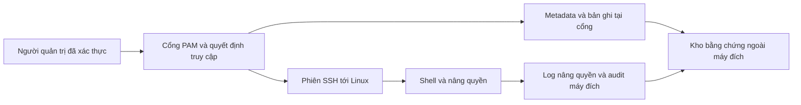

# Shell session recording

## 1. Ghi lại phiên shell để trả lời câu hỏi nào?

Trong quản trị Linux, quyền đặc biệt thường được sử dụng qua một phiên terminal: kỹ sư kết nối SSH, chuyển sang tài khoản đích bằng `sudo`, sửa cấu hình, kiểm tra dịch vụ rồi thoát. Khi có sự cố, một dòng ghi nhận đăng nhập thành công hoặc một bản lịch sử shell thường chưa đủ để biết người quản trị đã quan sát gì và thao tác nào xảy ra trong phiên.

**Shell session recording** là việc thu thập dữ liệu của phiên terminal để có thể xem lại diễn biến, thường bao gồm đầu ra hiển thị và thông tin thời gian; một số giải pháp còn thu đầu vào, sự kiện hoặc metadata liên quan. Trong module này, PAM là **Privileged Access Management — quản lý truy cập đặc quyền**. Cơ chế ghi phiên có thể tích hợp với nhiều thành phần Linux, nhưng không đồng nghĩa với bộ thư viện xác thực Linux cũng thường mang tên PAM.

Ghi phiên giúp điều tra và kiểm toán quyền quản trị bằng cách bổ sung ngữ cảnh: ai yêu cầu truy cập, ai phê duyệt, phiên đi tới tài sản nào, khi nào có nâng quyền và terminal hiển thị điều gì. Nó phải gắn với kiểm kê tài khoản, least privilege, JIT/JEA, vault, luân chuyển credential và ứng phó sự cố. Một kho video terminal lớn nhưng không xác định được danh tính con người hoặc tài khoản đích vẫn là bằng chứng khó sử dụng.

Sau bài học, người học cần có khả năng:

- Phân biệt dữ liệu ghi phiên với shell history, log xác thực và log thực thi.
- Chọn vị trí thu thập phù hợp với mức tin cậy của hệ thống Linux được quản trị.
- Thực hiện một lab ghi đầu ra terminal bằng `script` và phát lại bằng `scriptreplay`.
- Thiết kế liên kết danh tính, bảo vệ log, xử lý dữ liệu nhạy cảm và tình huống collector lỗi.
- Nêu rõ kết luận nào có thể và không thể rút ra từ một bản ghi phiên.

## 2. Một bản ghi terminal thực sự chứa gì?

### 2.1. Terminal không phải sổ lệnh

Phiên tương tác thường có pseudo-terminal, viết tắt là PTY. Chương trình shell và các ứng dụng phía trong đọc, ghi qua terminal này. Bộ ghi có thể quan sát luồng đầu ra, đầu vào và thời điểm tương ứng, tùy cách triển khai.

Khi người dùng gõ `id`, ký tự nhập có thể được terminal echo lại. Bộ ghi **đầu ra** vì thế có thể chứa dòng `id` dù không thu luồng đầu vào riêng. Tuy nhiên, điều đó không biến đầu ra thành danh sách lệnh đã thực thi hoàn chỉnh.

Những trường hợp dễ hiểu nhầm gồm:

- Người dùng sửa dòng lệnh trước khi nhấn Enter: hình ảnh terminal có thể có ký tự xóa hoặc di chuyển con trỏ.
- Một shell script chạy nhiều chương trình nhưng chỉ in vài dòng kết quả.
- Ứng dụng toàn màn hình cập nhật màn hình bằng escape sequence thay vì các dòng văn bản đơn giản.
- Chương trình không echo đầu vào, chẳng hạn lời nhắc mật khẩu.
- Người dùng chạy tác vụ nền hoặc khởi động dịch vụ tiếp tục hoạt động sau khi phiên kết thúc.

Do đó, cần phân biệt **dòng chữ xuất hiện trên terminal**, **dữ liệu người dùng nhập** và **sự kiện chương trình được thực thi**. Đây là ba góc quan sát khác nhau.

### 2.2. Các loại dữ liệu và giới hạn

| Nguồn | Cho biết chủ yếu | Không nên suy ra một mình |
|---|---|---|
| Shell history | Một phần dòng lệnh shell lưu lại | Đã thu đủ mọi thao tác, kết quả hoặc danh tính người thật |
| Log đăng nhập SSH | Sự kiện xác thực, mở và đóng kết nối theo cấu hình | Toàn bộ hoạt động bên trong shell |
| Log quyết định `sudo` | Yêu cầu hoặc lần thực thi nâng quyền được ghi nhận | Toàn bộ nội dung phiên nếu chưa bật cơ chế I/O tương ứng |
| Bản ghi terminal | Những luồng terminal được cấu hình thu thập và diễn biến thời gian | Mọi hoạt động trên máy, mọi lệnh nền hoặc mọi đường truyền file |
| Audit thực thi và hệ thống | Các sự kiện được luật audit chọn thu | Hình ảnh màn hình, toàn bộ đầu ra hoặc toàn bộ ngữ cảnh nghiệp vụ |
| Nhật ký ứng dụng, cơ sở dữ liệu, cloud | Hành động và kết quả ở lớp dịch vụ đích | Danh tính con người nếu ứng dụng chỉ thấy tài khoản dùng chung |

Một thiết kế tốt ghép các nguồn này bằng session ID, danh tính, tài sản và thời gian. Không dùng shell history làm phương án dự phòng tương đương khi hệ thống ghi phiên ngừng hoạt động.

### 2.3. Đầu ra, đầu vào và thời gian

**Output recording** thu luồng đi từ terminal tới người xem. Nó thường hữu ích để phát lại phiên và quan sát thông báo lỗi, kết quả lệnh, thay đổi giao diện.

**Input recording** thu luồng nhập. Khả năng này có rủi ro riêng: mật khẩu vốn được nhập khi terminal tắt echo vẫn có thể bị ghi ở đầu vào. Không bật ghi đầu vào chỉ vì muốn bản ghi “đầy đủ hơn”. Cần xác định nhu cầu, chính sách và khả năng loại trừ dữ liệu nhạy cảm trước.

**Timing data** mô tả nhịp diễn biến để phát lại. Nó không thay cho metadata thời gian tuyệt đối được đồng bộ và gắn với nguồn tin cậy. Một tệp timing dùng cho replay không tự chứng minh đồng hồ máy đích chính xác.

## 3. Đặt bộ ghi ở đâu?

Vị trí thu thập quyết định ai có thể bỏ qua hoặc sửa bằng chứng. Trước khi chọn công cụ, hãy xác định đối tượng cần giám sát có quyền gì đối với bộ ghi.



Sơ đồ thể hiện một cách bố trí. Không phải mọi sản phẩm đều thu và liên kết được đủ các luồng này.

### 3.1. Ghi từ shell hoặc tài khoản người dùng

Ví dụ đơn giản là tự chạy `script` trước khi bắt đầu thao tác. Cách này thích hợp cho lab, hỗ trợ kỹ thuật có giám sát hoặc ghi lại các bước tái hiện lỗi.

Nó không tự tạo ra cơ chế cưỡng chế. Người dùng có thể quên chạy, thoát bộ ghi, dùng kết nối khác hoặc sửa file mình sở hữu. Thêm một lệnh vào file khởi tạo shell cũng không bảo đảm mọi loại shell, SSH command hay đường truy cập khác đều được bao phủ.

### 3.2. Ghi tại cơ chế nâng quyền

Một giải pháp quản lý nâng quyền có thể ghi I/O của tác vụ hoặc phiên được cấp quyền. Điều này giúp gắn bản ghi với quyết định “ai được chạy gì, dưới danh tính nào”.

Phạm vi vẫn phải được kiểm chứng. Ghi một phiên root được cấp qua công cụ nâng quyền không tự bao phủ đăng nhập root trực tiếp, tài khoản dịch vụ, console, container hoặc các kênh quản trị ngoài luồng. Nếu cho phép shell tổng quát, đầu ra terminal cũng không biến nó thành JEA: phạm vi hành động vẫn có thể rất rộng.

### 3.3. Ghi tại cổng PAM hoặc bastion

Cổng trung gian có thể thu dữ liệu của kết nối đi qua nó và chuyển bằng chứng ra khỏi máy đích. Khi quản trị viên có root trên máy đích, ranh giới này hữu ích vì họ không nhất thiết có quyền sửa kho bản ghi của cổng.

Tuy nhiên, một bastion chỉ chuyển tiếp TCP hoặc SSH tunnel không mặc nhiên nhìn thấy nội dung phiên SSH được mã hóa bên trong. Cần hiểu giải pháp kết thúc kết nối ở đâu, tạo kết nối tới đích bằng cách nào và thực sự quan sát được dữ liệu nào.

Khả năng ghi tại cổng có giá trị khi các đường truy cập được kiểm soát: người dùng không thể đi SSH trực tiếp tới máy đích hoặc dùng một cổng khác không có recording mà không phát sinh cảnh báo, quyết định ngoại lệ và bằng chứng.

### 3.4. Agent và hệ thống audit trên máy đích

Agent có thể cung cấp ngữ cảnh cục bộ mà cổng không quan sát được, chẳng hạn tiến trình, danh tính hiệu lực hoặc sự kiện nâng quyền. Mức bảo vệ phụ thuộc quyền điều khiển agent, đường gửi log và hệ điều hành.

Nếu người bị giám sát có toàn quyền root trên cùng máy, không nên tuyên bố log cục bộ chống sửa tuyệt đối. Cần gửi dữ liệu ra ngoài sớm, giám sát sức khỏe collector và phát hiện khoảng trống. Khi máy đích đã bị chiếm quyền, sự vắng mặt của sự kiện không chứng minh hoạt động không xảy ra.

## 4. Liên kết bản ghi với danh tính và quyền được cấp

### 4.1. Danh tính con người khác tài khoản đích

Một phiên có thể bắt đầu từ người dùng `an.nguyen`, kết nối bằng tài khoản được vault quản lý và nâng quyền thành `root`. Chỉ lưu `user=root` làm mất phần quan trọng nhất của truy vết.

Một bản ghi metadata minh họa:

```yaml
sessionId: pam-linux-lab-0007
actor:
  subjectId: employee-lab-0042
  displayName: an.nguyen
access:
  requestId: request-lab-0198
  approvalId: approval-lab-0083
  purpose: Kiem tra loi dich vu trong moi truong lab
target:
  assetId: linux-lab-02
  account: ops-maintenance
  effectiveUser: root
recording:
  mode: output-and-timing
  collector: bastion-lab-01
  state: complete
```

Đây là ví dụ về thông tin cần liên kết, không phải schema bắt buộc cho công cụ cụ thể. Trong triển khai thật, bổ sung thời điểm bắt đầu/kết thúc có múi giờ, kết quả kiểm tra MFA theo chính sách, phiên bản chính sách, trạng thái upload và tham chiếu đối tượng bằng chứng.

Không đưa mật khẩu vault, token truy cập hoặc private key vào metadata. Dùng ID tham chiếu để tra bằng chứng phân quyền thay vì sao chép secret.

### 4.2. Gắn với vòng đời JIT

Luồng kiểm soát thường gồm:

1. Người quản trị yêu cầu quyền cho tài sản, công việc và khoảng thời gian cụ thể.
2. Hệ thống xác thực, đánh giá chính sách và lấy phê duyệt khi cần.
3. Phiên được tạo với session ID; bộ ghi xác nhận sẵn sàng trước khi cấp shell theo chính sách.
4. Trong phiên, quyền nâng cao chỉ tồn tại theo phạm vi đã cấp; sự kiện và bản ghi được liên kết.
5. Khi kết thúc hoặc hết hạn, hệ thống thực hiện chính sách đóng phiên, thu hồi quyền và xử lý credential.
6. Hệ thống xác nhận bản ghi đã được lưu đầy đủ hoặc đánh dấu thiếu, rồi cung cấp bằng chứng cho người được phép xem.

Hết hạn quyền JIT không phải lúc nào cũng tự đóng kết nối hoặc tiến trình đã có. Cần kiểm thử hành vi cụ thể. Bản ghi phiên kết thúc cũng không chứng minh credential đã được luân chuyển: việc đó cần bằng chứng riêng từ vault và hệ thống đích.

## 5. Lab: ghi đầu ra shell bằng `script`

### 5.1. Mục tiêu và điều kiện

Lab này minh họa cơ chế thu luồng terminal và timing trên một máy Linux thử nghiệm có bộ công cụ util-linux phù hợp. Nó không dựng cổng PAM, không cưỡng chế mọi phiên SSH và không tạo bằng chứng chống sửa.

Chạy bằng tài khoản thông thường trong terminal tương tác của máy lab. Không cần root, không nhập secret thật và không thử trên phiên đang xử lý dữ liệu production. Tên và tùy chọn công cụ có thể khác giữa các hệ điều hành; cần kiểm tra tại máy thực hiện:

```bash
command -v script
command -v scriptreplay
script --version
script --help
scriptreplay --help
```

Ví dụ bên dưới dùng các tùy chọn của util-linux: `--log-out`, `--log-timing`, `--command`, `--return`, `--flush`, `--quiet`. Nếu bản cài đặt không hỗ trợ, dừng lab để chọn cú pháp tương ứng sau khi đọc hướng dẫn tại máy; không tự coi một chương trình cùng tên là có hành vi giống nhau.

### 5.2. Tạo thư mục riêng và bắt đầu recording

Tại shell cha:

```bash
umask 077
LAB_RECORDING_DIR=$(mktemp -d "${TMPDIR:-/tmp}/pam-shell-recording.XXXXXX")
printf 'Thu muc ban ghi lab: %s\n' "$LAB_RECORDING_DIR"

script --quiet --flush --return \
  --log-out "$LAB_RECORDING_DIR/session.out" \
  --log-timing "$LAB_RECORDING_DIR/session.time" \
  --command '/bin/bash --noprofile --norc'
recording_rc=$?
printf 'Ma ket thuc duoc script tra ve: %s\n' "$recording_rc"
```

Lệnh `script` mở shell con và chờ tới khi shell này kết thúc. Hai dòng cuối chỉ chạy sau khi bạn thoát shell con. Ghi lại đường dẫn vừa in để tránh nhầm file của phiên khác.

Ý nghĩa các lựa chọn:

- `umask 077` hạn chế quyền mặc định cho file và thư mục mới trong shell lab; nó không thay thế cơ chế kiểm soát kho bằng chứng tập trung.
- `mktemp -d` tạo một thư mục riêng, tránh dùng lại file log có sẵn hoặc đường dẫn dễ đoán.
- `--log-out` chọn file lưu đầu ra; ví dụ này không yêu cầu thu luồng đầu vào riêng.
- `--log-timing` lưu timing phục vụ phát lại.
- `--flush` yêu cầu đẩy dữ liệu xuống file thường xuyên hơn. Nó không tương đương với bảo đảm dữ liệu đã được ghi bền vững trên thiết bị hoặc đã tới kho từ xa.
- `--return` làm `script` trả mã thoát của chương trình con theo hành vi của công cụ, hữu ích để kiểm tra kết quả lab.
- `--quiet` giảm thông báo của công cụ trên terminal; không được suy diễn rằng tùy chọn này loại bỏ mọi metadata trong file.
- `--noprofile --norc` giảm ảnh hưởng của các file khởi tạo Bash trong lab. Nó không tạo sandbox hay ranh giới bảo mật.

### 5.3. Thao tác bên trong shell được ghi

Sau khi thấy prompt của shell con, nhập:

```bash
printf '=== BAT DAU PHIEN LAB ===\n'
date -u
id
tty
printf 'Kiem tra dau ra binh thuong\n'
printf 'Thong bao loi minh hoa\n' >&2
printf '=== KET THUC PHIEN LAB ===\n'
exit 7
```

Không nhập hai dòng kiểm tra mã thoát của shell cha vào shell con. Sau `exit 7`, bạn quay lại shell cha; ví dụ khởi chạy ở trên sẽ in mã kết thúc trả về. Trong một lần chạy bình thường, kỳ vọng mã này là `7`.

Hai loại thông báo tiêu chuẩn và lỗi có thể cùng xuất hiện trong luồng terminal. Bản ghi PTY không phải bộ lưu hai file stdout/stderr riêng biệt. Lệnh `tty` thường hiển thị một PTY, nhưng đường dẫn cụ thể thay đổi theo phiên.

### 5.4. Kiểm tra file và phát lại

Tại shell cha còn giữ biến `LAB_RECORDING_DIR`:

```bash
ls -ld "$LAB_RECORDING_DIR"
ls -l "$LAB_RECORDING_DIR/session.out" "$LAB_RECORDING_DIR/session.time"
wc -c "$LAB_RECORDING_DIR/session.out" "$LAB_RECORDING_DIR/session.time"

scriptreplay \
  --log-timing "$LAB_RECORDING_DIR/session.time" \
  --log-out "$LAB_RECORDING_DIR/session.out"
```

Kỳ vọng cả hai file không rỗng và replay hiển thị các dấu mốc cùng kết quả thao tác theo nhịp đã ghi. `scriptreplay` phát lại dữ liệu terminal; nó không thực thi lại những dòng lệnh được ghi thành văn bản. Tuy nhiên, luồng hiển thị có thể chứa control sequence ảnh hưởng terminal xem lại, nên bản ghi không tin cậy cần được mở bằng môi trường hoặc trình xem phù hợp, không tùy tiện đổ vào terminal quản trị.

Nếu cần xem file như dữ liệu có hiển thị ký tự không in được, có thể dùng trên máy lab:

```bash
LC_ALL=C sed -n '1,40l' "$LAB_RECORDING_DIR/session.out"
```

Đây là cách quan sát một phần nội dung, không phải bộ khử độc hoàn chỉnh cho mọi loại bản ghi. Không dùng việc file có vài dòng đọc được làm tiêu chuẩn duy nhất để kết luận replay đầy đủ.

### 5.5. Thêm dấu kiểm tra toàn vẹn cho lab

Chỉ sau khi `script` đã kết thúc và đóng file:

```bash
(
  cd "$LAB_RECORDING_DIR" || exit 1
  sha256sum session.out session.time > SHA256SUMS
  sha256sum -c SHA256SUMS
)
```

Kết quả mong đợi là hai file kiểm tra `OK`. Việc này minh họa phát hiện thay đổi so với một digest đã biết. Người có quyền sửa cả log và `SHA256SUMS` có thể tạo lại digest, nên bộ file cùng nằm trong thư mục người dùng không cung cấp tính chống giả mạo độc lập.

Để có giá trị bằng chứng cao hơn, digest hoặc manifest phải được neo tại nơi người bị giám sát không sửa được, với cơ chế xác thực nguồn, quản lý khóa và bảo vệ kho thích hợp. Hash không chứng minh collector đã ghi đủ và không chứng minh nguồn đầu vào là thật.

### 5.6. Điều lab chưa chứng minh

Lab thành công chỉ chứng minh phiên vừa tạo đã sinh ra file có thể đọc và replay theo cấu hình. Nó chưa chứng minh:

- Mọi phiên SSH hoặc mọi tài khoản Linux đều bắt buộc đi qua recording.
- Người dùng không thể thoát bộ ghi, tạo phiên khác hay sửa log.
- Mật khẩu luôn được bảo vệ khỏi đầu ra ứng dụng.
- Hoạt động chạy nền hoặc ngoài terminal được thu đầy đủ.
- Hệ thống có thể tự ngắt truy cập khi collector lỗi.
- Log được lưu an toàn theo thời hạn yêu cầu và chỉ người được cấp quyền mới xem được.

Các tính chất này phải được xây dựng ở kiến trúc PAM và kiểm thử độc lập.

## 6. Bảo vệ dữ liệu nhạy cảm trong bản ghi

### 6.1. Tắt echo không có nghĩa là không bị ghi

Ứng dụng thường tắt echo khi đọc mật khẩu. Trong chế độ chỉ ghi đầu ra, mật khẩu không echo thường không xuất hiện qua cơ chế echo. Nhưng nếu thu đầu vào, dữ liệu nhập vẫn có thể bị ghi. Ngoài ra, ứng dụng có thể tự in secret ra đầu ra hoặc hiển thị chúng trong kết quả lệnh.

Các nguồn rò rỉ điển hình:

- Chạy lệnh in biến môi trường chứa token.
- Xem file cấu hình có credential.
- Dán secret vào command line rồi terminal echo lại.
- Bật chế độ debug hiển thị request hoặc header xác thực.
- Truy vấn dữ liệu cá nhân hoặc dữ liệu khách hàng và hiển thị kết quả.

Không yêu cầu người học dùng password thật để “thử xem recording có bắt được không”. Dùng chuỗi giả được nhận diện rõ trong môi trường lab khi cần đánh giá chính sách thu thập.

### 6.2. Chọn mức thu thập có chủ đích

Trước khi bật ghi đầu vào, xác định rõ trường hợp sử dụng, người được xem, thời hạn giữ và cơ chế xử lý dữ liệu nhạy cảm. Nếu công cụ có masking, cần kiểm thử nó ở đúng nơi dữ liệu phát sinh: đầu vào, đầu ra, clipboard, file transfer hoặc giao diện tương tác. Một ô mật khẩu được che trên màn hình không chứng minh bản log thô đã được che.

Không mặc định dùng biểu thức chính quy để xóa mọi secret sau khi ghi. Dữ liệu có thể bị chia nhỏ theo các chunk, có control sequence hoặc xuất hiện dưới dạng biến đổi. Trong thời gian chờ xử lý, bản thô vẫn là dữ liệu nhạy cảm.

Nếu cần tạo bản đã che để phục vụ rà soát, giữ mối liên kết với bản gốc được bảo vệ và ghi nhận quá trình tạo bản dẫn xuất theo chính sách bằng chứng. Không âm thầm sửa bản gốc rồi trình bày như dữ liệu thu ban đầu.

### 6.3. Quyền xem log cũng là quyền nhạy cảm

Một người có thể không được đăng nhập production nhưng vẫn nhìn thấy secret và dữ liệu khách hàng nếu được xem mọi bản ghi. Vì vậy cần:

- Phân quyền người tạo phiên, quản trị hệ thống ghi và người kiểm toán.
- Giới hạn việc tìm kiếm, phát lại và xuất bản ghi theo nhiệm vụ.
- Ghi audit khi xem, tải hoặc chia sẻ bản ghi.
- Kiểm soát khóa mã hóa và quyền giải mã riêng với quyền quản trị máy đích khi có thể.
- Thiết lập thời hạn lưu, xử lý ngoại lệ lưu giữ và xóa theo chính sách của tổ chức.

Không có một thời hạn lưu chung phù hợp cho mọi tổ chức. Cần dựa vào yêu cầu điều tra, hợp đồng, quy định áp dụng và mức nhạy cảm dữ liệu đã được xác định.

## 7. Bảo đảm tính toàn vẹn và khả dụng của bằng chứng

### 7.1. Đưa bằng chứng ra khỏi miền quản trị của đối tượng được giám sát

Quyền root trên máy đích có thể đủ để sửa file cục bộ, thay đổi cấu hình thu thập hoặc tác động đồng hồ. Chỉ đặt log tại `/var/log` với owner root không giải quyết xung đột này nếu chính root là đối tượng cần giám sát.

Một kiến trúc có thể kết hợp:

- Thu tại cổng ngoài máy đích và gửi log máy đích về kho riêng.
- Kênh truyền có xác thực hai đầu và bảo vệ dữ liệu khi truyền.
- Quyền ghi, đọc, xóa và quản trị thời hạn lưu được tách phù hợp.
- Cơ chế lưu chống sửa hoặc giữ bất biến khi nền tảng hỗ trợ và được cấu hình đúng.
- Manifest có digest, trạng thái hoàn tất và thông tin nguồn cho mỗi phiên.
- Giám sát collector, bộ đệm, độ trễ và sự kiện mất dữ liệu.

Mã hóa bảo vệ nội dung khỏi người không có khóa; nó không tự chứng minh log đầy đủ hoặc đúng nguồn. Tương tự, lưu bất biến không sửa được dữ liệu sai đã được collector gửi lên từ đầu.

### 7.2. Trạng thái bản ghi cần rõ ràng

Không nên chỉ có hai trạng thái “có file” và “không có file”. Cần phân biệt phiên đang ghi, upload chờ xử lý, bản ghi hoàn tất, bản ghi một phần và thu thập thất bại.

Ví dụ, người dùng đã thoát shell nhưng file vẫn nằm trong hàng đợi upload. Không được hiển thị phiên là “đã lưu bằng chứng đầy đủ” nếu chưa xác nhận dữ liệu ở kho đích. Nếu collector bị ngắt, metadata cần giữ dấu mốc và trạng thái thiếu thay vì tạo một replay trông có vẻ bình thường nhưng đã mất một khoảng.

### 7.3. Lỗi collector phải có chính sách truy cập

Khi không thể ghi phiên, có hai hướng xử lý chính:

| Cách xử lý | Tác động | Điều kiện cần làm rõ |
|---|---|---|
| Chặn hoặc kết thúc truy cập theo chính sách | Bảo toàn yêu cầu có recording nhưng có thể ảnh hưởng vận hành | Kiểm tra trạng thái trước và trong phiên, cách ngắt an toàn, đường phục hồi |
| Cho phép tiếp tục theo ngoại lệ | Duy trì khả dụng nhưng tạo khoảng trống bằng chứng | Ai cho phép, thời hạn, cảnh báo, nguồn bù và rà soát sau phiên |

Không có một lựa chọn mặc định đúng cho mọi tài sản. Quyết định phải được xác định trước theo rủi ro và khả năng vận hành; không để lỗi ổ đĩa vô tình trở thành cơ chế bỏ qua kiểm soát.

Với break-glass, cần có đường truy cập khẩn cấp rõ ràng, thông báo kịp thời và hậu kiểm. Không giả định phiên khẩn cấp được ghi đầy đủ nếu nó đi qua đường truy cập khác với cổng thông thường.

## 8. Những đường bỏ qua cần đánh giá

### 8.1. Kết nối và phiên khác

Kiểm soát một shell không tự bao phủ:

- SSH trực tiếp bằng tài khoản hoặc khóa khác.
- Console của hypervisor, cloud hoặc giao diện quản trị phần cứng.
- Lệnh SSH không tương tác hoặc phiên không cấp PTY.
- Tác vụ tự động chạy bằng service account.
- Truy cập container hoặc môi trường thực thi khác.
- Chuyển tiếp cổng, kết nối tới dịch vụ đích hoặc truyền file.

Từng đường có thể cần kiểm soát riêng, thay vì cố coi tất cả là video terminal. Ví dụ, tác vụ tự động thường cần workload identity, credential ngắn hạn, audit pipeline và log ứng dụng hơn là một phiên terminal giả.

### 8.2. Shell lồng nhau và tiến trình kéo dài

Khi khởi chạy shell con hoặc nâng quyền bên trong PTY, đầu ra đi qua cùng terminal có thể tiếp tục được thu. Nhưng khả năng nhìn thấy đầu ra không đồng nghĩa xác định chính xác danh tính hiệu lực của mọi tiến trình.

Các công cụ duy trì phiên hoặc tác vụ chạy nền có thể tồn tại sau khi kết nối ban đầu đóng. Khi người dùng nối lại từ kênh khác, không nên mặc định bản ghi cũ còn thu đầy đủ. Cần kiểm thử cách hệ thống quản lý phiên, liên kết session ID và giám sát tác vụ tiếp tục chạy.

### 8.3. Nội dung hiển thị có thể gây hiểu nhầm

Terminal hỗ trợ di chuyển con trỏ, xóa dòng và nhiều control sequence. Bản text thô, bản replay và bản chụp màn hình cuối phiên có thể đưa ra trải nghiệm quan sát khác nhau.

Vì thế, khi điều tra, giữ dữ liệu gốc và metadata, dùng trình xem tin cậy, đối chiếu thêm audit hệ thống. Không kết luận thao tác đã thành công chỉ vì terminal có dòng `success`; dòng đó có thể là output của script hoặc văn bản do người dùng in ra.

## 9. Tình huống điều tra: tài khoản dùng chung sửa dịch vụ

Giả sử một dịch vụ Linux ngừng hoạt động sau cửa sổ bảo trì. Ba kỹ sư đều có thể dùng tài khoản đích `ops-maintenance` qua PAM; một phiên có nâng quyền root.

Quy trình phân tích bằng chứng có thể đi như sau:

1. Lấy tài sản bị ảnh hưởng và thời điểm phát hiện từ giám sát dịch vụ.
2. Tìm các phiên PAM liên quan trong khoảng thời gian thích hợp; ánh xạ tài khoản đích về từng danh tính con người và yêu cầu truy cập.
3. Kiểm tra trạng thái hoàn tất, nguồn thu và tính toàn vẹn của mỗi bản ghi trước khi diễn giải replay.
4. Xem đoạn terminal có thao tác liên quan; ghi lại session ID và khoảng thời gian, không chỉ chụp một dòng màn hình rời rạc.
5. Đối chiếu với log nâng quyền, audit file, nhật ký dịch vụ và dữ liệu triển khai để xác minh thay đổi thực tế.
6. Kiểm tra kênh truy cập khác và khoảng trống collector nếu bằng chứng không đủ.
7. Bảo toàn bản gốc, kiểm soát quyền xuất và ghi lại người đã truy cập bằng chứng trong quá trình điều tra.

Nếu replay cho thấy người dùng chạy lệnh chỉnh file nhưng không có bằng chứng xác nhận file thay đổi, kết luận nên dừng ở quan sát đó. Ngược lại, không thấy lệnh trong replay cũng không đủ để loại trừ một thay đổi qua API, tác vụ nền hoặc đường quản trị khác.

Khi có dấu hiệu credential bị lộ trong phiên, luân chuyển credential theo quy trình ứng phó sự cố và rà soát nơi đã xuất bản ghi. Xóa một bản sao replay không bảo đảm secret chưa từng bị xem hoặc sao chép.

## 10. Tiêu chí kiểm thử một triển khai recording

Kiểm thử theo ranh giới đã thiết kế và công cụ thực tế, không chỉ xác nhận nút replay hoạt động. Mọi thử nghiệm gây lỗi hoặc can thiệp collector cần thực hiện trong môi trường được phép.

| Kịch bản | Bằng chứng cần quan sát | Điều không được bỏ qua |
|---|---|---|
| Phiên SSH tương tác bình thường | Session ID, danh tính, asset, output, timing, trạng thái lưu | Liên kết đúng người thật với tài khoản đích |
| Nâng quyền trong phiên | Quyết định nâng quyền và đoạn recording liên quan | Quyền hiệu lực có thể khác tài khoản đăng nhập |
| Kết nối đứt đột ngột | Dấu thời gian cuối, trạng thái bản ghi, xử lý upload | Không coi file một phần là hoàn tất |
| Hết dung lượng hoặc collector ngừng nhận | Cảnh báo và hành vi truy cập theo chính sách | Khoảng trống không được âm thầm bỏ qua |
| Đồng hồ sai lệch | Dấu hiệu lệch và khả năng đối chiếu các nguồn | Thời gian replay tương đối không sửa được đồng hồ sai |
| Người dùng không có quyền xem replay | Truy cập bị từ chối và audit thích hợp | Quyền xem log phải được kiểm soát riêng |
| Người quản trị máy đích thử sửa log cục bộ | Kho ngoài máy và cảnh báo vẫn cung cấp bằng chứng phù hợp | Không chỉ dựa vào hash cục bộ có thể bị tạo lại |
| Lệnh không tương tác và đường quản trị khác | Kiểm soát, nguồn log hoặc ngoại lệ tương ứng | Không tuyên bố recording terminal bao phủ mặc định |
| Secret giả xuất hiện ở vị trí đã chọn | Hành vi thu, che và quyền truy cập đúng chính sách | Kiểm tra cả bản thô lẫn bản dẫn xuất |
| Đến hạn lưu giữ | Kết quả giữ/xóa phù hợp và dấu vết quản trị | Ngoại lệ giữ bằng chứng phải được xử lý rõ |

Các tiêu chí trên dùng để đánh giá triển khai thực tế. Hoàn thành lab `script` trong bài không có nghĩa đã vượt qua toàn bộ các tiêu chí này.

## 11. Lỗi thiết kế thường gặp

**Bật ghi ở file khởi tạo Bash rồi tuyên bố bắt buộc mọi phiên.** Các loại phiên khác có thể không chạy file đó. Cần xác định các đường truy cập được phép và cưỡng chế ở nơi phù hợp.

**Ghi cả đầu vào mà không xét secret.** Điều này có thể làm lộ mật khẩu ngay cả khi người xem terminal thông thường không nhìn thấy. Chọn mức thu thập theo nhu cầu và kiểm thử dữ liệu nhạy cảm bằng dữ liệu giả.

**Chỉ ghi tên `root`.** Tài khoản hiệu lực không thay cho danh tính con người. Liên kết bản ghi với yêu cầu truy cập, người phê duyệt và tài sản.

**Cho người quản trị đích toàn quyền xóa kho bằng chứng.** Khi người bị giám sát cũng kiểm soát log duy nhất, điều tra thiếu nguồn kiểm chứng độc lập. Tách miền quyền và gửi dữ liệu ra ngoài.

**Dựa vào replay để chứng minh mọi lệnh và kết quả.** Terminal là một nguồn quan sát. Kết luận thay đổi hệ thống cần đối chiếu nguồn audit và ứng dụng thích hợp.

**Xem recording như biện pháp giới hạn quyền.** Ghi phiên chủ yếu hỗ trợ quan sát, điều tra và răn đe; nó không thay least privilege, JIT/JEA, giới hạn đích hoặc thu hồi quyền. Cảnh báo và chặn lệnh, nếu có, là khả năng riêng phải được cấu hình và kiểm thử.

**Tuyên bố hoàn tất khi người dùng đã logout.** Cần xác nhận kho đích nhận đủ dữ liệu và trạng thái hoàn tất. Quá trình upload có thể còn chờ hoặc đã lỗi.

## 12. Bài tập tự kiểm tra

1. Vì sao log đầu ra có thể chứa lệnh người dùng gõ dù không bật ghi luồng đầu vào? Trường hợp nào không thể dùng nó làm danh sách lệnh đầy đủ?
2. Một kỹ sư có root trên máy đích và file recording chỉ lưu trên máy đó. Những thành phần nào của bằng chứng người này có thể tác động? Cần thêm ranh giới tin cậy nào?
3. Hệ thống thấy phiên đã đóng nhưng upload chưa được xác nhận. Nên hiển thị trạng thái gì và cần điều kiện nào để đánh dấu hoàn tất?
4. Bản ghi có digest hợp lệ trong cùng thư mục với log. Điều này chứng minh được gì và chưa chứng minh được gì?
5. Khi mất collector trong một phiên bảo trì khẩn cấp, tổ chức cho phép tiếp tục theo ngoại lệ. Cần lưu những quyết định, khoảng thời gian và nguồn bằng chứng bù nào?
6. Một lệnh không xuất hiện trong replay, nhưng nhật ký ứng dụng xác nhận thay đổi. Hãy nêu ít nhất ba giả thuyết cần kiểm tra trước khi loại trừ người dùng.

Một lời giải tốt luôn gắn ba yếu tố: **phạm vi quan sát**, **ranh giới quyền kiểm soát** và **bằng chứng đối chiếu**. Shell session recording chỉ phát huy giá trị trong PAM khi cả ba yếu tố này được thiết kế và kiểm thử rõ ràng.
