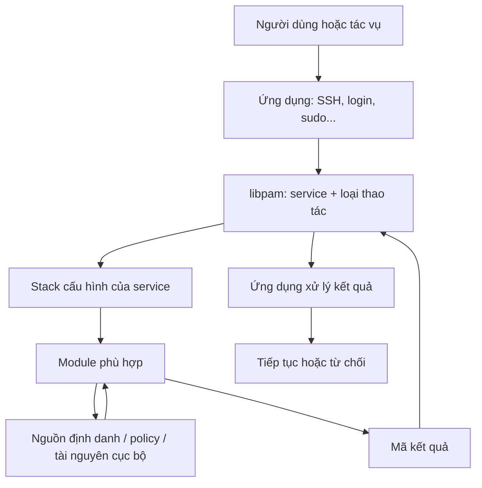

# PAM Linux module

## 1. Bài toán: kiểm soát đúng cửa vào của máy Linux

Một kỹ sư vận hành đăng nhập bằng SSH key, sau đó dùng `sudo` để khởi động lại một dịch vụ. Tổ chức muốn biết người đó là ai, tài khoản còn được sử dụng hay không, phiên truy cập có được tạo đúng chính sách và lệnh đặc quyền có nằm trong quyền đã cấp hay không.

Các câu hỏi này đi qua nhiều thành phần. Linux-PAM là một trong những thành phần đó: thư viện và cơ chế module để ứng dụng tích hợp các bước xác thực, kiểm tra tài khoản, thay đổi thông tin xác thực và quản lý vòng đời phiên. Ứng dụng quyết định khi nào gọi PAM và xử lý kết quả trả về. Khái niệm nền tảng này được mô tả trong [tài liệu Linux-PAM của dự án](https://github.com/linux-pam/linux-pam/blob/master/doc/man/pam.8.xml).

Trong bài này cần phân biệt hai nghĩa của chữ PAM:

| Thuật ngữ | Nghĩa trong ngữ cảnh này |
|---|---|
| Privileged Access Management | Chương trình quản trị truy cập đặc quyền: phê duyệt, vault, JIT/JEA, giám sát, bằng chứng |
| Linux-PAM — Pluggable Authentication Modules | Cơ chế tích hợp kiểm soát truy cập tại ứng dụng trên Linux |

Một máy có Linux-PAM không đồng nghĩa đã có quy trình phê duyệt quyền quản trị, vault mật khẩu hay ghi hình toàn bộ phiên. Ngược lại, một nền tảng quản trị đặc quyền vẫn cần hiểu những cửa vào trên máy đích để bảo đảm chính sách không chỉ tồn tại tại gateway.

Sau bài học, người học có thể:

- Xác định ứng dụng, PAM service và module tham gia một đường truy cập.
- Phân biệt bốn nhóm quản lý, tránh đặt chính sách vào sai giai đoạn.
- Đọc một stack đơn giản, phát hiện nhánh bỏ qua kiểm soát.
- Lập bài kiểm thử cho SSH, nâng quyền, lỗi backend và đường khôi phục.
- Mô tả bằng chứng cần giữ khi thay đổi cấu hình PAM trên máy nhạy cảm.

## 2. Từ ứng dụng đến module: ai thực sự thực thi chính sách?

Hãy xem Linux-PAM là một điểm gọi chính sách trong luồng ứng dụng, thay vì một bộ lọc tự động bao quanh mọi tiến trình của hệ điều hành.



Có ba câu hỏi cần trả lời trước khi đánh giá một máy:

1. **Đường truy cập nào đang được xét?** SSH tương tác, SSH chạy một lệnh, console, `su`, `sudo`, tác vụ tự động hay một dịch vụ riêng.
2. **Đường đó có gọi PAM không?** Phụ thuộc cách ứng dụng được xây dựng, cấu hình và kiểu thao tác.
3. **Service và nhóm quản lý nào được gọi?** Có dòng cấu hình không chứng minh dòng đó được thực thi trên mọi đường đi.

Ví dụ, thành công của bài thử đăng nhập SSH không đủ để kết luận rằng một quy tắc áp dụng cho `sudo` cũng hoạt động. Hai ứng dụng có thể dùng stack khác nhau, dù cuối cùng cùng liên quan tới một tài khoản Linux.

Ngược lại, sửa một stack được nhiều service dùng chung có thể tác động rộng hơn dự kiến. Việc chỉ nhìn file vừa sửa mà không theo các quan hệ include dễ bỏ sót phạm vi ảnh hưởng.

### 2.1. Module là mã thực thi, không chỉ là tên cấu hình

Các tên như `pam_unix.so`, `pam_access.so` hay `pam_limits.so` thường chỉ tới shared object được thư viện PAM nạp. Mỗi module có thể cung cấp một hoặc nhiều chức năng phù hợp với các nhóm quản lý.

Ví dụ, phía ứng dụng gọi giao diện `pam_authenticate()`; phía module có thể triển khai `pam_sm_authenticate()`. Chữ `sm` ở đây chỉ giao diện phía service module. Đây là hai phía khác nhau của cùng cơ chế, không phải hai lần xác thực bắt buộc. Xem [giao diện module pam_sm_authenticate](https://github.com/linux-pam/linux-pam/blob/master/doc/man/pam_sm_authenticate.3.xml).

Vì module là mã được nạp vào luồng ứng dụng, nguồn gói cài đặt, quyền ghi vào thư viện, phiên bản và chuỗi cập nhật đều quan trọng. Một cấu hình trông hợp lý không bảo vệ được hệ thống nếu module thực tế đã bị thay thế bằng mã khác.

## 3. Bốn nhóm quản lý và câu hỏi của từng nhóm

Linux-PAM tách các nhiệm vụ thành `auth`, `account`, `password`, `session`. Bảng sau diễn giải các nhóm theo câu hỏi vận hành; chúng không phải bốn bước luôn chạy liên tiếp trong mọi lần truy cập.

| Nhóm | Câu hỏi thực tế | Ví dụ về mục tiêu kiểm soát |
|---|---|---|
| `auth` | Bằng chứng xác thực có hợp lệ không? | Kiểm tra mật khẩu hoặc yếu tố xác thực được tích hợp |
| `account` | Tài khoản có được dùng service này trong điều kiện hiện tại không? | Kiểm tra hạn sử dụng hoặc điều kiện truy cập |
| `password` | Có được cập nhật authentication token, và cập nhật thế nào? | Đổi mật khẩu theo cơ chế được hỗ trợ |
| `session` | Cần làm gì khi mở hoặc đóng phiên? | Thiết lập môi trường, tài nguyên, thông tin vòng đời phiên |

Cách chia nhóm được dự án giải thích tại [PAM(8)](https://github.com/linux-pam/linux-pam/blob/master/doc/man/pam.8.xml).

Ba hệ quả thường bị bỏ sót:

- Đặt quy tắc vào `password` không có nghĩa nó sẽ kiểm tra mỗi lần người dùng nhập mật khẩu để đăng nhập.
- Xác thực thành công chưa đủ để bỏ qua câu hỏi tài khoản còn được phép truy cập hay không.
- Hook mở phiên không tự tạo cơ chế theo dõi liên tục mọi hành động diễn ra sau đó.

Hãy xét một người đã có phiên quản trị từ trước. Sau khi tổ chức thu hồi quyền, lần truy cập tiếp theo có thể bị từ chối, nhưng phiên đang chạy có thể vẫn tồn tại. Thiết kế thu hồi quyền phải xác định riêng cách xử lý phiên hiện hữu, tiến trình con và credential đã phát hành.

### 3.1. Không đánh đồng khóa mật khẩu với vô hiệu hóa mọi truy cập

Trong môi trường hỗ trợ nhiều phương thức đăng nhập, một thao tác chỉ ảnh hưởng mật khẩu có thể không mang nghĩa giống việc cấm toàn bộ tài khoản. Đánh giá offboarding phải xem phương thức xác thực, kiểm tra account của từng service, key/certificate còn hợp lệ và phiên đã tồn tại.

Một biên bản kiểm thử chỉ ghi “password login thất bại” chưa chứng minh rằng tài khoản đó không thể đăng nhập bằng key. Kết quả cần được gắn với đúng phương thức và đúng cửa vào đã thử.

## 4. Đọc cấu hình PAM theo service và theo stack

Trên nhiều hệ thống, cấu hình theo service được đặt trong `/etc/pam.d/`. Với dạng này, tên file thường chính là tên service; dòng cấu hình không cần thêm cột tên service:

```text
type    control    module-path    module-arguments
```

Ví dụ một dòng để đọc cấu trúc:

```text
account required pam_access.so accessfile=/etc/security/access-pam-lab.conf
```

Ý nghĩa:

- `account`: nhóm quản lý cần gọi.
- `required`: cách tổng hợp kết quả module vào kết quả stack.
- `pam_access.so`: module được dùng.
- `accessfile=...`: tham số do module đó hiểu.

Đây là một **đoạn minh họa**, không phải file PAM hoàn chỉnh để thay cho cấu hình SSH hoặc đăng nhập của máy.

Một số bản phân phối có cấu hình do vendor cung cấp hoặc công cụ quản lý profile sinh ra. Đừng mặc định mọi máy đều có cùng cây file và cùng quyền ưu tiên. Cú pháp theo thư mục và quan hệ với cấu hình vendor được mô tả trong [tài liệu pam.d của Linux-PAM](https://github.com/linux-pam/linux-pam/blob/master/doc/man/pam.conf-dir.xml).

Khi điều tra một stack, nên ghi lại:

| Thành phần cần xác định | Vì sao cần |
|---|---|
| Ứng dụng và service thực tế | Tránh xem đúng cú pháp nhưng sai cửa vào |
| File chính và các file được tham chiếu | Xác định toàn bộ đường đánh giá |
| Nhóm quản lý | Biết quy tắc được gọi ở thời điểm nào |
| Module, tham số, phiên bản gói | Biết hành vi nào đang được yêu cầu |
| Công cụ quản lý cấu hình | Tránh chỉnh file rồi bị profile hoặc automation ghi đè |
| Đường đi khi thành công và thất bại | Phát hiện bỏ qua kiểm soát hoặc khóa nhầm |

Không có một thứ tự file đơn giản dùng chung cho mọi bản phân phối. Phải theo chuỗi tham chiếu thực tế của service, đồng thời đối chiếu tài liệu và cơ chế quản lý gói trên máy đó.

## 5. Control quyết định kết quả của stack

Một module trả về kết quả; trường `control` quyết định kết quả đó ảnh hưởng thế nào tới toàn stack.

| Control đơn giản | Hành vi cần nhớ |
|---|---|
| `required` | Lỗi làm stack thất bại, nhưng thường còn xử lý các dòng sau |
| `requisite` | Lỗi trả về sớm khỏi stack hiện tại |
| `sufficient` | Thành công có thể kết thúc sớm nếu chưa có lỗi `required` trước đó; thất bại không tự làm stack thất bại |
| `optional` | Thường không quyết định kết quả khi có module quyết định khác |

`include` đưa các dòng cùng loại từ cấu hình khác vào đánh giá. `substack` có ranh giới xử lý riêng cho một số hành động điều khiển; không nên đổi qua lại chỉ vì thấy hai từ đều “gọi file khác”. Cấu hình nâng cao còn có dạng `[value=action ...]`. Xem [đặc tả control của Linux-PAM](https://github.com/linux-pam/linux-pam/blob/master/doc/man/pam.conf-syntax.xml).

### 5.1. Mô phỏng một lỗi thứ tự

Giả sử yêu cầu nghiệp vụ là phải vượt qua **cả** xác thực chính lẫn MFA. Stack sau chỉ là giả mã: hai tên module `pam_lab_*` được đặt để giải thích, không phải gói có sẵn.

```text
# GIẢ MÃ ĐỂ PHÂN TÍCH, KHÔNG TRIỂN KHAI
auth sufficient pam_lab_identity.so
auth required   pam_lab_mfa.so
```

Nếu dòng đầu thành công và chưa có lỗi bắt buộc nào trước đó, việc đánh giá có thể kết thúc trước dòng MFA. Cài một module MFA vào máy và có một dòng gọi nó trong file vẫn chưa chứng minh MFA được bắt buộc.

Để diễn đạt ý định trên trong mô hình tối giản này:

```text
# GIẢ MÃ ĐỂ PHÂN TÍCH, KHÔNG TRIỂN KHAI
auth required pam_lab_identity.so
auth required pam_lab_mfa.so
```

Ma trận kỳ vọng do người thiết kế đặt ra là:

| Xác thực chính | MFA | Kỳ vọng |
|---|---|---|
| Thành công | Thành công | Cho tiếp tục tới kiểm tra kế tiếp |
| Thành công | Thất bại | Từ chối |
| Thất bại | Thành công | Từ chối |
| Thất bại | Thất bại | Từ chối |

Ma trận này thể hiện phép **AND** của yêu cầu nghiệp vụ. Khi áp dụng cho cấu hình thật, còn phải xét mã trả về cụ thể, nhánh include, điều kiện bỏ qua, cách ứng dụng gọi PAM và hành vi backend. Không dùng hai dòng giả mã để thay thế một stack do bản phân phối cung cấp.

### 5.2. Vì sao cần xét mã lỗi ngoài “đúng” và “sai”?

Một hệ thống xác thực có thể gặp tài khoản không tồn tại, backend không liên lạc được, hết thời gian chờ hoặc không lấy được thông tin cần thiết. Không phải mọi tình huống đều tương đương người dùng nhập sai credential.

Trong thiết kế policy, phải xác định trường hợp nào bị từ chối, trường hợp nào được chuyển sang đường khôi phục có kiểm soát và bằng chứng nào được phát sinh. Nếu cấu hình biến mọi lỗi backend thành “bỏ qua”, một sự cố hạ tầng có thể làm mất chính bước bảo vệ đang cần.

Các nhánh số như `success=1` cũng cần được xem lại khi chèn hoặc xóa dòng. Người đánh giá nên diễn giải đường đi thành lời và lập ca thử cho từng nhánh, thay vì chỉ nhìn thấy dòng kiểm soát còn tồn tại trong file.

## 6. Những module tiêu biểu và phạm vi sử dụng

### 6.1. pam_unix: cơ chế tài khoản và mật khẩu Unix

`pam_unix.so` cung cấp chức năng liên quan tới xác thực Unix truyền thống, trạng thái tài khoản/mật khẩu, thay đổi mật khẩu và thông tin mở/đóng phiên. Cùng một tên module ở các nhóm khác nhau có nhiệm vụ khác nhau.

Các tùy chọn truyền credential không đồng nghĩa với nhau:

| Tùy chọn | Điểm khác biệt |
|---|---|
| `try_first_pass` | Thử mật khẩu từ module trước rồi có thể hỏi lại |
| `use_first_pass` | Dùng mật khẩu từ module trước; không hỏi lại nếu thiếu hoặc không phù hợp |
| `use_authtok` | Khi đổi mật khẩu, dùng token mới từ module trước |

Phải kiểm tra tùy chọn được hỗ trợ ở đúng module, đúng chức năng. Không áp dụng máy móc tùy chọn của `pam_unix` cho module khác. Chi tiết ở [pam_unix(8)](https://github.com/linux-pam/linux-pam/blob/master/modules/pam_unix/pam_unix.8.xml).

Trong hệ thống quản trị đặc quyền, cần đặc biệt rõ nguồn credential. Một tài khoản local, tài khoản directory và tài khoản break-glass có thể cần các đường đánh giá khác nhau. Việc có fallback local phải là quyết định được kiểm thử, có phạm vi tài khoản rõ ràng; không biến mọi lỗi của nguồn định danh chính thành cơ hội thử một nguồn khác tùy ý.

### 6.2. pam_access: điều kiện truy cập theo người dùng và nguồn

`pam_access.so` hỗ trợ kiểm soát truy cập dựa trên danh tính và thông tin nguồn mà ứng dụng cung cấp. Có thể dùng `accessfile` để chỉ một file policy riêng. Tài liệu module giải thích cơ chế xét các file policy tại [pam_access(8)](https://github.com/linux-pam/linux-pam/blob/master/modules/pam_access/pam_access.8.xml).

Ví dụ policy trong phòng lab:

```text
# /etc/security/access-pam-lab.conf — CHỈ VÍ DỤ
+ : (ops-linux) : 192.0.2.0/24
- : ALL         : ALL
```

Ý định của ví dụ là cho nhóm vận hành đi qua từ dải nguồn thử nghiệm và từ chối những trường hợp còn lại trong phạm vi policy này. `192.0.2.0/24` là địa chỉ dùng cho ví dụ; cần thay bằng dữ liệu lab phù hợp.

Kết quả thực tế còn phụ thuộc thông tin mà ứng dụng gửi tới PAM. Nếu tất cả kết nối đều đi qua một gateway, máy đích có thể chỉ thấy địa chỉ gateway. Không nên gán cho địa chỉ đó ý nghĩa “thiết bị cá nhân của kỹ sư đã được xác minh”.

Quy tắc truy cập theo nguồn cũng không phải danh sách lệnh được phép chạy. Sau khi qua bước này, quyền thao tác vẫn phải do các cơ chế phân quyền thích hợp quyết định.

### 6.3. pam_faillock: theo dõi lỗi và khóa theo chính sách

`pam_faillock.so` theo dõi thất bại xác thực. Các vị trí `preauth`, `authfail`, `authsucc` có vai trò khác nhau; bố trí sai có thể làm sai việc kiểm tra trạng thái khóa, ghi thất bại hoặc xử lý lần thành công. Cần theo cấu hình phù hợp với stack và phiên bản của hệ thống, theo [pam_faillock(8)](https://github.com/linux-pam/linux-pam/blob/master/modules/pam_faillock/pam_faillock.8.xml).

Với máy quản trị, câu hỏi thiết kế còn bao gồm:

- Kẻ tấn công có thể cố ý khóa tài khoản vận hành hay không?
- Tài khoản khôi phục được xử lý thế nào khi hệ thống định danh chính lỗi?
- Trạng thái khóa của máy local có khác trạng thái tại directory không?
- Ai được mở khóa, qua quy trình nào và lưu bằng chứng gì?

Một thử nghiệm phù hợp dùng tài khoản lab dành riêng và số lần thử có giới hạn. Không dùng tài khoản trực ca production để tự tạo lockout rồi mới tìm cách phục hồi.

### 6.4. pam_limits: tài nguyên của phiên

`pam_limits.so` thuộc nhóm `session`, thiết lập các giới hạn tài nguyên cho phiên theo cấu hình của module. Tài liệu mô tả nguồn cấu hình và phạm vi tại [pam_limits(8)](https://github.com/linux-pam/linux-pam/blob/master/modules/pam_limits/pam_limits.8.xml).

Ví dụ một đoạn giới hạn cho nhóm lab:

```text
# VÍ DỤ trong policy limits dành cho lab
@ops-linux soft nofile 4096
@ops-linux hard nofile 8192
```

Đây không phải chính sách least privilege theo lệnh. Giới hạn số file mở không trả lời câu hỏi kỹ sư có được sửa cấu hình dịch vụ thanh toán hay không.

Cũng cần phân biệt phiên được ứng dụng mở qua PAM với một daemon do bộ quản lý dịch vụ khởi động. Không suy ra rằng sửa giới hạn của phiên đăng nhập sẽ lập tức đổi giới hạn của mọi tiến trình đang chạy.

## 7. SSH: bật PAM chưa đủ để chứng minh MFA

Với OpenSSH portable hỗ trợ PAM, `UsePAM yes` bật tích hợp PAM; xử lý account và session còn áp dụng cho các kiểu xác thực ngoài mật khẩu. Public key không mặc nhiên đi qua cùng đường `auth` như password hoặc keyboard-interactive. Nếu cần kết hợp key với một bước PAM tương tác, phải thiết kế chuỗi phương thức phù hợp. Các điểm này được quy định trong [sshd_config của OpenSSH portable](https://github.com/openssh/openssh-portable/blob/master/sshd_config.5).

Trong lab, có thể xem một đoạn thể hiện ý định:

```text
# ĐOẠN MINH HỌA Ý ĐỊNH, KHÔNG PHẢI CẤU HÌNH SSH HOÀN CHỈNH
UsePAM yes
PubkeyAuthentication yes
KbdInteractiveAuthentication yes
PasswordAuthentication no
AuthenticationMethods publickey,keyboard-interactive:pam
```

Đoạn này yêu cầu một chuỗi phương thức SSH; nó không tự bảo đảm bước PAM phía sau là một yếu tố độc lập, có khả năng chống phishing hoặc được triển khai đúng. Cần xác minh backend thực tế và thử đường đăng nhập.

Trước khi áp dụng, phải đối chiếu phiên bản OpenSSH được cài đặt, cấu hình hiệu lực của kết nối và quy định của bản phân phối. Không dùng giá trị mặc định trên một bản upstream để suy ra mặc định của máy đang vận hành.

### 7.1. Ba bài thử có giá trị khác nhau

| Bài thử | Chứng minh được điều gì? |
|---|---|
| Key đúng và hoàn thành bước bổ sung | Đường thành công dự kiến hoạt động |
| Key đúng nhưng từ chối hoặc làm sai bước bổ sung | Bước bổ sung thực sự có thể chặn truy cập |
| Chỉ dùng key, thử một phương thức hoặc cửa vào khác | Phát hiện đường đi không đáp ứng yêu cầu kết hợp |

Nếu hệ thống chỉ thử dòng đầu, một nhánh bỏ qua MFA vẫn có thể tồn tại.

Ngoài shell tương tác, nên xét SSH chạy lệnh, subsystem truyền file và tài khoản automation theo phạm vi cho phép. Các đường này có mục đích khác nhau; quy trình xác thực tương tác của con người không nên được sao chép nguyên xi cho pipeline rồi xử lý bằng một ngoại lệ quá rộng.

## 8. Từ đăng nhập đến sudo: giữ riêng câu hỏi xác thực và phân quyền

Giả sử kỹ sư đã vượt qua SSH và muốn chạy:

```bash
sudo systemctl restart billing-api.service
```

Có ít nhất hai nhóm câu hỏi:

1. Người đang yêu cầu nâng quyền có đáp ứng kiểm tra xác thực và tài khoản cần thiết của `sudo` không?
2. Policy của `sudo` có cho người đó chạy lệnh này, với danh tính đích, tham số và điều kiện hiện tại không?

Một kết quả PAM thành công không nên được diễn giải là cấp quyền chạy mọi lệnh root. Danh sách lệnh, user đích, điều kiện môi trường và nguy cơ shell escape cần được đánh giá ở chính sách phân quyền.

Tương tự, không xuất hiện prompt mới chưa chắc là PAM bị hỏng. Có thể ứng dụng đang dùng cơ chế lưu trạng thái xác thực hoặc policy không yêu cầu xác thực cho trường hợp đó. Khi kiểm thử, phải ghi nhận trạng thái cache/timestamp, ngữ cảnh phiên và policy hiệu lực.

Trong thiết kế JIT, một quyền được phê duyệt trong 20 phút cần có mô tả rõ:

- Thành phần nào cấp và thu hồi quyền.
- Thành phần nào kiểm tra quyền ở lần sử dụng kế tiếp.
- Cache có thể kéo dài quyết định cũ bao lâu.
- Phiên hoặc tiến trình đã được tạo trước thời điểm hết hạn được xử lý thế nào.
- Bằng chứng nào nối được yêu cầu phê duyệt với thao tác trên máy đích.

Linux-PAM có thể là một điểm tham gia vào thiết kế này, nhưng chỉ thêm một module không tạo đủ toàn bộ vòng đời JIT.

## 9. Thiết kế hành vi khi dependency lỗi

Khi xác thực hoặc policy phụ thuộc một dịch vụ ngoài máy, lỗi mạng là một đầu vào của thiết kế, không phải ngoại lệ có thể bỏ qua khi kiểm thử.

Ví dụ nhóm vận hành đặt yêu cầu cho một môi trường nhạy cảm:

| Tình huống | Quyết định thiết kế mẫu |
|---|---|
| Tài khoản thông thường, policy hợp lệ, backend sẵn sàng | Theo đường truy cập chuẩn |
| Backend không liên lạc được | Từ chối đường thông thường và ghi lý do |
| Có sự cố cần khôi phục hạ tầng định danh | Dùng đường break-glass đã được phê duyệt |
| Hết hạn quyền tạm thời | Không cấp lần truy cập đặc quyền mới |
| Collector log lỗi | Theo quyết định đã duyệt cho loại hệ thống đó; phát cảnh báo |

Đây là **mẫu yêu cầu nghiệp vụ**, không phải khuyến nghị cấu hình chung cho mọi tổ chức. Một hệ thống có nhu cầu sẵn sàng khác có thể chọn phương án khác, nhưng phải ghi rõ đánh đổi.

Đường break-glass cần tài khoản định danh được, credential được bảo vệ, quyền tối thiểu cần thiết, điều kiện kích hoạt, cảnh báo và đối soát sau sử dụng. Thêm một dòng bỏ qua cho tất cả thành viên nhóm quản trị để “tránh mất truy cập” không tạo ra một quy trình break-glass có thể kiểm toán.

Nếu có cache hoặc chế độ offline, phải thử trường hợp tài khoản vừa bị thu hồi quyền nhưng máy không nhận được cập nhật. Kỳ vọng cần nêu được cửa sổ chấp nhận dữ liệu cũ và cách chấm dứt rủi ro đó.

## 10. Quan sát hệ thống mà không thay đổi policy

Các lệnh sau là gợi ý cho máy Linux lab đã được cấp quyền; chúng không cần được chạy trên máy đang chứa tài liệu bài học.

```bash
# Đọc hướng dẫn đúng phiên bản đã cài
man 8 pam
man 5 pam.d
man 8 pam_unix
man 8 pam_access
man 8 pam_faillock
man 8 pam_limits

# Xem service chính; file có thể khác theo hệ thống
sed -n '1,200p' /etc/pam.d/sshd
sed -n '1,200p' /etc/pam.d/sudo

# Tìm các tham chiếu trong cấu hình cục bộ
grep -R -n -E 'include|substack|@include' /etc/pam.d

# Xem cấu hình SSH hiệu lực cho một kết nối mẫu trong lab
sudo /usr/sbin/sshd -T \
  -C user=ops-lab,host=client.lab,addr=192.0.2.10

# Kiểm tra cấu hình SSH; không thay thế bài thử PAM thực tế
sudo /usr/sbin/sshd -t
```

Thay đường dẫn binary, user và ngữ cảnh theo máy lab. Việc đọc cấu hình/log có thể cần quyền quản trị theo chính sách hệ thống.

Kết quả của `sshd -t` không phải chứng nhận rằng mọi module PAM nạp được, backend phản hồi đúng hoặc nhánh từ chối đã hoạt động. Vì vậy kiểm tra cấu hình và kiểm tra hành vi bổ sung cho nhau.

Đối với log, dùng nguồn có trên bản phân phối, chẳng hạn journal của service SSH hoặc file log xác thực được cấu hình. Tên service có thể là `ssh`, `sshd` hoặc tên khác; không coi thiếu một tên cố định là bằng chứng không có sự kiện.

```bash
# Chỉ dùng unit tồn tại trên máy lab
sudo journalctl -u sshd --since "10 minutes ago"

# Xem giới hạn trong chính phiên thử nghiệm hiện tại
ulimit -Sn
ulimit -Hn
```

Không thu thập nội dung `/etc/shadow`, mật khẩu, OTP, token hoặc khóa riêng để làm bằng chứng. Dữ liệu cần cho phân tích là danh tính thử nghiệm, đường truy cập, thời gian, kết quả, lý do và phiên bản cấu hình đã dùng.

## 11. Bài thực hành: xây hồ sơ cho một cửa truy cập quản trị

### 11.1. Chuẩn bị

Dùng máy ảo có snapshot hoặc môi trường có cơ chế phục hồi đã kiểm tra. Tạo các danh tính thử nghiệm tách biệt: người được phép, người không thuộc phạm vi và một tài khoản dùng cho bài thử trạng thái khóa.

Trước thay đổi, cần có:

- Console hoặc đường quản trị ngoài băng có thể sử dụng thực tế.
- Bản cấu hình trước thay đổi và cách phục hồi đúng cơ chế của bản phân phối.
- Một phiên quản trị còn mở, kết hợp kiểm thử bằng **phiên mới độc lập**.
- Danh sách service bị ảnh hưởng, kể cả service dùng stack chung.
- Kỳ vọng cho thành công, từ chối và dependency lỗi.

Giữ phiên cũ chỉ giúp giảm rủi ro khi thử; không chứng minh cấu hình mới cho phép đăng nhập lại. Không đóng đường phục hồi trước khi đã xác minh các đường truy cập mới.

### 11.2. Ghi lại một giao dịch truy cập

Với mỗi lần thử, điền các trường sau:

```text
test_id:
change_id:
host_id:
time_utc:
actor_test_account:
entry_point:
authentication_methods:
pam_service:
management_group_under_test:
configuration_revision:
expected_result:
actual_result:
evidence_reference:
recovery_required:
```

Đây là mẫu bằng chứng do bài thực hành đề xuất, không phải schema log bắt buộc của Linux-PAM. Nếu nguồn log không có một trường, ghi rõ cách đối chiếu từ nguồn khác; không tự bịa giá trị để làm hồ sơ trông đầy đủ.

### 11.3. Ma trận kiểm thử

| Ca thử | Điều cần quan sát |
|---|---|
| Người hợp lệ, bằng chứng đúng, nguồn đúng | Truy cập thành công theo thiết kế |
| Người hợp lệ, bằng chứng sai | Bị từ chối, lý do phù hợp |
| Người không thuộc phạm vi nhưng có credential đúng | Policy truy cập vẫn chặn |
| Key đúng nhưng không hoàn thành bước bổ sung | Không có đường chỉ dùng key ngoài ý định |
| Tài khoản hết hạn hoặc bị thu hồi quyền | Lần truy cập mới theo đúng chính sách |
| Backend không liên lạc được | Hành vi đúng quyết định lỗi đã duyệt |
| Tài khoản lab vượt ngưỡng lỗi | Trạng thái khóa và khôi phục đúng thiết kế |
| Một service khác dùng stack chung | Không phát sinh tác động ngoài dự kiến |
| Phiên đã mở trước khi thu hồi | Có kết luận riêng về phiên hiện hữu |
| Quay lại cấu hình trước | Đường phục hồi và đăng nhập mới hoạt động |

Không cần cố tạo mọi lỗi trên production để hoàn thành bảng. Lab cần mô phỏng đúng điều kiện quan trọng; rollout production có canary, theo dõi và điều kiện dừng riêng.

### 11.4. Tiêu chí hoàn thành bài thực hành

Người học cần trình bày được một đường đi từ ứng dụng tới module, giải thích ít nhất một nhánh thành công và một nhánh thất bại, đồng thời chỉ ra cơ chế nào quyết định quyền chạy lệnh đặc quyền.

Hồ sơ đạt yêu cầu khi người khác có thể tái hiện ca thử từ thông tin đã ghi, phân biệt rõ dữ liệu quan sát với nhận định và xác định được bản cấu hình tương ứng. “Đăng nhập được” hoặc “có log PAM” chưa đủ để kết luận tất cả kiểm soát hoạt động.

## 12. Chẩn đoán theo triệu chứng

| Triệu chứng | Hướng kiểm tra trước |
|---|---|
| Một người truy cập được dù vừa thêm quy tắc chặn | Đúng service chưa; nhóm quản lý có được gọi không; có nhánh kết thúc sớm không |
| Key đăng nhập được nhưng không thấy MFA | Chuỗi phương thức SSH và đường `auth` thực tế |
| Xác thực đúng nhưng vẫn bị từ chối | Kết quả account, policy service và trạng thái tài khoản |
| Console được nhưng SSH bị chặn | Stack, dữ liệu nguồn và điều kiện riêng của hai cửa vào |
| Đăng nhập được nhưng không nâng quyền được | Policy sudo và luồng PAM riêng của sudo |
| Nhiều ứng dụng cùng lỗi sau một thay đổi nhỏ | Stack dùng chung, profile sinh cấu hình, module/dependency |
| Sửa file rồi cấu hình quay về | Công cụ quản lý profile hoặc automation sở hữu file |
| Đã đổi limits nhưng tiến trình cũ không đổi | Phiên tạo trước thay đổi hoặc tiến trình không đi qua đường PAM đó |
| Tài khoản báo khóa nhưng công cụ directory không thấy khóa | Phân biệt trạng thái khóa local và nguồn định danh ngoài |

Thứ tự chẩn đoán có ích là: xác định cửa vào, lấy thời gian và kết quả cụ thể, theo stack hiệu lực, kiểm tra module/dependency, rồi đối chiếu với kỳ vọng.

Tránh cách xử lý bằng việc đổi tất cả dòng lỗi thành `optional`. Thao tác đó có thể làm đăng nhập trở lại nhưng đồng thời loại bỏ chính kiểm soát cần duy trì. Cần khôi phục hoặc sửa nguyên nhân có phạm vi rõ ràng, sau đó chạy lại cả ca cho phép lẫn ca từ chối.

## 13. Bảo vệ thay đổi PAM như một thay đổi đặc quyền

Ai sửa được cấu hình PAM hoặc thay module có thể ảnh hưởng trực tiếp tới cửa xác thực. Do đó, quyền sửa các thành phần này thuộc phạm vi kiểm kê đặc quyền.

Một thay đổi có thể xem xét được nên nêu:

1. Yêu cầu nghiệp vụ và các đường truy cập bị tác động.
2. File hoặc profile là nguồn quản lý chính thức.
3. Module/gói, phiên bản, tùy chọn và lý do chọn.
4. Luồng thành công, từ chối, lỗi dependency và khôi phục.
5. Kết quả thử trên phiên mới, kèm kiểm tra service dùng chung.
6. Người phê duyệt, người triển khai, thời điểm và bằng chứng rollout.

Nên triển khai trước trên nhóm máy nhỏ đại diện cho hệ điều hành và kiểu truy cập. Một cấu hình hoạt động với người dùng local trên máy lab chưa chứng minh nó hoạt động với tài khoản directory, automation hoặc môi trường mạng có proxy/gateway.

Cảnh báo drift cần theo dõi cả cấu hình lẫn gói/module thực thi. Khi có sự cố, giữ được phiên bản trước và sau giúp phân biệt lỗi policy, lỗi module và lỗi dependency.

Việc ghi log mở/đóng phiên cũng chưa phải ghi toàn bộ lệnh hoặc màn hình. Nếu yêu cầu kiểm toán cần nội dung thao tác, phải thiết kế thêm cơ chế ghi nhận tương ứng và liên kết nó với danh tính, yêu cầu quyền và máy đích.

## 14. Tình huống tổng hợp

Một tổ chức yêu cầu kỹ sư chỉ quản trị máy production sau phê duyệt, dùng key và yếu tố bổ sung, truy cập qua gateway, chỉ được khởi động lại một dịch vụ trong thời gian đã cấp.

Cách phân tích phù hợp:

| Yêu cầu | Thành phần cần được xác minh |
|---|---|
| Có phê duyệt trước truy cập | Quy trình và hệ thống cấp quyền, có dấu vết quyết định |
| Key kết hợp yếu tố bổ sung | Chuỗi phương thức SSH và stack/backend xác thực |
| Chỉ truy cập qua gateway | Kiểm soát mạng và policy theo nguồn với dữ liệu đúng |
| Tài khoản còn hiệu lực | Kiểm tra account trên đường truy cập tương ứng |
| Chỉ chạy lệnh đã cấp | Chính sách phân quyền lệnh và ngữ cảnh nâng quyền |
| Hết hạn sau cửa sổ JIT | Cơ chế thu hồi, cache và xử lý phiên đang tồn tại |
| Điều tra được thao tác | Log có thể đối chiếu và cơ chế ghi nhận thao tác phù hợp |

Giả sử bài thử cho thấy người dùng vào được chỉ bằng key. Điều đó không nhất thiết chứng minh module MFA sai; cũng có thể đường SSH chưa yêu cầu gọi bước đó. Phải xem cả chuỗi phương thức lẫn stack.

Giả sử người dùng bị chặn đăng nhập mới khi hết hạn quyền nhưng vẫn có root shell cũ. Khi đó kiểm soát truy cập mới và kiểm soát phiên hiện hữu cho hai kết quả khác nhau. Báo cáo phải giữ cả hai phát hiện để hoàn thiện thiết kế thu hồi.

Giả sử log chỉ có địa chỉ gateway. Không được suy luận rằng địa chỉ máy cá nhân đã được kiểm tra tại host. Cần đối chiếu dữ liệu gateway và host bằng dấu thời gian, định danh kết nối hoặc cơ chế liên kết phù hợp.

## 15. Tự kiểm tra

1. Vì sao một dòng MFA có trong file PAM chưa chứng minh MFA là bắt buộc?
2. Khác biệt giữa `auth` và `account` ảnh hưởng thế nào tới đăng nhập bằng SSH key?
3. Khi nào đặt một module ở đầu stack với `sufficient` có thể làm sai yêu cầu nghiệp vụ?
4. Vì sao kiểm tra `sshd -t` thành công vẫn cần thử một phiên đăng nhập mới?
5. Ai quyết định người dùng được chạy lệnh root nào sau khi xác thực thành công?
6. Khi quyền hết hạn, hệ thống xử lý phiên đang tồn tại ra sao?
7. Bằng chứng nào giúp phân biệt khóa local với vô hiệu hóa tài khoản tại directory?

Một câu trả lời tốt luôn gắn kết luận với ứng dụng, service, nhóm quản lý, đường đi và điều kiện thử nghiệm. Nắm được mối liên hệ đó giúp sử dụng Linux-PAM như một điểm kiểm soát rõ ràng trong chương trình quản trị truy cập đặc quyền, đồng thời xác định đúng những trách nhiệm cần được thực hiện bởi các thành phần khác.

