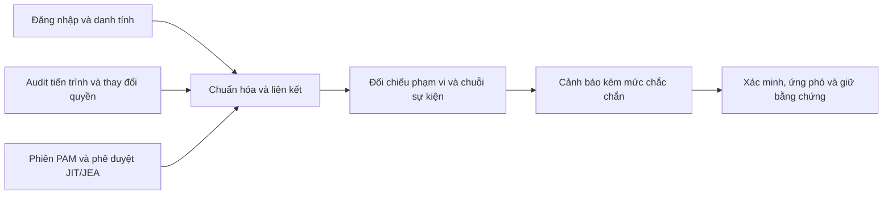

# Phát hiện leo thang đặc quyền trên Linux

## 1. Mục tiêu và phạm vi

Phát hiện leo thang đặc quyền (*privilege escalation detection*) là nhận biết một tiến trình hoặc danh tính đang cố đạt được, đã đạt được, hoặc đã sử dụng quyền cao hơn phạm vi được cho phép. Trong hệ thống quản lý truy cập đặc quyền (*Privileged Access Management — PAM*), việc thấy một lệnh chạy bằng `root` mới chỉ là tín hiệu kỹ thuật. Kết luận cần thêm ngữ cảnh: ai khởi tạo, qua phiên nào, được duyệt làm gì, trên máy nào, trong khoảng thời gian nào và bằng cơ chế nào.

Ví dụ, kỹ sư trực ca dùng `sudo` để khởi động lại một dịch vụ trong cửa sổ được duyệt có thể hoàn toàn hợp lệ. Cùng người đó mở shell `root` trên máy ngoài phạm vi phê duyệt là trường hợp khác, dù cả hai đều có `euid=0`.

Sau bài học, bạn cần có khả năng:

- Phân biệt yêu cầu nâng quyền, nâng quyền thành công và sử dụng quyền ngoài phạm vi.
- Chọn nguồn dữ liệu để nối danh tính người dùng với tiến trình đặc quyền.
- Thiết kế phát hiện cho `sudo`, `su`, thay đổi chính sách, SUID/SGID và Linux capabilities.
- Đánh giá cảnh báo dựa trên phê duyệt JIT/JEA, phạm vi tài sản và thời gian thực thi.
- Xác minh độ phủ, xử lý ngoại lệ và giữ bằng chứng phục vụ điều tra.

Trong bài này, PAM là hệ thống quản lý truy cập đặc quyền của module. **Linux-PAM**, thư viện xác thực dùng các module cấu hình ở những vị trí như `/etc/pam.d/`, là khái niệm khác. Nhật ký Linux-PAM có thể đóng góp dữ liệu xác thực, nhưng không tự đại diện cho toàn bộ hoạt động đặc quyền trên Linux.

## 2. Quyền nào đang được nâng lên?

### 2.1. Danh tính người dùng và danh tính tiến trình

Một người đăng nhập bằng tài khoản cá nhân rồi chạy `sudo` có thể tạo ra tiến trình mang danh tính thực thi khác tài khoản đăng nhập ban đầu. Các trường sau giúp phân biệt hai việc này:

| Thuộc tính | Ý nghĩa trong điều tra | Giới hạn cần nhớ |
| --- | --- | --- |
| UID thực, thường biểu diễn bằng `uid` | Một phần danh tính của tiến trình tại thời điểm ghi nhận | Không luôn đại diện cho người ban đầu đăng nhập |
| EUID, thường biểu diễn bằng `euid` | Danh tính hiệu lực dùng trong nhiều kiểm tra quyền | `euid=0` không tự chứng minh có tấn công |
| Audit login UID, thường biểu diễn bằng `auid` | Dấu vết danh tính đăng nhập ban đầu nếu đã được thiết lập | Có thể chưa được đặt; không thay bằng UID hiện tại để đoán người dùng |
| Audit session, thường biểu diễn bằng `ses` | Nhóm hoạt động thuộc phiên audit | Không mặc định bằng mã phiên của sản phẩm PAM |
| PID, PPID và thời điểm khởi tạo | Liên kết tiến trình với cha và cây thực thi | PID có thể được tái sử dụng |
| Groups và supplementary groups | Các quyền được cấp qua nhóm | Thành viên nhóm tại thời điểm điều tra có thể khác thời điểm sự kiện |
| Capabilities | Những năng lực đặc quyền cụ thể của tiến trình hoặc file | Tiến trình không phải `root` vẫn có thể rất mạnh |

Tên trường và mức dữ liệu thực tế phụ thuộc nguồn thu thập. Khi chuẩn hóa, giữ lại bản ghi gốc và ý nghĩa ban đầu của trường; không nhập chung `auid`, `uid` và `euid` thành một trường `user` duy nhất.

Ví dụ một sự kiện có `auid=1007`, `euid=0` có thể gợi ý hoạt động đặc quyền xuất phát từ phiên của người dùng số 1007. Đó là đầu mối để tra cứu, chưa phải chứng minh rằng người sở hữu tài khoản đã trực tiếp gõ lệnh: tài khoản, phiên hoặc tiến trình của họ có thể đã bị chiếm quyền.

### 2.2. Quyền cao không chỉ là UID 0

Một mô hình chỉ kiểm tra `euid=0` sẽ bỏ sót nhiều trường hợp:

- Tài khoản được thêm vào nhóm có quyền quản trị hoặc kiểm soát một dịch vụ nhạy cảm.
- File được cấp capability cho phép thao tác đặc quyền dù tiến trình có UID khác 0.
- Người dùng sửa được unit hoặc executable mà một dịch vụ đặc quyền sẽ chạy.
- Tiến trình kiểm soát được giao diện quản trị container hoặc tài nguyên tương đương.
- Quyền truy cập secret đặc quyền bị mở rộng mà chưa có tiến trình `root` mới.

Ngược lại, UID 0 bên trong user namespace không mặc định tương đương UID 0 của host. Phải đọc ngữ cảnh namespace, ánh xạ UID, quyền được cấp và tài nguyên host thực sự có thể truy cập. Cảnh báo cần nói rõ ranh giới nào đang bị vượt qua.

### 2.3. Ba trạng thái cần báo riêng

| Trạng thái | Ví dụ bằng chứng | Cách diễn đạt cảnh báo |
| --- | --- | --- |
| Cố nâng quyền | `sudo` từ chối yêu cầu của người dùng | Có yêu cầu nâng quyền bị từ chối |
| Đạt quyền | Tiến trình thực thi thành công với EUID 0, có chuỗi nguồn gốc phù hợp | Đã quan sát thực thi với quyền `root` |
| Dùng quyền trái phép | Tiến trình đặc quyền nằm ngoài tài sản, lệnh hoặc thời hạn được duyệt | Hoạt động đặc quyền vi phạm phạm vi phê duyệt |

Không đổi một lần xác thực thất bại thành kết luận “đã leo thang thành công”. Cũng không coi việc không thấy log từ chối là bằng chứng mọi hoạt động đều được duyệt.

## 3. Mô hình phát hiện: nối quyền kỹ thuật với quyền được duyệt

Một hoạt động đặc quyền hợp lệ thường phải đáp ứng đồng thời các điều kiện:

1. Có danh tính khởi tạo đủ tin cậy.
2. Đúng tài sản hoặc nhóm tài sản được phép.
3. Đúng hành động, vai trò hoặc tập lệnh được phê duyệt.
4. Nằm trong thời gian được cấp quyền.
5. Đi qua kênh bắt buộc nếu chính sách yêu cầu broker hoặc session proxy.
6. Có bằng chứng thực thi và khả năng truy vết tương ứng.

JIT giới hạn **thời điểm và thời lượng** có quyền; JEA giới hạn **những việc có thể làm**. Một phiên còn hạn JIT vẫn có thể vi phạm JEA nếu mở shell toàn quyền trong khi chỉ được chạy một lệnh cụ thể.



Cần phân biệt “không có phê duyệt” với “chưa lấy được dữ liệu phê duyệt”. Nếu API PAM hoặc luồng đồng bộ phê duyệt đang lỗi, hệ thống phải ghi nhận trạng thái chưa xác định. Với tài sản quan trọng, có thể tăng ưu tiên điều tra, nhưng không âm thầm gán `approved=true` để giảm cảnh báo.

## 4. Thu thập dữ liệu nào?

### 4.1. Nguồn xác thực và nâng quyền

Thu thập các bản ghi đăng nhập, `sudo`, `su`, SSH và thay đổi phiên. Tùy bản phân phối và cấu hình, dữ liệu có thể đi qua journal, syslog hoặc file log xác thực. Không hardcode một đường dẫn như `/var/log/auth.log` cho mọi máy Linux; có môi trường dùng `/var/log/secure`, có môi trường chủ yếu truy vấn journal.

Từ log `sudo`, các thuộc tính hữu ích có thể gồm người yêu cầu, tài khoản đích, terminal, thư mục làm việc, lệnh và kết quả. Không mặc định mọi cài đặt đều ghi đủ thuộc tính hoặc có I/O logging. Nếu dùng sudo I/O log, cần cấu hình riêng, kiểm tra quyền truy cập và chính sách lưu giữ vì dữ liệu đầu vào/đầu ra có thể chứa thông tin nhạy cảm.

Một sự kiện `sudo` cho biết lời gọi qua `sudo`; nó không bao phủ mọi cách đạt quyền. Nâng quyền qua lỗ hổng, capability, file SUID hoặc dịch vụ bị cấu hình sai có thể không tạo bản ghi `sudo` tương ứng.

### 4.2. Linux Audit và dữ liệu tiến trình

Linux Audit có thể cung cấp bản ghi syscall, thực thi chương trình, danh tính, đường dẫn và thay đổi đối tượng theo rule đã cấu hình. Một sự kiện audit thường gồm nhiều bản ghi có cùng định danh sự kiện, chẳng hạn `SYSCALL`, `EXECVE`, `CWD` và `PATH`; không phải sự kiện nào cũng có đủ các loại này.

Khi phân tích, nhóm các bản ghi theo định danh sự kiện audit cùng định danh host. Không ghép một dòng `EXECVE` với dòng `SYSCALL` gần nhất chỉ vì chúng xuất hiện liền nhau: sự kiện từ nhiều tiến trình có thể xen kẽ.

Agent bảo mật hoặc cảm biến eBPF có thể bổ sung cây tiến trình, thay đổi credential và ngữ cảnh container. Mức độ phủ phụ thuộc cảm biến, kernel, điểm thu thập và cấu hình. Ghi rõ những gì đã được quan sát thay vì mặc định một nhãn sản phẩm tương đương với độ phủ hoàn chỉnh.

### 4.3. Thay đổi cấu hình và đối tượng đặc quyền

Những đối tượng nên được đưa vào kế hoạch theo dõi gồm:

- Chính sách `sudo`, các file được include và quyền sở hữu của chúng.
- Cơ sở dữ liệu tài khoản/nhóm cục bộ, nếu đó là nguồn quản lý danh tính đang dùng.
- Cấu hình Linux-PAM, SSH và cơ chế cho phép đăng nhập đặc quyền.
- Unit, timer, job định kỳ, executable và thư mục cấu hình có thể dẫn tới thực thi đặc quyền.
- File có SUID/SGID, extended attributes chứa file capabilities và quyền ghi của thư mục cha.
- Cấu hình audit, trạng thái agent và đường truyền log.

Tổ chức dùng LDAP, AD hoặc dịch vụ danh tính khác cần thêm log từ nguồn danh tính đó. Chỉ theo dõi `/etc/group` sẽ không bao phủ thay đổi nhóm quản trị được quản lý từ xa.

### 4.4. Ngữ cảnh từ PAM

Tối thiểu, nên liên kết được:

| Dữ liệu PAM | Mục đích sử dụng |
| --- | --- |
| Mã phiên, tài khoản cá nhân, tài khoản đích | Nối hoạt động Linux với yêu cầu truy cập |
| Ticket hoặc mã phê duyệt | Xác minh lý do và người phê duyệt |
| Tài sản và phạm vi hành động | Đánh giá đúng host, đúng việc |
| Thời điểm bắt đầu, hết hạn, thu hồi | Phát hiện dùng quyền ngoài cửa sổ |
| Kênh kết nối và thiết bị nguồn | Phân biệt đường truy cập hợp lệ và đường vòng |
| Tham chiếu recording hoặc command log | Bổ sung bằng chứng điều tra |
| Sự kiện break-glass | Áp dụng quy trình khẩn cấp và hậu kiểm tương ứng |

Mã phiên PAM và audit session có thể không có ánh xạ trực tiếp. Khi phải tương quan bằng thời gian, host, tài khoản và terminal, ghi lại phương pháp cùng mức chắc chắn. NAT, tài khoản dùng chung hoặc nhiều phiên đồng thời làm liên kết này kém tin cậy hơn.

## 5. Ví dụ cấu hình quan sát trong phòng lab

Các lệnh dưới đây là ví dụ cho một máy lab có Linux Audit và `sudo`. Đây là nội dung hướng dẫn, không phải yêu cầu áp dụng trực tiếp lên máy production. Cấu hình thực tế cần phù hợp kiến trúc, bản phân phối và tập rule audit sẵn có.

### 5.1. Quan sát chương trình được thực thi bằng quyền root

Ví dụ rule cho syscall ABI 64-bit:

```text
-a always,exit -F arch=b64 -S execve -F euid=0 -F auid>=1000 -F auid!=4294967295 -k pam_root_exec
```

Ý nghĩa:

- `always,exit`: ghi nhận syscall phù hợp khi syscall kết thúc.
- `arch=b64`: áp dụng cho ABI 64-bit được hỗ trợ trên host đó.
- `execve`: quan sát thực thi chương trình qua syscall này.
- `euid=0`: lọc theo danh tính hiệu lực `root` tại điểm đánh giá sự kiện.
- `auid>=1000`: giả định tài khoản người dùng trong lab bắt đầu từ UID 1000.
- `auid!=4294967295`: loại giá trị login UID chưa được đặt trong cách biểu diễn số thường dùng của audit.
- `pam_root_exec`: khóa tìm kiếm cho các sự kiện khớp rule.

**Đây là một nguồn tín hiệu về root execution, không phải rule chứng minh chuyển quyền.** Nó có thể ghi nhiều chương trình chạy sau khi người dùng đã nâng quyền từ trước. Cần nối dữ liệu credential, cây tiến trình và sự kiện xác thực để xác định thời điểm, cơ chế nâng quyền.

Những giới hạn phải ghi trong hồ sơ độ phủ:

1. Ngưỡng UID 1000 là giả định của lab, không phải quy tắc cho mọi Linux hoặc mọi doanh nghiệp.
2. Phiên đăng nhập trực tiếp bằng `root`, tài khoản UID thấp và tiến trình có `auid` chưa đặt có thể bị loại.
3. Tài khoản dịch vụ khởi động không qua phiên người dùng thường cần rule và ngữ cảnh riêng.
4. `execveat`, ABI khác và cơ chế đổi credential trong một tiến trình đang chạy không được bao phủ đầy đủ bởi rule duy nhất này.
5. Tiến trình có capability mạnh nhưng EUID khác 0 không khớp bộ lọc này.
6. Một hành động đặc quyền có thể xảy ra mà không tạo lần thực thi chương trình mới.

Nếu môi trường hỗ trợ syscall hoặc ABI bổ sung, đánh giá thêm rule tương ứng sau khi kiểm tra khả năng hỗ trợ và lượng sự kiện. Không sao chép hàng loạt rule cho kiến trúc không tồn tại trên máy.

### 5.2. Quan sát thay đổi chính sách sudo

Ví dụ watch cho các đường dẫn tồn tại trong lab:

```text
-w /etc/sudoers -p wa -k pam_sudo_policy
-w /etc/sudoers.d/ -p wa -k pam_sudo_policy
```

Trong ví dụ này, `w` theo dõi thao tác ghi và `a` theo dõi thay đổi thuộc tính. Cú pháp watch là một cách minh họa dễ đọc; môi trường chuẩn hóa rule syscall có thể dùng dạng tương đương sau khi kiểm tra trên host đích.

Kiểm tra thêm các đường dẫn include thực tế và trường hợp chỉnh sửa bằng cách thay file. Việc có một watch không chứng minh đã bao phủ mọi file chính sách, mọi mount hoặc mọi cơ chế triển khai. Đối chiếu với công cụ quản lý cấu hình và kiểm tra tính toàn vẹn để phát hiện sai lệch tồn tại lâu dài.

Không dùng thao tác xóa toàn bộ rule audit để chuẩn bị ví dụ. Cách nạp và lưu bền rule phải đi qua cơ chế quản lý audit hiện hành của môi trường. Nếu policy audit đang khóa thay đổi rule, làm theo quy trình bảo trì đã được thiết lập.

### 5.3. Đọc dữ liệu để xác nhận rule hoạt động

Các truy vấn minh họa:

```bash
sudo auditctl -s
sudo auditctl -l
sudo ausearch -k pam_root_exec --start recent -i
sudo ausearch -k pam_sudo_policy --start recent -i
```

Lệnh cần quyền đọc/quản lý audit thích hợp. Trong lab, tạo một hoạt động quản trị đã được cho phép rồi kiểm tra xem sự kiện xuất hiện từ host đến nơi lưu trữ trung tâm hay không. Không chỉ xác nhận rule có mặt trong danh sách.

Giữ bản ghi raw bên cạnh bản đã diễn giải bởi `-i`. Tên người dùng và đường dẫn được diễn giải có thể phụ thuộc ngữ cảnh của hệ thống lúc đọc, còn số định danh và nội dung gốc là phần quan trọng để đối chiếu về sau.

## 6. Chuẩn hóa sự kiện mà vẫn giữ bằng chứng

Ví dụ dưới đây là **schema minh họa nội bộ**, không phải định dạng raw mặc định của Linux Audit hoặc một sản phẩm PAM cụ thể:

```json
{
  "event_time": "2026-11-20T02:10:31Z",
  "ingest_time": "2026-11-20T02:10:33Z",
  "host_id": "linux-app-lab-01",
  "boot_id": "example-boot-47",
  "source": "linux_audit",
  "source_event_id": "example-audit-9214",
  "action": "process_exec",
  "result": "success",
  "actor": {
    "audit_login_uid": 1007,
    "audit_session": "example-session-83"
  },
  "process": {
    "pid": 18520,
    "ppid": 18501,
    "start_time": "2026-11-20T02:10:31Z",
    "effective_uid": 0,
    "executable": "/usr/bin/id",
    "arguments": ["id", "-u"]
  },
  "pam_context": {
    "session_id": "example-pam-312",
    "approval_id": "example-change-104",
    "approval_lookup": "found",
    "correlation_confidence": "high"
  },
  "raw_event_reference": "example-evidence-object-9214"
}
```

Không điền `result=success` chỉ vì agent đã gửi log thành công. Trường này phải phản ánh kết quả hành động đang mô tả. Nếu nguồn không đủ dữ liệu để biết kết quả, dùng trạng thái chưa xác định.

Đối với cây tiến trình, kết hợp host, boot, PID và thời điểm khởi tạo khi nguồn cung cấp được. Không ghép PPID với một tiến trình có cùng PID trên lần khởi động khác. Nếu thiếu sự kiện cha, đánh dấu chuỗi bị khuyết và hạ mức chắc chắn của suy luận.

Lệnh có thể chứa token hoặc dữ liệu nhạy cảm. Áp dụng quyền truy cập bằng chứng, che dữ liệu theo chính sách và lưu bản gốc trong kho được kiểm soát khi cần cho điều tra. Hash giúp kiểm tra tính toàn vẹn; bản thân hash không chứng minh dữ liệu đầy đủ hoặc người thu thập đáng tin cậy.

## 7. Các nhóm phát hiện thực tế

### 7.1. Thực thi root ngoài phạm vi được duyệt

Điểm bắt đầu là một sự kiện thực thi hoặc sử dụng quyền đặc quyền đã được quan sát. Sau đó đối chiếu người khởi tạo, host, tài khoản đích, hành động và thời hạn với bản ghi phê duyệt.

Logic khái niệm:

```text
KHI quan sát hoạt động đặc quyền
  xác định tài sản và danh tính khởi tạo nếu có bằng chứng
  lấy phạm vi phê duyệt tương ứng với thời điểm sự kiện

  NẾU dữ liệu phê duyệt không khả dụng
    tạo kết quả: KHÔNG ĐỦ NGỮ CẢNH PHÊ DUYỆT
  NẾU có phê duyệt và mọi điều kiện phạm vi đều khớp
    ghi nhận hoạt động hợp lệ để truy vết
  NẾU không có phê duyệt phù hợp hoặc có điều kiện không khớp
    tạo cảnh báo kèm điều kiện vi phạm và bằng chứng nguồn
```

Đánh giá theo **thời điểm sự kiện**, có tính đến sai lệch đồng hồ và độ trễ tiếp nhận. Log đến sau khi phiên hết hạn không có nghĩa hoạt động xảy ra sau hạn. Ngược lại, phiên mở trước thời hạn không tự cho phép tiếp tục mọi thao tác sau khi quyền đã hết hạn.

Nếu phê duyệt JEA là một lệnh có tham số giới hạn, không chỉ so sánh tên executable. Một chương trình được cho phép với tham số A không mặc nhiên được phép chạy với mọi tham số, đầu vào hoặc môi trường. Quy tắc đối chiếu phải bám vào policy thực thi thực tế, không dùng tách chuỗi lệnh đơn giản làm ranh giới bảo mật.

### 7.2. Chuỗi từ chối rồi hoạt động đặc quyền

Một chuỗi đáng điều tra có thể là:

1. Người dùng có nhiều yêu cầu `sudo` bị từ chối.
2. Sau đó xuất hiện tiến trình hoặc thao tác đặc quyền liên quan cùng host và phiên.
3. Không tìm thấy một lần cấp quyền hoặc phê duyệt tương ứng.

Chuỗi này làm tăng mức ưu tiên, nhưng chưa chứng minh lần từ chối đầu là nguyên nhân của hoạt động sau. Có thể tồn tại một phiên khác được duyệt hoặc một thay đổi quyền hợp lệ diễn ra đồng thời.

Ngưỡng số lần và khoảng thời gian phải được hiệu chỉnh theo dữ liệu thực tế. Không dùng một ngưỡng chung cho mọi người dùng rồi kết luận ít hơn ngưỡng là an toàn. Một lần từ chối mở shell trên host trọng yếu vẫn có thể đáng chú ý.

### 7.3. Thay đổi sudoers hoặc chính sách rồi sử dụng quyền

Kết hợp sự kiện ghi/thay thuộc tính file chính sách với sự kiện sử dụng quyền sau đó. Dữ liệu bổ sung hữu ích gồm người sửa, tiến trình sửa, đường dẫn đích, thay đổi quyền sở hữu, ticket triển khai và kết quả so sánh với baseline.

Ví dụ cảnh báo có căn cứ: tài khoản cá nhân sửa file được include trong chính sách, không có change tương ứng, rồi phát sinh hoạt động root từ phiên liên quan. Cảnh báo nên đính kèm cả sự kiện sửa file và sự kiện thực thi, thay vì chỉ nói “sudoers bị thay đổi”.

Chỉnh sửa bằng công cụ quản lý cấu hình cũng cần được ghi nhận. Ngoại lệ hợp lệ nên ràng buộc tài khoản triển khai, agent, host, cửa sổ thay đổi và loại nội dung mong đợi. Một allowlist chỉ dựa vào tên tiến trình dễ che khuất trường hợp tiến trình đó bị lạm dụng.

### 7.4. SUID/SGID hoặc file capability mới, sau đó được sử dụng

Theo dõi thay đổi mode, chủ sở hữu và extended attributes ở các vị trí cần bảo vệ. So sánh inventory theo thời gian để xác định file nào mới có đặc quyền hoặc khác baseline.

Một chuỗi ưu tiên cao hơn sự kiện đơn lẻ là:

- File được tạo hoặc thay thế ở vị trí người dùng có thể ghi.
- File nhận SUID/SGID hoặc capability nhạy cảm.
- File sau đó được thực thi trong một chuỗi tiến trình đáng ngờ.

SUID/SGID là cơ chế hợp lệ của hệ điều hành; không coi mọi file có bit này là mã độc. Tương tự, ghi nhận lệnh `setcap` chưa chứng minh capability đã được áp dụng thành công. Cần kết quả thao tác và trạng thái file thực tế, có tính đến mount, chính sách và ngữ cảnh thực thi.

Inventory định kỳ phát hiện trạng thái còn tồn tại tại lúc quét. Nó có thể bỏ lỡ thay đổi ngắn hạn rồi khôi phục; dữ liệu sự kiện giúp bù khoảng trống đó. Ngược lại, inventory có thể phát hiện sai lệch đã xuất hiện trước khi agent thu thập sự kiện được cài đặt.

### 7.5. Dịch vụ hoặc cơ chế định kỳ dẫn tới thực thi đặc quyền

Theo dõi mối liên hệ giữa thay đổi unit, job, cấu hình hoặc executable với lần chạy đặc quyền tiếp theo. Không cần có lệnh `sudo` của người dùng tại đúng thời điểm dịch vụ chạy; việc chuẩn bị đường thực thi có thể đã xảy ra trước đó.

Những câu hỏi cần trả lời:

- Ai thay đổi đối tượng mà dịch vụ đặc quyền sẽ dùng?
- Người đó có quyền thay đổi theo thiết kế và có phê duyệt phù hợp không?
- Thay đổi ảnh hưởng đến executable, tham số, môi trường hay đường dẫn tìm kiếm nào?
- Lần chạy sau có thực sự dùng đối tượng đã thay đổi không?
- Có bằng chứng khôi phục file nhằm che dấu vết không?

Giữ lại sự kiện khởi động hoặc reload liên quan nếu có. Chỉ phát hiện file đổi mà không nối tới hành vi thực thi sẽ khó đánh giá mức ảnh hưởng.

### 7.6. Root execution không qua kênh PAM bắt buộc

Nếu chính sách yêu cầu phiên quản trị qua broker, đối chiếu hoạt động Linux với phiên broker và đường truy cập được quản lý. Không nên chỉ dựa vào IP nguồn: nhiều kết nối có thể đi chung NAT, proxy hoặc bastion.

Trường hợp thiếu phiên PAM có thể là đường vòng, collector mất dữ liệu, phiên break-glass hoặc một workload tự động không thuộc luồng người dùng. Kết luận phải dựa vào chính sách áp dụng cho đối tượng đó. Workload cần được đối chiếu với danh tính dịch vụ và policy riêng thay vì ép ghép với tài khoản cá nhân.

### 7.7. Mất khả năng quan sát trong lúc có hoạt động đặc quyền

Theo dõi agent ngừng gửi, audit bị thay đổi, backlog hoặc mất sự kiện tăng, sai lệch đồng hồ và lỗi chuyển tiếp log. Đây là phát hiện về tính toàn vẹn của giám sát, không tự chứng minh đã có leo thang đặc quyền.

Khi đi cùng dấu hiệu sửa chính sách hoặc sử dụng quyền bất thường, khoảng trống telemetry làm tăng rủi ro và cần được đưa vào dòng thời gian điều tra. Không ghi “không có hoạt động” cho một khoảng thời gian không có dữ liệu.

## 8. Dòng thời gian minh họa

Giả sử một kỹ sư được duyệt khởi động lại dịch vụ trên `linux-app-lab-01` từ 09:00 đến 09:15, thông qua một phiên PAM và tập lệnh giới hạn.

| Thời điểm sự kiện | Quan sát | Đánh giá ban đầu |
| --- | --- | --- |
| 09:02 | Phiên PAM mở, danh tính và host khớp phê duyệt | Có ngữ cảnh truy cập hợp lệ |
| 09:04 | Lệnh khởi động lại dịch vụ chạy đúng phạm vi | Hoạt động phù hợp với phê duyệt |
| 09:06 | Yêu cầu mở shell đặc quyền bị từ chối | Có nỗ lực vượt phạm vi; chưa chứng minh thành công |
| 09:07 | Xuất hiện chương trình chạy EUID 0 trong chuỗi liên quan, ngoài tập lệnh được duyệt | Cần xác minh hoạt động đặc quyền ngoài JEA |
| 09:08 | Agent có khoảng mất dữ liệu | Ghi nhận giới hạn của dòng thời gian |
| 09:17 | Sự kiện lúc 09:07 mới được tiếp nhận ở nơi lưu trữ trung tâm | Dùng 09:07 để đối chiếu phê duyệt, không dùng 09:17 |

Phân tích không được dừng ở nhận xét “phiên vẫn còn hạn”. Câu hỏi chính là hoạt động lúc 09:07 có nằm trong hành động được phép hay không, được thực hiện bằng cơ chế nào và bằng chứng liên kết có đủ chắc chắn không.

Nếu dữ liệu chỉ có executable với EUID 0 mà thiếu nguồn gốc, nội dung cảnh báo phải ghi thiếu bằng chứng để gán cho người dùng. Có thể nâng ưu tiên điều tra, nhưng không biến suy luận thành sự kiện đã được chứng minh.

## 9. Giảm báo động giả mà vẫn giữ độ phủ

### 9.1. Baseline có phạm vi và thời hạn

Các hoạt động hợp lệ thường gặp gồm cập nhật gói, quản lý cấu hình, backup, giám sát, vận hành nền tảng và quy trình break-glass. Baseline nên mô tả quan hệ giữa danh tính, host, chương trình, nguồn triển khai và lịch chạy.

Ví dụ “agent triển khai đã xác minh trên nhóm máy ứng dụng trong change window” hữu ích hơn “bỏ qua mọi tiến trình có tên deploy”. Một hash cố định cũng không đủ nếu executable hợp lệ có thể bị gọi với đầu vào hoặc tham số làm vượt phạm vi.

Ngoại lệ cần có chủ sở hữu, lý do, thời hạn và điều kiện thu hồi. Khi hành vi thay đổi vượt baseline, đưa hoạt động trở lại luồng đánh giá. Không bỏ qua toàn bộ user hoặc host để xử lý một cảnh báo ồn.

### 9.2. Break-glass vẫn là hoạt động phải phát hiện được

Phiên khẩn cấp có thể tuân theo quy trình phê duyệt khác hoặc yêu cầu hậu kiểm. Nó cần có lý do, tài khoản sử dụng, tài sản, thời gian, người chịu trách nhiệm và bằng chứng.

Không tắt cảnh báo cho toàn bộ tài khoản khẩn cấp. Thay vào đó, phân loại cảnh báo theo policy break-glass và xác minh nghĩa vụ hậu kiểm. Việc có ticket khẩn cấp không hợp thức hóa mọi hành động trên mọi máy.

### 9.3. Mức độ nghiêm trọng và mức độ chắc chắn là hai trục khác nhau

Hoạt động root không rõ nguồn gốc trên host chứa secret quan trọng có thể có ảnh hưởng tiềm tàng cao nhưng mức chắc chắn về cơ chế tấn công thấp. Cảnh báo cần thể hiện cả hai.

Ưu tiên có thể tăng khi nhiều dấu hiệu độc lập cùng xuất hiện: sửa chính sách bất thường, dùng quyền ngoài phạm vi, file đặc quyền mới và khoảng trống audit. Tuy nhiên, nhiều bản sao của cùng một sự kiện từ ba collector không phải ba bằng chứng độc lập.

## 10. Xác minh cảnh báo và ứng phó

Một hồ sơ cảnh báo hữu ích cần chứa:

- Host, thời điểm sự kiện, thời điểm tiếp nhận và thông tin sai lệch đồng hồ đã biết.
- Danh tính quan sát được cùng phương pháp liên kết tới phiên/người dùng.
- Quyền thực thi, đối tượng bị tác động, hành động và kết quả.
- Phê duyệt đã đối chiếu, điều kiện khớp và điều kiện vi phạm.
- Cây tiến trình hoặc chuỗi sự kiện, có chỉ rõ mắt xích còn thiếu.
- Tham chiếu bản ghi gốc, log PAM và bằng chứng cấu hình liên quan.

Quy trình xử lý có thể đi theo trình tự:

1. **Xác minh dữ liệu:** loại trừ trùng lặp, ghép sai host hoặc diễn giải sai UID; kiểm tra thời gian và trạng thái collector.
2. **Xác minh phạm vi:** tra cứu phê duyệt đúng thời điểm, người dùng, tài sản, hành động và luồng break-glass nếu có.
3. **Xác định ảnh hưởng:** tài khoản, tiến trình, secret, cấu hình và tài sản nào thực sự bị truy cập hoặc thay đổi.
4. **Chọn hành động phù hợp:** thu hồi quyền, chặn phiên, cách ly tài sản hoặc luân chuyển credential theo playbook và mức ảnh hưởng đã xác minh.
5. **Giữ bằng chứng:** lưu dữ liệu gốc, trạng thái liên quan và quyết định xử lý theo cơ chế lưu giữ được kiểm soát.
6. **Khép vòng:** ghi nguyên nhân, bổ sung độ phủ và điều chỉnh rule/ngoại lệ dựa trên kết quả.

Kết thúc phiên PAM không bảo đảm mọi tiến trình con, job định kỳ hoặc phiên khác trên host cũng đã chấm dứt. Thu hồi quyền JIT cũng không tự thu hồi secret đã bị sao chép. Việc xác nhận containment phải kiểm tra cả tiến trình, credential và đường truy cập còn tồn tại.

Không tự động dừng mọi tiến trình `root` chỉ dựa vào một điều kiện đơn lẻ. Tự động hóa cần bám vào playbook đã được xác định cho tài sản và dịch vụ; môi trường có thể dùng chế độ chỉ cảnh báo trước khi bật hành động phản ứng.

## 11. Kiểm thử độ phủ mà không khai thác lỗ hổng

Có thể dùng hoạt động quản trị có kiểm soát trên máy lab để xác minh đường phát hiện. Không cần chạy exploit hoặc tạo đường nâng quyền nguy hiểm trên production.

| Tình huống lab | Kết quả mong đợi | Điều đang được kiểm tra |
| --- | --- | --- |
| Lệnh quản trị được duyệt, đúng host và thời hạn | Có telemetry, phân loại phù hợp phê duyệt | Liên kết danh tính và phạm vi |
| Người dùng bị từ chối một lệnh ngoài policy | Có sự kiện nỗ lực bị từ chối, không ghi thành công | Diễn giải kết quả |
| Hoạt động ngoài JEA trong kịch bản được đội thử nghiệm cho phép | Có cảnh báo điều kiện vi phạm cụ thể | Đối chiếu hành động |
| Change hợp lệ cập nhật chính sách trong lab | Có bằng chứng thay đổi và liên kết change | Theo dõi cấu hình và ngoại lệ |
| Sự kiện đến muộn sau khi phiên đã hết hạn | Đánh giá theo thời điểm sự kiện | Xử lý độ trễ |
| Dịch vụ đồng bộ phê duyệt tạm không khả dụng | Ghi trạng thái chưa đủ ngữ cảnh | Phân biệt thiếu dữ liệu và không được phép |
| Collector bị ngắt trong thử nghiệm có kiểm soát | Có cảnh báo độ phủ, ghi rõ khoảng mất dữ liệu | Tính toàn vẹn giám sát |
| Phiên trực tiếp hoặc workload không thuộc bộ lọc AUID mẫu | Xác nhận nguồn/rule riêng hoặc ghi rõ khoảng trống | Độ phủ ngoài phiên người dùng |

Mỗi lần kiểm thử cần ghi thời điểm, host, danh tính thử nghiệm, hành động đã cho phép, sự kiện tại nguồn, sự kiện ở nơi tiếp nhận và kết quả rule. Xác nhận cả trường hợp phải cảnh báo lẫn hoạt động hợp lệ có dữ liệu đầy đủ.

Nếu kiểm thử chỉ thấy log ở máy nguồn mà không có cảnh báo ở nơi xử lý, chưa thể kết luận đường phát hiện hoàn chỉnh. Ngược lại, một cảnh báo xuất hiện nhưng không còn tham chiếu raw event cũng chưa đủ cho yêu cầu truy vết.

## 12. Đo lường và vận hành

Các chỉ số nên được định nghĩa cùng mẫu số và phạm vi tài sản:

- **Độ phủ telemetry:** tỷ lệ host trong phạm vi gửi đủ nguồn dữ liệu bắt buộc và còn hoạt động.
- **Khả năng quy danh tính:** tỷ lệ hoạt động đặc quyền có thể nối tới danh tính hoặc workload với mức chắc chắn đã định nghĩa.
- **Khả năng đối chiếu phê duyệt:** tỷ lệ sự kiện có đủ dữ liệu để đánh giá policy tại thời điểm xảy ra.
- **Độ trễ phát hiện:** khoảng thời gian từ sự kiện tới cảnh báo, tách biệt với thời gian nhân sự phản hồi.
- **Tình trạng dữ liệu:** mất sự kiện, độ trễ tiếp nhận, lỗi parse, lỗi enrichment và sai lệch đồng hồ.
- **Kết quả kiểm thử:** tình huống đã chạy, kết quả mong đợi, kết quả thực tế và khoảng trống chưa xử lý.

Số cảnh báo giảm không tự chứng minh an toàn hơn. Nguyên nhân có thể là rule tốt hơn, nhưng cũng có thể do collector ngừng gửi hoặc một ngoại lệ quá rộng. Khi thay đổi policy, bản phân phối, agent, kiến trúc workload hay cơ chế PAM, kiểm thử lại những đường dữ liệu bị ảnh hưởng.

## 13. Những sai lầm cần tránh

| Sai lầm | Hậu quả | Cách sửa |
| --- | --- | --- |
| Chỉ tìm `sudo` trong log | Bỏ sót cơ chế đặc quyền khác | Kết hợp tiến trình, credential, cấu hình và inventory |
| Coi mọi `euid=0` là tấn công | Nhiễu lớn, mất khả năng ưu tiên | Đối chiếu phạm vi phê duyệt và hành vi |
| Gán `uid` hiện tại thành người đăng nhập | Quy trách nhiệm sai | Giữ riêng danh tính khởi tạo, thực thi và phương pháp liên kết |
| Xem log thất bại là nâng quyền thành công | Báo cáo sai kết quả | Phân biệt nỗ lực, đạt quyền và dùng quyền |
| Dùng PID đơn lẻ để ghép cây | Nối nhầm tiến trình | Kèm host, boot và thời điểm khởi tạo |
| So thời gian tiếp nhận với hạn JIT | Kết luận sai khi log đến muộn | Dùng thời điểm sự kiện và kiểm tra đồng hồ |
| Bỏ qua khi thiếu dữ liệu phê duyệt | Tạo khoảng trống im lặng | Ghi trạng thái chưa xác định và điều tra phù hợp |
| Allowlist cả tài khoản hoặc executable | Che khuất lạm dụng từ đối tượng hợp lệ | Ngoại lệ có phạm vi, thời hạn và bằng chứng |
| Đóng phiên rồi coi như đã thu hồi mọi quyền | Bỏ lại tiến trình hoặc credential còn dùng được | Xác minh trạng thái host, tiến trình và secret |

## 14. Bài tập tình huống

Một máy Linux cho phép đội vận hành dùng tài khoản cá nhân và nâng quyền qua PAM. Phê duyệt cho phép một kỹ sư chạy thao tác chẩn đoán giới hạn trong 20 phút. Hệ thống nhận được sự kiện `sudo` bị từ chối, một lần thực thi với EUID 0, và một bản ghi thay đổi file chính sách. Dữ liệu đến không đúng thứ tự; một phần cây tiến trình bị thiếu.

Hãy xây dựng hồ sơ điều tra với các yêu cầu:

1. Sắp xếp theo thời điểm sự kiện, ghi riêng thời điểm tiếp nhận và độ tin cậy đồng hồ.
2. Phân biệt những gì nguồn dữ liệu chứng minh được với những liên hệ chỉ là giả thuyết.
3. Xác định thông tin cần có để nối EUID 0 tới tài khoản đăng nhập và phiên PAM.
4. Đối chiếu tài sản, hành động và thời hạn; không chỉ kiểm tra phiên còn mở.
5. Chỉ ra dữ liệu cần bổ sung để biết thay đổi chính sách có dẫn tới hoạt động đặc quyền hay không.
6. Đề xuất hành động ứng phó gắn với mức ảnh hưởng, đồng thời nêu cách xác nhận quyền đã được thu hồi.

Một kết quả tốt không buộc phải khẳng định ngay có khai thác. Nó phải chỉ ra rõ bằng chứng, mức chắc chắn, phạm vi vi phạm nếu đã xác định, khoảng trống cần làm rõ và bước kiểm chứng tiếp theo.

Phát hiện leo thang đặc quyền có giá trị khi nối được **quyền đã sử dụng**, **danh tính khởi tạo**, **phạm vi được duyệt** và **bằng chứng thực thi**. Linux telemetry cung cấp dấu vết kỹ thuật; PAM bổ sung ngữ cảnh quản trị. Kết hợp hai phần này giúp phân biệt công việc vận hành hợp lệ, nỗ lực vượt quyền và hoạt động đặc quyền cần ứng phó.
