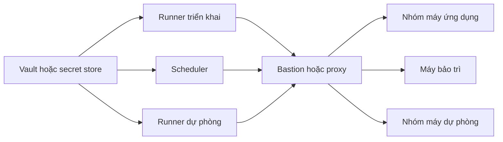
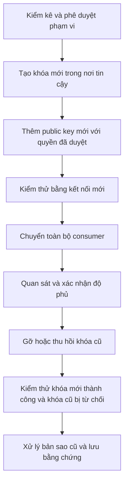

# Key rotation trong quản lý truy cập SSH đặc quyền

## 1. Mục tiêu và phạm vi

Một SSH key được sinh an toàn vẫn có thể trở thành rủi ro sau nhiều tháng sử dụng: chủ sở hữu chuyển nhóm, bản sao private key nằm lại trong máy CI cũ, public key còn tồn tại trên máy chủ đã đổi người quản trị, hoặc quyền của tài khoản đích đã rộng hơn nhu cầu ban đầu. **Key rotation** là quá trình thay cặp khóa đang dùng bằng cặp khóa mới, chuyển các bên sử dụng sang khóa mới và thu hồi khả năng xác thực bằng khóa cũ.

Trong PAM — Privileged Access Management — mục tiêu không chỉ là có một file khóa mới. Quy trình phải trả lời được:

- Ai hoặc workload nào sở hữu khóa, được vào tài khoản nào và vì mục đích gì?
- Khóa mới đã hoạt động trên những đường truy cập cần thiết chưa?
- Khóa cũ còn được chấp nhận ở đâu, kể cả bastion, bản sao cấu hình và máy chủ dự phòng?
- Ai phê duyệt, ai triển khai và bằng chứng nào chứng minh đã thu hồi?

Bài này tập trung vào **khóa xác thực người dùng hoặc workload tới SSH server**. Không đồng nhất loại khóa này với SSH host key, khóa của SSH certificate authority, mật khẩu tài khoản hay token truy cập vault.

Sau bài học, bạn có thể lập kế hoạch rotation cho tài khoản quản trị và tài khoản dịch vụ, triển khai giai đoạn chồng lấp có giới hạn, xác minh đúng khóa được dùng, thu hồi khóa cũ và xử lý ngoại lệ mà không làm mất khả năng ứng phó sự cố.

## 2. Rotation thực sự thay đổi điều gì?

Giả sử tài khoản `deploy` trên một máy chủ chấp nhận public key `K_old`. Private key tương ứng do một workload triển khai ứng dụng giữ. Một lượt rotation thành công tạo ra trạng thái sau:

```text
Trước rotation:
  Workload dùng private K_old
  Server chấp nhận public K_old

Trong khoảng chuyển tiếp:
  Workload mới dùng private K_new
  Server tạm chấp nhận public K_old và public K_new

Sau rotation:
  Các consumer hợp lệ dùng private K_new
  Server không còn chấp nhận public K_old
  Bản sao private K_old được xử lý theo chính sách
```

Điểm quyết định nằm ở **phía chấp nhận xác thực**. Xóa private key khỏi một laptop không thu hồi được bản sao mà người khác đã giữ. Ngược lại, gỡ public key khỏi mọi nơi chấp nhận khóa đó có thể chặn xác thực mới, dù một bản sao private key vẫn còn tồn tại.

| Thao tác | Có phải rotation hoàn chỉnh? | Lý do |
|---|---|---|
| Đổi tên file `id_ed25519` | Không | Cặp khóa và quyền xác thực không thay đổi |
| Đổi passphrase của private key | Không | Public key vẫn như cũ; bản sao private key cũ có thể vẫn sử dụng được |
| Tạo cặp khóa mới rồi giữ cả hai vô thời hạn | Không | Khóa cũ vẫn là đường truy cập hợp lệ |
| Đổi nội dung comment của public key | Không | Comment không làm đổi vật liệu khóa hoặc quyền xác thực |
| Triển khai khóa mới, chuyển consumer, thu hồi khóa cũ và kiểm chứng | Có | Cả đường sử dụng lẫn đường chấp nhận xác thực đã được chuyển |

**Fingerprint** là dấu vân tay dùng để nhận diện public key. Trong quy trình vận hành, dùng fingerprint để đối chiếu khóa; tên file và comment chỉ là thông tin hỗ trợ vì chúng có thể bị đổi hoặc trùng nhau.

## 3. Phân biệt các vòng đời khóa SSH

Một hệ thống có thể có nhiều loại khóa cùng lúc. Áp dụng nhầm quy trình sẽ tạo ra bằng chứng sai hoặc gây gián đoạn không cần thiết.

| Loại khóa | Vai trò | Nơi cần thay đổi khi rotation |
|---|---|---|
| Khóa SSH của quản trị viên | Chứng minh danh tính người truy cập | Thiết bị hoặc kho khóa của người dùng và các nguồn cấp quyền phía server |
| Khóa SSH của workload | Xác thực pipeline, scheduler hoặc ứng dụng | Kho bí mật, các consumer và các nguồn cấp quyền phía server |
| SSH host key | Chứng minh danh tính SSH server | Cấu hình server và dữ liệu tin cậy phía client, chẳng hạn `known_hosts` |
| Khóa CA ký SSH certificate | Ký chứng thư người dùng hoặc host | Hệ thống ký, trust anchor và kế hoạch chuyển đổi certificate |
| Khóa nằm trong phần cứng | Giữ vật liệu private key trong thiết bị | Đăng ký public key mới, thay thiết bị hoặc cập nhật chứng thư tùy mô hình |

Việc xác minh **host key** vẫn bắt buộc trong lúc rotation khóa người dùng. Không tắt kiểm tra danh tính server chỉ để vượt qua một bài kiểm thử đang thất bại.

## 4. Chọn thời điểm rotation theo rủi ro

Rotation có thể được kích hoạt bởi lịch vận hành hoặc một sự kiện. Không có một chu kỳ duy nhất phù hợp cho mọi tài khoản và mọi tổ chức.

### 4.1. Rotation theo kế hoạch

Chu kỳ được xác định từ mức đặc quyền, độ nhạy của tài nguyên, cách bảo vệ private key, khả năng quan sát việc sử dụng và yêu cầu nội bộ. Khóa của pipeline có quyền quản trị hạ tầng cần được quản lý khác với khóa chỉ được phép chạy một lệnh đọc dữ liệu trên một máy cô lập.

Lịch rotation có ý nghĩa khi tổ chức thực sự thực hiện được chuyển đổi và thu hồi. Một quy định có chu kỳ rất ngắn nhưng phải sao chép private key bằng tay qua nhiều nơi có thể làm tăng số bản sao bí mật và tỷ lệ sai sót.

### 4.2. Rotation theo sự kiện

Các tín hiệu thường gặp gồm:

- Nhân sự rời tổ chức hoặc thay đổi vai trò, đặc biệt khi từng dùng chung một khóa.
- Private key xuất hiện trong repository, artifact, ticket, log hoặc thiết bị mất kiểm soát.
- Máy trạm, runner hoặc vault liên quan có dấu hiệu bị xâm nhập.
- Không xác định được chủ sở hữu hay toàn bộ nơi sử dụng khóa.
- Thay đổi chính sách thuật toán, định dạng hoặc nơi lưu trữ được tổ chức phê duyệt.
- Kết thúc một đợt truy cập khẩn cấp có cấp khóa tạm thời.

Nếu nghi ngờ lộ khóa, ưu tiên cô lập và thu hồi theo quy trình ứng phó sự cố. Không mặc định giữ khóa cũ hoạt động suốt cửa sổ chuyển đổi thông thường chỉ để tránh thay đổi lịch triển khai.

## 5. Lập inventory: một khóa có thể có nhiều consumer và nhiều đích

Một lỗi phổ biến là xem quan hệ giữa khóa và server như một đường thẳng. Trên thực tế, một khóa có thể được ba runner sử dụng để đăng nhập qua bastion tới nhiều nhóm máy chủ. Rotation chỉ hoàn tất khi đã xử lý toàn bộ quan hệ trong phạm vi.



Sơ đồ chỉ biểu diễn quan hệ truy cập; không hàm ý private key phải được sao chép vào bastion. Thiết kế proxy hoặc broker có thể sử dụng các danh tính riêng cho từng chặng.

Một bản ghi inventory tối thiểu nên có:

| Thuộc tính | Ví dụ minh họa |
|---|---|
| Mã danh tính | `svc-deploy-prod` |
| Chủ sở hữu chịu trách nhiệm | Nhóm Platform; có người dự phòng |
| Fingerprint khóa cũ | `SHA256:<fingerprint-old>` |
| Kho lưu bí mật | Đường dẫn logic trong vault; không đưa private key vào inventory |
| Consumer | Runner chính, runner dự phòng, job phát hành định kỳ |
| Đích và tài khoản | Bastion, nhóm máy ứng dụng; tài khoản `deploy` |
| Nguồn cấp quyền | Cấu hình `authorized_keys` được quản lý tập trung |
| Giới hạn quyền | Lệnh được phép, nguồn kết nối, forwarding theo chính sách |
| Lần sử dụng quan sát được | Thời gian và nguồn log; ghi rõ giới hạn quan sát |
| Hạn hoàn tất rotation | Mốc chuyển consumer và mốc gỡ khóa cũ |
| Phương án phục hồi | Đường quản trị độc lập đã kiểm thử |

Không suy luận “khóa không còn được dùng” chỉ vì không thấy log trong một ngày. Có thể workload chỉ chạy cuối tháng, hoặc đường truy cập không phát log về hệ thống tập trung.

### 5.1. Inventory cả nguồn có thể khôi phục khóa cũ

Không chỉ tìm public key trên máy đang chạy. Cần xác định nguồn cấu hình có thể đưa khóa cũ trở lại:

- Repository quản lý cấu hình và biến inventory của công cụ triển khai.
- Image máy ảo, cloud-init, script bootstrap và cấu hình autoscaling.
- Dữ liệu cấp khóa tập trung qua `AuthorizedKeysCommand` hoặc cơ chế tương đương.
- Snapshot, môi trường dự phòng và quy trình khôi phục máy chủ.
- Secret version, cache trên runner và cấu hình job ít chạy.

Nếu chỉ sửa file trên một server, lần hội tụ cấu hình tiếp theo có thể thêm lại khóa cũ. Nguồn khai báo cần được cập nhật trước hoặc đồng bộ với thay đổi runtime.

## 6. Thiết kế rotation hai giai đoạn

Với rotation theo kế hoạch, mô hình thường dùng là **mở rộng rồi thu hẹp**: thêm khả năng xác thực mới, xác nhận hoạt động, sau đó gỡ khả năng xác thực cũ.



### 6.1. Các điều kiện trước khi bắt đầu

1. Có owner của danh tính và danh sách consumer, đích truy cập trong phạm vi.
2. Có cửa sổ chuyển đổi, thời điểm hết chồng lấp và người chịu trách nhiệm quyết định.
3. Có đường quản trị độc lập để phục hồi khi cập nhật sai. Không dựa duy nhất vào một phiên SSH đang mở.
4. Có khả năng cập nhật nguồn cấu hình chính thức, không chỉ sửa thủ công trạng thái hiện tại.
5. Có kế hoạch kiểm thử xác thực, tác vụ nghiệp vụ và thu hồi khóa cũ.
6. Có chính sách xử lý private key cũ, secret version, cache và bản sao dự phòng.

### 6.2. Giới hạn khoảng chồng lấp

Trong lúc hai public key cùng được chấp nhận, bề mặt xác thực không giảm: cả khóa cũ và mới đều có thể mở đường truy cập. Do đó khoảng chồng lấp phải có thời hạn, phạm vi và cơ chế báo quá hạn.

Ví dụ, một đợt thay đổi có thể yêu cầu các consumer chuyển trong cửa sổ bảo trì đã phê duyệt, sau đó dành thời gian kiểm thử đủ để bao phủ tác vụ quan trọng. Các mốc này là quyết định vận hành theo rủi ro, không phải thuộc tính tự động của SSH.

Không dùng “chờ thêm cho chắc” làm lý do giữ public key cũ vô thời hạn. Consumer không thể chuyển đúng hạn cần có owner, lý do, hạn ngoại lệ và biện pháp giới hạn quyền rõ ràng.

## 7. Tạo và quản lý khóa mới

### 7.1. Tạo một danh tính khóa mới, không ghi đè khóa đang hoạt động

Ví dụ dưới đây dùng môi trường OpenSSH trên máy quản trị Linux hoặc Unix. Đây là mẫu thực hành; chọn thuật toán và nơi lưu trữ theo môi trường và chính sách được duyệt. Không chạy nguyên mẫu lên hệ thống thật khi chưa xác định account, đích và quyền tương ứng.

```bash
# Chạy trong terminal tin cậy của người sở hữu khóa.
# Tên mới giúp tránh ghi đè private key đang được sử dụng.
ssh-keygen -t ed25519 \
  -f "$HOME/.ssh/pam_deploy_next" \
  -C 'svc-deploy-prod rotation-next'

# Ghi nhận fingerprint của public key mới.
ssh-keygen -l -E sha256 -f "$HOME/.ssh/pam_deploy_next.pub"
```

Với khóa do người dùng trực tiếp giữ, nhập passphrase tại lời nhắc và bảo vệ thiết bị theo chính sách. Không đưa passphrase vào tham số dòng lệnh, script, ticket hoặc log. Nếu môi trường yêu cầu thuật toán khác hoặc thiết bị phần cứng, thực hiện theo phương án đã được phê duyệt thay vì cố dùng ví dụ trên.

Với workload, chọn cơ chế cấp khóa mà workload có thể sử dụng an toàn: vault, agent được kiểm soát, broker hoặc danh tính ngắn hạn phù hợp. Không giải quyết bài toán không tương tác bằng cách chép private key không bảo vệ vào image dùng chung.

### 7.2. Phân phối đúng thành phần

- **Public key** đi tới nguồn cấp quyền phía SSH server, kèm các giới hạn được phê duyệt.
- **Private key** chỉ tới nơi được phép thực hiện xác thực. Không phân phối private key tới toàn bộ server đích.
- **Fingerprint và metadata** đi vào hồ sơ thay đổi, inventory và bằng chứng kiểm chứng.

Khóa mới không mặc nhiên được thừa hưởng toàn bộ quyền lịch sử của khóa cũ. Đây là cơ hội kiểm tra lại least privilege: tài khoản đích, lệnh cho phép, nguồn kết nối, quyền dùng agent, port forwarding và thời gian sử dụng.

### 7.3. Không coi vault là bằng chứng rotation đã hoàn tất

Tạo một secret version mới chỉ chứng minh vault đã lưu vật liệu mới. Consumer có thể vẫn cache bản cũ, đọc một version được ghim, hoặc chưa được khởi động lại theo thiết kế.

Cần xác nhận rõ:

1. Public key mới đã được triển khai tới các đích cần thiết.
2. Consumer thực sự đọc version mới, không chỉ có quyền đọc nó.
3. Consumer đã mở kết nối mới bằng đúng danh tính khóa mới.
4. Version cũ đã bị hạn chế hoặc vô hiệu hóa theo kế hoạch.

Thay đổi quyền đọc secret không thu hồi được private key mà consumer đã lấy trước đó. Phía server vẫn phải ngừng chấp nhận public key cũ.

## 8. Triển khai public key mới mà không làm rộng quyền

Trong mô hình `authorized_keys`, hãy quản lý **toàn bộ dòng cấp quyền**, bao gồm options và public key. Nếu khóa cũ bị giới hạn bởi nguồn kết nối hoặc forced command, việc thêm khóa mới thành một dòng không có giới hạn có thể mở rộng quyền dù mục tiêu chỉ là rotation.

Ví dụ khái niệm:

```text
# Trạng thái chuyển tiếp, do công cụ quản lý cấu hình tạo ra.
<options-da-duyet> ssh-ed25519 <public-key-old> owner=svc-deploy-prod
<options-da-duyet> ssh-ed25519 <public-key-new> owner=svc-deploy-prod
```

Các chuỗi trong dấu `<...>` là placeholder, không phải cấu hình để sao chép trực tiếp. Cần kiểm tra tính tương thích của options trên hệ thống đang dùng và bảo đảm giới hạn tương ứng vẫn còn hiệu lực.

Những nguyên tắc triển khai quan trọng:

- Kiểm tra đường dẫn public key thực tế. `AuthorizedKeysFile` có thể không dùng vị trí mặc định hoặc có thể khai báo nhiều file.
- Giữ đúng owner và quyền truy cập của thư mục, file theo yêu cầu của SSH server. Trên Unix, `.ssh` với quyền `700` và `authorized_keys` với quyền `600` là cấu hình thường dùng cho tài khoản cá nhân; vẫn cần xét owner, thư mục cha và cơ chế quản lý tại chỗ.
- Cập nhật theo cách tránh file nửa chừng, chẳng hạn cơ chế ghi file tạm rồi thay thế nguyên tử của công cụ quản lý cấu hình. Việc thay thế phải bảo toàn owner, mode và ngữ cảnh bảo mật cần thiết.
- Không xóa dòng dựa vào comment như `old-key`. Đối chiếu đúng vật liệu public key hoặc fingerprint qua công cụ hiểu cấu trúc khóa.
- Không dùng thao tác “giữ đúng một key” cho file dùng chung nếu chưa biết các danh tính hợp lệ khác trong file đó.

Với OpenSSH dùng file `authorized_keys`, thay đổi file thường được áp dụng cho các lần xác thực tiếp theo mà không cần restart dịch vụ. Nếu thay cấu hình `sshd` hoặc cơ chế cấp khóa khác, tuân theo quy trình kiểm tra và nạp cấu hình riêng của môi trường.

## 9. Kiểm thử đúng khóa, đúng kết nối, đúng quyền

Một thông báo “SSH thành công” chưa đủ chứng minh rotation thành công. Client có thể dùng khóa khác trong agent, phương thức xác thực khác hoặc một kết nối đã được xác thực từ trước.

### 9.1. Kiểm tra fingerprint và danh tính đích

Trước khi thử, ghi nhận fingerprint khóa mới và đối chiếu với public key đã triển khai. Phía client phải xác minh host key bằng dữ liệu tin cậy được chuẩn bị trước. Không coi kết quả thu được từ một kết nối chưa xác minh server là bằng chứng hợp lệ.

Trong lab này, giả sử:

- Máy đích là `app01.example.internal`, truy cập trực tiếp ở cổng `22`.
- Tài khoản đích là `deploy`.
- Host key đã được xác minh và lưu trong kho `known_hosts` thích hợp.
- Khóa mới đã được thêm ở phía server với quyền được phê duyệt.

Một lệnh kiểm thử tương tác cho khóa mới:

```bash
ssh -F /dev/null \
  -p 22 \
  -i "$HOME/.ssh/pam_deploy_next" \
  -o IdentitiesOnly=yes \
  -o PreferredAuthentications=publickey \
  -o PasswordAuthentication=no \
  -o KbdInteractiveAuthentication=no \
  -o StrictHostKeyChecking=yes \
  -o ControlMaster=no \
  -o ControlPath=none \
  -o ForwardAgent=no \
  deploy@app01.example.internal 'id -un'
```

Ý nghĩa của các lựa chọn trong bài kiểm thử:

| Lựa chọn | Vấn đề cần loại trừ |
|---|---|
| `-F /dev/null` | Cấu hình client ẩn có thể thêm identity hoặc thay đổi tuyến truy cập |
| `-i` cùng `IdentitiesOnly=yes` | Thu hẹp lựa chọn về identity được chỉ định; vẫn cần đối chiếu fingerprint |
| Chỉ ưu tiên `publickey`, tắt password và keyboard-interactive | Tránh thành công nhờ một phương thức khác |
| `StrictHostKeyChecking=yes` | Yêu cầu server đã được tin cậy trước khi thử |
| `ControlMaster=no`, `ControlPath=none` | Không tái sử dụng kết nối multiplex đã xác thực bằng khóa cũ |
| `ForwardAgent=no` | Không mở rộng việc sử dụng agent sang máy đích trong bài kiểm thử |

`-F /dev/null` cũng bỏ cấu hình bastion, cổng và các tùy chọn riêng của hệ thống. Với đường truy cập qua proxy hoặc bastion, dùng cấu hình kiểm thử được kiểm soát có khai báo đầy đủ từng chặng; không sao chép lệnh truy cập trực tiếp rồi kết luận hệ thống lỗi.

Nếu tài khoản chỉ được chạy forced command, lệnh `id -un` có thể không được phép hoặc không phản ánh lệnh thực sự được chạy. Khi đó kiểm thử đúng tác vụ được cho phép và dùng log phía server để xác nhận tài khoản, khóa và quyết định cấp quyền.

### 9.2. Kiểm thử workload không tương tác

Một bài kiểm thử thành công trên laptop chưa chứng minh runner sản xuất đã chuyển khóa. Hãy chạy tác vụ thử từ chính môi trường consumer với:

- Version secret đã được xác định.
- Khả năng mở khóa private key qua cơ chế được phê duyệt.
- Kết nối SSH mới và fingerprint xác thực quan sát được.
- Tác vụ nghiệp vụ tối thiểu có ý nghĩa nhưng ít tác động.

Có thể dùng `BatchMode=yes` để bài kiểm thử không chờ nhập liệu. Tuy nhiên, private key có passphrase nhưng không có agent hoặc cơ chế mở khóa phù hợp sẽ thất bại ngay ở client. Lỗi đó không chứng minh server đã từ chối public key.

### 9.3. Kiểm chứng các giới hạn quyền

Sau xác thực, thử cả trường hợp được phép và một trường hợp bị cấm trong môi trường kiểm thử được duyệt. Ví dụ: job được chạy lệnh triển khai đã duyệt nhưng không được mở shell quản trị tùy ý hoặc tạo tunnel khi chính sách không cho phép.

Không dùng một bài kiểm thử có khả năng thay đổi dữ liệu sản xuất ngoài phạm vi change. Bằng chứng cần thể hiện khóa mới hoạt động **với đúng quyền**, không phải chỉ hoạt động bằng mọi cách.

## 10. Thu hồi khóa cũ và xác minh kết quả

### 10.1. Đóng các nơi chấp nhận khóa cũ

Khi các consumer cần thiết đã chuyển và đạt điều kiện hoàn tất giai đoạn chồng lấp:

1. Gỡ public key cũ khỏi nguồn cấu hình chính thức.
2. Triển khai thay đổi tới tất cả đích, tài khoản và đường cấp quyền trong phạm vi.
3. Cập nhật nguồn bootstrap và phục hồi để khóa cũ không xuất hiện lại.
4. Hạn chế hoặc vô hiệu hóa quyền lấy secret version cũ theo chính sách.
5. Xử lý cache và bản sao private key cũ ở những nơi đang kiểm soát.

Nếu dùng cơ chế danh sách thu hồi, chẳng hạn OpenSSH KRL thông qua cấu hình `RevokedKeys`, cần bảo đảm server thực sự sử dụng danh sách đó và dữ liệu được phân phối đầy đủ. Một file KRL mới nằm trong repository chưa chặn được xác thực. Khi cập nhật, phải giữ các mục thu hồi còn hiệu lực; không vô tình thay toàn bộ danh sách bằng một mục mới.

Không mặc định việc gỡ một dòng trong `authorized_keys` đã xử lý hết các nguồn khác như file cấp quyền thứ hai, nguồn cấp khóa tập trung hoặc đường xác thực bằng certificate.

### 10.2. Kiểm thử âm phải có nguyên nhân xác định

Kiểm thử khóa cũ cần chứng minh nó bị từ chối tại đúng nơi cấp quyền. Những kết quả sau **không đủ**:

- Máy chủ mất mạng hoặc DNS không phân giải được.
- Client không tìm thấy file private key.
- Private key có passphrase nhưng bài kiểm thử không thể mở khóa.
- Host key không khớp nên client dừng trước xác thực người dùng.
- Tài khoản bị khóa vì nguyên nhân khác, làm cả khóa cũ lẫn mới đều thất bại.

Một cách kiểm thử có kiểm soát là dùng client thử nghiệm riêng, tạm có khả năng sử dụng khóa cũ theo phê duyệt, chỉ cho phép xác thực public key bằng identity đó và mở kết nối mới tới đích. Đối chiếu log để xác nhận **đúng fingerprint cũ đã được đề nghị và không được chấp nhận**. Đồng thời thử khóa mới để chứng minh đường truy cập vẫn hoạt động.

Nếu dùng agent cho bài kiểm thử, giới hạn agent và identity được phép; không để client chuyển sang khóa hợp lệ khác. Với OpenSSH, chỉ định file public key tương ứng qua `-i` có thể dùng để chọn khóa có private key nằm trong agent, nhưng phải bảo đảm agent thực sự có khóa cần thử và kiểm chứng fingerprint. Không lưu giữ khóa cũ lâu hơn yêu cầu chỉ để thuận tiện kiểm thử.

Log debug của client có thể chứa hostname, username, fingerprint và đường dẫn nội bộ. Chỉ lưu phần cần thiết trong nơi được kiểm soát; không bật ghi bí mật hoặc đính kèm private key vào hồ sơ thay đổi.

### 10.3. Thu hồi khóa không tự kết thúc phiên đang mở

Gỡ public key thường ngăn **lần xác thực mới**, không tự đóng phiên SSH đã xác thực trước đó. Kết nối multiplex, phiên qua bastion, tiến trình nền và quyền đã đạt được từ một phiên trước có thể vẫn còn hiệu lực.

Nếu rotation là một phần của ứng phó sự cố, cần đánh giá và xử lý các phiên đang hoạt động, kênh truy cập khác, tác vụ đã khởi chạy và thay đổi trái phép. Không đánh dấu sự cố đã được cô lập chỉ vì kiểm thử khóa cũ cho kết quả từ chối.

### 10.4. Xử lý private key cũ và bản sao dự phòng

Xóa file trên một thiết bị không đảm bảo loại bỏ mọi bản sao, đặc biệt với snapshot, SSD, backup hoặc artifact đã được nhân bản. Quy trình cần xác định các vị trí đang kiểm soát, thu hồi quyền đọc, xử lý cache và áp dụng chính sách lưu giữ thích hợp.

Bản sao dự phòng có thể phải giữ theo chính sách phục hồi hoặc điều tra. Khi đó kiểm soát truy cập và trạng thái thu hồi phía server phải tiếp tục có hiệu lực; bài kiểm thử phục hồi cần bảo đảm backup không đưa public key cũ trở lại một hệ thống đang cho phép đăng nhập.

## 11. Chuyển consumer an toàn: canary, cache và thứ tự cập nhật

Với nhiều server hoặc nhiều consumer, chia rollout thành nhóm nhỏ giúp phát hiện lỗi sớm. Canary phải đại diện cho đường truy cập và loại workload cần kiểm thử, không chỉ là máy dễ đăng nhập nhất.

Ví dụ kế hoạch cho ba nhóm consumer:

| Giai đoạn | Thay đổi | Điều kiện đi tiếp |
|---|---|---|
| Chuẩn bị | Tạo khóa mới, cập nhật nguồn cấp quyền và kiểm tra đường phục hồi | Fingerprint, quyền và phạm vi được xác nhận |
| Canary | Chuyển một runner thử trên nhóm đích đại diện | Kết nối mới và tác vụ tối thiểu thành công bằng khóa mới |
| Mở rộng | Chuyển runner chính, scheduler và runner dự phòng | Có bằng chứng từng consumer đã nhận và sử dụng khóa mới |
| Thu hồi | Gỡ khóa cũ trên tất cả nguồn chấp nhận trong phạm vi | Khóa cũ bị từ chối, khóa mới vẫn hoạt động |
| Hoàn tất | Dọn secret version, cache, cập nhật inventory và hồ sơ | Không còn ngoại lệ chưa có owner và hạn xử lý |

Với consumer chỉ chạy theo lịch dài, có thể thực hiện một lần chạy thử được phê duyệt hoặc xác nhận bằng cơ chế kiểm thử tương đương. Không giữ khóa cũ nhiều tuần chỉ vì chưa có lịch chạy tiếp theo mà không quản lý ngoại lệ.

### 11.1. Phiên bản secret phải được theo dõi rõ

Một alias như `current` thuận tiện cho quản trị nhưng có thể bị cache. Một version được ghim giúp tái lập nhưng sẽ không tự chuyển khi alias đổi. Chọn cơ chế nào cũng cần biết consumer nhận version mới khi nào và bằng chứng nào thể hiện điều đó.

Không giả định restart luôn là cách duy nhất hoặc luôn đủ. Một ứng dụng có thể đọc secret mỗi lần kết nối, nạp một lần khi khởi động, hoặc nhận khóa qua sidecar. Kế hoạch rotation phải bám vào hành vi thực của consumer.

### 11.2. Tránh cùng một khóa cho nhiều môi trường

Dùng riêng danh tính và khóa cho production, staging và các workload độc lập giúp giới hạn phạm vi ảnh hưởng khi rotation hoặc lộ khóa. Nếu một khóa cũ dùng chung ở nhiều môi trường, inventory và kế hoạch thu hồi phải bao phủ các môi trường đó; không chỉ xử lý nơi vừa phát hiện vấn đề.

## 12. Rollback và xử lý lỗi

Rollback phải phục hồi được dịch vụ mà không làm mất kiểm soát quyền. Trước khi thay đổi, xác định rõ rollback cho **consumer**, cho **public key được chấp nhận** và cho **kho bí mật**; đây có thể là ba thao tác khác nhau.

| Tình huống | Kiểm tra ưu tiên | Cách xử lý trong phạm vi đã duyệt |
|---|---|---|
| Khóa mới chưa xác thực được | Fingerprint, tài khoản, đường cấp khóa, owner và mode | Sửa nguồn cấu hình hoặc quay lại consumer cũ trong cửa sổ chồng lấp hợp lệ |
| Client thử thành công nhưng job thất bại | Secret version, agent, cache, cấu hình và quyền đọc của runner | Sửa consumer rồi kiểm thử từ chính runtime của job |
| SSH thành công nhưng tác vụ bị từ chối | Forced command, options, quyền tài khoản và quyền ứng dụng | Khôi phục đúng quyền được duyệt, không mở shell rộng để né lỗi |
| Một phần server chưa nhận khóa mới | Trạng thái rollout và khả năng kết nối của nhóm đích | Tạm dừng thu hồi trên phần chưa đủ điều kiện; quản lý ngoại lệ có thời hạn |
| Khóa cũ xuất hiện lại sau khi đã gỡ | Image, bootstrap, repository hoặc công cụ hội tụ cấu hình | Sửa nguồn sinh cấu hình, triển khai lại và kiểm chứng |
| Khóa cũ nghi bị lộ | Phạm vi ảnh hưởng, phiên đang mở và đường truy cập liên quan | Dùng đường phục hồi độc lập; không đưa khóa nghi lộ trở lại làm rollback |

Không dùng việc giảm kiểm tra host key, bật đăng nhập root rộng hoặc thêm một public key dùng chung không có owner làm phương án phục hồi mặc định.

Nếu xuất hiện lỗi giữa chừng, ghi trạng thái từng đích và từng consumer. Một dòng “rollback thành công” không có độ phủ có thể che giấu trạng thái hỗn hợp: nơi dùng khóa cũ, nơi dùng khóa mới và nơi chấp nhận cả hai.

## 13. Bằng chứng và tiêu chí hoàn tất

Một đợt rotation có thể chạy được về kỹ thuật nhưng chưa đủ để đóng change nếu không chứng minh được phạm vi và kết quả thu hồi.

Hồ sơ nên có:

- Mã change hoặc sự cố, lý do rotation, phạm vi và owner phê duyệt.
- Fingerprint khóa cũ, khóa mới và danh tính liên quan.
- Phiên bản cấu hình cấp quyền, phiên bản secret và danh sách rollout.
- Bằng chứng consumer dùng khóa mới qua kết nối mới.
- Kết quả tác vụ được phép và kiểm thử giới hạn quyền phù hợp.
- Bằng chứng khóa cũ bị từ chối ở các đường cấp quyền trong phạm vi.
- Thời điểm kết thúc chồng lấp và xử lý phiên cũ khi có yêu cầu.
- Kết quả xử lý cache, secret version, nguồn bootstrap và ngoại lệ.

Không ghi private key hoặc passphrase vào bằng chứng. Một bản ghi fingerprint, thời điểm, đích và kết quả xác thực thường hữu ích hơn một ảnh chụp terminal chứa dữ liệu không được kiểm soát.

### 13.1. Tiêu chí nghiệm thu mẫu

```text
[ ] Owner và phạm vi consumer/đích đã được xác nhận.
[ ] Khóa mới được sinh và giữ trong nơi được phê duyệt.
[ ] Public key mới có đúng quyền và giới hạn cần thiết.
[ ] Mọi consumer trong phạm vi đã dùng khóa mới qua kết nối mới.
[ ] Khóa cũ không còn được chấp nhận qua các nguồn cấp quyền liên quan.
[ ] Kiểm thử khóa cũ thất bại do bị từ chối xác thực, không phải do lỗi client/mạng.
[ ] Khóa mới vẫn xác thực và thực hiện đúng tác vụ sau thu hồi.
[ ] Nguồn bootstrap, autoscaling và phục hồi không đưa khóa cũ trở lại.
[ ] Cache, secret version và bản sao cũ đã được xử lý theo chính sách.
[ ] Ngoại lệ còn lại có owner, hạn xử lý và biện pháp giới hạn quyền.
[ ] Bằng chứng đã lưu và inventory đã cập nhật.
```

Một chỉ số vận hành hữu ích là tỷ lệ rotation hoàn tất trước hạn và thời gian từ khi bắt đầu chuyển consumer tới khi thu hồi khóa cũ. Cũng nên theo dõi số khóa không owner, số khóa quá hạn và số lần khóa đã thu hồi xuất hiện lại. Không dùng duy nhất “số khóa mới đã tạo” để đánh giá kết quả.

## 14. SSH certificate thay đổi quy trình ra sao?

Khi dùng SSH certificate, client có private key và một certificate được CA ký. Certificate có thể giới hạn thời gian hiệu lực và principal, giúp giảm việc phân phối từng public key dài hạn tới mọi server.

Tuy nhiên, cần phân biệt ba thao tác:

1. **Gia hạn hoặc cấp lại certificate:** có thể vẫn dùng cùng một cặp khóa bên dưới.
2. **Rotation cặp khóa của client:** tạo private/public key mới và cấp certificate phù hợp cho khóa mới.
3. **Rotation CA:** chuyển trust anchor và khả năng ký; có phạm vi ảnh hưởng lớn hơn.

Certificate ngắn hạn không tự bảo vệ được private key đã lộ nếu hệ thống vẫn cho danh tính bị xâm nhập xin certificate mới. Cần quản lý quyền cấp certificate, điều kiện phê duyệt, thời hạn, principal và khả năng thu hồi tương ứng.

Trong lúc chuyển từ raw public key sang certificate, hãy kiểm tra các đường xác thực cùng tồn tại. Nếu public key cũ vẫn được chấp nhận trực tiếp trong `authorized_keys`, việc ngừng cấp certificate chưa chắc đã chặn đường truy cập đó.

## 15. Tình huống thực hành: rotation khóa triển khai qua bastion

### 15.1. Bối cảnh

Nhóm Platform quản lý danh tính `svc-deploy-prod`. Một khóa SSH được runner chính và runner dự phòng sử dụng để truy cập nhóm máy ứng dụng qua bastion. Tài khoản đích chỉ được thực hiện lệnh triển khai được duyệt. Public key do công cụ quản lý cấu hình phân phối; private key nằm trong vault.

Trong quá trình kiểm kê, nhóm phát hiện image runner dự phòng đã cũ và job bảo trì chỉ chạy định kỳ. Không có dấu hiệu lộ khóa; rotation được thực hiện theo kế hoạch.

### 15.2. Cách thực hiện

**Chuẩn bị:** xác định fingerprint cũ, chủ sở hữu, hai runner, job định kỳ, danh sách đích và cách bastion xác thực từng chặng. Kiểm thử một đường quản trị độc lập. Xác định rõ khóa nào đang được rotation; không giả định hai chặng dùng cùng danh tính.

**Tạo và cấp quyền:** tạo khóa mới trong nơi được duyệt, lưu version mới trong vault và phân phối public key với cùng giới hạn đã rà soát. Cập nhật cả nguồn bootstrap để máy được tạo thêm cũng nhận trạng thái đúng.

**Canary:** chuyển một runner thử sang secret version mới. Mở kết nối mới qua đúng đường bastion, xác minh fingerprint trên chặng liên quan và chạy một tác vụ triển khai thử ít tác động. Kiểm tra tác vụ ngoài quyền vẫn bị chặn.

**Chuyển consumer:** cập nhật runner chính, runner dự phòng và job định kỳ. Với job ít chạy, thực hiện kiểm thử được phê duyệt thay vì chờ tới lịch kế tiếp. Xác nhận image và cấu hình mới không tiếp tục nạp secret version cũ.

**Thu hồi:** gỡ public key cũ khỏi mọi nguồn chấp nhận liên quan, hội tụ cấu hình, ngừng cấp secret version cũ và xử lý cache. Kiểm thử lại bằng khóa mới; kiểm thử âm với khóa cũ qua đường truy cập hợp lệ, đối chiếu đúng fingerprint và nguyên nhân từ chối.

**Đóng change:** lưu bằng chứng độ phủ của các consumer và đích, cập nhật inventory, ghi kết quả xử lý image cũ và thời điểm kết thúc chồng lấp.

### 15.3. Sai sót cần phát hiện

Nếu chỉ runner chính được chuyển, pipeline hằng ngày có thể chạy bình thường nhưng runner dự phòng thất bại khi cần khôi phục. Nếu nhóm giữ khóa cũ để tránh lỗi đó mà không đặt hạn, rotation chưa kết thúc. Nếu nhóm gỡ khóa khỏi server đang chạy nhưng image hoặc cấu hình chính thức vẫn chứa public key cũ, lần tạo máy tiếp theo sẽ phục hồi đường truy cập đã thu hồi.

## 16. Câu hỏi tự kiểm tra

1. Vì sao đổi passphrase không thay thế cho rotation cặp khóa?
2. Một lần SSH thành công có thể dùng khóa cũ dù lệnh vừa thử có chỉ định khóa mới bằng cách nào?
3. Vì sao phải kiểm tra runner dự phòng và job ít chạy trước khi kết thúc chồng lấp?
4. Xóa private key khỏi vault có chặn được bản sao mà workload đã lấy trước đó không?
5. Kiểm thử khóa cũ trả exit code lỗi nhưng host key không khớp: có thể kết luận thu hồi thành công không?
6. Gỡ public key có kết thúc các phiên SSH đang mở không?
7. Khi nào việc rollback bằng khóa cũ không còn là phương án phù hợp?
8. Nếu certificate được cấp lại nhưng public key bên dưới giữ nguyên, đó có phải rotation cặp khóa không?

### Gợi ý trả lời

1. Passphrase bảo vệ bản lưu private key; public key được server chấp nhận vẫn không đổi. Một bản sao cũ có thể vẫn dùng passphrase cũ hoặc đã bị giải mã trước đó.
2. Client có thể tái sử dụng kết nối multiplex đã xác thực, hoặc cấu hình và agent có thể làm bài thử dùng danh tính khác. Phải mở kết nối mới, kiểm soát identity và đối chiếu fingerprint.
3. Các consumer đó cũng có thể giữ private key hoặc secret version cũ. Không quan sát thấy chúng hoạt động hằng ngày không có nghĩa chúng đã chuyển khóa.
4. Không. Thu hồi phải bao gồm việc phía server ngừng chấp nhận public key cũ; quyền đọc secret chỉ kiểm soát những lần lấy tiếp theo.
5. Không. Client chưa đi tới bước xác thực người dùng, nên chưa có bằng chứng khóa cũ bị từ chối bởi nguồn cấp quyền.
6. Thông thường không. Cần quy trình riêng cho phiên và quyền đã được thiết lập nếu yêu cầu vận hành hoặc ứng phó sự cố đòi hỏi.
7. Khi nghi ngờ khóa đã lộ, chủ sở hữu không còn hợp lệ hoặc chính sách đã cấm sử dụng khóa đó. Cần dùng đường phục hồi độc lập và cấp danh tính mới phù hợp.
8. Không. Đó là thay hoặc gia hạn certificate; rotation cặp khóa phải thay vật liệu private/public key tương ứng.

## 17. Các nguyên tắc cần ghi nhớ

Rotation SSH key hoàn tất khi consumer hợp lệ đã chuyển sang khóa mới và các nguồn cấp quyền trong phạm vi đã ngừng chấp nhận khóa cũ. Fingerprint là điểm đối chiếu danh tính khóa; kết nối mới và kiểm thử âm có nguyên nhân rõ ràng là bằng chứng quan trọng.

Trong PAM, quy trình này phải gắn với owner, least privilege, vault, thời hạn chồng lấp và bằng chứng kiểm toán. Tạo khóa mới là một bước; kiểm soát được cả quá trình chuyển đổi và thu hồi mới là kết quả cần đạt.
