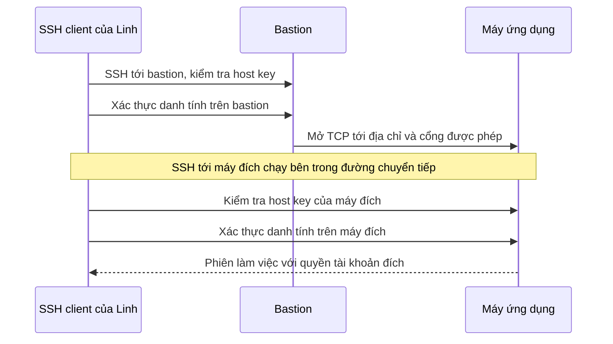

# SSH bastion

## 1. Bastion là điểm kiểm soát trên đường quản trị

SSH bastion là máy hoặc cụm máy làm điểm trung chuyển cho kết nối SSH tới các hệ thống quản trị nằm trong vùng mạng hạn chế. Thay vì cho từng máy chủ production nhận SSH từ nhiều laptop, tổ chức tập trung đường vào qua một cổng được quản lý.

Trong quản lý truy cập đặc quyền, mục tiêu của bastion không dừng ở việc “SSH được vào mạng nội bộ”. Nó phải góp phần trả lời được: ai truy cập, được phép tới tài nguyên nào, vào thời điểm nào, dùng danh tính gì và để lại bằng chứng nào. Bastion hỗ trợ kiểm soát đường đi; hệ thống PAM còn cần quản lý vòng đời quyền, credential, nâng quyền và phiên làm việc.

Bài học thuộc chương **SSH và key**, tập trung vào cách thiết kế và vận hành bastion trong phạm vi PAM cho tài khoản quản trị, dịch vụ và hạ tầng nhạy cảm. Các cấu hình dưới đây là ví dụ thiết kế để thực hành, không phải cấu hình production dùng chung cho mọi hệ điều hành.

Sau bài học, người học cần có khả năng:

- Mô tả đúng luồng SSH qua bastion và nơi thực hiện từng lần xác thực.
- Phân biệt bastion chuyển tiếp TCP với gateway PAM kết thúc và tạo lại phiên SSH.
- Thiết kế quyền truy cập tối thiểu ở cả mạng, bastion, máy đích và cơ chế nâng quyền.
- Kết hợp bastion với JIT, SSH certificate, vault và thu hồi truy cập.
- Xây dựng kiểm thử cho phép/từ chối và chuỗi bằng chứng phục vụ điều tra.

## 2. Tình huống: vận hành ứng dụng qua một cửa vào có kiểm soát

Nhóm vận hành cần kiểm tra dịch vụ thanh toán trên hai máy chủ nội bộ:

| Thành phần | Giá trị ví dụ | Vai trò |
|---|---|---|
| Máy quản trị | Laptop được tổ chức quản lý | Chạy SSH client, giữ hoặc sử dụng khóa cá nhân |
| Bastion | `bastion-prod.example.net` | Nhận kết nối quản trị từ vùng được cho phép |
| Máy ứng dụng A | `10.40.12.21:22` | Tài nguyên thuộc phạm vi appops |
| Máy ứng dụng B | `10.40.12.22:22` | Tài nguyên thuộc phạm vi appops |
| Máy cơ sở dữ liệu | `10.40.20.11:22` | Thuộc nhóm quyền khác |
| Người vận hành | `linh` | Danh tính cá nhân trên từng tầng |
| Phiếu công việc | `CHG-2048` | Lý do, phạm vi và thời hạn phê duyệt |

Yêu cầu thiết kế là Linh chỉ đi qua bastion tới hai máy ứng dụng khi có quyền phù hợp. Quyền đó không bao gồm shell trên bastion, không bao gồm máy cơ sở dữ liệu và không tự động bao gồm quyền root trên máy ứng dụng.

Đây là ba phạm vi khác nhau. Một tài khoản có thể được phép đăng nhập bastion nhưng bị từ chối ở máy đích. Một người đã đăng nhập máy đích vẫn có thể bị từ chối thực hiện thao tác cần đặc quyền. Không dùng thành công ở một tầng để suy ra quyền ở tầng tiếp theo.

## 3. Luồng ProxyJump và các ranh giới tin cậy

Một cách phổ biến để sử dụng bastion là `ProxyJump` của OpenSSH:



OpenSSH mô tả `-J` là kết nối SSH tới jump host rồi chuyển tiếp TCP tới đích. Lựa chọn cấu hình cho jump host cần được khai báo riêng, vì tùy chọn dòng lệnh thường áp dụng cho máy đích. [Tài liệu ssh(1)](https://man.openbsd.org/ssh)

Trong mô hình này có hai quan hệ tin cậy độc lập:

1. Client tin rằng nó đang nói chuyện với đúng bastion và chứng minh quyền sử dụng bastion.
2. Client tin rằng nó đang nói chuyện với đúng máy đích và chứng minh quyền đăng nhập máy đích.

Bastion mở kết nối mạng tới máy đích nhưng không vì thế trở thành chủ thể được tin cậy thay cho người dùng. Private key dùng để xác thực máy đích có thể tiếp tục nằm trên máy quản trị hoặc thiết bị bảo vệ khóa của người dùng.

Ở tầng mạng, máy đích thường nhìn thấy địa chỉ nguồn của bastion, tùy thiết kế NAT và định tuyến. Điều đó hữu ích cho firewall nhưng không đủ để nhận diện Linh. Định danh cá nhân phải được giữ ở tầng xác thực và bằng chứng liên kết.

### 3.1. Bastion chuyển tiếp và proxy PAM khác nhau ở đâu?

| Thuộc tính | Bastion chuyển tiếp với ProxyJump | Gateway PAM kết thúc phiên |
|---|---|---|
| SSH tới máy đích kết thúc ở đâu? | Client người dùng và máy đích | Gateway và máy đích |
| Ai xác thực với máy đích? | Client dùng credential của người dùng | Gateway dùng credential hoặc danh tính được cấp |
| Ai kiểm tra host key máy đích? | Client | Gateway |
| Bastion/gateway đọc được nội dung phiên đích? | Không theo cơ chế chuyển tiếp thông thường | Có thể, tùy cách triển khai |
| Ghi hình terminal ở điểm giữa | Không có sẵn chỉ nhờ ProxyJump | Có thể tích hợp nếu sản phẩm hỗ trợ |
| Credential đích trong vault | Không tự được đưa vào luồng | Có thể được gateway truy xuất hoặc cấp phát |
| Quyết định kiến trúc chính | Giữ SSH tới đích giữa client và đích | Đặt thêm niềm tin vào gateway và cơ chế ghi phiên |

Bảng là phân tích hai mô hình triển khai, không phải cam kết tính năng của một sản phẩm PAM cụ thể. Khi đánh giá sản phẩm, cần kiểm tra đường đi thực tế của credential, điểm giải mã và dữ liệu được ghi.

Một sơ đồ ghi chữ “bastion + recording” chưa chứng minh rằng các lệnh trong máy đích được ghi. Phải chỉ ra thành phần nào quan sát được nội dung và bằng chứng nào xác nhận phạm vi quan sát đó.

## 4. Mô hình đe dọa trước khi viết cấu hình

Thiết kế bastion nên bắt đầu bằng tài sản cần bảo vệ và điều kiện tấn công, thay vì bắt đầu bằng một danh sách tùy chọn SSH.

### 4.1. Những tình huống cần xem xét

**Laptop quản trị bị chiếm quyền.** Kẻ tấn công có thể sử dụng credential còn hiệu lực từ nguồn mạng hợp lệ. Chỉ giới hạn địa chỉ IP không xử lý đủ tình huống này. Cần kết hợp bảo vệ thiết bị, MFA hoặc quy trình cấp credential sau MFA, quyền ngắn hạn và giám sát.

**Một tài khoản bastion bị lộ.** Nếu bastion cho shell, có công cụ kết nối tùy ý và egress rộng, tài khoản đó có thể trở thành điểm di chuyển ngang. Hạn chế phiên trên bastion và giới hạn đích là hai lớp bổ sung cho nhau.

**Bastion bị chiếm quyền root.** Kẻ tấn công có thể thay đổi chính sách cục bộ, đọc metadata kết nối và tác động đường truyền. Không nên đặt credential dài hạn cho toàn bộ production hoặc khóa ký CA trên bastion. Việc kiểm tra host key từ client giúp bảo vệ một ranh giới quan trọng nhưng không làm máy bastion đã bị chiếm quyền trở nên an toàn.

**Người dùng có quyền hợp lệ nhưng vượt phạm vi công việc.** Một phiên truy cập được phê duyệt để kiểm tra trạng thái ứng dụng không nhất thiết cho phép đọc bản sao cơ sở dữ liệu hay thay đổi firewall. Phân quyền ở máy đích và cơ chế nâng quyền phải thể hiện phạm vi nghiệp vụ.

**Quyền đã hết hạn nhưng phiên cũ còn tồn tại.** Hệ thống chỉ ngừng cấp credential mới có thể vẫn để phiên đã xác thực tiếp tục chạy. Thu hồi cần xử lý cả khả năng mở phiên mới lẫn phiên đang hoạt động.

### 4.2. Các điều kiện thiết kế rút ra từ tình huống

Với tình huống của Linh, có thể xây dựng một chính sách mẫu gồm:

- Chỉ máy quản trị trong vùng được kiểm soát có đường mạng tới bastion.
- Bastion của production không làm cửa vào chung cho mọi môi trường.
- Nhóm appops chỉ được mở kết nối tới hai địa chỉ ứng dụng đã đăng ký.
- Tài khoản sử dụng bastion có danh tính cá nhân, không có shell và không được nâng quyền trên bastion.
- Máy đích tiếp tục xác thực người dùng độc lập, với quyền tài khoản phù hợp.
- Quyền thay đổi hệ thống tại đích được cấp riêng theo công việc.
- Bằng chứng được chuyển ra hệ thống thu thập nằm ngoài quyền sửa của người vận hành.

Đây là chính sách ví dụ do bài học đề xuất. Tổ chức phải điều chỉnh theo tài nguyên, luồng sự cố và yêu cầu sẵn sàng của mình.

## 5. Thiết kế mạng: bắt buộc đường đi nhưng không trao quyền bằng IP

Bastion chỉ kiểm soát hiệu quả khi không tồn tại đường SSH trực tiếp không được quản lý tới cùng máy đích.

| Luồng | Chính sách mẫu | Mục đích |
|---|---|---|
| Vùng quản trị → bastion TCP/22 | Cho phép nguồn đã định danh | Giới hạn cửa vào |
| Laptop → máy ứng dụng TCP/22 trực tiếp | Từ chối | Bắt buộc dùng đường quản trị |
| Bastion → hai máy ứng dụng TCP/22 | Cho phép | Phục vụ phạm vi appops |
| Bastion → database TCP/22 | Từ chối với đường appops | Hạn chế di chuyển ngang |
| Bastion → hệ thống log | Cho phép theo thiết kế thu thập | Chuyển bằng chứng |
| Bastion → dịch vụ hạ tầng cần thiết | Cho phép tường minh | DNS, thời gian, cập nhật và định danh |
| Các luồng còn lại | Theo chính sách mặc định từ chối | Giảm phạm vi kết nối ngoài dự kiến |

Cần kiểm tra cả IPv4, IPv6, giao diện quản trị phụ, peering, VPN, security group và rule firewall cũ. Một rule đúng ở một thiết bị không chứng minh toàn bộ đường đi đã được khóa.

Nếu máy đích chấp nhận SSH từ bastion, nó vẫn phải kiểm tra tài khoản và credential. Quy tắc “đến từ IP bastion thì cho đăng nhập” biến quyền kiểm soát bastion thành quyền truy cập mọi máy phía sau.

Egress của bastion cũng cần quản lý. Khi không có nhu cầu, không cấp quyền truy cập tùy ý tới toàn bộ mạng nội bộ. Đồng thời, đừng chặn dịch vụ định danh hoặc thời gian mà không có phương án thay thế: hệ thống có thể mất khả năng xác thực, xác minh thời hạn hoặc chuyển log đúng lúc cần điều tra.

## 6. Cấu hình client: giữ rõ danh tính của từng tầng

Ví dụ sau dùng hai identity riêng cho bastion và máy đích. Địa chỉ, tên người dùng và tên khóa đều là dữ liệu minh họa.

```sshconfig
Host bastion-prod
    HostName bastion-prod.example.net
    User linh
    IdentityFile ~/.ssh/id_ed25519_bastion
    IdentitiesOnly yes
    ForwardAgent no
    StrictHostKeyChecking yes

Host app-prod-a
    HostName 10.40.12.21
    User linh
    IdentityFile ~/.ssh/id_ed25519_appops
    IdentitiesOnly yes
    ProxyJump bastion-prod
    ForwardAgent no
    StrictHostKeyChecking yes

Host app-prod-b
    HostName 10.40.12.22
    User linh
    IdentityFile ~/.ssh/id_ed25519_appops
    IdentitiesOnly yes
    ProxyJump bastion-prod
    ForwardAgent no
    StrictHostKeyChecking yes
```

Sau khi có dữ liệu host key được xác minh và cấp credential đúng quy trình:

```bash
ssh app-prod-a
```

`HostName` là địa chỉ thật của alias; `IdentityFile` và `IdentitiesOnly` giúp chỉ rõ identity được sử dụng. `StrictHostKeyChecking yes` yêu cầu chuẩn bị dữ liệu tin cậy trước. Đặt cấu hình host cụ thể trước các mặc định rộng vì OpenSSH thường lấy giá trị đầu tiên tìm được. [Tài liệu ssh_config(5)](https://man.openbsd.org/ssh_config.5)

Hai khóa khác nhau hỗ trợ tách phạm vi credential nhưng không tự tạo ra phân quyền. Public key tương ứng vẫn phải được chấp nhận đúng nơi và có khả năng thu hồi. Nếu cả hai khóa cùng nằm trong một laptop bị chiếm quyền, việc tách tên file không loại bỏ rủi ro từ thiết bị đó.

### 6.1. Không chuyển private key lên bastion

Một cách vận hành dễ phát sinh là đăng nhập shell bastion, chép private key lên đó, rồi SSH tiếp. Khi nhiều người làm vậy, bastion trở thành kho credential ngoài quản lý.

ProxyJump cho phép tránh bước lưu khóa đích trên bastion. Không bật agent forwarding chỉ để làm cho luồng truy cập hoạt động: agent được chuyển tiếp có thể bị chủ thể đủ quyền trên máy trung gian sử dụng để xác thực, dù private key không bị xuất ra. [Tài liệu ssh(1), agent forwarding](https://man.openbsd.org/ssh#A)

Với tổ chức cần vault cấp credential thay người dùng, phải chọn luồng tích hợp phù hợp. “Credential nằm trong vault” và “client được quyền dùng credential đó qua bastion” là hai thiết kế riêng; vault không tự tham gia vào một kết nối ProxyJump thông thường.

### 6.2. Xác minh máy chủ ở cả hai tầng

Nhóm vận hành nên phân phối host key hoặc thông tin host CA qua kênh quản lý đáng tin cậy. Một giá trị lấy từ chính kết nối mạng đang nghi ngờ chưa phải bằng chứng xác minh danh tính.

Nếu fingerprint máy đích thay đổi sau khi xây dựng lại hệ thống, cần đối chiếu thay đổi đã được phê duyệt và cập nhật dữ liệu tin cậy có kiểm soát. Không xử lý cảnh báo bằng cách tắt kiểm tra host key trên toàn bộ nhóm production.

Trong cụm bastion, cần quyết định cách nhận diện từng node hoặc tên dịch vụ. Host certificate có thể giúp quản lý danh tính theo tên đã cấp, nhưng vòng đời khóa host, khóa CA và phạm vi tên được ký vẫn phải được kiểm soát.

## 7. Cấu hình bastion chuyển tiếp với đích được giới hạn

Ví dụ dưới đây minh họa hai nhóm tách biệt:

- `ssh-bastion-admin` dành cho quản trị hệ điều hành bastion qua quy trình riêng.
- `ssh-bastion-appops` dành cho người chỉ chuyển tiếp tới máy ứng dụng.

Tài khoản Linh trong bài thuộc nhóm appops. Thành viên các nhóm phải được quản lý tường minh; không dùng chồng nhóm để vô tình cấp quyền rộng hơn.

```sshdconfig
# Phần global của cấu hình ví dụ
PermitRootLogin no
PubkeyAuthentication yes
PasswordAuthentication no
KbdInteractiveAuthentication no
AllowGroups ssh-bastion-admin ssh-bastion-appops

AllowAgentForwarding no
AllowTcpForwarding no
AllowStreamLocalForwarding no
X11Forwarding no
PermitTunnel no
GatewayPorts no
LogLevel VERBOSE

# Khối này phải ở vị trí phù hợp trong cấu hình thực tế
Match Group ssh-bastion-appops
    AllowTcpForwarding local
    PermitOpen 10.40.12.21:22 10.40.12.22:22
    MaxSessions 0
    PermitTTY no
    PermitUserRC no
```

`MaxSessions 0` chặn shell, lệnh và subsystem trong khi vẫn cho phép forwarding. `PermitOpen` giới hạn cặp host:cổng; tên không được tự quy đổi để so khớp. Cấu hình dùng đúng IP như client. Chặn shell cùng egress mới giúp củng cố giới hạn chuyển tiếp. [Tài liệu sshd_config(5)](https://man.openbsd.org/sshd_config)

Điểm cần nhận ra từ ví dụ là người dùng appops không có môi trường shell trên bastion để tự chạy một công cụ mạng khác. `PermitTTY no` riêng lẻ không đủ: chạy lệnh từ xa không nhất thiết cần terminal.

Cấu hình trên sử dụng public key; **chưa triển khai MFA**. Nếu chính sách yêu cầu MFA, đội triển khai cần bổ sung cơ chế xác thực tương thích hoặc quy trình cấp credential ngắn hạn sau MFA và xác định rõ điểm thực thi. Không coi một passphrase mở khóa file cục bộ là bằng chứng máy chủ đã kiểm tra thêm một yếu tố.

`PermitOpen` không phải bộ kiểm tra giao thức ứng dụng. Thiết kế này cho phép kết nối TCP tới cổng SSH đã đăng ký; chính máy đích phải bảo đảm dịch vụ tại cổng đó và kiểm soát hành động của người dùng sau đăng nhập.

Không đặt một cơ chế vô hiệu hóa toàn bộ forwarding rồi kỳ vọng ProxyJump tiếp tục hoạt động. Khi điều chỉnh baseline SSH, cần đưa cả đường truy cập được phép vào kiểm thử để tránh cấu hình có vẻ nghiêm ngặt nhưng làm mất chức năng cần thiết.

### 7.1. Quản lý cấu hình hiệu lực

Cấu hình production có thể có nhiều file include và nhiều khối Match. Đọc một đoạn cấu hình không đủ để kết luận chính sách thực tế.

Kiểm tra cú pháp và cấu hình hiệu lực với bộ tham số đại diện trước khi triển khai:

```bash
sudo /usr/sbin/sshd -t

sudo /usr/sbin/sshd -T \
  -C user=linh,addr=192.0.2.25,host=admin-ws.example.net,laddr=192.0.2.10,lport=22
```

`sshd -t` kiểm tra cấu hình và tính hợp lệ của khóa; `-T -C` giúp xem cấu hình áp dụng cho một kết nối giả định, kể cả Match. Các địa chỉ `192.0.2.0/24` ở đây chỉ là dữ liệu minh họa. [Tài liệu sshd(8)](https://man.openbsd.org/sshd)

Kết quả cần phù hợp với ý định: appops chỉ chuyển tiếp tới hai đích; người quản trị bastion dùng đường quản trị riêng; người ngoài nhóm bị từ chối. Kiểm tra thêm thành viên nhóm thực tế, quyền sửa file cấu hình và cách cơ chế quản lý cấu hình triển khai thay đổi.

Bài thực hành chỉ yêu cầu xây dựng cấu hình trong môi trường thử nghiệm được phép. Với máy đang phục vụ vận hành, cần có kênh phục hồi đã kiểm chứng trước khi reload và xác nhận một kết nối mới hoạt động sau thay đổi.

## 8. Máy đích vẫn phải thi hành least privilege

Nếu bastion hoạt động đúng nhưng mọi người cùng đăng nhập `root` trên máy đích, tổ chức vẫn thiếu định danh cá nhân và giới hạn hành động. Quyền đường đi không thể thay thế quyền thao tác.

Một thiết kế cho Linh có thể là:

1. Đăng nhập máy ứng dụng bằng tài khoản cá nhân `linh` hoặc ánh xạ danh tính có thể truy vết.
2. Chỉ đọc thông tin vận hành phù hợp với nhóm appops.
3. Khi cần restart dịch vụ, xin cấp quyền thao tác cụ thể có thời hạn.
4. Ghi lại sự kiện nâng quyền và liên kết với `CHG-2048`.
5. Kết thúc công việc, thu hồi quyền và kiểm tra phiên còn tồn tại.

Nếu một sản phẩm dùng tài khoản đích dùng chung được quản lý trong vault, cần giữ ánh xạ từ người thực tới phiên sử dụng tài khoản đó. Chỉ có dòng log “svc-admin đăng nhập” chưa đủ để quy trách nhiệm.

Cơ chế sudo hoặc công cụ chạy tác vụ cần được xem xét theo hành vi thực tế. Một quyền cho phép gọi chương trình có khả năng mở shell, sửa file tùy ý hoặc chạy plugin có thể rộng hơn tên lệnh thể hiện. Việc cho phép “một lệnh” không tự chứng minh JEA nếu lệnh đó cho phép thoát ra quyền rộng hơn.

Tài khoản service cũng cần luồng riêng. Không dùng tài khoản của Linh cho cron job hoặc công cụ triển khai để vượt yêu cầu tương tác của con người. Workload cần danh tính, phạm vi đích, vòng đời credential và bằng chứng độc lập; việc có cùng đường bastion không làm hai loại chủ thể giống nhau.

## 9. Kết hợp JIT, certificate và vault

### 9.1. Một quy trình cấp quyền có thời hạn

Ví dụ sau là thiết kế đề xuất cho công việc kéo dài 30 phút; con số được chọn để minh họa, không phải thời hạn chuẩn áp dụng cho mọi công việc.

| Mốc | Hành động kiểm soát | Bằng chứng cần có |
|---|---|---|
| T0 | Linh gửi yêu cầu cho hai máy ứng dụng | Danh tính, tài nguyên, lý do, thời hạn |
| T1 | Người hoặc chính sách có thẩm quyền phê duyệt | Quyết định và phiên bản policy |
| T2 | Hệ thống xác minh điều kiện và cấp quyền ngắn hạn | Kết quả xác thực, lease, dấu thời gian |
| T3 | Linh kết nối qua bastion tới đúng máy đích | Sự kiện hai tầng và liên kết phiên |
| T4 | Linh thực hiện tác vụ đã cho phép | Log đích, nâng quyền, recording nếu có |
| T5 | Hết thời hạn hoặc bị thu hồi | Sự kiện ngừng cấp quyền và xử lý phiên |
| T6 | Rà soát kết quả | Đối chiếu yêu cầu với hành vi thực tế |

Quyền ngắn hạn có thể được thực thi bằng certificate, membership tạm thời, cơ chế của gateway hoặc tổ hợp nhiều lớp. Cần chỉ rõ thành phần nào kiểm tra mỗi điều kiện; tên ticket trong phần mô tả không tự tạo ra chính sách.

### 9.2. SSH certificate trong luồng bastion

Certificate cho phép gắn public key với thông tin được CA ký, như principal và thời hạn. Tổ chức có thể dùng chúng để giảm việc phân phối nhiều public key dài hạn. Khóa ký CA là tài sản có độ nhạy cao và nên được bảo vệ tách khỏi bastion.

Có thể xem thông tin certificate đã được cấp trong môi trường thực hành:

```bash
ssh-keygen -L -f ~/.ssh/id_ed25519_appops-cert.pub
```

OpenSSH hỗ trợ certificate có principal, thời hạn và cơ chế danh sách thu hồi khóa. Lệnh trên chỉ hiển thị thông tin certificate; quyết định chấp nhận vẫn thuộc chính sách trên máy chủ. [Tài liệu ssh-keygen(1)](https://man.openbsd.org/ssh-keygen)

Trong thiết kế PAM, cần kiểm tra:

- Principal nào được chấp nhận cho tài khoản bastion và tài khoản đích?
- Quyền chuyển tiếp và quyền đăng nhập máy đích được cấp cùng hay khác phạm vi?
- Ai được yêu cầu cấp certificate và ai được phê duyệt?
- Certificate được liên kết với người thực, thiết bị và yêu cầu truy cập thế nào?
- Kênh phân phối chính sách thu hồi tới các máy có độ trễ bao nhiêu?
- Nếu dịch vụ cấp credential không sẵn sàng, quy trình vận hành nào được dùng?

Không đặt khóa ký CA trên bastion chỉ để tiện cấp lại certificate tại chỗ. Một sự cố tại điểm trung chuyển khi đó có thể lan sang toàn bộ hệ thống tin cậy certificate đó.

### 9.3. Hết hạn credential và đóng phiên là hai việc riêng

Thời hạn dùng để xác thực không phải bộ đếm tự kết thúc mọi tiến trình đã tạo. Cần kiểm thử hành vi của stack cụ thể đối với phiên đang mở, kết nối được tái sử dụng và tác vụ chạy nền.

Ví dụ, quyền của Linh kết thúc lúc 10:30 nhưng kết nối bắt đầu lúc 10:20. Nếu policy chỉ kiểm tra lúc đăng nhập, phiên cũ có thể tiếp tục hoạt động sau 10:30. Cơ chế đáp ứng yêu cầu “hết thời hạn là ngừng truy cập” phải có khả năng xử lý phiên đang sống và tài nguyên liên quan.

Tương tự, đổi credential trong vault thường ảnh hưởng lần xác thực tiếp theo; nó không phải bằng chứng các phiên cũ đã bị hủy. Khi ứng phó sự cố, phải xác nhận riêng cả kết quả thu hồi và kết quả chấm dứt phiên.

### 9.4. Vai trò của vault

Trong kiến trúc có credential đích do hệ thống giữ, vault hỗ trợ kiểm kê owner, cấp phát theo quyền, luân chuyển và lưu bằng chứng sử dụng. Thành phần lấy credential từ vault cần danh tính riêng và chỉ được truy cập phần credential cần cho công việc.

Với ProxyJump thuần, người dùng vẫn cần một cách xác thực hợp lệ tại máy đích. Nếu mục tiêu là không tiết lộ credential đích cho người dùng, phải lựa chọn thiết kế như gateway thực hiện đăng nhập thay hoặc cấp credential tạm thời có phạm vi phù hợp. Đây là quyết định kiến trúc, không phải một tùy chọn tự có của bastion.

## 10. Thu thập bằng chứng: xác định điều gì thực sự quan sát được

Trong mô hình ProxyJump, điểm bastion quan sát luồng chuyển tiếp nhưng không mặc nhiên thấy plaintext của phiên SSH đích. Vì vậy, cần phân biệt các loại bằng chứng.

| Nguồn | Câu hỏi có thể hỗ trợ trả lời | Giới hạn cần đánh giá |
|---|---|---|
| Hệ thống yêu cầu/phê duyệt | Ai xin quyền, được duyệt gì? | Không chứng minh tác vụ đã thực hiện |
| Dịch vụ cấp credential | Ai được cấp khả năng xác thực? | Không chứng minh phiên đã mở |
| Log xác thực bastion | Ai vào cửa quản trị, từ nguồn nào? | Không tự là bản ghi lệnh tại máy đích |
| Log mạng hoặc gateway | Kết nối đi tới đâu và tồn tại bao lâu? | Metadata không phải nội dung thao tác |
| Log xác thực máy đích | Tài khoản nào được máy đích chấp nhận? | Có thể chỉ thấy IP bastion ở tầng mạng |
| Audit và nâng quyền tại đích | Những hoạt động nào được cấu hình để thu thập? | Độ bao phủ tùy chính sách và công cụ |
| Recording tại điểm có plaintext | Terminal hoặc hoạt động nào được ghi? | Không mặc nhiên bao phủ mọi kênh và tiến trình |

Không khẳng định `LogLevel VERBOSE` sẽ tạo ra toàn bộ bằng chứng về đích chuyển tiếp hay tất cả thao tác. Phải kiểm tra event thực tế được sinh ra với phiên bản và cấu hình đang dùng. Khi thiếu trường cần thiết, bổ sung telemetry hoặc đổi thiết kế thu thập.

### 10.1. Liên kết người, quyền và phiên

Một mô hình bản ghi nghiệp vụ có thể gồm:

```json
{
  "access_request_id": "CHG-2048",
  "subject": "linh",
  "device_id": "admin-ws-17",
  "bastion_node": "bastion-prod-a",
  "target": "10.40.12.21:22",
  "target_account": "linh",
  "credential_reference": "cert-serial-84721",
  "approved_until": "2026-11-27T10:30:00+07:00",
  "session_reference": "access-session-5832"
}
```

Đây là schema minh họa cho hệ thống liên kết bằng chứng, không phải định dạng log mặc định của OpenSSH. Các trường phải được lấy từ nguồn đáng tin và đối chiếu với sự kiện thực tế; không coi comment do client tự gửi là chứng cứ quyết định.

Chuỗi bằng chứng cần giữ quan hệ giữa người thực, credential được cấp, tài khoản tại từng tầng và tài nguyên đích. Đồng bộ thời gian giúp đối chiếu nhưng không thay thế định danh phiên. Khi có nhiều người truy cập đồng thời từ cùng bastion, chỉ so khớp IP và thời gian gần nhau dễ gây nhầm.

### 10.2. Bảo vệ bằng chứng

Đẩy log ra nơi lưu tập trung với phân quyền quản trị riêng. Nếu người có quyền quản trị bastion đồng thời có thể xóa bản log duy nhất, tổ chức khó phát hiện việc sửa dấu vết sau sự cố.

Recording có thể chứa dữ liệu nhạy cảm, đường dẫn nội bộ hoặc secret vô tình được in ra. Cần xác định ai được xem, mục đích sử dụng, thời hạn lưu và cách xử lý dữ liệu đó. Quyền truy cập recording cũng là quyền nhạy cảm cần được kiểm soát.

Nếu ghi phiên là điều kiện bắt buộc của một luồng PAM, thiết kế phải quy định rõ cách xử lý khi bộ ghi hoặc nơi lưu không hoạt động. Không âm thầm tiếp tục truy cập mà vẫn báo rằng yêu cầu ghi phiên đã được đáp ứng.

## 11. Hardening, khả năng sẵn sàng và đường khẩn cấp

### 11.1. Giữ bastion nhỏ và có thể dựng lại

Bastion là hạ tầng quản trị nên chỉ chạy các thành phần cần thiết. Tránh biến nó thành máy build, nơi lưu source code hoặc điểm tải các công cụ tùy ý của nhiều nhóm.

Duy trì inventory owner, bản vá, cấu hình, dịch vụ nền và phụ thuộc. Theo dõi thay đổi file chính sách, thay đổi membership, việc xuất hiện khóa lạ và các phiên quản trị bastion. Quản trị bastion phải là một quyền riêng có bằng chứng, không phải quyền mặc định của mọi người được phép sử dụng nó.

Kế hoạch dựng lại cần bao gồm cách cấp lại danh tính host và xác minh host key. Có image chuẩn nhưng không quản lý được danh tính node mới vẫn có thể dẫn đến việc người dùng bỏ qua cảnh báo bảo mật để khôi phục công việc.

### 11.2. Cụm bastion phải giữ cùng chính sách

Một cụm nhiều node giúp giảm phụ thuộc vào một máy, nhưng cũng tạo thêm nơi phải cập nhật và kiểm tra. Cần kiểm soát drift của đích được phép, khóa tin cậy, quy tắc nhóm và cấu hình thu thập log.

Khi chuyển node, người dùng thường cần tạo kết nối mới; không giả định phiên SSH đang mở sẽ tự di chuyển sang node khác. Thiết kế phục hồi phải được thử bằng tình huống một node mất đột ngột.

Đặt thêm bastion dự phòng mà để node đó chấp nhận mọi nguồn hoặc thiếu log sẽ tạo ra đường truy cập có kiểm soát yếu hơn. Bài kiểm thử phải bao gồm từng node và từng điểm vào được công bố.

### 11.3. Break-glass cần được chuẩn bị trước

Nếu IdP, CA hoặc toàn bộ bastion ngừng hoạt động, đội trực cần đường phục hồi được phê duyệt trước. Có thể là console quản trị ngoài băng hoặc một cơ chế khẩn cấp phù hợp với hạ tầng.

Đường đó cần owner, điều kiện kích hoạt, xác thực phù hợp, thời hạn, thông báo, bằng chứng và rà soát sau sử dụng. Credential liên quan phải được thu hồi hoặc luân chuyển khi kết thúc theo thiết kế.

Không dùng biện pháp khẩn cấp như mở SSH production cho mọi nguồn rồi để nguyên sau sự cố. Khôi phục truy cập và khôi phục chính sách là hai phần của cùng một công việc vận hành.

## 12. Thực hành kiểm chứng theo các tầng

Chỉ thực hiện với tài nguyên thử nghiệm đã được cho phép. Mục tiêu không chỉ là kết nối thành công mà còn chứng minh các đường ngoài phạm vi bị từ chối.

### 12.1. Kiểm tra cấu hình client

```bash
ssh -G bastion-prod
ssh -G app-prod-a
```

Đối chiếu các giá trị liên quan tới hostname, user, identity, proxyjump, forwardagent và host key checking. Đây là kiểm tra ý định phía client; người dùng có thể thay đổi client nên không coi nó là lớp cưỡng chế duy nhất.

### 12.2. Ma trận kiểm thử

| Phép thử trong lab | Kết quả mong đợi | Bằng chứng |
|---|---|---|
| Linh truy cập app A qua bastion | Thành công khi quyền hợp lệ | Xác thực hai tầng |
| Linh truy cập app B qua bastion | Thành công khi quyền hợp lệ | Xác thực hai tầng |
| Linh xin shell trên bastion | Bị từ chối | Kết quả thử và log phù hợp |
| Linh xin chạy lệnh trực tiếp trên bastion | Bị từ chối | Xác nhận không có exec session |
| Linh dùng đường appops tới database | Bị từ chối | Chính sách đích và kết quả |
| Laptop SSH trực tiếp tới app A | Bị từ chối ở mạng | Log hoặc bằng chứng rule mạng |
| Người ngoài nhóm truy cập bastion | Bị từ chối | Log xác thực/ủy quyền |
| Credential không được máy đích chấp nhận | Bastion có thể qua, máy đích từ chối | Log máy đích |
| Host key không khớp dữ liệu đã tin cậy | Client dừng kết nối | Cảnh báo xác minh máy chủ |
| Quyền hết hạn | Chặn lần xác thực mới theo thiết kế | Kết quả và sự kiện thu hồi |
| Thu hồi khẩn cấp khi đang có phiên | Hành vi đúng chính sách đóng phiên | Sự kiện phiên trước/sau |
| Một node bastion ngừng phục vụ | Đường phục hồi đúng thiết kế | Thời gian phục hồi và log node còn lại |

Một số lệnh minh họa:

```bash
# Kiểm tra đường được phép
ssh app-prod-a 'id'

# Nhóm appops không được có shell trên bastion
ssh bastion-prod

# Không được chạy lệnh ngay trên bastion
ssh bastion-prod 'id'
```

Phép thử đích ngoài phạm vi chỉ thực hiện với máy lab đã được cấp phép. Không dùng một dải mạng production làm đối tượng dò kết nối để kiểm tra allowlist.

Khi kiểm thử hết hạn quyền, cần tách hai trường hợp: kết nối hoàn toàn mới và kết nối đang tồn tại hoặc được tái sử dụng. Nếu chỉ chạy lại một lệnh mà client dùng kết nối cũ, kết quả có thể không phản ánh lần xác thực mới.

### 12.3. Tiêu chí chấp nhận

Môi trường mẫu đạt yêu cầu khi nhóm vận hành chứng minh được đường hợp lệ hoạt động, các đường ngoài phạm vi bị từ chối, danh tính còn truy vết qua hai tầng và bằng chứng được lưu đúng nơi.

Nếu chỉ chứng minh “SSH vào được app A” thì chưa đủ. Nếu mọi kết nối đều thất bại thì cũng chưa đủ: đó có thể là hệ thống mất chức năng thay vì một chính sách đúng.

## 13. Chẩn đoán lỗi mà không mở rộng quyền tùy tiện

| Hiện tượng | Hướng kiểm tra | Tránh xử lý vội |
|---|---|---|
| Không tới được bastion | Nguồn mạng, định tuyến, firewall, dịch vụ SSH | Mở cổng cho toàn Internet |
| Bastion từ chối xác thực | User, nhóm, khóa, điều kiện cấp credential | Chuyển sang tài khoản dùng chung |
| Bastion vào được nhưng báo cấm forwarding | Match áp dụng, đích:cổng, chính sách forwarding | Cho phép mọi đích |
| Forwarding được mở nhưng timeout tới đích | Egress bastion, ingress đích, routing, dịch vụ đích | Cho laptop truy cập thẳng production |
| Máy đích từ chối public key | Tài khoản đích, khóa/certificate, principal, thời hạn | Chép private key lên bastion |
| Host key thay đổi | Thay đổi host hợp lệ hay sai đích | Tắt xác minh host key |
| Không tìm thấy lệnh trong log bastion | Điểm quan sát có plaintext hay chỉ metadata | Khẳng định thiếu log là lỗi người dùng |
| Quyền hết hạn nhưng vẫn thao tác được | Phiên cũ, connection reuse, quyền khác còn tồn tại | Chỉ rút ngắn TTL rồi coi đã xử lý |
| Người dùng chỉ có quyền trên app A nhưng tới app B | Mapping nhóm, allowlist, policy trên đích | Chỉ kiểm tra một tầng |
| Một node khác có hành vi rộng hơn | Drift cấu hình, membership, rule mạng | Bỏ node đó ngoài kiểm thử |

Có thể dùng `ssh -v` trong lab để phân biệt lỗi ở tầng bastion hay máy đích. Dữ liệu chẩn đoán có thể lộ tên tài khoản, địa chỉ, fingerprint và cấu trúc hạ tầng; cần xử lý theo quy định của tổ chức trước khi chia sẻ.

Quy trình chẩn đoán nên đi theo đường kết nối: client → bastion → chuyển tiếp → máy đích → hành động. Mỗi bước cần một giả thuyết và bằng chứng cụ thể; tránh nới nhiều chính sách cùng lúc vì sẽ khó biết nguyên nhân và khó khôi phục giới hạn ban đầu.

## 14. Tình huống phân tích: bastion hợp lệ nhưng bằng chứng thiếu

Một tổ chức báo rằng mọi truy cập production đều “đã qua PAM” vì máy chủ chỉ cho SSH từ bastion. Sau một thay đổi sai, đội điều tra tìm được log Linh đăng nhập bastion nhưng không xác định được ai sửa cấu hình trên máy ứng dụng.

Khi kiểm tra, họ phát hiện:

- Nhiều người dùng chung tài khoản `ops` trên máy đích.
- Bastion dùng ProxyJump nhưng được mô tả trong tài liệu là có ghi lại toàn bộ lệnh.
- Không có ánh xạ đáng tin giữa người thực và phiên đích.
- Quyền sudo tại máy đích rộng và được cấp thường trực.
- Log cục bộ tại máy đích là nguồn bằng chứng duy nhất.

Nguyên nhân không phải đơn giản là thiếu một mức log cao hơn. Kiến trúc đã dùng bằng chứng về đường vào để thay thế bằng chứng danh tính và hành động.

Hướng cải thiện có thể gồm tài khoản cá nhân hoặc mapping phiên được quản lý, quyền thao tác theo công việc, thu thập ở điểm quan sát phù hợp và lưu log bên ngoài hệ thống được quản trị. Nếu bắt buộc recording tập trung, cần chọn cơ chế gateway hoặc recorder tại đích phù hợp thay vì suy diễn khả năng đó từ tên “bastion”.

Sau thay đổi, đội vận hành phải diễn tập một tác vụ cụ thể và truy ngược được từ yêu cầu, quyết định cấp quyền, kết nối, tài khoản đích tới hành động. Việc tái dựng thành công một tình huống thực tế đáng tin hơn một sơ đồ chỉ ghi đủ tên công cụ.

## 15. Câu hỏi tự kiểm tra

1. Vì sao máy đích chỉ cho phép IP bastion vẫn cần xác thực cá nhân?
2. Khi dùng ProxyJump, ai kiểm tra host key của máy đích?
3. Bastion có thể ghi đầy đủ lệnh tại máy đích chỉ bằng log SSH thông thường không?
4. Vì sao chặn PTY không tương đương chặn mọi lệnh thực thi trên bastion?
5. Nếu public key bị thu hồi, cần kiểm tra thêm điều gì ở những phiên đang tồn tại?
6. Quyền truy cập bastion, quyền đăng nhập máy đích và quyền nâng quyền khác nhau thế nào?
7. Nếu yêu cầu không tiết lộ credential đích cho người dùng, kiến trúc phải thay đổi ra sao?
8. Vì sao kiểm thử từ chối cần được thực hiện trên cả node bastion dự phòng?
9. Một ticket ID trong comment của key có đủ làm bằng chứng phê duyệt không?
10. Nếu hệ thống thu thập recording ngừng hoạt động, chính sách của luồng truy cập bắt buộc recording phải xử lý thế nào?

Gợi ý đánh giá: câu trả lời cần chỉ ra điểm thực thi và bằng chứng quan sát được. Các từ “đã có firewall”, “đã có vault” hoặc “đã có bastion” không đủ nếu chưa mô tả được chúng chặn điều gì, cho phép điều gì và tạo bằng chứng gì.

## 16. Kết luận

SSH bastion giúp tổ chức tập trung đường quản trị và giảm số điểm nhận kết nối SSH trực tiếp. Giá trị của nó trong PAM phụ thuộc vào cách kết hợp với định danh, giới hạn đích, least privilege, cấp quyền có thời hạn và bằng chứng ở nơi có khả năng quan sát phù hợp.

Với ProxyJump, giữ rõ hai quan hệ SSH và kiểm tra danh tính máy chủ ở cả hai tầng. Với gateway kết thúc phiên, đánh giá thêm quyền giữ credential, điểm giải mã và cơ chế ghi phiên. Trong cả hai trường hợp, cần kiểm chứng cả truy cập hợp lệ, truy cập bị từ chối và hành vi khi thu hồi.

## Tài liệu tham khảo

- [OpenSSH ssh(1)](https://man.openbsd.org/ssh): luồng `-J`, tùy chọn client và rủi ro agent forwarding.
- [OpenSSH ssh_config(5)](https://man.openbsd.org/ssh_config.5): cấu hình theo host và các tùy chọn client.
- [OpenSSH sshd_config(5)](https://man.openbsd.org/sshd_config): chính sách daemon, Match và các giới hạn forwarding/session.
- [OpenSSH sshd(8)](https://man.openbsd.org/sshd): chế độ kiểm tra cấu hình.
- [OpenSSH ssh-keygen(1)](https://man.openbsd.org/ssh-keygen): xem certificate, quản lý khóa và danh sách thu hồi.

Tài liệu manual mô tả bản OpenSSH của hệ thống cung cấp tài liệu. Khi triển khai, cần đối chiếu manual và cấu hình hiệu lực của phiên bản trên môi trường thực tế.
