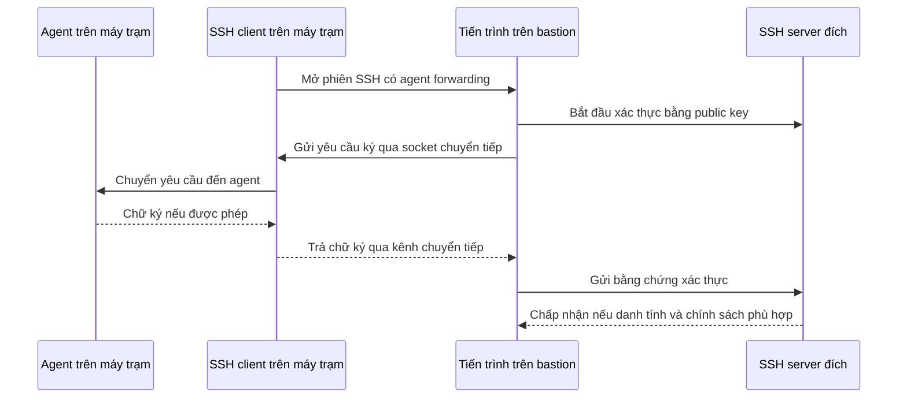

# Agent forwarding risk

## 1. Mục tiêu bài học

Trong chương **SSH và key** của module quản lý truy cập đặc quyền (Privileged Access Management — PAM), agent forwarding là một điểm cần kiểm soát riêng: khóa bí mật có thể vẫn nằm trên máy quản trị viên, nhưng khả năng xác thực bằng khóa đó lại được đưa đến một máy khác.

Sau bài này, bạn có thể:

- Giải thích đường đi của yêu cầu ký khi bật SSH agent forwarding.
- Xác định ai có thể dùng forwarded agent và tài nguyên nào có thể bị ảnh hưởng.
- Chọn ProxyJump, credential dành riêng cho workload hoặc một ngoại lệ có thời hạn.
- Phân biệt các lớp kiểm soát: khóa, agent, kết nối SSH, quyền trên máy đích và bằng chứng kiểm toán.
- Kiểm tra cấu hình, thiết kế một phép thử có kiểm soát và xử lý khi nghi có hành vi sử dụng agent trái phép.

Ví dụ sử dụng OpenSSH trên hệ điều hành kiểu Unix. Tên host thuộc miền `example.test` và các tài khoản đều là giả định. Các đoạn cấu hình và lệnh là tài liệu thực hành, không phải yêu cầu thay đổi hệ thống đang vận hành.

## 2. Bài toán: đi qua bastion có cần giao agent cho bastion?

Giả sử Lan quản trị một hệ thống thanh toán:

| Thành phần | Vai trò | Mức tin cậy cần đánh giá |
| --- | --- | --- |
| Máy trạm quản trị | Nơi Lan mở agent và thao tác | Có thể là máy quản trị chuyên dụng, vẫn phải bảo vệ trước mã độc |
| Bastion | Cửa vào mạng vận hành | Nhiều người đăng nhập, có quản trị viên riêng |
| Máy ứng dụng production | Chạy dịch vụ nhạy cảm | Chỉ cho phép một nhóm vận hành được phê duyệt |
| Máy lưu trữ mã nguồn | Chứa repository triển khai | Có chính sách truy cập khác production |

Lan muốn đi từ máy trạm qua bastion đến máy ứng dụng. Một cách thuận tiện là mở shell trên bastion với agent forwarding, rồi từ shell đó chạy SSH đến máy ứng dụng. Từ thời điểm agent được chuyển tiếp, việc bảo vệ danh tính của Lan phụ thuộc thêm vào những tiến trình có thể truy cập socket agent trên bastion.

Câu hỏi thiết kế PAM cần đặt ra là: **bastion chỉ cần chuyển lưu lượng đến máy đích, hay thực sự cần thực hiện xác thực thay người dùng?** Hai nhu cầu này dẫn đến hai kiến trúc khác nhau.

Nếu chỉ cần đi xuyên qua vùng mạng, việc để client trên máy trạm thực hiện xác thực đến máy đích thường phù hợp hơn. Nếu một tiến trình trên máy từ xa thực sự cần dùng danh tính khác, phải xác định danh tính và quyền riêng cho tiến trình đó trước khi chọn giải pháp.

## 3. Agent forwarding hoạt động như thế nào?

### 3.1. Khóa, agent và socket là ba thành phần khác nhau

Khóa bí mật dùng để tạo chữ ký chứng minh quyền sử dụng một danh tính. Agent giữ hoặc cung cấp khả năng dùng khóa và nhận yêu cầu qua một socket. SSH client có thể hỏi agent về danh tính khả dụng và yêu cầu ký dữ liệu phục vụ xác thực.

Khi bật agent forwarding, máy từ xa nhận một điểm truy cập chuyển tiếp về agent ở phía client. Với cơ chế hoạt động bình thường này, đối tượng truy cập được socket có thể yêu cầu agent thực hiện xác thực mà không cần nhận bản sao private key. Đây là rủi ro được OpenSSH nêu rõ trong tài liệu của tùy chọn `-A`. [Tài liệu ssh(1)](https://man.openbsd.org/ssh.1)



Sơ đồ thể hiện tiến trình trên bastion có thể là SSH client hợp lệ của Lan. Nếu bastion đã bị chiếm quyền và một tiến trình khác dùng được socket đó, cùng đường đi này có thể trở thành đường xác thực ngoài ý muốn.

### 3.2. Mã hóa đường truyền không giải quyết toàn bộ vấn đề

SSH bảo vệ dữ liệu trên đường truyền. Nhưng agent forwarding cố ý cung cấp một chức năng cho phía từ xa; kênh được mã hóa không quyết định tiến trình nào ở phía từ xa nên được quyền sử dụng chức năng đó.

Vì vậy, khi đánh giá rủi ro cần xem cả hai đầu của kênh:

- Máy trạm có chứa khóa quá rộng quyền hoặc agent hoạt động quá lâu không?
- Máy từ xa có nhiều tiến trình cùng tài khoản, có plugin, script triển khai hoặc phần mềm chưa tin cậy không?
- Những máy đích nào chấp nhận các danh tính đang nằm trong agent?
- Một lần xác thực thành công có thể tạo ra quyền hoặc credential mới tồn tại lâu hơn agent không?

Thời gian được phép truy cập socket và thời gian tồn tại của hậu quả là hai khoảng thời gian khác nhau.

## 4. Mô hình đe dọa đối với tài khoản đặc quyền

### 4.1. Những chủ thể cần xem xét

Các nhóm sau cần được đưa vào mô hình đe dọa:

1. **Tiến trình chạy cùng danh tính hệ điều hành với phiên từ xa.** Một công cụ tải về, script cài đặt hoặc tác vụ bị chèn mã có thể hoạt động trong chính tài khoản của quản trị viên.
2. **Chủ thể có quyền vượt qua kiểm soát quyền truy cập socket.** Ví dụ, quyền quản trị trên một bastion đã bị xâm nhập có thể làm mất ý nghĩa của cách ly dựa vào quyền file thông thường.
3. **Người dùng chung một tài khoản quản trị.** Tài khoản dùng chung làm mờ ranh giới giữa người được phép thao tác và tiến trình của những người khác.
4. **Tiến trình trên máy trạm bị xâm nhập.** Đây là một đường đe dọa riêng; tắt forwarding không thay thế việc bảo vệ máy trạm.

Không phải mọi người đăng nhập vào bastion đều tự động dùng được agent của nhau. Cần xác định quyền truy cập thực tế, cách ly tài khoản và điều kiện của hệ điều hành. Ngược lại, một bastion có nhiều người sử dụng cũng không thể được coi là an toàn chỉ nhờ socket có quyền truy cập chặt chẽ.

### 4.2. Chuỗi sự kiện minh họa

Đây là tình huống giả định để phân tích kiểm soát:

| Thời điểm | Sự kiện | Ý nghĩa với PAM |
| --- | --- | --- |
| 09:00 | Lan mở phiên bảo trì qua bastion, agent chứa cả danh tính vận hành và danh tính Git | Một tác vụ đang tiếp cận nhiều miền quyền |
| 09:03 | Lan chạy công cụ chẩn đoán trên bastion | Tiến trình công cụ nằm trong vùng có thể tiếp cận agent |
| 09:05 | Công cụ bị chèn mã yêu cầu xác thực đến một máy khác | Hành vi xác thực không tương ứng với mục đích bảo trì |
| 09:06 | Máy đích chấp nhận danh tính đang được tin cậy | Danh tính hợp lệ không đồng nghĩa thao tác do Lan chủ ý |
| 09:10 | Lan kết thúc phiên bảo trì | Phiên trái phép đã được mở trước đó có thể vẫn tồn tại |

Ở đây, sự cố không cần bắt đầu bằng việc sao chép khóa. Một phép ký đúng về mặt mật mã vẫn có thể phục vụ mục đích sai về mặt nghiệp vụ.

### 4.3. Phạm vi ảnh hưởng không chỉ là bastion

Để tính phạm vi ảnh hưởng, hãy lập danh sách tài nguyên chấp nhận từng danh tính có thể sử dụng. Một danh tính được tin cậy trên production, repository và hệ thống sao lưu tạo ra quan hệ giữa ba miền quyền dù chúng nằm trên các máy khác nhau.

Có thể dùng khung đánh giá định tính:

> Rủi ro tăng khi số danh tính khả dụng lớn, số nơi chấp nhận danh tính nhiều, quyền trên máy đích cao, thời gian phơi lộ dài và khả năng phát hiện thấp.

Đây là khung suy luận, không phải công thức tính điểm chuẩn hóa. Mục đích là tránh chỉ đếm số khóa mà bỏ qua quyền thực tế và đường đi mạng.

## 5. Những hiểu nhầm dễ dẫn đến thiết kế sai

| Nhận định | Điều cần sửa trong cách đánh giá |
| --- | --- |
| “Private key không rời laptop nên bastion không thể mạo danh” | Khả năng yêu cầu ký cũng là một năng lực cần bảo vệ |
| “Khóa đã có passphrase nên mỗi kết nối đều phải nhập lại” | Agent có thể giữ khả năng dùng khóa sau khi được mở khóa; hành vi còn phụ thuộc cấu hình xác nhận |
| “MFA lúc đăng nhập bastion bảo vệ mọi lần đi tiếp” | Cần kiểm tra chính sách xác thực riêng tại từng tài nguyên đích |
| “Bastion là tài sản nội bộ nên có thể tin mọi tiến trình trên đó” | Quyền quản trị, phần mềm và người dùng trên bastion đều thuộc mô hình đe dọa |
| “Đóng cửa sổ terminal là thu hồi được mọi quyền” | Cần phân biệt phiên giao diện, kết nối nền, agent và các phiên đã tạo trên máy đích |
| “Recording thấy được mọi hành vi sử dụng agent” | Phải xác định recording bắt được đường truy cập nào và có bao phủ phiên ngoài luồng không |
| “Chỉ cấu hình một identity cho bastion là đủ” | Việc client chọn khóa cho một kết nối không tự tạo ranh giới quyền cho toàn bộ agent |

Hai câu hỏi cần luôn đi cùng nhau là “ai đang giữ khóa?” và “ai đang có khả năng sử dụng danh tính được khóa đại diện?”.

## 6. Ưu tiên ProxyJump khi chỉ cần đi qua vùng mạng

### 6.1. Khác biệt về nơi thực hiện xác thực

Với ProxyJump, SSH client ở máy trạm mở kết nối đến máy đích qua đường chuyển tiếp TCP của jump host. Bạn không cần mở shell trên bastion rồi giao agent cho shell đó để thực hiện bước SSH kế tiếp. OpenSSH cung cấp cách dùng này qua `-J`. [Tài liệu ssh(1)](https://man.openbsd.org/ssh.1)

```text
Cách mở shell rồi chuyển tiếp agent:
máy trạm -> shell bastion + agent khả dụng -> SSH từ bastion -> máy đích

Cách dùng ProxyJump:
SSH client máy trạm -> đường chuyển tiếp qua bastion -> SSH server đích
```

ProxyJump không làm bastion biến mất khỏi mô hình đe dọa. Bastion vẫn ảnh hưởng đến tính sẵn sàng và đường kết nối. Client phải xác minh danh tính máy đích, đồng thời máy đích phải thực thi quyền phù hợp. Lợi ích ở đây là giảm nhu cầu cung cấp chức năng agent cho môi trường shell trên bastion.

### 6.2. Cấu hình minh họa

Các identity trong ví dụ đã được cấp và phê duyệt cho đúng vai trò. Không lấy private key production để sao chép sang bastion nhằm làm cho ví dụ chạy được.

```sshconfig
Host pam-bastion
    HostName bastion.example.test
    User lan
    IdentityFile ~/.ssh/id_ed25519_bastion
    IdentitiesOnly yes
    ForwardAgent no
    StrictHostKeyChecking yes

Host app-prod
    HostName app-prod.example.test
    User ops-lan
    ProxyJump pam-bastion
    IdentityFile ~/.ssh/id_ed25519_prod
    IdentitiesOnly yes
    ForwardAgent no
    StrictHostKeyChecking yes

Host *
    ForwardAgent no
```

Sau khi chuẩn bị host key đáng tin cậy bằng quy trình quản lý của tổ chức:

```bash
ssh app-prod
```

`IdentitiesOnly` giới hạn những identity client đưa ra khi xác thực cho kết nối tương ứng. Nó không phải danh sách giới hạn cho mọi yêu cầu đi vào một agent đã được forward. OpenSSH thường lấy giá trị cấu hình đầu tiên áp dụng cho mỗi tùy chọn; đặt cấu hình cụ thể trước mặc định chung và kiểm tra giá trị hiệu lực. [Tài liệu ssh_config(5)](https://man.openbsd.org/ssh_config.5)

`StrictHostKeyChecking yes` đòi hỏi đã có cơ sở tin cậy cho host key; cấu hình này không tự tạo cơ sở tin cậy. Khi host key thay đổi, hãy xác minh qua kênh được quản lý thay vì bỏ qua cảnh báo để tiếp tục.

## 7. Kiểm soát ở nhiều lớp trong PAM

### 7.1. Quyết định kiến trúc trước khi cấp ngoại lệ

| Nhu cầu | Phương án nên đánh giá | Câu hỏi kiểm soát |
| --- | --- | --- |
| Người vận hành đi qua bastion đến máy đích | ProxyJump hoặc cổng PAM được thiết kế cho luồng đó | Client xác thực ở đâu, ai phê duyệt quyền đích? |
| Người phát triển cần lấy mã nguồn trên máy build | Credential workload có phạm vi repository phù hợp | Tại sao cần danh tính cá nhân thay cho danh tính build? |
| Tác vụ định kỳ truy cập nhiều máy | Service identity và cơ chế cấp credential riêng | Ai là owner, quyền nào thực sự cần, có thu hồi độc lập được không? |
| Công cụ cũ chỉ hoạt động với agent chuyển tiếp | Ngoại lệ hẹp, có thời hạn và kế hoạch thay thế | Máy trung gian nào được tin cậy, kiểm chứng hạn chế ra sao? |
| Xử lý sự cố khẩn cấp | Quy trình break-glass đã thiết kế trước | Có recording, JIT, thu hồi và rà soát sau sử dụng không? |

Không chuyển private key cá nhân lên bastion để tránh agent forwarding. Cách đó thay đổi dạng rủi ro và có thể tạo ra bản sao credential khó kiểm soát hơn.

### 7.2. Kiểm kê danh tính và ràng buộc quyền đích

Một bản kiểm kê phục vụ PAM cần tối thiểu các dữ liệu sau:

- Owner của danh tính và người được phép sử dụng.
- Fingerprint hoặc định danh certificate, tài khoản đích và nhóm tài nguyên tin cậy.
- Phạm vi chức năng: chỉ đọc trạng thái, triển khai, quản lý tài khoản hay toàn quyền.
- Cơ chế cấp quyền, thời hạn, điều kiện phê duyệt và phương thức thu hồi.
- Agent hoặc thiết bị giữ khả năng dùng khóa.
- Những luồng truy cập thực tế cần dùng danh tính đó.

Least privilege cần được thực thi ở tài nguyên đích, không chỉ ở nơi chứa khóa. Nếu một account có thể sửa cấu hình xác thực hoặc cấp quyền cho account khác, hậu quả sau một lần đăng nhập có thể rộng hơn nhiệm vụ ban đầu.

JIT giúp giảm thời gian một quyền có hiệu lực. JEA hoặc giới hạn thao tác giúp giảm việc một phiên hợp lệ có thể thực hiện. Cả hai cần dựa vào cơ chế thực thi đã chọn; ghi “JIT” trong ticket mà quyền vẫn thường trực không tạo ra kiểm soát.

### 7.3. Chính sách phía server

Trên một server không cần hỗ trợ agent forwarding, có thể cấu hình:

```sshconfig
AllowAgentForwarding no
```

Đây là cấu hình của `sshd_config`, khác với `ForwardAgent no` phía client. Nó chặn tính năng forwarding do SSH server cung cấp. Với người có shell và khả năng tạo kênh riêng, riêng tùy chọn này không ngăn được mọi cách chuyển tiếp credential hoặc socket; OpenSSH nêu rõ giới hạn đó. [Tài liệu sshd_config(5)](https://man.openbsd.org/sshd_config.5)

Trước khi áp dụng, cần xác định host đang giữ vai trò nào. Một bastion chỉ chuyển TCP có yêu cầu khác với server cho phép shell; cấm mọi forwarding một cách máy móc có thể làm hỏng luồng ProxyJump được phê duyệt.

Quy trình triển khai nên bao gồm kiểm tra cấu hình, phương án truy cập dự phòng và xác nhận sau thay đổi. Không cần thay đổi dịch vụ SSH chỉ để hoàn thành bài thực hành này.

## 8. Nếu bắt buộc phải có ngoại lệ agent forwarding

### 8.1. Ngoại lệ là một quyền truy cập đặc biệt

Một ngoại lệ cần mô tả cụ thể:

| Trường | Ví dụ giả định |
| --- | --- |
| Mục đích | Chạy công cụ kiểm tra tương thích chưa hỗ trợ luồng thay thế |
| Người chịu trách nhiệm | Owner công cụ và owner bastion |
| Đường truy cập | Máy trạm quản trị -> bastion bảo trì -> máy lab |
| Identity | Chỉ danh tính bảo trì cho nhóm máy lab |
| Quyền đích | Đọc kết quả kiểm tra, không thay đổi chính sách truy cập |
| Thời gian | Một cửa sổ bảo trì được phê duyệt |
| Bằng chứng | Ticket, kết quả kiểm tra, nhật ký truy cập đích và thời điểm thu hồi |
| Điều kiện kết thúc | Hoàn tất công việc hoặc phát hiện hành vi ngoài phạm vi |
| Hướng loại bỏ | Nâng cấp công cụ để dùng danh tính workload hoặc truy cập trực tiếp có kiểm soát |

Không mở ngoại lệ theo mẫu “mọi host trong mạng nội bộ”. Tên miền nội bộ không thể hiện đầy đủ sự tin cậy của người quản trị, phần mềm và tiến trình trên từng host.

### 8.2. Giảm identity và thời gian khả dụng

Dùng một agent dành riêng cho công việc giúp tránh đưa nhiều danh tính không liên quan vào cùng ngoại lệ. Trên agent của công việc đó, có thể yêu cầu xác nhận và giới hạn thời gian khi nạp khóa:

```bash
ssh-add -c -t 10m ~/.ssh/id_ed25519_maintenance
```

`-c` yêu cầu xác nhận khi identity được dùng; `-t` đặt thời gian tối đa giữ identity trong agent. Hãy kiểm tra cơ chế hỏi xác nhận thực sự hoạt động trong môi trường đang dùng. [Tài liệu ssh-add(1)](https://man.openbsd.org/ssh-add.1)

Mười phút trong ví dụ là tham số minh họa. Hạn mức thực tế phải theo tác vụ và chính sách. Thời gian ngắn giúp thu hẹp cửa sổ sử dụng nhưng không hoàn tác các thao tác đã được thực hiện.

Nếu dùng agent chung chứa nhiều khóa, việc chỉ nạp thêm một khóa bảo trì không làm các khóa cũ biến mất. Cần kiểm tra danh sách identity và tách agent theo cách môi trường hỗ trợ, thay vì giả định một cờ trên SSH client đã cách ly chúng.

Yêu cầu xác nhận cũng cần được thiết kế cho con người: người vận hành phải biết khi nào mình đang chủ động xác thực. Các hộp thoại liên tục hoặc không đủ ngữ cảnh dễ biến việc xác nhận thành phản xạ bấm đồng ý.

### 8.3. Ràng buộc đích: lớp bổ sung cần kiểm chứng

OpenSSH có hỗ trợ destination constraints cho khóa trong agent thông qua `ssh-add -h`. Khi dùng qua forwarding, khả năng tương thích trên đường kết nối và host key đáng tin cậy đều quan trọng. Ràng buộc này không ngăn việc socket bị chuyển tiếp tiếp; nó giới hạn việc dùng khóa đến đích được cho phép. [Tài liệu ssh-add(1)](https://man.openbsd.org/ssh-add.1)

Trước khi dựa vào tính năng này trong một ngoại lệ, hãy có bằng chứng thử nghiệm cho cả đích được phép và đích bị cấm. Đích được phép vẫn là nơi có thể chịu tác động nếu một chủ thể khác dùng được agent; quyền trên đích đó phải tiếp tục được giới hạn.

Không coi tính năng của một bản OpenSSH là cam kết chung cho mọi agent, plugin hoặc cầu nối credential. Phải xác nhận bộ phần mềm thực tế đang tham gia.

## 9. Kiểm tra thực tế mà không tạo cảm giác an toàn giả

### 9.1. Kiểm tra cấu hình phía máy trạm

Chạy trên máy trạm trong môi trường kiểm thử:

```bash
ssh -G pam-bastion
ssh -G app-prod
```

`ssh -G` cho biết cấu hình sau khi client đánh giá các khối cấu hình. Kiểm tra riêng alias của jump host và của máy đích, vì các lựa chọn cho hai kết nối có thể khác nhau. [Tài liệu ssh(1)](https://man.openbsd.org/ssh.1)

Những giá trị cần xem gồm `forwardagent`, `proxyjump`, `identityfile`, `identitiesonly` và chính sách xác minh host key. Đây là kiểm tra cấu hình client, chưa chứng minh server chấp nhận cấu hình nào hoặc các phiên đã tồn tại đang có trạng thái gì.

Với kết nối đang dùng cơ chế chia sẻ kết nối, thay đổi cấu hình không đồng nghĩa mọi kết nối nền được tạo trước đó đã nhận chính sách mới. Phép thử cần dùng một kết nối mới, tách biệt, để kết quả không bị trộn với trạng thái cũ.

### 9.2. Kiểm tra dấu hiệu agent trên host từ xa

Trên tài khoản thử nghiệm, sau khi đã vào một host do bạn được phép kiểm tra:

```bash
printf '%s\n' "$SSH_AUTH_SOCK"
ssh-add -l
```

`SSH_AUTH_SOCK` chỉ đường dẫn socket cho các công cụ dùng biến này; `ssh-add -l` liệt kê fingerprint của các identity mà agent hiện tại cung cấp. [Tài liệu ssh-add(1)](https://man.openbsd.org/ssh-add.1)

Cách diễn giải:

| Quan sát | Kết luận phù hợp | Điều chưa chứng minh |
| --- | --- | --- |
| Biến không có giá trị, công cụ không kết nối được agent | Tiến trình thử không có đường agent qua cấu hình đang dùng | Toàn host không có agent hay đường chuyển tiếp khác |
| Biến có giá trị nhưng kết nối thất bại | Có tham chiếu socket nhưng chưa xác nhận agent hoạt động | Chính sách đã chặn agent một cách bền vững |
| Liệt kê được identity | Tiến trình hiện tại giao tiếp được với một agent | Tất cả identity đều xác thực được tới mọi máy |
| Có agent dù đã tắt forwarding trong kết nối mới | Cần xác định nguồn agent | Chắc chắn forwarding bị bật sai; có thể đó là agent cục bộ của host |
| Không thấy khóa tại thời điểm kiểm tra | Agent hiện không cung cấp khóa cho phép thử này | Agent chưa từng cung cấp khóa hoặc sẽ không được nạp thêm khóa |

Không cần thử đến các máy production để xác minh rủi ro. Một tài khoản lab và một đích được cấp riêng đã đủ để chứng minh sự khác biệt về kiến trúc.

## 10. Bài thực hành: so sánh hai đường truy cập

### 10.1. Chuẩn bị

Sử dụng ba máy hoặc ba môi trường kiểm thử được cách ly: máy trạm A, bastion B và máy đích C. Chỉ dùng khóa lab và tài khoản có quyền tối thiểu. Host key của B và C phải được xác minh trước; không dùng credential của người khác.

Chuẩn bị một thao tác vô hại trên C, ví dụ đọc tên tài khoản hiện tại. Trên B, không nạp khóa lab vào agent cục bộ, để giảm nhầm lẫn giữa agent được forward và agent có sẵn.

Các bước dưới đây mô tả phép thử được ủy quyền bằng tài khoản của chính bạn; không yêu cầu tìm socket của người dùng khác.

### 10.2. Trường hợp A: forwarding để phục vụ shell trên B

1. Trên A, bảo đảm agent lab chỉ có identity dành cho bài thử.
2. Mở kết nối lab từ A đến B với forwarding được bật có chủ đích.
3. Trên B, kiểm tra biến socket và danh sách identity.
4. Từ shell của chính tài khoản lab trên B, thử xác thực tới C và chạy thao tác vô hại đã chuẩn bị.
5. Kết thúc kết nối thử và gỡ identity lab khỏi agent theo quy trình của môi trường.

Ghi nhận điều đã được chứng minh: một tiến trình trên B có thể sử dụng danh tính được cung cấp từ A để truy cập C. Phép thử không cần trích xuất private key và cũng không chứng minh có xâm nhập thực tế.

### 10.3. Trường hợp B: ProxyJump

1. Trên A, cấu hình đường đến C qua B và tắt forwarding cho cả hai host.
2. Dùng một kết nối mới từ A đến C qua ProxyJump.
3. Chạy cùng thao tác vô hại trên C.
4. Mở một phiên riêng đến B với forwarding tắt; kiểm tra rằng phiên đó không nhận forwarded agent từ A.
5. Đối chiếu kết quả với trường hợp A.

Kết quả mong đợi là thao tác trên C vẫn thực hiện được, trong khi phiên shell riêng trên B không cần có khả năng dùng agent của A. Nếu B có agent cục bộ, cần ghi rõ nguồn đó để không suy diễn sai từ việc thấy một socket.

### 10.4. Bảng kết quả thực hành

| Tiêu chí | Shell trên B có forwarding | ProxyJump, forwarding tắt |
| --- | --- | --- |
| Nơi chạy SSH client đến C | B | A |
| Shell trên B cần agent từ A cho luồng thử | Có | Không |
| Chủ thể thực thi quyền của account trên C | C | C |
| Có tự động tạo phê duyệt JIT không | Không | Không |
| Có thay thế xác minh host key không | Không | Không |
| Bằng chứng cần lưu | Danh tính thử, thời gian, đường đi, kết quả và thu hồi | Cùng nhóm bằng chứng để so sánh |

Sau thực hành, không để lại ngoại lệ forwarding, quyền lab hoặc các phiên nền không còn cần thiết.

## 11. Phát hiện và lưu bằng chứng

### 11.1. Đối chiếu ý định với sự kiện xác thực

Một thiết kế giám sát nên trả lời được:

- Ai được phê duyệt truy cập tài nguyên nào, trong cửa sổ nào?
- Phiên ban đầu được mở từ thiết bị nào?
- Danh tính hoặc certificate nào được dùng tại máy đích?
- Nguồn mạng và thời điểm đăng nhập có phù hợp với đường truy cập dự kiến không?
- Có truy cập đến hệ thống ngoài phạm vi ticket hay sau thời gian kết thúc không?

Đừng coi địa chỉ nguồn là bằng chứng xác định người thao tác. Nhiều kết nối qua bastion có thể cùng xuất hiện từ một địa chỉ. Tương tự, cùng một fingerprint cho biết danh tính khóa được dùng, không tự chứng minh ai đã chủ động yêu cầu dùng khóa.

Dữ liệu ghi nhận tùy sản phẩm và cấu hình: có hệ thống ghi được fingerprint, có hệ thống bổ sung principal hoặc serial certificate, có hệ thống cần bật mức log phù hợp. Phải kiểm tra dữ liệu thực tế trước khi viết quy tắc phát hiện dựa trên trường chưa tồn tại.

### 11.2. Recording có phạm vi, không phải bằng chứng toàn năng

Một bản ghi terminal có thể thể hiện thao tác người dùng nhập trong phiên được ghi. Nó không mặc nhiên bao phủ mọi tiến trình, yêu cầu agent hoặc kết nối được mở qua đường khác.

Vì vậy, trong kiến trúc PAM cần ghi rõ:

| Loại bằng chứng | Có thể hỗ trợ điều gì | Hạn chế cần biết |
| --- | --- | --- |
| Ticket và phê duyệt | Mục đích, người nhận quyền, khoảng thời gian | Không tự chứng minh hành vi thực tế |
| Nhật ký bastion | Đầu vào hệ thống và một phần đường truy cập | Có thể không thấy đầy đủ hành vi tại máy đích |
| Recording phiên | Nội dung luồng được sản phẩm ghi lại | Có thể thiếu hoạt động ngoài luồng ghi |
| Nhật ký xác thực máy đích | Danh tính được chấp nhận và thời điểm | Cần đối chiếu người thao tác và quyền được cấp |
| Nhật ký cấp, thu hồi quyền | Vòng đời quyền truy cập | Cần kiểm tra hiệu lực thu hồi tại nơi thực thi |

Ví dụ một quy tắc nội bộ có thể yêu cầu điều tra khi account bảo trì đăng nhập vào hệ thống ngoài danh sách phê duyệt trong cửa sổ đang có ngoại lệ forwarding. Đây là giả thuyết phát hiện cần kiểm thử, không phải kết luận rằng mỗi sự kiện như vậy đều là tấn công.

## 12. Xử lý khi nghi agent đã bị lạm dụng

### 12.1. Chặn yêu cầu mới và xử lý phiên đã tồn tại

Hai mục tiêu phải được theo dõi riêng:

1. Ngăn agent tiếp tục phục vụ các yêu cầu ngoài ý muốn.
2. Chấm dứt hoặc kiểm soát những phiên và quyền phát sinh từ các yêu cầu trước đó.

Trong phạm vi ứng phó đã được ủy quyền, có thể ngắt đường forwarding liên quan, loại identity khỏi agent hoặc dừng agent của công việc. Phải xác định đúng agent và tác động tới các công việc khác trước khi thao tác.

Đóng một shell không đủ để khẳng định mọi kết nối nền đã đóng. Loại identity khỏi agent cũng không tự đóng phiên SSH đã xác thực thành công trên máy đích. Thay đổi quyền cho lần đăng nhập tiếp theo không đồng nghĩa tiến trình hiện tại đã mất mọi khả năng hoạt động.

Vì thế, nhóm ứng phó cần kiểm tra riêng phiên đích, quyền vừa được cấp, credential mới, thay đổi cấu hình truy cập và các tác vụ có thể đã được tạo trong cửa sổ nghi vấn.

### 12.2. Đánh giá credential theo bằng chứng

Không kết luận private key đã bị lấy chỉ từ việc phát hiện agent forwarding. Ngược lại, việc chưa tìm thấy bản sao private key không đủ để kết luận không có tác động.

Cần xác định:

- Host bị nghi xâm nhập là máy trạm, bastion hay cả hai.
- Identity nào khả dụng trong thời gian liên quan.
- Những tài nguyên nào đã và có thể đã chấp nhận identity đó.
- Có chữ ký xác thực ngoài ý muốn, phiên mới hoặc thay đổi quyền nào không.
- Cơ chế thu hồi nào được thực thi tại từng nơi tin cậy.

Từ bằng chứng đó, thực hiện thu hồi hoặc thay credential theo chính sách sự cố. Nếu dùng SSH certificate, cần xử lý khả năng cấp certificate mới, hiệu lực của certificate đã cấp và cơ chế từ chối tại máy đích; chỉ đợi hết hạn chưa chắc đáp ứng thời gian ứng phó cần thiết.

### 12.3. Bộ bằng chứng tối thiểu

Một hồ sơ điều tra nên liên kết ticket, thiết bị nguồn, tài khoản, định danh khóa hoặc certificate, các host trên đường truy cập, mốc thời gian, log liên quan và hành động thu hồi. Ghi cả giới hạn dữ liệu: thiếu log, thời gian chưa đồng bộ hoặc recording không bao phủ đường truy cập nghi vấn.

Không đưa private key hay passphrase vào ticket để “đầy đủ bằng chứng”. Định danh credential và dữ liệu sự kiện phù hợp thường giúp đối chiếu mà không tạo thêm nơi lưu bí mật.

## 13. Tình huống áp dụng: bastion cho nhóm triển khai

Một nhóm triển khai dùng một bastion chung để vào production. Mỗi thành viên thường có cả khóa Git và khóa quản trị trong agent; công cụ triển khai yêu cầu chạy ngay trên bastion. Nhóm muốn bật forwarding mặc định cho tiện sử dụng.

Phân tích theo PAM:

- **Nhu cầu của con người:** vào máy production để thực hiện một công việc được phê duyệt.
- **Nhu cầu của công cụ:** lấy artifact hoặc mã nguồn để triển khai.
- **Ranh giới đang bị trộn:** danh tính cá nhân, quyền đọc repository và quyền thay đổi production.
- **Hậu quả có thể có:** một tiến trình triển khai bị lỗi hoặc bị chèn mã có cơ hội dùng các danh tính vượt quá tác vụ của nó.

Một thiết kế cải tiến là để người vận hành dùng đường truy cập được kiểm soát đến máy đích, còn công cụ triển khai dùng danh tính workload với quyền artifact phù hợp. Production cấp quyền theo vai trò và cửa sổ bảo trì; hệ thống lưu mối liên hệ giữa người phê duyệt, lần triển khai, artifact và kết quả.

Nếu công cụ chưa thay đổi ngay, ngoại lệ phải chỉ rõ host, identity bảo trì, quyền đích, thời hạn và bằng chứng thu hồi. Việc hoàn tất một lần triển khai không tự gia hạn ngoại lệ cho những lần sau.

Tiêu chí chấp nhận thay đổi nên đo được: luồng được phê duyệt vẫn hoàn thành, shell trên bastion không nhận agent cá nhân ngoài ngoại lệ, danh tính workload không có quyền quản trị người dùng, và log đủ để đối chiếu một lần triển khai.

## 14. Tự kiểm tra khả năng thiết kế

**Vì sao khóa nằm trong thiết bị bảo mật vẫn cần đánh giá rủi ro forwarding?**

Khả năng chống trích xuất khóa bảo vệ một thuộc tính quan trọng. Tuy nhiên, vẫn phải xem yêu cầu sử dụng danh tính được cho phép như thế nào, có yêu cầu hiện diện hoặc xác nhận không, và người dùng có đủ ngữ cảnh để nhận biết yêu cầu bất thường không.

**Nếu chỉ bật MFA trên bastion thì đã bảo vệ máy đích chưa?**

Chưa đủ để kết luận. Cần biết máy đích yêu cầu gì, có chấp nhận chỉ một chữ ký bằng khóa không và quyền đích được cấp theo điều kiện nào. Kiểm soát tại cổng vào không tự tạo yêu cầu xác thực cho mọi tài nguyên phía sau.

**Nếu chỉ cần đi từ máy trạm qua bastion đến server nội bộ, nên thử phương án nào trước?**

Đánh giá ProxyJump hoặc đường truy cập PAM có chức năng tương đương, để client phía máy trạm thực hiện xác thực đến đích. Đồng thời kiểm tra host key, quyền đích, chính sách mạng và khả năng ghi bằng chứng.

**Vì sao một agent chỉ chứa khóa bảo trì vẫn chưa đủ?**

Cần xem khóa bảo trì có quyền gì và được chấp nhận ở đâu. Nếu nó mở toàn quyền trên nhiều hệ thống, việc giảm từ nhiều khóa xuống một khóa chưa chắc giảm đủ phạm vi ảnh hưởng.

**Khi gỡ identity khỏi agent, điều gì còn cần xử lý?**

Những phiên đã mở, quyền đã thay đổi và credential hoặc tác vụ đã phát sinh. Thu hồi khả năng ký trong tương lai chỉ là một phần của ứng phó.

## 15. Điểm cần ghi nhớ

Agent forwarding đưa khả năng sử dụng danh tính qua một ranh giới tin cậy. Trong PAM, quyết định cho phép phải gắn với owner, mục đích, đường đi, quyền tối thiểu, thời hạn và bằng chứng.

Khi chỉ cần đi qua mạng trung gian, hãy đánh giá đường truy cập không cần cung cấp agent cho shell trung gian. Khi cần ngoại lệ, phải thử nghiệm các giới hạn và khả năng thu hồi trong môi trường thực tế. Khi có sự cố, theo dõi cả việc ngăn yêu cầu xác thực mới lẫn tác động đã được tạo trên tài nguyên đích.
