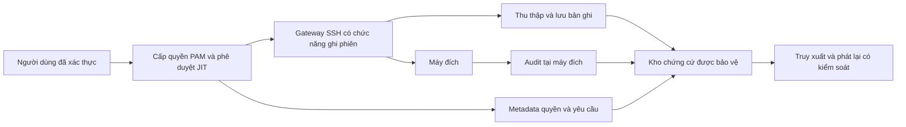

# SSH session recording

## Mục tiêu bài học

SSH session recording là việc ghi lại hoạt động trong phiên SSH theo một chính sách xác định, gắn hoạt động đó với người hoặc workload đã được cấp quyền và giữ bản ghi để phục vụ điều tra, kiểm toán, đào tạo hoặc giám sát. Trong hệ thống quản lý truy cập đặc quyền (PAM), ghi phiên giúp trả lời: ai đã truy cập tài nguyên nào, với quyền gì, trong thời gian nào, đã quan sát hoặc thao tác những gì và có bằng chứng nào cho kết luận đó.

Sau bài học, bạn có thể:

- Phân biệt lịch sử shell, nhật ký xác thực, command audit, terminal recording và packet capture.
- Chọn điểm ghi phiên phù hợp với kiến trúc SSH, vault, JIT/JEA và đường đi đến máy đích.
- Giải thích giới hạn khi phiên không có PTY, dùng SFTP, tunnel, shell lồng nhau hoặc tiến trình chạy tách phiên.
- Thiết kế liên kết giữa bản ghi, danh tính cá nhân, SSH certificate, yêu cầu phê duyệt và quyền thực tế.
- Đặt chính sách bảo vệ, lưu giữ, truy xuất và phát lại bản ghi có dữ liệu nhạy cảm.
- Xây dựng phép thử để xác nhận recorder thực sự ghi đủ, báo đúng khoảng trống và xử lý lỗi theo chính sách.

Phạm vi của bài là ghi phiên quản trị SSH trong module Privileged Access Management, không phải cơ chế xác thực của Linux Pluggable Authentication Modules, dù hai lĩnh vực cùng dùng chữ viết tắt PAM. Bài cũng không coi bản ghi terminal là bằng chứng đầy đủ cho mọi thay đổi trên máy chủ.

## 1. Vì sao đã có SSH log vẫn cần ghi phiên?

Một quản trị viên nhận quyền JIT trong 30 phút để xử lý dịch vụ thanh toán. Nhật ký SSH cho thấy tài khoản đã đăng nhập thành công. Sau sự cố, đội vận hành cần biết người đó chỉ đọc trạng thái dịch vụ hay đã sửa cấu hình, đổi quyền truy cập và xuất dữ liệu ra ngoài.

Nhật ký đăng nhập không trả lời được toàn bộ những câu hỏi này. Ngược lại, một đoạn video terminal đẹp mắt cũng không chứng minh người dùng không làm gì qua một tunnel hoặc một kết nối SSH khác không đi qua recorder.

Các nguồn bằng chứng bổ sung cho nhau:

| Nguồn | Thường cho biết | Giới hạn quan trọng |
| --- | --- | --- |
| Nhật ký xác thực SSH | Danh tính được chấp nhận, thời điểm, nguồn kết nối và cơ chế xác thực tùy cấu hình | Không mô tả đầy đủ thao tác sau đăng nhập |
| Lịch sử shell | Một số dòng lệnh shell đã lưu | Có thể thiếu, bị sửa hoặc không được ghi; không phải nguồn kiểm toán đáng tin cậy độc lập |
| Command audit hoặc sự kiện thực thi | Lệnh hoặc tiến trình được thực thi, theo phạm vi cơ chế thu thập | Có thể không phản ánh thao tác bên trong chương trình; có nguy cơ ghi tham số chứa bí mật |
| Terminal recording | Luồng hiển thị và thời gian tương tác; một số recorder ghi cả đầu vào | Không tự giải thích mọi tác động của chương trình hoặc mọi kênh SSH |
| File transfer audit | Hoạt động truyền file nếu sản phẩm và đường đi hỗ trợ | Không mặc nhiên có khi bật ghi terminal |
| Packet capture | Luồng mạng, địa chỉ và đặc điểm kết nối | Payload SSH được mã hóa; capture thông thường không tạo ra bản ghi terminal có thể đọc |
| Nhật ký ứng dụng, cấu hình, hệ điều hành | Thay đổi hoặc sự kiện tại tài nguyên đích | Cần đối chiếu để quy về phiên và người thực hiện |

Mục tiêu thiết kế là một tập bằng chứng có phạm vi rõ ràng. Không lấy sự có mặt của một bản ghi để suy ra rằng mọi hành vi đều đã được quan sát.

### 1.1 Ghi phiên không thay thế kiểm soát quyền

Một phiên được ghi vẫn có thể thực hiện thao tác nguy hiểm. Ghi phiên không tự động giới hạn lệnh, ngăn xuất dữ liệu, thu hồi quyền hay bảo đảm phê duyệt đúng.

Một chuỗi kiểm soát hợp lý gồm kiểm kê tài khoản đặc quyền, tài khoản cá nhân hoặc ánh xạ danh tính rõ ràng, least privilege, cấp quyền JIT/JEA, xác thực mạnh, vault hoặc SSH certificate, giám sát phiên, thu hồi quyền và lưu bằng chứng. Recorder là một thành phần của chuỗi này.

## 2. Xác định chính xác thứ đang được ghi

### 2.1 Luồng terminal khác với danh sách lệnh

Terminal là một luồng ký tự và tín hiệu điều khiển hiển thị. Người dùng có thể gõ, xóa, di chuyển con trỏ, dùng completion, mở trình soạn thảo, chạy giao diện toàn màn hình hoặc dán nhiều dòng. Những gì hiện trên màn hình không luôn tương đương một lệnh được thực thi.

Ví dụ, chuỗi `rm example.txt` có thể chỉ được gõ rồi xóa. Ngược lại, một chương trình có thể sửa nhiều file sau một lần nhấn phím mà không xuất ra danh sách thay đổi. Không nên biến nội dung terminal thành “danh sách lệnh đã chạy” bằng cách chia theo ký tự xuống dòng.

Nếu cần chứng minh tiến trình nào đã thực thi, phải dùng nguồn sự kiện thực thi phù hợp tại máy đích. Nếu cần biết nội dung file đã đổi thế nào, phải bổ sung bằng chứng thay đổi file hoặc cấu hình. Các nguồn này cũng cần đánh giá giới hạn và độ tin cậy riêng.

### 2.2 Output-only và input/output recording

Recorder chỉ ghi đầu ra thường lưu những gì terminal hiển thị. Recorder ghi đầu vào có thể lưu thêm phím gõ hoặc dữ liệu gửi tới chương trình. Hai chế độ tạo rủi ro dữ liệu khác nhau.

Khi một chương trình tắt echo để nhập mật khẩu, terminal có thể không hiển thị ký tự đó. Tuy nhiên, recorder bắt đầu vào vẫn có thể ghi được bí mật. Vì vậy, “mật khẩu không hiện trên màn hình” không có nghĩa là “mật khẩu không có trong bản ghi”.

Ngay cả chế độ chỉ ghi đầu ra vẫn có thể thu thập token trong kết quả lệnh, khóa riêng bị in ra, chuỗi kết nối cơ sở dữ liệu hoặc thông tin khách hàng. Chọn output-only giúp giảm một số rủi ro nhưng không loại bỏ yêu cầu bảo vệ bản ghi.

### 2.3 PTY và các channel khác của SSH

Một kết nối SSH có thể phục vụ nhiều kiểu hoạt động. Ghi terminal thường gắn với phiên có pseudo-terminal (PTY), trong khi SSH còn hỗ trợ lệnh không tương tác, subsystem và forwarding.

Các ví dụ sau chỉ minh họa các dạng truy cập cần kiểm thử trên môi trường được cấp quyền:

```sh
# Shell tương tác: việc cấp PTY còn phụ thuộc client, server và tùy chọn.
ssh operator@lab-server

# Yêu cầu chạy lệnh từ xa; không mặc nhiên là một phiên terminal tương tác.
ssh operator@lab-server 'id'

# Chủ động không cấp PTY.
ssh -T operator@lab-server 'id'

# SFTP sử dụng subsystem, không phải tương tác shell thông thường.
sftp operator@lab-server
```

Một kết nối còn có thể có nhiều channel. Khi recorder hoặc báo cáo dùng từ “session”, cần xác định đó là kết nối vận chuyển SSH, một channel shell, một lượt truy cập PAM hay một lần đăng nhập trên máy đích. Hệ thống phải có cách liên kết các đơn vị này.

| Dạng hoạt động | Có thể chỉ dựa vào terminal recording không? | Hướng kiểm soát |
| --- | --- | --- |
| Shell tương tác có PTY | Có ích nhưng vẫn có giới hạn | Ghi luồng terminal, metadata và đối chiếu audit đích |
| Lệnh từ xa không PTY | Không được giả định có bản ghi terminal | Hỗ trợ ghi đúng channel hoặc chặn theo chính sách |
| SFTP, truyền file | Không | Dùng audit truyền file riêng hoặc hạn chế đường truy cập |
| Local/remote/dynamic forwarding | Không | Cho phép có chủ đích, giới hạn đích và có telemetry mạng phù hợp |
| Agent forwarding | Không phải nội dung terminal | Đánh giá riêng khả năng sử dụng danh tính từ xa và giới hạn theo nhu cầu |
| Phiên lồng sang máy khác | Chỉ có thể thấy phần đi qua terminal ngoài | Kiểm soát hop kế tiếp và ghi/audit tại tài nguyên thực tế |

Định dạng và cách vận chuyển file phụ thuộc công cụ, phiên bản và cấu hình. Một bài kiểm thử chỉ bao phủ một đường truyền thành công không chứng minh mọi cách truyền file đều đã được kiểm soát.

## 3. Chọn điểm ghi trong kiến trúc PAM

### 3.1 Chỉ có jump host chưa đủ

SSH mã hóa dữ liệu giữa các đầu cuối SSH. Nếu một bastion chỉ chuyển tiếp TCP hoặc làm đường đi cho một kết nối SSH bên trong, nó có thể thấy metadata mạng nhưng không mặc nhiên đọc được nội dung terminal của kết nối bên trong.

Ví dụ, việc dùng jump host hoặc `ProxyJump` không tự tạo session recording. Muốn ghi được nội dung cần cơ chế được thiết kế cho việc đó: một gateway kết thúc và tạo lại các kết nối SSH, một recorder ở endpoint, hoặc phương thức tích hợp khác có khả năng quan sát đúng luồng dữ liệu.

### 3.2 Các mô hình thường gặp

| Mô hình | Điểm mạnh | Câu hỏi cần giải quyết |
| --- | --- | --- |
| Gateway/proxy hiểu SSH | Tập trung cấp quyền, liên kết danh tính và ghi luồng được hỗ trợ | Có kết thúc SSH không? Hỗ trợ những channel nào? Có đường đi thẳng đến đích không? |
| Recorder tại máy đích | Quan sát gần môi trường thực thi, có thể kết hợp audit hệ điều hành | Ai có thể tắt hoặc sửa recorder? Tài khoản đặc quyền có vượt qua được không? |
| Wrapper ở shell hoặc công cụ terminal | Thuận tiện cho một số trường hợp thử nghiệm hoặc phạm vi hẹp | Shell khác, subsystem, lệnh không PTY và quyền root có vượt qua được không? |
| Kết hợp gateway và endpoint | Có nhiều nguồn bằng chứng để đối chiếu | Làm sao liên kết phiên, xử lý trùng lặp và phát hiện chỗ hai nguồn bất đồng? |

Không có mô hình nào mặc nhiên chống được mọi người quản trị. Nếu cùng một người có quyền root trên máy đích, quyền sửa recorder và quyền xóa kho bằng chứng, việc ghi phiên chỉ cung cấp mức bảo đảm hạn chế.

### 3.3 Luồng tham chiếu



Sơ đồ thể hiện một gateway có chức năng ghi phiên, không phải mọi jump host. Đường đến máy đích và các channel phải được kiểm soát theo kiến trúc thực tế. Nếu vẫn tồn tại đường SSH trực tiếp, cần giải thích đường đó được ghi hoặc hạn chế như thế nào.

### 3.4 Gắn ghi phiên với vault, key và certificate

Trong một thiết kế PAM, gateway có thể sử dụng credential được vault cấp hoặc SSH certificate ngắn hạn để kết nối tới đích. Người dùng không nhất thiết phải nhận được bí mật đích. Bản ghi cần giữ tham chiếu tới lần cấp credential hoặc certificate đủ để điều tra, nhưng không chứa private key hay mật khẩu.

Fingerprint public key giúp nhận diện khóa. Nó không tự chứng minh ai đang điều khiển khóa, nhất là khi khóa được chia sẻ. SSH certificate có thể bổ sung principal, serial, key ID và thời hạn; các giá trị này vẫn phải liên kết với sự kiện cấp phát và xác thực đáng tin cậy.

Nếu đích chỉ thấy tài khoản dùng chung như `ops-admin`, metadata PAM phải giữ được danh tính cá nhân đã yêu cầu và sử dụng phiên. Đây là ánh xạ trách nhiệm, không phải lý do để tiếp tục chia sẻ khóa ngoài hệ thống.

## 4. Thiết kế danh tính và metadata của bản ghi

### 4.1 Một session ID không mang bí mật

Mỗi lượt truy cập được quản lý cần một mã tham chiếu không tái sử dụng. Mã này nên liên kết được đến kết nối hoặc channel SSH, quyết định cấp quyền, người dùng, tài khoản đích, yêu cầu công việc và đối tượng bản ghi.

Không đưa mật khẩu, token, private key hoặc dữ liệu nhạy cảm vào session ID, tên file hay đường dẫn kho. Không coi giá trị do client tự đặt, như biến môi trường hoặc dòng mô tả phiên, là nguồn danh tính đáng tin cậy nếu chưa có ràng buộc xác thực.

### 4.2 Metadata tối thiểu theo mục đích điều tra

| Nhóm | Ví dụ dữ liệu | Ý nghĩa |
| --- | --- | --- |
| Danh tính | Subject ID, phương thức xác thực, tham chiếu sự kiện xác thực | Ai được hệ thống xác nhận |
| Cấp quyền | Grant ID, ticket, người phê duyệt, thời hạn, policy version | Vì sao và trong phạm vi nào được truy cập |
| Tài nguyên | Asset ID, tài khoản đích, endpoint thực tế | Tránh nhầm máy khi IP, DNS hoặc hostname thay đổi |
| SSH | Tham chiếu key/certificate, loại channel, có PTY hay không | Phạm vi kỹ thuật của lượt truy cập |
| Ghi phiên | Recorder ID, chế độ ghi, định dạng, phiên bản | Giúp diễn giải và phát lại đúng |
| Thời gian | Bắt đầu, kết thúc, timezone, chất lượng đồng bộ | Dựng timeline và đánh giá sai số |
| Tính đầy đủ | Số chunk, khoảng trống, lý do kết thúc, trạng thái finalization | Phân biệt bản ghi đầy đủ và bị gián đoạn |
| Tính toàn vẹn | Tham chiếu manifest, digest, chữ ký nếu có | Phát hiện thay đổi theo mô hình tin cậy đã chọn |

Không phải mọi trường đều phải đưa vào mọi sự kiện. Có thể lưu tham chiếu tới hồ sơ bất biến hoặc phiên bản chính sách đã áp dụng. Việc giữ tham chiếu phải bảo đảm dữ liệu gốc còn tồn tại đủ lâu để giải thích bản ghi.

### 4.3 Ví dụ bản mô tả hoàn tất phiên

Đây là schema minh họa, không phải định dạng của một sản phẩm hay file cấu hình có thể triển khai trực tiếp:

```json
{
  "schema_version": "example-1",
  "session_id": "pam-lab-ssh-000042",
  "actor_subject": "employee-lab-017",
  "target_asset_id": "asset-lab-linux-03",
  "target_account": "ops-admin",
  "access_grant_id": "grant-lab-219",
  "change_request_id": "change-lab-731",
  "policy_version": "ssh-admin-lab-v4",
  "ssh_channel_type": "shell",
  "pty_allocated": true,
  "recording_mode": "terminal_output",
  "started_at": "2026-01-15T02:00:00Z",
  "ended_at": "2026-01-15T02:12:31Z",
  "recorder_id": "recorder-lab-a",
  "completeness": "complete_for_declared_scope",
  "gap_count": 0,
  "end_reason": "normal_exit",
  "manifest_ref": "evidence/lab/pam-lab-ssh-000042/manifest"
}
```

Giá trị `complete_for_declared_scope` chỉ nói rằng recorder đã hoàn tất phạm vi được công bố. Nó không khẳng định đã quan sát mọi hoạt động trên máy đích. Trường `gap_count: 0` cũng chỉ có ý nghĩa nếu cơ chế phát hiện khoảng trống đáng tin cậy và được kiểm thử.

## 5. Vòng đời bản ghi và bảo đảm tính đầy đủ

### 5.1 Chuẩn bị trước khi cấp phiên

Trước khi mở phiên đặc quyền, hệ thống nên xác nhận chính sách ghi áp dụng, recorder sẵn sàng, vùng đệm còn dung lượng, khóa mã hóa khả dụng và có thể tạo metadata. Thời điểm cho phép người dùng bắt đầu thao tác phải được định nghĩa rõ so với thời điểm bắt đầu ghi.

Một kết nối đã xác thực nhưng recorder chưa khởi tạo không nên âm thầm trở thành phiên “đã ghi”. Nếu chính sách yêu cầu ghi bắt buộc, lỗi chuẩn bị phải dẫn đến từ chối hoặc một đường ngoại lệ được kiểm soát.

### 5.2 Ghi theo chunk và chốt manifest

Phiên dài thường cần được chia thành các đoạn hoặc chunk thay vì chờ đến khi kết thúc mới lưu tất cả. Mỗi đoạn cần liên kết được với phiên, thứ tự và thời gian tương đối. Khi phiên kết thúc, hệ thống chốt manifest mô tả các đối tượng cần có, tình trạng khoảng trống và lý do kết thúc.

Trạng thái có thể được mô hình hóa như sau:

```text
PREPARING -> ACTIVE_RECORDING -> FINALIZING -> FINALIZED_COMPLETE
                     |                |
                     v                v
                 DEGRADED      FINALIZED_PARTIAL
                     |
                     v
             TERMINATED_OR_EXCEPTION
```

Tên trạng thái chỉ minh họa. Điểm quan trọng là phiên lỗi hoặc mất dữ liệu phải có trạng thái quan sát được. Không được ánh xạ mọi trường hợp kết thúc thành một cờ `recorded=true`.

### 5.3 Buffer cục bộ không phải bằng chứng đã lưu bền vững

Recorder có thể ghi vào vùng đệm rồi tải lên kho tập trung. Hệ thống cần phân biệt dữ liệu đã nhận, đã ghi vào bộ nhớ, đã ghi bền cục bộ và đã được kho tập trung xác nhận. Nếu chỉ có bản sao cục bộ trên máy đang gặp sự cố, rủi ro mất bằng chứng vẫn còn.

Vùng đệm phải có giới hạn, mã hóa theo thiết kế, cơ chế theo dõi dung lượng và xử lý khi đầy. Chính sách tiếp tục phiên khi kho lưu trữ tạm lỗi cần kèm điều kiện như dung lượng còn đủ, thời gian tối đa, cảnh báo và trách nhiệm xử lý.

### 5.4 Thời gian và thứ tự

Nên lưu thời gian tuyệt đối để liên kết nhiều hệ thống và thời gian tương đối hoặc số thứ tự để phát lại đúng diễn biến trong một phiên. Đồng hồ tường có thể bị điều chỉnh; không nên chỉ dựa vào nó để tính mọi khoảng thời gian phát lại.

Khi dựng timeline, cần biết nguồn thời gian, mức lệch được quan sát và cách hệ thống phản ứng nếu đồng bộ thời gian lỗi. Hai sự kiện cách nhau vài mili giây trên hai máy không mặc nhiên có thứ tự chính xác nếu sai số đồng hồ lớn hơn khoảng cách đó.

## 6. Tính toàn vẹn, nguồn gốc và chuỗi lưu giữ chứng cứ

### 6.1 Hash giúp phát hiện thay đổi trong điều kiện nào?

Digest của một chunk giúp so sánh nội dung với một giá trị tham chiếu đáng tin cậy. Nếu người sửa bản ghi cũng sửa được digest và manifest, chỉ tính hash không đủ để phát hiện gian lận.

Một thiết kế có thể dùng chuỗi hash, manifest được ký, kho chỉ ghi thêm hoặc tính năng giữ đối tượng bất biến. Mỗi lựa chọn cần giải thích ai giữ khóa, ai có quyền sửa manifest, ai có quyền thay đổi chính sách lưu giữ và thời điểm dữ liệu được cam kết.

Ví dụ khái niệm về liên kết các chunk:

```text
digest_i = H(
    domain_separator || session_id || sequence_i ||
    digest_previous || canonical_metadata_i || chunk_bytes_i
)
```

Biểu thức trên là mô hình để thảo luận, không phải hướng dẫn tự xây một giao thức mật mã. Định dạng ghép nối phải không nhập nhằng và phải bảo vệ thứ tự cũng như danh tính phiên. Manifest cuối cần nêu số đoạn kỳ vọng, điểm kết thúc và các digest liên quan.

Chuỗi hash chỉ có ích khi gốc tin cậy hoặc manifest được bảo vệ. Nó không tự chứng minh nội dung ghi đúng sự thật, người dùng thực sự là ai hay thời gian ghi không bị giả mạo. Chữ ký hoặc HMAC cũng không tự tạo dấu thời gian đáng tin cậy; HMAC dùng khóa chung không cung cấp cùng mô hình xác minh độc lập như chữ ký số.

### 6.2 Tách quyền quản trị và quyền chứng cứ

Các quyền cần được phân tách theo nhu cầu thực tế:

- Người vận hành tài nguyên có thể dùng phiên nhưng không mặc nhiên được xóa hoặc sửa bản ghi.
- Recorder có quyền tạo dữ liệu cần thiết nhưng nên có phạm vi quyền nhỏ nhất có thể đối với kho lưu trữ.
- Người điều tra có thể đọc những phiên được phê duyệt trong phạm vi vụ việc.
- Người quản trị chính sách lưu giữ hoặc khóa mã hóa chịu cơ chế kiểm soát riêng cho hành động nhạy cảm.
- Người duyệt quyền đọc không nên luôn đồng thời là người tự phê duyệt yêu cầu của mình.

Nếu sản phẩm hoặc hạ tầng không hỗ trợ tách hết các vai trò, cần ghi rõ phần quyền còn tập trung và biện pháp giám sát bù đắp. Một tuyên bố “tamper-proof” không thay thế được phân tích các quyền thực tế.

### 6.3 Chain of custody khi xuất bản ghi

Khi phục vụ điều tra, cần lưu ai đã yêu cầu bản ghi, ai phê duyệt, phiên nào được lấy, từ đối tượng nguồn nào, vào lúc nào và có biến đổi gì. Việc xem, tải xuống, chia sẻ, tạo bản che dữ liệu hoặc xuất video đều cần dấu vết phù hợp.

Gói xuất nên có manifest, tham chiếu phiên, các digest cần kiểm tra, dữ liệu thời gian và mô tả định dạng. Nếu chuyển đổi thành video hoặc văn bản dễ đọc, phải giữ quan hệ với bản gốc và chỉ rõ đó là bản dẫn xuất. Video chuyển đổi có thể làm mất metadata, channel hoặc thông tin thời gian chi tiết.

## 7. Bảo vệ bí mật và quyền riêng tư

### 7.1 Bản ghi là kho dữ liệu nhạy cảm mới

Một phiên quản trị có thể hiển thị biến môi trường, log ứng dụng, chứng thư, token truy cập, truy vấn dữ liệu cá nhân hoặc thông tin sự cố chưa công bố. Vì vậy, kho ghi phiên phải được bảo vệ tương xứng với dữ liệu có thể chứa, không chỉ theo nhãn “log kỹ thuật”.

Cần có mã hóa khi truyền và khi lưu, kiểm soát quyền đọc, quản lý khóa, theo dõi truy xuất, thời hạn giữ và quy trình xử lý dữ liệu nhạy cảm vô tình bị thu thập. Mã hóa không thay thế kiểm soát người có quyền giải mã.

### 7.2 Giảm thu thập từ nguồn

Một số biện pháp thực tế gồm dùng credential injection để giảm thao tác nhập bí mật, tránh truyền bí mật qua tham số lệnh, dùng dữ liệu giả khi đào tạo, giới hạn việc đọc dữ liệu sản xuất và hiển thị thông báo ghi phiên trước khi bắt đầu thao tác.

Credential injection vẫn không bảo đảm bí mật không thể xuất hiện trong output hoặc log khác. Cần đánh giá cả quy trình vận hành, quyền của công cụ và khả năng chương trình in dữ liệu nhạy cảm ra terminal.

Việc tạm dừng ghi vì có dữ liệu nhạy cảm tạo ra khoảng trống bằng chứng. Nếu có tính năng này, phải quy định ai được dùng, có phê duyệt hay không, metadata nào vẫn được ghi, điều gì kích hoạt lại ghi và cách phát hiện việc lợi dụng tạm dừng.

### 7.3 Redaction có giới hạn

Che dữ liệu theo mẫu có thể bỏ sót token không nhận diện được hoặc che nhầm thông tin cần điều tra. Terminal còn có ký tự điều khiển, chuỗi bị chia qua nhiều chunk, nội dung nhiều dòng và dữ liệu mã hóa hoặc nén; việc che không đơn giản như thay một chuỗi trong văn bản.

Nếu tạo bản đã che để chia sẻ, cần đánh dấu rõ đây là bản dẫn xuất. Bản gốc có thể được lưu với quyền chặt hơn trong phạm vi chính sách cho phép. Không sửa âm thầm bản gốc rồi giữ nguyên tuyên bố rằng digest hoặc chữ ký cũ vẫn xác thực nội dung hiện tại.

Không tự chọn số ngày lưu giữ vì “càng lâu càng tốt”. Thời hạn phụ thuộc mục đích, phân loại dữ liệu, nghĩa vụ áp dụng và chính sách tổ chức. Cơ chế legal hold, nếu có, phải ngăn xóa theo lịch trong phạm vi vụ việc nhưng vẫn có người chịu trách nhiệm xem xét.

## 8. Phát lại an toàn và diễn giải đúng

### 8.1 Terminal output là đầu vào không đáng tin cậy

Chương trình trên máy đích có thể xuất escape sequence, đổi tiêu đề, điều khiển con trỏ, tạo liên kết hoặc sinh dữ liệu có ý nghĩa đặc biệt với terminal. Tính năng cụ thể phụ thuộc terminal và cấu hình, nhưng nguyên tắc chung là không coi bản ghi như văn bản hoàn toàn thụ động.

Không tùy tiện phát lại dữ liệu thô vào terminal cá nhân có các tính năng nhạy cảm đang bật. Trình xem nên cô lập xử lý, giới hạn các tính năng không cần thiết, có cách xem dữ liệu đã escape và được cập nhật như một thành phần xử lý đầu vào không đáng tin cậy.

### 8.2 Người xem cần thấy chất lượng bằng chứng

Giao diện phát lại nên hiển thị danh tính và tài nguyên đã được liên kết, thời gian, trạng thái hoàn tất, khoảng trống dữ liệu, chế độ ghi và các giới hạn có liên quan. Không nên giấu cảnh báo partial recording chỉ vì phần đầu của phiên vẫn phát được.

Nếu một bản ghi là output-only, người điều tra cần hiểu rằng phím gõ không echo có thể không hiện. Nếu thời gian đã bị rút ngắn để xem nhanh, giao diện phải phân biệt thời gian phát lại và thời gian thực tế của phiên.

### 8.3 Xem trực tiếp và ngắt phiên

Một hệ thống có thể cho giám sát trực tiếp hoặc kết thúc phiên. Đây là các quyền riêng, không nên tự động cấp cho mọi người có quyền xem bản ghi lịch sử. Quyền ngắt phiên cần gắn với vai trò, lý do và dấu vết vì nó có thể làm gián đoạn công việc sản xuất.

Ngắt kết nối SSH không bảo đảm dừng mọi tác động. Tiến trình đã chạy nền, tác vụ được lập lịch hoặc công việc được giao sang hệ thống khác có thể tiếp tục. Quy trình ứng phó cần xem xét trạng thái tại đích, thu hồi quyền và phạm vi credential, thay vì chỉ dựa vào nút ngắt phiên.

## 9. Xử lý lỗi recorder và ngoại lệ break-glass

### 9.1 Phân biệt lỗi trước phiên và trong phiên

Trước khi mở phiên, hệ thống có thể kiểm tra khả năng ghi. Trong phiên, các lỗi như đầy đĩa, mất kết nối kho, mất khóa mã hóa, recorder crash hoặc tải tăng đột biến cần được phát hiện liên tục.

| Tình huống | Ví dụ quyết định theo chính sách | Bằng chứng cần giữ |
| --- | --- | --- |
| Recorder chưa sẵn sàng trước phiên quản trị bắt buộc ghi | Từ chối mở phiên | Người yêu cầu, tài nguyên, policy và nguyên nhân |
| Kho tập trung tạm mất kết nối, buffer còn đủ | Có thể tiếp tục trong giới hạn đã duyệt | Thời gian lỗi, giới hạn buffer, chunk đã lưu và trạng thái tải lại |
| Buffer đầy hoặc recorder ngừng thu thập | Từ chối thao tác mới hoặc chấm dứt phiên theo khả năng hệ thống | Điểm mất quan sát, lý do, hành động áp dụng và cảnh báo |
| Sự cố nghiêm trọng cần break-glass | Dùng luồng ngoại lệ có quyền hạn, thời gian và giám sát riêng | Ai phê duyệt, phạm vi, lý do thiếu bản ghi và bằng chứng thay thế |
| Kết thúc phiên nhưng chưa chốt được manifest | Giữ trạng thái đang hoàn tất hoặc partial | Không báo complete cho đến khi kiểm chứng đủ điều kiện |

Các quyết định trên là ví dụ để thiết kế, không phải lựa chọn mặc định cho mọi dịch vụ. Chính sách cần cân đối yêu cầu vận hành và mức bảo đảm chứng cứ, đồng thời được người có trách nhiệm phê duyệt trước sự cố.

### 9.2 Fail-closed cần định nghĩa cụ thể

“Fail-closed” có thể nghĩa là không mở phiên mới khi recorder lỗi. Nó không mặc nhiên có nghĩa mọi phiên đang chạy bị dừng ngay. Nếu cần dừng phiên đang chạy, phải kiểm thử thời gian phát hiện, cách đóng channel, tác động tới terminal và trạng thái công việc tại đích.

Một hệ thống không thể bảo đảm dừng mọi tiến trình chỉ bằng việc đóng kết nối. Chính sách phải mô tả hành động mà hệ thống thực sự làm được và quy trình xử lý phần còn lại.

### 9.3 Break-glass không phải đường đi bỏ quên

Đường khẩn cấp cần tài khoản hoặc quyền phù hợp, thời gian ngắn, lý do, thông báo, kiểm tra sau sử dụng và xoay hoặc thu hồi credential theo thiết kế. Nếu recorder chính không khả dụng, có thể cần bằng chứng thay thế như audit tại đích, sự kiện quản lý thay đổi hoặc giám sát phối hợp.

Không gắn nhãn bản ghi đầy đủ cho một phiên break-glass thiếu dữ liệu. Giá trị của ngoại lệ nằm ở việc nó được khai báo, giới hạn và hậu kiểm, không ở việc che giấu khoảng trống.

## 10. Những đường vượt cần đưa vào threat model

### 10.1 Truy cập trực tiếp hoặc tài khoản ngoài inventory

Một gateway ghi tốt không giúp quan sát kết nối trực tiếp đến máy đích qua mạng quản trị khác, VPN khác hoặc tài khoản không nằm trong kiểm kê. Cần kiểm tra chính sách mạng, đường quản trị, tài khoản cục bộ, khóa trong `authorized_keys` và quyền sửa chúng theo phạm vi được giao.

Danh sách bản ghi chỉ cho thấy những phiên hệ thống biết đến. Để tìm khoảng trống, phải đối chiếu với nhật ký xác thực và telemetry ở tài nguyên đích, đồng thời giải thích các trường hợp không thuộc phạm vi gateway.

### 10.2 Shell lồng, tmux và tiến trình nền

Một phiên ghi bên ngoài có thể thấy nội dung một shell lồng nếu dữ liệu vẫn đi qua terminal đó. Nhưng `tmux`, phiên tách rời, tác vụ nền hoặc người khác cùng gắn vào một phiên có thể làm trách nhiệm và thời gian thực thi phức tạp hơn.

Việc thoát recorder không đồng nghĩa tiến trình nền đã dừng. Khi một người khác gắn lại vào môi trường làm việc dùng chung, cần xác định hành động nào thuộc người nào bằng cơ chế bổ sung. Không suy diễn toàn bộ hoạt động của một terminal multiplexer thuộc về người mở nó đầu tiên.

### 10.3 Quyền quản trị máy đích

Người có quyền cao có thể thay shell, sửa binary, tắt agent, thay cấu hình audit hoặc tác động đồng hồ nếu được cấp đủ quyền. Recorder tại endpoint cần đánh giá khả năng bị can thiệp theo chính quyền mà phiên đang sử dụng.

Gửi bằng chứng sớm ra ngoài máy đích và tách quyền xóa giúp giảm một số rủi ro. Điều đó không chứng minh rằng nguồn dữ liệu chưa từng bị làm sai lệch trước khi gửi. Cần công bố giới hạn thay vì đưa ra bảo đảm tuyệt đối.

### 10.4 Tunnel và truy cập công cụ khác

Một tunnel có thể vận chuyển giao thức khác trong khi terminal không hiển thị hoạt động đó. Khi cho phép forwarding, cần giới hạn và quan sát theo mục đích; không gán nội dung tunnel vào phạm vi terminal recording.

Tương tự, một lệnh SSH có thể gọi API quản trị, kích hoạt pipeline hoặc giao việc cho orchestrator. Bản ghi có thể cho thấy yêu cầu được phát ra nhưng bằng chứng kết quả cần lấy từ hệ thống thực thi tương ứng.

## 11. Chính sách minh họa cho một nhóm quản trị

Đoạn YAML dưới đây mô tả ý định kiểm soát để thảo luận với đội triển khai. Đây không phải cấu hình OpenSSH hoặc cú pháp sản phẩm:

```yaml
policy_id: example-production-ssh-admin
scope:
  asset_group: production-linux
  access_purpose: approved-administration
identity:
  individual_actor_required: true
  approved_grant_required: true
recording:
  required: true
  declared_channels:
    - interactive-shell-with-pty
  mode: terminal-output
  other_channels: deny-unless-separately-approved-and-observed
  direct_access: require-equivalent-control-or-approved-exception
failure_handling:
  before_session: deny-if-recording-not-ready
  during_session: apply-tested-buffer-and-termination-policy
evidence:
  access: approved-case-scoped-review
  retention: reference-to-organizational-retention-policy
  export: audited-with-manifest
exceptions:
  break_glass: separate-time-limited-workflow
```

Khi hiện thực, phải ánh xạ từng ý định sang khả năng cụ thể của gateway, server, mạng và kho bằng chứng. Một trường YAML như `direct_access` không tạo ra kiểm soát mạng; nó chỉ ghi yêu cầu cần triển khai và kiểm thử.

Nếu công việc bắt buộc dùng SFTP hoặc lệnh không PTY, cần mở rộng thiết kế để hỗ trợ và audit đúng loại hoạt động đó. Không ép mọi tác vụ vào terminal chỉ để báo cáo có một video.

## 12. Bài thực hành trong môi trường lab

### 12.1 Chuẩn bị

Sử dụng máy đích lab, danh tính thử nghiệm, dữ liệu giả và hệ thống ghi phiên được cấp quyền. Tạo một yêu cầu thay đổi giả lập, một grant ngắn hạn, quyền quản trị hạn chế và kho bản ghi tách khỏi tài khoản thao tác. Không đưa credential hoặc dữ liệu sản xuất vào bài thực hành.

Ghi trước phạm vi được hỗ trợ: loại channel, chế độ input/output, tài nguyên, quyền, cách finalization và xử lý lỗi. Kết quả đúng được đánh giá theo phạm vi công bố, không theo cảm giác bản phát lại “trông đầy đủ”.

### 12.2 Thử nghiệm phiên bình thường

1. Nhận quyền truy cập theo grant lab và ghi lại mã tham chiếu.
2. Mở phiên theo đường được quản lý, xác nhận có thông báo ghi phiên nếu chính sách yêu cầu.
3. Chạy các lệnh quan sát vô hại như `id`, `hostname` và `date`.
4. Trong thư mục lab được cấp quyền, tạo hoặc sửa một file văn bản không chứa bí mật bằng công cụ đã chuẩn bị.
5. Dùng một chương trình tương tác, thay đổi kích thước terminal rồi thoát bình thường.
6. Chờ bản ghi được chốt; đối chiếu actor, asset, grant, thời gian, channel và trạng thái hoàn tất.
7. Phát lại bằng trình xem được chỉ định, so sánh với audit tại đích và kiểm tra dấu vết truy cập bản ghi.

Kết quả mong đợi là tìm được phiên theo grant hoặc actor, xem được luồng thuộc phạm vi, giải thích được thay đổi lab và xác nhận manifest tương ứng. Không chỉ kiểm tra có một file lớn hơn 0 byte.

### 12.3 Ma trận kiểm thử phạm vi và lỗi

| Phép thử | Câu hỏi kiểm chứng | Điều kiện chấp nhận |
| --- | --- | --- |
| Hai người dùng cùng một tài khoản đích | Có phân biệt được actor cá nhân không? | Mỗi lượt có ánh xạ đáng tin cậy đến danh tính và grant |
| Lệnh không PTY | Có nằm trong phạm vi được ghi không? | Được ghi đúng, bị chặn, hoặc có ngoại lệ và audit riêng rõ ràng |
| SFTP và các đường truyền file được cho phép | Có bị nhầm là terminal recording không? | Có kiểm soát và sự kiện tương ứng với đường được hỗ trợ |
| Kết nối trực tiếp đến đích | Có vượt qua kiểm soát không? | Bị chặn hoặc đi qua cơ chế tương đương đã công bố |
| Mất kết nối kho lưu trữ | Buffer, cảnh báo và finalization hoạt động thế nào? | Hành vi đúng chính sách; không báo complete sai |
| Recorder hoặc tiến trình liên quan dừng | Mất dữ liệu bắt đầu từ đâu? | Phát hiện lỗi, hành động theo chính sách và ghi rõ khoảng trống |
| Phiên bị ngắt mạng | Bản ghi có được chốt đúng không? | Có lý do kết thúc và trạng thái đầy đủ/partial chính xác |
| Grant hết hạn hoặc bị thu hồi | Quyền mới và phiên đang chạy thay đổi thế nào? | Hành vi đúng thiết kế đã công bố và có dấu vết |
| Người không có quyền đọc | Có thể tải hoặc phát lại không? | Truy cập bị từ chối và được ghi nhận theo chính sách |
| Bản sao chunk bị sửa trong khu thử | Kiểm tra toàn vẹn có nhận ra không? | Công cụ xác minh phát hiện khác biệt với manifest tin cậy |
| Bản sao thiếu chunk cuối | Có nhầm thành bản hoàn chỉnh không? | Báo thiếu hoặc partial, không im lặng phát như complete |
| Dữ liệu chứa escape sequence thử nghiệm | Trình xem có xử lý an toàn không? | Không gây tác động ngoài chức năng xem được cho phép |

Thử làm hỏng dữ liệu chỉ trên bản sao lab; không sửa bản gốc được quản lý. Các phép thử dừng recorder hoặc mô phỏng đầy bộ đệm phải được giới hạn trong môi trường thử nghiệm, có cách khôi phục và được phép thực hiện.

### 12.4 Hồ sơ bàn giao bài lab

Hồ sơ nên chứa phạm vi đã kiểm thử, phiên bản thành phần có liên quan, grant thử nghiệm, session ID, manifest, kết quả kiểm tra toàn vẹn và những trường hợp chưa được hỗ trợ. Chỉ dùng dữ liệu giả và không đưa bí mật vào ảnh chụp hoặc tài liệu bàn giao.

Kết luận nên nêu cụ thể: “Phiên shell có PTY qua gateway lab được ghi output và chốt đầy đủ; SFTP bị từ chối theo chính sách thử nghiệm”. Kết luận “SSH đã được ghi toàn bộ” là rộng hơn bằng chứng nếu chưa kiểm tra mọi đường truy cập thuộc phạm vi đó.

## 13. Tình huống điều tra: bản phát lại không kể hết câu chuyện

Một kỹ sư dùng grant 20 phút để xử lý máy `payment-lab-03`. Bản phát lại cho thấy người đó kiểm tra dịch vụ, đọc một file log và thoát. Sau đó, đội điều tra thấy một cấu hình đã bị sửa ngoài khoảng thời gian hiển thị trong bản ghi.

Không thể kết luận ngay rằng bản ghi bị giả mạo hoặc kỹ sư chắc chắn không liên quan. Các giả thuyết cần kiểm tra gồm tiến trình nền tiếp tục chạy, một phiên trực tiếp không qua gateway, tác vụ được kích hoạt sang hệ thống khác, sai lệch thời gian và thay đổi do người khác thực hiện.

Quy trình phân tích phù hợp:

1. Xác nhận đúng asset, actor, grant và session ID; kiểm tra nguồn ánh xạ danh tính.
2. Kiểm tra trạng thái finalization, các khoảng trống và khả năng xác minh manifest.
3. Xác định bản ghi là output-only hay input/output, channel nào được hỗ trợ và có đường truy cập khác không.
4. Đối chiếu nhật ký xác thực, sự kiện thực thi, thay đổi cấu hình và sự kiện từ hệ thống được gọi.
5. Dựng timeline có tính đến sai số đồng hồ và phân biệt lúc phát lệnh với lúc tác động hoàn tất.
6. Ghi rõ phần bằng chứng xác nhận, phần suy luận và những câu hỏi chưa trả lời được.

Nếu phát hiện một tiến trình chạy nền được khởi tạo trong phiên, cần đối chiếu bằng chứng tiến trình với thay đổi thực tế. Một dòng lệnh hiển thị trong terminal chỉ là một phần của mối liên hệ, không tự chứng minh toàn bộ chuỗi tác động.

## 14. Chỉ số vận hành và tiêu chí nghiệm thu

### 14.1 Chỉ số phải có mẫu số phù hợp

Tỷ lệ ghi phiên không nên chỉ tính trên những phiên đã đi qua recorder. Mẫu số cần phản ánh lượt truy cập thuộc chính sách bắt buộc ghi, được đối chiếu với nguồn sự kiện phù hợp tại đích hoặc hệ thống cấp quyền.

Các chỉ số hữu ích gồm tỷ lệ phiên hoàn tất trong phạm vi công bố, số phiên partial, số khoảng trống, độ trễ đưa dữ liệu vào kho, tuổi chunk chưa tải lên, dung lượng buffer, lỗi finalization, số phiên thiếu grant và số lượt truy xuất bản ghi không được phép.

Tỷ lệ 100% phiên trong gateway có bản ghi không chứng minh 100% truy cập đặc quyền đã đi qua gateway. Cần theo dõi cả kết nối ngoài đường quản lý và giải thích các ngoại lệ hợp lệ.

### 14.2 Tiêu chí nghiệm thu có thể kiểm chứng

Một hệ thống sẵn sàng vận hành cần chứng minh ít nhất các điều sau trong phạm vi được duyệt:

- Mỗi phiên được quản lý gắn được với actor, grant, tài nguyên và tài khoản đích.
- Các channel được hỗ trợ có dữ liệu ghi hoặc audit tương ứng; channel ngoài phạm vi được xử lý theo chính sách.
- Trạng thái complete, partial và lỗi phản ánh đúng những phép thử đã thực hiện.
- Chính sách buffer và xử lý sự cố được kiểm thử, có cảnh báo đến đúng nơi chịu trách nhiệm.
- Người dùng tài nguyên không mặc nhiên có quyền sửa hoặc xóa bằng chứng của chính mình.
- Việc xem, xuất, che dữ liệu và áp dụng ngoại lệ có dấu vết và kiểm soát quyền.
- Bản ghi được giữ, giải mã, kiểm tra toàn vẹn và phát lại trong thời gian cần thiết theo chính sách.
- Có tài liệu về giới hạn quan sát, đường truy cập thay thế và cách hậu kiểm break-glass.

Kiểm thử khôi phục và phát lại cần dùng cả bản ghi đã lưu từ trước, không chỉ phiên vừa tạo. Dữ liệu còn tồn tại nhưng thiếu khóa, codec, metadata hoặc trình xem phù hợp có thể không còn đáp ứng mục đích điều tra.

## 15. Sai lầm thường gặp

| Sai lầm | Vì sao không đủ | Cách điều chỉnh |
| --- | --- | --- |
| Dùng shell history làm bằng chứng chính | Có thể thiếu, bị sửa và không phản ánh đầy đủ tương tác | Kết hợp recording với audit đáng tin cậy theo mục đích |
| Có bastion nên mặc định đã ghi được SSH | Forwarding không mặc nhiên giải mã kết nối bên trong | Xác nhận điểm quan sát và khả năng recorder thực tế |
| Có PTY recording nên cho rằng SFTP và tunnel cũng được ghi | Đây là các hoạt động hoặc channel khác | Kiểm soát và kiểm thử riêng |
| Chỉ dùng tài khoản đích để quy trách nhiệm | Tài khoản dùng chung không nhận diện cá nhân | Liên kết actor, xác thực và grant từ nguồn đáng tin cậy |
| Thấy không hiện mật khẩu nên cho rằng không có bí mật | Input recorder hoặc output khác vẫn có thể thu thập | Giảm dữ liệu từ nguồn và bảo vệ kho bản ghi |
| Tính hash là đủ chống sửa | Người có quyền có thể thay cả dữ liệu lẫn giá trị tham chiếu | Bảo vệ manifest, khóa và quyền lưu trữ theo threat model |
| Ngắt SSH là chấm dứt mọi thao tác | Tiến trình nền hoặc công việc bên ngoài có thể tiếp tục | Kiểm tra trạng thái tại đích và thu hồi quyền phù hợp |
| Phiên phát được nên đánh dấu complete | Có thể thiếu chunk, metadata hoặc đoạn cuối | Finalization và kiểm tra tính đầy đủ theo phạm vi |
| Giữ mọi bản ghi vô hạn | Tăng dữ liệu nhạy cảm và không thay thế chính sách | Định nghĩa thời hạn, legal hold và xử lý hết hạn có kiểm soát |
| Cho mọi quản trị viên tải toàn bộ bản ghi | Bản ghi có thể chứa dữ liệu nhạy cảm ngoài nhiệm vụ | Cấp quyền theo vụ việc, phạm vi và thời gian cần thiết |

## 16. Câu hỏi tự kiểm tra

1. Vì sao một kết nối qua jump host vẫn có thể không tạo ra nội dung terminal để phát lại?
2. Recorder chỉ ghi output có bảo đảm không thu thập bí mật không? Nêu hai cách bí mật vẫn xuất hiện.
3. Bạn sẽ liên kết người dùng cá nhân với tài khoản đích dùng chung bằng dữ liệu nào?
4. Một phiên không PTY được phép chạy cần được kiểm thử khác gì với shell tương tác?
5. Vì sao hash chain không tự chứng minh thời gian hay tính đúng sự thật của bản ghi?
6. Khi kho lưu trữ mất kết nối nhưng buffer còn đủ, cần điều kiện và bằng chứng nào để tiếp tục phiên?
7. Điều gì có thể tiếp tục xảy ra sau khi PAM ngắt kết nối SSH?
8. Một bản ghi phát được nhưng thiếu manifest cuối nên được đánh giá như thế nào?
9. Vì sao tỷ lệ ghi 100% trong gateway chưa đủ chứng minh độ bao phủ truy cập đặc quyền?
10. Trình xem bản ghi cần xử lý terminal output như loại đầu vào nào?

### Gợi ý trả lời

1. Jump host có thể chỉ chuyển tiếp dữ liệu của kết nối SSH đã mã hóa; cần recorder quan sát được đúng luồng tại điểm phù hợp.
2. Không. Một lệnh có thể in token hoặc dữ liệu nhạy cảm ra màn hình; một chương trình cũng có thể in cấu hình chứa credential.
3. Dùng actor đã xác thực, sự kiện xác thực, grant hoặc ticket, session/channel ID và tham chiếu credential hoặc certificate được cấp theo thiết kế.
4. Xác nhận hệ thống hỗ trợ đúng channel đó, ghi được dữ liệu cần thiết và không bỏ qua chính sách khi không có PTY; nếu không hỗ trợ thì phải có cách xử lý được công bố.
5. Nó liên kết nội dung với giá trị tham chiếu trong một mô hình tin cậy; không xác nhận nguồn dữ liệu trung thực hoặc đồng hồ chính xác, và có thể bị tạo lại nếu gốc tin cậy không được bảo vệ.
6. Cần buffer bền theo yêu cầu, giới hạn dung lượng/thời gian, cảnh báo, xử lý khi vượt giới hạn, thông tin chunk đã lưu và cách xác nhận tải lại.
7. Tiến trình nền, tác vụ đã lập lịch và công việc được gửi sang hệ thống khác có thể tiếp tục; cần kiểm tra và xử lý tại nơi thực thi.
8. Chưa có đủ cơ sở tuyên bố hoàn tất; cần kiểm tra finalization và đánh dấu đang hoàn tất hoặc partial theo kết quả thực tế.
9. Các phiên trực tiếp, tài khoản ngoài inventory hoặc đường quản trị khác có thể không xuất hiện trong gateway; phải đối chiếu nguồn độc lập phù hợp.
10. Đây là đầu vào không đáng tin cậy, có thể chứa ký tự điều khiển và dữ liệu gây tác động đến trình hiển thị; cần trình xem được kiểm soát và cô lập phù hợp.

## Kết luận

SSH session recording có giá trị khi dữ liệu được gắn với danh tính và quyền đã cấp, phạm vi ghi được công bố rõ, bản ghi được bảo vệ và trạng thái thiếu dữ liệu được phản ánh trung thực. Trong PAM, thiết kế này phải đi cùng least privilege, JIT/JEA, quản lý credential hoặc SSH key, kiểm soát đường truy cập và audit tại tài nguyên đích.

Một bản phát lại hữu ích giúp nhìn thấy diễn biến thuộc phạm vi quan sát. Một hệ thống chứng cứ đáng tin cậy còn phải giải thích được ai tạo dữ liệu, dữ liệu có thể bị can thiệp ở đâu, có phần nào bị thiếu, ai đã truy xuất và vì sao kết luận điều tra phù hợp với những bằng chứng thực sự có.
