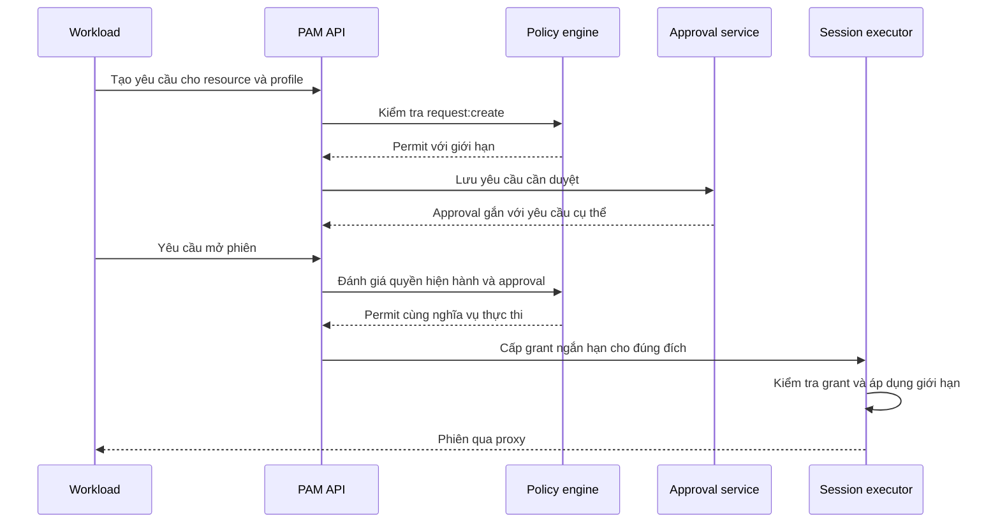

# PAM API authorization

## 1. Mục tiêu và tình huống mở đầu

Một pipeline triển khai cần khởi động lại dịch vụ thanh toán trên máy chủ production. Nhóm vận hành tích hợp pipeline với PAM để tạo phiên quản trị ngắn hạn. Pipeline xác thực thành công, nhận access token và gọi API của PAM.

Nếu API chỉ kiểm tra “token hợp lệ” rồi thực hiện yêu cầu, pipeline có thể nhận nhiều quyền hơn nhiệm vụ yêu cầu: mở phiên đến máy chủ khác, truy xuất mật khẩu quản trị hoặc tự phê duyệt yêu cầu của chính nó. Token hợp lệ chỉ chứng minh một danh tính được hệ thống chấp nhận; nó không chứng minh danh tính ấy được thực hiện mọi thao tác.

**PAM API authorization** là quá trình quyết định một danh tính có được thực hiện một hành động đặc quyền trên một tài nguyên cụ thể, trong điều kiện cụ thể hay không. Quyết định phải được thực thi tại API và các thành phần thực hiện thao tác, không phụ thuộc vào việc giao diện có hiển thị nút hay không.

Trong module kiểm soát quyền truy cập đặc biệt, API authorization nối chính sách least privilege với hoạt động thực tế của tài khoản quản trị, tài khoản dịch vụ và automation. Nó quyết định ai được yêu cầu quyền, ai được duyệt, credential nào được sử dụng, phiên nào được mở và bằng chứng nào phải được lưu lại.

Sau bài này, người học có thể:

- Phân biệt xác thực API với phân quyền thực hiện thao tác đặc quyền.
- Thiết kế quyền theo danh tính, hành động, tài nguyên, thời gian và điều kiện.
- Kết hợp RBAC, ABAC, scope, JIT và JEA mà không đánh đồng chúng.
- Ngăn truy cập chéo tenant, sửa thuộc tính nhạy cảm và lạm dụng quyền của automation.
- Xác định vị trí kiểm tra quyền, xử lý approval và cấp quyền ngắn hạn an toàn.
- Xây dựng kiểm thử từ chối và bằng chứng kiểm toán cho một PAM API.

Các endpoint, tên permission và cấu trúc policy trong bài là ví dụ thiết kế, không phải giao thức bắt buộc của một sản phẩm PAM. Khi áp dụng vào hệ thống thật, cần ánh xạ chúng sang cơ chế được nền tảng đó hỗ trợ.

## 2. Xác thực không thay thế phân quyền

### 2.1. Hai câu hỏi khác nhau

Authentication trả lời: **Ai đang gọi?**

Authorization trả lời: **Danh tính này được làm gì, với tài nguyên nào, trong hoàn cảnh hiện tại?**

Ví dụ, PAM xác thực một workload tên `deploy-payments-prod`. Danh tính này có thể được phép tạo yêu cầu khởi động lại dịch vụ thanh toán nhưng không được phép đọc password của tài khoản `root`.

| Thành phần | Ví dụ câu hỏi cần giải quyết |
| --- | --- |
| Xác thực | Token có hợp lệ với API này không? Workload có đúng là bên được cấp danh tính không? |
| Phân quyền chức năng | Workload có quyền gọi thao tác tạo phiên hay truy xuất credential không? |
| Phân quyền đối tượng | Quyền đó có áp dụng cho máy chủ và tài khoản đích được yêu cầu không? |
| Phân quyền thuộc tính | Bên gọi có được đặt thời lượng, chọn profile lệnh hoặc xem trường dữ liệu này không? |
| Phân quyền theo điều kiện | Approval còn hiệu lực không? Cửa sổ bảo trì đã mở chưa? Quyền JIT đã hết hạn chưa? |

Một API có thể xác thực rất tốt nhưng vẫn có lỗi phân quyền đối tượng. Ví dụ, người dùng thay `request_id` trong URL và đọc được yêu cầu của nhóm khác. Mã định danh khó đoán giúp giảm khả năng dò tìm, nhưng không thay thế kiểm tra quyền.

### 2.2. Ba lớp credential không được trộn lẫn

Trong tích hợp PAM thường tồn tại ít nhất ba loại thông tin truy cập:

1. **Credential xác thực bên gọi PAM:** dùng để chứng minh danh tính của người dùng hoặc workload.
2. **Access token hoặc chứng thư truy cập API:** được PAM API kiểm tra trước khi tiếp nhận yêu cầu.
3. **Credential đặc quyền của hệ thống đích:** password, SSH key, certificate hoặc cơ chế tương đương dùng để thực hiện thao tác quản trị.

Quyền sở hữu loại thứ nhất hoặc thứ hai không tự động cho phép nhận loại thứ ba. Một workload có thể được phép sử dụng credential thông qua proxy của PAM mà không được nhận giá trị credential đó.

Phân biệt rõ **được sử dụng quyền** và **được xem bí mật** là một bước quan trọng để giảm nguy cơ lộ credential trong log, biến môi trường hoặc artifact của pipeline.

## 3. Mô hình một quyết định phân quyền

Có thể mô tả yêu cầu phân quyền bằng bộ dữ liệu:

```text
subject + action + resource + context -> permit hoặc deny
```

Trong PAM, nên bổ sung nghĩa vụ phải thực hiện nếu quyết định là permit:

```text
permit + obligations
```

Ví dụ, chỉ cho phép mở phiên khi hệ thống có thể ghi lại phiên và gắn phiên với một approval còn hiệu lực. Nếu yêu cầu ghi hình bắt buộc nhưng thành phần thực thi không đáp ứng được, thao tác không được âm thầm tiếp tục.

### 3.1. Subject: người hoặc workload thực sự chịu trách nhiệm

Subject có thể là:

- Người quản trị đang làm việc trực tiếp.
- Workload CI/CD triển khai ứng dụng.
- Công cụ tự động khắc phục sự cố.
- Dịch vụ quản lý vòng đời credential.
- Dịch vụ trung gian thực hiện thao tác thay một người dùng.

Thông tin subject cần lấy từ kết quả xác thực đáng tin cậy và dữ liệu được hệ thống quản lý. Không lấy vai trò hoặc tenant của subject từ body do client gửi.

Nếu một ứng dụng thực hiện thao tác thay người dùng, cần biết cả người khởi tạo và dịch vụ thực hiện. Dịch vụ trung gian không được biến yêu cầu của người có ít quyền thành thao tác được hưởng toàn bộ quyền riêng của dịch vụ.

### 3.2. Action: mô tả khả năng đặc quyền, không chỉ phương thức HTTP

`POST` không phải một permission đủ rõ. Trong cùng một phương thức HTTP có thể có thao tác tạo yêu cầu, phê duyệt, mở phiên hoặc thu hồi phiên.

Ví dụ một danh mục quyền:

```text
request:create
request:read-own
request:read-team
request:approve
session:create
session:terminate-own
session:terminate-managed
credential:use-via-proxy
credential:retrieve
credential:rotate
policy:read
policy:manage
audit:read
```

Tách các action giúp trả lời rõ câu hỏi: một pipeline được tự động triển khai có thực sự cần quyền truy xuất password hay không? Thông thường, một job chỉ cần một số action nhỏ được giới hạn theo tài nguyên.

Permission phải có ngữ nghĩa nhất quán giữa API công khai, API nội bộ và tác vụ nền. Đổi đường đi của yêu cầu không được làm thay đổi giới hạn quyền.

### 3.3. Resource: không chỉ là một mã định danh

Tài nguyên đích có thể là tài khoản đặc quyền, hệ thống, secret, yêu cầu cấp quyền, phiên quản trị hoặc bản ghi kiểm toán.

Một phiên nên được liên kết với những thông tin đủ để ra quyết định:

```json
{
  "tenant_id": "tenant-a",
  "resource_id": "host-payments-prod-03",
  "account_id": "acct-payments-operator",
  "environment": "production",
  "owner_team": "payments-platform",
  "access_profile": "restart-payments-service"
}
```

Các nhãn môi trường và nhóm sở hữu phải đến từ dữ liệu do hệ thống tin cậy quản lý. Nếu client tự khai một máy chủ production là development để được áp dụng policy nhẹ hơn, API phải bỏ qua hoặc từ chối khai báo đó.

Kiểm tra cả quan hệ giữa các đối tượng: tài khoản được chọn có thuộc tài nguyên đích không, approval có dành cho tài nguyên này không, và phiên có nằm trong tenant đang xét không.

### 3.4. Context: điều kiện tại thời điểm quyết định

Context thường gồm:

- Thời gian hiện tại và cửa sổ thực hiện được phê duyệt.
- Request hoặc change ticket liên quan.
- Trạng thái approval, người phê duyệt và giới hạn đã duyệt.
- Trạng thái quyền JIT hoặc entitlement hiện hành.
- Danh tính workload, môi trường triển khai và nguồn gọi đã được xác minh.
- Điều kiện xác thực tăng cường của người dùng khi policy yêu cầu.
- Trạng thái rủi ro và khả năng đáp ứng nghĩa vụ giám sát.

Địa chỉ IP có thể là một tín hiệu bổ sung, nhưng không đủ để định danh workload. Nhiều workload có thể dùng chung một điểm ra mạng. Tương tự, trường `ticket_id` có mặt trong body không có nghĩa ticket đã tồn tại, đã được duyệt hoặc phù hợp với thao tác.

## 4. Kết hợp RBAC, ABAC và scope

### 4.1. RBAC mô tả chức trách

RBAC gán quyền theo vai trò. Ví dụ:

| Vai trò | Khả năng dự kiến | Giới hạn cần bổ sung |
| --- | --- | --- |
| Requester | Tạo và xem yêu cầu của mình | Không tự duyệt yêu cầu |
| Approver | Duyệt yêu cầu trong phạm vi quản lý | Không duyệt ngoài nhóm hoặc ngoài tài nguyên phụ trách |
| Automation operator | Dùng profile thao tác của workload | Không quản lý policy hoặc đọc credential tùy ý |
| Credential operator | Thực hiện vòng đời credential | Không mặc định được đọc giá trị credential |
| Auditor | Đọc bằng chứng trong phạm vi được giao | Không mở phiên quản trị hoặc chỉnh sửa bằng chứng |

Tên vai trò không đủ để bảo đảm least privilege. Một vai trò `operator` cho toàn bộ hệ thống vẫn có thể quá rộng. Vai trò cần được gắn với phạm vi tài nguyên, tenant và môi trường.

### 4.2. ABAC áp dụng điều kiện chi tiết

ABAC đánh giá các thuộc tính của subject, action, resource và context.

Ví dụ:

```text
Cho phép session:create khi:
- subject là workload triển khai đã được đăng ký;
- subject và resource thuộc cùng tenant;
- workload được ràng buộc với nhóm payments-platform;
- tài nguyên nằm trong nhóm máy chủ payments production;
- profile là restart-payments-service;
- approval đúng yêu cầu và còn hiệu lực;
- thời lượng yêu cầu không vượt quá giới hạn;
- phiên phải đi qua proxy có giám sát.
```

ABAC giúp tránh tạo một vai trò mới cho mọi tổ hợp tình huống. Đổi lại, thuộc tính phải có nguồn tin cậy và chính sách cần đủ rõ để kiểm thử. Một nhãn tài nguyên bị gán sai cũng có thể làm sai kết quả phân quyền.

Quyền sửa nhãn dùng cho phân quyền là quyền nhạy cảm. Người có thể tự đổi `owner_team` hoặc `environment` có thể gián tiếp thay đổi quyền truy cập mà không chỉnh policy.

### 4.3. Scope là một giới hạn, không phải toàn bộ quyết định

Một access token có thể mang scope như `pam.session.create`. Scope này thể hiện loại API mà token có thể sử dụng theo mô hình của hệ thống. Nó không tự chứng minh bên gọi có quyền mở phiên đến mọi máy chủ.

Một cách thiết kế là chỉ cho phép khi tất cả điều kiện bắt buộc đều thỏa mãn:

```text
token được chấp nhận cho API này
AND token cho phép loại action đang gọi
AND subject còn entitlement phù hợp
AND resource nằm trong phạm vi được cấp
AND approval và context thỏa mãn policy
AND nghĩa vụ thực thi có thể được đáp ứng
```

Không phải mọi nền tảng đều biểu diễn các lớp này bằng cùng tên gọi. Điểm cốt lõi là không dùng một cờ hoặc một scope rộng để bỏ qua phân quyền theo đối tượng và điều kiện hiện hành.

Quyền trong token cũng có thể cũ hơn trạng thái entitlement. Với thao tác nhạy cảm, cần có chiến lược kiểm tra trạng thái hiện tại hoặc thời gian sống phù hợp để hạn chế khoảng trễ khi thu hồi quyền.

## 5. Ma trận quyền cho một integration cụ thể

Giả sử integration `deploy-payments-prod` chỉ cần khởi động lại dịch vụ thanh toán bằng một profile quản trị đã định nghĩa.

| Action | Tài nguyên | Cho phép? | Điều kiện |
| --- | --- | --- | --- |
| Tạo yêu cầu | Nhóm máy chủ payments production | Có | Đúng workload và đúng profile |
| Xem yêu cầu | Yêu cầu của integration | Có | Cùng tenant |
| Duyệt yêu cầu | Bất kỳ | Không | Duyệt bởi chủ thể độc lập theo policy |
| Tạo phiên | Tài nguyên đã được duyệt | Có | Approval còn hiệu lực, thời lượng phù hợp |
| Dùng credential qua proxy | Tài khoản gắn với profile | Có | Không trả giá trị credential cho workload |
| Truy xuất password | Bất kỳ | Không | Không thuộc nhu cầu triển khai |
| Thay đổi policy | Bất kỳ | Không | Không thuộc chức trách integration |
| Đọc audit | Sự kiện của chính integration | Có giới hạn | Chỉ trường dữ liệu và phạm vi cần thiết |
| Truy cập tenant khác | Bất kỳ | Không | Không có entitlement chéo tenant |

Ma trận này nên được chuyển thành kiểm thử và cấu hình có thể đánh giá. Một mô tả “pipeline có quyền deploy” quá mơ hồ để xác định password retrieval, approval hoặc policy management có bị cấp nhầm hay không.

Không dùng chung một service principal cho nhiều pipeline có phạm vi khác nhau nếu việc đó khiến không thể ràng buộc quyền và truy vết riêng từng workload. Nếu phải dùng dịch vụ trung gian chung, dịch vụ cần giữ được nguồn gốc yêu cầu và thực thi phân quyền theo từng bên khởi tạo.

## 6. Những lỗi phân quyền cần chặn tại API

### 6.1. Truy cập đối tượng bằng cách đổi ID

Một người gọi:

```http
GET /pam/v1/tenants/tenant-a/requests/req-101
```

Sau đó thay `req-101` bằng `req-202` của người khác. API phải tải đối tượng theo phạm vi được kiểm soát và kiểm tra quyền đọc đối tượng đó.

Không chỉ kiểm tra rằng người gọi đã đăng nhập hoặc có permission `request:read`. Cần xác định họ được đọc yêu cầu của mình, của nhóm hay của tenant nào.

Danh sách và tìm kiếm cũng phải áp dụng cùng giới hạn. Việc chặn endpoint đọc chi tiết nhưng để endpoint tìm kiếm trả toàn bộ yêu cầu vẫn gây lộ thông tin.

### 6.2. Truy cập chức năng quản trị ngoài vai trò

Ẩn nút “Approve” khỏi giao diện không bảo vệ endpoint:

```http
POST /pam/v1/tenants/tenant-a/requests/req-101/approve
```

API phải tự kiểm tra permission duyệt, phạm vi phụ trách và điều kiện tách biệt trách nhiệm. Một integration có quyền tạo yêu cầu không được tự có quyền duyệt chỉ vì cùng sử dụng phương thức POST.

Cần kiểm tra cả API nội bộ mà gateway không trực tiếp công bố. Gọi được endpoint qua mạng nội bộ không phải bằng chứng được phép thực hiện chức năng.

### 6.3. Sửa thuộc tính nhạy cảm trong body

Ví dụ body mà client gửi:

```json
{
  "resource_id": "host-payments-prod-03",
  "profile": "restart-payments-service",
  "duration_seconds": 600,
  "approved": true,
  "requester_role": "platform-admin",
  "recording_required": false
}
```

API chỉ nên chấp nhận các trường đầu vào được quy định. `approved`, `requester_role` và việc tắt ghi hình không thể trở thành sự thật chỉ vì client đưa chúng vào body.

Một cách xử lý là từ chối các trường ngoài schema để lỗi tích hợp được nhận diện sớm. Dù chọn từ chối hay bỏ qua, các trường không được phép không được thay đổi trạng thái đặc quyền.

Phân quyền thuộc tính còn áp dụng cho dữ liệu trả về. Người được xem metadata của credential không mặc định được xem trường chứa secret.

### 6.4. Truy cập chéo tenant

Không tin `tenant_id` trong URL, header hoặc body như một quyền được cấp. Đó là tài nguyên hoặc phạm vi mà client đang yêu cầu.

API cần đối chiếu với danh tính đã xác thực, entitlement và quan hệ sở hữu của đối tượng. Nếu hệ thống hỗ trợ quản trị nhiều tenant, việc đó cần một entitlement rõ ràng; không tự suy ra từ vai trò quản trị trong một tenant.

Đường đi tới dữ liệu, cache và tác vụ nền đều cần giữ tenant context. Hai đối tượng có cùng tên ở hai tenant không được dùng chung một kết quả phân quyền hoặc một cache entry.

### 6.5. Lạm dụng dịch vụ trung gian có quyền rộng

Một portal nội bộ có quyền gọi PAM cho nhiều nhóm. Người dùng ít quyền gửi yêu cầu nhắm tới tài khoản quản trị của nhóm khác. Nếu portal gọi PAM bằng toàn bộ quyền riêng mà không kiểm tra bên khởi tạo, portal trở thành công cụ thực hiện đặc quyền vượt phạm vi người dùng.

Để kiểm soát tình huống này:

- Phân quyền người khởi tạo trước khi chấp nhận thao tác.
- Truyền nguồn gốc người khởi tạo qua cơ chế được xác minh, không dùng header tùy ý từ client.
- Giới hạn quyền riêng của portal theo nhu cầu dịch vụ.
- Gắn audit với cả người khởi tạo và dịch vụ thực hiện.
- Không biến lỗi xác minh nguồn gốc thành thao tác với quyền hệ thống.

Nếu một tác vụ chạy bằng thẩm quyền dịch vụ độc lập, cần xác định rõ ai được phép kích hoạt tác vụ và những tham số nào được họ lựa chọn. Không để người dùng biến một tác vụ cố định thành công cụ truy cập tùy ý.

## 7. Phân quyền theo vòng đời yêu cầu và phiên

Một lần kiểm tra quyền khi tạo request không đủ cho toàn bộ vòng đời.



### 7.1. Khi tạo request

Kiểm tra ít nhất:

- Subject được phép yêu cầu action và profile đó.
- Tài nguyên và tài khoản đích nằm trong phạm vi hợp lệ.
- Thời lượng yêu cầu nằm trong giới hạn được phép xin.
- Ticket hoặc lý do có định dạng và liên hệ phù hợp.
- Client không tự đặt trạng thái duyệt hoặc bỏ qua điều kiện.
- Dữ liệu đã được chuẩn hóa trước khi liên kết với approval.

Tạo request chỉ ghi nhận một nhu cầu truy cập. Nó chưa đồng nghĩa được phép thực hiện thao tác quản trị.

### 7.2. Khi phê duyệt

Approval phải gắn với yêu cầu cụ thể, gồm tài nguyên, action hoặc profile, thời lượng và cửa sổ sử dụng. Nếu thay đổi những thuộc tính quyết định sau khi duyệt, hệ thống phải yêu cầu duyệt lại hoặc từ chối theo policy.

Không cho requester tự duyệt khi policy yêu cầu tách biệt trách nhiệm. Đối với hai danh tính máy khác nhau nhưng cùng một integration có thể điều khiển, việc chỉ so sánh hai ID khác nhau chưa chắc tạo ra sự độc lập thực sự. Quy trình quản trị cần xác định chủ thể chịu trách nhiệm và quyền điều khiển các danh tính đó.

Approval cho yêu cầu A không được dùng để thực hiện yêu cầu B. Một ticket được duyệt cho máy chủ development không được dùng lại cho production.

### 7.3. Khi mở phiên hoặc lấy quyền sử dụng credential

Đánh giá lại những điều kiện có thể thay đổi:

- Subject còn hoạt động và còn entitlement không?
- Approval còn hiệu lực, chưa bị hủy và đúng phiên bản yêu cầu không?
- Tài nguyên còn thuộc phạm vi được cấp không?
- Cửa sổ bảo trì còn mở không?
- Thời lượng phiên có nằm trong giới hạn còn lại không?
- Thành phần thực thi có thể đáp ứng các nghĩa vụ bắt buộc không?

Đây là điểm kiểm soát khoảng cách giữa **thời điểm kiểm tra** và **thời điểm sử dụng**. Nếu người dùng bị thu hồi quyền sau khi tạo request, request cũ không được trở thành cách lách việc thu hồi.

### 7.4. Khi phiên đang hoạt động và khi thu hồi

Việc token API hết hạn không tự động chứng minh phiên SSH hoặc RDP đã kết thúc. Vòng đời phiên do thành phần thực thi và hệ thống đích kiểm soát.

Thiết kế cần xác định:

- Grant hết hạn có chấm dứt phiên đang chạy hay chỉ ngăn mở phiên mới?
- Thu hồi entitlement có tác động tới phiên hiện hữu như thế nào?
- Khi approval bị hủy, ai phát lệnh và ai thực thi việc kết thúc phiên?
- Nếu đã tiết lộ password, việc thu hồi ở PAM có cần rotate credential tại hệ thống đích không?
- Thời gian tối đa từ lúc quyết định thu hồi đến lúc quyền thực tế mất hiệu lực là bao lâu?

Nếu sản phẩm chưa hỗ trợ thu hồi tức thời, cần nêu rõ giới hạn vận hành và giảm thời gian tồn tại quyền. Không mô tả một thao tác xóa request trong cơ sở dữ liệu như bằng chứng phiên đã bị chấm dứt.

## 8. JIT và JEA trong API authorization

### 8.1. JIT giới hạn thời gian tồn tại của quyền

JIT cung cấp quyền vào thời điểm cần thiết và trong một khoảng thời gian xác định. Một API tích hợp có thể hỗ trợ grant 10 phút cho đúng một nhiệm vụ.

Thời gian sống của quyền không nên dài hơn bất kỳ giới hạn bắt buộc nào:

```text
grant_expiry = thời điểm sớm nhất trong:
- giới hạn theo policy;
- thời điểm kết thúc approval;
- thời điểm kết thúc cửa sổ bảo trì;
- thời điểm hết hạn entitlement JIT.
```

Nếu thời lượng client yêu cầu vượt giới hạn, API nên từ chối hoặc trả về thời lượng được cấp đã điều chỉnh theo một hợp đồng rõ ràng. Không được âm thầm cấp nhiều hơn giới hạn.

Không phải lúc nào token truy cập API và grant thực hiện thao tác cũng có cùng thời gian sống. Điều quan trọng là mỗi loại được kiểm tra tại đúng điểm sử dụng, và việc hết hạn hoặc thu hồi có tác động được xác định rõ.

### 8.2. JEA giới hạn tập thao tác

JEA hạn chế người hoặc workload chỉ được thực hiện những hành động cần thiết. Trong ví dụ triển khai, profile có thể chỉ cho phép khởi động lại một dịch vụ xác định.

Chỉ giới hạn API ở `session:create` nhưng cấp một shell quản trị không giới hạn vẫn chưa đạt JEA cho nhiệm vụ đó. Giới hạn phải được thực thi đến nơi thao tác xảy ra: proxy, broker, cơ chế quản trị hạn chế hoặc quyền của tài khoản đích.

Profile cũng phải được thiết kế để tránh cách vượt giới hạn. Một lệnh được cho phép nhưng nhận tham số tùy ý hoặc có khả năng gọi shell khác có thể mở rộng quyền ngoài mục tiêu. API không thể bù đắp hoàn toàn cho một profile thực thi quá rộng.

### 8.3. Quyền khẩn cấp phải có đường phân quyền riêng

Break-glass không nên là một tham số `force=true` mà mọi client đều có thể gửi.

Nếu API hỗ trợ quy trình khẩn cấp, nó cần permission riêng, phạm vi rõ, thời hạn ngắn, lý do và cơ chế xác minh phù hợp. Việc sử dụng phải phát sinh bằng chứng và cảnh báo theo policy, đồng thời có bước rà soát và xử lý credential sau sử dụng.

Lỗi policy engine hoặc timeout của approval service không tự tạo ra quyền khẩn cấp. Hành vi khi hạ tầng phân quyền không sẵn sàng cần được thiết kế trước và không mặc định cấp quyền rộng.

## 9. Kiến trúc thực thi quyền

### 9.1. Điểm thực thi và điểm quyết định

Trong mô hình có policy engine:

- **Policy Enforcement Point:** thành phần chặn hoặc cho phép yêu cầu, ví dụ API handler và session executor.
- **Policy Decision Point:** thành phần đánh giá policy và trả kết quả cùng giới hạn.
- **Nguồn thuộc tính:** cung cấp dữ liệu subject, resource, approval và trạng thái quyền.
- **Quản trị policy:** nơi thay đổi, kiểm tra, phê duyệt và phát hành policy.

API gateway có thể kiểm tra token, scope và giới hạn lưu lượng. Backend vẫn cần phân quyền theo đối tượng và trạng thái nghiệp vụ vì gateway có thể không biết tài khoản nào thuộc máy chủ nào hoặc approval đã bị hủy hay chưa.

Giới hạn tần suất giúp chống lạm dụng nhưng không thay thế authorization. Một thao tác trái phép duy nhất vẫn là trái phép dù nằm dưới ngưỡng tần suất.

### 9.2. Grant giữa API và executor

Khi API đã cho phép, nó có thể cấp một grant giới hạn để executor thực hiện. Grant cần được bảo vệ tính xác thực và gắn với các thuộc tính như:

```json
{
  "grant_id": "grant-410",
  "subject_id": "workload-deploy-payments",
  "tenant_id": "tenant-a",
  "request_id": "req-101",
  "request_revision": 3,
  "resource_id": "host-payments-prod-03",
  "account_id": "acct-payments-operator",
  "profile": "restart-payments-service",
  "expires_at": "2030-04-10T02:10:00Z",
  "recording_required": true,
  "intended_executor": "pam-session-executor"
}
```

Mốc thời gian trong ví dụ chỉ minh họa cấu trúc dữ liệu. Executor phải kiểm tra grant theo cơ chế của hệ thống, gồm nguồn cấp, đối tượng nhận, thời hạn, đích được phép và trạng thái thu hồi nếu áp dụng.

Không chuyển một grant chỉ cho phép khởi động lại dịch vụ thành quyền mở shell đầy đủ. Không cho client thay `resource_id` sau khi grant được cấp.

Nếu grant chỉ được dùng một lần, việc đánh dấu đã sử dụng và việc tạo phiên cần có cơ chế chống sử dụng đồng thời. Chỉ thêm trường `one_time=true` không giải quyết được hai executor cùng sử dụng một grant.

### 9.3. Cache quyết định

Cache có thể giảm độ trễ nhưng cũng kéo dài hiệu lực của một quyết định đã cũ.

Khóa cache phải phân biệt đủ subject, tenant, action, resource và các điều kiện liên quan. Không cache một kết quả “người dùng này là operator” rồi áp dụng cho mọi tài nguyên.

Thời hạn cache không được vượt qua thời điểm hết hạn bắt buộc. Với approval bị hủy hoặc entitlement bị thu hồi, cần có cách làm mất hiệu lực cache hoặc chấp nhận một khoảng trễ đã được đánh giá và công bố.

Khi cache hoặc policy engine lỗi, thao tác nhạy cảm phải có hành vi được xác định trước. Không chuyển lỗi kỹ thuật thành một kết quả permit mặc định.

## 10. Ví dụ policy và luồng xử lý ở server

### 10.1. Policy mô tả ý định

Ví dụ dưới đây là biểu diễn minh họa, không phải cú pháp của một policy engine cụ thể:

```yaml
policyId: payments-deploy-session
effect: permit
subject:
  kind: workload
  integrationId: deploy-payments-prod
actions:
  - request:create
  - session:create
resource:
  tenantId: tenant-a
  ownerTeam: payments-platform
  environment: production
  profile: restart-payments-service
conditions:
  approvalRequired: true
  requesterCannotApprove: true
  maxDurationSeconds: 600
  maintenanceWindowRequired: true
obligations:
  - use-session-proxy
  - record-session
  - audit-decision
```

Trong một hệ thống thật, điều kiện có thể khác nhau theo action. Ví dụ, `request:create` được phép tạo yêu cầu chưa duyệt, trong khi `session:create` bắt buộc có approval. Policy engine hoặc các rule riêng cần thể hiện sự khác biệt này; không áp điều kiện “đã duyệt” vào chính bước khởi tạo yêu cầu.

Danh sách action ở ví dụ không bao gồm `credential:retrieve`, `request:approve` hoặc `policy:manage`. Những action đó phải bị từ chối trừ khi có một policy độc lập, hợp lệ cho phép. Cách kết hợp nhiều policy và ưu tiên deny cần được quy định rõ trong hệ thống.

### 10.2. Pseudocode xử lý yêu cầu mở phiên

```text
function createSession(httpRequest):
    identity = authenticateForPamApi(httpRequest)
    input = parseAllowedFields(httpRequest.body)

    tenant = resolveAuthorizedTenant(identity, httpRequest.path.tenantId)
    request = loadRequestWithinTenant(tenant.id, input.requestId)
    resource = loadResourceWithinTenant(tenant.id, request.resourceId)
    account = loadAccountWithinTenant(tenant.id, request.accountId)

    assertAccountBelongsToResource(account, resource)
    assertRequestRevisionMatches(input.requestRevision, request.revision)

    approval = loadApprovalForRequest(tenant.id, request.id, request.revision)
    entitlement = loadCurrentEntitlement(identity, resource)
    context = buildTrustedContext(identity, request, approval, entitlement)

    decision = authorize(identity, "session:create", resource, context)
    if decision.isDenied:
        auditDeniedDecision(identity, request, decision.reasonCode)
        return safeDeniedResponse()

    assertObligationsSupported(decision.obligations)
    grant = atomicallyReserveAndIssueGrant(
        identity,
        request,
        approval,
        decision.constraints,
        decision.obligations,
        scopedIdempotencyKey(httpRequest)
    )

    return sessionExecutor.open(grant)
```

Các hàm trên thể hiện trách nhiệm cần có; chúng không phải mã có thể triển khai nguyên xi. Khi hiện thực, cần xử lý giao dịch, lỗi, timeout và việc thử lại.

Hàm cấp grant nguyên tử cần bảo đảm các điều kiện quyết định chưa bị thay đổi theo cách làm mất hiệu lực quyền tại thời điểm cấp. Có thể dùng kiểm tra phiên bản, giao dịch hoặc một cơ chế nhất quán phù hợp với kiến trúc. Một lần đọc approval rồi chờ lâu trước khi cấp grant không tự giải quyết rủi ro thay đổi trạng thái.

Executor vẫn cần kiểm tra grant khi sử dụng. Việc kiểm tra ở API không thay thế kiểm tra đích, thời hạn và giới hạn tại thành phần thực thi.

### 10.3. Idempotency không được làm tắt phân quyền

Một client có thể gửi lại yêu cầu vì timeout. Idempotency giúp tránh tạo nhiều phiên cho cùng một thao tác, nhưng key cần được ràng buộc với subject, tenant, loại thao tác và payload đã chuẩn hóa.

Những trường hợp phải tránh:

- Hai subject dùng cùng key và nhận kết quả của nhau.
- Gửi lại key cũ với một tài nguyên mới nhưng nhận một grant không khớp.
- Subject đã bị thu hồi quyền vẫn lấy lại được grant hoặc thông tin phiên qua một kết quả cache.
- Retry làm tiêu thụ approval hoặc mở thêm phiên ngoài giới hạn.

Trước khi trả kết quả đã lưu, API vẫn phải xác định người gọi được quyền truy cập kết quả đó. Với grant hoặc thông tin truy cập ngắn hạn, cần kiểm tra trạng thái hiện hành và quy tắc trả lại tương ứng, không phát lại bí mật đã hết hiệu lực.

## 11. Phản hồi API và bằng chứng kiểm toán

### 11.1. Phản hồi đủ rõ nhưng không tiết lộ quá mức

Một API cần có hợp đồng lỗi nhất quán. Ví dụ thông thường:

| Tình huống | Cách phản hồi có thể áp dụng |
| --- | --- |
| Chưa xác thực hoặc credential không được chấp nhận | 401 theo cơ chế xác thực của API |
| Đã xác thực nhưng không đủ quyền | 403 |
| Không tìm thấy hoặc cố ý che sự tồn tại của đối tượng ngoài phạm vi | 404 theo chính sách công bố thông tin |
| Trạng thái hoặc phiên bản yêu cầu xung đột | 409 |
| Đầu vào không hợp lệ | Mã lỗi đầu vào theo hợp đồng API |

Không nên coi bảng này là thay thế đặc tả giao thức. Hệ thống cần thống nhất cách trả lỗi với cơ chế xác thực, yêu cầu bảo mật và client của mình.

Mã lỗi nghiệp vụ ổn định giúp automation xử lý đúng:

```json
{
  "code": "PAM_ACCESS_DENIED",
  "message": "Yêu cầu không được phép trong điều kiện hiện tại.",
  "correlation_id": "corr-701"
}
```

Chi tiết như tên tài khoản nhạy cảm, policy nội bộ hoặc tenant khác có thể chỉ xuất hiện trong log được kiểm soát. Không trả password, token hoặc toàn bộ thông tin approval trong lỗi.

### 11.2. Audit quyết định và audit thực thi

Quyết định permit không chứng minh thao tác đã thực hiện thành công. Ngược lại, executor bắt đầu hoạt động cần được liên kết với quyết định cho phép tương ứng.

Ví dụ sự kiện quyết định:

```json
{
  "event_type": "pam.authorization.decision",
  "decision": "deny",
  "reason_code": "APPROVAL_EXPIRED",
  "tenant_id": "tenant-a",
  "subject_id": "workload-deploy-payments",
  "action": "session:create",
  "resource_id": "host-payments-prod-03",
  "request_id": "req-101",
  "request_revision": 3,
  "policy_version": "policy-v12",
  "correlation_id": "corr-701"
}
```

Ngoài thời điểm và dữ liệu trên, có thể cần lưu người khởi tạo, dịch vụ thực hiện, grant ID và các nghĩa vụ đã áp dụng. Không đưa raw access token, private key hoặc credential hệ thống đích vào audit.

Chuỗi bằng chứng nên nối được:

```text
yêu cầu -> approval -> quyết định quyền -> grant -> phiên -> kết quả -> thu hồi
```

Quyền đọc audit cũng cần được phân quyền. Một auditor của nhóm không mặc định được xem toàn bộ phiên của tổ chức. Thông tin ghi hình hoặc bản ghi lệnh có thể chứa dữ liệu nhạy cảm và cần kiểm soát truy cập tương ứng.

Nếu policy yêu cầu bằng chứng phải được lưu bền vững trước khi bắt đầu thao tác, thành phần thực thi phải bảo đảm điều kiện đó. Không báo “đã audit” chỉ vì gửi sự kiện vào một bộ nhớ đệm mà chưa có bảo đảm cần thiết.

## 12. Kiểm thử phân quyền

### 12.1. Bắt đầu từ các trường hợp được phép và bị từ chối

Một bộ kiểm thử chỉ xác nhận “pipeline mở được phiên” không chứng minh hệ thống phân quyền đúng.

| Ca kiểm thử | Thay đổi so với yêu cầu hợp lệ | Kết quả cần đạt |
| --- | --- | --- |
| Đường hợp lệ | Đúng workload, đích, profile và approval | Cấp phiên trong giới hạn |
| Khác tài nguyên | Đổi máy chủ ngoài nhóm | Từ chối, không tạo grant |
| Khác tenant | Đổi tenant trong URL | Không truy cập dữ liệu tenant khác |
| Khác tài khoản | Chọn tài khoản quản trị ngoài profile | Từ chối |
| Truy xuất credential | Gọi endpoint lấy password | Từ chối |
| Tự phê duyệt | Requester gọi approve | Từ chối theo policy |
| Approval hết hạn | Mở phiên sau cửa sổ đã duyệt | Từ chối |
| Approval sai yêu cầu | Dùng approval của request khác | Từ chối |
| Thời lượng quá dài | Xin phiên dài hơn giới hạn | Từ chối hoặc điều chỉnh theo hợp đồng |
| Đầu vào nhạy cảm | Gửi approved=true hoặc role=admin | Không thay đổi quyền hoặc trạng thái duyệt |
| Entitlement bị thu hồi | Dùng request đã tạo từ trước | Không cấp quyền mới |
| Lỗi policy engine | Không có quyết định hợp lệ | Không mở phiên ngoài hành vi đã thiết kế |

Không chỉ kiểm tra mã HTTP. Phải xác nhận không tạo phiên, không phát grant, không trả credential và không sửa trạng thái theo cách trái phép.

### 12.2. Kiểm thử danh sách, trường dữ liệu và đường gọi phụ

Thử phân quyền trên:

- Endpoint list, search, export và đọc chi tiết.
- Endpoint tạo, cập nhật, hủy và phê duyệt.
- API đọc trạng thái tác vụ nền hoặc tải artifact.
- Những trường nhạy cảm trong response.
- API nội bộ và đường đi qua executor.
- Cơ chế retry, idempotency và kết quả được cache.

Ví dụ, người gọi không có quyền đọc credential phải không nhận được secret từ cả endpoint chi tiết lẫn endpoint export. Nếu cùng dữ liệu có nhiều cách truy cập, mỗi cách đều cần kiểm soát phù hợp.

### 12.3. Kiểm thử cạnh tranh và thay đổi trạng thái

Những ca quan trọng với PAM:

1. Gửi đồng thời hai yêu cầu sử dụng một approval chỉ cho phép một lần.
2. Hủy approval ngay khi một worker đang chuẩn bị cấp grant.
3. Thu hồi entitlement rồi dùng lại token API còn hạn.
4. Sửa profile hoặc tài nguyên trong request sau khi đã duyệt.
5. Gửi retry với cùng idempotency key nhưng payload khác.
6. Dùng grant đã hết hạn hoặc sai executor.
7. Kết thúc phiên rồi thử dùng lại thông tin phiên cũ.

Kết quả mong đợi phải bám vào ngữ nghĩa được đặc tả. Nếu approval cho phép nhiều phiên, kiểm thử giới hạn số phiên hoặc thời gian tổng thay vì mặc định nó chỉ dùng một lần.

### 12.4. Kiểm thử trên môi trường có kiểm soát

Dùng tài nguyên thử nghiệm và credential giả lập khi có thể. Không thử các ca lấy password hoặc leo thang quyền trên production khi chưa có kế hoạch kiểm thử được phê duyệt.

Đây là hoạt động kiểm chứng phân quyền của hệ thống do tổ chức quản lý. Mục tiêu là chứng minh thao tác bị chặn và không tạo tác dụng phụ, không phải thực hiện những thao tác quản trị thật không cần thiết.

## 13. Vận hành và điều tra lỗi phân quyền

### 13.1. Khi một integration bị từ chối

Thực hiện theo chuỗi bằng chứng:

1. Xác định subject thực tế từ kết quả xác thực và correlation ID.
2. Xác định action mà endpoint ánh xạ tới.
3. Kiểm tra tenant, resource, account và quan hệ giữa chúng.
4. Kiểm tra entitlement hiện hành, scope và policy version.
5. Kiểm tra request revision, approval và thời gian hiệu lực.
6. Kiểm tra nghĩa vụ thực thi như proxy, recording hoặc audit.
7. Kiểm tra quyết định có dùng dữ liệu cache cũ không.

Không sửa lỗi bằng cách cấp vai trò quản trị toàn cục cho integration. Nếu thiếu một action hợp lệ, bổ sung đúng action và phạm vi cần thiết, rồi chạy lại kiểm thử được phép lẫn bị từ chối.

### 13.2. Khi quyền bị cấp quá rộng

Dấu hiệu có thể gồm một workload truy cập nhiều nhóm tài nguyên bất thường, gọi endpoint credential retrieval dù chỉ cần mở phiên hoặc tự tạo approval.

Biện pháp xử lý phụ thuộc phạm vi sự cố:

- Ngăn cấp grant mới cho danh tính hoặc policy bị ảnh hưởng.
- Thu hồi token, entitlement và grant theo cơ chế thực tế của hệ thống.
- Xác minh việc kết thúc các phiên đang hoạt động.
- Rotate credential hệ thống đích nếu credential có thể đã bị tiết lộ.
- Bảo toàn audit và liên kết sự kiện theo subject, resource, request và grant.
- Sửa policy, khôi phục có kiểm soát và kiểm thử đường khai thác đã phát hiện.

Việc thu hồi token của PAM API không tự bảo đảm credential đã bị lấy ra khỏi PAM cũng mất hiệu lực. Phải xử lý cả lớp API lẫn quyền trên hệ thống đích.

### 13.3. Khi thay đổi policy

Quản lý policy như một thay đổi ảnh hưởng trực tiếp tới khả năng sử dụng đặc quyền:

- Có chủ sở hữu và lý do thay đổi.
- Có phiên bản để đối chiếu với audit.
- Có kiểm thử phạm vi quyền trước khi phát hành.
- Có cơ chế triển khai và quay lui phù hợp.
- Có giám sát thay đổi tỷ lệ permit, deny và phạm vi tài nguyên.
- Có kiểm soát người được chỉnh policy và các thuộc tính đầu vào của policy.

Không dùng việc giảm số lỗi 403 làm thước đo duy nhất. Tỷ lệ từ chối giảm vì quyền được mở quá rộng là một tín hiệu xấu, dù pipeline chạy thuận lợi hơn.

## 14. Bài thực hành thiết kế

Bạn quản lý một công cụ tự động khắc phục sự cố cho hệ thống đơn hàng. Công cụ chỉ được khởi động lại dịch vụ `orders-worker` trên một nhóm máy chủ production trong tối đa 5 phút.

### Yêu cầu đầu ra

Thiết kế một ma trận quyền và mô tả API flow đáp ứng các điều kiện:

- Workload có danh tính riêng và không dùng tài khoản cá nhân.
- Chỉ được tạo yêu cầu và thực hiện profile khởi động lại dịch vụ.
- Không được đọc password, sửa policy hoặc tự duyệt.
- Approval phải gắn với tài nguyên, profile và thời lượng.
- Thay đổi request sau khi duyệt làm approval cũ mất hiệu lực theo policy.
- Grant hết hạn hoặc bị thu hồi không được mở phiên mới.
- Phiên và audit phải truy về được workload và yêu cầu ban đầu.

### Gợi ý lời giải

Permission tối thiểu có thể gồm `request:create`, quyền đọc yêu cầu của chính workload, `session:create` và `credential:use-via-proxy`. Cần ánh xạ lại theo sản phẩm thực tế; không thêm permission chỉ vì tên giống ví dụ.

Phạm vi tài nguyên phải là nhóm máy chủ orders production được hệ thống quản lý. Profile `restart-orders-worker` phải được thực thi bằng cơ chế chỉ cho phép thao tác cần thiết, không cấp shell quản trị tùy ý.

Cấp grant với thời hạn không vượt quá 5 phút và các giới hạn còn lại của approval. Khi mở phiên, kiểm tra lại approval và entitlement. Khi policy yêu cầu thu hồi phiên đang chạy, executor phải hỗ trợ và ghi nhận kết quả thực thi.

Bộ kiểm thử tối thiểu nên có các ca đổi sang máy chủ payments, lấy password, tự duyệt, xin 15 phút, dùng approval cũ sau khi sửa request, dùng lại grant và retry từ một workload khác.

### Câu hỏi tự đánh giá

1. Vì sao scope `pam.session.create` chưa đủ để cho phép mở phiên đến mọi máy chủ?
2. Ai có quyền thay đổi những thuộc tính như tenant, environment và owner team mà policy dựa vào?
3. Approval cần gắn với dữ liệu nào để không bị dùng cho một thao tác khác?
4. Nếu token API hết hạn nhưng phiên vẫn hoạt động, thành phần nào chịu trách nhiệm chấm dứt phiên?
5. Làm thế nào chứng minh một yêu cầu bị từ chối chưa tạo grant hoặc tác dụng phụ?
6. Nếu hệ thống đã trả password cho workload, việc xóa entitlement trong PAM còn thiếu bước gì?

## 15. Những nguyên tắc cần nhớ

PAM API authorization phải kiểm soát đồng thời chức năng, đối tượng, thuộc tính và điều kiện sử dụng quyền. Xác thực thành công là đầu vào của quyết định, không phải kết luận rằng mọi thao tác đều được phép.

Thiết kế tốt ràng buộc danh tính với đúng tài nguyên, action, approval và thời hạn; kiểm tra lại khi cấp quyền thực tế; đồng thời truyền được các giới hạn đến thành phần thực thi. JIT giảm thời gian quyền tồn tại, còn JEA giảm những việc quyền đó có thể làm.

Một tích hợp chỉ cần thực hiện nhiệm vụ quản trị qua proxy không nên mặc định được đọc credential. Quyền tạo yêu cầu, quyền phê duyệt, quyền thực hiện và quyền quản lý policy phải được phân biệt theo chức trách.

Cuối cùng, kiểm chứng bằng các trường hợp bị từ chối và bằng chứng xuyên suốt từ request tới phiên thực tế. Hệ thống chỉ đạt mục tiêu khi thao tác hợp lệ thực hiện được trong giới hạn, thao tác ngoài phạm vi bị chặn, và mỗi lần sử dụng đặc quyền đều truy vết được.
