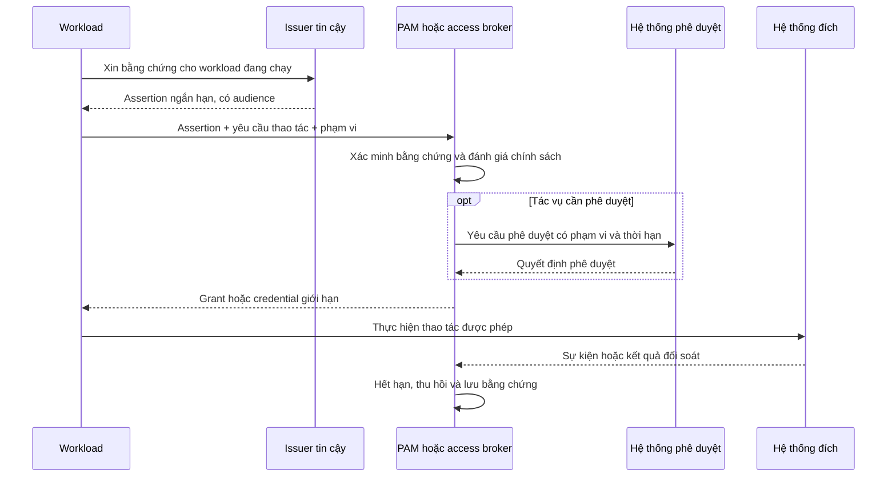

# Automation identity

## Mục tiêu bài học

Trong chương **API và automation** của module **Privileged Access Management (PAM)**, automation identity là danh tính mà một tiến trình tự động dùng để được xác thực, được cấp quyền và chịu trách nhiệm cho những thao tác của nó. Danh tính này có thể đại diện cho một workload đang chạy, một controller, một pipeline hoặc một tác vụ theo lịch. Nó không phải là tên gọi khác của mật khẩu dùng chung cho mọi script.

Sau bài học, bạn có thể:

- Phân biệt danh tính của automation, thông tin xác thực, quyền được cấp và phiên thực thi.
- Thiết kế đường đi từ bằng chứng workload đến quyền đặc biệt có thời hạn.
- Chọn ranh giới danh tính phù hợp cho pipeline, ứng dụng và hạ tầng.
- Kiểm soát vòng đời credential, thu hồi quyền và bằng chứng kiểm toán.
- Phân tích những tình huống thất bại thường gặp mà không biến tài khoản máy thành cửa hậu quản trị.

Phạm vi bài học là kiểm soát quyền đặc biệt của automation đối với tài khoản quản trị, dịch vụ và hạ tầng nhạy cảm. Các cấu hình và giao thức bên dưới là mô hình minh họa, không phải cấu hình có thể đưa thẳng vào một sản phẩm PAM cụ thể.

## 1. Vì sao automation cần một danh tính riêng?

Giả sử đội vận hành có một script triển khai ứng dụng. Ban đầu, người viết script dùng tài khoản quản trị của chính mình để chạy nó. Sau đó, mật khẩu được đưa vào kho biến của hệ thống CI để job có thể chạy ban đêm. Nhiều repository cùng dùng biến đó và một số script cũng được sao chép sang máy quản trị.

Khi có thay đổi trái phép, nhật ký chỉ ghi nhận tài khoản của người viết script. Bạn không biết thay đổi do người đó thực hiện trực tiếp, pipeline nào gây ra hay credential đã bị sao chép sang đâu. Khi người đó nghỉ việc, vô hiệu hóa tài khoản có thể làm ngừng triển khai. Nếu giữ tài khoản hoạt động để tránh gián đoạn, tổ chức tiếp tục duy trì một danh tính không còn chủ sở hữu phù hợp.

Một automation identity được thiết kế tốt tách các quan hệ đó ra:

- Con người sở hữu, phê duyệt và bảo trì automation.
- Workload có danh tính riêng khi nó chạy.
- Chính sách quyết định workload đó được phép làm gì.
- Credential hoặc token chứng minh danh tính hay mang quyền trong một khoảng thời gian.
- Nhật ký liên kết thao tác với workload, lần chạy và người chịu trách nhiệm.

Điều quan trọng không phải là đặt tên tài khoản có tiền tố `svc-`. Mục tiêu là tạo một chuỗi tin cậy có thể kiểm tra: **ai chịu trách nhiệm, workload nào đang chạy, quyền nào được cấp, thao tác nào đã xảy ra và quyền đã kết thúc chưa**.

## 2. Bốn khái niệm không nên gộp làm một

| Khái niệm | Câu hỏi được trả lời | Ví dụ |
|---|---|---|
| Identity | Chủ thể nào đang yêu cầu truy cập? | Workload triển khai dịch vụ thanh toán vào production |
| Authenticator hoặc credential | Chủ thể đưa ra bằng chứng gì? | Token được ký, chứng thư hoặc một secret được quản lý |
| Authorization hoặc grant | Chủ thể được phép làm gì trên tài nguyên nào? | Khởi động lại một dịch vụ trong một cụm cụ thể |
| Execution hoặc session | Lần sử dụng quyền cụ thể là gì? | Lần triển khai có mã `run-7f21` vào lúc được phê duyệt |

Một identity có thể tồn tại nhiều năm trong danh mục quản lý, nhưng mỗi credential của nó chỉ tồn tại vài phút. Ngược lại, một secret có thể được dùng suốt nhiều năm dù các workload sử dụng nó liên tục thay đổi. Tuổi thọ identity và tuổi thọ credential là hai đại lượng khác nhau.

Một tên identity cũng không tự tạo ra sự tin cậy. Nếu script gửi chuỗi `identity=prod-deployer` trong một request, đó chỉ là lời tự khai. Hệ thống phải kiểm tra bằng chứng do một nguồn được tin cậy phát hành và ánh xạ bằng chứng đó sang identity theo chính sách.

### 2.1. Automation identity và service account

Service account thường là một biểu diễn tài khoản trong hệ thống cụ thể, chẳng hạn một tài khoản cơ sở dữ liệu, hệ điều hành hoặc ứng dụng. Automation identity là khái niệm rộng hơn, mô tả danh tính của tác nhân tự động và cách nó được quản lý.

Một workload có thể được xác thực bằng danh tính liên kết rồi nhận credential cho service account ở hệ thống đích. Trong mô hình đó có hai chủ thể cần theo dõi:

1. Identity nguồn của workload.
2. Tài khoản đích mà workload được phép sử dụng.

Nếu hệ thống đích chỉ ghi tài khoản đích, PAM hoặc proxy phải lưu ánh xạ giữa hai chủ thể. Việc vault đã trả mật khẩu không đủ chứng minh lệnh nào thực sự được thực thi tại đích.

### 2.2. Automation identity và tài khoản cá nhân

Tài khoản cá nhân phục vụ một con người; quy trình xác thực có thể bao gồm tương tác, thiết bị cá nhân và MFA. Automation chạy không giám sát không nên phụ thuộc vào việc một người xác nhận MFA cho từng lần khởi động hoặc lưu lại phiên đăng nhập cá nhân.

Automation không có thao tác nhập mã MFA không đồng nghĩa với việc được bỏ xác thực mạnh. Bằng chứng workload, khóa gắn với môi trường chạy, xác minh nguồn phát hành và giới hạn quyền phải tạo thành chuỗi kiểm soát phù hợp cho tác nhân máy.

Phê duyệt của con người vẫn có thể là điều kiện để cấp quyền đặc biệt. Nó là một bước ủy quyền riêng, không phải hành vi giả lập một người dùng để automation đăng nhập.

## 3. Chia identity theo ranh giới rủi ro

Một lỗi phổ biến là tạo tài khoản `automation-admin` rồi cấp cho mọi job. Cách làm này thuận tiện lúc đầu nhưng khiến một workload bị xâm nhập trở thành điểm truy cập vào nhiều hệ thống.

Nên cân nhắc các chiều sau khi xác định ranh giới identity:

| Chiều phân tách | Câu hỏi thiết kế | Rủi ro nếu gộp quá rộng |
|---|---|---|
| Chức năng | Job triển khai và job sao lưu có cần cùng quyền không? | Job chỉ cần đọc có thể lấy được quyền ghi |
| Môi trường | Development có dùng chung identity với production không? | Mã thử nghiệm trở thành đường vào production |
| Ứng dụng hoặc miền dữ liệu | Các dịch vụ có cùng chủ sở hữu và độ nhạy không? | Một sự cố lan sang dữ liệu không liên quan |
| Nguồn mã và workflow | Ai có thể sửa mã đang chạy dưới identity này? | Quyền sửa repository chuyển thành quyền quản trị |
| Nơi thực thi | Runner dùng chung có đủ cách ly không? | Job khác có thể lấy credential còn tồn tại |
| Vùng quản trị | Có vượt tenant, tài khoản cloud hay miền quản trị không? | Phá vỡ ranh giới kiểm soát giữa các đơn vị |

Không cần tạo một identity bền vững mới cho mọi lần chạy. Có thể giữ identity logic ổn định theo chức năng, nhưng cấp credential ngắn hạn gắn với mã lần chạy. Nhờ đó danh mục identity vẫn quản lý được, trong khi hoạt động từng lần vẫn truy vết riêng.

Cũng không nên phân tách một cách máy móc. Nếu hàng nghìn identity có chính sách giống nhau nhưng không rõ owner, tổ chức chỉ chuyển từ một tài khoản quá mạnh sang một danh mục khó quản trị. Ranh giới cần phản ánh khác biệt về quyền, nguồn tin cậy, chủ sở hữu hoặc tác động khi bị xâm nhập.

### Ví dụ về ranh giới hợp lý

Một hệ thống thanh toán có thể dùng ba identity logic:

- `payment-build-dev`: xây dựng và kiểm thử trong môi trường phát triển.
- `payment-deploy-prod`: triển khai artifact đã được phê duyệt vào một phạm vi production.
- `payment-backup-prod`: tạo bản sao lưu theo lịch, có quyền khác với triển khai.

Việc cả ba cùng thuộc một đội không phải lý do để dùng chung credential. Đội sở hữu là thuộc tính quản trị; tập quyền là quyết định bảo mật của từng workload.

## 4. Danh mục identity là điểm xuất phát của PAM

PAM không thể kiểm soát tốt một automation mà tổ chức không biết đang tồn tại. Mỗi identity có quyền đặc biệt nên có hồ sơ tối thiểu.

Ví dụ hồ sơ dưới đây chỉ mô tả thiết kế:

```yaml
identity:
  id: payment-deploy-prod
  kind: workload
  purpose: Deploy approved payment artifacts
  business_owner: payments-platform
  technical_owner: release-engineering
  environment: production

trust:
  issuer_ref: approved-ci-issuer
  subject_binding_ref: payment-production-workflow
  audience: pam-token-exchange
  allowed_runner_pool: production-isolated

access:
  policy_ref: payment-prod-deployment
  target_scope: payment-production-cluster
  interactive_login: prohibited
  standing_privileged_membership: prohibited

lifecycle:
  review_interval_days: 90
  maximum_grant_duration_minutes: 15
  retirement_condition: production-workflow-removed
```

Các con số trong ví dụ là giả định để thảo luận. Chu kỳ rà soát và thời lượng quyền phải dựa trên tác vụ, độ nhạy, khả năng thu hồi và năng lực vận hành của hệ thống thực tế.

Hồ sơ cần trả lời được thêm những câu hỏi sau:

- Ai có quyền sửa workflow, mã nguồn, image và chính sách cấp quyền?
- Credential được phát hành ở đâu và có thể xuất hiện ở những vị trí nào?
- Identity được phép truy cập những tài khoản đích nào?
- Điều gì xảy ra khi owner thay đổi hoặc không còn phản hồi?
- Cách vô hiệu hóa khẩn cấp và khôi phục vận hành là gì?
- Những log nào chứng minh quyền đã được dùng và đã kết thúc?

“Đội DevOps quản lý” là mô tả quá rộng nếu không có đầu mối chịu trách nhiệm và người thay thế. Một identity hoạt động liên tục nhưng không còn owner hợp lệ là khoản nợ kiểm soát cần xử lý.

## 5. Chuỗi tin cậy từ workload đến hệ thống đích

Một luồng truy cập có thể được hình dung như sau:



Đây là mô hình logic. Trong triển khai qua proxy, workload có thể không bao giờ nhận credential của tài khoản đích; proxy giữ credential và thực hiện kết nối. Trong mô hình khác, broker cấp credential trực tiếp cho workload. Mỗi lựa chọn có ranh giới rủi ro khác nhau.

### 5.1. Kiểm tra bằng chứng đầu vào

Nếu sử dụng token được ký hoặc một assertion tương tự, broker phải thực hiện các kiểm tra phù hợp với giao thức và cấu hình đã chọn, chẳng hạn:

- Chữ ký hợp lệ từ issuer đã cấu hình trước.
- Khóa xác minh được chọn theo quy tắc tin cậy, không theo URL tùy ý do request cung cấp.
- Audience khớp mục đích trao đổi token của broker.
- Thời điểm phát hành, bắt đầu hiệu lực và hết hạn phù hợp.
- Subject cùng các thuộc tính nguồn được ánh xạ theo chính sách.
- Thuật toán và định dạng nằm trong tập được cho phép.
- Điều kiện chống phát lại hoặc ràng buộc với bên giữ khóa, nếu thiết kế yêu cầu.

Audience ngăn token dành cho một dịch vụ bị sử dụng ở một dịch vụ khác. Audience không tự chứng minh workload có quyền triển khai; nó chỉ là một điều kiện trong quá trình kiểm tra.

Không giải mã payload rồi tin ngay các claim. Nội dung token có thể đọc được mà chưa hề được xác thực.

### 5.2. Thuộc tính được xác minh phải đủ mạnh

Một điều kiện như “repository có tên payments” thường chưa đủ. Có thể cần kết hợp định danh ổn định của repository, tổ chức sở hữu, workflow được bảo vệ, môi trường, loại sự kiện và điều kiện kiểm soát thay đổi.

Đặc biệt, phải phân biệt:

- Claim do issuer tạo từ trạng thái đã được xác minh.
- Giá trị do workflow hoặc mã chạy trong job tự truyền vào.
- Giá trị do request gửi đến broker tự khai.

Nếu một pull request không được tin cậy có thể tự khai `environment=production`, broker không được coi chuỗi đó là bằng chứng môi trường production. Quyền sửa dữ liệu đầu vào của một policy là một phần quan trọng của mô hình đe dọa.

### 5.3. Broker cũng là một hệ thống đặc quyền

Một broker có thể giữ credential gốc hoặc quyền tạo credential động. Vì vậy nó cần được bảo vệ như hạ tầng quản trị:

- Tách quyền quản trị broker khỏi quyền chạy workload.
- Hạn chế mạng và quyền truy cập kho khóa.
- Kiểm soát thay đổi policy, cấu hình issuer và ánh xạ tài khoản đích.
- Lưu dấu vết các thao tác quản trị.
- Kiểm thử khôi phục và thu hồi khi broker bị xâm nhập.

Đưa mọi secret vào broker không làm biến mất rủi ro; nó tập trung rủi ro để có thể quản lý bằng các kiểm soát chặt hơn.

## 6. Chọn cơ chế xác thực phù hợp

Không phải hệ thống nào cũng hỗ trợ cùng một cơ chế. Thiết kế nên ưu tiên bằng chứng gắn với workload và giảm secret dài hạn khi có thể, đồng thời có cách quản lý rõ ràng cho các hệ thống cũ.

| Cơ chế | Điểm hữu ích | Điều cần kiểm soát |
|---|---|---|
| Danh tính nền tảng hoặc workload federation | Có thể tránh phân phối secret bootstrap dài hạn cho từng job | Issuer, subject, audience, ranh giới runner và điều kiện trao đổi |
| Chứng thư hoặc khóa bất đối xứng | Hữu ích khi cần chứng minh quyền giữ khóa hoặc xác thực hai chiều | Bảo vệ private key, gia hạn, thu hồi và nguồn cấp chứng thư |
| Secret tĩnh trong vault | Có thể tích hợp với hệ thống đích cũ | Bootstrap, quyền đọc secret, rotation và nơi secret bị sao chép |
| Tài khoản được broker sử dụng qua proxy | Workload có thể không nhận credential đích | Quyền broker, phạm vi thao tác, đường truy cập trực tiếp và log tương quan |

“Không có mật khẩu” không đồng nghĩa với “không có credential”. Private key, token và cookie phiên đều có thể trở thành vật mang quyền. Một bearer token bị sao chép có thể được dùng bởi người đang giữ nó trong giới hạn của token, trừ khi có thêm ràng buộc phù hợp.

Cũng không có cơ chế nào bù được việc workflow được phép chạy mã tùy ý dưới quyền quá rộng. Nếu kẻ tấn công điều khiển workload hợp lệ trong cửa sổ cấp quyền, hệ thống cần giảm thiệt hại bằng phạm vi, thời hạn, giới hạn thao tác và kiểm soát thay đổi.

### 6.1. Bài toán bootstrap

Một script cần secret để đăng nhập vault, nhưng secret đăng nhập vault lại được lưu cạnh script. Khi đó vault chưa giải quyết được điểm yếu ban đầu.

Các hướng giải quyết có thể bao gồm danh tính do nền tảng cấp, khóa được bảo vệ trong môi trường thực thi hoặc một cơ chế đăng ký workload được kiểm soát. Nếu buộc phải có secret bootstrap, cần giới hạn quyền của nó vào việc lấy đúng credential, hạn chế nơi sử dụng, đặt lịch rotation và theo dõi truy cập.

Không giấu secret bootstrap trong một repository riêng rồi coi đó là kiểm soát đầy đủ. Bất cứ ai đọc được repository đó có thể có được cùng năng lực xác thực.

## 7. Least privilege, JIT và JEA cho automation

Với automation, “cần quyền quản trị để chạy được” thường là một mô tả chưa đủ chi tiết. Hãy tách tác vụ thành các thao tác đích.

Ví dụ, triển khai ứng dụng có thể cần:

1. Đọc artifact đã được duyệt.
2. Cập nhật một nhóm tài nguyên triển khai.
3. Kiểm tra trạng thái.
4. Khôi phục phiên bản trước trong phạm vi xác định.

Không phải bước nào cũng cần quyền đọc secret của toàn bộ hệ thống, tạo tài khoản quản trị hoặc sửa chính sách IAM.

### 7.1. Quyền theo bộ ba thao tác, tài nguyên và điều kiện

Một policy minh họa có thể được diễn đạt như sau:

```yaml
policy:
  identity: payment-deploy-prod
  allow:
    actions:
      - deployment.read
      - deployment.update
      - rollout.status.read
    resources:
      - payment-prod/application/payment-api
    conditions:
      approved_artifact_required: true
      change_reference_required: true
      maximum_duration_minutes: 15
      production_runner_required: true
  deny:
    actions:
      - identity.create
      - role.assign
      - secret.export
      - audit.disable
```

Đây là ngôn ngữ minh họa. Các tên action không đại diện cho API của nhà cung cấp nào. Một policy thực tế chỉ có hiệu lực nếu hệ thống thực thi hiểu và áp dụng các giới hạn đó; ghi một điều kiện vào YAML không tự tạo ra kiểm soát.

Danh sách action cũng cần được xem xét về khả năng leo thang gián tiếp. Chẳng hạn, quyền sửa mã của một dịch vụ đang chạy dưới tài khoản rất mạnh có thể dẫn đến sử dụng quyền của dịch vụ đó. “Không có quyền gán role” chưa đủ để kết luận không thể leo thang.

### 7.2. JIT: quyền xuất hiện khi cần

Just-in-time access giảm thời gian tồn tại của quyền đặc biệt. Workload nhận quyền sau khi điều kiện được thỏa mãn và mất quyền khi tác vụ kết thúc hoặc hết hạn.

Cần phân biệt ít nhất bốn thời hạn:

- Thời hạn của assertion dùng để xác thực workload.
- Thời hạn của grant mà broker cấp.
- Thời hạn của credential đích.
- Thời gian sống của phiên hoặc công việc đã bắt đầu tại đích.

Một assertion hết hạn không nhất thiết thu hồi credential được phát hành trước đó. Một credential hết hạn cũng không chắc chấm dứt phiên đã xác thực, tùy hành vi hệ thống đích. Một tác vụ từ xa được tạo trong cửa sổ hợp lệ có thể tiếp tục chạy sau khi grant hết hạn.

Vì vậy, thiết kế JIT phải xác định điều gì thực sự kết thúc quyền tại đích, cách thu hồi phiên và cách xử lý tác vụ vẫn đang chạy.

### 7.3. JEA: chỉ đủ năng lực để hoàn thành tác vụ

Just enough administration hướng tới giảm năng lực được trao. Thay vì cấp một shell quản trị không giới hạn, có thể cung cấp API vận hành hẹp hoặc tập hành động có tham số được kiểm tra.

Ví dụ, một endpoint `restartPaymentService` kiểm tra identity, môi trường và tên dịch vụ có thể dễ giới hạn hơn quyền chạy chuỗi lệnh tùy ý. Tuy nhiên, endpoint hẹp vẫn có thể nguy hiểm nếu tham số cho phép chèn lệnh, chọn đường dẫn tùy ý hoặc gọi sang một tài nguyên ngoài phạm vi.

Nếu giới hạn theo lệnh, phải đánh giá cả chương trình được gọi, tham số, file cấu hình, biến môi trường, script được nạp và khả năng ghi vào những thành phần đó. Chặn vài chuỗi ký tự trong lệnh không phải một ranh giới quyền vững chắc.

## 8. Phê duyệt cho automation phải gắn với yêu cầu cụ thể

Không phải mọi lần chạy đều cần một người phê duyệt trực tiếp. Chính sách có thể cho phép tự động các tác vụ rủi ro thấp, lặp lại và có phạm vi hẹp. Các thao tác tác động lớn có thể cần phê duyệt từ người hoặc hệ thống thay đổi có thẩm quyền.

Một quyết định phê duyệt nên gắn với các thuộc tính có ý nghĩa:

- Identity và lần chạy dự kiến.
- Môi trường, tài nguyên và tập thao tác.
- Artifact hoặc đầu vào đã được kiểm soát.
- Cửa sổ thời gian.
- Mã thay đổi và người phê duyệt.
- Phiên bản policy được dùng để quyết định.

Nếu người duyệt chấp nhận triển khai artifact A nhưng job thay bằng artifact B trước khi chạy, phê duyệt cũ không nên còn đủ điều kiện. Broker phải kiểm tra lại những thuộc tính quan trọng tại thời điểm cấp quyền.

Mã ticket không phải credential. Chỉ gửi một chuỗi giống mã ticket không chứng minh yêu cầu đã được duyệt, còn hiệu lực hay có đúng phạm vi. Cần lấy trạng thái từ nguồn có thẩm quyền hoặc kiểm tra một quyết định phê duyệt được bảo vệ phù hợp.

Tách nhiệm vụ cũng cần xét quyền sửa automation. Một người có quyền thay mã chạy dưới identity đặc quyền và đồng thời tự phê duyệt lần chạy có thể kiểm soát toàn bộ đường thực thi.

## 9. Ví dụ xuyên suốt: pipeline triển khai production

### 9.1. Bối cảnh

Đội Payments triển khai một dịch vụ vào production. Tác vụ chỉ được cập nhật tài nguyên của dịch vụ đó và đọc trạng thái rollout. Nó không được sửa identity, đọc toàn bộ secret hay thao tác trên ứng dụng khác.

Thiết kế ban đầu dùng một tài khoản quản trị chung. Thiết kế mới có:

- Identity logic `payment-deploy-prod`.
- Runner production được cách ly với job không được tin cậy.
- Bằng chứng workload từ issuer đã được phê duyệt.
- Policy cấp quyền cho đúng môi trường và tài nguyên.
- Credential hoặc kết nối qua broker có thời hạn.
- Bằng chứng liên kết lần chạy, grant và thao tác đích.

### 9.2. Yêu cầu cấp quyền minh họa

```json
{
  "request_id": "req-9d31",
  "run_id": "run-7f21",
  "requested_operation": "deploy",
  "target": "payment-prod/application/payment-api",
  "artifact_digest": "sha256:example-approved-artifact",
  "change_ref": "CHG-2048",
  "requested_duration_seconds": 600
}
```

Request không chứa claim tự khai để thay thế cho xác thực. Broker lấy identity thực từ bằng chứng đã kiểm tra, rồi so sánh yêu cầu với policy. Trường `requested_duration_seconds` cũng chỉ là đề nghị; broker quyết định thời lượng được cấp.

Digest minh họa là định danh artifact, không phải secret. Dù vậy, broker vẫn cần xác minh artifact đó liên quan đến quyết định phê duyệt và nguồn phát hành được tin cậy. Một digest bất kỳ không chứng minh artifact an toàn hay đã được duyệt.

### 9.3. Quyết định và thực thi

Luồng xử lý có thể diễn đạt bằng mã giả:

```text
claims = verify_workload_assertion(
    trusted_issuer,
    expected_audience,
    accepted_time_window
)

identity = map_verified_claims_to_identity(claims)
policy = load_effective_policy(identity)

assert request.target is within policy.allowed_targets
assert request.operation is allowed by policy
assert runner_context satisfies policy
assert approval is valid for this artifact, target and time

grant = create_bounded_grant(identity, request, policy)
record_grant_decision(grant, run_id, approval_reference)

try:
    execute_bounded_operation(grant, approved_artifact)
    record_target_result(run_id, grant.id)
finally:
    request_grant_cleanup(grant.id)
    record_cleanup_attempt(grant.id)
```

Khối `finally` chỉ minh họa cơ chế dọn dẹp trên đường chạy bình thường. Nếu runner bị tắt đột ngột, mã dọn dẹp có thể không chạy. Vì vậy phải có TTL và một bộ đối soát phía máy chủ phát hiện grant quá hạn hoặc tài nguyên tạm chưa được xóa.

“Đã yêu cầu cleanup” và “đã thu hồi thành công” là hai trạng thái khác nhau. Không ghi kết quả thu hồi thành công chỉ vì request đã được gửi.

### 9.4. Trường hợp phải từ chối

Cùng identity logic nhưng yêu cầu cần bị từ chối nếu:

- Job xuất phát từ một ngữ cảnh nguồn không đáp ứng policy.
- Artifact khác với artifact đã được phê duyệt.
- Yêu cầu thêm quyền sửa role hoặc xuất secret.
- Tài nguyên thuộc một ứng dụng khác.
- Phê duyệt đã hết hiệu lực.
- Bằng chứng có audience sai hoặc không xác minh được.
- Điều kiện runner không còn thỏa mãn.

Nhật ký từ chối phải đủ giải thích quyết định nhưng không để lộ token, private key, mật khẩu hoặc nội dung secret.

## 10. Quản lý credential trong quá trình chạy

Credential ngắn hạn vẫn có thể bị rò rỉ trong cửa sổ còn hiệu lực. Môi trường chạy cần hạn chế số nơi credential xuất hiện.

### 10.1. Những vị trí dễ làm lộ credential

- In toàn bộ biến môi trường để chẩn đoán lỗi.
- Đặt token trong tham số dòng lệnh có thể bị quan sát.
- Bật chế độ trace khiến header xác thực xuất hiện trong log.
- Lưu file cấu hình vào workspace rồi tải workspace thành artifact.
- Tạo crash dump hoặc bản chụp bộ nhớ.
- Giữ credential trong cache dùng chung giữa nhiều job.
- Đưa secret vào URL rồi để proxy ghi lại URL đó.

Các kênh truyền credential đều có đánh đổi. Biến môi trường, file tạm và bộ nhớ không tự động an toàn; lựa chọn cần dựa trên mô hình cách ly, quyền quan sát tiến trình và hành vi công cụ sử dụng credential.

Nên giảm thời gian tồn tại, giới hạn quyền truy cập file hoặc tiến trình, tránh ghi ra đĩa khi không cần và làm sạch tài nguyên khi kết thúc. Xóa một file không đảm bảo dữ liệu chưa từng xuất hiện ở cache, log, snapshot hoặc artifact.

### 10.2. Masking log chỉ là một lớp hỗ trợ

Che chuỗi secret đã biết trong log có ích nhưng không thể bảo đảm phát hiện mọi biến thể mã hóa, cắt nhỏ hoặc biến đổi của secret. Không nên thiết kế quy trình phụ thuộc vào việc “cứ in ra rồi hệ thống sẽ che”.

Cần rà soát cả log của client, broker, proxy, hệ thống đích và bộ thu thập telemetry. Một ứng dụng không in token nhưng một proxy bật debug header vẫn có thể làm lộ token.

### 10.3. Cache phải tôn trọng identity và vòng đời quyền

Nếu cần cache token để giảm tải, khóa cache phải phân biệt đúng identity, audience, phạm vi, môi trường và những điều kiện liên quan. Không dùng một token của job trước cho job sau chỉ vì hai job cùng chạy trên một runner.

Khi token sắp hết hạn, workload nên yêu cầu token mới theo quy trình xác thực và ủy quyền hiện hành. Gia hạn vô hạn bằng quyền tự gia hạn có thể biến credential ngắn hạn thành quyền tồn tại lâu dài trên thực tế.

## 11. Rotation và thu hồi quyền

### 11.1. Rotation không đồng nghĩa với thu hồi tức thời

Thay mật khẩu có thể ngăn lần đăng nhập mới bằng mật khẩu cũ, nhưng một phiên đang mở có thể vẫn hoạt động. Thu hồi một token ở broker có thể không tác động đến token mà hệ thống đích chỉ xác minh ngoại tuyến đến khi hết hạn.

Cần lập bản đồ cho từng cơ chế:

| Đối tượng | Hành động cần có | Bằng chứng cần kiểm tra |
|---|---|---|
| Identity nguồn | Vô hiệu hóa hoặc chặn ánh xạ | Yêu cầu cấp quyền mới bị từ chối |
| Grant tại broker | Thu hồi grant | Trạng thái thu hồi được xác nhận |
| Credential đích | Rotate, revoke hoặc chờ hết hạn có kiểm soát | Credential cũ không dùng được cho truy cập mới |
| Phiên đang hoạt động | Đóng phiên khi hệ thống hỗ trợ | Phiên đã kết thúc tại điểm thực thi |
| Tác vụ đã tạo tại đích | Hủy, cô lập hoặc tiếp tục theo quyết định vận hành | Trạng thái thực của tác vụ được xác nhận |

Không phải hệ thống nào cũng có khả năng thu hồi giống nhau. Nếu không thể thu hồi tức thời, thiết kế phải phản ánh khoảng phơi nhiễm còn lại và dùng TTL, hạn chế mạng hoặc các biện pháp giảm thiệt hại phù hợp.

### 11.2. Rotation cho secret tĩnh

Với hệ thống cũ, rotation có thể cần phối hợp giữa vault và nhiều consumer. Quy trình nên xác định nguồn dữ liệu có thẩm quyền, thứ tự cập nhật, cách kiểm tra consumer và điểm thu hồi credential cũ.

Một số hệ thống hỗ trợ khoảng chồng lấn hai credential để giảm gián đoạn; một số hệ thống chỉ có một credential tại một thời điểm. Không áp dụng cùng một chiến lược cho mọi đích.

Nếu rotation thất bại, không tự quay về secret cũ đã nghi bị lộ chỉ để làm job chạy lại. Cần quy trình phục hồi có kiểm soát, trạng thái rõ ràng và người chịu trách nhiệm.

### 11.3. Credential động

Credential động có thể được tạo riêng theo lần chạy với thời hạn và phạm vi phù hợp. Lợi ích là giảm chia sẻ và tăng khả năng gắn hoạt động với grant cụ thể.

Đổi lại, cần kiểm soát quyền tạo tài khoản hoặc lease của broker, giới hạn số lượng tài nguyên tạm, xử lý cleanup thất bại và đối soát các tài khoản đích còn sót lại. “Được tạo tự động” không có nghĩa “sẽ tự biến mất”.

## 12. Vận hành an toàn khi có lỗi, retry và chạy đồng thời

Automation thường retry để tăng độ ổn định. Với quyền đặc biệt, retry có thể làm nhân bản grant hoặc lặp lại một thao tác nguy hiểm.

### 12.1. Tính lặp an toàn

Một request cấp quyền nên có mã tương quan và cơ chế chống tạo bản sao phù hợp. Khi cùng một yêu cầu được gửi lại do mất phản hồi, broker cần biết đang tiếp tục yêu cầu cũ hay đang tạo một lần cấp quyền mới.

Khóa idempotency không thay thế kiểm tra quyền. Broker vẫn phải xác nhận identity của bên gửi lại, nội dung yêu cầu, thời hạn và chính sách áp dụng. Không để một bên lấy kết quả cấp quyền của bên khác chỉ bằng cách đoán mã yêu cầu.

Tác vụ đích cũng cần xét tính lặp an toàn. “Cập nhật trạng thái mong muốn” có hành vi khác với “tạo thêm một tài khoản quản trị”. Retry ở tầng HTTP không đảm bảo thao tác nghiệp vụ không bị lặp.

### 12.2. Chạy đồng thời

Hai job có thể cùng muốn triển khai hoặc cùng rotate một credential. Thiết kế cần cơ chế điều phối khi thao tác xung đột, chẳng hạn khóa có thời hạn, phiên bản trạng thái hoặc quy tắc chỉ cho một tác vụ thay đổi tài nguyên tại một thời điểm.

Không để job A thu hồi credential mà job B vẫn đang được phép sử dụng chỉ vì cả hai dùng chung tài khoản đích. Nếu hệ thống cũ buộc chia sẻ tài khoản, phải mô tả rõ cách phân phối, rotation và truy vết trong tình huống đồng thời.

### 12.3. Broker hoặc issuer không khả dụng

Nếu không thể xác minh identity hoặc đánh giá policy, tác vụ đặc quyền mới nên tuân theo hành vi lỗi đã thiết kế. Không tự chuyển sang tài khoản quản trị chung như một phương án dự phòng ẩn.

Tính sẵn sàng có thể được cải thiện bằng dự phòng, giới hạn cache phù hợp và quy trình khôi phục. Truy cập khẩn cấp cần một luồng break-glass riêng với phạm vi, thời hạn, người chịu trách nhiệm và hậu kiểm rõ ràng.

### 12.4. Lỗi từng phần

Một tình huống điển hình:

1. Broker tạo credential đích thành công.
2. Phản hồi về runner bị mất.
3. Runner retry.
4. Broker tạo thêm credential thứ hai.
5. Job chỉ dọn credential thứ hai.

Credential thứ nhất có thể tồn tại mà không được dùng hoặc không được theo dõi đúng. Để xử lý, cần trạng thái yêu cầu bền vững, đối soát phía máy chủ và giới hạn thời gian sống ở đích khi có thể.

Đối soát phải dựa trên trạng thái thực tế, không chỉ dựa vào giả định rằng luồng client đã hoàn tất.

## 13. Nhật ký và bằng chứng kiểm toán

Đối với automation, ghi lại màn hình thường không diễn tả được toàn bộ hoạt động. Nhiều tác vụ chỉ gọi API. Bằng chứng cần tập trung vào quyết định cấp quyền, request có cấu trúc, kết quả tại đích và tương quan giữa các hệ thống.

Một sự kiện cấp quyền có thể bao gồm:

```json
{
  "event": "privileged_grant_issued",
  "identity_id": "payment-deploy-prod",
  "run_id": "run-7f21",
  "request_id": "req-9d31",
  "grant_id": "grant-63b8",
  "target": "payment-prod/application/payment-api",
  "operation": "deploy",
  "policy_version": "policy-42",
  "approval_ref": "approval-81c2",
  "expires_at": "2030-01-15T03:20:00Z",
  "outcome": "allowed"
}
```

Thời gian trong ví dụ chỉ minh họa định dạng. Một sự kiện thực tế cần thời điểm phát sinh và đồng bộ thời gian phù hợp giữa các thành phần.

Không ghi bearer token hoặc credential đích vào log để “chứng minh đã phát hành”. Sử dụng định danh grant, lease hoặc session không có năng lực xác thực. Nếu thiết kế dùng dấu vân tay credential để tương quan, phải đánh giá khả năng dò đoán và việc biến nó thành dữ liệu nhạy cảm; không mặc định một phép băm luôn làm secret trở nên an toàn.

### 13.1. Ba lớp bằng chứng khác nhau

- **Được cấp:** broker cho phép quyền nào, theo policy nào.
- **Đã sử dụng:** hệ thống đích hoặc điểm thực thi quan sát thao tác nào.
- **Đã kết thúc:** grant, credential, phiên và tài nguyên tạm đã được xử lý ra sao.

Log “vault trả secret thành công” chỉ thuộc lớp cấp hoặc lấy credential. Nó không chứng minh thao tác triển khai thành công và cũng không chứng minh không có thao tác khác.

Nếu đích không hỗ trợ ghi identity nguồn, cần ánh xạ tài khoản đích, thời gian, phiên, kết nối và grant. Với tài khoản dùng chung và nhiều phiên đồng thời, việc quy trách nhiệm có thể không hoàn hảo; cần ghi nhận giới hạn đó thay vì khẳng định truy vết tuyệt đối.

### 13.2. Giám sát hành vi bất thường

Có thể theo dõi những dấu hiệu như:

- Identity dùng ngoài lịch hoặc ngoài runner dự kiến.
- Tăng đột biến số lần lấy credential.
- Yêu cầu truy cập tài nguyên mới.
- Nhiều lần bị từ chối do sai audience hoặc sai phạm vi.
- Grant còn hoạt động sau khi job kết thúc.
- Identity vốn chỉ đọc bắt đầu yêu cầu quyền ghi.
- Một lần chạy xuất hiện từ nhiều vị trí không phù hợp với thiết kế.

Một dấu hiệu đơn lẻ chưa đủ kết luận có xâm nhập. Cần đối chiếu với thay đổi đã được duyệt và hoạt động vận hành. Tuy nhiên, identity máy có hành vi khá lặp lại nên những thay đổi về phạm vi hoặc nguồn thực thi thường đáng chú ý.

## 14. Các đường tấn công cần đưa vào thiết kế

| Tình huống | Điều kẻ tấn công có thể đạt được | Kiểm soát liên quan |
|---|---|---|
| Sửa workflow được tin cậy | Chạy mã tùy ý dưới identity hợp lệ | Bảo vệ thay đổi, review và giới hạn quyền đích |
| Chiếm runner | Lấy credential trong cửa sổ thực thi | Cách ly, thời hạn ngắn, giảm lưu trữ và thu hồi |
| Dùng token sai ngữ cảnh | Đổi token dành cho mục đích khác thành quyền PAM | Kiểm tra issuer, audience và ràng buộc nguồn |
| Đánh cắp secret bootstrap | Lấy credential từ vault như một workload hợp lệ | Giới hạn bootstrap, rotation và xác thực gắn workload |
| Sửa policy hoặc ánh xạ identity | Mở rộng quyền mà không cần sửa workload | Tách nhiệm vụ, kiểm soát thay đổi và audit quản trị |
| Bỏ qua broker để đi thẳng tới đích | Né một phần kiểm soát và bằng chứng PAM | Giới hạn mạng, quyền đích và quản lý đường truy cập trực tiếp |
| Thay artifact sau phê duyệt | Chạy nội dung khác với nội dung đã được duyệt | Gắn phê duyệt với artifact và kiểm tra lại lúc cấp quyền |

Mỗi biện pháp chỉ bảo vệ một phần đường đi. Chẳng hạn, xác thực workload rất chặt vẫn không cứu được một policy cho phép identity đó quản trị mọi môi trường. Ngược lại, policy hẹp sẽ khó có giá trị nếu một job không được tin cậy có thể mạo danh đúng identity.

## 15. Vòng đời từ tạo mới đến ngừng sử dụng

### 15.1. Tạo mới

Yêu cầu một mục đích rõ ràng, owner và phạm vi tài nguyên trước khi cấp quyền. Xác định nguồn bằng chứng và người có quyền thay đổi nguồn đó. Đặt hành vi lỗi và quy trình thu hồi ngay từ đầu.

### 15.2. Hoạt động

Theo dõi grant, credential, mức sử dụng và các lần từ chối. Đối soát trạng thái giữa broker và hệ thống đích. Kiểm tra rằng tác vụ vẫn cần những quyền đã được cấp.

### 15.3. Thay đổi

Khi chuyển repository, runner, đội sở hữu hoặc môi trường, phải xem lại ánh xạ danh tính và policy. Sao chép workflow sang repository mới không nên mặc nhiên mang theo quyền production.

Việc đổi owner cần có xác nhận tiếp nhận trách nhiệm. Đổi tên hiển thị đơn thuần không đủ nếu thông tin liên hệ, nhóm quản trị và quyền phê duyệt vẫn trỏ tới đội cũ.

### 15.4. Rà soát

Owner nên xác nhận mục đích còn tồn tại, quyền còn cần thiết và không có đường sử dụng ngoài thiết kế. Dữ liệu không sử dụng trong một thời gian là tín hiệu để xem xét, không tự chứng minh identity có thể xóa an toàn; tác vụ khôi phục hoặc tác vụ hiếm có thể chỉ chạy khi sự cố xảy ra.

### 15.5. Ngừng sử dụng

Vô hiệu hóa việc phát hành quyền mới, thu hồi grant còn hoạt động, xử lý credential đích, đóng phiên khi cần và xóa các binding không còn dùng. Đồng thời loại bỏ cấu hình trong pipeline, runner, vault và policy.

Giữ bằng chứng cần thiết theo quy định lưu trữ của tổ chức. Không giữ một credential hoạt động chỉ để giữ lịch sử kiểm toán; lịch sử cần được lưu trong hệ thống bằng chứng thích hợp.

## 16. Khi nghi ngờ identity bị xâm nhập

Giả sử `payment-deploy-prod` có dấu hiệu gọi API ngoài lịch và từ nguồn thực thi bất thường.

Một trình tự xử lý có thể là:

1. Chặn việc cấp grant mới cho identity hoặc binding bị ảnh hưởng.
2. Thu hồi grant và credential còn hiệu lực theo khả năng của từng hệ thống.
3. Xác định phiên và tác vụ đích vẫn hoạt động.
4. Cô lập runner hoặc nguồn thực thi bị nghi ngờ.
5. Bảo toàn log, artifact và thông tin tương quan phù hợp.
6. Kiểm tra thay đổi đã xảy ra tại đích và các identity mới được tạo.
7. Khắc phục nguồn xâm nhập trước khi bật lại automation.
8. Khôi phục bằng credential mới và binding đã được kiểm tra.

Phạm vi thu hồi phải tính đến credential đã được phát hành trước khi chặn identity. Chỉ tắt pipeline trong giao diện CI có thể không làm mất hiệu lực các token hoặc tài khoản đích mà kẻ tấn công đã lấy.

Nếu hệ thống cần phục hồi dịch vụ khẩn cấp, sử dụng quy trình break-glass được quản trị. Không phân phối lại một secret quản trị chung qua kênh chat để thay thế luồng đã bị chặn.

## 17. Kiểm chứng thiết kế trước khi vận hành

Các kiểm tra nên tập trung vào ranh giới quyền và điều kiện thất bại, không chỉ việc job chạy thành công.

| Kiểm tra | Kết quả mong đợi |
|---|---|
| Workload hợp lệ yêu cầu đúng thao tác, đúng đích | Có grant phù hợp và bằng chứng tương quan |
| Assertion sai issuer hoặc audience | Bị từ chối trước khi cấp quyền |
| Job không được tin cậy yêu cầu identity production | Không được ánh xạ vào identity đặc quyền |
| Yêu cầu vượt phạm vi tài nguyên | Bị từ chối và có lý do phù hợp |
| Phê duyệt cho artifact khác | Không được dùng để cấp quyền |
| Runner dừng trước cleanup | Grant hoặc tài nguyên tạm được đối soát và xử lý |
| Request cấp quyền bị gửi lại | Không tạo quyền dư ngoài thiết kế |
| Identity bị vô hiệu hóa | Không cấp quyền mới; quyền cũ được xử lý riêng |
| Credential hết hạn nhưng phiên còn mở | Hành vi thực tế được xác nhận và kiểm soát |
| Rotation thất bại giữa chừng | Có trạng thái rõ ràng và quy trình phục hồi |

Cần thực hiện các kiểm tra có tác động trong môi trường được phép và với tài nguyên thử nghiệm phù hợp. Một thử nghiệm từ chối quyền không nên dựa vào việc thử thao tác phá hủy trên dữ liệu production.

Tiêu chí hoàn thành không chỉ là “pipeline xanh”. Cần chứng minh pipeline được phép chạy trong điều kiện đúng, bị chặn trong điều kiện sai và không để lại quyền đặc biệt ngoài vòng đời đã thiết kế.

## 18. Những sai lầm thường gặp

### “Có vault là đã giải quyết automation identity”

Vault quản lý credential, nhưng identity, bootstrap, ánh xạ quyền và nơi thực thi vẫn cần được thiết kế. Nếu mọi job dùng cùng một token vault có quyền đọc toàn bộ secret, mức độ tập trung credential tăng lên nhưng phân tách quyền chưa được cải thiện.

### “Token sống ngắn thì không cần thu hồi”

TTL giảm cửa sổ rủi ro. Nó không thay thế thu hồi khẩn cấp và không đảm bảo phiên hoặc tác vụ đích kết thúc. Cần hiểu hành vi thực tế của từng điểm thực thi.

### “Service account không tương tác nên không cần owner”

Chính vì không có một người đăng nhập trực tiếp, trách nhiệm sở hữu càng phải được ghi rõ. Owner chịu trách nhiệm về mục đích, phạm vi và vòng đời; không có nghĩa owner phải giữ credential.

### “Policy chỉ cần kiểm tra tên branch”

Tên branch có thể là điều kiện hữu ích nhưng không tự chứng minh mã đã được review, workflow an toàn hay nguồn request được tin cậy. Phải xét các thuộc tính được issuer xác minh và quyền thay đổi chúng.

### “Cho quyền rộng trước, sẽ thu hẹp sau”

Automation thường trở thành hạ tầng thiết yếu rất nhanh. Khi quyền rộng đã tồn tại lâu, việc thu hẹp khó hơn vì không còn biết tác vụ thực sự phụ thuộc quyền nào. Nên phân tích thao tác và kiểm thử quyền tối thiểu ngay từ giai đoạn đầu.

### “Log lấy secret đủ để quy trách nhiệm”

Nó chỉ chứng minh một sự kiện truy xuất. Cần liên kết với lần chạy và hành động tại đích. Nếu không có dữ liệu đích, phải nêu rõ mức bằng chứng thực sự có được.

## 19. Bài tập áp dụng

### Bài tập 1: Tách identity

Một tài khoản `svc-ops` đang được dùng bởi pipeline triển khai, job sao lưu và script tạo tài khoản. Cả ba chạy ở development và production.

Hãy đề xuất ranh giới identity dựa trên chức năng và môi trường. Với mỗi identity, xác định owner, quyền đích, nguồn bằng chứng và tình huống cần phê duyệt.

Gợi ý: không chỉ đổi tên sáu tài khoản rồi giữ nguyên quyền quản trị toàn cục. Phải chứng minh mỗi identity có tập quyền phù hợp và không lấy được credential của chức năng khác.

### Bài tập 2: Phân tích thời hạn

Một assertion có hiệu lực 5 phút, grant có hiệu lực 15 phút, credential đích có hiệu lực 30 phút và phiên đích không tự đóng khi credential hết hạn.

Hãy giải thích tại sao không thể khẳng định quyền chỉ tồn tại 5 phút. Đề xuất các điểm cần đồng bộ thời hạn, khả năng thu hồi và bằng chứng xác nhận kết thúc phiên.

### Bài tập 3: Phục hồi sau lỗi từng phần

Broker đã tạo credential động nhưng runner không nhận được phản hồi. Runner gửi lại yêu cầu với cùng mã tương quan.

Hãy thiết kế cách phát hiện yêu cầu cũ, tránh cấp trùng ngoài ý muốn, theo dõi credential đã tạo và xử lý khi runner biến mất hoàn toàn.

### Bài tập 4: Kiểm tra chuỗi phê duyệt

Một ticket duyệt triển khai artifact A vào dịch vụ X. Job gửi yêu cầu dùng artifact B vào dịch vụ Y nhưng kèm đúng mã ticket đó.

Hãy xác định các thuộc tính broker phải đối chiếu và những log cần có để chứng minh quyết định từ chối. Không sử dụng nội dung token hoặc credential làm bằng chứng log.

## 20. Tự đánh giá

1. Identity khác credential như thế nào trong một pipeline chạy theo lịch?
2. Vì sao tài khoản cá nhân được lưu trong CI gây vấn đề ngay cả khi mật khẩu nằm trong vault?
3. Những ai có thể gián tiếp kiểm soát một automation identity thông qua quyền sửa mã hoặc workflow?
4. Audience đúng có đủ để cấp quyền đặc biệt không?
5. Khi nào cần tách identity theo môi trường hoặc chức năng?
6. JIT và JEA giải quyết hai chiều rủi ro nào?
7. Vì sao request cleanup thành công ở tầng gửi chưa chứng minh quyền đã bị thu hồi?
8. Cần những lớp bằng chứng nào để phân biệt được cấp quyền, đã dùng quyền và đã kết thúc quyền?
9. Khi identity nguồn bị vô hiệu hóa, các credential đã phát hành có thể còn tác dụng ra sao?
10. Cơ chế nào xử lý tài nguyên đặc quyền bị bỏ lại khi runner dừng đột ngột?

Một thiết kế automation identity có thể vận hành được khi mỗi tác vụ có danh tính xác minh được, quyền đủ hẹp, thời hạn rõ ràng, chủ sở hữu chịu trách nhiệm và bằng chứng nối được từ quyết định cấp quyền đến trạng thái cuối cùng tại hệ thống đích.
