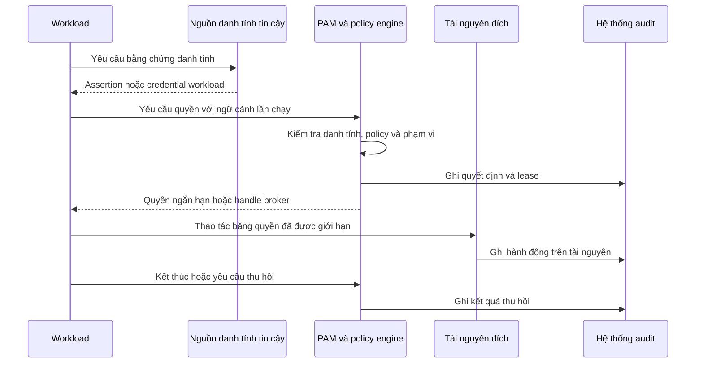

# Machine-to-machine access trong PAM

## Mục tiêu bài học

Machine-to-machine access (M2M) là truy cập mà một phần mềm, dịch vụ hoặc workload thực hiện tới một hệ thống khác mà không cần con người thao tác trong từng lần gọi. Trong quản lý truy cập đặc quyền (Privileged Access Management — PAM), câu hỏi cốt lõi không chỉ là “máy nào được kết nối”, mà là:

> Workload nào đang hành động, được phép làm gì trên tài nguyên nào, quyền đó tồn tại bao lâu và có bằng chứng nào để truy lại?

Sau bài này, bạn có thể:

- Phân biệt danh tính workload, service account, credential và quyền đặc quyền.
- Thiết kế luồng xác thực và cấp quyền M2M phù hợp với API PAM.
- Chọn giữa truy cập qua broker và cấp credential cho workload.
- Áp dụng least privilege, JIT, thời hạn hiệu lực và thu hồi trong automation.
- Xử lý retry, cache, rotation, lỗi kiểm tra chính sách và tình huống bị xâm nhập.
- Xây dựng bằng chứng để nối một lần chạy automation với thao tác trên hệ thống đích.

Bài thuộc chương **API và automation** của module PAM. Phạm vi chính là workload tự động cần quản trị hệ thống hoặc lấy credential nhạy cảm: pipeline triển khai, tác vụ vận hành, hệ thống sao lưu, agent quản trị và dịch vụ điều phối hạ tầng.

## 1. M2M không đồng nghĩa với quyền quản trị

Một dịch vụ đọc danh mục sản phẩm qua API công khai cũng là M2M, nhưng không nhất thiết thuộc PAM. PAM trở nên quan trọng khi workload có khả năng thực hiện hành động tác động lớn, chẳng hạn:

- Triển khai hoặc thay đổi cấu hình production.
- Thực hiện migration cơ sở dữ liệu.
- Thay đổi luật firewall hoặc cấu hình thiết bị mạng.
- Lấy credential có quyền quản trị từ vault.
- Tạo, sửa hoặc thu hồi quyền của chủ thể khác.
- Đọc dữ liệu sao lưu nhạy cảm hoặc khôi phục hệ thống.

Quyền truy cập được đánh giá theo **hành động và tài nguyên**, không theo việc chủ thể là người hay máy. Một job chạy một phút với quyền quản trị toàn bộ cụm vẫn có thể gây thiệt hại nghiêm trọng.

### Ví dụ xuyên suốt

Đội vận hành có pipeline `billing-deploy-prod` triển khai ứng dụng thanh toán. Mỗi lần chạy cần cập nhật một deployment trong namespace `billing-prod`.

Nhu cầu thực tế:

- Chỉ pipeline production đã được kiểm soát mới được yêu cầu quyền.
- Chỉ lần chạy gắn với thay đổi đã được phê duyệt mới được triển khai.
- Chỉ được cập nhật deployment `billing-api`.
- Không được đọc toàn bộ secret, mở shell quản trị hoặc sửa quyền của chính nó.
- Quyền chỉ tồn tại trong cửa sổ triển khai.
- Có thể truy từ sự kiện tại hệ thống đích về workload, lần chạy và thay đổi liên quan.

Nếu pipeline đang giữ một mật khẩu quản trị dùng chung, thiết kế đó vượt quá nhu cầu, dù mật khẩu được lưu trong một vault.

## 2. Bốn khái niệm cần tách rõ

| Khái niệm | Ý nghĩa | Ví dụ |
| --- | --- | --- |
| Danh tính workload | Chủ thể phần mềm mà hệ thống tin cậy nhận diện | Pipeline production của dịch vụ billing |
| Service account | Tài khoản kỹ thuật mà workload có thể dùng trên một hệ thống | Tài khoản chỉ được chạy migration cho billing |
| Credential | Bằng chứng để xác thực hoặc sử dụng một tài khoản | Certificate, access token, mật khẩu |
| Authorization | Quyết định cho phép một hành động trên một tài nguyên | Cho phép cập nhật một deployment cụ thể |

Một workload có thể được ánh xạ tới nhiều service account ở các hệ thống khác nhau. Ngược lại, nhiều workload có thể vô tình dùng chung một service account, làm mất khả năng phân biệt người gây ra hành động.

**Tên service account không chứng minh danh tính của workload.** Một tiến trình chỉ cần lấy được credential của tài khoản đó là có thể hành động dưới tên tài khoản.

Cũng cần tách:

- **Authentication:** bằng chứng có hợp lệ, đúng issuer, đúng nơi nhận và còn hiệu lực không?
- **Authorization:** danh tính đã xác thực có được làm hành động cụ thể này trong hoàn cảnh hiện tại không?
- **Accountability:** sau khi hành động xảy ra, có thể gắn nó với danh tính và lần chạy nào bằng bằng chứng đáng tin cậy không?

Chữ ký hợp lệ của một token chỉ giải quyết một phần xác thực. Nó không tự cấp quyền triển khai production.

## 3. Hai lớp quyền trong một yêu cầu M2M

Một luồng qua PAM thường có ít nhất hai lớp kiểm soát:

1. **Quyền gọi PAM:** workload có được yêu cầu một lease, thực hiện một thao tác qua broker hoặc sử dụng một credential profile không?
2. **Quyền tại tài nguyên đích:** credential hoặc kết nối do PAM cung cấp thực sự cho phép làm gì?

Cấp quyền API PAM hẹp nhưng trả về mật khẩu quản trị toàn hệ thống vẫn tạo ra quyền hiệu lực rất rộng.

Ngược lại, một tài khoản đích có quyền hẹp cũng chưa đủ nếu mọi workload trong tổ chức đều lấy được credential của nó.

Có thể suy nghĩ về quyền hiệu lực như sau:

```text
Danh tính được tin cậy
        +
Quyết định chính sách của PAM
        +
Cách PAM cấp hoặc thực thi quyền
        +
Quyền và kiểm soát tại hệ thống đích
        =
Khả năng hành động thực tế
```

Các lớp phải khớp nhau. Trường `requested_action: deploy` trong yêu cầu không biến một credential quản trị toàn năng thành credential chỉ được deploy.

## 4. Kiến trúc tham chiếu



Sơ đồ thể hiện luồng **cấp quyền trực tiếp** ở bước workload gọi tài nguyên đích. Nếu dùng broker, workload gửi yêu cầu tới broker; broker mới kết nối và thao tác với đích.

Các thành phần có vai trò khác nhau:

- Nguồn danh tính xác nhận workload nào đang chạy.
- PAM đánh giá quyền và quản lý credential hoặc phiên.
- Hệ thống đích thực thi quyền mà nó hiểu.
- Hệ thống audit giữ bằng chứng về quyết định và hành động.

Không nên coi một nguồn log là đủ để thay thế tất cả các lớp. Log “PAM đã cấp lease” không chứng minh deployment đã thành công; log “deployment được cập nhật” không tự giải thích tại sao quyền được cấp.

## 5. Xác thực workload: tránh vòng lặp secret bootstrap

### 5.1. Vấn đề secret để lấy secret

Một thiết kế phổ biến:

```text
Pipeline giữ API key dài hạn
    → dùng API key gọi vault
    → lấy mật khẩu quản trị
    → đăng nhập hệ thống đích
```

Vault có thể bảo vệ mật khẩu tốt, nhưng API key bootstrap vẫn là một credential đặc quyền cần kiểm soát. Đưa API key vào biến môi trường không làm nó biến mất khỏi mô hình đe dọa.

Nếu kẻ tấn công lấy được key, họ có thể không cần xâm nhập vault; chỉ cần sử dụng đúng API mà pipeline đang được phép gọi.

### 5.2. Danh tính gắn với môi trường chạy

Khi hạ tầng hỗ trợ, workload có thể nhận bằng chứng danh tính từ nền tảng chạy hoặc một cơ chế phát hành danh tính được quản lý. PAM chỉ tin các issuer, trust anchor và thuộc tính đã được cấu hình trước.

Bằng chứng có thể mang thông tin như:

- Chủ thể workload.
- Môi trường production hoặc staging.
- Project, repository hay service đã đăng ký.
- Đích nhận bằng chứng, thường biểu diễn bằng audience.
- Thời điểm phát hành và hết hạn.
- Thuộc tính nguồn chạy mà nền tảng thực sự xác nhận.

Phải phân biệt **thuộc tính do issuer xác nhận** với **dữ liệu do client tự khai**. Header `X-Environment: production` hoặc trường `approved: true` trong request không có giá trị tương đương một xác nhận đáng tin cậy.

Một assertion ngắn hạn giúp giảm thời gian lạm dụng, nhưng nếu workload đã bị chiếm quyền và vẫn được phát assertion mới, kẻ tấn công vẫn có thể liên tục xin quyền. Cần kiểm soát cả nơi phát hành và nơi sử dụng.

### 5.3. Các cách xác thực thường gặp

| Cách tiếp cận | Điểm mạnh | Điều kiện và giới hạn cần hiểu |
| --- | --- | --- |
| Credential bootstrap tĩnh | Dễ tích hợp với hệ thống cũ | Phải bảo vệ, phân tách, rotate và có cách thu hồi rõ ràng |
| Certificate workload và mTLS | Có thể xác thực đầu kết nối bằng khóa riêng tương ứng certificate | Cần quản lý phát hành, thời hạn, trust chain và ràng buộc identity |
| Assertion workload rồi trao đổi quyền | Có thể gắn với nền tảng và lần chạy | Phải kiểm tra issuer, audience, thời hạn và thuộc tính được tin cậy |
| Access token ngắn hạn | Thuận tiện cho API, có thể giới hạn scope | Bearer token bị lấy cắp vẫn có thể bị sử dụng trong phạm vi hiệu lực |
| Broker thực thi thay workload | Có thể tránh đưa credential đích về workload | Broker phải kiểm tra từng thao tác và được bảo vệ tương xứng |

mTLS không tự giải quyết authorization. Một client có certificate hợp lệ chưa chắc được lấy credential production. Nếu ứng dụng vẫn dùng bearer token độc lập, cũng không được mặc định rằng token đó chỉ dùng được trên kết nối mTLS đã phát hành nó.

Với hệ thống OAuth dùng client credentials, access token thường đại diện cho client phần mềm, không phải người dùng đang tương tác. Cách xác thực client và chính sách giới hạn quyền vẫn phải được thiết kế; tên grant không thay thế các kiểm soát PAM.

## 6. Thiết kế danh tính và trust mapping

### 6.1. Phân tách theo ranh giới quyền

Một nguyên tắc thực dụng là tạo danh tính riêng khi khác biệt có ý nghĩa về quyền, môi trường hoặc vòng đời:

- Production khác staging.
- Pipeline deploy khác job đọc báo cáo.
- Dịch vụ billing khác dịch vụ inventory.
- Job migration khác job sao lưu.
- Workload vận hành thường lệ khác workload break-glass.

Không nhất thiết tạo một tài khoản thủ công cho mọi tiến trình tạm thời. Có thể giữ danh tính logic ổn định và gắn mỗi lần chạy với một mã định danh ngắn hạn.

Điều cần tránh là gom tất cả thành `automation-admin` vì “đều do máy chạy”.

### 6.2. Mapping phải nằm phía tin cậy

Ví dụ mapping khái niệm:

```yaml
# Minh họa thiết kế, không phải cấu hình chạy được của một sản phẩm.
trusted_workload:
  issuer: ci-identity.example.invalid
  subject: project-billing/pipeline-deploy
  environment: production

pam_binding:
  role: billing-prod-deployer
  credential_profile: billing-prod-deployment
  allowed_target: cluster-prod/namespace-billing-prod/deployment-billing-api
```

Client có thể đề nghị sử dụng `credential_profile`, nhưng server phải tính hoặc kiểm tra binding theo danh tính đã xác thực. Không được cho phép client đổi tên tài khoản đích để thoát khỏi binding.

Các thuộc tính cần có nguồn đáng tin cậy. Nếu issuer không xác nhận branch hoặc trạng thái phê duyệt, không nên giả vờ rằng chúng đã được xác thực. Hệ thống có thể phải lấy bằng chứng bổ sung từ một nguồn được ủy quyền và xử lý rõ khi không lấy được.

### 6.3. Owner và vòng đời danh tính

Mỗi danh tính đặc quyền cần có:

- Owner chịu trách nhiệm nghiệp vụ.
- Người hoặc nhóm vận hành tích hợp.
- Mục đích sử dụng và tài nguyên được phép.
- Liên kết tới workload đang hoạt động.
- Ngày rà soát và điều kiện ngừng sử dụng.
- Cách thu hồi khi repository, pipeline hoặc dịch vụ bị xóa.

Danh tính không còn workload hợp lệ nhưng vẫn có quyền lấy credential là một đường truy cập tồn dư.

## 7. Authorization phải gắn với hành động, tài nguyên và ngữ cảnh

Một yêu cầu M2M tốt cần mô tả điều workload muốn làm, thay vì chỉ hỏi “hãy đưa secret”.

Ví dụ yêu cầu:

```http
POST /illustrative/pam/access-requests
Authorization: Bearer <WORKLOAD_ACCESS_TOKEN>
Content-Type: application/json
Idempotency-Key: <UNIQUE_REQUEST_ID>

{
  "action": "deployment.update",
  "target": "prod/billing/billing-api",
  "requested_duration_seconds": 300,
  "run_id": "run-2026-042",
  "change_ref": "change-1842"
}
```

Endpoint và các trường trên chỉ minh họa một giao ước API. Một sản phẩm thực tế có thể dùng tên và cơ chế khác.

Trong ví dụ này:

- Token phải dành cho PAM, không phải token của một API khác được chấp nhận tùy tiện.
- `action`, `target` và thời lượng đều là yêu cầu cần được kiểm tra.
- `run_id` hỗ trợ truy vết, nhưng bản thân nó không chứng minh workload đang thực hiện đúng lần chạy đó.
- `change_ref` phải được đối chiếu với thay đổi có liên quan, đúng môi trường và đúng khoảng thời gian nếu nó là điều kiện cấp quyền.
- Idempotency key giúp xử lý lặp yêu cầu theo giao ước của server, không phải một cơ chế cấp quyền.

### Chính sách minh họa

```yaml
# Pseudopolicy để thảo luận thiết kế, không phải cú pháp của sản phẩm.
policy: billing-prod-deployment
match:
  workload: project-billing/pipeline-deploy
  environment: production
  action: deployment.update
  target: prod/billing/billing-api
require:
  identity_evidence: trusted-and-valid
  change_reference: verified-for-this-target
  workload_enabled: true
grant:
  maximum_duration_seconds: 300
  target_permissions: update-only-this-deployment
  credential_delivery: broker-or-restricted-short-lived-credential
deny:
  - self-modify-policy
  - read-unrelated-secrets
  - create-privileged-principal
  - interactive-admin-session
```

Quyết định cuối cùng còn phụ thuộc khả năng thực thi thực tế. Nếu tài nguyên đích không hỗ trợ quyền `update-only-this-deployment`, phải thay đổi cơ chế tích hợp hoặc mô tả rõ quyền rộng hơn; không được chỉ ghi một tên role hẹp trong PAM rồi coi như đã đạt least privilege.

### Những lỗi authorization thường gặp

- Chỉ kiểm tra workload đã đăng nhập.
- Cho phép wildcard toàn bộ vault hoặc toàn bộ production.
- Tin trường `role: admin` do client gửi.
- Cấp quyền đổi policy cho chính workload đang chịu policy.
- Dùng một token cho nhiều audience không cần thiết.
- Phê duyệt một lần nhưng cho phép lấy quyền mãi mãi.
- Cấp cho runner dùng chung mà không phân biệt job và project.
- Cho phép API “test connection” hoặc “validate credential” trở thành đường lấy hoặc sử dụng quyền ngoài kiểm soát.

## 8. Hai mô hình cung cấp quyền

### 8.1. Cấp credential cho workload

PAM cấp một credential hoặc tham chiếu mà workload dùng trực tiếp tại hệ thống đích.

Ưu điểm:

- Phù hợp với nhiều công cụ và giao thức hiện có.
- Workload có thể gọi đích mà không phải chuyển mọi thao tác qua PAM.
- Có thể dùng tài khoản tạm thời hoặc credential ngắn hạn khi đích hỗ trợ.

Đổi lại:

- Credential đi vào ranh giới thực thi của workload.
- Tiến trình, thư viện, plugin hoặc bước build bị xâm nhập có thể lấy credential.
- Phải kiểm soát log, file tạm, crash dump và artifact.
- Thu hồi lease tại PAM có thể chưa thu hồi được khả năng truy cập tại đích.

Nếu workload nhận mật khẩu của một tài khoản tồn tại lâu dài, “lease 5 phút” chỉ có ý nghĩa khi sau đó hệ thống thực sự vô hiệu hóa, đổi credential hoặc chấm dứt khả năng sử dụng theo cơ chế đã thiết kế.

### 8.2. Broker hoặc proxy thực thi

Workload gửi yêu cầu tới broker; broker giữ credential đích và thực hiện thao tác được cho phép.

Ưu điểm:

- Có thể giữ credential đích ngoài workload.
- Có điểm tập trung để kiểm tra hành động.
- Có thể ghi nhận lệnh hoặc thay đổi với ngữ cảnh workload.
- Có thể dừng nhận yêu cầu mới khi quyền hết hạn.

Đổi lại:

- Broker trở thành thành phần nhạy cảm và có thể là điểm nghẽn.
- Cần đảm bảo tính sẵn sàng và phân tách quyền của chính broker.
- Phải chống việc dùng broker như một “đại diện có quyền quá rộng”.
- Các phiên đã mở, kết nối backend và tác vụ bất đồng bộ cần quy tắc thu hồi riêng.

Một broker chỉ nhận URL do client tùy ý cung cấp rồi gắn credential quản trị vào request là thiết kế nguy hiểm. Broker phải giới hạn đích, giao thức và hành động, đồng thời xử lý redirect hoặc đích phụ theo policy phù hợp.

### 8.3. Chọn theo quyền cần thực thi

| Tiêu chí | Cấp credential | Broker |
| --- | --- | --- |
| Credential đích xuất hiện trong workload | Có thể có | Có thể tránh được |
| Kiểm soát từng thao tác | Chủ yếu dựa vào quyền đích | Có thể thực hiện tại broker và đích |
| Phù hợp hệ thống cũ | Thường dễ tích hợp hơn | Có thể cần adapter |
| Thu hồi phiên đang hoạt động | Phụ thuộc đích và giao thức | Phụ thuộc cả broker lẫn phiên backend |
| Truy vết qua tài khoản dùng chung | Cần bổ sung bằng chứng | Có thể giữ ngữ cảnh tập trung, vẫn cần đối chiếu log đích |

Không có mô hình nào tự bảo đảm an toàn. Cần chứng minh quyền hạn chế được thực thi ở đâu và thu hồi tác động tới phần nào.


## 9. Vòng đời một lần truy cập đặc quyền tự động

### Bước 1 — Đăng ký workload

Owner đăng ký mục đích, môi trường, tài nguyên và hành động cần thiết. Quyền lấy credential được rà soát cùng quyền tại tài nguyên đích.

Workload không tự tạo binding production chỉ bằng cách gửi một request có tên project hợp lệ.

### Bước 2 — Nhận bằng chứng danh tính

Workload nhận assertion, certificate hoặc credential bootstrap đã được quản lý. Bằng chứng này phải được giới hạn cho đúng bên nhận và không được đưa vào log.

PAM kiểm tra các điều kiện tương ứng với cơ chế xác thực: nguồn phát hành, thời hạn, trust chain hoặc chữ ký, audience và các thuộc tính được dùng trong policy.

### Bước 3 — Yêu cầu quyền theo tác vụ

Workload gửi hành động, tài nguyên, thời lượng và ngữ cảnh cần thiết. PAM tự xác định danh tính từ bằng chứng xác thực, không từ tên người dùng tự khai.

Nếu có phê duyệt thay đổi, quyết định phải gắn với phạm vi yêu cầu. Một thay đổi dành cho staging không được dùng để lấy credential production.

### Bước 4 — Cấp quyền có giới hạn

Kết quả có thể là:

- Một credential ngắn hạn được giới hạn tại đích.
- Một tài khoản tạm thời với quyền đã xác định.
- Một lease quản lý việc sử dụng credential hiện hữu.
- Một handle để gọi broker thực hiện thao tác cụ thể.

Tên gọi “lease” không cho biết quyền được thực thi thế nào. Thiết kế cần xác định rõ credential có thể tiếp tục dùng sau khi lease hết hạn hay không.

### Bước 5 — Thực hiện và quan sát

Workload chỉ dùng quyền cho tác vụ được duyệt. PAM hoặc broker ghi quyết định, còn hệ thống đích ghi hành động thực tế.

Nếu tác vụ chạy lâu hơn dự kiến, workload không tự đổi sang một credential rộng hơn. Nó yêu cầu gia hạn hoặc quyền mới theo policy đã định nghĩa.

### Bước 6 — Kết thúc và thu hồi

Khi hoàn tất, workload yêu cầu đóng quyền nếu giao ước hỗ trợ. Đồng thời, hệ thống vẫn phải có cơ chế hết hạn hoặc dọn dẹp phía server để không phụ thuộc vào việc client luôn chạy thành công khối cleanup.

Runner có thể bị tắt đột ngột. Nếu quyền chỉ được thu hồi nhờ bước cuối của pipeline, quyền có thể tồn tại ngoài dự kiến.

### Bước 7 — Đối chiếu bằng chứng

Đối chiếu trạng thái cấp quyền, kết quả thao tác và kết quả thu hồi. Một yêu cầu “đóng lease” thành công ở lớp điều phối chưa chắc chứng minh session backend đã chấm dứt.

Các trạng thái bất thường phải có owner xử lý, ví dụ:

- Lease đã hết hạn nhưng tài khoản tạm thời chưa bị xóa.
- Đã yêu cầu rotation nhưng đích chưa chấp nhận credential mới.
- Không thấy sự kiện đích tương ứng với lần cấp quyền.
- Có hành động tại đích sau thời điểm đáng lẽ quyền phải hết hiệu lực.

## 10. TTL, JIT và thu hồi phải có ý nghĩa thực tế

### 10.1. Có nhiều thời hạn trong cùng một luồng

Đừng gộp tất cả thành một giá trị TTL. Có thể đồng thời tồn tại:

| Đối tượng | Thời hạn kiểm soát điều gì? |
| --- | --- |
| Assertion workload | Khoảng thời gian bằng chứng danh tính được chấp nhận |
| Token gọi PAM | Khoảng thời gian workload có thể dùng token để gọi PAM |
| Lease PAM | Khoảng thời gian quyền sử dụng được PAM quản lý |
| Credential đích | Khoảng thời gian đích còn chấp nhận credential |
| Phiên tại đích | Khoảng thời gian kết nối hoặc session còn hoạt động |

Ví dụ:

```text
T+00 phút: PAM cấp credential đích, lease dài 5 phút
T+02 phút: workload mở kết nối tới cơ sở dữ liệu
T+05 phút: lease hết hạn
T+06 phút: kết nối cũ vẫn thực hiện truy vấn được
```

Nếu cơ sở dữ liệu chỉ kiểm tra credential khi đăng nhập và không chấm dứt kết nối cũ theo TTL, quyền vẫn có thể được sử dụng qua phiên hiện hữu.

Vì vậy, thời hạn mong muốn phải được chuyển thành kiểm soát cụ thể: giới hạn phiên, đóng kết nối qua broker, chấm dứt session tại đích hoặc một cơ chế tương đương đã được kiểm thử.

Không thể kết luận “thu hồi tức thời” chỉ vì access token có thời hạn ngắn.

### 10.2. JIT cho workload

JIT nghĩa là cấp quyền khi có nhu cầu và trong một cửa sổ hạn chế. Nó không bắt buộc con người phải bấm duyệt từng API call.

Một mô hình phù hợp có thể là:

- Chính sách được phê duyệt trước cho tác vụ vận hành thường lệ.
- Mỗi lần chạy vẫn phải chứng minh đúng danh tính và điều kiện.
- Quyền được cấp theo tài nguyên và thời lượng cần thiết.
- Tác vụ rủi ro cao cần thêm phê duyệt gắn với lần thay đổi.

JIT làm giảm quyền thường trực, nhưng không sửa được một policy cho phép workload luôn yêu cầu quyền quản trị toàn bộ môi trường.

### 10.3. Không mô phỏng MFA bằng credential của người

Không nên giải quyết automation bằng cách cho pipeline giữ mật khẩu cá nhân, mã dự phòng hoặc vật liệu dùng để tạo mã xác thực của người quản trị.

M2M cần cơ chế xác thực workload. Nếu có quyết định của con người, quyết định đó nên nằm ở luồng phê duyệt thay đổi hoặc cấp quyền, được ghi nhận rõ ràng và không biến thành việc chia sẻ tài khoản người.

### 10.4. Thu hồi theo nhiều lớp

Một thao tác ứng phó có thể cần:

1. Chặn danh tính xin quyền mới.
2. Ngừng hoặc thu hồi khả năng phát hành bằng chứng mới.
3. Vô hiệu hóa token hoặc lease theo khả năng của hệ thống.
4. Thu hồi hoặc đổi credential tại đích.
5. Chấm dứt phiên và tác vụ đang chạy khi phù hợp.
6. Xác minh bằng yêu cầu mới và phiên đã tồn tại từ trước.

Chặn bước 1 không tự hoàn thành các bước còn lại. Với token tự chứa được kiểm tra offline, quyết định thu hồi có thể chưa được bên nhận biết ngay nếu không có cơ chế bổ sung.

## 11. Retry, timeout và idempotency trong automation

Lỗi mạng có thể xảy ra sau khi PAM đã cấp quyền nhưng trước khi client nhận phản hồi. Retry không kiểm soát có thể tạo nhiều credential hoặc nhiều tác vụ đích.

### 11.1. Phân biệt loại yêu cầu

- Đọc trạng thái thường dễ retry hơn tạo quyền hoặc thực thi thay đổi.
- Yêu cầu cấp credential có thể gây ra tài khoản hoặc lease mới.
- Yêu cầu broker chạy migration có thể gây thay đổi không thể lặp tùy tiện.
- Yêu cầu thu hồi cần theo dõi kết quả, đặc biệt khi tác vụ dọn dẹp bất đồng bộ.

Không mặc định “đều là HTTP nên có thể gọi lại”.

### 11.2. Idempotency có phạm vi

Một thiết kế cấp quyền hỗ trợ idempotency cần quy định:

- Key gắn với chủ thể đã xác thực và một yêu cầu nghiệp vụ.
- Cùng key nhưng khác nội dung phải được phát hiện.
- Phạm vi lưu giữ và thời gian hiệu lực được xác định.
- Việc tạo kết quả và ghi nhận key phải tránh tạo trùng khi có yêu cầu đồng thời.
- Client có cách kiểm tra trạng thái khi kết quả chưa rõ.

Không tái sử dụng cùng key cho mọi lần chạy. Cũng không cho phép workload khác lấy kết quả chỉ vì biết key.

Idempotency ở API PAM không tự làm cho hành động đích có tính idempotent. Migration và deployment vẫn cần giao ước thao tác hoặc cách kiểm tra kết quả tương ứng.

### 11.3. Quy tắc xử lý lỗi

| Tình huống | Cách xử lý phù hợp |
| --- | --- |
| Bằng chứng danh tính hết hạn | Lấy bằng chứng mới theo cơ chế hợp lệ, giới hạn số lần thử |
| Bị từ chối quyền | Dừng hành động; ghi lý do đã được làm sạch; không tăng scope để thử |
| Bị giới hạn lưu lượng | Backoff có giới hạn và tuân theo hướng dẫn của API nếu có |
| Timeout sau yêu cầu cấp quyền | Tra cứu theo request ID hoặc dùng idempotency theo giao ước |
| Đích từ chối credential | Kiểm tra trạng thái và rotation; không fallback sang credential quản trị dùng chung |
| Hệ thống xác minh điều kiện không khả dụng | Áp dụng chế độ lỗi đã thiết kế; không tự bỏ điều kiện đặc quyền |
| Audit bắt buộc không ghi được | Xử lý theo policy đã phê duyệt, có giới hạn và bằng chứng sự cố |

“Fail closed” ở đây nghĩa là không tự cấp quyền mới khi không xác minh được điều kiện bắt buộc. Điều đó không đồng nghĩa với việc mọi phiên cũ đã tự kết thúc, và cũng không thay thế kế hoạch bảo đảm tính sẵn sàng.

Nếu tổ chức có cơ chế khẩn cấp, phải thiết kế riêng với danh tính, phạm vi, thời hạn và bằng chứng riêng. Một câu lệnh “nếu PAM lỗi thì dùng root password dự phòng” trong pipeline là đường truy cập ngoài kiểm soát.

### 11.4. Pseudocode xử lý quyền

```text
identity = obtain_workload_identity()
request = build_request_for_one_action_and_target()

grant = pam.request_access(identity, request, unique_request_key)

if grant.result != ALLOWED:
    stop_without_privileged_action()

try:
    verify_grant_matches_expected_action_target_and_expiry(grant)
    result = execute_bounded_operation(grant)
    record_sanitized_result(result)
finally:
    request_release_if_supported(grant.id)
    record_release_state_without_secret_material()
```

Đây là mô tả luồng, không phải thư viện có thể chạy. Phần `finally` giúp cleanup khi tiến trình vẫn hoạt động; cơ chế hết hạn và đối soát phía server vẫn cần thiết.

## 12. Cache và rotation: giảm tải mà không tạo quyền tồn dư

### 12.1. Cache credential là một quyết định bảo mật

Cache có thể giảm độ trễ, nhưng cũng kéo dài nơi tồn tại credential. Nếu cần cache:

- Chỉ lưu trong phạm vi workload và ngữ cảnh quyền phù hợp.
- Hết hạn trước hoặc đúng thời điểm credential không còn được sử dụng.
- Không dùng cache giữa production và staging.
- Không trả credential của run trước cho run mới nếu quyền bị ràng buộc theo run.
- Không đưa cache vào image, artifact, volume dùng chung hoặc bản sao lưu ngoài thiết kế.
- Giới hạn đồng thời để nhiều thread không cùng phát hành credential mới.

Khóa cache phải bao gồm các yếu tố phân biệt quyền như identity, audience, môi trường, tài nguyên, hành động và profile credential. Nếu policy có ràng buộc theo lần chạy hoặc thay đổi, các ràng buộc đó cũng phải được giữ đúng.

Một cache key chỉ gồm tên secret có thể khiến các workload khác nhau dùng nhầm quyền.

### 12.2. Không gia hạn vô hạn

Client cần biết thời điểm credential hết hiệu lực và chỉ gia hạn theo policy. Gia hạn phải đánh giá lại điều kiện cần thiết, đặc biệt khi:

- Workload đã bị vô hiệu hóa.
- Thay đổi đã đóng hoặc bị thu hồi phê duyệt.
- Môi trường bị phong tỏa.
- Credential profile hoặc quyền tại đích đã thay đổi.

Tự động làm mới mỗi phút nhưng không có hạn cuối của tác vụ có thể biến quyền JIT thành quyền thường trực.

### 12.3. Rotation đồng bộ với consumer

Với credential dài hạn của hệ thống cũ, rotation cần bao gồm cả việc consumer chuyển sang credential mới.

Các câu hỏi cần trả lời:

- Credential mới được kích hoạt tại đích trước hay sau khi công bố cho consumer?
- Có khoảng chồng lấn hợp lệ không và kéo dài bao lâu?
- Kết nối cũ có còn hoạt động sau rotation không?
- Workload có phát hiện cache cũ và cập nhật an toàn không?
- Khi cập nhật thất bại, trạng thái nào được ghi nhận?
- Ai xử lý nếu có khả năng credential cũ đã lộ?

Không ghi “rotation thành công” chỉ vì vault đã lưu một giá trị mới. Phải xác minh trạng thái tại đích và consumer theo giao ước tích hợp.

Nếu rotation xuất phát từ nghi ngờ lộ credential, việc giữ credential cũ để fallback có thể giữ nguyên đường truy cập của kẻ tấn công. Quyết định xử lý phải phản ánh lý do rotation và mức độ rủi ro, không chỉ ưu tiên pipeline tiếp tục chạy.

## 13. Bảo vệ credential trong môi trường automation

Một credential ngắn hạn vẫn là credential nhạy cảm trong thời gian còn hiệu lực. Việc giới hạn TTL không thay thế việc bảo vệ nơi nó được sử dụng.

### Các điểm thường làm lộ credential

- In toàn bộ request hoặc response khi debug.
- Shell tracing hiển thị tham số chứa token.
- Đưa secret vào command line rồi để công cụ giám sát thu thập.
- Tạo file tạm có quyền đọc rộng.
- Đóng gói file cấu hình có credential vào artifact.
- Gửi biến môi trường cho plugin, subprocess hoặc tác vụ không cần biết.
- Lưu crash dump hoặc báo cáo lỗi chứa vùng nhớ nhạy cảm.
- Chạy build từ nguồn không được tin cậy trên runner có quyền production.

Biến môi trường không phải một kho bí mật tách biệt với tiến trình. Nếu tiến trình hoặc công cụ được phép đọc môi trường đã bị chiếm quyền, credential có thể bị lấy.

### Biện pháp thiết kế

- Chỉ đưa credential vào bước cần sử dụng và trong thời gian cần thiết.
- Dùng giao diện truyền credential hạn chế lộ qua log hoặc tham số khi công cụ hỗ trợ.
- Giới hạn quyền file nếu buộc phải dùng file tạm và dọn dẹp theo cơ chế của nền tảng.
- Giữ bước chạy mã không được tin cậy ngoài runner hoặc ranh giới có quyền production.
- Rà soát quyền của plugin, action, image và thư viện được nạp vào job đặc quyền.
- Dùng cơ chế che log như một lớp hỗ trợ; không coi việc che chuỗi là bảo đảm không rò rỉ.
- Giới hạn đường ra mạng theo nhu cầu để giảm khả năng gửi credential tới đích tùy ý.
- Thiết kế credential có quyền và thời hạn đủ hẹp để giảm hậu quả nếu bị lấy cắp.

Nếu cần chẩn đoán lỗi, ghi request ID, mã lỗi và metadata đã làm sạch. Không ghi token, private key hay toàn bộ phản hồi cấp credential.

## 14. Audit: nối danh tính, quyết định và hành động

### 14.1. Bằng chứng cần trả lời được điều gì?

Một cuộc rà soát nên trả lời được:

1. Workload nào yêu cầu quyền?
2. Danh tính được xác thực dựa trên nguồn nào?
3. Policy nào, phiên bản nào đã cho phép hoặc từ chối?
4. Quyền nào đã được cấp, trên tài nguyên nào và trong bao lâu?
5. Lần chạy và thay đổi nào liên quan?
6. Hành động nào thực sự xảy ra tại đích?
7. Quyền và phiên đã được thu hồi ra sao?

Mã lần chạy do client gửi chỉ là một phần dữ liệu. Nếu cần dùng nó làm bằng chứng mạnh, phải gắn với danh tính hoặc nguồn ghi nhận đáng tin cậy.

### 14.2. Ví dụ sự kiện đã làm sạch

```json
{
  "event_type": "pam.access.granted",
  "request_id": "req-742",
  "workload_identity": "project-billing/pipeline-deploy",
  "identity_issuer": "ci-identity.example.invalid",
  "environment": "production",
  "run_id": "run-2026-042",
  "change_ref": "change-1842",
  "policy_id": "billing-prod-deployment",
  "policy_version": "v7",
  "action": "deployment.update",
  "target": "prod/billing/billing-api",
  "grant_id": "grant-913",
  "duration_seconds": 300,
  "decision": "allow"
}
```

Sự kiện không chứa access token, assertion nguyên bản hoặc credential đích. Các ID chỉ minh họa cấu trúc bằng chứng.

Với log từ hệ thống đích, cần một cơ chế đối chiếu phù hợp:

- Danh tính đích riêng cho workload hoặc lần chạy khi có thể.
- ID phiên hoặc giao dịch mà cả hai phía ghi nhận.
- Metadata triển khai được thiết lập từ nguồn tin cậy.
- Mapping do broker lưu giữa yêu cầu và phiên backend.

Nếu tất cả thao tác đều xuất hiện dưới một tài khoản `shared-admin` và không có mapping đáng tin cậy, không nên tuyên bố đã đạt truy vết theo từng workload.

### 14.3. Chất lượng vận hành của audit

Cần quan tâm tới:

- Đồng bộ thời gian và quy ước timestamp.
- Tính đầy đủ của các sự kiện allow, deny, renew và revoke.
- Phân quyền đọc log và bảo vệ log khỏi thay đổi trái phép.
- Theo dõi thất bại khi chuyển hoặc lưu sự kiện.
- Khả năng truy vấn theo workload, target và grant ID.
- Thời hạn lưu theo chính sách dữ liệu của tổ chức.

Log chỉ từ client là chưa đủ vì workload bị xâm nhập có thể không gửi hoặc sửa nội dung log. Bằng chứng tại PAM, broker và hệ thống đích giúp đối chiếu chéo.

### 14.4. Tín hiệu phát hiện bất thường

Một số tín hiệu có ích:

- Workload xin quyền tới tài nguyên chưa từng dùng.
- Tăng đột biến số lease hoặc số yêu cầu bị từ chối.
- Xin quyền khi không có lần chạy hợp lệ.
- Gia hạn vượt thời gian tác vụ thông thường.
- Credential được dùng từ vị trí ngoài ranh giới dự kiến.
- Tài khoản đích tiếp tục hoạt động sau khi đã yêu cầu thu hồi.
- Thay đổi mapping hoặc policy ngay trước một lần cấp quyền lớn.

Mỗi tín hiệu cần ngưỡng và bối cảnh phù hợp. Địa chỉ IP đơn lẻ thường không đủ để nhận diện workload, đặc biệt khi nhiều job đi qua cùng NAT hoặc proxy.

## 15. Các rủi ro cần kiểm thử

| Rủi ro | Ví dụ | Kiểm soát cần chứng minh |
| --- | --- | --- |
| Giả mạo danh tính | Client tự khai là pipeline production | Mapping dựa trên bằng chứng từ nguồn được tin cậy |
| Dùng sai audience | Token cho API khác được đưa tới PAM | Kiểm tra bên nhận của token |
| Vượt môi trường | Staging lấy credential production | Ràng buộc môi trường trong policy và credential profile |
| Lạm dụng broker | Đổi target để broker dùng quyền tại đích khác | Giới hạn đích và hành động phía server |
| Tự nâng quyền | Workload sửa policy rồi tự cấp quyền | Tách quyền quản trị policy khỏi quyền runtime |
| Rò rỉ credential | Plugin build gửi token ra ngoài | Cách ly bước đặc quyền, giới hạn secret và đường ra |
| Thu hồi thiếu | Lease đóng nhưng session backend còn chạy | Kiểm thử credential mới, kết nối mới và phiên cũ |
| Mất attribution | Nhiều workload dùng chung tài khoản đích | Danh tính riêng hoặc mapping phiên đáng tin cậy |
| Quyền tồn dư | Xóa project nhưng binding PAM còn | Đồng bộ vòng đời và rà soát owner |
| Lặp thao tác | Timeout khiến job chạy migration hai lần | Giao ước idempotency và kiểm tra kết quả đích |

Việc chấp nhận bằng chứng chưa hết hạn không tự ngăn replay. Mức bảo vệ phụ thuộc cơ chế: bearer token có thể được dùng lại nếu bị lấy cắp; một thiết kế cần giảm rủi ro bằng thời hạn, ràng buộc bên nhận, bảo vệ kênh và các cơ chế ràng buộc hoặc phát hiện phù hợp.

Không thêm một trường `nonce` rồi cho rằng đã giải quyết replay. Bên xác minh phải có giao ước kiểm tra và trạng thái cần thiết để trường đó mang ý nghĩa bảo mật.

## 16. Tình huống: pipeline bị xâm nhập khi đang triển khai

### Bối cảnh

Pipeline được cấp quyền 5 phút để cập nhật deployment billing. Một thành phần trong job bị nghi ngờ đã gửi credential ra ngoài. Tại thời điểm phát hiện, workload vẫn đang chạy và đã mở kết nối tới hệ thống đích.

### Phân tích

Có ít nhất ba khả năng cần xử lý:

- Credential hiện tại bị lấy cắp và được dùng ngoài job.
- Workload còn khả năng xin credential mới.
- Phiên đã mở vẫn còn quyền dù credential mới đã bị vô hiệu hóa.

Chỉ rotate mật khẩu đích có thể chưa chặn workload lấy mật khẩu mới. Chỉ vô hiệu hóa danh tính workload có thể chưa kết thúc phiên cũ.

### Hướng xử lý

1. Cô lập hoặc dừng runner theo quy trình ứng phó để ngăn tiếp tục thực thi mã bị nghi ngờ.
2. Chặn danh tính workload xin quyền mới và xử lý khả năng phát hành bằng chứng mới.
3. Xác định các lease, token, tài khoản tạm thời và phiên liên quan.
4. Thu hồi hoặc rotate credential đích, đồng thời xử lý phiên đang hoạt động theo khả năng của đích.
5. Bảo toàn log và metadata cần thiết, tránh đưa secret thô vào hồ sơ sự cố.
6. Kiểm tra thay đổi thực tế tại đích và mở rộng phạm vi điều tra theo bằng chứng.
7. Chỉ khôi phục workload sau khi đã xử lý nguồn xâm nhập và xác minh lại policy.

### Cách chứng minh đã chặn

Kiểm thử riêng:

- Workload cũ không xin được quyền mới.
- Credential cũ không tạo được kết nối mới.
- Phiên cũ không tiếp tục thao tác ngoài phạm vi mong muốn.
- Không còn đường fallback dùng credential quản trị khác.
- Log thể hiện quyết định và kết quả thực tế, kể cả bước thất bại.

Nếu một kiểm thử chưa đạt, ghi rõ phần quyền còn tồn tại và biện pháp đang áp dụng. Không đánh dấu thu hồi hoàn tất dựa trên một phản hồi duy nhất của API PAM.

## 17. Bài thực hành thiết kế M2M cho deployment

Bài thực hành sử dụng môi trường mô phỏng hoặc tài nguyên thử nghiệm. Không cần credential production.

### Đề bài

Thiết kế truy cập cho `billing-deploy-prod` với yêu cầu:

- Cập nhật duy nhất deployment billing.
- Mỗi lần cấp quyền tối đa 5 phút.
- Có tham chiếu thay đổi được xác minh.
- Tách biệt staging và production.
- Không cho workload tự sửa policy hoặc cấp quyền cho workload khác.
- Có bằng chứng cấp quyền, thao tác và thu hồi.

### Phần A — Lập bản đồ quyền

Tạo một bảng mô tả:

| Thành phần | Cần xác định |
| --- | --- |
| Workload | Danh tính logic, owner và nguồn bằng chứng |
| PAM | Hành động được phép, profile và ràng buộc |
| Đích | Quyền thực tế có thể thực thi |
| Credential | Cách cấp, thời hạn và nơi tồn tại |
| Phiên | Cách mở, đóng và chấm dứt khi cần |
| Audit | ID tương quan và nguồn log đáng tin cậy |

Ghi rõ nơi thực thi từng giới hạn. Nếu một giới hạn chỉ tồn tại trong tài liệu nhưng hệ thống không kiểm tra, đánh dấu là chưa đạt.

### Phần B — Mô tả luồng thành công

Viết chuỗi bước từ nhận bằng chứng danh tính tới đóng quyền. Chỉ ra sự kiện được ghi ở mỗi ranh giới.

Nếu dùng broker, xác định workload gửi hành động thế nào và broker xác minh target ra sao. Nếu cấp credential trực tiếp, xác định cách credential bị giới hạn tại đích và cách nó hết hiệu lực.

### Phần C — Kiểm thử phủ định

| Kiểm thử | Kết quả mong đợi |
| --- | --- |
| Workload staging yêu cầu production | Bị từ chối |
| Token có audience khác PAM | Bị từ chối xác thực |
| Workload đúng nhưng đổi sang deployment khác | Bị từ chối quyền |
| Tham chiếu thay đổi không khớp target | Không cấp quyền |
| Yêu cầu thời lượng vượt chính sách | Bị từ chối hoặc bị giới hạn theo giao ước đã công bố |
| Workload muốn sửa policy của chính nó | Bị từ chối |
| Gửi lại cùng yêu cầu sau timeout | Không tạo thêm quyền ngoài giao ước idempotency |
| Cùng idempotency key nhưng đổi nội dung | Phát hiện xung đột |
| Credential hết hạn được dùng tạo kết nối mới | Đích từ chối theo thiết kế |
| Phiên mở trước khi quyền hết hạn | Kết quả đúng với cơ chế quản lý phiên đã cam kết |
| Hệ thống kiểm tra điều kiện bắt buộc bị lỗi | Không tự bỏ điều kiện để cấp quyền |
| Job bị dừng trước bước cleanup | Hết hạn và đối soát phía server vẫn xử lý quyền |

Nếu hệ thống có thời gian lan truyền khi thu hồi, đo và ghi nhận nó. Tiêu chí hoàn thành phải dùng hành vi đã xác minh, không dùng kỳ vọng “chắc sẽ hết hạn”.

### Phần D — Bằng chứng bàn giao

Kết quả thực hành gồm:

- Sơ đồ luồng danh tính và cấp quyền.
- Policy minh họa với tài nguyên cụ thể.
- Mapping quyền PAM sang quyền tại đích.
- Bảng thời hạn của từng loại bằng chứng, credential và phiên.
- Kết quả kiểm thử thành công, từ chối và thu hồi.
- Ví dụ log đã làm sạch có thể đối chiếu theo một lần chạy.
- Owner, cách ngừng sử dụng và cách xử lý sự cố.

Đây là thiết kế và bằng chứng kỹ thuật cho truy cập M2M; nó không thay thế vòng kiểm tra chuyên môn đầy đủ của hệ thống thực tế.

## 18. Tự kiểm tra

**1. Token workload hợp lệ có đủ để lấy credential production không?**

Không. PAM vẫn cần kiểm tra binding, hành động, tài nguyên và các điều kiện bắt buộc. Hệ thống đích còn phải thực thi quyền tương ứng.

**2. Vault đã lưu secret thì còn cần quan tâm bootstrap credential không?**

Có. Bootstrap credential có thể là chìa khóa để lấy các secret khác. Cần quản lý danh tính, phạm vi, bảo vệ, rotation và thu hồi của chính nó.

**3. Lease 5 phút có bảo đảm quyền dừng sau 5 phút không?**

Chỉ khi cơ chế tại PAM, credential đích và phiên thực sự tạo ra hành vi đó. Cần kiểm thử cả kết nối mới lẫn phiên đã mở.

**4. Có nên cho một danh tính automation dùng chung cho mọi môi trường?**

Việc dùng chung làm tăng phạm vi ảnh hưởng và khó truy vết. Cần phân tách theo ranh giới quyền và vòng đời có ý nghĩa.

**5. Vì sao M2M không nên dùng tài khoản quản trị của một nhân viên?**

Nó làm lẫn danh tính người và workload, khó phân quyền, thu hồi và quy trách nhiệm; automation còn có thể phụ thuộc vào vòng đời credential cá nhân.

**6. Broker có loại bỏ mọi rủi ro credential không?**

Broker có thể giữ credential đích ngoài workload, nhưng vẫn cần xác thực caller, giới hạn hành động, bảo vệ quyền backend, ghi audit và quản lý phiên.

## 19. Nguyên tắc ghi nhớ

Một thiết kế M2M tốt trong PAM phải nối được **danh tính workload đáng tin cậy → quyết định quyền có phạm vi → kiểm soát thực tế tại đích → bằng chứng hành động → thu hồi đã xác minh**.

Credential ngắn hạn, vault, JIT và broker là các công cụ để đạt chuỗi kiểm soát đó. Chất lượng thiết kế được thể hiện qua quyền thực sự mà workload có thể sử dụng và khả năng giải thích, giới hạn, chấm dứt quyền ấy trong từng lần chạy.
