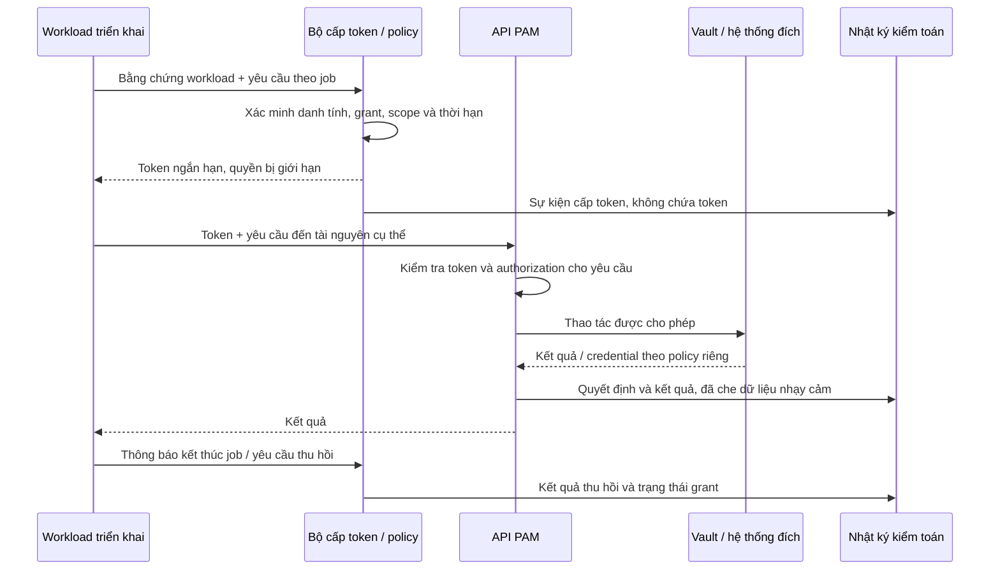

# Ephemeral API token

## 1. Vì sao automation PAM cần token có vòng đời ngắn?

Một pipeline triển khai cần gọi PAM để lấy credential của một tài khoản dịch vụ. Một tác vụ bảo trì cần mở phiên quản trị trong mười phút. Một hệ thống ứng phó sự cố cần gọi API để thu hồi quyền của tài khoản bị nghi xâm nhập. Nếu các tác vụ này dùng chung một API key quản trị tồn tại nhiều tháng, việc lộ key trong log, biến môi trường hoặc máy chạy job có thể biến một sự cố ngắn thành quyền truy cập kéo dài.

**Ephemeral API token** là token được cấp cho một nhu cầu cụ thể, có thời hạn ngắn và được thiết kế để hết giá trị sau khi nhu cầu đó kết thúc. Trong PAM, token nên gắn với một danh tính automation đã được xác minh, một công việc, một tập quyền tối thiểu và một đích sử dụng rõ ràng. Token không phải bằng chứng rằng mọi hành động của công việc đều đã được phê duyệt.

Ví dụ, job `deploy-orders-742` chỉ được đọc một secret phục vụ triển khai trong năm phút. Token của job này không được tạo tài khoản quản trị, sửa policy PAM, đọc toàn bộ vault hoặc được dùng cho một API khác. Sau khi job kết thúc, tổ chức có thể lần theo ai đã cho phép, workload nào nhận token, token đã được dùng ở đâu và credential lấy ra đã được xử lý ra sao.

Token ngắn hạn là một phần của kiểm soát quyền đặc biệt: kiểm kê danh tính, least privilege, quyền đúng thời điểm, quản lý credential trong vault, giám sát và lưu bằng chứng. Nó không tự thay thế các kiểm soát đó.

Sau bài học, người học có thể:

- Phân biệt thời hạn token với thời hạn phê duyệt, lease credential và thời lượng phiên quản trị.
- Thiết kế yêu cầu cấp token theo workload, job, scope, tài nguyên và audience.
- Giải thích khác biệt giữa hết hạn, thu hồi, gia hạn, cấp lại và sử dụng một lần.
- Tích hợp token vào automation mà không tạo ra một credential dài hạn mới thiếu kiểm soát.
- Xây dựng luồng kiểm toán và xử lý sự cố cho token bị lộ hoặc bị dùng ngoài phạm vi.

## 2. Ngắn hạn là thuộc tính thời gian, không phải toàn bộ mô hình bảo mật

Một bearer token có thể được sử dụng bởi bên đang giữ nó, trừ khi hệ thống yêu cầu thêm bằng chứng ràng buộc với người gửi. Nếu token bị đánh cắp khi còn hiệu lực, kẻ giữ token có thể thử sử dụng quyền của nó. TTL ngắn làm giảm khoảng thời gian có thể sử dụng token, nhưng không ngăn được mọi lần sử dụng trái phép trong khoảng thời gian ấy.

Cần xem xét đồng thời các chiều sau:

| Chiều kiểm soát | Câu hỏi thiết kế | Ví dụ trong automation PAM |
|---|---|---|
| Danh tính | Ai hoặc workload nào được nhận token? | Workload triển khai từ môi trường production đã được xác minh |
| Quyền | Token cho phép hành động nào? | Chỉ `credential:read`, không có quyền thay đổi policy |
| Tài nguyên | Quyền áp dụng cho đối tượng nào? | Chỉ secret `orders-db/deploy` trong vault production |
| Đích nhận | API nào được phép chấp nhận token? | API credential của PAM, không phải API quản trị danh tính |
| Thời gian | Token được chấp nhận trong khoảng nào? | Năm phút và không vượt quá cửa sổ quyền JIT |
| Ngữ cảnh | Yêu cầu phải thuộc công việc nào? | Job `deploy-orders-742`, môi trường production |
| Ràng buộc sử dụng | Có cần chứng minh bên gửi hoặc giới hạn lần dùng? | Khóa workload được kiểm chứng hoặc token redeem một lần |
| Thu hồi và bằng chứng | Có thể ngừng chấp nhận và truy vết thế nào? | Thu hồi grant, ghi nhận token ID và quyết định của API |

Đặt TTL là 60 giây nhưng cho phép đọc mọi secret vẫn tạo ra phạm vi thiệt hại lớn. Ngược lại, scope rất hẹp nhưng token có thể được gia hạn vô thời hạn cũng tạo ra quyền thường trực trên thực tế.

### 2.1. Các dạng credential thường bị nhầm với nhau

| Khái niệm | Ý nghĩa | Điểm cần tránh suy diễn |
|---|---|---|
| API key tĩnh | Credential dùng để gọi API, thường tồn tại đến khi bị thay hoặc thu hồi | Tên gọi “key” không cho biết thời hạn hay mức quyền |
| Access token ngắn hạn | Credential được API chấp nhận trong một khoảng thời gian hạn chế | Không mặc nhiên dùng một lần hoặc thu hồi tức thì |
| Token một lần | Token chỉ được redeem thành công một lần theo cơ chế phía server | TTL ngắn không tự tạo ra tính chất một lần |
| Refresh credential | Credential có thể dùng để xin access token mới | Có thể sống lâu hơn access token và cần bảo vệ chặt |
| Lease credential | Khoảng thời gian quản lý một credential do vault cấp hoặc cho mượn | Hết hạn token gọi vault không bảo đảm credential lấy ra đã mất hiệu lực |
| Grant JIT | Quyền được phê duyệt có giới hạn thời gian và phạm vi | Token không được kéo dài grant khi grant hết hạn |
| Phiên đặc quyền | Phiên truy cập đang hoạt động trên hệ thống đích | Phiên có thể tiếp tục sau lúc token mở phiên hết hạn nếu thiếu kiểm soát riêng |

“Ephemeral” cần được chuyển thành yêu cầu có thể kiểm chứng: thời hạn tối đa bao lâu, ai cấp, phạm vi nào, điều kiện cấp lại, cách chấm dứt và bằng chứng cần giữ.

## 3. Mô hình tin cậy của luồng cấp token

Một thiết kế cơ bản gồm năm thành phần:

1. **Workload**: pipeline, runner hoặc dịch vụ tự động cần thực hiện công việc.
2. **Bộ xác minh danh tính**: kiểm tra bằng chứng workload, danh tính dịch vụ hoặc cơ chế bootstrap được chấp nhận.
3. **Bộ cấp token và quyết định policy**: đối chiếu danh tính, job, quyền và phê duyệt để cấp token phù hợp.
4. **API tài nguyên PAM**: nhận token và thực thi kiểm soát trên từng yêu cầu.
5. **Hệ thống bằng chứng**: liên kết sự kiện cấp, sử dụng, từ chối, thu hồi và kết quả tác vụ.



Sơ đồ là mô hình logic, không phải cam kết rằng mọi sản phẩm đều có một endpoint tương ứng. Bộ cấp token, policy engine và API PAM có thể được triển khai trong cùng một hệ thống hoặc nhiều hệ thống.

### 3.1. Bài toán bootstrap: lấy gì để xin token đầu tiên?

Workload phải chứng minh danh tính trước khi nhận token. Nếu runner dùng một API key quản trị cố định để xin token ngắn hạn, credential dài hạn đó vẫn là điểm rủi ro quan trọng. Việc đổi tên credential thành “bootstrap secret” không làm nó ít quyền hơn.

Các hướng thiết kế có thể gồm:

- Danh tính workload được nền tảng cấp và được bộ cấp token xác minh.
- Danh tính máy hoặc dịch vụ được quản lý, có cơ chế chứng minh quyền sở hữu.
- Chứng thư hoặc credential bootstrap nằm trong cơ chế lưu trữ được bảo vệ, có giới hạn quyền cấp token và chu kỳ thay thế.

Mục tiêu là giảm số secret dài hạn do ứng dụng tự giữ. Không thể bỏ qua gốc tin cậy: cần quản lý khóa, danh tính nền tảng và quan hệ tin cậy giữa bên phát hành bằng chứng với bên cấp token.

Ví dụ, chỉ kiểm tra chuỗi tên `production` do job tự gửi là không đủ. Hệ thống phải đối chiếu nó với bằng chứng danh tính đáng tin cậy, môi trường chạy đã được xác minh và policy của tổ chức. Tương tự, một `job_id` trong request body phục vụ liên kết nghiệp vụ nhưng không tự chứng minh rằng caller sở hữu job đó.

### 3.2. Quyền hiệu lực phải là phần giao của các giới hạn

Một cách tư duy hữu ích là:

```text
Quyền hiệu lực
  = quyền nền của danh tính
    ∩ quyền trong grant/phê duyệt còn hiệu lực
    ∩ quyền token yêu cầu và được cấp
    ∩ policy tài nguyên tại thời điểm xử lý
    ∩ điều kiện ngữ cảnh còn thỏa mãn
```

Ký hiệu này mô tả các ràng buộc phải cùng được đáp ứng, không phải thuật toán có thể thay thế authorization thực tế. Không được cộng quyền từ các nguồn mà bỏ qua điều kiện hạn chế của chúng.

Nếu workload chỉ được triển khai ứng dụng Orders, yêu cầu cấp token cho secret của hệ thống Payroll phải bị từ chối. Nếu grant chỉ cho đọc credential, token không được thêm quyền tạo account dù caller gửi scope đó trong yêu cầu.

## 4. Thiết kế hợp đồng cấp token

Yêu cầu cấp token cần đủ thông tin để server đưa ra quyết định, nhưng client không được tự quyết định quyền cuối cùng.

Ví dụ dưới đây là **hợp đồng minh họa**, không phải API chuẩn của một nhà cung cấp. Tên endpoint và field phải được ánh xạ theo triển khai thực tế. Các giá trị trong dấu `<...>` là chỗ giữ chỗ, không phải credential để chạy thử.

```http
POST /example/pam/token-requests HTTP/1.1
Host: pam.example.invalid
Content-Type: application/json
Authorization: Bearer <bang-chung-workload-khong-phai-token-PAM>

{
  "audience": "pam-credential-api",
  "requested_actions": ["credential:read"],
  "resource": "vault/prod/orders-db/deploy",
  "requested_ttl_seconds": 300,
  "job_id": "deploy-orders-742",
  "grant_id": "grant-orders-219",
  "request_id": "token-request-742-01"
}
```

Server phải kiểm tra danh tính và tính hợp lệ của bằng chứng trước khi tin bất kỳ field nào. `requested_actions` và `requested_ttl_seconds` là đề nghị của client; policy có thể từ chối hoặc cấp mức hẹp hơn, ngắn hơn. Client phải đọc và kiểm tra kết quả cấp, không giả định rằng yêu cầu luôn được đáp ứng nguyên vẹn.

Ví dụ phản hồi:

```json
{
  "access_token": "<token-bi-mat-chi-hien-thi-minh-hoa>",
  "token_type": "Bearer",
  "expires_in": 300,
  "token_id": "tok-742-a1",
  "granted_actions": ["credential:read"],
  "resource": "vault/prod/orders-db/deploy",
  "audience": "pam-credential-api"
}
```

Phản hồi cấp token chứa secret. Cần dùng kết nối bảo mật, cấu hình không cache theo giao thức áp dụng và ngăn proxy, APM, debug log hoặc bản ghi request/response thu lại nội dung này. `token_id` là định danh phục vụ truy vết, không phải bản sao token.

### 4.1. Những thông tin cần gắn với token hoặc trạng thái server

| Thông tin | Vai trò |
|---|---|
| Issuer | Xác định nguồn phát hành được API tin cậy |
| Subject | Danh tính mà token đại diện |
| Actor hoặc chuỗi ủy quyền | Phân biệt workload đang hành động với người hay dịch vụ đã ủy quyền, khi có delegation |
| Audience | Giới hạn API đích được chấp nhận token |
| Actions hoặc scopes | Các thao tác token được phép yêu cầu |
| Resource boundary | Tài nguyên, vault, account hoặc tenant nằm trong phạm vi |
| Issued-at, not-before, expires-at | Các mốc thời gian cần kiểm tra theo định dạng token |
| Token ID | Liên kết sự kiện và hỗ trợ cơ chế thu hồi nếu có |
| Job và grant reference | Nối token với công việc và quyết định phê duyệt |
| Sender binding | Thông tin ràng buộc khóa/chứng thư nếu triển khai hỗ trợ |

Không phải mọi thông tin đều phải nằm trong token tự chứa. Với token opaque, server có thể tra cứu chúng qua trạng thái được quản lý. Với token tự chứa, cần tránh nhét dữ liệu nhạy cảm hoặc quá nhiều thông tin nội bộ vào payload.

Token được ký không có nghĩa là payload được mã hóa. Không đưa password, private key hoặc secret lấy từ vault vào claim của token truy cập.

## 5. Chọn TTL theo công việc và cửa sổ quyền

TTL nên xuất phát từ thời gian cần thực hiện thao tác, độ trễ cấp token, khả năng cấp lại an toàn và mức rủi ro của tài nguyên. Không chọn một con số chung cho toàn tổ chức mà bỏ qua các luồng công việc khác nhau.

Ví dụ nội bộ:

| Tác vụ | Thời gian dự kiến | Hướng giới hạn |
|---|---|---|
| Đọc một secret để bắt đầu triển khai | Vài giây | Token chỉ đủ để thực hiện bước đọc, giới hạn tài nguyên |
| Mở phiên quản trị được phê duyệt | Khoảng một phút để thiết lập | Token mở phiên ngắn hạn; thời lượng phiên có policy riêng |
| Chạy batch bảo trì | Hai mươi phút | Cấp token theo từng giai đoạn, tái kiểm tra quyền khi cần |
| Thay đổi quyền nhạy cảm | Thao tác ngắn | Token phạm vi hẹp, grant rõ ràng, có thể cần dual control |

Các khoảng thời gian trên chỉ mô tả tình huống; cần đo và điều chỉnh theo hệ thống thực tế.

### 5.1. Không vượt quá thời hạn của quyền gốc

Tại thời điểm cấp, có thể hình dung giới hạn như sau:

```text
expires_at(token) <= min(
    thời_điểm_cấp + TTL_tối_đa_theo_policy,
    thời_điểm_kết_thúc_grant,
    thời_điểm_kết_thúc_công_việc_được_cho_phép,
    các_giới_hạn_ủy_quyền_khác_được_policy_áp_dụng
)
```

Không nhất thiết token luôn phải hết hạn cùng credential dùng để xác thực việc cấp token; quan hệ này phụ thuộc mô hình ủy quyền. Điều bắt buộc là hệ thống xác định rõ giới hạn nào chi phối quyền đã cấp, không âm thầm kéo dài grant hoặc chuỗi ủy quyền trái policy.

Ví dụ, grant JIT kết thúc lúc 10:20. Workload xin token có TTL năm phút vào 10:18. Nếu quyền yêu cầu phải kết thúc cùng grant, token chỉ được cấp đến 10:20 hoặc yêu cầu bị từ chối. Cấp đến 10:23 sẽ vượt cửa sổ đã cho phép.

### 5.2. Thời gian hết hạn và sai lệch đồng hồ

API phải kiểm tra thời gian theo quy tắc định dạng token được sử dụng. Với một mốc hết hạn, không chấp nhận token đã qua thời điểm đó. Nếu có dung sai đồng hồ, phải coi dung sai là một phần của cửa sổ chấp nhận thực tế, cấu hình có giới hạn và theo dõi đồng hồ của các thành phần.

Client nên xin token sát lúc dùng và chủ động xin token mới trước khi hết hạn một khoảng an toàn phù hợp. Không trừ hay cộng tùy ý nhiều phút ở từng tầng để “tránh lỗi”, vì các dung sai cộng dồn có thể làm TTL thực tế dài hơn thiết kế.

Thông tin `expires_in` giúp client lập lịch, nhưng quyết định chấp nhận thuộc về server. Đồng hồ client bị sai không được biến token hết hạn thành token hợp lệ.

## 6. API phải xác minh và phân quyền trên từng yêu cầu

Nhận được token không có nghĩa là API được bỏ qua authorization. Tối thiểu cần kiểm tra:

1. Token có dạng được hỗ trợ và được phát hành bởi nguồn tin cậy.
2. Tính toàn vẹn hoặc trạng thái token được xác minh theo cơ chế đã chọn.
3. Token đã đến thời điểm có hiệu lực và chưa hết hạn.
4. Audience phù hợp với API đang nhận yêu cầu.
5. Danh tính, tenant và ngữ cảnh token phù hợp với tài nguyên được truy cập.
6. Action yêu cầu nằm trong quyền được cấp và còn được policy cho phép.
7. Các điều kiện thu hồi, grant, sender binding hoặc số lần dùng được kiểm tra nếu mô hình yêu cầu.

Với token được ký, không chỉ giải mã payload rồi tin claim. Phải xác minh chữ ký bằng khóa tin cậy và cấu hình thuật toán được phép. Với token opaque, việc tra cứu phải diễn ra qua thành phần đáng tin cậy, có kiểm soát thời gian chờ và cache.

```text
handle(request):
    token = extract_supported_token(request)
    identity_and_limits = verify_token(token)
    require_valid_time(identity_and_limits)
    require_expected_issuer_and_audience(identity_and_limits)
    require_active_grant_if_policy_requires(identity_and_limits)
    require_sender_proof_if_bound(identity_and_limits, request)

    resource = resolve_resource_in_trusted_tenant_context(request)
    require_allowed_action(identity_and_limits, request.action, resource)
    require_current_resource_policy(identity_and_limits.subject, resource)

    result = execute_with_required_concurrency_controls(request, resource)
    record_redacted_audit_event(identity_and_limits, request, result)
    return result
```

Đây là giả mã thể hiện các bước kiểm soát; không phải thư viện xác minh token để sao chép vào production. Thứ tự và ranh giới giao dịch phải được thiết kế theo loại thao tác. Với thay đổi nhạy cảm, kiểm tra quyền quá sớm rồi thực thi rất muộn có thể tạo khoảng trống khi grant đã bị thu hồi giữa hai thời điểm.

### 6.1. Đừng nhầm scope với quyền trên mọi đối tượng

Scope `credential:read` chỉ mô tả loại hành động. API còn phải kiểm tra token được đọc credential nào. Nếu caller thay đường dẫn từ secret Orders sang secret Payroll và vẫn đọc được, hệ thống có lỗi kiểm soát tài nguyên dù TTL chỉ là một phút.

Tương tự, `tenant_id` hay `vault_id` do caller tự gửi không được dùng để vượt ranh giới mà danh tính đã được cấp. Cần đối chiếu danh tính và policy đáng tin cậy, đồng thời ngăn alias, đường dẫn tương đương hoặc định danh đối tượng khác làm lọt kiểm tra.

## 7. Token tự chứa và token opaque: tác động tới thu hồi

Hai mô hình có thể cùng dùng TTL ngắn nhưng khác cách hệ thống biết token còn được phép sử dụng hay không.

| Mô hình | Cách xác minh điển hình | Hệ quả cần thiết kế |
|---|---|---|
| Token tự chứa, API xác minh cục bộ | Kiểm tra chữ ký và claim bằng dữ liệu tin cậy | Nếu không tra trạng thái thu hồi, token có thể được chấp nhận đến hết hạn |
| Token opaque với tra trạng thái | API hoặc gateway hỏi thành phần có trạng thái token | Có thể phản ánh thu hồi nhanh hơn, nhưng phụ thuộc khả năng tra cứu và cache |
| Mô hình kết hợp | Xác minh cục bộ và kiểm tra trạng thái cho các hành động được chọn | Cần quy định rõ bước nào kiểm tra gì, cache bao lâu và khi lỗi xử lý ra sao |

Không thể kết luận rằng “JWT không thể thu hồi” hoặc “opaque luôn thu hồi tức thì”. Token tự chứa có thể kết hợp danh sách thu hồi hoặc kiểm tra grant; token opaque vẫn có độ trễ khi trạng thái bị cache hoặc chưa được đồng bộ.

Ví dụ, bộ cấp token đánh dấu thu hồi lúc 10:02 nhưng gateway giữ kết quả cho phép trong 60 giây. Token có thể còn được chấp nhận trong cửa sổ cache đó, tùy cách triển khai. Phải đo thời gian ngừng chấp nhận tại nơi thực thi, không chỉ thời điểm cập nhật cơ sở dữ liệu của issuer.

### 7.1. Hết hạn, thu hồi và vô hiệu hóa danh tính là ba việc khác nhau

- **Hết hạn token**: token không còn được chấp nhận sau giới hạn thời gian của nó.
- **Thu hồi token hoặc grant**: hệ thống chủ động rút quyền trước thời điểm hết hạn, với hiệu lực phụ thuộc cơ chế thực thi.
- **Vô hiệu hóa danh tính workload**: ngăn danh tính tiếp tục xin token hoặc thực hiện các quyền liên quan; token đã phát hành có thể cần biện pháp thu hồi riêng.

Nếu workload bị xâm nhập, chỉ thu hồi một token trong khi workload vẫn có thể xin token mới sẽ không ngăn được tái cấp. Cần xác định và xử lý cả nguồn cấp quyền.

### 7.2. Không dùng thay khóa ký như cơ chế thu hồi mặc định

Thay khóa ký có thể ảnh hưởng nhiều token và nhiều API cùng lúc. Nó phù hợp với quản lý khóa và một số tình huống sự cố, nhưng không nên là biện pháp duy nhất để thu hồi một job cụ thể. Hơn nữa, API còn cache khóa cũ có thể chưa phản ánh thay đổi ngay.

Cần phân biệt kế hoạch xoay khóa bình thường, xử lý khóa bị lộ và thu hồi quyền của một workload. Các sự kiện này có phạm vi ảnh hưởng và yêu cầu phối hợp khác nhau.

## 8. Gia hạn, cấp lại và công việc chạy dài

Một job chạy hai mươi phút không nhất thiết cần token có TTL hai mươi phút. Có thể tách công việc thành các giai đoạn và cấp token sát thời điểm mỗi giai đoạn thực hiện thao tác đặc quyền.

```text
10:00  Job bắt đầu, xác minh workload và grant
10:01  Cấp T1 cho bước đọc credential, hết hạn lúc 10:06
10:02  Bước đọc hoàn thành; không lưu T1 vào artifact
10:08  Trước bước tiếp theo, kiểm tra lại grant và policy
10:08  Cấp T2 với quyền cho bước tiếp theo, nếu vẫn được phép
10:20  Grant kết thúc; từ chối cấp token vượt cửa sổ này
```

Việc cấp T2 không được coi là tự động chỉ vì T1 từng hợp lệ. Hệ thống phải kiểm tra danh tính còn hoạt động, job còn được phép chạy, grant còn hiệu lực và policy hiện tại có cho phép quyền yêu cầu hay không.

### 8.1. Hạn chế của refresh credential

Nếu client giữ một refresh credential tồn tại ba tháng và có thể xin token quản trị liên tục, access token năm phút chưa loại bỏ quyền dài hạn. Cần quản lý refresh credential như một tài sản đặc quyền:

- Quyền xin token phải có phạm vi và thời hạn riêng.
- Việc gia hạn không được kéo dài grant ngoài phê duyệt.
- Cần có giới hạn vòng đời tuyệt đối hoặc điều kiện tái xác thực phù hợp.
- Khi có sự cố, phải thu hồi nguồn cấp lại và token đã phát hành theo khả năng hệ thống.

Nếu dùng cơ chế thay refresh credential sau mỗi lần sử dụng, cần thiết kế xử lý cạnh tranh và phát hiện tái sử dụng. Không giả định một giá trị refresh credential bị thay ở client là đủ để vô hiệu hóa giá trị cũ ở server.

### 8.2. Nhiều worker trong cùng một job

Tránh chia sẻ một bearer token quyền rộng cho mọi tiến trình con. Mỗi thành phần nên nhận quyền cần cho phần việc của nó. Nếu nền tảng hỗ trợ cấp token cho bước hoặc tác vụ con, cần bảo đảm token con không có quyền rộng hơn chuỗi ủy quyền gốc.

Client cũng cần phối hợp khi nhiều tiến trình cùng thấy token sắp hết hạn. Việc đồng loạt xin token mới có thể gây quá tải, tạo quá nhiều token đang hoạt động và làm khó truy vết. Có thể điều phối cấp token tại một thành phần được bảo vệ, giới hạn đồng thời hoặc cấp riêng theo danh tính tác vụ. Không đánh đổi việc giảm số request lấy token bằng cách kéo dài TTL thiếu căn cứ.

## 9. Token một lần và ràng buộc người gửi

### 9.1. Token một lần cần trạng thái và thao tác nguyên tử

Một token được mô tả là một lần nhưng chỉ có claim `max_uses: 1` sẽ không tự ngăn hai API instance cùng chấp nhận nó. Server cần cơ chế tiêu thụ trạng thái có tính nguyên tử, hoặc cơ chế tương đương bảo đảm chỉ một lần redeem được chấp nhận.

Ví dụ trạng thái:

```text
ISSUED -> REDEEMED
ISSUED -> EXPIRED
ISSUED -> REVOKED
```

Hai request đồng thời không được cùng chuyển `ISSUED` sang `REDEEMED`. Tuy nhiên, **redeem một lần không đồng nghĩa thao tác nghiệp vụ thực hiện đúng một lần**. Nếu server đã thay đổi quyền ở hệ thống đích nhưng phản hồi bị mất, client không biết thao tác đã hoàn thành hay chưa.

Vì vậy cần phân biệt token một lần với idempotency của thao tác. Hệ thống có thể dùng định danh tác vụ, lưu kết quả và cung cấp cơ chế tra trạng thái. Không tạo token mới rồi lặp lại thay đổi nhạy cảm một cách mù quáng.

### 9.2. Sender-constrained token giảm khả năng dùng token bị đánh cắp

Trong mô hình ràng buộc người gửi, chỉ có token là chưa đủ; client còn phải chứng minh sở hữu khóa hoặc danh tính kết nối đã được ràng buộc. Thiết kế này chỉ có tác dụng khi API xác minh đúng bằng chứng và liên kết nó với token.

Cần xác định nơi kết thúc kết nối bảo mật, cách gateway chuyển bằng chứng, độ tin cậy của header nội bộ và cách ngăn client tự giả mạo header. Ghi một định danh chứng thư vào claim nhưng không kiểm tra tại API không tạo ra ràng buộc.

Nếu cả token và khóa tương ứng đều bị lấy từ một runner bị xâm nhập, khả năng bảo vệ còn tùy cơ chế lưu khóa và thực thi. Ràng buộc người gửi bổ sung kiểm soát, không thay thế cô lập runner hoặc giới hạn quyền.

## 10. Giữ token an toàn trong pipeline và dịch vụ

### 10.1. Giảm số nơi token có thể xuất hiện

Ưu tiên cấp token trong tiến trình hoặc phạm vi tác vụ cần dùng, lưu trong bộ nhớ trong thời gian cần thiết và kết thúc phạm vi sử dụng khi bước công việc hoàn thành. Khi framework buộc phải truyền credential qua biến môi trường hoặc tệp tạm, phải giới hạn quyền đọc và vòng đời, đồng thời xem xét cách tiến trình con và công cụ thu thập chẩn đoán truy cập chúng.

Không lưu token vào repository, cấu hình dùng chung, image, cache build, artifact, kết quả test hoặc đầu ra của job. Không truyền bearer token qua query string vì URL dễ bị ghi ở nhiều tầng. Dùng cơ chế truyền credential mà API hỗ trợ qua kết nối bảo mật và cấu hình che thông tin nhạy cảm tại mọi tầng.

Token nằm trong bộ nhớ cũng không được bảo vệ tuyệt đối: crash dump, debugger, tiến trình bị xâm nhập hoặc công cụ quan sát có thể làm lộ dữ liệu. Giảm thời gian tồn tại và hạn chế quyền truy cập môi trường thực thi vẫn cần thiết.

### 10.2. Log che token cần nhiều lớp

Masking của hệ thống CI là một lớp hỗ trợ, không phải bảo đảm rằng mọi dạng biến đổi của token đều bị che. Tránh tạo log chứa secret ngay từ đầu:

- Không bật shell tracing ở bước xử lý token.
- Không ghi toàn bộ request/response hoặc header xác thực.
- Không đính kèm token vào thông báo lỗi, ticket hoặc dữ liệu telemetry.
- Không xuất token qua output dùng chung giữa các job khi không cần thiết.
- Cấu hình gateway, APM và bộ thu log để che credential ở vị trí tương ứng.

Với kết quả API chứa password hoặc secret lấy từ vault, quy tắc che dữ liệu phải áp dụng cho cả kết quả đó. Bảo vệ token gọi API nhưng ghi credential trả về vào log vẫn làm thất bại mục tiêu PAM.

### 10.3. Runner tin cậy và ranh giới giữa các tác vụ

Nếu một runner nhận cả mã nguồn chưa được tin cậy lẫn token production, mã độc trong bước build có thể đọc token. Cần tách ngữ cảnh không tin cậy khỏi bước được cấp quyền, xác minh nguồn công việc và hạn chế token xuất hiện ở các bước không cần nó.

Runner được tái sử dụng cần có cơ chế dọn môi trường, tệp tạm, biến và vùng lưu credential giữa các job. Không giả định rằng token đã hết hạn đồng nghĩa môi trường không còn chứa thông tin nhạy cảm khác, đặc biệt là credential đã lấy từ vault.

## 11. Lỗi, retry và sự cố giữa chừng

Automation cần phân biệt lỗi xác thực, thiếu quyền, lỗi nghiệp vụ và lỗi hạ tầng để tránh lặp hành động nguy hiểm.

| Tình huống | Hướng xử lý |
|---|---|
| Token hết hạn trước khi gửi request | Xin token mới nếu danh tính và grant vẫn hợp lệ |
| Token bị từ chối do sai audience hoặc bằng chứng không hợp lệ | Dừng, sửa cấu hình; không lặp vô hạn |
| Danh tính không được phép truy cập tài nguyên | Dừng và ghi quyết định từ chối; không xin scope rộng hơn tự động |
| Bị giới hạn tốc độ | Theo hướng dẫn retry của API, có backoff và giới hạn lần thử |
| Timeout sau thao tác thay đổi quyền | Tra trạng thái hoặc dùng cơ chế idempotency; không tự kết luận chưa thực hiện |
| Bộ cấp token không sẵn sàng | Dừng bước cần token mới; áp dụng policy sự cố đã thiết kế |
| Hệ thống tra trạng thái token không sẵn sàng | Thực thi quy tắc lỗi đã định; với thao tác đặc quyền nhạy cảm, không tự bỏ kiểm tra |

Mã HTTP cụ thể phụ thuộc hợp đồng API. Không chỉ nhìn một mã lỗi rồi tự động gia hạn token; cần đối chiếu loại lỗi được API công bố và giữ số lần thử hữu hạn.

### 11.1. Không lùi về credential quản trị chung khi lỗi

Một nhánh “nếu cấp token thất bại thì dùng key admin dự phòng” thường biến lỗi hạ tầng thành đường vòng bỏ qua policy. Nếu tổ chức cần break-glass, đó phải là một luồng riêng được quản lý: điều kiện kích hoạt, người chịu trách nhiệm, quyền tối thiểu, thời hạn, giám sát và đối soát sau sử dụng.

Sự tồn tại của luồng khẩn cấp không cho phép pipeline tự lựa chọn nó chỉ để hoàn tất một deployment.

### 11.2. Job bị hủy hoặc runner biến mất

Khối cleanup của client có thể không chạy khi runner mất điện, bị hủy cưỡng bức hoặc bị xâm nhập. Do đó:

- Token cần TTL độc lập với việc client có thông báo kết thúc hay không.
- Grant và trạng thái job cần cơ chế kết thúc hoặc đối soát phía server.
- Phiên đặc quyền và credential downstream cần thời hạn hoặc cơ chế thu hồi riêng.
- Khi có API thông báo kết thúc job, cần ghi lại kết quả và xử lý trường hợp thông báo không thành công.

Không mô tả cleanup theo kiểu “best effort” rồi xem đó là bằng chứng rằng mọi quyền đã được rút.

## 12. Hết hạn token không thu hồi mọi tác động downstream

Đây là điểm quan trọng khi kết hợp ephemeral token với vault, rotation và giám sát phiên.

### 12.1. Token đọc vault và credential nhận từ vault

Giả sử token T hết hạn sau năm phút. Trong phút đầu, T được dùng để lấy password tài khoản quản trị tồn tại lâu dài. Việc T hết hạn không tự thay password đó. Nếu password đã bị sao chép, kẻ giữ password có thể tiếp tục sử dụng theo điều kiện của hệ thống đích.

Tùy sản phẩm và loại tài nguyên, tổ chức có thể áp dụng credential động có lease, check-out/check-in, rotation sau sử dụng hoặc một cơ chế truy cập không trả secret cho caller. Cần xác minh khả năng thực tế và kết quả trên hệ thống đích, không suy luận từ TTL token.

### 12.2. Token mở phiên và phiên đang hoạt động

Token dùng để mở phiên có thể hết hạn trong khi phiên SSH, RDP hoặc phiên API dài hạn vẫn còn. Cần xác định phiên có thời hạn tối đa, idle timeout, kiểm tra lại quyền và khả năng ngắt khi grant bị thu hồi hay không.

Nếu token chỉ được kiểm tra lúc thiết lập phiên, không được hứa rằng hết hạn token sẽ ngắt phiên. Nhật ký phải liên kết được token, grant và session ID để điều phối thu hồi hoặc điều tra.

### 12.3. Thay đổi tồn tại lâu hơn token

Một token tồn tại 60 giây nhưng có quyền tạo account, thêm SSH key hoặc cấp role thường trực có thể tạo ra đường truy cập lâu dài. TTL chỉ giới hạn thời gian gửi yêu cầu ban đầu, không hoàn tác các thay đổi mà yêu cầu đã gây ra.

Với các hành động đó, cần giới hạn quyền tạo thay đổi bền vững, kiểm soát phê duyệt và ghi nhận trạng thái trước/sau. Nếu yêu cầu là cấp quyền tạm thời, chính quyền trên hệ thống đích cũng cần cơ chế kết thúc và bằng chứng đã thu hồi.

## 13. Bằng chứng kiểm toán và giám sát

Mục tiêu kiểm toán là tái dựng được chuỗi quyết định mà không phải lưu credential. Một chuỗi sự kiện hữu ích gồm:

```text
Định danh workload
    -> yêu cầu cấp token
    -> quyết định grant/policy
    -> token_id
    -> yêu cầu API và tài nguyên
    -> kết quả thực thi
    -> credential lease hoặc session_id, nếu có
    -> kết thúc job / thu hồi / hết hạn
```

Mỗi sự kiện nên có thời điểm đáng tin cậy, mã tương quan, định danh tác nhân, action, tài nguyên hoặc tham chiếu được bảo vệ, kết quả và lý do phù hợp. Với quyền được ủy quyền, cần phân biệt người phê duyệt, danh tính đại diện và workload thực thi.

Ví dụ sự kiện đã loại bỏ credential:

```json
{
  "event_type": "pam_api_access_decision",
  "correlation_id": "corr-deploy-742",
  "token_id": "tok-742-a1",
  "workload_id": "orders-deployer-prod",
  "job_id": "deploy-orders-742",
  "grant_id": "grant-orders-219",
  "action": "credential:read",
  "resource_ref": "orders-db-deploy-prod",
  "decision": "allow",
  "policy_version": "policy-orders-17",
  "result": "success"
}
```

Không lưu access token, refresh credential hoặc secret trả về trong sự kiện. Token ID và tham chiếu tài nguyên vẫn là dữ liệu nội bộ cần kiểm soát quyền truy cập, thời gian lưu và tính toàn vẹn. Với token opaque, nên có định danh kiểm toán riêng thay vì dùng chính giá trị token làm mã tương quan.

### 13.1. Chỉ số và tín hiệu bất thường

- Token được cấp cho tài nguyên hoặc môi trường ít khi được workload sử dụng.
- Một job xin nhiều token ngoài mô hình bình thường hoặc liên tục bị từ chối scope.
- Token bị thử dùng sai audience, sai tài nguyên hoặc sau khi grant kết thúc.
- Thời gian từ thu hồi đến lần cuối API còn chấp nhận vượt mục tiêu đã đặt.
- Phiên đặc quyền hoặc credential lease còn hoạt động sau khi job đã kết thúc.
- Token hoặc credential xuất hiện trong log và artifact qua cơ chế phát hiện phù hợp.

Số lần cấp token tăng có thể do workload tăng, lỗi retry hoặc hành vi đáng ngờ; cần đối chiếu ngữ cảnh trước khi kết luận. Mục tiêu đo lường phải dựa trên dữ liệu tại nơi ra quyết định và thực thi, không chỉ số lượng bản ghi “đã thu hồi” từ issuer.

## 14. Tình huống thực hành: triển khai Orders qua PAM

### 14.1. Yêu cầu

Đội vận hành muốn pipeline triển khai Orders đọc credential phục vụ bước cập nhật cơ sở dữ liệu production. Cửa sổ thay đổi được phê duyệt là 10:00–10:20. Pipeline không được đọc secret của ứng dụng khác, tạo account hoặc thay policy PAM.

Thiết kế đề xuất:

1. Workload `orders-deployer-prod` chứng minh danh tính bằng cơ chế được nền tảng và PAM chấp nhận.
2. Server đối chiếu workload, môi trường, job và grant của cửa sổ thay đổi.
3. Token chỉ cấp quyền đọc `vault/prod/orders-db/deploy`, audience là API credential PAM, TTL tối đa năm phút và không vượt cửa sổ grant.
4. Pipeline chỉ nhận token ở bước cần gọi PAM, không chuyển qua artifact hoặc log.
5. API kiểm tra action, tài nguyên, thời gian và các điều kiện trạng thái theo policy.
6. Credential lấy ra được quản lý theo lease hoặc rotation phù hợp; bước này có bằng chứng riêng.
7. Khi job kết thúc hoặc bị hủy, hệ thống đóng quyền của job, xử lý token và các tài nguyên downstream theo khả năng đã thiết kế.

### 14.2. Diễn biến bình thường

Lúc 10:03, pipeline nhận token T1 hết hạn lúc 10:08. Lúc 10:04, API cho phép đọc credential của Orders và ghi nhận `token_id`, `job_id`, `grant_id`, quyết định và kết quả. Pipeline dùng credential cho thao tác đã phê duyệt.

Lúc 10:07, job hoàn tất. Hệ thống ghi nhận kết thúc, thu hồi hoặc đánh dấu token/grant theo policy, đồng thời hoàn tất xử lý credential downstream. Trạng thái hoàn thành cần dựa trên kết quả các bước thực thi; token hết hạn lúc 10:08 không đủ để chứng minh password đã được rotate.

### 14.3. Tình huống token bị lộ lúc 10:05

Đội ứng phó cần xác định:

- Token nào bị lộ, được cấp cho workload và grant nào?
- Token có được ràng buộc người gửi hay chỉ là bearer token?
- API nào có thể chấp nhận token và trạng thái thu hồi lan truyền trong bao lâu?
- Token đã được dùng để lấy credential, mở phiên hoặc thay đổi quyền nào?
- Workload còn khả năng xin token mới hay không?

Hành động có thể gồm thu hồi token/grant, vô hiệu hóa nguồn cấp lại đã bị xâm nhập, ngắt phiên liên quan và thay credential đã bị lộ theo quy trình. Cần lưu bằng chứng trước và sau xử lý mà không sao chép token vào ticket.

Nếu API chỉ kiểm tra token tự chứa cục bộ và không có trạng thái thu hồi, phải thừa nhận token có thể còn được chấp nhận đến lúc hết hạn trong phạm vi đã cấp. Khi đó, kiểm soát bổ sung phải tác động ở API, tài nguyên, danh tính hoặc phiên theo năng lực thực tế; không báo “đã khóa hoàn toàn” chỉ vì issuer đã nhận lệnh revoke.

## 15. Các lỗi thiết kế thường gặp

| Lỗi | Vì sao không đạt mục tiêu | Cách điều chỉnh |
|---|---|---|
| Token ngắn hạn nhưng scope quản trị toàn hệ thống | Giảm thời gian nhưng giữ phạm vi thiệt hại rất lớn | Giới hạn action và tài nguyên theo công việc |
| Lấy token bằng key admin chung nằm trong CI | Nguồn cấp quyền dài hạn vẫn dễ bị lộ và khó quy trách nhiệm | Dùng danh tính workload hoặc bootstrap được quản lý, quyền hẹp |
| Tin `job_id`, `tenant` hay môi trường do client tự khai | Caller có thể giả ngữ cảnh để xin quyền | Đối chiếu với danh tính và nguồn dữ liệu tin cậy |
| Chỉ kiểm tra chữ ký, bỏ audience và tài nguyên | Token có thể bị dùng nhầm API hoặc vượt ranh giới | Kiểm tra đầy đủ đích nhận và authorization |
| Gọi token TTL ngắn là token một lần | Token có thể bị phát lại nhiều lần trong TTL | Thiết kế trạng thái redeem nguyên tử nếu cần một lần |
| Gia hạn tự động không kiểm tra lại grant | Quyền tạm thời thành quyền kéo dài | Tái đánh giá và giới hạn thời hạn tuyệt đối |
| Cho phép dùng cache không giới hạn khi kiểm tra trạng thái lỗi | Token bị thu hồi vẫn có thể được chấp nhận lâu | Định nghĩa giới hạn cache, điều kiện từ chối và mục tiêu thu hồi |
| Ghi token vào log để điều tra | Tạo thêm bản sao credential và tăng phạm vi sự cố | Dùng token ID và mã tương quan đã loại bỏ secret |
| Hết hạn token được xem là đã thu hồi password và phiên | Các quyền downstream có vòng đời riêng | Quản lý lease, rotation, session và xác nhận kết quả |
| Retry thao tác thay đổi quyền sau mọi timeout | Có thể thực hiện thay đổi lặp hoặc không xác định trạng thái | Dùng idempotency và tra trạng thái nghiệp vụ |

## 16. Bài tập thiết kế và tiêu chí tự kiểm tra

### Bài tập 1: Chặn token vượt cửa sổ JIT

Grant kết thúc lúc 14:30. Job xin token năm phút lúc 14:29. Hãy xác định thời hạn token, cách client xử lý nếu chỉ được cấp một phút và điều kiện để job xin quyền tiếp.

Gợi ý: token không được tự kéo grant đến 14:34. Nếu công việc cần thêm thời gian, phải có quyết định gia hạn grant hợp lệ; client không thể giải quyết bằng cách đổi `requested_ttl_seconds`.

### Bài tập 2: Thu hồi trong hệ thống có cache

API cache kết quả trạng thái token trong một khoảng đã cấu hình. Token bị thu hồi tại issuer nhưng một API instance chưa hết cache. Hãy mô tả cửa sổ có thể còn chấp nhận, điểm cần đo và policy khi thành phần tra trạng thái mất kết nối.

Gợi ý: phân biệt thời điểm ghi lệnh thu hồi, thời điểm trạng thái đến các thành phần và thời điểm yêu cầu cuối cùng thực sự được cho phép. Không đặt mục tiêu “tức thì” nếu kiến trúc không đáp ứng.

### Bài tập 3: Token hết hạn nhưng account vẫn tồn tại

Một token hai phút tạo được account quản trị không có ngày hết hạn. Hãy giải thích vì sao đây chưa phải quyền tạm thời và đề xuất giới hạn API, phê duyệt, thời hạn account và bằng chứng thu hồi.

Gợi ý: thời hạn gửi yêu cầu tạo account khác với thời hạn của account được tạo. Cần kiểm soát cả hành động ban đầu và trạng thái tồn tại sau hành động.

### Các kiểm tra cần có trước khi triển khai thực tế

- Token hợp lệ thực hiện được đúng action trên đúng tài nguyên đã cấp.
- Token bị từ chối khi sai audience, sai tenant, vượt scope hoặc bị sửa nội dung.
- Token hết hạn, token dùng quá sớm và grant hết hạn được xử lý đúng policy thời gian.
- Workload không thể tự khai job hoặc môi trường khác để nhận quyền rộng hơn.
- Việc cấp lại bị từ chối khi grant kết thúc hoặc danh tính bị vô hiệu hóa theo thiết kế.
- Hành vi thu hồi được đo tại các API instance, bao gồm độ trễ cache và tình huống mất kết nối.
- Token một lần, nếu có, không bị redeem thành công hai lần do request đồng thời.
- Timeout và retry không gây lặp thay đổi quyền ngoài dự kiến.
- Token và credential trả về không xuất hiện trong log, artifact, kết quả debug hoặc cache build.
- Job bị hủy vẫn dẫn đến hết hạn/đối soát phía server, và credential hoặc phiên downstream được xử lý riêng.

Một triển khai đạt mục tiêu khi có thể chứng minh được chuỗi: **đúng danh tính, đúng công việc, đúng quyền, đúng tài nguyên, đúng thời gian và có bằng chứng kết thúc quyền**. TTL ngắn giúp thu hẹp cửa sổ rủi ro; toàn bộ chuỗi kiểm soát mới quyết định automation PAM có giữ được least privilege trong thực tế hay không.
