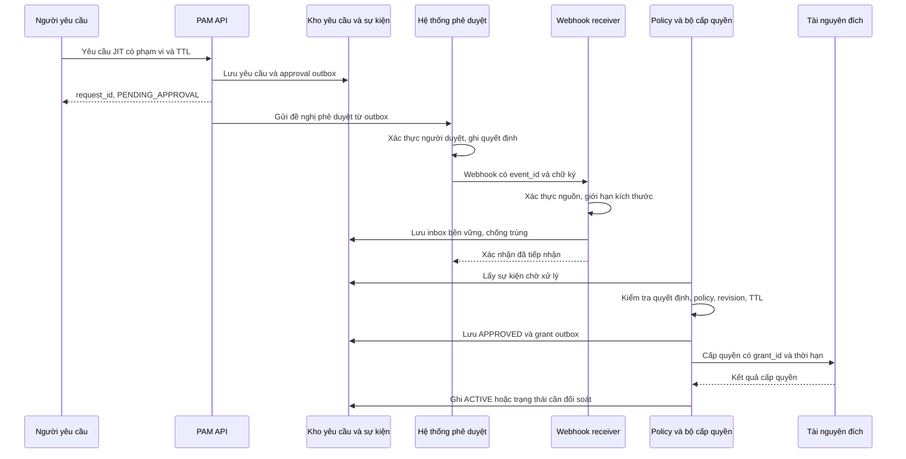
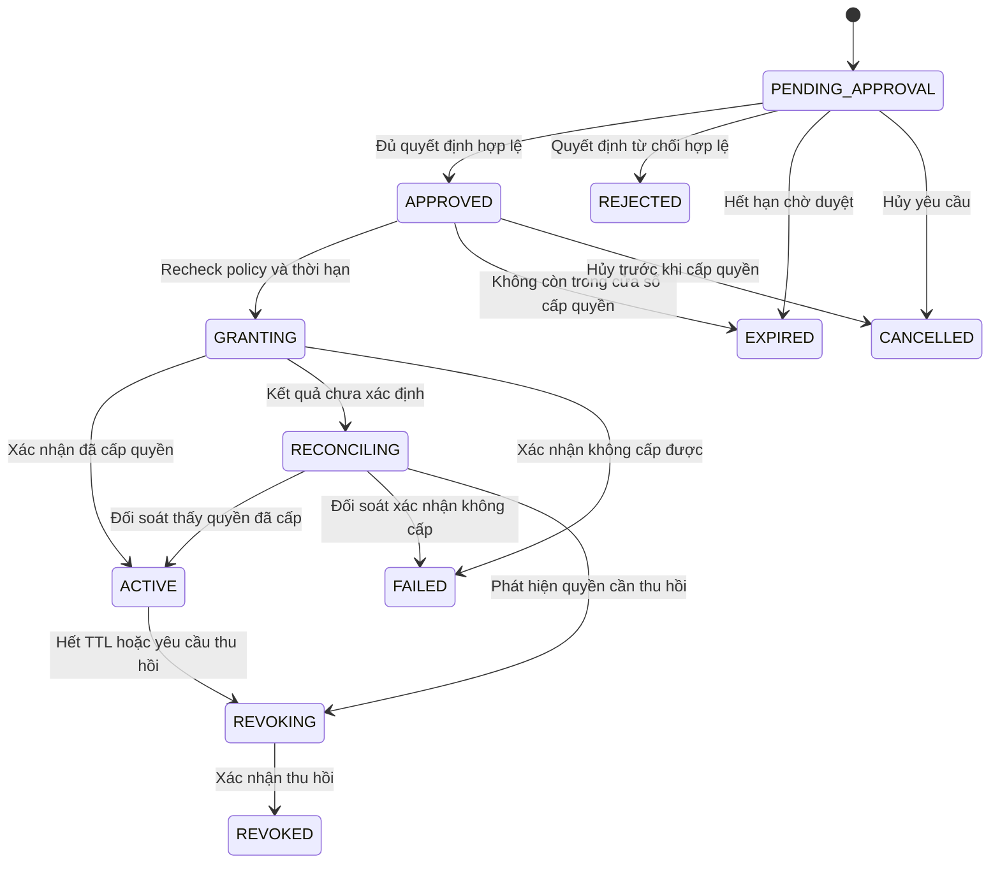

# Webhook approval trong PAM

## 1. Mục tiêu và phạm vi

Webhook approval là cách kết nối một yêu cầu quyền đặc biệt với một hệ thống phê duyệt bên ngoài bằng thông điệp được gửi qua HTTP. Trong một quy trình PAM, hệ thống ngoài có thể là cổng yêu cầu dịch vụ, nền tảng quản lý thay đổi hoặc dịch vụ phê duyệt nội bộ. Khi người có thẩm quyền đưa ra quyết định, hệ thống đó thông báo cho PAM qua webhook để PAM tiếp tục xử lý yêu cầu.

Mục tiêu của tích hợp không chỉ là chuyển trạng thái từ “đợi” sang “đã duyệt”. Điều quan trọng là chứng minh quyết định đó thuộc đúng yêu cầu, đúng phiên bản quyền, đúng người duyệt và còn hiệu lực tại thời điểm cấp quyền.

Sau bài học này, người học có thể:

- Phân biệt thông báo qua webhook, quyết định phê duyệt và hành động cấp quyền.
- Thiết kế trạng thái yêu cầu có thời hạn, xử lý sự kiện trùng và sự kiện đến sai thứ tự.
- Ràng buộc approval với danh tính, tài nguyên, vai trò, thời lượng và chính sách PAM.
- Thiết kế đường nhận webhook có xác thực, kiểm soát retry và bằng chứng kiểm toán.
- Xử lý an toàn khi hệ thống phê duyệt, hàng đợi hoặc bộ cấp quyền gặp sự cố.

Bài học nằm trong chương **API và automation** của module **Privileged Access Management**. Nội dung tập trung vào phê duyệt quyền quản trị, quyền của tài khoản dịch vụ và truy cập hạ tầng nhạy cảm. Các cấu trúc API, mã và thời gian bên dưới là ví dụ thiết kế, không phải giao diện của một sản phẩm cụ thể.

## 2. Webhook không tự tạo ra thẩm quyền

Xét tình huống kỹ sư trực vận hành cần mở phiên quản trị tới máy chủ cơ sở dữ liệu sản xuất trong 30 phút. Quy trình có thể diễn ra như sau:

1. Kỹ sư gửi yêu cầu JIT vào PAM, nêu tài nguyên, vai trò, thời gian và lý do.
2. PAM lưu một yêu cầu bất biến theo phiên bản và gửi đề nghị phê duyệt sang hệ thống ngoài.
3. Người có thẩm quyền đăng nhập hệ thống ngoài, xem phạm vi yêu cầu và đưa ra quyết định.
4. Hệ thống ngoài gửi một sự kiện đến endpoint webhook của PAM.
5. PAM xác thực sự kiện, kiểm tra thẩm quyền người duyệt và chính sách hiện hành.
6. Bộ cấp quyền tạo một entitlement hoặc phiên truy cập có thời hạn, rồi ghi nhận kết quả.

Có ba khái niệm cần tách rõ:

| Khái niệm | Nội dung | Không chứng minh được điều gì |
|---|---|---|
| Thông điệp webhook | Một sự kiện từ nguồn tích hợp được tin cậy | Không tự chứng minh người bấm duyệt có quyền duyệt yêu cầu |
| Quyết định phê duyệt | Một người có thẩm quyền đồng ý với phạm vi xác định | Không bảo đảm tài nguyên hoặc người yêu cầu vẫn đủ điều kiện truy cập |
| Kết quả cấp quyền | PAM thực sự tạo quyền hoặc mở phiên | Không đồng nghĩa đã dùng quyền, đã kết thúc phiên hoặc đã thu hồi thành công |

Chữ ký hợp lệ chỉ cho thấy thông điệp được xác thực theo cơ chế đã thống nhất. Nếu tài khoản ký có thể tạo tùy ý một trường `approver_id`, PAM vẫn cần mô hình tin cậy rõ ràng để biết trường đó phản ánh một người đã được xác thực và đã thực hiện quyết định.

Một mô hình phù hợp là PAM chỉ tin các danh tính người duyệt được ánh xạ trước, nhận từ một dịch vụ phê duyệt được quản trị chặt chẽ, và kiểm tra quyền duyệt theo chính sách nội bộ. Một mô hình chặt hơn coi webhook là tín hiệu đánh thức: PAM dùng API được xác thực để đọc lại quyết định từ nguồn phê duyệt trước khi chấp nhận. Việc đọc lại giảm rủi ro tin nhầm nội dung callback nhưng không thay thế kiểm soát quyền và bảo vệ chính hệ thống ngoài.

## 3. Kiến trúc luồng phê duyệt



Receiver nên làm ít việc: xác thực ở mức giao vận và thông điệp, kiểm tra cấu trúc tối thiểu, rồi lưu sự kiện bền vững. Việc kiểm tra nghiệp vụ và cấp quyền có thể chạy bất đồng bộ để không phụ thuộc vào thời gian phản hồi của tài nguyên đích.

Nếu đã trả thành công nhưng sự kiện chưa được lưu bền vững, một lần khởi động lại có thể làm mất quyết định. Nếu chỉ trả thành công sau khi cấp quyền xong, timeout hoặc retry từ bên gửi có thể gây xử lý lặp và khiến endpoint giữ kết nối quá lâu. Inbox bền vững giúp tách hai vấn đề này.

Xác nhận HTTP chỉ có nghĩa là PAM đã tiếp nhận sự kiện theo hợp đồng tích hợp. Trạng thái nghiệp vụ phải được theo dõi qua API trạng thái hoặc một kênh kết quả riêng.

## 4. Mô hình dữ liệu: ràng buộc approval vào điều gì?

Một yêu cầu nên có định danh do PAM tạo, không lấy tên máy chủ hoặc số ticket làm khóa duy nhất. Số ticket có thể được dùng lại trong nhiều yêu cầu, trong khi hostname có thể đổi hoặc trùng giữa các môi trường.

Ví dụ một bản ghi yêu cầu:

```json
{
  "request_id": "pamreq-2026-004281",
  "tenant_id": "tenant-acme",
  "revision": 3,
  "requester_id": "usr-1042",
  "subject_id": "usr-1042",
  "target_id": "asset-db-prod-17",
  "role_id": "role-db-maintenance-limited",
  "environment": "production",
  "requested_duration_seconds": 1800,
  "approval_deadline": "2026-11-27T03:15:00Z",
  "access_not_after": "2026-11-27T04:00:00Z",
  "ticket_id": "CHG-8421",
  "policy_version": "pam-policy-42",
  "scope_digest": "sha256:<digest-do-PAM-tinh>",
  "status": "PENDING_APPROVAL"
}
```

Các danh tính có ý nghĩa riêng:

- `requester_id`: người hoặc workload gửi yêu cầu.
- `subject_id`: chủ thể sẽ nhận quyền, có thể khác requester nếu một bộ tự động hóa làm thay.
- `target_id`: định danh tài nguyên từ inventory, kèm tenant và môi trường đã được PAM xác minh.
- `role_id`: tập quyền được yêu cầu, cần ưu tiên least privilege hoặc JEA khi phù hợp.
- `revision`: phiên bản nội dung đang chờ duyệt.
- `policy_version`: phiên bản chính sách dùng để giải thích và kiểm toán quyết định.
- `scope_digest`: dấu vết ràng buộc nội dung đã duyệt với biểu diễn chuẩn do PAM định nghĩa.

Digest không thay thế xác thực và không phải bí mật. Nó hữu ích để phát hiện việc nội dung yêu cầu đã thay đổi. Phải quy định chính xác trường nào tham gia tính digest, cách biểu diễn chuỗi, số, thời gian và thứ tự dữ liệu. Không tính bằng cách nối chuỗi tùy tiện hoặc dựa vào thứ tự key của một JSON bất kỳ.

Người duyệt cần nhìn thấy ít nhất chủ thể nhận quyền, tài nguyên, môi trường, quyền, thời lượng, thời hạn sử dụng và lý do. Chỉ hiển thị “Duyệt ticket CHG-8421?” là thiếu thông tin để đưa ra quyết định có ý nghĩa.

Nếu đổi tài nguyên, tăng vai trò, đổi subject hoặc kéo dài thời gian, PAM phải tạo revision mới và vô hiệu approval của revision cũ theo chính sách. Không được giữ chữ “approved” rồi gắn một phạm vi mới vào đó.

## 5. Hợp đồng sự kiện webhook

Ví dụ một sự kiện quyết định:

```json
{
  "schema_version": "1",
  "event_id": "evt-approval-98731",
  "event_type": "approval.decision_recorded",
  "occurred_at": "2026-11-27T03:02:11Z",
  "tenant_id": "tenant-acme",
  "approval_id": "apr-33210",
  "request_id": "pamreq-2026-004281",
  "request_revision": 3,
  "scope_digest": "sha256:<digest-do-PAM-tinh>",
  "decision": "APPROVE",
  "decision_id": "decision-6621",
  "approver": {
    "issuer": "approval-service-internal",
    "subject": "employee-204"
  },
  "correlation_id": "corr-78104"
}
```

Không đưa mật khẩu, private key, access token, secret của vault hoặc credential của tài nguyên vào payload. Webhook phục vụ luân chuyển quyết định; credential vẫn do PAM, vault và cơ chế mở phiên quản lý.

Các định danh không thay thế nhau:

| Trường | Mục đích |
|---|---|
| `event_id` | Nhận biết cùng một sự kiện được giao lại |
| `delivery_id` trong header, nếu có | Nhận biết từng lần thử gửi của một sự kiện |
| `decision_id` | Nhận biết một quyết định nghiệp vụ trong nguồn phê duyệt |
| `approval_id` | Ánh xạ giao dịch phê duyệt ngoài với yêu cầu PAM |
| `request_id` và `request_revision` | Ràng buộc quyết định với đối tượng và phiên bản yêu cầu |
| `correlation_id` | Nối dấu vết vận hành; không dùng để phân quyền |

PAM phải kiểm tra `approval_id` có thuộc đúng request và tenant hay không. Không tin `tenant_id` do payload tự khai; integration identity được xác thực phải được phép gửi sự kiện cho tenant đó. Nếu một integration có quyền trên nhiều tenant, cấu hình ánh xạ phải thể hiện rõ phạm vi được phép.

Không nhận trực tiếp role hoặc target trong callback rồi dùng chúng để cấp quyền. Worker xử lý sự kiện phải đọc phạm vi chuẩn đã lưu của request và so sánh revision/digest. Điều này ngăn callback biến thành một API cấp quyền tùy ý.

## 6. Xác thực thông điệp và chống replay

### 6.1. Giao vận và nguồn gọi

Endpoint webhook cần HTTPS, kiểm tra chứng thư máy chủ đúng cách và giới hạn tốc độ, kích thước body, số kết nối. Có thể bổ sung mTLS hoặc giới hạn mạng nếu hạ tầng cho phép. IP allowlist là lớp bổ sung; không dùng nó làm bằng chứng duy nhất về quyết định phê duyệt.

Nếu dùng mTLS qua reverse proxy, danh tính chứng thư chỉ đáng tin khi ứng dụng nhận nó từ đường proxy được bảo vệ và proxy loại bỏ các header danh tính do bên ngoài tự gửi. Một header trông giống danh tính client không tự có giá trị xác thực.

Không để một URL công khai chỉ chứa request ID hoặc một chuỗi “khó đoán” trở thành cơ chế duyệt. Link trong thông báo nên đưa người dùng tới giao diện đã đăng nhập; thao tác quyết định phải có kiểm soát phiên, chống giả mạo yêu cầu trình duyệt và yêu cầu xác thực phù hợp với độ nhạy cảm.

### 6.2. Ví dụ chữ ký HMAC

Một hợp đồng giả định dùng các header:

```text
X-PAM-Key-Id: approval-signing-2026-11
X-PAM-Timestamp: 1795748531
X-PAM-Event-Id: evt-approval-98731
X-PAM-Delivery-Id: delivery-0002
X-PAM-Signature: <HMAC-SHA256-encoded>
```

Hai bên có thể thống nhất chuỗi ký theo dạng:

```text
v1 + LF +
timestamp + LF +
event_id + LF +
delivery_id + LF +
POST + LF +
/integrations/approval/events + LF +
raw_body_bytes
```

Đây chỉ là một hợp đồng minh họa. Cần định nghĩa encoding của từng phần, cấm ký tự phân cách không hợp lệ trong header, định dạng signature và cách xử lý route qua proxy. Dùng thư viện mật mã được hỗ trợ; không tự viết thuật toán HMAC.

Receiver thực hiện theo thứ tự:

1. Áp dụng giới hạn kích thước trước khi đọc body quá lớn.
2. Xác định integration và key được cho phép từ cấu hình tin cậy.
3. Kiểm tra định dạng header và timestamp theo cửa sổ được cấu hình.
4. Tính chữ ký trên đúng raw bytes và ngữ cảnh đã thống nhất.
5. So sánh chữ ký bằng hàm constant-time phù hợp.
6. Sau khi xác thực, parse JSON, kiểm tra schema và đối chiếu event ID ở header/body.
7. Lưu sự kiện theo khóa chống trùng trong inbox.

Không parse JSON rồi serialize lại để kiểm tra chữ ký raw-body. Khoảng trắng, Unicode hoặc thứ tự key có thể thay đổi dù dữ liệu có vẻ tương đương.

Không lấy `key_id` làm đường dẫn file hoặc URL để tự tải key từ nguồn callback cung cấp. Nó chỉ là khóa tra cứu trong tập key đã cấu hình cho integration. Với chữ ký bất đối xứng, việc chọn khóa công khai và thuật toán được chấp nhận cũng cần ràng buộc vào cấu hình tin cậy, không để payload tự mở rộng thuật toán hoặc nguồn khóa.

### 6.3. Freshness và replay là hai vấn đề

Ví dụ cửa sổ timestamp là vài phút để giới hạn việc dùng lại một delivery cũ. Con số cụ thể phụ thuộc độ trễ mạng và sai lệch đồng hồ cho phép, không phải chuẩn chung cho mọi hệ thống.

Timestamp hợp lệ không ngăn cùng một sự kiện được gửi lại nhiều lần trong cửa sổ đó. PAM vẫn cần inbox với khóa duy nhất, chẳng hạn `(integration_id, tenant_id, event_id)`.

Khi retry sau một khoảng thời gian dài, bên gửi nên giữ event ID và nội dung nghiệp vụ của cùng sự kiện, nhưng tạo timestamp, delivery ID và chữ ký giao vận mới theo hợp đồng. `occurred_at` là thời điểm quyết định trong nghiệp vụ; timestamp của delivery là thời điểm gửi lần đó. Không dùng lẫn hai giá trị để “làm mới” một quyết định đã hết hạn.

Giữ bản ghi chống trùng ít nhất bằng khoảng thời gian replay/retry và đối soát có thể xảy ra. Kiểm soát trạng thái yêu cầu và khóa cấp quyền vẫn cần tồn tại lâu hơn nếu vòng đời nghiệp vụ đòi hỏi. Xóa inbox sau một ngày không được làm một approval cũ có khả năng cấp quyền lại vào ngày thứ hai.

## 7. Trạng thái và điều kiện chuyển trạng thái

Một mô hình đơn giản:



Trạng thái thể hiện việc PAM đã biết và xác nhận điều gì. Không đặt `FAILED` chỉ vì một lời gọi cấp quyền timeout: hệ thống đích có thể đã tạo quyền nhưng phản hồi bị mất. `RECONCILING` cho phép đối soát theo `grant_id` và xử lý phần quyền có thể đã tồn tại.

Một số quy tắc chuyển trạng thái:

| Sự kiện và trạng thái hiện tại | Kết quả mong muốn |
|---|---|
| Approval đúng revision khi đang chờ và chưa hết hạn | Ghi quyết định; chuyển khi đủ điều kiện policy |
| Approval tới sau khi request đã hết hạn | Ghi nhận sự kiện, không cấp quyền |
| Sự kiện cũ cho revision 2 trong khi request ở revision 3 | Đánh dấu stale, không dùng cho revision mới |
| Approval lặp sau khi đã ACTIVE | Không tạo grant thứ hai |
| Approval cho request đã CANCELLED | Không phục hồi request |
| Quyết định xung đột với quyết định đã chốt | Áp dụng quy tắc xung đột, lưu bằng chứng và cảnh báo |
| Thông báo “hủy approval” khi quyền đã ACTIVE | Đi qua quy trình thu hồi nếu hợp đồng và policy hỗ trợ |

Không chọn quyết định chỉ vì webhook đến cuối cùng. Thứ tự nhận qua mạng không chứng minh thứ tự quyết định tại nguồn. Nếu cho phép cập nhật quyết định, cần sequence/version từ nguồn có thẩm quyền hoặc đọc lại trạng thái chuẩn qua API. Với quyết định không được phép sửa, một payload xung đột phải bị cách ly để đối soát.

Hết hạn phải được kiểm tra ngay trong transaction quyết định và trước khi cấp quyền. Một tác vụ nền cập nhật trạng thái `EXPIRED` chạy chậm không được tạo khoảng trống cho một approval muộn.

## 8. Kiểm tra thẩm quyền và dual control

Một sự kiện APPROVE chỉ được dùng khi tất cả điều kiện liên quan đều đúng:

- Integration được phép gửi loại quyết định đó cho tenant và nguồn approval đang xét.
- Danh tính người duyệt được ánh xạ bằng cặp issuer/subject ổn định, không chỉ bằng tên hiển thị hoặc email.
- Người duyệt thuộc vai trò được policy cho phép đối với tài nguyên và loại quyền này.
- Người yêu cầu không tự duyệt nếu quy trình cấm self-approval.
- Người duyệt có đủ mức xác thực theo yêu cầu của quy trình; thông tin mức xác thực phải có nguồn tin cậy.
- Request, revision, scope digest và approval ID khớp dữ liệu chuẩn.
- Quyết định và cửa sổ cấp quyền còn hiệu lực.
- Không có điều kiện hiện tại yêu cầu từ chối hoặc chuyển duyệt lại.

Với dual control, hai callback không mặc nhiên là hai người duyệt độc lập. Cần lưu quyết định theo principal chuẩn hóa và bảo đảm hai người đáp ứng điều kiện phân tách trách nhiệm.

Ví dụ policy yêu cầu một người thuộc nhóm vận hành cơ sở dữ liệu và một người thuộc nhóm kiểm soát thay đổi. Một người đồng thời thuộc cả hai nhóm vẫn không đáp ứng quy tắc “hai người độc lập”. Khi hai webhook đến đồng thời, transaction và ràng buộc duy nhất trên quyết định phải ngăn cùng một người được tính hai lần hoặc hai worker cùng tạo hai grant.

Nếu quyền của người duyệt hoặc cấu trúc nhóm đã thay đổi, phải có chính sách rõ: chấp nhận thẩm quyền tại thời điểm quyết định, yêu cầu còn thẩm quyền tại thời điểm cấp, hoặc yêu cầu duyệt lại. Đối với truy cập nhạy cảm, việc recheck trước cấp quyền thường là lớp bảo vệ cần thiết. Lưu đủ ngữ cảnh để kiểm toán biết chính sách nào đã được áp dụng.

Không biến sự cố của webhook thành tự động bỏ qua phê duyệt. Break-glass là quy trình riêng có phạm vi, thời hạn, trách nhiệm và giám sát riêng; không phải nhánh “API lỗi thì approve”.

## 9. Các mốc thời gian trong JIT

Ít nhất cần phân biệt:

| Mốc | Ý nghĩa |
|---|---|
| Approval deadline | Hạn cuối quyết định được chấp nhận cho request |
| Grant deadline | Hạn cuối PAM được bắt đầu cấp quyền từ approval |
| Access not before / not after | Cửa sổ chủ thể được phép truy cập |
| Requested duration | Thời lượng quyền tối đa người dùng đề nghị |
| Grant TTL | Thời lượng thực tế đã áp dụng lên entitlement hoặc phiên |
| Delivery freshness | Độ mới cần thiết của một lần chuyển webhook |

Ví dụ request được duyệt lúc 03:02 UTC, grant có thể bắt đầu lúc 03:05 UTC và cửa sổ truy cập kết thúc lúc 04:00 UTC. Với duration 30 phút, thời điểm kết thúc thực tế phải tính từ quy tắc đã công bố, chẳng hạn:

```text
effective_start = thời điểm PAM xác nhận kích hoạt
effective_end = min(
    effective_start + requested_duration,
    request.access_not_after,
    giới_hạn_thời_hạn_theo_policy
)
```

Nếu không còn đủ thời gian hữu ích hoặc đã vượt grant deadline, cần từ chối cấp hoặc yêu cầu phê duyệt lại theo chính sách. Không cho retry reset TTL về 30 phút kể từ mỗi lần xử lý.

Approval có thời hạn không tự bảo đảm quyền ở hệ thống đích sẽ hết hạn. PAM phải cấu hình TTL tại nơi hỗ trợ, lập lịch thu hồi, đối soát và cảnh báo quyền quá hạn. Nếu tài nguyên chỉ hỗ trợ quyền tồn tại lâu dài, cần cơ chế bù và giới hạn rủi ro phù hợp trước khi tích hợp.

## 10. Xử lý bền vững: inbox, transaction và outbox

### 10.1. Receiver

Mã giả dưới đây mô tả ý tưởng, không phải mã triển khai hoàn chỉnh:

```text
receiveApprovalWebhook(httpRequest):
    raw = readBodyWithinLimit(httpRequest)
    integration = authenticateAndVerifySignature(httpRequest, raw)
    event = parseAndValidateSchema(raw)

    require integration.allowsTenant(event.tenant_id)
    require headerEventId(httpRequest) == event.event_id

    payloadHash = sha256(raw)

    begin transaction
        existing = findInbox(integration.id, event.tenant_id, event.event_id)

        if existing exists:
            require existing.payload_hash == payloadHash
            commit
            return accepted_duplicate

        insertInbox(
            integration_id = integration.id,
            tenant_id = event.tenant_id,
            event_id = event.event_id,
            payload_hash = payloadHash,
            authenticated_event = event,
            state = RECEIVED
        )
    commit

    return accepted_durable
```

Khóa duy nhất trong cơ sở dữ liệu vẫn cần thiết dù mã đã kiểm tra existing. Hai delivery có thể chạy đồng thời và đều thấy “chưa có”. Receiver phải xử lý lỗi xung đột unique bằng cách đọc bản ghi đã tồn tại rồi so sánh dữ liệu.

Nếu cùng event ID nhưng payload khác, không ghi đè bản cũ. Đây có thể là lỗi phía gửi hoặc một bất thường bảo mật. Cần giữ dấu vết của delivery bị từ chối, giới hạn dữ liệu nhạy cảm trong log và cảnh báo theo mức độ.

Hợp đồng này giả định body của một sự kiện được giữ nguyên khi giao lại. Nếu nguồn thay đổi metadata giao vận trong body, phải thiết kế lại dấu vết so sánh một cách có quy tắc; không tùy tiện bỏ qua trường khác nhau ở receiver.

### 10.2. Worker xử lý nghiệp vụ

```text
processInboxEvent(inboxId):
    begin transaction
        inbox = lockInbox(inboxId)
        if inbox.state is terminal:
            commit
            return

        request = lockRequest(inbox.tenant_id, inbox.event.request_id)

        validateApprovalMapping(inbox.integration_id, request, inbox.event)
        validateRevisionAndDigest(request, inbox.event)
        validateDeadlineUsingTrustedClock(request)
        validateApproverAuthority(request, inbox.event)
        recordDecisionIdempotently(request, inbox.event)

        if request is pending and approvalPolicySatisfied(request):
            setRequestApproved(request)
            insertGrantOutboxIfAbsent(
                grant_id = stableGrantId(request.id, request.revision),
                request_id = request.id,
                revision = request.revision
            )

        markInboxProcessed(inbox)
    commit
```

Mã thật phải phân biệt lỗi vĩnh viễn, lỗi cần retry và sự kiện bị loại theo nghiệp vụ. Ví dụ không tìm thấy request có thể do sai tenant hoặc mapping sai, cũng có thể do đồng bộ chưa hoàn tất trong một kiến trúc cụ thể. Cách phân loại phải dựa trên hợp đồng, có giới hạn retry và thời gian lưu; không lặp vô hạn.

Lời gọi ra hệ thống ngoài không nên giữ khóa cơ sở dữ liệu dài. Nếu phải đọc lại quyết định từ nguồn, worker có thể lấy snapshot, gọi ngoài transaction rồi mở transaction để khóa và xác nhận revision/trạng thái vẫn khớp trước khi chấp nhận.

### 10.3. Cấp quyền từ outbox

Bộ cấp quyền nhận một `grant_id` ổn định cho request/revision và sử dụng nó như idempotency key khi hệ thống đích hỗ trợ. Nếu API đích không có tính năng đó, cần kiểm tra trạng thái đích và lưu ánh xạ entitlement để tránh tạo quyền trùng.

Trước khi cấp, bộ cấp quyền đọc lại request, kiểm tra trạng thái, thời hạn và điều kiện policy hiện hành. Một approval hợp lệ hôm qua không bảo đảm người dùng chưa bị khóa tài khoản hôm nay.

Không thể bảo đảm “exactly once” cho mọi tác động ngoài chỉ bằng một khóa unique ở inbox. Inbox chống lặp sự kiện; outbox đảm bảo công việc cần gửi không bị bỏ quên sau commit; idempotency và đối soát ở hệ thống đích kiểm soát tác động thực tế.

Cần xử lý cả cạnh tranh giữa cấp và hủy: nếu hủy xảy ra khi grant đang được tạo, đánh dấu yêu cầu thu hồi và thực hiện bù sau khi xác định kết quả. Nếu tài nguyên hỗ trợ fencing/version, có thể dùng để chặn tác vụ cũ. Không báo hủy thành công hoàn toàn khi quyền ở đích chưa được xác nhận đã gỡ.

## 11. Retry, mã phản hồi và vận hành lỗi

Hợp đồng HTTP phải được hai bên thống nhất. Một thiết kế thường gặp:

| Tình huống | Cách phản hồi và xử lý ví dụ |
|---|---|
| Sai chữ ký hoặc không xác thực được integration | Từ chối; không ghi như sự kiện được tin cậy |
| Payload sai schema hoặc vượt kích thước | Lỗi phía gửi; yêu cầu sửa hợp đồng hoặc dữ liệu |
| Lưu inbox bền vững thành công | Trả thành công tiếp nhận; xử lý nghiệp vụ bất đồng bộ |
| Delivery trùng, body khớp bản đã nhận | Trả thành công; không xử lý lại tác động nghiệp vụ |
| Cùng event ID nhưng body khác | Từ chối xung đột, cảnh báo và giữ dấu vết |
| Kho inbox tạm thời không ghi được | Lỗi tạm thời để bên gửi retry |
| Rate limit | Phản hồi theo hợp đồng, có hướng dẫn retry nếu hỗ trợ |
| Sự kiện hợp lệ nhưng request đã hết hạn | Ghi kết quả nghiệp vụ bị loại; không yêu cầu gửi lặp mãi |

Có thể dùng 200, 202 hoặc 204 cho các ý nghĩa tiếp nhận khác nhau theo hợp đồng. Không mặc định mọi hệ thống đều retry cùng các nhóm mã. Cần kiểm tra cấu hình retry, timeout và thời hạn giao sự kiện của nguồn tích hợp thực tế.

Retry nên có exponential backoff, jitter, số lần hoặc thời gian tối đa, rồi chuyển sang dead-letter hoặc hàng đợi điều tra. Một sự kiện mắc lỗi không được làm tắc mọi request khác.

Khi replay từ dead-letter, giữ nguyên event ID và nội dung quyết định gốc; chỉ metadata giao vận được đổi theo hợp đồng. PAM kiểm tra lại trạng thái, revision và deadline hiện tại. Người vận hành không được replay bằng cách sửa ngày hết hạn hoặc đổi event ID để vượt chống trùng.

Nếu hệ thống phê duyệt không nhận được phản hồi dù PAM đã lưu inbox, retry là tình huống bình thường. Cần thiết kế cho nó ngay từ đầu, không coi mọi duplicate là tấn công và cũng không im lặng trước duplicate có nội dung xung đột.

## 12. Thu hồi, credential và quản lý phiên

Approval kết thúc giai đoạn xin phép, không kết thúc trách nhiệm PAM.

Đối với mở phiên quản trị, quyền truy cập có thể cần đi qua broker/proxy để thực thi thời gian phiên, giới hạn lệnh và ghi hình hoặc ghi log theo chính sách. Entitlement hết hạn không luôn đồng nghĩa phiên đang mở sẽ tự đóng; cần xác định rõ cơ chế kết thúc phiên.

Đối với lấy credential từ vault, approval nên ràng buộc cả loại secret, cách sử dụng, thời hạn checkout và chủ thể được phép nhận. Không trả secret trong callback, không đính credential vào email phê duyệt. Nếu credential được tiết lộ cho người dùng, việc thu hồi entitlement có thể chưa đủ; phải cân nhắc rotate credential sau sử dụng hoặc sau sự cố.

Đối với tài khoản dịch vụ, subject là workload và requester có thể là pipeline hoặc người vận hành. Webhook approval vẫn phải ràng buộc vào workload identity, môi trường, tác vụ và phạm vi tài nguyên. Tránh dùng một approval để cấp credential chung cho mọi pipeline.

Một sự kiện thu hồi approval chỉ có hiệu lực nếu nguồn được phép phát loại sự kiện đó và policy đã định nghĩa tác động. Khi quyền đang active, PAM phải tạo tác vụ thu hồi, theo dõi kết quả và cảnh báo nếu chưa gỡ được. Không chỉ cập nhật cơ sở dữ liệu nội bộ thành `REVOKED` rồi bỏ qua hệ thống đích.

## 13. Bằng chứng kiểm toán và quan sát

Một chuỗi bằng chứng hữu ích trả lời được:

- Ai yêu cầu, cho chủ thể nào và vì sao?
- Phạm vi nào đã được hiển thị và duyệt?
- Người duyệt có thẩm quyền theo chính sách nào?
- Sự kiện đến từ integration nào, dùng key nào và có xác thực thành công không?
- PAM chấp nhận hoặc loại quyết định vào thời điểm nào?
- Grant nào đã được tạo, có thời hạn gì và hệ thống đích xác nhận thế nào?
- Quyền và phiên đã kết thúc chưa; credential có cần và đã được rotate không?

Nên liên kết request ID, revision, approval ID, decision ID, event ID, delivery ID, grant ID, session ID nếu có, cùng các thời điểm nhận và xử lý. Lưu phiên bản policy, kết quả kiểm tra và digest của phạm vi. Nếu cần chứng minh nội dung đã duyệt, phải giữ bản snapshot có kiểm soát truy cập; một digest đơn lẻ không cho biết nội dung ban đầu.

Audit log cần được bảo vệ khỏi sửa trái phép và có chính sách lưu giữ phù hợp. Không gọi log là “bất biến” nếu tài khoản vận hành thông thường vẫn sửa được dữ liệu. Hạn chế nội dung lý do có thể chứa thông tin nhạy cảm; không lưu secret, header Authorization hoặc signing key vào log.

Các chỉ số nên theo dõi gồm:

| Chỉ số | Câu hỏi vận hành |
|---|---|
| Tỷ lệ lỗi xác thực/chữ ký | Key rotation, clock skew hoặc cấu hình nguồn có vấn đề không? |
| Độ trễ từ quyết định tới inbox và tới grant | Người dùng đang đợi ở giao vận, queue hay hệ thống đích? |
| Số duplicate hợp lệ và xung đột payload | Có retry bình thường hay sai hợp đồng sự kiện? |
| Số stale revision, expired decision | Cửa sổ thời gian và việc sửa request có phù hợp không? |
| Tuổi lớn nhất của inbox/outbox chưa xử lý | Có công việc bị kẹt hay mất worker không? |
| Số grant đang đối soát hoặc thu hồi quá hạn | Có quyền tồn tại ngoài dự kiến không? |

Chỉ số tổng hợp tránh dùng request ID hoặc user ID làm label có số lượng giá trị quá lớn. Các định danh chi tiết phù hợp hơn với log và tracing được kiểm soát truy cập.

## 14. Kịch bản thực hành và tiêu chí kiểm chứng

### 14.1. Yêu cầu quản trị cơ sở dữ liệu

Trong môi trường thử nghiệm, tạo request cho người dùng A mở phiên bảo trì giới hạn tới tài nguyên DB-17 trong 30 phút. Người B và C là hai người duyệt độc lập theo policy; A không được tự duyệt.

Chuẩn bị mô phỏng nguồn approval và tài nguyên đích. Dùng signing key thử nghiệm riêng, không kết nối credential sản xuất. Quy định trước thời hạn chờ duyệt, thời hạn cấp, thời hạn truy cập và cách kết thúc phiên.

Thực hiện lần lượt:

1. Tạo request và kiểm tra snapshot phạm vi mà B/C nhìn thấy.
2. Gửi quyết định của B; request vẫn chờ nếu policy cần đủ hai người.
3. Gửi lại cùng sự kiện B nhiều lần và đồng thời; số người duyệt hợp lệ vẫn là một.
4. Gửi quyết định của C; kiểm tra chỉ có một grant ID.
5. Làm mất phản hồi của API cấp quyền sau khi đích đã tạo entitlement.
6. Kiểm tra PAM chuyển sang đối soát, tìm được grant và không tạo quyền thứ hai.
7. Đến TTL, kiểm tra entitlement và phiên được thu hồi theo chính sách.
8. Ghép audit trail từ request đến thu hồi và xác nhận không có secret trong payload/log.

### 14.2. Ma trận kiểm tra lỗi

| Ca kiểm tra | Kết quả cần quan sát |
|---|---|
| Đổi một byte body nhưng giữ signature | Không tiếp nhận như sự kiện hợp lệ |
| Dùng key của tenant khác | Không áp dụng vào request của tenant đích |
| Replay cùng event trong cửa sổ timestamp | Một bản ghi inbox logic, không thêm grant |
| Replay quyết định sau access deadline | Không khôi phục thời hạn hoặc cấp quyền |
| Hai người gửi callback cùng lúc | Chỉ chốt một lần và tạo một grant outbox |
| Một người gửi hai event ID để tự nhân số phiếu | Không được tính là hai người độc lập |
| Callback cho revision cũ sau khi tăng role | Không sử dụng approval cũ |
| APPROVE tới sau CANCELLED hoặc REJECTED | Không mở lại request tự động |
| Receiver mất kết nối trước khi commit | Nguồn retry và sự kiện được nhận lại an toàn |
| Receiver đã commit nhưng phản hồi bị mất | Delivery trùng được xác nhận, không lặp tác động |
| Cấp quyền timeout nhưng đích đã cấp | Đối soát theo grant ID, không kết luận sai là chưa cấp |
| Thu hồi thất bại | Có retry, cảnh báo và trạng thái phản ánh quyền chưa được xác nhận đã gỡ |
| Dead-letter được replay khi request hết hạn | Lưu dấu vết replay, không bypass deadline |
| Signing key đang rotation | Key trong thời gian chồng lấn được xử lý theo cấu hình, key bị thu hồi bị từ chối |

Không chỉ kiểm tra HTTP trả thành công. Phải kiểm tra số grant thực tế, trạng thái ở tài nguyên đích, TTL, phiên đang tồn tại và chuỗi bằng chứng.

## 15. Các lỗi thiết kế cần nhận ra

**Cấp quyền ngay khi nhận chuỗi APPROVE.** Cách này bỏ qua nguồn sự kiện, quyền người duyệt, revision và điều kiện hiện tại. Receiver cần xác thực và ghi nhận; quyết định nghiệp vụ phải được đánh giá bằng dữ liệu chuẩn.

**Dùng ticket ID làm bằng chứng đủ để cấp quyền.** Ticket là một liên kết quy trình, không tự biểu diễn chính xác role, target, subject và thời gian. Cần ràng buộc phạm vi cụ thể của request.

**Chống trùng chỉ bằng bộ nhớ tiến trình.** Cache mất khi khởi động lại và không đồng bộ giữa nhiều instance. Khóa unique bền vững cùng trạng thái nghiệp vụ mới là nền tảng.

**Cho retry tạo ID mới và gia hạn TTL.** Điều này biến lỗi mạng thành mở rộng quyền. Giữ idempotency key ổn định cho tác động cấp quyền và tính thời hạn từ quy tắc nghiệp vụ đã duyệt.

**Tin email người duyệt trong JSON mà không có mô hình thẩm quyền.** Chữ ký của integration không tự biến mọi email thành principal có quyền. Ánh xạ danh tính ổn định và kiểm tra vai trò duyệt là hai bước riêng.

**Đặt secret trong callback hoặc URL phê duyệt.** Dữ liệu có thể đi qua log, proxy hoặc công cụ điều tra. Approval chuyển quyết định; vault và session broker xử lý credential theo luồng được kiểm soát.

**Đánh dấu thu hồi chỉ ở PAM.** Quyền vẫn có thể còn ở đích hoặc trong phiên đã mở. Chỉ xác nhận kết thúc khi có đủ bằng chứng theo cơ chế của tài nguyên và chính sách.

**Tự động approve khi dịch vụ ngoài gián đoạn.** Lỗi tích hợp phải tạo trạng thái chờ, thất bại hoặc đối soát rõ ràng. Nếu cần truy cập khẩn cấp, đi qua quy trình break-glass riêng.

## 16. Kết luận thực hành

Một webhook approval đáng tin cậy nối được quyết định của người có thẩm quyền với đúng phiên bản yêu cầu PAM, rồi chuyển thành quyền tối thiểu có thời hạn và có thể thu hồi. Các lớp bảo vệ phải đi cùng nhau: xác thực nguồn, kiểm tra người duyệt, ràng buộc phạm vi, inbox/outbox bền vững, idempotency ở điểm cấp quyền và đối soát trạng thái thực tế.

Tiêu chí hoàn thành của luồng tích hợp là quyền được cấp và kết thúc đúng điều kiện, có bằng chứng giải thích toàn bộ quá trình. Một callback hợp lệ hay một response HTTP thành công mới chỉ là một phần của chuỗi đó.

