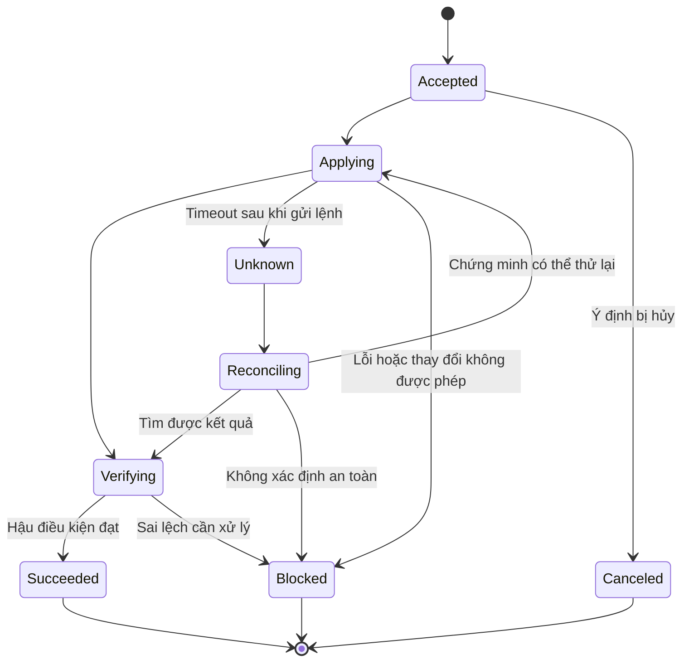

# Idempotent provisioning trong PAM

## 1. Vì sao một lần yêu cầu có thể trở thành nhiều lần cấp quyền?

Trong hệ thống Privileged Access Management (PAM), provisioning là quá trình đưa một yêu cầu đã được phê duyệt thành trạng thái thực tế: đăng ký tài khoản vào vault, gán quyền truy cập safe, thêm tài khoản vào nhóm quản trị, tạo policy hoặc cấp một quyền tạm thời. Automation thường phải phối hợp nhiều thành phần có độ trễ và cơ chế lỗi khác nhau.

Giả sử một workflow gọi API để cấp quyền đọc credential của một tài khoản dịch vụ. PAM đã ghi nhận quyền, nhưng kết nối đứt trước khi workflow nhận phản hồi. Workflow chỉ biết rằng lần gọi bị timeout; nó không biết quyền đã được cấp hay chưa. Nếu gửi lại một lệnh tạo mới, hệ thống có thể tạo thêm một đối tượng, mở thêm một phiên cấp quyền hoặc gia hạn thời gian truy cập.

Idempotent provisioning giải quyết tình huống này bằng cách làm cho việc thực thi lặp lại cùng một ý định không tạo thêm tác động nghiệp vụ ngoài tác động đã được cho phép. Mục tiêu không phải là bảo đảm mạng chỉ chuyển một request, mà là giữ kết quả cấp quyền ổn định khi request, message hoặc lượt reconcile xuất hiện nhiều lần.

Sau bài học, người học có thể:

- Phân biệt idempotence của trạng thái, chống xử lý trùng request và bảo đảm thực thi đúng một lần.
- Thiết kế định danh tài nguyên, idempotency key và bản ghi operation cho một API provisioning.
- Xử lý timeout, thực thi một phần và tranh chấp mà không nhân bản quyền hoặc vô tình mở rộng quyền.
- Bảo vệ TTL, credential và bằng chứng kiểm toán trong vòng đời provisioning của PAM.
- Xây dựng các tình huống kiểm thử thể hiện rằng retry không làm tăng đặc quyền.

## 2. Định nghĩa đúng phạm vi idempotence

### 2.1. Lặp thao tác, giữ nguyên kết quả có ý nghĩa

Với một thao tác F và trạng thái S, cách diễn đạt cơ bản là:

```text
F(F(S)) = F(S)
```

Ví dụ, thao tác “bảo đảm user U có đúng quyền R trên tài nguyên A, đến thời điểm E” phải đưa hệ thống về cùng một trạng thái được quản lý dù chạy một hay nhiều lần. Sau lần đầu thành công, lần sau thường chỉ kiểm tra, trả lại kết quả cũ hoặc ghi nhận rằng không cần thay đổi.

Cần xác định rõ trạng thái nào đang được xét. Một lần retry có thể tạo thêm log hoặc tăng bộ đếm số lần gọi; điều đó không nhất thiết phá vỡ idempotence của provisioning. Ngược lại, tạo thêm một grant, gửi thêm một credential hoặc đặt lại expiry là tác động nghiệp vụ phải được kiểm soát.

Idempotence cũng không có nghĩa rằng mọi lần gọi đều phải trả cùng mã HTTP hoặc cùng timestamp. Một request có thể trả trạng thái đang xử lý, còn lần sau trả kết quả hoàn tất. Điều quan trọng là chúng tham chiếu cùng operation và cùng tác động đã được phê duyệt.

### 2.2. Ba khái niệm cần tách biệt

| Khái niệm | Câu hỏi được trả lời | Giới hạn cần nhớ |
|---|---|---|
| Idempotent operation | Thực hiện lại cùng ý định có tạo thêm thay đổi nghiệp vụ không? | Phải xét toàn bộ tác động cần bảo vệ, kể cả quyền và TTL. |
| Request deduplication | Request này đã được nhận và xử lý trước đó chưa? | Chỉ nhớ request ở tầng vào chưa đủ bảo vệ tác động ở connector. |
| Exactly-once effect | Tác động cụ thể có được áp dụng đúng một lần trong phạm vi đã định không? | Không thể suy ra chỉ từ việc có queue, transaction hoặc idempotency key. |

Ví dụ, API ghi một idempotency key vào database, sau đó gọi connector để tạo user. Nếu connector tạo xong nhưng tiến trình chết trước khi cập nhật database, lớp deduplication vẫn chưa biết kết quả cuối cùng. Khả năng phục hồi phụ thuộc vào cách tìm lại và xác minh tài nguyên ở hệ thống đích.

### 2.3. Những thao tác trông giống nhau nhưng có bản chất khác nhau

| Thao tác | Cách diễn đạt phù hợp cho retry | Điều dễ làm sai |
|---|---|---|
| Tạo tài khoản được PAM quản lý | Bảo đảm tồn tại một tài khoản có định danh và thuộc tính đã xác định. | Tạo tên ngẫu nhiên mới sau mỗi timeout. |
| Gán quyền | Bảo đảm một grant cụ thể tồn tại với scope và expiry cố định. | Thêm grant mới hoặc cộng thêm thời gian sau mỗi lượt chạy. |
| Revoke quyền | Bảo đảm grant đã chỉ định không còn hiệu lực. | Xóa nhầm grant khác chỉ vì tên hoặc role giống nhau. |
| Rotate credential | Thực thi một operation rotation có định danh và theo dõi riêng. | Mỗi retry sinh thêm một mật khẩu khác. |
| Gia hạn quyền | Một ý định mới, có phiên bản và căn cứ phê duyệt mới. | Coi gia hạn là tác dụng phụ của thao tác ensure. |

Vì vậy, một API `ensure account` không nên tự động rotate mật khẩu, mở khóa tài khoản hoặc tái kích hoạt quyền đã bị thu hồi. Các thay đổi có mức độ nhạy cảm khác nhau cần có ý định và điều kiện thực thi riêng.

## 3. Bắt đầu từ ý định và các bất biến bảo mật

### 3.1. Mô tả trạng thái mong muốn

Thay vì yêu cầu mơ hồ “cấp quyền admin cho người này”, một yêu cầu provisioning nên diễn đạt đầy đủ chủ thể, tài nguyên, phạm vi quyền, thời hạn và căn cứ phê duyệt.

Ví dụ minh họa dưới đây là hợp đồng nội bộ giả định, không phải schema của một sản phẩm PAM cụ thể:

```json
{
  "tenantId": "tenant-training",
  "intentId": "intent-2026-0042",
  "intentVersion": 3,
  "principalId": "principal-81",
  "targetId": "database-lab-02",
  "managedGrantId": "grant-0042",
  "role": "credential-reader",
  "permissions": ["credential.checkout"],
  "validFrom": "2026-11-27T02:00:00Z",
  "expiresAt": "2026-11-27T02:30:00Z",
  "approvalId": "approval-0042"
}
```

Các timestamp trong ví dụ dùng UTC và chỉ phục vụ tình huống học tập. Ở hệ thống thực, backend phải kiểm tra yêu cầu với policy và bản phê duyệt có thẩm quyền; không tin ngay `approvalId`, `role` hoặc thời hạn do client gửi.

### 3.2. Những điều phải luôn đúng

Trước khi chọn database hoặc cơ chế khóa, hãy xác định các bất biến:

1. Một ý định cấp quyền chỉ tạo một grant được quản lý cho phạm vi đó.
2. Quyền thực tế không vượt tập quyền đã được phê duyệt cho operation.
3. Retry không làm dịch chuyển `expiresAt` sang thời điểm muộn hơn.
4. Một yêu cầu cũ không phục hồi grant đã bị revoke hoặc thay thế bởi phiên bản mới.
5. Không lộ credential qua request log, kết quả operation hoặc thông báo lỗi.
6. Chỉ automation có thẩm quyền mới được thay đổi đúng tài nguyên thuộc phạm vi quản lý của nó.
7. Mỗi thay đổi có thể truy ngược đến ý định, phê duyệt và bằng chứng xác minh.

Idempotence là một thuộc tính của quy trình vận hành trong những ràng buộc này. Một script không tạo tài khoản trùng nhưng luôn thêm quyền rộng hơn vẫn không phải là provisioning PAM an toàn.

## 4. Ba loại định danh và vai trò khác nhau

### 4.1. Định danh tài nguyên

Định danh tài nguyên trả lời “đây là đối tượng nào”. Nên ưu tiên ID ổn định của hệ thống đích và khóa nghiệp vụ bất biến do hệ thống nguồn quản lý.

Ví dụ, một service account có thể có khóa nguồn gồm tenant, hệ thống đích và ID service account trong inventory. Sau khi tạo thành công, lưu ánh xạ khóa nguồn sang ID thật mà hệ thống đích trả về.

Tên hiển thị như `svc-backup` thường chưa đủ: cùng tên có thể tồn tại ở hai domain; tài khoản cũ có thể đã bị xóa và một tài khoản mới được tạo lại. Khi khôi phục sau timeout, phải xác minh cả định danh, domain hoặc target, thuộc tính sở hữu và dấu vết tương quan được phép sử dụng.

Nếu hệ thống đích hỗ trợ external reference có ràng buộc duy nhất, có thể dùng nó để nhận diện operation hoặc tài nguyên nguồn. Nếu chỉ có trường ghi chú không duy nhất, việc tìm thấy một giá trị giống nhau chưa đủ chứng minh rằng đó là đúng tài nguyên.

### 4.2. Idempotency key

Idempotency key trả lời “đây có phải lần gửi lại của cùng một thao tác không”. Client tạo key trước lần gửi đầu tiên, lưu nó bền vững trong workflow và dùng lại key đó cho mọi retry của cùng ý định.

```text
Cùng ý định + cùng payload nghiệp vụ + cùng phạm vi → dùng lại key
Ý định mới hoặc thay đổi payload nghiệp vụ          → operation/key mới
Timeout                                           → giữ nguyên key
```

Không tạo key ngẫu nhiên mới bên trong mỗi lần retry. Không đưa password, private key hoặc access token vào key. Cũng không dùng duy nhất một tên service account làm key cho mọi thay đổi trong toàn bộ vòng đời của nó: yêu cầu tạo, thay role và revoke là các ý định khác nhau.

Phạm vi duy nhất của key phải được xác định rõ, chẳng hạn `(tenant_id, operation_type, idempotency_key)` trong một API cấp quyền. Ngoài phạm vi đó, bản ghi phải gắn với đúng caller hoặc workflow được ủy quyền. Key không phải bearer token và không tự cấp quyền đọc kết quả của operation.

### 4.3. Correlation ID và operation ID

Correlation ID hỗ trợ lần theo luồng qua các dịch vụ. Operation ID là định danh do backend cấp cho quá trình thực thi và tra cứu trạng thái. Cả hai hữu ích cho quan sát, nhưng không tự ngăn xử lý trùng.

| Định danh | Ví dụ | Không nên dùng thay cho |
|---|---|---|
| Resource ID | `grant-0042` | Idempotency key cho mọi thay đổi tương lai. |
| Idempotency key | `req-73b1...` | Thông tin xác thực hoặc phân quyền. |
| Operation ID | `op-9f2...` | Bằng chứng rằng connector chỉ thực thi một lần. |
| Correlation ID | `trace-f61...` | Khóa duy nhất của grant. |

## 5. Thiết kế hợp đồng API chống xử lý trùng

### 5.1. Nhận request và ràng buộc key với payload

Một API minh họa có thể nhận:

```http
POST /training-api/provisioning/grants
Authorization: Bearer <workload-token>
Idempotency-Key: req-73b1-example
Content-Type: application/json

{
  "intentId": "intent-2026-0042",
  "intentVersion": 3,
  "managedGrantId": "grant-0042",
  "principalId": "principal-81",
  "targetId": "database-lab-02",
  "role": "credential-reader",
  "expiresAt": "2026-11-27T02:30:00Z",
  "approvalId": "approval-0042"
}
```

Server xác thực workload, kiểm tra quyền gọi, tải policy và phê duyệt phù hợp, rồi tạo biểu diễn chuẩn của payload nghiệp vụ. Fingerprint của payload phải bao gồm các thuộc tính ảnh hưởng đến quyền: tenant, chủ thể, target, role, expiry, phiên bản ý định và các ràng buộc liên quan.

Chuẩn hóa cần tuân thủ schema. Có thể bỏ qua khác biệt về khoảng trắng hoặc thứ tự key của JSON; chỉ sắp xếp một danh sách nếu schema xác định nó là một tập hợp không có thứ tự. Không tự gộp `null`, trường vắng mặt và giá trị mặc định nếu chúng mang ý nghĩa khác nhau.

Không nhận fingerprint do client cung cấp rồi tin ngay. Server tự tính và so sánh. Không đưa credential vào payload nếu có thể dùng một tham chiếu an toàn. Với dữ liệu bí mật bắt buộc phải xử lý, không dùng hash thông thường như một cách che giấu giá trị có thể đoán; cần thiết kế lưu trữ, mã hóa và redaction phù hợp.

### 5.2. Quy tắc phản hồi

| Tình huống | Cách xử lý trong hợp đồng minh họa |
|---|---|
| Key chưa tồn tại, yêu cầu hợp lệ | Ghi operation bền vững, trả `202 Accepted` cùng operation ID. |
| Key đã tồn tại, fingerprint giống, đang xử lý | Trả cùng operation ID và trạng thái hiện tại. |
| Key đã tồn tại, fingerprint giống, đã hoàn tất | Trả kết quả an toàn của operation cũ, không tạo grant mới. |
| Key đã tồn tại, fingerprint khác | Trả lỗi xung đột, ví dụ `409 Conflict`; không thực thi payload mới. |
| Caller không được phép truy cập operation | Từ chối theo chính sách API; không tiết lộ dữ liệu của caller khác. |
| Operation cũ không còn được phép thực thi tiếp | Chuyển sang trạng thái phù hợp như canceled hoặc expired; không cấp lại quyền. |

Các mã phản hồi cụ thể phải được tài liệu hóa cho API của tổ chức. Không suy ra rằng mọi API có header idempotency đều dùng cùng mã HTTP hoặc cùng thời gian lưu key.

Replay một kết quả lịch sử không được tạo tác động mới. Nếu quyền đã được cấp rồi bị revoke, kết quả cũ có thể cho biết operation trước đây đã thành công, nhưng không được diễn giải rằng grant hiện vẫn đang có hiệu lực. API tra cứu nên tách trạng thái operation khỏi trạng thái hiện tại của tài nguyên.

### 5.3. GET, PUT và POST không thay thế thiết kế nghiệp vụ

HTTP định nghĩa PUT và DELETE có ngữ nghĩa idempotent đối với tác động mong muốn, nhưng sử dụng tên method đó không tự sửa các tác dụng phụ trong triển khai. Một endpoint PUT âm thầm rotate mật khẩu ở mỗi lần gọi vẫn gây ra vấn đề provisioning.

POST có thể được thiết kế để xử lý lặp an toàn thông qua key và hợp đồng rõ ràng. Với endpoint sử dụng ID tài nguyên do client xác định, PUT có thể biểu đạt việc bảo đảm trạng thái, nhưng vẫn cần bảo vệ tranh chấp, authorization và các bước ở hệ thống đích.

## 6. Lưu operation bền vững và quản lý đồng thời

### 6.1. Những dữ liệu tối thiểu

Bản ghi operation có thể bao gồm:

```text
operation_id
tenant_id
operation_type
idempotency_key
request_fingerprint
intent_id, intent_version
requester_identity, approval_reference
managed_resource_key, target_resource_id
desired_state_reference
state, last_confirmed_step
created_at, updated_at
worker_lease_owner, lease_until, concurrency_version
safe_result_reference, last_error_category
```

`desired_state_reference` trỏ tới dữ liệu được bảo vệ và có phiên bản; `safe_result_reference` không chứa plaintext credential. Tổ chức cần giới hạn quyền đọc bản ghi operation và áp dụng chính sách lưu bằng chứng phù hợp.

Ràng buộc duy nhất trong kho dữ liệu phải bảo vệ phạm vi idempotency key. Nếu có hai request cùng đến, không dùng chuỗi thao tác đơn giản “SELECT không thấy rồi INSERT” mà thiếu unique constraint hoặc cơ chế tương đương. Cả hai request có thể cùng nhìn thấy trạng thái chưa tồn tại.

### 6.2. Một operation chỉ có một chủ sở hữu thực thi hợp lệ

Worker lấy ownership bằng thao tác nguyên tử, ví dụ cập nhật có điều kiện dựa trên phiên bản. Lease có thời hạn giúp phục hồi khi worker chết, nhưng cũng tạo tình huống worker cũ chạy tiếp sau khi lease hết hạn.

Nếu dùng fencing token, hệ thống nhận lệnh phải thực sự kiểm tra token hoặc phiên bản để từ chối lệnh cũ. Chỉ tăng token ở database nội bộ không ngăn một connector bên ngoài tiếp tục áp dụng request đã gửi.

Với hệ thống đích không hỗ trợ token, conditional update hoặc ràng buộc duy nhất phù hợp, cần thiết kế thực thi tuần tự theo tài nguyên, cơ chế khôi phục và xử lý kết quả không chắc chắn. Không tuyên bố đã loại bỏ mọi race chỉ vì có distributed lock.

Các ý định khác nhau cùng sửa một tài nguyên cũng cần kiểm soát cạnh tranh. Deduplication theo key chỉ gộp các lần gửi lại của cùng ý định; nó không giải quyết xung đột giữa yêu cầu cấp quyền phiên bản 3 và revoke phiên bản 4.

### 6.3. Luồng xử lý khái quát

Đoạn dưới là pseudocode mô tả luồng, không phải chương trình có thể chạy trực tiếp:

```text
handleProvision(request, caller):
    authenticate(caller)
    authorizeRequestScope(caller, request)
    validateSchema(request)
    intent = loadAndValidateApprovedIntent(request)
    fingerprint = fingerprintOfCanonicalBusinessPayload(intent)

    operation = atomicInsertOrLoadByScopedKey(
        request.idempotencyKey, fingerprint, intent
    )

    authorizeOperationAccess(caller, operation)
    if operation.fingerprint != fingerprint:
        return CONFLICT
    if operation.isTerminal:
        return safeHistoricalResult(operation)

    scheduleDurably(operation.id)
    return ACCEPTED(operation.id)

execute(operation):
    ownership = acquireExecutionOwnership(operation)
    validateIntentStillApplicable(operation.intentVersion)
    observeTargetStateWithoutMutation()
    plan = computeChangesWithinManagedScope()
    applyWithRecoveryEvidence(plan, ownership)
    observeTargetStateAgain()
    if approvedPostconditionsHold():
        persistVerifiedSuccess()
    else:
        persistRecoverableOrBlockedState()
```

Lần kiểm tra trước khi thực thi phải xét ý định còn hiệu lực, chưa hết hạn và chưa bị thay thế. Bản ghi authorization lúc tiếp nhận rất cần cho audit, nhưng không đủ để cho một job nằm trong queue nhiều giờ tiếp tục cấp quyền đã bị hủy.

## 7. State machine và phục hồi sau timeout

### 7.1. Phân biệt đang thực thi và không biết kết quả

Một mô hình trạng thái minh họa:



Sơ đồ chỉ minh họa một operation. Việc revoke sau khi cấp thành công thường là một operation khác, liên kết với grant và phiên bản ý định tương ứng.

`Unknown` không đồng nghĩa `Failed`. Khi không nhận được response, thao tác có thể chưa đến đích, đang xử lý hoặc đã hoàn tất. Nếu xử lý mọi timeout bằng cách tạo lại tài nguyên, workflow có thể nhân bản tài khoản hoặc quyền.

### 7.2. Bốn điểm lỗi thường gặp

| Điểm lỗi | Bằng chứng còn lại | Hướng phục hồi |
|---|---|---|
| Chết trước khi lưu operation | Không có operation và chưa gửi lệnh đích. | Tiếp nhận lại bằng cùng key. |
| Đã lưu operation, chưa gọi connector | Có ý định bền vững và chưa có bước gửi lệnh. | Worker mới lấy ownership và tiếp tục. |
| Connector đã xử lý, response bị mất | Có bước đã gửi; kết quả đích chưa được xác nhận. | Tra cứu, đối soát theo định danh ổn định trước khi thay đổi tiếp. |
| Đã xác minh đích, chưa ghi success | Tài nguyên và bằng chứng có thể đã tồn tại. | Đọc lại đích, xác minh hậu điều kiện rồi hoàn tất cùng operation. |

Không luôn có thể phân biệt chính xác “chưa gửi” và “đã gửi nhưng chưa ghi checkpoint” nếu việc ghi log với gửi request không nằm trong cùng một transaction. Mô hình phục hồi phải chấp nhận khoảng trống này và dựa vào đối soát hoặc khả năng idempotent của bên nhận.

### 7.3. Kết quả đích cần được xác minh

Ví dụ, sau lỗi khi tạo account, connector tìm thấy một tài khoản cùng tên. Chưa thể coi là thành công. Cần kiểm tra đúng target, đúng ID nguồn hoặc external reference đáng tin cậy, đúng loại tài khoản và quyền sở hữu.

Nếu có nhiều ứng viên hoặc một tài khoản không thuộc automation, chuyển sang trạng thái cần xử lý. Không tự nhận quản lý đối tượng chỉ vì tên giống với tài khoản mong muốn.

Khi kiểm tra quyền, cũng không chỉ nhìn HTTP 200. Hậu điều kiện có thể gồm đúng principal, đúng role, đúng scope, đúng expiry và không có quyền bổ sung do chính operation tạo ra. Nếu API đích có độ trễ đồng bộ, dùng polling có giới hạn và trạng thái đang xác minh; không cấp thêm chỉ vì lượt đọc đầu chưa thấy thay đổi.

## 8. Reconciliation: so sánh trạng thái rồi áp dụng delta

### 8.1. Bốn bước của một vòng reconcile

Một vòng reconcile an toàn gồm:

1. Tải ý định mới nhất có thẩm quyền và kiểm tra phiên bản.
2. Đọc trạng thái hiện tại cùng metadata sở hữu.
3. Tính chênh lệch trong đúng phạm vi automation quản lý.
4. Áp dụng thay đổi có điều kiện, đọc lại và ghi bằng chứng.

Ví dụ, một grant cần tập quyền D, còn tập quyền hiện tại mà automation thực sự sở hữu là A. Khi policy cho phép reconcile chính xác tập quyền của grant đó:

```text
Quyền cần thêm = D trừ A
Quyền cần bỏ  = A trừ D
```

Phép tính này chỉ áp dụng cho phạm vi được quản lý. Không lấy toàn bộ quyền của user trên hệ thống đích làm A rồi xóa mọi thứ không nằm trong D; user có thể đang có các grant hợp lệ từ workflow khác.

Ngược lại, nếu phát hiện tài nguyên có đặc quyền rộng hơn mong đợi mà không xác định được ownership, không bỏ qua sai lệch để báo success. Ghi nhận drift và xử lý theo chính sách. Kết quả “grant của operation đã đúng” khác với kết luận “user không có quyền nào khác”.

### 8.2. Create-if-absent chưa đủ

Kiểu xử lý sau có thể sinh duplicate:

```text
Worker A: GET account → không thấy
Worker B: GET account → không thấy
Worker A: CREATE account
Worker B: CREATE account
```

Có thể kết hợp nhiều biện pháp theo khả năng thực tế: ràng buộc duy nhất ở đích, external ID ổn định, conditional create, khóa theo tài nguyên và xử lý conflict bằng cách đọc lại. Nếu bên đích không cung cấp cách nhận diện kết quả đủ chắc chắn, việc tạo tự động sau kết quả không rõ cần được giới hạn hoặc chuyển sang xử lý có kiểm soát.

### 8.3. Cẩn thận với merge và replace

API patch theo kiểu “thêm role này” có thể giữ lại các quyền cũ quá rộng. API replace toàn bộ danh sách role có thể xóa nhầm quyền thuộc workflow khác. Trước khi triển khai, cần xác định field nào do automation sở hữu, endpoint nào có điều kiện phiên bản và việc thay role có yêu cầu phê duyệt lại hay không.

Đối với tài nguyên dùng chung, một mô hình grant riêng theo intent thường dễ theo dõi hơn việc nhiều workflow cùng sửa một danh sách quyền không có dấu vết sở hữu.

## 9. TTL, JIT và chống phục hồi quyền cũ

### 9.1. Expiry phải gắn với ý định

Mẫu dễ gây mở rộng quyền:

```text
Mỗi lần chạy: expiresAt = thời điểm hiện tại + 30 phút
```

Nếu retry sau 20 phút, thời hạn bị lùi thêm 20 phút. Một job chạy định kỳ có thể khiến quyền không bao giờ hết hạn.

Mẫu phù hợp cho một grant đã phê duyệt:

```text
Lúc chấp nhận ý định: chốt expiresAt theo policy và phê duyệt
Mọi retry: dùng lại expiresAt đã chốt
Nếu expiresAt đã qua: không cấp quyền; ghi nhận expired
Muốn gia hạn: tạo ý định mới và kiểm tra quyền/phê duyệt tương ứng
```

Expiry còn phải được thực thi ở lớp thích hợp. Một timestamp trong database không tự thu hồi membership đã được ghi vào directory. Nếu đích hỗ trợ hết hạn native, phải xác minh cấu hình đó. Nếu cần job revoke, phải có theo dõi và cảnh báo khi job không hoàn tất.

### 9.2. Phiên bản, revoke và tombstone

Giả sử intent phiên bản 3 cấp quyền, nhưng phiên bản 4 đã revoke. Một message cũ của phiên bản 3 được queue chuyển lại sau đó. Nếu worker chỉ thấy grant không còn tồn tại và thực hiện create-if-absent, quyền đã thu hồi sẽ sống lại.

Cần kiểm tra phiên bản hiện hành và trạng thái vòng đời trước khi thay đổi. Có thể giữ tombstone hoặc bản ghi thu hồi đủ lâu để biết rằng việc vắng mặt là kết quả mong muốn, không phải tài nguyên cần tạo lại.

Tombstone không thay thế kiểm soát đồng thời: worker đang thực thi phiên bản cũ cũng phải bị ngăn ghi tiếp bằng điều kiện phiên bản, cơ chế tuần tự hóa hoặc khả năng từ chối lệnh cũ ở đích. Với connector thiếu các khả năng đó, phải mô tả giới hạn và có quy trình xử lý cuộc đua cấp/revoke.

### 9.3. Revoke không đồng nghĩa mọi quyền đang dùng đã biến mất

Xóa grant có thể ngăn truy cập mới nhưng chưa kết thúc session hoặc token đã được phát hành. Hợp đồng revoke phải xác định rõ phạm vi: bỏ membership, thu hồi lease, vô hiệu credential, kết thúc session hay phối hợp nhiều bước.

Retry của revoke cũng phải an toàn: nếu đúng grant đã vắng mặt thì có thể đạt hậu điều kiện, nhưng lỗi không có quyền đọc hoặc connector không hoạt động không được diễn giải thành “đã revoke”.

## 10. Provisioning nhiều bước và credential nhạy cảm

### 10.1. Checkpoint theo bước

Một luồng onboarding tài khoản có thể gồm:

```text
A. Tạo hoặc nhận diện account trên target
B. Đăng ký account vào vault
C. Gắn policy rotation
D. Tạo grant truy cập theo phê duyệt
E. Xác minh và ghi bằng chứng
```

Không nên coi năm bước này là một transaction nguyên tử nếu chúng thuộc nhiều hệ thống. Mỗi bước cần định danh ổn định, hậu điều kiện và thông tin phục hồi riêng.

Nếu bước C lỗi, retry phải nhận diện account và vault entry ở A, B, không tạo thêm account mới. Nếu bước D là bước làm lộ khả năng truy cập cho người dùng, có thể thiết kế chỉ thực hiện sau khi các điều kiện bảo vệ cần thiết đã được xác minh.

### 10.2. Compensation phải dựa trên ownership

Không phải mọi lỗi đều nên rollback bằng cách xóa tất cả. Một account có thể đã được dùng bởi dịch vụ, hoặc tồn tại trước operation. Xóa nó có thể gây gián đoạn ngoài phạm vi provisioning.

Compensation chỉ tác động tới tài nguyên và thay đổi mà operation có quyền sở hữu hoặc được phép xử lý. Với thay đổi khó đảo ngược, hệ thống có thể giữ trạng thái chưa hoàn tất, hạn chế quyền truy cập, cảnh báo và tiếp tục phục hồi có kiểm soát.

Chính lệnh compensation cũng cần xử lý lặp an toàn. Không giả định một lần gọi cleanup sẽ thành công, cũng không coi lỗi cleanup là đã khôi phục an toàn.

### 10.3. Không sinh lại secret khi mất response

Tình huống đặc biệt nguy hiểm:

```text
1. Sinh credential A.
2. Cập nhật account trên target bằng A.
3. Kết nối lỗi trước khi vault ghi nhận A.
4. Retry sinh credential B nhưng không biết target đang dùng A hay B.
```

Đây là vấn đề phối hợp credential và trạng thái, không chỉ là tạo trùng tài khoản. Luồng cần được thiết kế theo khả năng của target và vault: dùng operation rotation riêng, lưu ứng viên credential trong vùng được bảo vệ khi phù hợp, theo dõi bước áp dụng và xác minh rồi mới công bố phiên bản credential hợp lệ.

Nếu không thể phục hồi thông tin cần thiết một cách an toàn, phải chuyển sang quy trình khắc phục hoặc rotation có kiểm soát. Không báo success dựa trên việc đã lưu metadata.

Kết quả idempotent thường trả resource ID, operation ID hoặc secret reference được phân quyền, thay vì lưu plaintext secret để phát lại response. Nếu sản phẩm có cơ chế secret chỉ hiển thị một lần, cần một giao thức bàn giao riêng cho tình huống client mất response; không âm thầm sinh secret mới mỗi khi client retry.

### 10.4. Transactional outbox bảo vệ điều gì?

Outbox có thể giúp việc ghi operation vào database và ghi message cần phát đi nằm trong cùng transaction, tránh tình trạng đã chấp nhận yêu cầu nhưng quên phát job. Tuy nhiên, publisher có thể phát lại message sau lỗi xác nhận.

Consumer vẫn cần deduplication hoặc reconcile. Outbox không tự biến việc gọi connector bên ngoài thành một tác động đúng một lần, và không giải quyết việc secret đã thay trên target nhưng vault chưa đồng bộ.

## 11. Retry có giới hạn và phân loại lỗi

Một chính sách retry nên phân biệt các nhóm sau:

| Nhóm tình huống | Ví dụ | Hành động |
|---|---|---|
| Tạm thời, kết quả đích chưa thay đổi hoặc có thể xác định | Rate limit, dịch vụ tạm bận. | Theo hợp đồng API, backoff có giới hạn và dùng lại key. |
| Kết quả không rõ | Timeout sau khi đã gửi lệnh tạo grant. | Đối soát trước; chỉ thử lại khi cơ chế phục hồi cho phép. |
| Dữ liệu hoặc phê duyệt không hợp lệ | Role không được phép, approval đã hết hạn. | Kết thúc hoặc block, không retry vô hạn. |
| Xung đột cùng key | Key cũ nhưng payload khác. | Trả conflict và yêu cầu ý định hợp lệ khác. |
| Xung đột tài nguyên hoặc phiên bản | Tài nguyên đã bị workflow khác thay đổi. | Tải trạng thái mới, đánh giá lại hoặc block. |
| Xác thực hoặc phân quyền | Workload không được phép thay target. | Xử lý nguyên nhân; không tăng quyền tự động để vượt lỗi. |

Áp dụng exponential backoff và jitter khi phù hợp, có số lần thử hoặc thời gian tối đa, và tôn trọng chỉ dẫn retry của API đích nếu hợp đồng có quy định. Những lựa chọn này giảm áp lực lên hệ thống nhưng không thay thế idempotence.

Deadline của retry cũng phải xét expiry của intent. Nếu grant chỉ còn vài giây hiệu lực mà đích đang lỗi kéo dài, việc tiếp tục cấp sau khi quyền đã hết hạn là sai về nghiệp vụ.

Khi hết thời gian đối soát, giữ trạng thái rõ ràng như `BLOCKED` hoặc `NEEDS_RECONCILIATION`. Không sửa thành success để làm sạch queue và cũng không xóa key rồi gửi lại như một operation hoàn toàn mới.

## 12. Thời gian lưu key và replay muộn

Thời gian lưu idempotency record phải xét khoảng retry của client, thời gian queue giữ hoặc phát lại message, thời gian workflow phục hồi và yêu cầu lưu bằng chứng. Không có một con số cố định đúng cho mọi hệ thống.

Khi bản ghi deduplication đã bị xóa, một request cũ có thể bị coi là mới. Vì vậy, tài nguyên vẫn cần định danh bền vững, kiểm tra intent/version, ràng buộc duy nhất và dữ liệu vòng đời như tombstone khi cần.

Tách hai nhu cầu: lưu dữ liệu nóng để chống request trùng và lưu bằng chứng audit trong thời gian dài. Có thể không giữ toàn bộ response trong kho nóng, nhưng vẫn cần thông tin đủ để phục hồi và chứng minh thay đổi mà không lộ credential.

Không cho rằng idempotency key là cơ chế chống replay bảo mật đầy đủ. Xác thực workload, giới hạn audience và scope của token, kiểm tra thẩm quyền và trạng thái ý định vẫn cần được thực hiện. Một key bị lộ không được trở thành đường truy cập vào secret hoặc kết quả của tenant khác.

## 13. Audit và quan sát vận hành

### 13.1. Bằng chứng nên ghi

Mỗi operation nên có thể trả lời: ai hoặc workload nào yêu cầu, dựa trên phê duyệt nào, muốn thay đổi gì, đã gửi lệnh gì, hệ thống đích xác nhận ra sao, quyền thực tế sau cùng là gì và ai xử lý khi bị block.

Thông tin hữu ích gồm operation ID, intent/version, resource ID, tham chiếu phê duyệt, timestamps, bước xử lý, số lần retry, kết quả đối soát và thay đổi trước/sau đã được lọc dữ liệu nhạy cảm.

Có thể phân biệt các event như:

```text
PROVISION_REQUEST_ACCEPTED
DUPLICATE_REQUEST_OBSERVED
TARGET_COMMAND_DISPATCHED
TARGET_OUTCOME_UNKNOWN
RECONCILIATION_MATCHED
PROVISION_POSTCONDITION_VERIFIED
PROVISION_BLOCKED
```

Ghi thêm event cho một request trùng không có nghĩa phải tạo lại tác động đích. Với số lượng retry lớn, cần cách tổng hợp phù hợp để vẫn truy vết được mà không làm ngập log.

### 13.2. Những chỉ số cần đọc cùng nhau

- Tỷ lệ request trùng và số operation thực sự tạo mới.
- Số operation có kết quả đích không rõ và thời gian ở trạng thái đó.
- Số xung đột key/payload và xung đột phiên bản tài nguyên.
- Số grant tạo trùng, grant quá hạn nhưng còn hiệu lực và sai lệch đặc quyền.
- Thời gian từ tiếp nhận đến xác minh hậu điều kiện.
- Tỷ lệ revoke chưa hoàn tất hoặc credential chưa đồng bộ.

Đừng chỉ theo dõi tỷ lệ HTTP thành công. Một hệ thống luôn trả 200 nhưng để lại grant quá hạn hoặc không xác minh scope vẫn có thể đang vận hành sai.

Không log Authorization header, plaintext password, private key, token checkout hoặc nội dung secret. Kết quả API tra cứu operation cần có authorization và redaction tương tự các API quản trị khác.

## 14. Tình huống xuyên suốt: timeout khi cấp quyền checkout

### Bối cảnh

Một workload được phê duyệt để cấp cho principal `principal-81` quyền checkout credential của `database-lab-02`, với grant `grant-0042` hết hạn lúc 02:30 UTC. Backend đã chấp nhận intent phiên bản 3 và key `req-73b1-example`.

### Diễn tiến và cách xử lý

| Thời điểm | Sự kiện | Quyết định đúng |
|---|---|---|
| 02:00 | Request đầu đến. | Ghi operation cùng fingerprint và expiry cố định. |
| 02:01 | Connector tạo grant nhưng response bị mất. | Chuyển sang kết quả không rõ; chưa ghi success. |
| 02:02 | Client gửi lại cùng key và payload. | Trả cùng operation ID; không tạo execution độc lập. |
| 02:03 | Worker phục hồi tìm thấy grant theo ID ổn định. | Xác minh principal, target, scope, ownership và expiry 02:30. |
| 02:04 | Hậu điều kiện đạt. | Hoàn tất operation, lưu bằng chứng đã đối soát. |
| 02:10 | Client gửi key cũ với role rộng hơn. | Từ chối xung đột payload, không sửa grant. |
| 02:15 | Có ý định revoke phiên bản 4. | Thu hồi theo operation mới và ngăn phiên bản 3 cấp lại. |
| 02:20 | Message cũ phiên bản 3 xuất hiện. | Nhận biết ý định đã bị thay thế; không tái tạo grant. |

Nếu backend chỉ tìm bằng tên hoặc đặt expiry bằng `now + 30 phút`, tình huống 02:03 có thể tạo sai quyền hoặc kéo dài quyền đến 02:33. Một retry tưởng như thành công đã làm thay đổi ranh giới được phê duyệt.

Nếu không tìm thấy grant ngay do độ trễ đọc, worker không nên lập tức tạo lại. Nó cần thực hiện bước đối soát có giới hạn, dùng khả năng nhận diện hoặc chống trùng của đích, rồi mới quyết định có đủ bằng chứng để thử lại hay phải block.

## 15. Kiểm thử tính idempotent theo tác động nghiệp vụ

Kiểm thử cần quan sát trạng thái đích và bằng chứng, không chỉ so sánh response body. Có thể dùng fake connector trong môi trường thử nghiệm để chủ động làm rơi response, làm chậm đọc hoặc mô phỏng lỗi giữa các checkpoint.

| Ca kiểm thử | Hành động | Điều cần chứng minh |
|---|---|---|
| Retry tuần tự | Gửi cùng key và payload nhiều lần. | Một operation, một grant, expiry không đổi. |
| Retry đồng thời | Gửi đồng thời nhiều request cùng key. | Unique constraint và ownership ngăn thực thi không kiểm soát. |
| Key bị tái sử dụng sai | Giữ key, thay target hoặc role. | Conflict; không thay đổi tài nguyên. |
| Chết sau khi đích xử lý | Tạo grant thành công rồi ngắt trước checkpoint. | Worker đối soát được, không tạo grant mới. |
| Đọc có độ trễ | Đích chưa hiển thị grant ngay sau tạo. | Không cấp trùng; kết thúc ở verified hoặc trạng thái block rõ ràng. |
| Intent hết hạn trong queue | Cho worker chạy sau expiry. | Không tạo quyền đã hết hạn. |
| Revoke rồi replay | Cấp phiên bản 3, revoke phiên bản 4, phát lại phiên bản 3. | Quyền không sống lại. |
| Tài nguyên cùng tên, khác chủ | Cho tồn tại account khác có tên giống. | Không nhận ownership hoặc sửa account đó. |
| Mất response chứa secret | Mô phỏng lỗi bàn giao credential. | Không sinh hoặc phát lại secret ngoài giao thức đã thiết kế. |
| Key hết thời gian lưu | Phát lại request cũ sau khi xóa cache deduplication. | Kiểm tra vòng đời và định danh đích vẫn ngăn tác động sai. |
| Grant vượt scope | Đích trả quyền rộng hơn mong đợi. | Không đánh dấu success mà bỏ qua sai lệch. |
| Caller khác tra cứu operation | Gửi key hoặc operation ID của workload khác. | Không đọc được kết quả ngoài quyền được cấp. |

Với phép thử retry, hãy giữ cùng ý định và các điều kiện có liên quan; thời gian vẫn trôi và có thể xuất hiện intent mới, vì vậy cần kiểm tra riêng trường hợp expiry hoặc revoke thay đổi trạng thái hợp lệ.

Một tiêu chí quan trọng là quyền không tăng qua các lượt retry: số grant không tăng, scope không rộng hơn, expiry không muộn hơn và credential không bị rotate thêm ngoài operation đã định.

## 16. Các mẫu thiết kế nên tránh

| Mẫu dễ gặp | Vì sao có vấn đề | Cách thiết kế phù hợp hơn |
|---|---|---|
| Tạo UUID mới ở mỗi vòng retry | Backend coi mỗi lần gửi là ý định mới. | Tạo và lưu key trước lần gửi đầu tiên. |
| Ghi success ngay sau HTTP 200 | Response chưa chứng minh đúng quyền và expiry. | Đọc lại, xác minh hậu điều kiện theo khả năng đích. |
| Xóa key khi gặp timeout | Mất khả năng liên kết với tác động đã xảy ra. | Giữ operation và đối soát kết quả không rõ. |
| Luôn cộng TTL từ hiện tại | Retry có thể duy trì quyền vô thời hạn. | Lưu expiry tuyệt đối theo ý định được phê duyệt. |
| Ensure account đồng thời rotate secret | Lặp lại có thể đổi credential nhiều lần. | Tách rotation thành operation có trạng thái riêng. |
| Dùng display name để nhận tài nguyên | Có thể nhận nhầm account hoặc grant. | Dùng ID ổn định và xác minh ownership. |
| Khóa nội bộ rồi tin đích không thể race | Worker cũ hoặc lệnh đã gửi có thể tiếp tục. | Dùng conditional write/fencing thực sự khi hỗ trợ và đối soát khi phục hồi. |
| Reconcile toàn bộ quyền của user | Có thể xóa grant hợp lệ thuộc hệ thống khác. | Giới hạn ở grant và field được quản lý. |
| Retry mọi lỗi vô hạn | Giữ job cũ chạy sau hủy hoặc hết hạn. | Phân loại lỗi, đặt deadline và kiểm tra intent mới nhất. |
| Lưu secret trong response cache | Mở thêm bề mặt lộ credential. | Lưu kết quả an toàn và tham chiếu được phân quyền. |

## 17. Bài tập thiết kế

Thiết kế một workflow onboarding service account vào PAM và cấp quyền checkout cho một workload trong 20 phút. API đích có ID tài khoản ổn định nhưng không hỗ trợ idempotency key; API tạo account có thể timeout sau khi đã tạo thành công.

Hãy xác định:

1. Khóa nghiệp vụ cho account, khóa cho grant và phạm vi idempotency key ở lớp API nội bộ.
2. Các field nghiệp vụ phải nằm trong fingerprint, bao gồm expiry và phiên bản intent.
3. Bằng chứng nào đủ để nhận diện account được tạo trước timeout; khi nào phải block.
4. Các checkpoint giữa tạo account, đăng ký vault, gắn policy và cấp grant.
5. Cách bảo đảm retry không gia hạn quyền, không rotate lại credential và không cấp lại sau revoke.
6. Dữ liệu audit có thể lưu mà không chứa plaintext secret.
7. Những trường hợp có thể tự phục hồi và những trường hợp cần vận hành can thiệp.

Một thiết kế hợp lý phải nhận ra giới hạn của đích: ID ổn định chỉ hữu ích sau khi tìm được đúng tài nguyên. Nếu không thể phân biệt tài khoản do operation tạo với một tài khoản khác, không có idempotency key phía client nào tự giải quyết được khoảng trống đó.

Điểm cốt lõi của idempotent provisioning trong PAM là giữ một ý định được phê duyệt ổn định qua các lần thực thi: đúng tài nguyên, đúng quyền, đúng thời hạn và đủ bằng chứng xác minh. Chống request trùng, quản lý trạng thái và reconcile phải phối hợp để retry không trở thành một lần cấp thêm đặc quyền.
