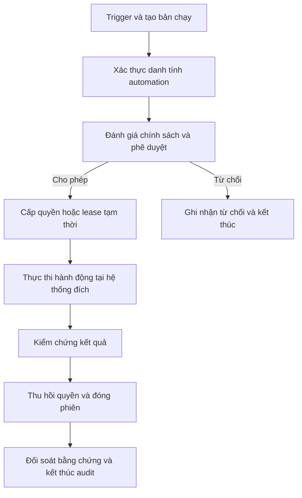

# Automation audit trong PAM

## 1. Mục tiêu của bài học

Automation giúp kiểm kê tài khoản, cấp quyền tạm thời, lấy credential từ vault, xoay vòng mật khẩu và thu hồi quyền với tốc độ lớn. Trong Privileged Access Management (PAM), một lỗi nhỏ trong automation cũng có thể tác động đồng thời tới nhiều tài khoản quản trị hoặc nhiều hệ thống nhạy cảm. Vì vậy, tự động hóa phải đi kèm khả năng giải thích và kiểm chứng hành động.

**Automation audit** là việc ghi nhận, bảo vệ, liên kết và kiểm tra bằng chứng về các quyết định và hành động của automation có liên quan tới đặc quyền. Một cuộc điều tra cần trả lời được:

- Ai hoặc cơ chế nào khởi tạo công việc? Automation thực thi bằng danh tính nào?
- Quyền nào được yêu cầu, được phê duyệt và thực sự được sử dụng?
- Chính sách và điều kiện nào cho phép hành động tại thời điểm đó?
- Automation đã thay đổi gì trên hệ thống đích? Điều gì thất bại hoặc chưa biết kết quả?
- Quyền, phiên và credential tạm thời có được xử lý khi công việc kết thúc?
- Bằng chứng có đủ, còn toàn vẹn và truy cập được trong phạm vi được phép không?

Sau bài học, người học có thể thiết kế chuỗi sự kiện audit cho một workflow PAM, xây dựng hợp đồng dữ liệu sự kiện, phân biệt audit với log vận hành, đặt điều kiện xử lý khi mất audit và thực hiện đối soát bằng chứng giữa nhiều hệ thống.

Phạm vi ở đây là audit cho automation có đặc quyền. Một job chạy thành công hoặc một dashboard màu xanh chưa đủ chứng minh rằng quyền đã được cấp đúng, sử dụng đúng và thu hồi đúng.

## 2. Audit khác log vận hành như thế nào?

Log vận hành giúp người phát triển và vận hành tìm lỗi: request mất bao lâu, có bao nhiêu lần retry, kết nối nào timeout. Audit giúp truy trách nhiệm và kiểm tra việc sử dụng quyền: chủ thể nào thực hiện hành động gì, dựa trên quyết định nào, tác động tới đối tượng nào và kết quả được xác nhận ở đâu.

Hai loại dữ liệu có thể dùng chung hạ tầng thu thập, nhưng cần phân biệt mục đích, mức bảo vệ và vòng đời.

| Khía cạnh | Log vận hành | Dữ liệu audit cho PAM |
|---|---|---|
| Câu hỏi chính | Vì sao job chậm hoặc lỗi? | Ai được phép làm gì và đã thực sự làm gì? |
| Nội dung trọng tâm | Stack trace, latency, trạng thái thành phần | Chủ thể, đối tượng, quyết định quyền, bằng chứng kết quả |
| Tần suất ghi | Có thể giảm chi tiết theo cấu hình | Các sự kiện kiểm soát trọng yếu phải có cơ chế bảo đảm phù hợp |
| Sampling | Có thể phù hợp cho chẩn đoán | Không nên sampling các sự kiện cấp, dùng, từ chối và thu hồi đặc quyền cần kiểm toán |
| Dữ liệu nhạy cảm | Vẫn phải kiểm soát | Phải ngăn lộ credential, token, nội dung bí mật và thông tin không cần thiết |
| Sửa hoặc xóa | Theo chính sách vận hành | Cần kiểm soát chặt quyền sửa, xóa, thời hạn lưu và ngoại lệ điều tra |
| Bằng chứng hoàn tất | Thành phần trả về thành công | Có thể cần thêm xác nhận độc lập từ PAM và hệ thống đích |

Một log như sau có ích cho vận hành nhưng yếu cho audit:

```text
rotation job finished successfully
```

Nó không cho biết tài khoản nào đã được xoay vòng, bản chạy nào, phiên bản automation nào, ai phê duyệt, việc cập nhật ở đích đã được kiểm chứng chưa và các quyền tạm thời đã hết hiệu lực chưa.

Ngược lại, ghi toàn bộ HTTP request và response để “đủ audit” có thể làm lộ token, mật khẩu mới và dữ liệu cá nhân. Đủ bằng chứng không đồng nghĩa với sao chép mọi dữ liệu.

## 3. Bắt đầu từ mô hình trách nhiệm và ranh giới tin cậy

Một workflow automation có thể liên quan tới nhiều chủ thể:

1. **Người hoặc sự kiện khởi tạo**: kỹ sư gửi yêu cầu, lịch chạy được cấu hình trước hoặc một hệ thống phát sự kiện.
2. **Chủ sở hữu automation**: đội chịu trách nhiệm mục đích, mã nguồn, cấu hình và xử lý sự cố.
3. **Danh tính thực thi**: workload identity hoặc service account mà automation dùng để xác thực.
4. **Bên ra quyết định**: policy engine, người duyệt hoặc cơ chế phê duyệt tự động.
5. **Dịch vụ cấp quyền**: PAM tạo lease, grant, phiên hoặc credential tạm thời.
6. **Hệ thống đích**: nơi lệnh được thực thi hoặc trạng thái thực sự thay đổi.
7. **Hệ thống giữ bằng chứng**: nơi nhận, lưu, bảo vệ và cung cấp dữ liệu audit.

Các vai trò này không nhất thiết là bảy sản phẩm riêng. Tuy nhiên, thiết kế phải xác định nguồn nào có thẩm quyền xác nhận từng thông tin.

Ví dụ, automation biết nó đã gửi lệnh tạo tài khoản; hệ thống đích mới là nguồn xác nhận tài khoản đã tồn tại. Policy engine biết nó đã cho phép một tập thao tác; audit ở đích giúp xác minh automation có làm thêm việc khác hay không.

### 3.1. Không gộp người khởi tạo với danh tính máy

Giả sử Lan yêu cầu workflow bảo trì cơ sở dữ liệu. Workflow chạy bằng danh tính máy `wi-maintenance-prod`. Audit cần giữ cả hai, nhưng không được ghi mọi hành động như thể Lan trực tiếp đăng nhập máy chủ.

```text
initiator: user:lan
executor: workload:wi-maintenance-prod
workflow_owner: team:database-platform
approval_authority: policy:approved-maintenance-window
```

Nếu công việc chạy theo lịch, không được tạo ra một người khởi tạo giả. Hãy ghi rõ loại trigger, mã lịch, chủ sở hữu lịch và phiên bản cấu hình đã được sử dụng. Có thể liên kết tới người đã thay đổi lịch gần nhất qua sự kiện quản trị riêng.

### 3.2. Trường do client gửi không tự trở thành danh tính đáng tin

Các header như `X-User`, `X-Run-Id` hoặc trường `requested_by` có thể hữu ích để liên kết, nhưng không được mặc nhiên dùng làm bằng chứng xác thực.

Danh tính nên được rút ra từ cơ chế xác thực mà dịch vụ thực sự kiểm tra. Nếu có ủy quyền, cần ghi rõ chủ thể được xác thực, bên được đại diện và nguồn xác nhận quan hệ ủy quyền. Trường do client tự khai phải được phân biệt với trường do dịch vụ xác minh.

Một correlation ID không phải chứng cứ rằng hai sự kiện có cùng người thực hiện. Nó chỉ là khóa liên kết, cần được đánh giá cùng nguồn phát, danh tính và thời gian.

## 4. Xây chuỗi bằng chứng theo vòng đời đặc quyền

Audit hữu ích khi các sự kiện tạo thành một chuỗi có thể truy ngược, thay vì một tập log rời rạc.



Đây là mô hình khái niệm. Một workflow thực tế có thể có nhiều hành động, nhiều lease và các bước bù trừ. Khi lỗi xảy ra, đường đi tới thu hồi quyền vẫn phải tồn tại; không chỉ đặt cleanup ở nhánh thành công.

### 4.1. Những nhóm sự kiện cần xem xét

| Giai đoạn | Ví dụ sự kiện | Bằng chứng cần có |
|---|---|---|
| Khởi tạo | Run created, schedule triggered | Run ID, trigger, workflow, chủ sở hữu, phiên bản |
| Xác thực | Authentication accepted hoặc denied | Danh tính được xác minh, phương thức, nguồn, lý do từ chối an toàn |
| Quyết định | Policy evaluated, approval recorded | Policy/version, quyết định, phạm vi, điều kiện, người hoặc cơ chế duyệt |
| Cấp quyền | Grant issued, lease created | Grant ID, target, quyền, thời điểm hết hạn, liên kết quyết định |
| Thực thi | Action requested, action observed | Action ID, target, thao tác, danh tính thực thi, kết quả ở từng nguồn |
| Credential | Secret accessed, credential rotated | Tham chiếu bí mật an toàn, phiên bản không nhạy cảm, mục đích; không có giá trị bí mật |
| Kết thúc | Lease revoked, session terminated | Đối tượng được thu hồi, nguồn xác nhận, trạng thái còn tồn tại |
| Đối soát | Run reconciled, evidence gap detected | Các bằng chứng đã khớp, phần còn thiếu, người hoặc hệ thống chịu xử lý |

Không phải mọi job đều cần phát đúng từng tên sự kiện trong bảng. Điều quan trọng là các chuyển trạng thái ảnh hưởng tới đặc quyền đều có bằng chứng đủ dùng và có nguồn xác nhận.

### 4.2. Phân biệt ý định, quyết định và tác động

Ba sự kiện sau có ý nghĩa khác nhau:

- `account.disable.requested`: automation muốn vô hiệu hóa tài khoản.
- `account.disable.authorized`: chính sách cho phép thao tác đó.
- `account.disable.verified`: trạng thái vô hiệu hóa đã được kiểm tra ở hệ thống đích.

Một HTTP response thành công có thể chỉ cho biết yêu cầu đã được nhận vào hàng đợi. Hãy hiểu rõ ngữ nghĩa của API trước khi chuyển nó thành sự kiện “đã hoàn tất”.

Nếu timeout xảy ra sau khi gửi request, kết quả có thể là **chưa biết**, không phải chắc chắn thất bại. Ghi `unknown` hoặc trạng thái tương đương, rồi đối soát bằng khóa thao tác hoặc đọc trạng thái ở đích. Gửi lại mù quáng có thể tạo tác động lặp.

## 5. Thiết kế hợp đồng sự kiện audit

Một sự kiện tốt có đủ ngữ cảnh để hiểu độc lập và đủ khóa để liên kết với sự kiện khác. Không cần nhồi toàn bộ payload nghiệp vụ vào mỗi bản ghi.

### 5.1. Các nhóm trường cốt lõi

| Nhóm | Trường minh họa | Mục đích |
|---|---|---|
| Định danh sự kiện | `event_id`, `schema_version`, `event_type` | Nhận diện, chống ghi nhận lặp, quản lý thay đổi schema |
| Nguồn | `producer`, `environment`, `producer_instance` | Xác định thành phần phát và miền hoạt động |
| Thời gian | `occurred_at`, `observed_at` | Phân biệt lúc hành động xảy ra và lúc hệ thống thu nhận thấy |
| Liên kết | `run_id`, `action_id`, `request_id`, `grant_id` | Nối workflow, thao tác, request và quyền được dùng |
| Chủ thể | `initiator`, `executor`, `delegation` | Phân biệt nguồn khởi tạo, máy thực thi và quan hệ ủy quyền |
| Đối tượng | `target_type`, `target_id`, `resource_scope` | Biết chính xác tài nguyên và phạm vi |
| Quyết định | `decision`, `policy_id`, `policy_version` | Giải thích vì sao hành động được cho phép hoặc bị chặn |
| Kết quả | `outcome`, `reason_code`, `verification` | Phân biệt kết quả quan sát với suy đoán |
| Thực thi | `workflow_version`, `artifact_digest`, `config_revision` | Liên hệ hành động với mã và cấu hình |
| Bằng chứng | `target_event_ref`, `recording_ref`, `change_ref` | Trỏ tới bằng chứng bổ sung có kiểm soát truy cập |

Không phải trường nào cũng có mặt ở mọi sự kiện. Chẳng hạn, chưa cấp quyền thì chưa có `grant_id`; một lần xác thực bị từ chối có thể chưa có danh tính đã được xác minh. Schema cần quy định trường bắt buộc theo loại sự kiện và cách biểu diễn dữ liệu chưa biết.

### 5.2. Ví dụ JSON

Ví dụ sau là hợp đồng sự kiện minh họa, không phải API của một nhà cung cấp PAM cụ thể:

```json
{
  "schema_version": "1.0",
  "event_id": "evt-9c21",
  "event_type": "privileged_action.verified",
  "producer": "pam-automation-controller",
  "environment": "production",
  "occurred_at": "2026-11-27T02:15:31Z",
  "observed_at": "2026-11-27T02:15:33Z",
  "run_id": "run-482",
  "action_id": "act-482-03",
  "request_id": "req-a731",
  "grant_id": "grant-b624",
  "initiator": {
    "type": "schedule",
    "id": "schedule-service-account-review",
    "revision": "schedule-rev-18"
  },
  "executor": {
    "type": "workload",
    "id": "wi-account-governance-prod",
    "identity_source": "verified-workload-identity"
  },
  "target": {
    "type": "service_account",
    "id": "acct-erp-reporter",
    "system_id": "db-reporting-prod"
  },
  "operation": "account.disable",
  "authorization": {
    "decision": "allow",
    "policy_id": "stale-account-remediation",
    "policy_version": "policy-rev-12",
    "approval_ref": "approval-721"
  },
  "outcome": "success",
  "verification": {
    "method": "read-target-account-state",
    "target_event_ref": "target-audit-9042",
    "observed_state": "disabled"
  },
  "workflow_version": "workflow-rev-42",
  "config_revision": "config-rev-11",
  "change_ref": "change-814"
}
```

Sự kiện này chứng minh controller đã quan sát trạng thái phù hợp. Mức tin cậy còn phụ thuộc vào tính xác thực của nguồn, quyền sửa log, cách lưu bằng chứng ở đích và khả năng đối soát độc lập. Một đối tượng JSON tự nó không đảm bảo chống giả mạo.

Trong triển khai thực tế, fingerprint hoặc digest của artifact phải được tạo theo thuật toán được tổ chức lựa chọn và tham chiếu tới artifact có thể xác minh. Nhãn phiên bản dễ đọc vẫn hữu ích, nhưng cần tránh tình trạng cùng một nhãn trỏ tới nhiều nội dung khác nhau.

### 5.3. Chuẩn hóa kết quả và mã lý do

Tránh để một trường `status` mang quá nhiều nghĩa. Có thể tách:

```text
authorization_decision = allow | deny | error
execution_outcome      = success | failure | unknown | not_attempted
verification_state     = confirmed | pending | mismatch | unavailable
cleanup_state          = confirmed | pending | failed | not_applicable
```

Đây là một ví dụ thiết kế, không phải bộ giá trị bắt buộc cho mọi hệ thống. Điểm chính là có thể diễn đạt: chính sách cho phép, thao tác bị timeout, trạng thái thực tế chưa rõ và việc thu hồi quyền đang chờ xác nhận.

Mã lý do nên ổn định để truy vấn, chẳng hạn `APPROVAL_EXPIRED` hoặc `TARGET_STATE_UNAVAILABLE`. Thông điệp cho người đọc có thể thay đổi hoặc được dịch; không nên để truy vấn phụ thuộc vào việc tìm một câu văn trong log.

## 6. Liên kết bản chạy, retry và thao tác lặp

Automation thường có retry, chạy song song, chia nhỏ công việc và phục hồi sau crash. Audit phải giữ được cấu trúc đó.

- **Run ID** đại diện cho một bản chạy workflow.
- **Action ID** đại diện cho một thao tác logic trong bản chạy.
- **Attempt ID** phân biệt các lần thử của cùng thao tác.
- **Event ID** nhận diện một sự kiện cụ thể.
- **Idempotency key** hỗ trợ ngăn tác động lặp theo hợp đồng của dịch vụ nhận.

Các khóa này không thay thế nhau. Dùng một Event ID cho toàn bộ workflow khiến những sự kiện khác nhau bị hệ thống downstream khử trùng nhầm.

### 6.1. Retry phải giữ nguyên ý nghĩa thao tác

```text
run-482
  action-03: disable acct-erp-reporter
    attempt-01: request sent, response timeout
    attempt-02: operation status queried, target state confirmed
```

Attempt thứ hai không nhất thiết phải gửi lại lệnh disable. Nó có thể kiểm tra kết quả của attempt đầu tiên. Audit cần diễn đạt được điều này để tránh kết luận rằng hệ thống đã thực hiện hai thay đổi độc lập.

Với thao tác không có idempotency ở đích, automation cần chiến lược bổ sung: kiểm tra trạng thái trước và sau, khóa thích hợp, giới hạn retry hoặc đưa vào hàng chờ xử lý thủ công. Audit ghi lại chiến lược đã áp dụng và phần không chắc chắn còn lại.

### 6.2. Phân biệt phát lại sự kiện với thực thi lại hành động

Hạ tầng giao sự kiện có thể cung cấp ít nhất một lần, vì vậy collector có thể nhận cùng một sự kiện nhiều lần. Khử trùng theo `event_id` giúp xử lý trường hợp đó, nhưng không ngăn một job thực thi lại thao tác ở đích.

Tương tự, khử trùng ở SIEM không tạo ra bảo đảm “exactly once” cho workflow. Cần xem riêng ba vấn đề:

1. Hành động có bị thực thi lặp không?
2. Sự kiện có được giao lặp không?
3. Báo cáo có đếm lặp hoặc bỏ sót không?

Khi một sự kiện được giao lại, nên giữ thời gian xảy ra ban đầu và phân biệt với thời gian tiếp nhận mới. Thay tất cả timestamp bằng thời gian ingest sẽ làm sai trình tự điều tra.

## 7. Bảo vệ bí mật và dữ liệu nhạy cảm trong audit

Audit PAM có thể trở thành kho dữ liệu cực kỳ nhạy cảm nếu chứa danh sách tài khoản quản trị, sơ đồ hạ tầng, lịch bảo trì hoặc bản ghi phiên. Phải bảo vệ dữ liệu audit ngay cả khi nó không chứa mật khẩu.

### 7.1. Những dữ liệu không nên ghi trực tiếp

- Mật khẩu, private key, recovery code, client secret.
- Access token, refresh token, session cookie, header Authorization.
- URL có credential hoặc token trong query string.
- Request và response lấy secret từ vault.
- Biến môi trường hoặc command line chứa bí mật.
- Nội dung bộ nhớ, connection string hoặc file cấu hình có credential.
- Dữ liệu khách hàng hoặc nội dung nghiệp vụ không cần thiết để chứng minh hành động.

Với thao tác credential, hãy ghi tham chiếu an toàn tới đối tượng trong vault và thông tin vòng đời được phép công bố. Không ghi hash của mật khẩu như một cách thay thế mặc định: hash không có cơ chế bảo vệ phù hợp có thể giúp dò mật khẩu, và thường cũng không cần thiết cho mục tiêu kiểm toán.

### 7.2. Ưu tiên allowlist trường dữ liệu

Một cơ chế “ghi mọi thứ rồi che vài trường” dễ bỏ sót khi schema thay đổi. Tốt hơn là xây đối tượng audit từ danh sách trường được phép, kiểm tra kiểu dữ liệu, giới hạn độ dài và bổ sung kiểm tra bí mật như một lớp bảo vệ thêm.

Thông điệp lỗi từ upstream cũng có thể chứa secret. Đừng đưa nguyên văn vào `reason`. Có thể lưu mã lỗi đã chuẩn hóa và tham chiếu tới dữ liệu chẩn đoán được bảo vệ riêng khi thật sự cần.

Không đưa dữ liệu tùy ý từ client vào dòng log dạng văn bản mà thiếu mã hóa hoặc chuẩn hóa. Ký tự xuống dòng và ký tự điều khiển có thể gây nhầm lẫn hoặc làm giả cấu trúc khi người đọc xem log. Log có cấu trúc vẫn cần xử lý an toàn ở bước hiển thị và export.

### 7.3. Bản ghi phiên cần cơ chế truy cập riêng

Session recording có thể chứa dữ liệu nhạy cảm trên màn hình hoặc trong đầu ra lệnh. Audit chính chỉ nên giữ tham chiếu bản ghi cùng quyền truy cập phù hợp. Người xem audit metadata không mặc nhiên được xem recording.

Tự việc mở, tải xuống hoặc xuất bản ghi phiên cũng là hành động cần được audit. Mã hóa dữ liệu lưu trữ không thay thế việc giới hạn người được giải mã hoặc kiểm soát export.

## 8. Độ tin cậy của luồng audit và lựa chọn khi xảy ra lỗi

Không thể thiết kế audit chỉ bằng một lệnh ghi log sau hành động. Process có thể crash sau khi thay đổi đích nhưng trước khi phát sự kiện; mạng có thể đứt; collector có thể đầy; queue có thể từ chối dữ liệu.

### 8.1. Ghi nhận bền vững trước điểm có tác động

Với thao tác rủi ro cao, hệ thống có thể yêu cầu một bản ghi ý định và quyết định quyền đã được lưu bền vững trước khi cho hành động đi tiếp.

```text
1. Xác thực executor và kiểm tra policy.
2. Lưu bền vững action intent, decision và khóa thao tác.
3. Thực thi thao tác ở hệ thống đích.
4. Ghi nhận kết quả quan sát được.
5. Kiểm chứng trạng thái tại đích.
6. Thu hồi quyền và đối soát các bằng chứng.
```

Bước 2 tạo điểm phục hồi, nhưng không làm các bước ở nhiều hệ thống trở thành một giao dịch nguyên tử. Nếu crash ở giữa, hệ thống vẫn phải nhận diện hành động chưa rõ kết quả và thực hiện đối soát.

Transactional outbox có thể giúp bảo đảm thay đổi trong một cơ sở dữ liệu và sự kiện chờ phát được commit cùng nhau khi chúng thuộc cùng ranh giới giao dịch. Nó không tự bảo đảm nguyên tử cho một lệnh đặc quyền gửi tới hệ thống đích bên ngoài.

### 8.2. Fail closed và chế độ suy giảm phải được quyết định trước

Không có một lựa chọn duy nhất phù hợp mọi thao tác.

| Tình huống | Cách xử lý minh họa | Bằng chứng và giới hạn cần có |
|---|---|---|
| Không ghi được bằng chứng cấp đặc quyền rủi ro cao | Dừng trước khi cấp hoặc thực thi | Mã lỗi, cảnh báo, không phát sinh grant ngoài kiểm soát |
| SIEM tạm ngắt nhưng journal audit bền vững còn hoạt động | Tiếp tục trong giới hạn được duyệt | Dung lượng, thời hạn backlog, cảnh báo và cơ chế phát bù |
| Journal đầy hoặc mất tính toàn vẹn | Ngừng nhận thao tác cần audit bắt buộc | Quy trình phục hồi, xác minh backlog và bảo vệ cleanup |
| Break-glass trong sự cố nghiêm trọng | Theo cơ chế khẩn cấp đã định nghĩa | Nguồn bằng chứng thay thế, giới hạn quyền, thời hạn và hậu kiểm |

Các lựa chọn này phải gắn với chính sách tổ chức và mức rủi ro. Một nhãn “khẩn cấp” do caller tự gửi không đủ để bỏ qua audit hoặc phê duyệt.

Đặc biệt, sự cố audit không nên vô tình ngăn việc giảm quyền đang tồn tại. Thiết kế cần xem riêng đường cleanup, thu hồi và đóng phiên, có phương án ghi bằng chứng thay thế theo chính sách. Việc cấm toàn bộ API khi collector lỗi có thể làm grant tồn tại lâu hơn cần thiết.

### 8.3. Theo dõi sức khỏe của chính pipeline audit

Các tín hiệu nên có gồm dung lượng journal còn lại, tuổi sự kiện chưa giao, tốc độ phát và nhận, lỗi xác thực producer, lỗi schema, số bản ghi bị loại, dữ liệu vào dead-letter queue và độ trễ tới kho truy vấn.

Một hàng đợi nhận thành công không chứng minh sự kiện đã được lưu vào kho cuối. Hãy xác định rõ điểm acknowledgment, bảo đảm lưu trữ ở điểm đó và cơ chế phục hồi sau lỗi.

Không xóa sự kiện hỏng schema một cách im lặng. Cần giữ bản lỗi trong vùng cách ly được bảo vệ, tạo cảnh báo và có quy trình sửa hoặc phát lại mà không làm mất dấu nguồn gốc.

## 9. Tính toàn vẹn, thời gian và khả năng chống sửa bằng chứng

### 9.1. Phân tách quyền giữa thực thi và lưu bằng chứng

Danh tính automation có thể cần gửi sự kiện, nhưng thường không cần quyền sửa, xóa hoặc thay chính sách retention của kho audit. Chủ sở hữu workflow không nên tự do xóa bằng chứng về chính workflow của mình.

Có thể tách quyền ghi, quyền truy vấn, quyền quản trị lưu trữ, quyền quản lý khóa và quyền export. Quy mô triển khai quyết định cách phân tách, nhưng cần nhận diện rõ ai có thể thay đổi hoặc che giấu bằng chứng.

Audit cả những thay đổi đối với cấu hình audit: tắt nguồn phát, đổi filter, thay retention, mở quyền đọc, sửa destination và quản lý khóa. Nếu quản trị viên kho audit có quyền rất lớn, cần cơ chế quan sát từ miền quản trị khác phù hợp.

### 9.2. Hash, chữ ký và lưu trữ bất biến giải quyết các vấn đề khác nhau

- Checksum giúp phát hiện thay đổi khi có giá trị đối chiếu đáng tin.
- Hash chain có thể giúp phát hiện sửa hoặc đứt chuỗi trong phạm vi được bảo vệ.
- Chữ ký có thể hỗ trợ xác thực nguồn và kiểm tra toàn vẹn nếu khóa ký được bảo vệ.
- Lưu trữ bất biến có thể hạn chế sửa hoặc xóa theo cấu hình và thời hạn được áp dụng.

Không cơ chế nào tự chứng minh mọi hành động đều đã được ghi. Một producer bị chiếm quyền có thể bỏ sự kiện trước khi ký; người nắm cả dữ liệu lẫn điểm neo hash có thể làm giảm giá trị kiểm chứng của chuỗi. Vì vậy, cần bảo vệ khóa, điểm neo hoặc checkpoint độc lập và kết hợp đối soát với nguồn khác.

Không gọi audit là “không thể chối bỏ” chỉ vì đã thêm hash hoặc blockchain. Hãy mô tả cụ thể loại sửa đổi có thể phát hiện và giả định tin cậy còn lại.

### 9.3. Thời gian cần có ngữ nghĩa rõ ràng

Dùng timestamp có timezone, thường là UTC, và đồng bộ thời gian theo cơ chế vận hành được quản lý. Nên tách thời gian sự kiện ở nguồn và thời gian quan sát ở collector.

Timestamp không bảo đảm thứ tự tuyệt đối giữa các máy. Hệ thống có thể lệch đồng hồ hoặc sự kiện đến trễ. Khi cần tái dựng thứ tự, kết hợp quan hệ nhân quả, sequence theo nguồn hoặc partition và các ID liên kết.

Nếu có sequence number, hãy định nghĩa phạm vi: trong một process, một partition hay một producer bền vững qua restart. Không suy ra “mất log” từ khoảng trống sequence nếu cơ chế cấp số cho phép bỏ số hợp lệ.

### 9.4. Retention và export là một phần của thiết kế

Thời hạn lưu phải xuất phát từ nhu cầu điều tra, yêu cầu nội bộ và các nghĩa vụ áp dụng, không tự chọn một con số như “mọi audit luôn lưu bảy năm”.

Cần xác định dữ liệu nào ở tầng truy vấn nhanh, dữ liệu nào lưu trữ dài hạn, cách giữ liên kết tới recording, khả năng phục hồi và kiểm tra tính toàn vẹn khi export. Nếu có cơ chế giữ dữ liệu phục vụ điều tra, việc hết hạn thông thường phải được xử lý theo quy trình tương ứng.

Một gói bằng chứng xuất ra nên có phạm vi truy vấn, thời gian xuất, nguồn dữ liệu, định dạng, người xuất và thông tin kiểm tra toàn vẹn phù hợp. Bản export cũng cần được bảo vệ vì có thể tập trung nhiều thông tin đặc quyền.

## 10. Đối soát: chứng minh không chỉ bằng log của automation

Đối soát so sánh các nguồn bằng chứng để tìm phần thiếu, mâu thuẫn hoặc chưa kết thúc. Đây là cách giảm phụ thuộc vào lời tự báo cáo của workflow.

### 10.1. Ba mặt cần đối chiếu

```text
Workflow: đã yêu cầu gì và cho rằng đã hoàn tất điều gì?
PAM:      đã cấp quyền, mở phiên, lấy credential và thu hồi điều gì?
Target:   đã quan sát thao tác hoặc trạng thái thực tế nào?
```

Ví dụ, workflow báo đã thu hồi grant. PAM xác nhận grant bị thu hồi. Tuy nhiên, một phiên đang mở hoặc token phát sinh có thể còn hiệu lực tùy cơ chế của hệ thống. Audit phải kiểm tra đúng loại quyền tồn dư, không suy ra mọi quyền đã mất chỉ từ một sự kiện revoke.

Tương tự, vault ghi secret đã được truy cập không chứng minh secret được dùng đúng mục đích. Cần liên kết với thao tác ở đích và phạm vi quyền đã được phê duyệt.

### 10.2. Các bất thường điển hình

| Quan sát | Khả năng cần điều tra |
|---|---|
| Có hành động đặc quyền ở đích nhưng không thấy grant hoặc quyết định tương ứng | Truy cập ngoài luồng PAM, thiếu log, lỗi liên kết hoặc tài khoản dùng chung |
| Có grant nhưng không có dấu vết sử dụng hoặc kết thúc | Job bị treo, hủy giữa chừng, mất audit hoặc quyền cấp không cần thiết |
| Workflow báo thành công, trạng thái đích không đổi | Sai target, kết quả bất đồng bộ, lỗi kiểm chứng hoặc báo cáo sai |
| Có revoke nhưng phiên vẫn hoạt động | Revoke không chấm dứt phiên, cache quyền, token phụ hoặc lỗi cleanup |
| Nhiều run sử dụng cùng một credential ngoài phạm vi dự kiến | Credential dùng chung, rò rỉ, retry sai hoặc automation cạnh tranh |
| Có hành động vượt thời hạn được duyệt | Lệch thời gian, hiệu lực grant không đúng hoặc kiểm soát tại đích thiếu |

Mỗi trường hợp là tín hiệu điều tra, chưa phải kết luận xâm nhập. Đối soát cần xét thời gian ingest, trạng thái chưa hoàn tất và khả năng quan sát thực tế của từng hệ thống.

### 10.3. Trạng thái kết thúc nên phản ánh cả an toàn và bằng chứng

Thay vì một cờ `done`, có thể quản lý độc lập:

```text
business_result   = success
privilege_cleanup = confirmed
audit_completeness = pending
```

Workflow có thể hoàn thành công việc nghiệp vụ nhưng chưa đủ audit do target log đến chậm. Việc đánh dấu “audit hoàn chỉnh” cần điều kiện riêng. Nếu quá cửa sổ chờ cho phép, tạo ngoại lệ có chủ sở hữu và hạn xử lý.

Đối với các API bất đồng bộ, cửa sổ chờ là một phần của hợp đồng vận hành. Không dùng một khoảng chờ ngẫu nhiên rồi tự kết luận bằng chứng đã đủ.

## 11. Tình huống thực hành: automation vô hiệu hóa service account hết sử dụng

Doanh nghiệp giả định Minh An có workflow hằng ngày rà soát service account ứng dụng. Workflow chỉ được tự vô hiệu hóa tài khoản khi thỏa chính sách đã định nghĩa; các trường hợp chưa rõ owner hoặc có dấu hiệu còn phụ thuộc phải chuyển sang kiểm tra.

### 11.1. Yêu cầu kiểm soát

- Danh tính máy riêng cho workflow ở production; không dùng tài khoản cá nhân.
- Quyền chỉ đủ đọc thuộc tính và vô hiệu hóa tập tài khoản thuộc phạm vi được giao.
- Điều kiện vô hiệu hóa được đánh giá từ dữ liệu đã xác minh, có phiên bản policy.
- Mỗi tài khoản là một action riêng, liên kết với run chung.
- Có bằng chứng phê duyệt khi chính sách yêu cầu.
- Không xem việc “không thấy sử dụng gần đây” là bằng chứng tuyệt đối rằng tài khoản không còn cần.
- Phải xác nhận trạng thái đích và xử lý quyền tạm thời sau hành động.

Mốc thời gian “hết sử dụng” và phạm vi tài khoản loại trừ do tổ chức quyết định. Workflow phải lưu tham chiếu tới bằng chứng được dùng để đánh giá, thay vì chỉ ghi một chuỗi “stale=true”.

### 11.2. Một chuỗi sự kiện bình thường

```text
02:15:00 run.created
         run=run-482 workflow=service-account-review version=workflow-rev-42

02:15:04 policy.evaluated
         action=act-482-03 target=acct-erp-reporter decision=allow
         policy=stale-account-remediation version=policy-rev-12

02:15:06 grant.issued
         grant=grant-b624 action=act-482-03 scope=account.disable
         target=acct-erp-reporter expires_at=02:20:06Z

02:15:08 privileged_action.requested
         action=act-482-03 attempt=attempt-01 operation=account.disable

02:15:31 privileged_action.verified
         action=act-482-03 target_state=disabled target_event=target-audit-9042

02:15:34 grant.revoked
         grant=grant-b624 verification=confirmed

02:15:40 action.reconciled
         action=act-482-03 evidence=complete cleanup=confirmed
```

Các timestamp rút gọn chỉ nhằm dễ đọc; dữ liệu thật cần ngày và timezone đầy đủ. Với workflow chạy song song, không nên kỳ vọng các action của cùng run tạo thành một danh sách hoàn toàn tuyến tính.

### 11.3. Trường hợp timeout sau khi gửi lệnh

Giả sử request vô hiệu hóa tài khoản bị timeout. Một xử lý phù hợp là:

1. Ghi attempt đầu là `execution_outcome=unknown`.
2. Giữ action ID và khóa thao tác, không tạo một yêu cầu nghiệp vụ khác.
3. Hỏi trạng thái operation nếu API hỗ trợ, hoặc đọc trạng thái tài khoản theo hợp đồng đã xác định.
4. Đối chiếu target event khi nguồn audit ở đích có thể cung cấp.
5. Nếu đủ bằng chứng, kết luận kết quả; nếu chưa đủ, giữ ngoại lệ và xử lý theo giới hạn retry.
6. Thực hiện thu hồi quyền hoặc xác nhận lease hết hạn theo thiết kế, không chờ vô hạn vào kết quả nghiệp vụ.

Nếu tài khoản đã disabled trước bản chạy, một lần đọc trạng thái disabled không tự chứng minh workflow vừa thay đổi nó. Cần phân biệt “trạng thái mong muốn đang đúng” với “hành động này gây ra thay đổi”; trạng thái trước thao tác và audit ở đích giúp làm rõ.

### 11.4. Trường hợp workflow bị chiếm quyền

Nếu kẻ tấn công kiểm soát runner, log do runner phát có thể không đáng tin hoàn toàn. Các lớp phát hiện bổ sung gồm:

- PAM chỉ cấp quyền cho target và thao tác được duyệt.
- Hệ thống đích ghi hành động với danh tính hoặc phiên có thể liên kết.
- Kho audit nằm ngoài quyền sửa và xóa của runner.
- Đối soát tìm thao tác ở đích không có action hợp lệ.
- Mã, artifact và cấu hình thực thi có nguồn gốc có thể xác minh.
- Chính sách và phê duyệt không chỉ dựa vào trường do runner tự khai.

Không nên kỳ vọng audit tự ngăn hành động nguy hiểm. Least privilege, JIT/JEA và giới hạn tại đích mới là các kiểm soát trực tiếp; audit hỗ trợ phát hiện, điều tra và cải thiện kiểm soát.

## 12. Truy vấn điều tra và cảnh báo có ngữ cảnh

Các ví dụ dưới đây là SQL khái niệm trên dữ liệu đã chuẩn hóa. Tên bảng và cú pháp thời gian cần điều chỉnh theo nền tảng thực tế.

### 12.1. Grant chưa thấy bằng chứng cleanup

```sql
SELECT
    g.run_id,
    g.grant_id,
    g.executor_id,
    g.target_id,
    g.expires_at
FROM grant_events AS g
LEFT JOIN cleanup_confirmations AS c
    ON c.grant_id = g.grant_id
WHERE g.event_type = 'grant.issued'
  AND c.grant_id IS NULL
  AND g.expected_cleanup_deadline < :evaluation_time;
```

Kết quả nghĩa là chưa có confirmation trong tập dữ liệu truy vấn. Nó không tự chứng minh grant còn hiệu lực. Bước điều tra tiếp theo cần hỏi trạng thái thực tại PAM và xem độ trễ ingest.

### 12.2. Hành động ở đích chưa ghép được với automation

```sql
SELECT
    t.target_event_id,
    t.executor_id,
    t.target_id,
    t.operation,
    t.occurred_at
FROM target_privileged_events AS t
LEFT JOIN verified_action_links AS a
    ON a.target_event_id = t.target_event_id
WHERE a.action_id IS NULL
  AND t.occurred_at < :reconciliation_watermark;
```

Watermark thể hiện mốc dữ liệu được kỳ vọng đã thu nhận đủ theo quy ước pipeline. Nó giảm cảnh báo giả do sự kiện đến trễ, nhưng không thay thế kiểm tra sức khỏe nguồn.

### 12.3. Một cảnh báo nên kèm những gì?

Một cảnh báo “automation bất thường” quá chung khiến người trực khó xử lý. Nên có run ID, executor, target, thao tác, điều kiện vi phạm, policy liên quan, trạng thái bằng chứng và liên kết tới quy trình điều tra.

Ví dụ: “Có hành động đổi cấu hình trên target ngoài resource scope của grant” cụ thể hơn “PAM risk high”. Cảnh báo phải phân biệt sự kiện từ chối với thao tác đã thực thi: nhiều lần deny có thể là lỗi cấu hình hoặc hành vi dò quyền, nhưng tác động và cách xử lý khác với một hành động thành công ngoài phạm vi.

Thông báo gửi ra kênh chat hoặc ticket chỉ nên chứa dữ liệu cần thiết. Liên kết tới kho audit được phân quyền thường phù hợp hơn việc sao chép toàn bộ log hoặc recording.

## 13. Chỉ số giúp đánh giá khả năng kiểm toán

Đếm tổng số log không cho biết độ đầy đủ. Nên định nghĩa chỉ số gắn với các kiểm soát cụ thể:

| Chỉ số | Cách hiểu |
|---|---|
| Tỷ lệ action ghép đủ bằng chứng | Action đủ các bằng chứng bắt buộc chia cho action đến hạn đối soát |
| Tuổi action chưa rõ kết quả | Thời gian từ khi phát hiện outcome unknown tới thời điểm đánh giá |
| Tỷ lệ cleanup được xác nhận đúng hạn | Grant hoặc phiên đến hạn có bằng chứng kết thúc đúng hạn |
| Độ trễ ingest | Khoảng cách giữa thời điểm nguồn phát và kho audit thu nhận, có xét chất lượng đồng hồ |
| Số nguồn audit mất tín hiệu | Nguồn ngừng heartbeat hoặc giảm dữ liệu ngoài mẫu dự kiến |
| Tỷ lệ lỗi schema và sự kiện cách ly | Dữ liệu không được xử lý bình thường, cần khắc phục |
| Tuổi bằng chứng chờ phát | Tuổi của sự kiện lâu nhất chưa giao tới đích được yêu cầu |
| Số ngoại lệ audit quá hạn | Ngoại lệ còn mở vượt thời hạn đã được giao trách nhiệm |

Mẫu số cần đáng tin. Nếu chỉ tính trên action mà automation đã phát log, một automation ngừng phát sự kiện có thể làm tỷ lệ trông vẫn đẹp. Hãy đối chiếu với lịch chạy, nguồn trigger, grant tại PAM và hoạt động ở đích để phát hiện phần vắng mặt.

Theo dõi phân vị hoặc đuôi độ trễ giúp thấy các sự kiện bị kẹt; giá trị trung bình thấp có thể che một số bản ghi đến muộn rất lâu. Mục tiêu cụ thể phải phù hợp mức rủi ro và khả năng xử lý sự cố của tổ chức.

## 14. Bài lab trên môi trường giả lập

Mục tiêu là kiểm chứng hợp đồng audit và cơ chế xử lý lỗi. Chỉ dùng tài khoản thử nghiệm, dữ liệu giả và môi trường được phép.

### Bước 1: Định nghĩa workflow và quyền

Chọn workflow vô hiệu hóa một service account thử nghiệm. Ghi rõ initiator, executor, target, thao tác cho phép, điều kiện phê duyệt, thời hạn grant và yêu cầu cleanup.

Tạo dữ liệu giả cho workflow version, policy version và target event. Không cần credential thật để kiểm tra cấu trúc và chuỗi sự kiện.

### Bước 2: Lập ma trận sự kiện bắt buộc

Với mỗi chuyển trạng thái, xác định nguồn có thẩm quyền, trường bắt buộc, nơi lưu và điều kiện xác nhận. Đặc biệt, xác định khi nào action có thể được đánh dấu audit complete.

Ví dụ: một action bị policy từ chối phải có bằng chứng deny và không được có grant; một action thành công phải có quyết định hợp lệ, grant trong phạm vi, bằng chứng đích và cleanup theo thiết kế.

### Bước 3: Chạy các tình huống lỗi có kiểm soát

| Tình huống thử | Kết quả mong đợi |
|---|---|
| Policy từ chối thao tác | Có deny, không tạo quyền thực thi |
| Request đích timeout sau khi gửi | Có outcome unknown, không tự báo success hoặc retry vô hạn |
| Process dừng sau thay đổi ở đích | Phục hồi phát hiện action dở dang và đối soát được |
| Collector không truy cập được | Áp dụng đúng chế độ lưu bền vững hoặc dừng theo chính sách |
| Journal gần đầy hoặc đầy | Có cảnh báo và giới hạn tiếp tục rõ ràng |
| Sự kiện được giao hai lần | Truy vấn không đếm hai hành động chỉ vì giao lặp |
| Target log đến muộn | Audit completeness chờ hoặc tạo ngoại lệ theo hạn |
| Grant đã revoke nhưng phiên còn mở | Không kết luận cleanup toàn bộ chỉ từ grant event |
| Payload có chuỗi giống secret | Không xuất secret trong audit hoặc thông báo |
| Producer gửi sai schema | Dữ liệu được cách ly và cảnh báo, không mất âm thầm |

### Bước 4: Thực hiện một cuộc điều tra ngược

Bắt đầu từ một target event. Tìm action, run, executor, quyết định quyền, phiên bản workflow, phê duyệt và bằng chứng cleanup. Sau đó bắt đầu từ run và đi theo chiều ngược lại để kiểm tra có action nào bị bỏ sót không.

Thử đặt ra câu hỏi: “Ai chịu trách nhiệm với automation này?” Nếu chỉ tìm thấy một service account không có owner, thiết kế chưa đủ để quy trách nhiệm vận hành.

### Bước 5: Kiểm tra quyền với kho audit

Danh tính runner thử nghiệm chỉ có quyền cần thiết để gửi sự kiện. Thử các thao tác ngoài quyền như sửa bản ghi cũ hoặc đổi retention trong phạm vi lab. Kỳ vọng các thao tác đó bị từ chối và có dấu vết quản trị thích hợp.

Kết thúc lab bằng một gói bằng chứng gồm các sự kiện đã làm sạch dữ liệu nhạy cảm, ma trận liên kết, các khoảng trống phát hiện được và cách xử lý. Không chỉ nộp ảnh dashboard thành công.

## 15. Các lỗi thiết kế thường gặp

### Chỉ audit thao tác thành công

Nếu bỏ qua deny, cancel, timeout và retry, người điều tra mất phần quan trọng của câu chuyện. Kẻ tấn công có thể bị từ chối nhiều lần trước khi thành công; một automation lỗi có thể giữ quyền dù tác vụ chưa hoàn tất.

### Ghi “đã xong” trước khi có xác nhận

Một request được xếp hàng hoặc một lời gọi không ném exception chưa đủ chứng minh tác động ở đích. Ghi nhận đúng mức quan sát và tách bước kiểm chứng.

### Để automation tự quyết định toàn bộ bằng chứng

Runner vừa có quyền đặc quyền, vừa tự ghi và xóa log sẽ tạo rủi ro che dấu. Cần giới hạn quyền và dùng nguồn đối soát có tính độc lập phù hợp.

### Dùng tài khoản chung rồi ghi tên người vào message

Tên người trong message không khắc phục được việc hệ thống đích chỉ thấy một tài khoản chung. Nếu không thể thay tài khoản chung ngay, cần cơ chế PAM liên kết phiên, lease và người hoặc workload thực hiện; phải nêu rõ giới hạn truy trách nhiệm.

### Tự động retry mọi lỗi

Retry có thể làm lặp thay đổi hoặc khuếch đại lỗi trên nhiều target. Cần phân loại lỗi, hiểu kết quả chưa biết, có giới hạn và giữ quan hệ action–attempt.

### Lưu credential để “có bằng chứng”

Audit cần chứng minh quyền và hành động, không cần giữ bản sao secret. Kho audit chứa credential có thể trở thành con đường truy cập đặc quyền mới.

### Coi hết hạn grant là kết thúc mọi truy cập

Phiên tồn tại lâu, token phụ, cache hoặc quyền đã được ghi trực tiếp vào target có thể cần xử lý riêng. Phải kiểm tra cơ chế thu hồi thực tế.

### Chỉ kiểm tra có log mà không kiểm tra sự vắng mặt

Sự kiện còn thiếu thường quan trọng hơn sự kiện đã thấy. Cần kỳ vọng về lịch chạy, số target, chuỗi cấp–dùng–thu hồi và nguồn audit để phát hiện khoảng trống.

## 16. Câu hỏi tự kiểm tra

1. Vì sao cần ghi riêng initiator, executor và owner của workflow?
2. Một sự kiện “request accepted” khác gì “target change verified”?
3. Nếu request timeout sau khi gửi, vì sao không được mặc nhiên ghi failure rồi retry?
4. Event ID và idempotency key giải quyết hai vấn đề nào khác nhau?
5. Vì sao hash chain không chứng minh tính đầy đủ của audit?
6. Khi SIEM mất kết nối nhưng journal còn hoạt động, cần những điều kiện nào để tiếp tục trong giới hạn?
7. Làm thế nào phát hiện hành động ở đích không đi qua workflow đã được quản lý?
8. Một grant đã revoke có đủ chứng minh mọi phiên và token liên quan đều vô hiệu chưa?
9. Vì sao chỉ số completeness chỉ tính trên log của automation có thể gây hiểu nhầm?
10. Những bằng chứng nào cần có để kết luận một action thành công cả về nghiệp vụ, cleanup và audit?

Một câu trả lời tốt cần nói rõ nguồn xác nhận, trạng thái chưa biết và giới hạn quan sát. Không nên điền sự chắc chắn vào chỗ chưa có bằng chứng.

## 17. Ghi nhớ khi áp dụng

Automation audit trong PAM phải nối được trigger, danh tính, quyết định quyền, hành động tại đích và quá trình thu hồi. Audit có giá trị khi dữ liệu đủ ngữ cảnh, được giữ an toàn, có thể đối soát và giúp xử lý phần thiếu.

Khi thiết kế một workflow, hãy xác định từ đầu: hành động nào cần bằng chứng trước khi thực thi, ai có thẩm quyền xác nhận kết quả, điều gì xảy ra khi pipeline audit lỗi và điều kiện nào cho phép đóng ngoại lệ. Những quyết định đó biến audit từ một dòng log cuối chương trình thành một phần vận hành của kiểm soát đặc quyền.
