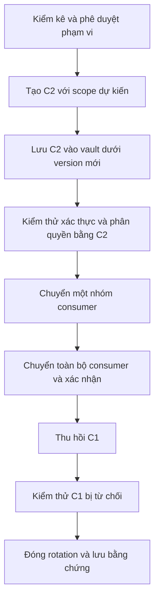

# Rotate integration credential

## Mục tiêu bài học

Một tích hợp PAM có thể chạy ổn định nhiều tháng nhờ một API key, client secret hoặc chứng thư được cấu hình từ ngày triển khai. Sự ổn định ấy che giấu một rủi ro: credential càng tồn tại lâu, càng có nhiều cơ hội xuất hiện trong bản sao cấu hình, môi trường kiểm thử, log hoặc máy của người vận hành.

**Rotate integration credential** là thay thế credential mà một hệ thống dùng để xác thực với hệ thống khác, xác minh consumer đã chuyển sang credential mới, sau đó vô hiệu hóa credential cũ. Với tích hợp PAM, thao tác này phải đồng thời bảo vệ quyền đặc biệt và duy trì các luồng cấp quyền, thu hồi quyền, ghi nhận bằng chứng.

Sau bài học, bạn có thể:

- Phân biệt rotation credential với thay đổi danh tính, quyền và token phiên.
- Lập inventory cho các consumer đang dùng credential của một tích hợp PAM.
- Thiết kế quy trình có hai credential cùng hợp lệ trong một khoảng thời gian có kiểm soát.
- Xử lý hệ thống chỉ hỗ trợ một credential, cache, job chạy thưa và tình huống cập nhật dở dang.
- Chọn phép thử đủ để phát hiện lỗi xác thực, lỗi phân quyền và mất luồng bằng chứng.
- Thu hồi credential cũ, lưu bằng chứng kiểm toán và ứng phó khi credential bị lộ.

Nội dung thuộc chương **API và automation** của module quản lý truy cập đặc quyền. Ví dụ tập trung vào tài khoản dịch vụ và workload thực hiện các tác vụ PAM: yêu cầu cấp quyền JIT, gọi API vault, đọc trạng thái phiên và gửi sự kiện kiểm toán.

## 1. Credential nào đang được luân chuyển?

Giả sử một workflow CI/CD gửi yêu cầu cấp quyền tạm thời đến PAM:

```text
CI/CD workload
    |
    | Xác thực bằng credential của integration identity
    v
PAM API
    |
    | Kiểm tra policy, approval và thời hạn
    v
Quyền tạm thời trên hệ thống đích
```

Trong luồng này có ít nhất ba đối tượng khác nhau:

| Đối tượng | Vai trò | Ví dụ |
|---|---|---|
| Integration identity | Danh tính đứng tên lời gọi API | service principal của workflow triển khai |
| Integration credential | Bằng chứng dùng để xác thực danh tính đó | client secret hoặc private key của client |
| Quyền đặc biệt được PAM quản lý | Quyền mà workflow yêu cầu hoặc sử dụng sau khi được duyệt | quyền deploy trên một nhóm máy chủ trong 15 phút |

Thay client secret của integration identity không tự động luân chuyển mật khẩu quản trị trên máy chủ đích. Nó cũng không mặc nhiên thu hồi các quyền JIT đã được cấp. Mỗi loại cần chính sách vòng đời và cơ chế thu hồi riêng.

### 1.1 Các dạng thường gặp

| Dạng credential | Điểm cần kiểm tra khi rotate |
|---|---|
| API key | Có thể tạo nhiều key trên cùng identity không? Key có scope riêng không? |
| Client secret | Có giai đoạn hai secret cùng hợp lệ không? Consumer lấy access token mới khi nào? |
| Chứng thư client | Server tin cậy chứng thư hoặc CA nào? Private key mới được tạo và bảo vệ ở đâu? |
| Private key dùng ký client assertion | Public key mới được công bố và cache ở những bên xác minh nào? |
| Refresh token | Provider có đổi token khi sử dụng không? Consumer có lưu token thay thế một cách nguyên tử không? |
| Mật khẩu của tài khoản tích hợp cũ | Đổi mật khẩu có làm hỏng dịch vụ hoặc tác vụ lịch chạy chưa được kiểm kê không? |

Rotation nên tạo vật liệu xác thực mới theo cơ chế được hệ thống hỗ trợ. Đổi nhãn secret, đổi đường dẫn vault nhưng giữ nguyên giá trị, hoặc chỉ khởi động lại ứng dụng không phải là thay credential.

Không lưu mật khẩu tài khoản người dùng vào automation để né việc quản lý integration identity. Một danh tính tích hợp riêng giúp xác định owner, giới hạn scope và thu hồi mà không ảnh hưởng tài khoản cá nhân.

### 1.2 Token còn sống sau khi credential đã bị thu hồi

Trong một mô hình cấp token, client secret thường dùng tại bước lấy access token. API tài nguyên có thể tiếp tục chấp nhận access token đã phát hành cho tới khi hết hạn hoặc bị cơ chế thu hồi có hiệu lực.

Vì vậy cần kiểm tra riêng:

1. Credential cũ có còn lấy được token mới không?
2. Token đã phát hành từ trước có còn dùng được không?
3. Phiên đang mở và quyền PAM đã cấp có bị ảnh hưởng không?
4. Những hành động nào cần chủ động thu hồi ngoài việc đổi secret?

Không kết luận rằng toàn bộ truy cập đã chấm dứt chỉ từ một thao tác “disable secret” thành công.

## 2. Mục tiêu an toàn và bất biến của quy trình

Rotation thành công phải đạt cả kết quả vận hành lẫn kết quả bảo mật.

**Kết quả vận hành:** mọi consumer trong phạm vi tiếp tục thực hiện đúng chức năng cần thiết; không mất yêu cầu thu hồi, không âm thầm ngừng ghi audit, không tạo retry storm.

**Kết quả bảo mật:** credential mới có quyền đúng mức cần thiết, được lưu đúng nơi; credential cũ không còn dùng được; bằng chứng cho thấy các bước chuyển đổi đã hoàn tất.

Các bất biến nên được kiểm tra xuyên suốt:

| Bất biến | Ý nghĩa thực hành |
|---|---|
| Danh tính có owner rõ ràng | Có người chịu trách nhiệm xử lý lỗi và phê duyệt vòng đời |
| Scope không tăng ngoài dự kiến | Rotation không trở thành cách cấp thêm quyền quản trị |
| Secret không xuất hiện trong log | Theo dõi credential ID và version, không theo dõi giá trị bí mật |
| Mỗi consumer có kết quả xác nhận | Không chỉ dựa vào một dashboard tổng |
| Quyền rollback có thời hạn | Không giữ credential cũ vô hạn vì lý do dự phòng |
| Thu hồi có phép thử riêng | “Đã cập nhật cấu hình” khác với “credential cũ đã bị chặn” |
| Audit giữ được liên kết danh tính | Có thể truy vết lời gọi trước và sau rotation |

Một credential mới cũng có thể sai: gán nhầm môi trường, nhận scope quá rộng hoặc bị phân phối vào hệ thống không thuộc phạm vi. Vì thế “key mới hoạt động” chỉ là một phần của tiêu chí hoàn tất.

## 3. Inventory trước khi rotate

Vấn đề khó thường nằm ở consumer chưa được biết tới. Một API key có thể được dùng bởi cả dịch vụ chính, worker nền, cronjob, pipeline rollback và công cụ khôi phục.

Trước khi thay credential, lập một bản đồ tối thiểu:

| Thuộc tính | Ví dụ minh họa |
|---|---|
| Integration identity | `svc-deploy-pam-prod` |
| Owner nghiệp vụ và kỹ thuật | đội nền tảng triển khai |
| Bên cấp credential | identity provider hoặc PAM |
| Bên xác minh credential/token | token endpoint và PAM API |
| Consumer | deployment gateway, background worker, scheduled reconciler |
| Môi trường | production |
| Chức năng PAM | yêu cầu JIT, truy vấn trạng thái, thu hồi grant |
| Secret reference | đường dẫn vault và version tham chiếu |
| Credential ID | mã định danh không chứa secret |
| Cách nạp | lúc khởi động, mỗi request hoặc cache có TTL |
| Nhịp sử dụng | liên tục, mỗi giờ, cuối tháng, khi khôi phục |
| Điều kiện kết thúc phiên | token expiry, session timeout, revoke riêng |
| Khả năng rollback | còn credential cũ trong bao lâu; ai được dùng |
| Kênh bằng chứng | audit của issuer, vault, PAM và consumer |

Không đưa giá trị secret vào bảng inventory, ticket hoặc tài liệu vận hành.

### 3.1 Consumer không chỉ là tiến trình đang chạy

Một deployment mới có thể đã dùng credential mới, trong khi các đối tượng sau vẫn trỏ vào credential cũ:

- Replica chưa được restart.
- Job được lên lịch nhưng chưa chạy.
- Image hoặc deployment manifest của phiên bản rollback.
- Runner tạm thời có bản sao biến môi trường.
- Dịch vụ DR đang tắt ở vùng dự phòng.
- Công cụ xử lý sự cố chỉ dùng vài lần mỗi năm.
- Agent đọc secret một lần rồi cache trong bộ nhớ.
- Sidecar hoặc proxy độc lập với ứng dụng chính.

Với tác vụ chạy thưa, chờ “không thấy lỗi trong một giờ” không tạo ra bằng chứng đáng tin. Cần thực thi phép thử có kiểm soát, xác minh reference hoặc ghi nhận quyết định loại bỏ consumer đó khỏi inventory.

### 3.2 Tránh phụ thuộc vòng tròn

Xét tình huống rotation controller cần đọc credential từ vault, nhưng credential duy nhất để truy cập vault cũng đang được controller luân chuyển.

Nếu controller mất quyền đọc giữa chừng, nó có thể không lấy được credential mới để tự phục hồi.

Thiết kế cần một đường truy cập quản trị đã được kiểm thử, có kiểm soát riêng. Controller có thể sử dụng workload identity độc lập với credential đang rotate. Cơ chế khôi phục khẩn cấp cần được bảo vệ, giới hạn người dùng và lưu audit; không phải một secret sao chép ra máy cá nhân.

## 4. Chọn cơ chế trước khi chọn lịch

Ưu tiên cơ chế giảm bí mật tồn tại lâu khi nền tảng hỗ trợ: workload identity, federation hoặc chứng thư/token ngắn hạn có vòng đời tự động. Những cơ chế này vẫn cần quản lý trust, khóa ký, policy và khả năng thu hồi; chúng không loại bỏ toàn bộ bài toán rotation.

Với credential tĩnh còn bắt buộc sử dụng, chọn chiến lược theo khả năng của bên cấp và consumer.

| Khả năng hệ thống | Chiến lược phù hợp | Điều phải xác minh |
|---|---|---|
| Hai credential cùng hợp lệ trên một identity | Tạo mới, chuyển consumer, thu hồi cũ | Hai credential có scope tương đương và phân biệt được trong audit |
| Chỉ một credential có hiệu lực | Phối hợp thời điểm đổi và cập nhật consumer | Có khoảng gián đoạn nào; cơ chế fail-closed và phục hồi ra sao |
| Có thể dùng hai identity | Chuyển dần sang identity thay thế khi được phép | Policy, ownership, approval và audit không bị lệch |
| Credential được cấp động, thời hạn ngắn | Tự cấp lại và kiểm thử đường renew | Renew có giới hạn; lỗi cấp mới không gây fallback sang secret tĩnh |
| Chứng thư client | Phân phối trust và key theo thứ tự tương thích | Cả hai chiều xác thực, cache trust và hạn chứng thư |

Không giả định mọi PAM API hoặc identity provider đều hỗ trợ cùng một mô hình. Runbook phải nêu khả năng thực tế của hệ thống đang triển khai.

## 5. Quy trình với hai credential cùng hợp lệ

Giả sử một integration identity đang dùng credential `C1`. Hệ thống hỗ trợ thêm `C2` trong thời gian chuyển đổi.



### 5.1 Chuẩn bị

Xác nhận inventory, owner, thời hạn credential hiện tại, quyền thực thi rotation và kênh liên lạc khi xảy ra lỗi.

Chụp lại metadata cần thiết: identity ID, credential ID, scope, audience, môi trường, secret reference và danh sách consumer. Không sao chép giá trị secret vào bằng chứng.

Xác định trước:

- Điều kiện được chuyển sang bước kế tiếp.
- Mức lỗi khiến phải dừng rollout.
- Hạn chót thu hồi credential cũ.
- Hành động nếu consumer chạy thưa chưa xác minh được.
- Điểm sau đó không thể quay lại credential cũ.
- Cách xử lý token hoặc phiên còn tồn tại sau thu hồi.

Nên thực hiện trước khi credential cũ sắp hết hạn đến mức không còn thời gian phục hồi.

### 5.2 Tạo và lưu credential mới

Tạo `C2` cho đúng identity, đúng môi trường và đúng quyền cần có. Đặt ngày hết hạn phù hợp với chính sách của tổ chức.

Đưa credential mới trực tiếp vào kho bí mật bằng kênh được bảo vệ. Hạn chế hiển thị giá trị trên terminal, không truyền secret trong đối số dòng lệnh dễ bị ghi lại, không để xuất hiện trong output CI.

Nếu hệ thống chỉ hiển thị secret một lần và thao tác lưu thất bại, xử lý credential vừa tạo như một đối tượng chưa được phân phối có kiểm soát. Thu hồi nó hoặc phục hồi theo runbook đã định; không tạo hàng loạt credential để thử lại mà bỏ quên những bản trước.

Ghi nhận mapping:

```text
rotation_id: rot-demo-042
identity_id: svc-deploy-pam-prod
old_credential_id: cred-A
new_credential_id: cred-B
vault_version: version-B
phase: STAGED
```

Đây chỉ là metadata minh họa. Không có trường chứa giá trị secret.

### 5.3 Kiểm thử credential mới trước khi phân phối rộng

Kiểm tra ít nhất ba lớp:

1. **Xác thực:** credential mới có thể xác thực tại đúng endpoint, đúng issuer và audience.
2. **Quyền được phép:** một thao tác PAM được phép thực hiện thành công trên đối tượng kiểm thử.
3. **Quyền bị cấm:** một thao tác ngoài scope bị từ chối mà không tạo thay đổi ngoài dự kiến.

Với luồng JIT, chỉ lấy token thành công chưa đủ. Có thể cần kiểm thử yêu cầu cấp grant, đọc trạng thái, thu hồi grant và quan sát audit. Sử dụng tài nguyên thử nghiệm được khoanh vùng, thời hạn ngắn và có bước dọn trạng thái sau kiểm thử.

Không dùng việc “tăng lên quyền admin rồi thử lại” để khắc phục lỗi permission của credential mới.

### 5.4 Canary và rollout

Chuyển một tập consumer nhỏ nhưng đại diện: ví dụ một replica hoặc một workflow kiểm thử trong production được phép dùng.

Theo dõi lỗi xác thực, từ chối phân quyền, độ trễ, hàng đợi retry và luồng audit. Nếu đạt tiêu chí, chuyển các consumer còn lại.

Phân biệt hai thao tác:

- Cập nhật reference đến version mới trong kho bí mật.
- Buộc consumer thực sự nạp lại credential.

Một alias tên `current` đã trỏ sang version mới không chứng minh process đang chạy đã bỏ giá trị cache. Cần biết cơ chế reload và nhận xác nhận từ từng consumer.

### 5.5 Quan sát giai đoạn chuyển đổi

Theo dõi việc sử dụng credential cũ nếu nền tảng có thể phân biệt credential ID. Nếu audit chỉ hiển thị identity, phải kết hợp inventory, xác nhận rollout và phép thử xác thực mới; không khẳng định đã chứng minh consumer bỏ credential cũ bằng một tín hiệu mà hệ thống không có.

Chốt trước cửa sổ overlap theo:

- Thời gian cập nhật và reload toàn bộ consumer.
- Độ trễ truyền cấu hình.
- Tần suất chạy của tác vụ nền.
- Thời hạn token và phiên liên quan.
- Thời gian cần thiết để phát hiện lỗi.
- Mức độ nghiêm trọng của việc giữ credential cũ còn hiệu lực.

Cửa sổ này phải có hạn chót. Khi không thể xác minh một consumer, quyết định xử lý rõ ràng thay vì tự động kéo dài overlap.

### 5.6 Thu hồi credential cũ

Sau khi đủ điều kiện, vô hiệu hóa `C1` tại bên cấp hoặc nơi xác minh thực tế. Xóa bản sao khỏi một ứng dụng không vô hiệu hóa credential ở phía server.

Thực hiện phép thử âm có kiểm soát: credential cũ không thể xác thực mới hoặc lấy token mới. Kết quả cần nêu rõ endpoint và điều đã được thử.

Tiếp tục kiểm tra token cũ, phiên đang chạy hoặc quyền PAM đã cấp theo mô hình thực tế. Nếu không có cơ chế thu hồi tức thời, ghi nhận thời điểm hết hạn tối đa và biện pháp hạn chế trong khoảng còn lại.

Cuối cùng, dọn reference lỗi thời, cập nhật inventory và xử lý phiên bản secret cũ theo chính sách lưu giữ. Không giữ secret hoạt động trong lịch sử triển khai để làm phương án rollback mặc định.

## 6. Khi hệ thống chỉ hỗ trợ một credential

Ở mô hình này, đổi credential phía server có thể khiến mọi consumer dùng giá trị cũ thất bại ngay lập tức. Không hứa hẹn zero downtime nếu giao thức và nền tảng không hỗ trợ chuyển đổi tương thích.

Runbook cần mô tả một cửa sổ phối hợp:

1. Thử trước đường cập nhật cấu hình bằng môi trường hoặc tài nguyên phù hợp.
2. Tạm dừng tác vụ có thể tạo yêu cầu mới không xử lý được trong cửa sổ đổi.
3. Xác định cách xử lý tác vụ đang chạy và hàng đợi.
4. Đổi credential phía cấp theo cơ chế được hỗ trợ.
5. Lưu phiên bản mới và cập nhật consumer theo thứ tự đã kiểm thử.
6. Xác minh lại các chức năng trọng yếu.
7. Mở lại luồng công việc và theo dõi hàng đợi tồn đọng.

Nếu cân nhắc tạo identity thay thế để chuyển dần, phải kiểm tra khả năng gán policy tương đương, approval, ownership và liên kết audit. Hai identity có cùng tên gần giống nhau không đảm bảo cùng quyền hoặc cùng ràng buộc.

Nếu workflow cần thu hồi quyền PAM trong khi các yêu cầu cấp mới bị dừng, cần giữ hoặc chuẩn bị đường thu hồi được bảo vệ. Không thiết kế cửa sổ bảo trì mà việc hết hạn hoặc thu hồi quyền phụ thuộc hoàn toàn vào consumer đang bị ngắt.

## 7. Rotation an toàn trong automation

Một controller nên quản lý rotation như một trạng thái có thể tiếp tục sau lỗi, không phải một chuỗi lệnh chỉ chạy thành công khi không có sự cố.

### 7.1 State machine gợi ý

```text
PREPARED
   -> NEW_CREATED
   -> NEW_STORED
   -> NEW_VALIDATED
   -> ROLLOUT_IN_PROGRESS
   -> CONSUMERS_CONFIRMED
   -> OLD_REVOKED
   -> CLOSED
```

Mỗi bước cần kiểm tra trạng thái hiện có trước khi tạo tác dụng phụ. Nếu controller bị dừng sau `NEW_CREATED`, lần chạy tiếp theo phải tìm credential thuộc rotation đó thay vì tạo một credential mới vô điều kiện.

Trường hợp không biết request tạo credential đã được server xử lý hay chưa là một trạng thái cần đối soát. Chỉ retry thao tác tạo khi cơ chế idempotency của API hoặc việc tra cứu trạng thái bảo đảm không phát sinh bản sao ngoài kiểm soát.

### 7.2 Pseudocode

Đoạn dưới minh họa logic, không phải API của một sản phẩm cụ thể:

```text
rotate(integration, rotation_id):
    acquire_exclusive_lock(integration.identity_id)
    try:
        state = load_rotation_state(rotation_id)
        assert_inventory_is_complete(integration)
        assert_no_unresolved_rotation(integration.identity_id, rotation_id)

        if state.phase == PREPARED:
            new_id = create_or_reconcile_credential(
                rotation_id = rotation_id,
                identity = integration.identity_id,
                expected_scopes = integration.allowed_scopes
            )
            save_metadata(rotation_id, new_id, phase = NEW_CREATED)

        if state_not_at_least(NEW_STORED):
            store_new_secret_using_protected_channel()
            save_metadata(rotation_id, vault_version, phase = NEW_STORED)

        validate_fresh_authentication_with_new_credential()
        validate_allowed_and_denied_operations()

        rollout_to_canary()
        require_canary_acceptance()
        rollout_to_remaining_consumers()
        require_each_consumer_confirmation()

        revoke_old_credential()
        verify_old_credential_cannot_authenticate()
        evaluate_existing_tokens_sessions_and_grants()
        close_rotation_with_evidence()
    finally:
        release_exclusive_lock(integration.identity_id)
```

Trong triển khai thực tế, state cần được tải lại sau các cập nhật hoặc quản lý nhất quán trong giao dịch phù hợp. Khóa phân tán phải có cơ chế phát hiện mất quyền sở hữu; một tiến trình giữ lease đã hết hạn không được tiếp tục thay đổi credential.

### 7.3 Idempotency và giới hạn retry

Các thao tác như “cập nhật consumer sang version B” thường có thể thực hiện lại nếu kiểm tra đích đã đúng. Thao tác “tạo secret mới” hoặc “reset mật khẩu” có thể gây thay đổi khác mỗi lần gọi.

Thiết kế retry theo loại lỗi:

| Loại lỗi | Hành động |
|---|---|
| Mất kết nối sau request có tác dụng phụ | Tra cứu và đối soát kết quả trước khi thử lại |
| Rate limit | Tôn trọng chính sách retry của API; giảm nhịp, có giới hạn |
| Credential mới bị từ chối | Dừng rollout, xác minh identity, scope, môi trường và thời gian hiệu lực |
| Consumer không xác nhận reload | Giữ trạng thái chưa hoàn tất; xử lý consumer cụ thể |
| Thu hồi cũ thất bại | Cảnh báo và tiếp tục xử lý như rủi ro đang mở |
| Không ghi được audit bắt buộc | Không đánh dấu rotation hoàn tất; áp dụng chính sách của luồng liên quan |

Tránh retry vô hạn. Một rotation lỗi không được tạo vô hạn credential, làm khóa tài khoản hoặc tạo tải lớn lên PAM.

## 8. Cache, alias và rollback

### 8.1 Ba lớp cache thường bị nhầm lẫn

```text
Vault secret version
        |
        v
Credential cache trong consumer
        |
        v
Access token hoặc session cache
```

Chuyển version ở vault chỉ tác động lớp đầu. Consumer có thể vẫn giữ secret cũ; ngay cả sau khi đọc secret mới, nó có thể tiếp tục dùng access token cũ cho tới khi token hết hạn.

Phép thử sau rollout nên buộc một lần xác thực mới qua đường mới, đồng thời kiểm tra trạng thái của các token/phiên đang tồn tại. Không xóa toàn bộ cache production thiếu kế hoạch chỉ để kiểm tra nhanh.

### 8.2 Alias không bảo đảm rollout nguyên tử

Alias như `current` giúp quản lý reference, nhưng thay alias không làm mọi consumer đổi cùng lúc.

Với rollout cần truy vết rõ, có thể ghim version cho từng đợt, ghi nhận consumer nào dùng version nào rồi cập nhật cấu hình chuẩn sau khi hoàn tất. Cách dùng alias hay pin version phải nhất quán với khả năng reload và rollback của nền tảng.

### 8.3 Ranh giới rollback

Trước khi thu hồi credential cũ, rollback có thể là chuyển lại consumer sang phiên bản trước, nếu credential đó vẫn được phép sử dụng và không bị nghi lộ.

Sau khi credential cũ đã bị thu hồi, không mặc định có thể khôi phục nó. Phương án phục hồi thường là cấp credential tiếp theo và sửa consumer theo hướng tiến tới trạng thái hợp lệ.

Nếu rotation được kích hoạt vì nghi lộ, quay lại credential cũ có thể tái mở đường truy cập của kẻ tấn công. Khi đó ưu tiên cô lập, cấp mới và phục hồi có kiểm soát.

Rollback ứng dụng cũng cần được kiểm tra: bản phát hành cũ không được tự động kéo lại một secret reference đã bị loại bỏ.

## 9. Tiêu chí kiểm thử và bằng chứng

### 9.1 Ma trận kiểm thử tối thiểu

| Kiểm thử | Kết quả mong đợi | Bằng chứng an toàn |
|---|---|---|
| Xác thực mới bằng credential mới | Thành công với đúng identity | credential ID, correlation ID, thời điểm |
| Gọi thao tác trong scope | Thành công trên tài nguyên thử | action, resource ID, kết quả |
| Gọi thao tác ngoài scope | Bị từ chối, không tạo thay đổi | policy decision và mã sự kiện |
| Consumer nạp version mới | Có xác nhận từng consumer | deployment ID, secret version, thời điểm reload |
| Thu hồi quyền JIT thử nghiệm | Grant không còn hiệu lực theo cơ chế thiết kế | grant ID, trạng thái và phép thử phù hợp |
| Luồng audit sau rollout | Sự kiện đến nơi lưu giữ và liên kết được identity | event ID, nơi nhận, thời gian |
| Credential cũ sau revoke | Không xác thực mới được | kết quả phép thử âm tại đúng endpoint |
| Token/phiên cũ | Xử lý theo chính sách đã xác định | expiry, revoke hoặc trạng thái session |
| Job chạy thưa và DR | Có xác minh chủ động hoặc quyết định xử lý | test run ID hoặc kết quả kiểm tra reference |

Một response thành công có thể là kết quả của cache hoặc tác vụ bất đồng bộ chưa hoàn tất. Với tác vụ bất đồng bộ, theo dõi tới trạng thái cuối liên quan và xác nhận ảnh hưởng mong muốn.

### 9.2 Hồ sơ rotation

Một hồ sơ hữu ích có thể chứa:

```yaml
rotationId: rot-demo-042
identityId: svc-deploy-pam-prod
reason: scheduled
oldCredentialId: cred-A
newCredentialId: cred-B
newSecretVersion: version-B
scopeCheck: passed
consumerCoverage:
  expected: 3
  confirmed: 3
oldCredentialRevocation:
  serverSide: confirmed
  freshAuthenticationDenied: confirmed
existingTokenHandling: recorded-separately
auditVerification: passed
outcome: closed
```

Ví dụ trên là dữ liệu giả trong bài học. Trong môi trường thật, cần thêm thời điểm, người hoặc workload thực hiện, approval/change reference và các liên kết bằng chứng phù hợp.

Không lưu client secret, access token, refresh token, private key, header `Authorization` hoặc body chứa credential vào hồ sơ.

## 10. Quan sát và cảnh báo

Các chỉ số có ích gồm:

- Thời gian từ lúc tạo credential mới tới lúc thu hồi credential cũ.
- Số rotation quá hạn hoặc dừng ở trạng thái trung gian.
- Số consumer chưa xác nhận version mới.
- Lỗi xác thực và lỗi phân quyền theo integration.
- Lần dùng credential cũ sau thời điểm phải chuyển.
- Credential sắp hết hạn nhưng chưa có rotation hợp lệ.
- Số credential đang cùng hoạt động trên một identity.
- Độ trễ và tình trạng thiếu sự kiện audit của luồng PAM.
- Hàng đợi cấp/thu hồi quyền bị tồn đọng trong cửa sổ rotation.

Không mọi nền tảng đều cung cấp phân biệt credential ID trên từng request. Khi thiếu tín hiệu đó, ghi rõ giới hạn và dùng biện pháp xác minh bổ sung; không dựng một metric tạo cảm giác chắc chắn giả.

Tránh metric có secret làm label. Cũng cần giới hạn cardinality và quyền xem metadata vì danh tính tích hợp, tên tài nguyên hoặc cấu trúc môi trường có thể là thông tin nhạy cảm.

Cảnh báo phải có owner và bước xử lý cụ thể. “Rotation failed” thiếu integration, phase và consumer bị ảnh hưởng thường khiến việc phục hồi kéo dài.

## 11. Khi credential bị lộ

Rotation định kỳ có thể ưu tiên chuyển đổi êm. Rotation vì nghi lộ cần ưu tiên cắt khả năng truy cập trái phép theo mức độ sự cố.

Một trình tự xử lý có thể gồm:

1. Xác định credential và identity bị ảnh hưởng, phạm vi quyền và nơi đã xuất hiện.
2. Cô lập consumer hoặc đường truy cập đang bị khai thác nếu cần.
3. Thu hồi credential bị lộ sớm theo phương án ứng phó, chấp nhận gián đoạn có kiểm soát khi cần thiết.
4. Xem xét token, phiên, grant và các credential khác mà identity có thể truy cập hoặc đã tạo ra.
5. Cấp credential mới qua kênh sạch, cập nhật consumer đã được xử lý.
6. Kiểm tra audit về truy cập bất thường, cấp quyền, thay đổi policy và truy cập secret.
7. Bảo toàn bằng chứng, dọn nguồn lộ và xác nhận luồng vận hành phục hồi.

Không phân phối secret mới vào cùng môi trường đang bị xâm nhập rồi coi sự cố đã kết thúc. Cần xử lý nguyên nhân lộ như logging, quyền đọc vault quá rộng, runner bị chiếm hoặc artifact chứa cấu hình.

Nếu secret đã vào Git, log hay artifact, xóa dấu vết hiển thị không thay thế việc thu hồi credential tại bên cấp. Các bản sao có thể đã tồn tại ngoài nơi bạn kiểm soát.

## 12. Tình huống thực hành

Một hệ thống có ba consumer dùng cùng integration identity:

- `deploy-gateway`: gọi PAM khi có yêu cầu triển khai.
- `grant-reconciler`: mỗi 20 phút đối soát và thu hồi grant.
- `recovery-runner`: chỉ chạy khi diễn tập DR.

Credential `C1` sẽ hết hạn trong vài ngày. Nền tảng cho phép hai credential cùng hiệu lực.

Đội vận hành tạo `C2`, cập nhật vault alias và thấy gateway hoạt động bình thường. Họ chuẩn bị thu hồi `C1`.

### 12.1 Điều gì chưa được chứng minh?

Gateway có thể vẫn dùng access token đã cấp trước đó. Reconciler có thể đọc secret một lần khi khởi động. Recovery runner chưa chạy và vẫn giữ cấu hình cũ.

Vì vậy chưa đủ bằng chứng rằng cả ba consumer đã dùng được `C2`.

### 12.2 Cách xử lý

1. Ghim hoặc xác minh version mới cho gateway, buộc một lần lấy token mới có kiểm soát, kiểm thử yêu cầu và thu hồi grant thử nghiệm.
2. Cập nhật reconciler, thực hiện reload theo cơ chế hỗ trợ và chạy một vòng đối soát thử.
3. Xác minh secret reference của recovery runner và thực hiện bài kiểm tra được khoanh vùng.
4. Kiểm tra scope của `C2`, bao gồm thao tác ngoài quyền phải bị từ chối.
5. Xác nhận audit cho cả ba luồng.
6. Thu hồi `C1`, thử xác thực mới bằng `C1` và ghi nhận thất bại mong đợi.
7. Xử lý token/phiên còn tồn tại, kiểm tra hàng đợi và đóng hồ sơ.

### 12.3 Lỗi phát sinh sau thu hồi

Nếu reconciler báo lỗi sau khi `C1` bị thu hồi, không bật lại credential cũ một cách tự động. Xác định vì sao nó chưa chuyển: cấu hình chưa triển khai, cache, quyền đọc version mới hay lỗi token endpoint.

Khôi phục bằng credential hợp lệ và sửa đường phân phối. Trong thời gian đó, theo dõi grant sắp hết hạn và dùng đường thu hồi đã chuẩn bị khi cần.

Bài học của tình huống là phải xác minh từng chức năng và consumer, đặc biệt consumer liên quan đến thu hồi quyền hoặc khôi phục hệ thống.

## 13. Những lỗi thường gặp

| Lỗi | Hậu quả | Cách phòng tránh |
|---|---|---|
| Tạo key mới nhưng không revoke key cũ | Tăng số đường truy cập còn hiệu lực | Đặt revoke là điều kiện đóng rotation |
| Coi đổi vault alias là hoàn tất | Consumer tiếp tục dùng cache cũ | Xác nhận reload và xác thực mới |
| Chỉ kiểm tra lấy token | Lỗi quyền hoặc luồng thu hồi không được phát hiện | Thử chức năng PAM và phép thử âm |
| Đổi secret và tăng scope cùng lúc không kiểm soát | Khó phân biệt lỗi và dễ mở rộng quyền | Kiểm tra scope riêng, ghi nhận thay đổi có chủ đích |
| Bỏ qua job chạy thưa | Sự cố xuất hiện sau nhiều ngày | Inventory và kiểm thử chủ động |
| Retry reset credential vô hạn | Làm consumer liên tục mất đồng bộ | State machine, đối soát, giới hạn retry |
| Log toàn bộ request khi debug | Lộ credential mới ngay sau rotation | Che dữ liệu nhạy cảm và kiểm tra logging |
| Dùng lại credential cũ sau sự cố lộ | Mở lại truy cập cho bên trái phép | Phục hồi bằng credential sạch |
| Xóa secret khỏi vault nhưng không revoke server | Credential đã bị sao chép vẫn hoạt động | Vô hiệu hóa tại bên cấp/xác minh |
| Quên pipeline rollback và DR | Khôi phục kéo theo credential đã hỏng | Kiểm tra cấu hình của cả đường phục hồi |

## 14. Checklist vận hành

Trước khi bắt đầu:

- Đúng integration identity, owner, môi trường và scope.
- Danh sách consumer gồm cả tác vụ định kỳ, DR và rollback.
- Đã biết cơ chế nạp secret, cache, token và phiên.
- Đã xác định khả năng nhiều credential, thời hạn overlap và ranh giới rollback.
- Có đường khôi phục được bảo vệ, không phụ thuộc vòng tròn vào credential đang đổi.

Trong khi chuyển đổi:

- Credential mới được lưu bằng kênh bảo vệ.
- Xác thực, thao tác được phép và thao tác bị cấm đều đã kiểm thử.
- Canary đạt tiêu chí trước khi mở rộng.
- Từng consumer xác nhận version hoặc đường xác thực mới.
- Audit, lỗi, hàng đợi và chức năng thu hồi quyền được theo dõi.

Trước khi đóng:

- Credential cũ đã bị vô hiệu hóa phía server.
- Phép thử xác thực mới bằng credential cũ bị từ chối.
- Token, session và grant còn tồn tại đã được đánh giá và xử lý.
- Reference cũ và cấu hình phục hồi đã được cập nhật.
- Hồ sơ có bằng chứng, không chứa giá trị bí mật.
- Không còn trạng thái trung gian hoặc consumer chưa có quyết định xử lý.

## 15. Câu hỏi tự kiểm tra

**1. Secret mới đã được ghi vào vault. Vì sao chưa thể đánh dấu rotation thành công?**

Vì consumer có thể chưa reload, vẫn sử dụng token cũ hoặc còn một consumer chưa được cập nhật. Credential cũ cũng có thể vẫn hoạt động phía server.

**2. Một request với token cũ thành công sau khi revoke client secret có nhất thiết chứng minh revoke thất bại không?**

Không. Phải phân biệt credential dùng lấy token với token đã được cấp. Cần kiểm tra khả năng xác thực mới và cơ chế xử lý token còn hiệu lực.

**3. Có thể kéo dài overlap vô hạn để giữ phương án dự phòng không?**

Không nên. Điều đó giữ credential cũ tiếp tục là đường truy cập. Overlap cần hạn chót và quyết định xử lý các consumer chưa chuyển.

**4. Khi API tạo credential trả lỗi timeout, có nên gọi lại ngay không?**

Phải đối soát trạng thái hoặc dùng cơ chế idempotency được hỗ trợ. Request trước có thể đã tạo credential dù client chưa nhận được phản hồi.

**5. Thu hồi credential cũ có bảo đảm tất cả quyền JIT đã cấp trước đó bị thu hồi không?**

Không. Credential tích hợp, token, phiên và grant là các đối tượng có vòng đời khác nhau. Cần kiểm tra và xử lý theo cơ chế PAM thực tế.

**6. Dấu hiệu rõ nhất cho thấy quy trình đã hoàn tất là gì?**

Có bằng chứng mọi consumer trong phạm vi dùng được đường xác thực mới với đúng quyền, credential cũ không còn xác thực mới được, trạng thái token/phiên/grant đã được xử lý và audit vẫn đầy đủ.

Rotate integration credential là một thay đổi có phối hợp giữa bên cấp danh tính, kho bí mật, consumer và PAM. Giá trị của automation nằm ở khả năng chuyển đổi có kiểm chứng, tiếp tục được sau lỗi và kết thúc bằng việc loại bỏ đường truy cập cũ.
