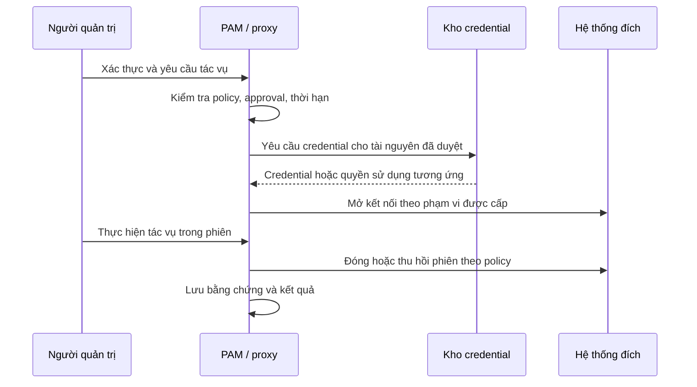

# PAM và secrets manager

## 1. Vì sao hai hệ thống cần được thiết kế cùng nhau?

Một tổ chức đã triển khai Privileged Access Management (PAM) có thể yêu cầu quản trị viên xin quyền theo ticket, xác thực nhiều yếu tố và đi qua cổng ghi hình phiên. Tuy nhiên, ứng dụng vẫn có thể dùng một tài khoản database có quyền cao, với mật khẩu nằm trong biến cấu hình được sao chép từ nhiều năm trước. Đường truy cập của con người được kiểm soát, nhưng đường truy cập của phần mềm vẫn tạo ra đặc quyền thường trực.

Tình huống ngược lại cũng phổ biến: mọi mật khẩu đã được cất trong secrets manager, nhưng bất kỳ thành viên nào của nhóm vận hành đều có thể đọc chúng vào bất kỳ lúc nào. Hệ thống bảo vệ được nơi lưu bí mật, chưa kiểm soát đầy đủ việc ai được sử dụng quyền mà bí mật đó mang lại.

Trong module quản lý truy cập đặc quyền, tích hợp PAM với secrets manager phải trả lời đồng thời hai nhóm câu hỏi:

- **Quyền truy cập:** chủ thể nào được thực hiện tác vụ đặc quyền nào, trên tài nguyên nào, trong hoàn cảnh nào và trong bao lâu?
- **Vòng đời bí mật:** credential được tạo, lưu, cấp, sử dụng, luân chuyển và thu hồi như thế nào; ai chịu trách nhiệm khi một bước thất bại?

Mục tiêu là biến mỗi đường truy cập nhạy cảm thành một chuỗi có chủ sở hữu, giới hạn quyền, thời hạn và bằng chứng. Việc chuyển mật khẩu từ một file cấu hình sang một vault mới chỉ giải quyết một phần bài toán đó.

Sau bài học này, bạn cần phân biệt được phạm vi của hai hệ thống, chọn mô hình tích hợp cho người và workload, giải thích được giới hạn của TTL và rotation, đồng thời xây dựng được quy trình vận hành có thể kiểm chứng.

## 2. Các khái niệm cần thống nhất

### 2.1. Secret, credential và đặc quyền

**Secret** là dữ liệu cần giữ bí mật để bảo vệ hệ thống: mật khẩu, private key, API token, khóa dùng để ký hoặc vật liệu xác thực khác. Không phải mọi secret đều trực tiếp dùng để đăng nhập; một khóa mã hóa dữ liệu có vòng đời khác mật khẩu của tài khoản quản trị.

**Credential** là vật liệu hoặc bằng chứng mà một chủ thể trình ra để được xác thực. Trong bài này, trọng tâm là credential có thành phần bí mật, chẳng hạn mật khẩu database, private key đi cùng chứng thư hoặc bearer token.

**Đặc quyền** là khả năng mà hệ thống đích cho phép sau khi xác thực và xét quyền: sửa cấu hình, quản lý tài khoản, đọc dữ liệu nhạy cảm, triển khai phiên bản mới hoặc thực hiện tác vụ quản trị. Một secret không tự mô tả đầy đủ đặc quyền; quyền thực tế còn phụ thuộc tài khoản đích, role, policy và ngữ cảnh thực thi.

Ví dụ, hai mật khẩu database đều là secret, nhưng một mật khẩu có thể thuộc tài khoản chỉ đọc bảng tham chiếu, còn mật khẩu kia thuộc tài khoản có thể tạo người dùng và cấp role. Cả hai cần được bảo vệ; mức kiểm soát truy cập đặc quyền không nhất thiết giống nhau.

### 2.2. PAM tập trung vào việc sử dụng quyền nhạy cảm

PAM là tập hợp năng lực kiểm kê, kiểm soát và giám sát truy cập đặc quyền. Tùy thiết kế, hệ thống có thể cung cấp:

- Quản lý tài khoản quản trị và service account có quyền cao.
- Phê duyệt, just-in-time access (JIT) và giới hạn tác vụ theo just-enough administration (JEA).
- Checkout credential hoặc kết nối qua proxy mà không hiển thị credential cho người dùng.
- Luân chuyển mật khẩu, giám sát phiên, ghi nhận lệnh và lưu bằng chứng.
- Kiểm soát truy cập khẩn cấp và rà soát quyền định kỳ.

Không nên mặc định mọi sản phẩm PAM có đầy đủ mọi năng lực trên. Đặc biệt, ghi hình phiên tương tác không tự bao phủ toàn bộ hoạt động của API hay workload chạy nền.

### 2.3. Secrets manager tập trung vào vòng đời và phân phối bí mật

Secrets manager cung cấp cơ chế lưu trữ, phân quyền và phân phối secret cho người hoặc phần mềm. Một số triển khai còn có thể phát hành credential động, quản lý lease hoặc thực hiện rotation qua thành phần tích hợp với hệ thống đích.

Các khả năng này cần được kiểm tra theo từng loại secret và connector. Một secret tĩnh nằm trong kho không tự trở thành credential ngắn hạn chỉ vì ứng dụng phải dùng token ngắn hạn để đọc nó.

Vault là thuật ngữ thường gặp ở cả hai phía. Một PAM có thể có credential vault; một secrets manager có thể có cơ chế checkout hoặc approval. Vì vậy, thiết kế nên dựa trên năng lực và trách nhiệm thực tế, không dựa riêng vào tên sản phẩm.

### 2.4. Danh tính workload và secret zero

**Workload identity** là danh tính của một đơn vị phần mềm đang thực thi, ví dụ service, job hoặc thành phần tự động hóa. Danh tính này cần gắn được với môi trường và phạm vi công việc, thay vì dùng chung danh tính của một nhân viên.

**Secret zero** là bài toán bootstrap: ứng dụng dùng gì để chứng minh danh tính trước khi được phép lấy secret đầu tiên? Cất mật khẩu database trong vault nhưng để một token quản trị vault dài hạn cạnh ứng dụng chỉ chuyển điểm yếu sang một credential khác, có thể còn có phạm vi ảnh hưởng lớn hơn.

## 3. Phân chia trách nhiệm giữa PAM và secrets manager

Một tích hợp tốt phải xác định hệ thống nào ra quyết định, hệ thống nào giữ vật liệu bí mật và hệ thống nào thực thi quyền tại đích.

| Vấn đề | Trách nhiệm cần có | Điểm cần thống nhất khi tích hợp |
|---|---|---|
| Kiểm kê tài khoản đặc quyền | PAM hoặc hệ thống quản trị danh tính liên quan | Secret nào thuộc tài khoản nào, ai là owner, mức nhạy cảm là gì? |
| Phê duyệt tác vụ quản trị | Luồng kiểm soát truy cập đặc quyền | Approval có phạm vi, thời hạn và người phê duyệt cụ thể không? |
| Xác thực workload | Nền tảng danh tính và bên kiểm tra danh tính | Bằng chứng có gắn đúng workload, môi trường và audience không? |
| Bảo vệ và phân phối secret | Vault hoặc secrets manager được chỉ định | Ai được đọc giá trị, ai chỉ được yêu cầu một thao tác sử dụng? |
| Tạo hoặc đổi credential | Thành phần được giao quyền tại hệ thống đích | Có một chủ thể điều phối rotation cho mỗi credential không? |
| Thực thi quyền dữ liệu hoặc quản trị | Database, API, hệ điều hành hoặc dịch vụ đích | Tài khoản đích có thực sự tuân thủ least privilege không? |
| Thu hồi và kiểm toán | Nhiều thành phần phối hợp | Thu hồi ở lớp nào, có xác minh ở đích và có bằng chứng liên kết không? |

Tên hệ thống có thể thay đổi theo kiến trúc, nhưng mỗi trách nhiệm phải có owner rõ ràng. Nếu hai bên đều nghĩ bên kia chịu trách nhiệm thu hồi credential, thực tế có thể không bên nào thực hiện.

Một mô hình đáng tránh là hai hệ thống cùng giữ bản có thể sửa của một mật khẩu và cùng tự động rotate mật khẩu đó. Điều này tạo ra hai nguồn điều phối, dễ gây lệch phiên bản, ghi đè cập nhật hoặc khóa tài khoản đích. Với mỗi credential, cần xác định một bên có thẩm quyền phát hành hoặc rotation; những bên còn lại tích hợp theo hợp đồng đã thống nhất.

Secrets manager cũng không thay thế hệ thống quản lý khóa mã hóa theo mọi nghĩa. Nó có thể sử dụng dịch vụ quản lý khóa để bảo vệ dữ liệu lưu trữ, nhưng quyền đọc secret, quyền dùng khóa để giải mã và quyền quản trị khóa là những quyền khác nhau, cần được phân tách theo thiết kế.

## 4. Ba mô hình tích hợp thường gặp

### 4.1. Người quản trị đi qua PAM, credential nằm trong kho bí mật

Người quản trị đăng nhập bằng danh tính cá nhân, xin quyền cho một tác vụ cụ thể, rồi mở phiên qua PAM. PAM hoặc thành phần proxy lấy credential bằng danh tính máy của chính nó và dùng credential đó để kết nối tới hệ thống đích.



Mô hình này có thể giảm việc người quản trị trực tiếp nhìn thấy và sao chép mật khẩu. Tuy nhiên, proxy trở thành một điểm tin cậy quan trọng. Cần bảo vệ danh tính của proxy, giới hạn tài nguyên mà nó truy cập được, quản lý bản vá và kiểm tra khả năng tránh đường kiểm soát.

Nếu người quản trị vẫn có thể kết nối trực tiếp tới đích bằng một credential dùng lại được, việc đi qua PAM có thể chỉ là một lựa chọn. Cần đánh giá cả đường mạng, phương thức xác thực và quyền tại đích để xác định luồng kiểm soát có thực sự bắt buộc hay không.

### 4.2. Workload tự lấy secret theo danh tính của nó

Ứng dụng dùng workload identity để xác thực với secrets manager, nhận credential phù hợp rồi kết nối tới đích. PAM có thể tham gia ở lớp quản trị quyền nhạy cảm, phê duyệt thay đổi policy, kiểm kê service account, kiểm soát root credential hoặc theo dõi ngoại lệ.

Luồng tự động hóa không nhất thiết cần một người phê duyệt từng lần đọc secret. Với service chạy liên tục, tổ chức thường phê duyệt trước một policy được giới hạn rõ và kiểm soát thay đổi policy đó. Tác vụ tự động có rủi ro cao vẫn có thể cần approval theo từng lần thực thi.

Điểm mấu chốt là một lần cấp secret cho workload phải giải thích được bằng danh tính và policy của chính workload, không phải bằng mật khẩu cá nhân của người triển khai.

### 4.3. Credential động hoặc thao tác được môi giới

Ở mô hình credential động, một thành phần phát hành tạo credential gắn với một lần cấp hoặc một workload. Nếu hệ thống đích và connector hỗ trợ, credential có thể có thời hạn, lease và cơ chế thu hồi độc lập.

Ở mô hình môi giới thao tác, workload hoặc người dùng yêu cầu một thao tác được phép; thành phần môi giới thực hiện việc xác thực với đích. Client có thể không nhận giá trị secret gốc.

Hai mô hình này có khả năng giảm credential được sao chép ra ngoài, nhưng không tự loại bỏ rủi ro. Credential phát hành sai quyền vẫn gây hại trong thời gian tồn tại. Một broker có quyền rộng có thể trở thành điểm tập trung đặc quyền. Cần đánh giá cả quyền của thành phần phát hành, khả năng xác minh thu hồi và hành vi khi nó bị gián đoạn.

## 5. Tách ba mặt phẳng: quyết định, phân phối và thực thi

Để phân tích một tích hợp, hãy tách ba mặt phẳng sau:

1. **Quyết định truy cập:** xác định chủ thể, tài nguyên, hành động, điều kiện và thời hạn được phép.
2. **Phân phối hoặc sử dụng credential:** lấy, phát hành, inject hoặc môi giới credential theo quyết định đã có.
3. **Thực thi tại đích:** áp dụng role, quyền hệ điều hành, quyền database hoặc scope API thực tế.

Một approval hợp lệ ở PAM không nên biến thành quyền đọc mọi secret ở tầng phân phối. Tương tự, secrets manager cho phép đọc một credential không chứng minh tài khoản đích có đúng quyền cần thiết.

Giả sử yêu cầu là “đọc trạng thái đối soát trong production trong 30 phút”. Một thiết kế phù hợp cần liên kết được:

- Người hoặc workload được xác thực.
- Mục đích và tài nguyên đích cụ thể.
- Quyền đọc cần dùng tại đích.
- Cách cấp credential hoặc mở phiên cho đúng yêu cầu.
- Hạn cuối của quyền và cách kết thúc hiệu lực thực tế.
- Bằng chứng để nối yêu cầu với hoạt động ở đích.

Nếu approval ghi “chỉ đọc” nhưng credential được lấy là tài khoản có quyền tạo người dùng, mặt phẳng quyết định và mặt phẳng thực thi đang không khớp nhau.

## 6. Thiết kế danh tính và policy cho workload

### 6.1. Giảm phụ thuộc vào bootstrap secret dài hạn

Tùy nền tảng, bằng chứng danh tính có thể đến từ token danh tính được nền tảng ký, chứng thư client hoặc cơ chế chứng thực workload khác. Khi xác minh, cần kiểm tra đúng thuộc tính của cơ chế đó, chẳng hạn bên phát hành, đối tượng nhận token, chủ thể, thời hạn và môi trường được phép.

Không chấp nhận một giá trị tên service do client tự khai là đủ để chứng minh danh tính. Một request ghi `workload=settlement-api` chỉ là dữ liệu do bên gọi gửi, trừ khi nó được ràng buộc với bằng chứng xác thực đáng tin cậy.

Nếu buộc phải dùng bootstrap secret, cần giới hạn phạm vi, thời hạn và nơi lưu; có owner và kế hoạch rotation; đồng thời tránh để nó có quyền quản trị toàn bộ kho bí mật. Cách bootstrap cũng cần được đưa vào kiểm kê credential.

### 6.2. Phân quyền theo danh tính, môi trường và hành động

Một policy cần thể hiện ít nhất:

- Workload nào được phép yêu cầu.
- Môi trường nào được áp dụng.
- Tài nguyên hoặc nhóm secret nào được truy cập.
- Hành động nào được thực hiện: đọc, phát hành, gia hạn, rotate hay quản trị policy.
- Giới hạn thời gian và điều kiện bổ sung nếu có.

Ví dụ dưới đây là **mô hình policy minh họa**, không phải cú pháp cấu hình của một sản phẩm cụ thể:

```yaml
subject:
  workload: settlement-api
  environment: production
resource:
  credential_role: settlement-db-runtime
allowed_actions:
  - request_runtime_credential
constraints:
  target: settlement-db-production
  database_role: settlement_runtime
  credential_lifetime_seconds: 900
  maximum_continuous_authorization_seconds: 3600
```

Các giá trị thời gian chỉ là ví dụ để thảo luận. Không được suy ra rằng mọi kho bí mật đều thực thi những field này hoặc hỗ trợ các giới hạn tương ứng. Hợp đồng tích hợp phải chỉ rõ thành phần nào thực thi mỗi ràng buộc và cách kiểm thử.

Policy runtime không nên tự cho phép sửa policy, đọc root credential hay rotate mọi tài khoản. Danh tính triển khai, danh tính vận hành service và danh tính thực hiện rotation cần được phân biệt theo trách nhiệm.

### 6.3. Quyền quản trị secret là một dạng đặc quyền

Người có thể sửa policy đọc secret có khả năng mở đường cho một danh tính khác lấy credential nhạy cảm. Người có thể thay connector rotation có thể tác động trực tiếp lên tài khoản đích. Vì vậy, chỉ bảo vệ giá trị secret bằng mã hóa là chưa đủ.

Các thay đổi về policy, cấu hình xác thực, connector và tài khoản phát hành nên có kiểm soát truy cập đặc quyền, phân tách trách nhiệm và bằng chứng thay đổi. Trong tình huống cần dual control, việc một người tự phê duyệt yêu cầu của chính mình phải bị ngăn theo luồng đã thiết kế.

## 7. Credential đi từ kho tới ứng dụng như thế nào?

### 7.1. Chọn phương thức phân phối theo mô hình đe dọa

| Phương thức | Lợi ích thường gặp | Rủi ro hoặc giới hạn cần xử lý |
|---|---|---|
| Ứng dụng gọi API lấy secret | Chủ động xử lý phiên bản, gia hạn và lỗi | Ứng dụng phải quản lý credential trong bộ nhớ, client và retry an toàn |
| Agent hoặc sidecar cung cấp secret | Tách một phần logic xác thực khỏi ứng dụng | Cần bảo vệ giao tiếp nội bộ, file đầu ra và danh tính của agent |
| File được mount hoặc cập nhật | Phù hợp với ứng dụng đọc cấu hình từ file | Quyền file, bản sao, cơ chế reload và thời điểm cập nhật phải rõ |
| Biến môi trường | Dễ tích hợp với một số ứng dụng có sẵn | Có thể bị lộ qua chẩn đoán hoặc process con; cập nhật thường cần cơ chế khởi động lại |
| Proxy hoặc broker | Có thể giảm việc client nhận secret gốc | Thành phần trung gian cần HA, giới hạn quyền và khả năng quan sát |

Không có phương thức nào tự động an toàn trong mọi môi trường. Chẳng hạn, một file có quyền truy cập hẹp nhưng bị đưa vào bản sao lưu không được bảo vệ vẫn có thể làm lộ secret. Biến môi trường cũng không phải lúc nào đọc được bởi mọi người; rủi ro phụ thuộc quyền hệ điều hành, công cụ chẩn đoán và cách triển khai.

### 7.2. Xem credential là dữ liệu nhạy cảm trong suốt quá trình sử dụng

Không đưa secret vào tham số dòng lệnh nếu công cụ và hệ điều hành có thể hiển thị chúng qua danh sách tiến trình. Tránh ghi response chứa secret vào log, trace, thông báo lỗi, ticket hoặc chat. Không đưa file chứa secret vào image build hay kho mã nguồn.

Chỉ dùng kênh được xác thực và bảo vệ phù hợp. Khi kết nối TLS, client phải kiểm tra danh tính server; bỏ kiểm tra chứng thư để “khắc phục nhanh” sẽ làm suy yếu chính kênh dùng để nhận credential.

Trong ứng dụng, hạn chế số bản sao và thời gian giữ credential. Không hứa rằng secret đã biến mất hoàn toàn chỉ vì biến chứa nó ra khỏi scope: runtime, dump bộ nhớ hoặc thư viện có thể giữ bản sao. Việc bảo vệ host, quyền debug, crash dump và dữ liệu chẩn đoán vẫn quan trọng.

### 7.3. Cache phải gắn với giới hạn hiệu lực

Cache có thể giảm độ trễ và giảm phụ thuộc vào kho bí mật trong từng request. Tuy nhiên, cần tách:

- Thời gian client giữ một bản sao.
- Thời hạn token dùng để gọi secrets manager.
- Thời hạn credential tại đích.
- Thời hạn của approval hoặc quyền JIT.
- Thời gian tồn tại của phiên đã được mở.

Các thời gian này không đồng nghĩa với nhau. Token đọc vault hết hạn không làm mật khẩu đã lấy mất hiệu lực tại database. Xóa cache cũng không đóng những kết nối đã xác thực trước đó.

## 8. Vòng đời tích hợp từ cấp quyền đến offboarding

Một credential cần có vòng đời có thể truy vết, thay vì chỉ có ngày tạo và ngày đổi mật khẩu.

| Giai đoạn | Việc cần thực hiện | Bằng chứng cần giữ |
|---|---|---|
| Đăng ký | Gắn tài khoản, secret, tài nguyên đích, owner và consumer | Hồ sơ tài sản, mức nhạy cảm, phê duyệt ban đầu |
| Thiết lập quyền | Giới hạn quyền đích và policy lấy credential | Policy đã duyệt, thay đổi role và kết quả kiểm thử |
| Cấp hoặc sử dụng | Xác thực chủ thể, xét quyền, phát hành hoặc môi giới | Danh tính, quyết định, tài nguyên, thời hạn, mã liên kết |
| Gia hạn | Kiểm tra lại điều kiện và giới hạn tổng thời gian | Kết quả renewal, lý do từ chối nếu có |
| Rotation | Đổi credential và cập nhật consumer theo quy trình | Phiên bản, kết quả ở đích, consumer đã chuyển đổi |
| Thu hồi | Chặn cấp mới và vô hiệu hóa quyền hoặc credential liên quan | Kết quả thực thi thu hồi, phạm vi phiên còn sống |
| Offboarding | Xóa ánh xạ không còn dùng, thu hồi tài khoản và dọn consumer | Xác nhận owner, tài khoản đã vô hiệu, không còn phụ thuộc |

Không cần ghi giá trị secret để tạo những bằng chứng này. Bản thân audit store cũng cần được bảo vệ vì metadata có thể tiết lộ cấu trúc hạ tầng, tài khoản hoặc mục tiêu nhạy cảm.

Với service account dùng chung cho nhiều workload, việc xác định workload nào gây ra một hành động có thể khó hơn, đặc biệt nếu log ở đích chỉ ghi tên account. Credential riêng cho từng consumer hoặc từng lần cấp có thể cải thiện truy vết nếu nền tảng hỗ trợ, nhưng vẫn phải giữ được mối liên kết giữa danh tính gốc và credential phát hành.

## 9. Rotation: đồng bộ thay đổi tại kho, đích và consumer

### 9.1. Chỉ đổi giá trị trong kho là chưa đủ

Một rotation thành công cần bảo đảm credential mới hoạt động ở đích, consumer được phép đã chuyển sang dùng nó và credential cũ không còn hiệu lực theo kế hoạch. Nếu chỉ cập nhật giá trị ở kho, ứng dụng có thể lấy một mật khẩu chưa được áp dụng tại đích.

Nếu chỉ đổi ở đích, consumer chưa cập nhật có thể bị lỗi đăng nhập. Nếu hai hệ thống cùng đổi mật khẩu, giá trị cuối cùng ở vault có thể không trùng với giá trị đang có hiệu lực.

Vì vậy, cần một bên điều phối rotation cho mỗi credential, cùng quy trình xử lý trường hợp mất kết nối giữa các bước. Một job đã timeout chưa chắc chưa thay đổi đích; retry mù có thể tạo thêm một lần đổi credential ngoài dự kiến.

### 9.2. Hệ thống hỗ trợ hai credential song song

Khi đích hỗ trợ nhiều credential hoặc hai tài khoản có quyền tương đương được kiểm soát, có thể dùng một khoảng chuyển tiếp:

1. Tạo credential mới với đúng phạm vi quyền.
2. Kiểm tra credential mới bằng tác vụ tối thiểu được phép tại đích.
3. Công bố phiên bản mới cho các consumer được chỉ định.
4. Theo dõi consumer chuyển đổi và xử lý kết nối đang tồn tại.
5. Thu hồi credential cũ sau điều kiện chuyển đổi đã thống nhất.
6. Xác minh credential cũ không còn tạo được kết nối mới.

Khoảng chồng lấn làm tăng số credential còn hiệu lực nên phải có giới hạn và owner. Không kéo dài nó vô thời hạn chỉ vì thiếu khả năng quan sát một consumer.

### 9.3. Hệ thống chỉ có một mật khẩu hoạt động

Không thể áp dụng nguyên xi quy trình hai credential nếu tài khoản chỉ có một mật khẩu. Có thể cần phối hợp một cửa sổ thay đổi, cập nhật cấu hình và pool kết nối, hoặc chuyển sang mô hình tài khoản khác nếu đích cho phép.

Hợp đồng vận hành cần trả lời:

- Bước nào đổi mật khẩu ở đích và bước nào cập nhật giá trị ở kho?
- Nếu chỉ một bước thành công, làm sao xác định trạng thái thực tế?
- Consumer có reload credential mà không khởi động lại không?
- Có bao nhiêu phiên đang dùng credential cũ, và các phiên đó có tiếp tục hoạt động sau đổi mật khẩu không?
- Khi nào được rollback, và rollback có vô tình khôi phục credential đã bị nghi lộ không?

Trong ứng phó sự cố, khôi phục mật khẩu cũ đã bị lộ có thể tái mở đường truy cập cho kẻ tấn công. Khi đó, cần ưu tiên phát hành credential mới sạch và phối hợp phục hồi dịch vụ theo kế hoạch sự cố, thay vì tự động quay lại secret cũ.

### 9.4. Root credential dùng để rotation cũng phải được quản lý

Connector có quyền đổi mật khẩu hoặc tạo account ở đích thường mang đặc quyền đáng kể. Quyền của nó cần được giới hạn theo khả năng của đích, được kiểm kê, giám sát và có quy trình rotation riêng. Không cất root credential trong chính ứng dụng chỉ để ứng dụng tự đổi mật khẩu cho thuận tiện.

## 10. Thu hồi: TTL không thay thế được xác minh ở đích

Thu hồi là nhiều thao tác liên quan, không phải một nút duy nhất có hiệu lực trên mọi thành phần.

Ví dụ khi một workload bị xâm nhập:

1. Vô hiệu hóa hoặc hạn chế danh tính workload để ngăn cấp credential mới.
2. Thu hồi token hoặc phiên đang dùng để truy cập kho bí mật, theo khả năng của nền tảng.
3. Thu hồi credential đã phát hành hoặc đổi credential tĩnh có nguy cơ bị lộ.
4. Xử lý phiên, kết nối, token con hoặc quyền được tạo ra từ credential đó tại đích.
5. Kiểm tra kết quả thực tế và theo dõi nỗ lực truy cập sau thu hồi.

Không phải nền tảng nào cũng hỗ trợ từng bước theo cùng một cách. Đặc biệt, một số token tự chứa thông tin có thể tiếp tục được đích chấp nhận đến khi hết hạn nếu không có cơ chế thu hồi tương ứng. Với mật khẩu database, đổi mật khẩu có thể chặn lần đăng nhập tiếp theo nhưng không nhất thiết đóng kết nối đã mở.

Lease hết hạn cũng không tự chứng minh quyền tại đích đã mất hiệu lực. Thành phần thu hồi có thể bị lỗi mạng hoặc thiếu quyền. Cần phân biệt “đã yêu cầu thu hồi”, “hệ thống điều phối ghi nhận hết hạn” và “đích đã xác nhận vô hiệu hóa”.

Một thiết kế JIT phải nêu rõ điều gì kết thúc khi hết thời gian: quyền yêu cầu secret, quyền tại đích, phiên proxy hay tất cả các lớp đó. Nếu không kiểm tra điều này, một approval 30 phút có thể tạo ra phiên sử dụng được nhiều giờ.

## 11. Ví dụ xuyên suốt: service đối soát cần truy cập database production

### 11.1. Bối cảnh và giới hạn

`settlement-api` là service thực hiện đối soát. Nó cần đọc và cập nhật một nhóm dữ liệu nghiệp vụ cụ thể; không cần tạo tài khoản database, cấp role hoặc thay đổi cấu hình database. Nhóm hỗ trợ thỉnh thoảng cần điều tra lỗi production bằng quyền đọc riêng.

Thiết kế ban đầu có ba vấn đề: service và người hỗ trợ dùng chung một tài khoản, mật khẩu được sao chép vào nhiều hệ thống triển khai, và không xác định được bên nào điều phối rotation.

Thiết kế đích tách hai đường sử dụng:

- **Runtime:** workload identity của `settlement-api` được phép yêu cầu credential cho role runtime đã giới hạn.
- **Điều tra của người:** kỹ sư dùng danh tính cá nhân, ticket và quyền đọc JIT qua PAM; không lấy credential runtime của service.

Owner nghiệp vụ chịu trách nhiệm xác nhận nhu cầu truy cập dữ liệu. Owner nền tảng database kiểm soát role tại đích. Nhóm quản lý secrets chịu trách nhiệm cơ chế phân phối và rotation theo hợp đồng. Nhóm PAM quản lý đường truy cập đặc quyền của người và các thay đổi nhạy cảm được giao cho mình.

### 11.2. Luồng runtime minh họa

Đoạn sau là **mã giả**, nhằm mô tả thứ tự kiểm soát; tên hàm không phải API của một thư viện cụ thể:

```text
function start_runtime_connection():
    identity = obtain_platform_workload_identity()

    grant = request_credential(
        identity = identity,
        role = "settlement-db-runtime",
        target = "settlement-db-production"
    )

    require grant.target_matches_expected_target
    require grant.has_sufficient_remaining_lifetime

    connection = connect_to_expected_database(
        credential = grant.credential,
        verify_server_identity = true
    )

    record_metadata_only(
        event = "runtime_connection_opened",
        grant_id = grant.audit_reference,
        target = "settlement-db-production"
    )

    schedule_refresh_or_reconnect_before_effective_expiry()
    return connection
```

Client không được tự tin rằng credential nhận về là đúng chỉ vì request đã thành công. Hợp đồng API và cơ chế xác thực phải bảo vệ tính toàn vẹn của response; ứng dụng cũng cần dùng đúng endpoint đích đã cấu hình và kiểm tra những metadata được hệ thống thực sự cung cấp.

Khi đến hạn refresh, nếu yêu cầu bị từ chối do workload không còn được phép, ứng dụng không nên liên tục dùng lại credential cũ ngoài giới hạn đã định. Cơ chế dừng nhận việc, đóng hoặc thay thế kết nối và báo lỗi phải được thiết kế phù hợp với đặc tính nghiệp vụ.

### 11.3. Luồng điều tra của kỹ sư

Kỹ sư yêu cầu quyền đọc trong thời gian giới hạn, kèm ticket sự cố. PAM kiểm tra danh tính, policy và approval. Phiên điều tra sử dụng tài khoản hoặc role dành cho người với quyền tương ứng; các khả năng ghi dữ liệu hoặc cấp quyền không được đưa vào chỉ vì tài khoản runtime đang có sẵn.

Bằng chứng cần nối được kỹ sư, yêu cầu, quyết định cấp quyền, phiên truy cập và hoạt động ở database. Nếu đích chỉ thấy một account proxy chung, phải có cơ chế liên kết bổ sung đủ tin cậy; không nên tự tuyên bố audit đã đầy đủ chỉ vì proxy có log đăng nhập.

### 11.4. Điều kiện nghiệm thu tình huống

Service không đọc được credential của môi trường khác. Danh tính runtime không sửa được policy hay root credential. Kỹ sư không dùng được đường runtime để tránh approval. Rotation có kiểm tra hoạt động tại database và khả năng chuyển đổi consumer. Khi thu hồi, lần cấp mới bị chặn và quyền ở đích được xử lý theo mục tiêu thời gian đã thống nhất.

Đây là những kết quả cần chứng minh bằng kiểm thử, không chỉ bằng sơ đồ kiến trúc.

## 12. Bằng chứng kiểm toán và giám sát

### 12.1. Ghi lại quyết định và kết quả, không ghi secret

Một sự kiện kiểm toán hữu ích có thể chứa thông tin như ví dụ sau. Các tên trường là minh họa và mọi mã định danh đều là dữ liệu giả:

```json
{
  "event": "credential_grant",
  "request_id": "req-demo-1042",
  "subject_type": "workload",
  "subject_id": "settlement-api-production",
  "target_id": "settlement-db-production",
  "credential_role": "settlement-db-runtime",
  "policy_revision": "revision-demo-17",
  "decision": "allow",
  "grant_reference": "grant-demo-804",
  "expires_at": "2030-01-10T08:15:00Z",
  "result": "issued"
}
```

Không ghi mật khẩu, private key, bearer token hoặc toàn bộ response có chứa chúng. Cả tên secret hay đường dẫn secret cũng có thể nhạy cảm; chọn định danh phù hợp với quyền truy cập của người xem log. Cơ chế lọc log nên xử lý cả lỗi và trace, không chỉ luồng thành công.

Mã liên kết cần được truyền và bảo vệ phù hợp qua các thành phần. Một `request_id` do client tự khai không tự là bằng chứng danh tính; nó chỉ hỗ trợ nối sự kiện khi đi kèm các log và cơ chế xác thực đáng tin cậy.

### 12.2. Những tín hiệu nên theo dõi

- Danh tính liên tục yêu cầu secret ngoài phạm vi hoặc ở môi trường không phù hợp.
- Số lần đọc hoặc cấp credential tăng bất thường so với hành vi của workload.
- Thay đổi policy làm mở rộng quyền đọc, quyền phát hành hoặc quyền quản trị.
- Rotation thất bại, consumer còn dùng phiên bản cũ hoặc credential quá hạn chưa được xử lý.
- Yêu cầu thu hồi thất bại hoặc kết quả tại đích không khớp trạng thái điều phối.
- Truy cập khẩn cấp, checkout thủ công và hành vi sử dụng đường kết nối ngoài proxy.

Không coi mọi lần tăng số request là tấn công. Deploy, autoscaling hoặc retry sau sự cố có thể tạo ra tín hiệu tương tự. Cảnh báo phải có ngữ cảnh để người trực phân biệt sự cố vận hành với dấu hiệu xâm nhập.

### 12.3. Đánh giá mức bao phủ

Các chỉ số có ích gồm tỷ lệ tài khoản nhạy cảm có owner, tỷ lệ consumer dùng danh tính riêng, số credential tĩnh chưa có rotation, thời gian thu hồi được xác minh tại đích và số ngoại lệ còn hiệu lực. Tỷ lệ “secret đã vào vault” là một chỉ số triển khai, nhưng không chứng minh quyền tại đích đã tối thiểu hoặc mọi đường truy cập đã được kiểm soát.

## 13. Vận hành khi thành phần tích hợp gặp lỗi

### 13.1. Kho bí mật không khả dụng

Cần tách hành vi cấp mới khỏi hành vi của công việc đang chạy. Khi không xác minh được quyền cấp mới, không nên mở một đường fallback cho phép đọc secret bằng tài khoản quản trị chung. Với công việc đang chạy, khả năng tiếp tục bằng credential còn hiệu lực phải nằm trong chính sách đã phê duyệt, có giới hạn và có quan sát.

Nếu không thể refresh trước hạn thực tế, ứng dụng cần có hành vi được thiết kế sẵn: dừng nhận công việc mới, retry có giới hạn, chuyển trạng thái không sẵn sàng hoặc kết thúc xử lý theo quy tắc nghiệp vụ. Không kéo dài cache vô hạn để che giấu lỗi.

Retry nên có backoff, độ lệch ngẫu nhiên và giới hạn để tránh hàng loạt instance đồng thời gây tải lên hệ thống vừa phục hồi. Thời gian chờ và giới hạn retry phải phù hợp với thời hạn credential và mục tiêu phục hồi.

### 13.2. Mất đồng bộ và khôi phục từ backup

Backup của kho bí mật có thể chứa credential hoặc phiên bản cũ. Khôi phục backup không bảo đảm đích quay về cùng trạng thái. Sau phục hồi, cần đối chiếu trạng thái ở đích, trạng thái rotation và consumer trước khi tiếp tục cấp giá trị cũ.

Quy trình phục hồi phải xem xét credential đã bị thu hồi trong khoảng thời gian sau bản backup. Khôi phục dữ liệu không được mặc nhiên làm sống lại quyền đã bị loại bỏ. Khóa bảo vệ backup, quyền truy cập bản sao và hoạt động phục hồi cũng thuộc phạm vi quản trị đặc quyền.

### 13.3. Truy cập khẩn cấp

Đường break-glass cần được chuẩn bị và diễn tập trước. Nó phải có người chịu trách nhiệm, phạm vi sử dụng, cơ chế ghi nhận và kiểm tra sau sử dụng. Credential đã được tiết lộ hoặc sử dụng trong tình huống khẩn cấp cần được xử lý lại theo quy trình, thường bao gồm rotation và rà soát hoạt động.

Không phụ thuộc hoàn toàn vào cùng một thành phần đang hỏng nếu yêu cầu phục hồi đòi hỏi truy cập khi thành phần đó ngừng hoạt động. Đồng thời, đường khẩn cấp không được trở thành đường vận hành hằng ngày vì tiện hơn.

## 14. Kiểm thử tích hợp trước khi mở rộng

Nên kiểm thử trên môi trường phù hợp với các tài khoản và dữ liệu thử nghiệm, trong đó quyền tại đích phản ánh đúng mô hình dự kiến. Một lần lấy được secret thành công chỉ chứng minh luồng cơ bản hoạt động.

| Tình huống | Kết quả cần xác minh |
|---|---|
| Workload đúng danh tính, đúng role | Nhận đúng loại credential và chỉ thực hiện được tác vụ đã định |
| Workload ở môi trường khác | Bị từ chối dù tên service giống nhau |
| Danh tính runtime yêu cầu quản trị policy | Bị từ chối và có sự kiện kiểm toán phù hợp |
| Approval hoặc token hết hạn | Không cấp mới ngoài phạm vi; hành vi phiên cũ được xác minh riêng |
| Rotation trong lúc có kết nối | Consumer chuyển đổi theo thiết kế; không vô tình giữ quyền cũ quá hạn |
| Mất mạng giữa các bước rotation | Xác định được trạng thái thực tế, khôi phục có kiểm soát, không retry mù |
| Thu hồi workload bị nghi xâm nhập | Chặn cấp mới và kiểm tra cả credential lẫn phiên tại đích |
| Kho bí mật không khả dụng | Không xuất hiện fallback mở rộng quyền; cảnh báo và hành vi dịch vụ đúng thiết kế |
| Lỗi client hoặc lỗi server | Log, trace và thông báo lỗi không lộ vật liệu bí mật |
| Khôi phục backup | Không vô tình tái cấp credential cũ đã bị thu hồi |

Với mỗi kiểm thử, ghi rõ điều kiện ban đầu, thao tác, kết quả ở từng thành phần và bằng chứng ở đích. Nếu mục tiêu là thu hồi trong một khoảng thời gian cụ thể, hãy đo từ sự kiện bắt đầu đến lúc đích thực sự từ chối khả năng truy cập cần chặn.

## 15. Những lỗi thiết kế dễ gặp

### 15.1. “Đã có vault nên không cần rà soát quyền account”

Vault bảo vệ và phân phối credential; quyền của account vẫn do đích thực thi. Cần rà soát role và kiểm thử các hành động bị cấm. Một credential được giữ kín nhưng có quyền rộng vẫn gây ảnh hưởng lớn khi workload bị chiếm quyền.

### 15.2. “TTL đọc secret chính là TTL mật khẩu”

Token đọc secret, cache, lease, mật khẩu và phiên là các đối tượng khác nhau. Phải chỉ rõ thời hạn nào được áp dụng ở đâu và cơ chế nào thực sự làm mất hiệu lực tại đích.

### 15.3. “Hai hệ thống cùng rotation sẽ an toàn hơn”

Hai bộ điều phối độc lập có thể tạo ra trạng thái lệch nhau. Cần một bên chịu trách nhiệm điều phối cho mỗi credential, với giao tiếp và quy trình đối chiếu trạng thái rõ ràng.

### 15.4. “Một service account cho mọi workload giúp quản lý dễ hơn”

Account dùng chung có thể đơn giản hóa một số bước ban đầu nhưng làm tăng phạm vi ảnh hưởng và khó quy trách nhiệm. Hãy tách theo consumer hoặc phạm vi công việc khi khả thi; với ngoại lệ phải ghi rõ owner, lý do, thời hạn và biện pháp quan sát bù đắp.

### 15.5. “Đổi mật khẩu là đã kết thúc mọi truy cập”

Phiên hoặc kết nối có thể tiếp tục tồn tại tùy đích. Thu hồi phải xử lý thêm trạng thái đó khi mục tiêu kiểm soát yêu cầu. Kết quả cần được kiểm tra, không chỉ suy ra từ thông báo rotation thành công.

### 15.6. “Ghi lại toàn bộ request và response để dễ audit”

Điều này có thể sao chép secret sang log và nhiều hệ thống tìm kiếm, lưu trữ, cảnh báo khác. Audit nên ghi đủ metadata để giải thích quyết định và kết quả, đồng thời bảo vệ vật liệu xác thực khỏi các kênh quan sát.

## 16. Áp dụng vào một tích hợp thực tế

Khi bắt đầu với một service hoặc một nhóm tài khoản, trước hết hãy lập bản đồ đường truy cập hiện có: chủ thể, credential, nơi lưu, hệ thống đích, quyền thực tế và consumer. Chọn một phạm vi có owner rõ và có khả năng kiểm thử rotation, thu hồi.

Tiếp theo, xác định bên điều phối vòng đời cho từng credential; thiết kế danh tính của workload và quyền của thành phần tích hợp; chọn cách phân phối phù hợp với khả năng reload của ứng dụng. Đường truy cập của con người và runtime cần có chính sách riêng, được liên kết bằng cùng hồ sơ tài nguyên khi cần điều tra.

Trước khi đưa vào sử dụng, phải trả lời được bằng bằng chứng: ai có thể lấy hoặc sử dụng credential, quyền tại đích đến đâu, điều gì xảy ra khi hết hạn, rotation chuyển consumer ra sao và thu hồi được xác minh bằng cách nào. Khi các câu trả lời này rõ ràng, PAM và secrets manager mới tạo thành một chuỗi kiểm soát truy cập đặc quyền có thể vận hành và kiểm toán được.
