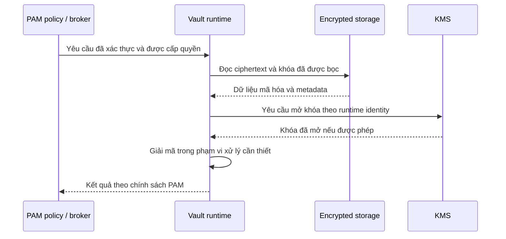

# PAM vault với KMS

## 1. Mục tiêu và phạm vi

Trong một hệ thống Privileged Access Management (PAM), vault giữ những bí mật có thể mở đường tới tài khoản quản trị, cơ sở dữ liệu và hạ tầng quan trọng. Khi vault dùng Key Management Service (KMS), câu hỏi cần giải quyết là: **ai được sử dụng khóa bảo vệ vault, trong hoàn cảnh nào, và làm sao khôi phục dịch vụ mà vẫn giữ được kiểm soát truy cập đặc quyền?**

Bài học thuộc chương **Secrets integration**, tập trung vào quan hệ giữa PAM vault và dịch vụ quản lý khóa. Sau bài này, người học có thể:

- Phân biệt credential của tài khoản đích, khóa mã hóa dữ liệu và khóa bảo vệ khóa.
- Giải thích mô hình envelope encryption và giới hạn của việc bảo vệ bằng KMS.
- Phân tách quyền quản trị vault, quyền sử dụng khóa và quyền quản trị KMS.
- Thiết kế đường khởi động vault không phụ thuộc vào chính secret đang bị khóa bên trong.
- Lập kế hoạch xoay khóa, phục hồi và thu thập bằng chứng kiểm toán.

Các ví dụ AWS KMS và HashiCorp Vault minh họa một cách triển khai cụ thể. HashiCorp Vault có thể cung cấp thành phần quản lý secret trong kiến trúc PAM, nhưng cấu hình auto-unseal của sản phẩm này không tự cung cấp toàn bộ các chức năng PAM như phê duyệt JIT, giới hạn lệnh JEA hay ghi hình phiên quản trị.

## 2. Ba loại tài sản thường bị nhầm lẫn

Giả sử PAM quản lý tài khoản `db-maintenance` dùng để bảo trì cơ sở dữ liệu. Có ít nhất ba lớp tài sản khác nhau:

| Tài sản | Ví dụ | Mục đích | Hệ quả khi bị lộ hoặc mất |
| --- | --- | --- | --- |
| Credential của tài khoản đích | Mật khẩu của `db-maintenance` | Đăng nhập vào hệ thống đích | Có thể bị dùng ngoài PAM nếu hệ thống đích vẫn chấp nhận |
| Data Encryption Key, viết tắt DEK | Khóa dùng để mã hóa bản ghi trong vault | Bảo vệ dữ liệu vault | Dữ liệu thuộc phạm vi khóa có thể bị giải mã khi có ciphertext tương ứng |
| Key Encryption Key, viết tắt KEK | Khóa KMS dùng để bảo vệ DEK hoặc khóa cấp cao của vault | Bảo vệ khóa khác | Mất khả năng dùng khóa có thể khiến vault không mở được dữ liệu cần thiết |

Một sản phẩm có thể có nhiều tầng khóa nội bộ hơn bảng trên. Không được suy ra rằng mọi PAM vault đều dùng một DEK cho mỗi secret, hoặc mọi lần đọc secret đều gọi KMS. Phải kiểm tra sơ đồ khóa của đúng sản phẩm và đúng chế độ triển khai.

Sự khác biệt này dẫn tới ba nghiệp vụ độc lập:

1. **Rotate credential:** thay mật khẩu, API token hoặc khóa SSH mà hệ thống đích chấp nhận.
2. **Rotate DEK:** thay khóa mã hóa dữ liệu theo cơ chế của vault.
3. **Rotate hoặc thay KEK:** thay vật liệu khóa trong KMS hoặc chuyển sang tài nguyên khóa khác.

Ví dụ, đổi KEK không làm mật khẩu `db-maintenance` đổi theo. Nếu mật khẩu đã bị lấy cắp, phải thay credential ở hệ thống đích và xử lý phiên hoặc token còn hiệu lực.

## 3. Vault và KMS chịu trách nhiệm gì?

### 3.1. Vai trò của PAM vault

Trong kiến trúc của bài học, PAM vault chịu trách nhiệm về dữ liệu và nghiệp vụ truy cập đặc quyền:

- Lưu, phân loại và gắn owner cho secret.
- Xác thực người dùng, workload hoặc thành phần broker.
- Kiểm tra quyền đọc, sử dụng, cấp phát hoặc cập nhật secret.
- Liên kết yêu cầu với ticket, mục đích, khoảng thời gian và phê duyệt.
- Phối hợp với connector để xoay credential ở hệ thống đích.
- Cung cấp bằng chứng về yêu cầu truy cập và kết quả xử lý.

Tùy sản phẩm, một số chức năng nằm ở control plane hoặc session broker thay vì tiến trình vault. Cần ghi đúng nơi thực thi kiểm soát để tránh chỉ kiểm tra giao diện mà bỏ sót API trực tiếp.

### 3.2. Vai trò của KMS

KMS cung cấp tài nguyên khóa và các phép toán mật mã được cấp quyền. Với kiến trúc phù hợp, vault không cần lưu KEK dưới dạng plaintext trong cùng cơ sở dữ liệu chứa secret.

Ví dụ, AWS KMS hỗ trợ customer managed key để khách hàng kiểm soát chính sách và vòng đời khóa. Việc chọn loại khóa phải dựa vào quyền quản lý, yêu cầu kiểm toán và khả năng tích hợp, thay vì chỉ nhìn tên gọi “KMS”. [Nguồn: AWS KMS keys](https://docs.aws.amazon.com/kms/latest/developerguide/concepts.html).

KMS không thay thế chính sách nghiệp vụ của PAM. KMS có thể thấy rằng một runtime role yêu cầu giải mã, nhưng không nhất thiết biết người dùng cuối đã được phê duyệt bảo trì máy chủ nào. PAM phải giữ thông tin đó và liên kết nó với hành vi sử dụng credential.

### 3.3. Ranh giới bảo vệ

Một bản sao cơ sở dữ liệu vault bị lấy cắp là tình huống khác với một tiến trình vault đang chạy bị chiếm quyền. KMS có thể tạo thêm rào cản cho việc giải mã bản sao dữ liệu, trong khi tiến trình đang chạy có thể đã có khóa hoặc secret trong bộ nhớ.

Vì vậy, đánh giá tích hợp phải xét đồng thời:

- Bảo vệ dữ liệu lưu trữ và bản sao lưu.
- Bảo vệ runtime identity có quyền dùng KMS.
- Giảm quyền trên host, container và công cụ quan sát tiến trình vault.
- Kiểm soát đường API, broker và connector đưa secret tới hệ thống đích.

## 4. Envelope encryption: mã hóa dữ liệu bằng khóa được bảo vệ

Một mô hình khái niệm thường gặp là:

```text
C_data = Encrypt(DEK, secret, metadata_đã_xác_thực)
C_key  = Wrap(KEK_trong_KMS, DEK)

Vault lưu: C_data + C_key + metadata cần để giải mã
Vault không lưu: DEK plaintext như một thuộc tính thông thường của bản ghi
```

Khi dùng AWS KMS `GenerateDataKey`, bên gọi có thể nhận một bản DEK plaintext và một bản DEK đã được mã hóa bởi KMS key. Ứng dụng dùng bản plaintext để mã hóa dữ liệu rồi loại bỏ nó khỏi bộ nhớ theo khả năng của môi trường chạy; bản mã hóa được giữ cùng dữ liệu. [Nguồn: GenerateDataKey](https://docs.aws.amazon.com/kms/latest/APIReference/API_GenerateDataKey.html).



Sơ đồ diễn tả một mẫu xử lý để hiểu trách nhiệm. Trong triển khai thực, vault có thể mở một khóa cấp cao lúc khởi động, sử dụng keyring nội bộ hoặc cache khóa. Không dùng sơ đồ này để kết luận số lần gọi KMS cho mỗi lần checkout.

### 4.1. Những gì phải đi cùng ciphertext

Đội thiết kế cần xác định rõ metadata nào là bắt buộc để đọc lại dữ liệu:

- Định danh khóa hoặc phiên bản khóa theo định dạng của sản phẩm.
- Định dạng envelope và thuật toán được hỗ trợ.
- Nonce, authentication tag và dữ liệu xác thực bổ sung nếu cơ chế mã hóa yêu cầu.
- Thông tin về tenant, môi trường hoặc phạm vi bản ghi mà thiết kế dùng để ràng buộc dữ liệu.

Metadata không nhất thiết là bí mật, nhưng vẫn phải được quản lý tính toàn vẹn. Làm mất metadata có thể khiến bản sao lưu còn nguyên byte nhưng không còn giải mã được.

Không tự xây dựng giao thức mã hóa cho PAM chỉ dựa trên công thức minh họa. Trong triển khai, dùng cơ chế được sản phẩm hỗ trợ và tài liệu hóa cách backup, restore, nâng cấp định dạng.

## 5. Phân biệt hai cách tích hợp với KMS

### 5.1. KMS bảo vệ khóa dùng khi mở vault

Trong cách này, KMS giúp mở lớp khóa cần thiết để vault hoạt động. Sau khi mở, vault có thể phục vụ một số nghiệp vụ bằng khóa đã có trong bộ nhớ, tùy sản phẩm.

Ví dụ, HashiCorp Vault hỗ trợ AWS KMS auto-unseal. Cấu hình `seal "awskms"` xác định cơ chế seal; quyền mà tài liệu connector liệt kê gồm `kms:Encrypt`, `kms:Decrypt`, `kms:DescribeKey`. Cơ chế seal wrapping của Vault Enterprise còn có phụ thuộc KMS trong vận hành. [Nguồn: AWS KMS seal configuration](https://developer.hashicorp.com/vault/docs/configuration/seal/awskms).

Điểm cần đo khi thử nghiệm là tác động của mất KMS tới từng trạng thái: node đang chạy, node mới khởi động, node chuyển vai trò và cụm phục hồi từ snapshot. Những trạng thái này có thể cho kết quả khác nhau.

### 5.2. KMS tham gia xử lý dữ liệu hoặc khóa trong runtime

Một số tích hợp dùng KMS để bọc hoặc mở các khóa theo bản ghi, nhóm dữ liệu hoặc thao tác. Độ trễ, hạn mức và lỗi của KMS khi đó có thể xuất hiện trực tiếp trên đường xử lý yêu cầu.

Khi khảo sát một PAM vault, cần lấy câu trả lời cụ thể cho các câu hỏi:

| Câu hỏi | Vì sao phải biết? |
| --- | --- |
| KMS bảo vệ đối tượng khóa nào? | Xác định phạm vi dữ liệu phụ thuộc vào khóa |
| Khi nào vault gọi KMS? | Ước lượng tải và tác động của gián đoạn |
| Có cache không, trong bao lâu? | Đánh giá độ trễ và thời gian quyền bị thu hồi phát huy tác dụng |
| Metadata khóa được lưu ở đâu? | Đảm bảo restore không thiếu thông tin |
| Có hỗ trợ đổi KMS key không? | Xây dựng kế hoạch thay khóa và rollback |
| Những bản backup cũ cần khóa nào? | Tránh xóa khóa còn cần cho phục hồi |

Không suy luận câu trả lời từ một tùy chọn giao diện mang tên “customer key” hoặc “auto-unseal”.

## 6. Thiết kế identity để tránh phụ thuộc vòng tròn

Một lỗi thiết kế dễ gặp:

```text
Vault cần credential để gọi KMS
        ↓
Credential đó chỉ được lưu trong vault đang sealed
        ↓
Không có cách mở vault để lấy credential
```

Đường khởi động nên dựa vào một identity do nền tảng cấp và kiểm soát độc lập với dữ liệu đang bị khóa. Trong mô hình AWS, đó có thể là role gắn với workload hoặc máy chủ, miễn connector và môi trường triển khai hỗ trợ cách lấy credential tương ứng.

Thiết kế đề xuất cho hệ thống giả định:

1. Runtime identity của vault chỉ có quyền mật mã cần thiết trên khóa của đúng môi trường.
2. Trust policy giới hạn nguồn có thể nhận identity đó.
3. Người vận hành phải đi qua quy trình JIT để thay cấu hình runtime hoặc triển khai mã mới lên vault.
4. Đường cấp identity tiếp tục hoạt động khi vault chưa mở.
5. Hoạt động assume role hoặc cấp identity có log và có owner.

Thời hạn ngắn của credential không tự giải quyết việc trust policy quá rộng. Nếu workload ngoài phạm vi có thể nhận cùng role, nó có thể tiếp tục lấy phiên mới.

### 6.1. Không để CI/CD trở thành đường vòng vào vault

Pipeline triển khai thường có quyền thay image, cấu hình hoặc service account của vault. Dù pipeline không có `kms:Decrypt`, quyền triển khai mã chạy dưới runtime role vẫn có thể trở thành quyền sử dụng khóa một cách gián tiếp.

Vì vậy, trong mô hình đe dọa cần coi các quyền sau là đặc quyền liên quan tới vault:

- Sửa image hoặc binary chạy trên node vault.
- Gắn, đổi hoặc giả mạo runtime identity.
- Thay trust policy của role.
- Đọc bộ nhớ, tạo core dump hoặc gắn debugger vào tiến trình.
- Sửa cấu hình audit hoặc chuyển hướng nơi nhận log.

Đây là lý do phân quyền KMS phải đi cùng kiểm soát quản trị hạ tầng và chuỗi triển khai.

## 7. Least privilege và phân tách nhiệm vụ

### 7.1. Ma trận trách nhiệm đề xuất

| Vai trò | Quyền cần có trong thiết kế | Quyền cần tách hoặc kiểm soát chặt |
| --- | --- | --- |
| Vault runtime | Dùng đúng khóa cho cơ chế tích hợp đã chọn | Đổi key policy, xóa khóa, tạo quyền dùng khóa tùy ý |
| Quản trị PAM | Quản lý chính sách và quy trình PAM theo phạm vi | Tự cấp quyền KMS hoặc tự sửa runtime role |
| Quản trị khóa | Quản lý vòng đời khóa theo change được duyệt | Dùng khóa để giải mã dữ liệu nghiệp vụ ngoài quy trình |
| Quản trị nền tảng | Duy trì node, mạng, identity của workload | Truy cập tùy ý vào bộ nhớ hoặc thay mã vault |
| Kiểm toán | Đọc metadata, lịch sử change và log được phân quyền | Đọc plaintext secret hoặc thực hiện phép giải mã |

Ma trận là mục tiêu thiết kế, không phải đảm bảo tự có chỉ vì đã tạo nhiều role. Ví dụ, người được sửa key policy có thể tự cấp quyền sử dụng khóa nếu không có lớp kiểm soát khác. Cần kiểm tra quyền hiệu lực, khả năng tự nâng quyền và các đường gián tiếp qua quản trị identity.

### 7.2. Ví dụ identity policy cho connector auto-unseal

Đoạn JSON sau minh họa quyền của runtime role cho connector AWS KMS đã nêu. Account, region và key ARN đều là giá trị ví dụ; phải thay bằng tài nguyên lab được phê duyệt.

```json
{
  "Version": "2012-10-17",
  "Statement": [
    {
      "Sid": "UseOnlyTheAssignedVaultSealKey",
      "Effect": "Allow",
      "Action": [
        "kms:Encrypt",
        "kms:Decrypt",
        "kms:DescribeKey"
      ],
      "Resource": "arn:aws:kms:ap-southeast-1:111122223333:key/12345678-1234-1234-1234-123456789012"
    }
  ]
}
```

Đây là một identity policy, chưa phải toàn bộ cấu hình cấp quyền. AWS KMS dùng key policy làm cơ chế kiểm soát nền tảng; việc IAM policy có cấp được quyền hay không còn phụ thuộc key policy và các điều kiện áp dụng. Explicit deny và các lớp kiểm soát tổ chức cũng cần được xét trong đánh giá quyền hiệu lực. [Nguồn: Key policies in AWS KMS](https://docs.aws.amazon.com/kms/latest/developerguide/key-policies.html).

Không bổ sung `kms:*` để “cho chạy trước”. Nếu một thao tác bị từ chối, xác định thao tác API, principal, key ARN và lớp policy gây lỗi. Connector auto-unseal này cũng không cần được cấp `GenerateDataKey` chỉ vì bài học có giải thích envelope encryption.

### 7.3. Ràng buộc ngữ cảnh khi tích hợp hỗ trợ

AWS KMS encryption context là tập cặp khóa–giá trị không bí mật, được ràng buộc với ciphertext; giải mã cần dùng đúng context. Context có thể xuất hiện trong CloudTrail, nên không đưa mật khẩu, token hoặc dữ liệu nhạy cảm vào đó. [Nguồn: Encryption context](https://docs.aws.amazon.com/kms/latest/developerguide/encrypt_context.html).

Ví dụ context khái niệm cho một connector có hỗ trợ:

```json
{
  "application": "pam-vault",
  "environment": "training",
  "security-domain": "privileged-access"
}
```

Context không thay thế xác thực: một caller có thể tự gửi chuỗi `environment=training` nếu policy và thiết kế không ràng buộc caller đúng cách. Cũng không được tự thêm điều kiện encryption context vào policy của một connector chưa được xác nhận có gửi context đó; kết quả có thể là vault mất khả năng mở khóa.

## 8. Ví dụ cấu hình HashiCorp Vault với AWS KMS

Đây là đoạn cấu hình **chỉ cho phần seal** trong lab, không phải cấu hình hoàn chỉnh để triển khai một cụm vault:

```hcl
seal "awskms" {
  region     = "ap-southeast-1"
  kms_key_id = "arn:aws:kms:ap-southeast-1:111122223333:key/12345678-1234-1234-1234-123456789012"
}
```

Cấu hình không nhúng static access key. Trong tình huống lab, tiến trình nhận credential của runtime role qua cơ chế nền tảng và credential provider mà connector hỗ trợ. Các thông số của `seal` cần đối chiếu với phiên bản sản phẩm đang cài. [Nguồn: Tham số và xác thực của awskms seal](https://developer.hashicorp.com/vault/docs/configuration/seal/awskms).

Những thành phần vẫn phải có trong một triển khai đầy đủ gồm storage, TLS listener, cấu hình cluster, mạng, audit, giám sát và quy trình initialization. Auto-unseal không thay thế các thành phần đó.

### 8.1. Kiểm tra identity và metadata trước khi mở vault

Các lệnh dưới đây chỉ minh họa kiểm tra metadata. Chạy dưới đúng identity của môi trường lab; không cần tạo hoặc hiển thị secret để thực hiện bước này.

```bash
aws sts get-caller-identity

aws kms describe-key \
  --region ap-southeast-1 \
  --key-id arn:aws:kms:ap-southeast-1:111122223333:key/12345678-1234-1234-1234-123456789012 \
  --query 'KeyMetadata.{Arn:Arn,State:KeyState,Usage:KeyUsage,Spec:KeySpec}'
```

Cần xác nhận:

- Principal thực tế đúng runtime identity dự kiến, không phải tài khoản quản trị đang đăng nhập trên máy cá nhân.
- Account và region đúng với khóa đã cấu hình.
- Loại khóa, trạng thái và mục đích sử dụng phù hợp connector.
- Đường DNS, TLS và endpoint policy cho phép kết nối cần thiết.

`DescribeKey` thành công chỉ chứng minh quyền và đường truy cập cho thao tác đó. Nó không chứng minh `Decrypt` hoặc toàn bộ quá trình unseal sẽ thành công. Kiểm thử chức năng phải thực hiện bằng luồng được sản phẩm hỗ trợ và dữ liệu lab.

### 8.2. Trường hợp vault đã có dữ liệu

Thêm hoặc thay đoạn `seal` vào một cụm hiện hữu có thể là thay đổi cơ chế seal, cần quy trình migration tương ứng. Không coi đây là một chỉnh sửa cấu hình thông thường rồi khởi động lại cả cụm.

Hồ sơ change nên có phiên bản sản phẩm, cơ chế seal hiện tại, cơ chế đích, bản backup trước đổi, quyền dùng khóa cũ và mới, thứ tự thao tác, điều kiện dừng và cách phục hồi. Nếu không có quy trình được hỗ trợ cho trường hợp cụ thể, chưa triển khai thay đổi đó lên dữ liệu thật.

## 9. Xoay khóa mà không làm mất dữ liệu

### 9.1. Phân biệt các thao tác

| Thao tác | Thay đổi chính | Không được mặc định suy ra |
| --- | --- | --- |
| Xoay vật liệu của một KMS key | Vật liệu mật mã mới dưới tài nguyên khóa hiện hữu | Mọi ciphertext cũ đã được ghi lại |
| Chuyển sang KMS key khác | Tài nguyên khóa bảo vệ thay đổi | Dữ liệu và backup cũ không còn cần khóa trước |
| Rewrap | Lớp bọc khóa được đổi theo cơ chế hỗ trợ | Plaintext secret đã thay hoặc DEK đã thay |
| Rotate DEK | Khóa mã hóa dữ liệu được đổi | Mọi dữ liệu lịch sử đều đã được mã hóa lại ngay |
| Rotate credential | Credential của tài khoản đích được thay | Phiên đăng nhập hoặc token đã cấp đều bị chấm dứt |

Với AWS KMS, xoay vật liệu khóa không tự xoay data key và không tự mã hóa lại dữ liệu. KMS vẫn chọn vật liệu phù hợp để giải mã ciphertext cũ thuộc tài nguyên khóa đó. [Nguồn: Rotate AWS KMS keys](https://docs.aws.amazon.com/kms/latest/developerguide/rotate-keys.html).

### 9.2. Quy trình chuyển sang khóa mới đề xuất

Ví dụ này là khung lập kế hoạch, không thay thế quy trình migration của sản phẩm:

1. **Kiểm kê phụ thuộc:** xác định dữ liệu hiện hành, snapshot, bản sao DR và cấu hình còn tham chiếu khóa cũ.
2. **Chuẩn bị khóa mới:** owner rõ ràng; runtime có quyền cần thiết; quản trị vòng đời đi qua change control.
3. **Thử phục hồi trên lab:** dùng dữ liệu giả lập để kiểm tra cả trạng thái trước và sau chuyển đổi.
4. **Đặt điều kiện dừng:** tỷ lệ lỗi mở khóa, lỗi đọc secret cũ, lỗi ghi secret mới hoặc node không tham gia được cụm.
5. **Thực hiện theo tài liệu sản phẩm:** không tự sửa key ID trong storage hoặc chỉnh ciphertext bằng công cụ riêng.
6. **Xác minh phạm vi:** đọc được dữ liệu cũ, ghi và đọc dữ liệu mới, khởi động được node thử nghiệm, phục hồi được backup thuộc các mốc cần giữ.
7. **Giữ khả năng dùng khóa cũ:** cho tới khi có bằng chứng toàn bộ phụ thuộc cần duy trì đã được xử lý.
8. **Đóng change:** lưu kết quả, người thực hiện, phê duyệt và các ngoại lệ còn tồn tại.

AWS KMS có API `ReEncrypt` cho ciphertext tương thích với KMS; API này không phải công cụ chung để sửa định dạng storage của mọi vault. Chỉ dùng nó trong luồng được connector hoặc nhà cung cấp hỗ trợ. [Nguồn: ReEncrypt](https://docs.aws.amazon.com/kms/latest/APIReference/API_ReEncrypt.html).

### 9.3. Vì sao đổi alias chưa đủ?

Alias là tên tham chiếu, không phải bằng chứng rằng mọi dữ liệu cũ đã được chuyển sang khóa mới. Một hệ thống có thể dùng alias cho ghi mới nhưng vẫn cần khóa cũ để đọc dữ liệu trước đó.

Vì vậy, tiêu chí hoàn thành phải dựa trên khả năng đọc và phục hồi dữ liệu thuộc phạm vi yêu cầu. Chỉ chụp ảnh alias đang trỏ tới khóa mới không đáp ứng tiêu chí đó.

## 10. Tính sẵn sàng và khôi phục sau thảm họa

### 10.1. Nhiều node vault không loại bỏ phụ thuộc KMS

Ba node vault cùng phụ thuộc một đường identity, một endpoint hoặc một khóa bị vô hiệu hóa vẫn có thể chịu lỗi chung. Đánh giá khả dụng phải bao gồm chuỗi phụ thuộc:

```text
Vault node
  → Cấp identity cho workload
  → DNS / network / TLS / endpoint policy
  → KMS và quyền dùng đúng khóa
  → Storage / key metadata
  → Khả năng mở và phục vụ vault
```

Thử nghiệm nên tách các tình huống: mất một node, mất đường tới KMS, runtime identity hết hiệu lực, thay policy sai và phục hồi ở môi trường DR. Không dùng kết quả “cụm vẫn trả health check” để suy ra mọi chức năng đã hoạt động.

### 10.2. Backup cần cả dữ liệu lẫn khả năng dùng khóa

Một gói phục hồi thực tế cần xác định:

- Snapshot hoặc backup của đúng thời điểm và đúng cụm.
- Cấu hình và metadata cần để nhận diện khóa.
- Identity có thể được cấp tại nơi phục hồi.
- Quyền dùng các khóa mà backup còn phụ thuộc.
- Kết nối tới dịch vụ khóa, storage và các dependency liên quan.
- Quy trình khôi phục, chủ sở hữu và người có quyền phê duyệt.

Với HashiCorp Vault auto-unseal, recovery key shares không thay thế khả năng giải mã của cơ chế seal. Nếu khóa KMS cần thiết bị mất vĩnh viễn, giữ recovery shares và snapshot cũng không đủ để khôi phục cụm theo cơ chế đó. [Nguồn: Seal/Unseal và recovery keys](https://developer.hashicorp.com/vault/docs/concepts/seal).

Từ giới hạn trên, thiết kế đề xuất là tách lưu trữ backup, quản trị khóa và quyền xóa khóa; đồng thời diễn tập phục hồi có kiểm chứng. Không hứa khả năng DR chỉ vì dữ liệu đã được sao chép sang một region khác.

### 10.3. Không dùng xóa khóa làm thao tác thu hồi thông thường

AWS KMS cho phép đặt lịch xóa customer managed key với thời gian chờ. Khóa ở trạng thái chờ xóa không dùng được cho phép toán mật mã; sau khi xóa, việc mất khóa có thể làm dữ liệu phụ thuộc không phục hồi được. [Nguồn: Delete an AWS KMS key](https://docs.aws.amazon.com/kms/latest/developerguide/deleting-keys.html).

Trong PAM, thu hồi một người dùng nên bắt đầu ở identity, policy, phiên và credential thuộc phạm vi sự cố. Tác động lên khóa bảo vệ toàn vault là quyết định khác, cần hiểu phạm vi gián đoạn và phụ thuộc backup.

## 11. Xử lý sự cố theo đúng lớp kiểm soát

| Biểu hiện | Hướng kiểm tra | Điều cần tránh |
| --- | --- | --- |
| Node mới không auto-unseal | Principal, key ARN, trạng thái khóa, quyền KMS và đường kết nối | Khởi động lại toàn bộ các node còn phục vụ được |
| `AccessDenied` khi gọi KMS | Identity thực tế, key policy, IAM policy, deny và grant liên quan | Mở toàn bộ `kms:*` trên mọi khóa |
| Timeout hoặc throttling | Endpoint, DNS, tải gọi, retry và giới hạn đang áp dụng | Retry không giới hạn gây tăng tải dây chuyền |
| Chỉ dữ liệu cũ không đọc được | Khóa cũ, metadata và kết quả migration | Xóa khóa cũ vì đã đổi alias |
| Credential đã checkout vẫn dùng được sau khi thu hồi quyền vault | Trạng thái credential, phiên và chính sách ở hệ thống đích | Cho rằng chặn KMS sẽ thu hồi secret đã phát ra |
| Restore có storage nhưng vault không mở | Seal dependency, identity DR, metadata và khóa mà backup cần | Khởi tạo cụm mới để thay thế dữ liệu phục hồi một cách tùy tiện |

### 11.1. Ví dụ sự cố runtime role bị lạm dụng

Giả sử điều tra phát hiện một workload ngoài vault có thể assume runtime role. Phạm vi ứng phó đề xuất gồm:

1. Xác định đường trust bị lạm dụng và ngăn việc nhận thêm identity trái phép.
2. Thu thập log sử dụng role, thay đổi policy và phép toán KMS trong khoảng nghi vấn.
3. Kiểm tra workload đó có đọc được storage, backup, bộ nhớ hay API vault không.
4. Xác định secret nào có khả năng bị lộ và thay credential ở hệ thống đích theo mức ưu tiên.
5. Xem xét thu hồi phiên và token còn tồn tại bằng cơ chế của hệ thống liên quan.
6. Khôi phục quyền runtime hợp lệ và kiểm thử trước khi tái đưa dịch vụ vào đầy đủ.

Không phải mọi lời gọi KMS đáng ngờ đều chứng minh secret đã bị lấy. Ngược lại, không có lời gọi mới cũng chưa chứng minh an toàn nếu attacker đã có dữ liệu plaintext hoặc khóa cache trước đó. Kết luận phải dựa trên chuỗi bằng chứng.

## 12. Audit: liên kết quyền truy cập với phép toán mật mã

Thiết kế bằng chứng nên trả lời được ba nhóm câu hỏi:

1. **PAM:** ai yêu cầu quyền, được duyệt phạm vi nào, trong bao lâu, bằng ticket nào?
2. **Vault:** identity nào đọc hoặc sử dụng secret nào, qua đường nào, kết quả gì?
3. **KMS và hạ tầng:** principal nào dùng khóa nào, thay policy nào, từ deployment nào?

AWS KMS tích hợp CloudTrail để ghi các hoạt động quản trị và mật mã. Cần kiểm tra cấu hình lưu log vì một trail có thể loại trừ sự kiện KMS; một số trường nhạy cảm như plaintext và kết quả mật mã không được ghi vào event. [Nguồn: Logging AWS KMS API calls with AWS CloudTrail](https://docs.aws.amazon.com/kms/latest/developerguide/logging-using-cloudtrail.html).

### 12.1. Mẫu liên kết bằng chứng

```text
Change hoặc ticket: CHG-TRAINING-104
Yêu cầu PAM: req-7f2a
Secret reference: pam/training/db-maintenance
Vault node hoặc cluster: vault-training-a
Runtime role: pam-vault-training-runtime
KMS key ARN: khóa training được phê duyệt
Khoảng thời gian: từ bắt đầu đến kết thúc thao tác, theo UTC
Kết quả: được phép / từ chối / lỗi dependency
```

Các giá trị trên chỉ là metadata minh họa. Không lưu plaintext credential, DEK hoặc recovery shares vào ticket để chứng minh thao tác đã thành công.

Việc đối chiếu không nhất thiết theo tỷ lệ một-một: một lần unseal có thể phục vụ nhiều lần đọc secret. Cần ghi rõ mô hình tích hợp và khoảng thời gian liên quan để tránh gán một KMS event cho người dùng cuối chỉ dựa trên thời điểm gần nhau.

### 12.2. Tín hiệu vận hành đề xuất

- Tăng đột biến lỗi KMS theo principal, key ARN và mã lỗi.
- Thay key policy, trust policy, grant hoặc alias ngoài cửa sổ change.
- Khóa bị disable hoặc lên lịch xóa.
- Node không mở được sau rollout.
- Tăng độ trễ cấp secret khi đường xử lý có phụ thuộc KMS.
- Backup hoặc diễn tập restore không đạt mục tiêu thời gian phục hồi.
- Audit pipeline bị gián đoạn hoặc thay cấu hình lưu sự kiện.

Ngưỡng phải được xây từ baseline của từng môi trường. Tỷ lệ gọi KMS cao có thể là dấu hiệu workload khởi động lại liên tục, thay vì nhiều người đang đọc secret.

## 13. Bài thực hành thiết kế và kiểm chứng trong lab

### 13.1. Bối cảnh

Một nhóm vận hành cần bảo vệ vault chứa credential bảo trì của các máy chủ lab. Nhóm muốn dùng một KMS key riêng cho môi trường training, runtime identity ngắn hạn và phê duyệt JIT cho mọi thay đổi quản trị khóa.

Dữ liệu thực hành là secret giả, không đăng nhập được vào hạ tầng thật. Các thao tác gây gián đoạn chỉ thực hiện trên cụm lab có thể phục hồi. Bài thực hành không yêu cầu hiển thị secret hoặc tạo tài khoản quản trị trên hệ thống production.

### 13.2. Các bước

1. Vẽ ranh giới giữa PAM policy, vault, storage, runtime identity, KMS và hệ thống đích.
2. Chọn cơ chế tích hợp và ghi rõ khóa KMS bảo vệ đối tượng nào.
3. Lập ma trận quyền của runtime, quản trị PAM, quản trị khóa, nền tảng và kiểm toán.
4. Xác nhận đường cấp identity hoạt động khi vault chưa mở.
5. Kiểm tra key metadata và quyền hiệu lực theo cấu hình connector.
6. Mở vault theo quy trình lab; ghi và đọc một secret giả qua policy cho phép.
7. Chạy yêu cầu từ một identity không thuộc phạm vi; xác nhận bị từ chối ở lớp dự kiến.
8. Thử khởi động lại một node lab theo quy trình sản phẩm; xác nhận cơ chế mở khóa và khả năng phục vụ.
9. Mô phỏng mất đường KMS trên phạm vi đã cô lập; ghi tác động lên node đang chạy và node mới mở.
10. Khôi phục kết nối và xác minh phục hồi mà không mở rộng quyền runtime.
11. Thực hiện diễn tập restore từ bản backup được chọn và kiểm chứng dữ liệu giả còn đọc được.
12. Lưu bằng chứng đã loại bỏ secret và đóng quyền JIT sau bài thực hành.

### 13.3. Tiêu chí nghiệm thu

| Tiêu chí | Bằng chứng cần thu |
| --- | --- |
| Runtime dùng đúng khóa | Metadata khóa và principal thực tế |
| Identity ngoài phạm vi bị từ chối | Kết quả phép thử âm và log tương ứng |
| Không có phụ thuộc vòng tròn | Sơ đồ bootstrap và kết quả khởi động |
| Thay đổi có thể kiểm toán | Change, phê duyệt, log và người thực hiện |
| Hiểu tác động khi mất KMS | Bảng quan sát theo trạng thái node và nghiệp vụ |
| Backup thực sự phục hồi được | Mốc backup, dependency cần thiết và kết quả đọc dữ liệu giả |
| Credential không bị đưa vào bằng chứng | Kiểm tra artifact thực hành chỉ chứa metadata cần thiết |

Không đánh dấu đạt chỉ vì cấu hình chứa đúng key ARN. Kết quả cần chứng minh cả đường hợp lệ lẫn các đường phải bị từ chối.

## 14. Tình huống phân tích: có backup nhưng không mở được vault

Một nhóm đã chuyển vault từ khóa A sang khóa B. Dữ liệu mới hoạt động bình thường nên họ kết luận khóa A không còn cần thiết. Sáu tháng sau, cần phục hồi snapshot được tạo trước khi chuyển đổi, nhưng khóa A không còn sử dụng được.

Phân tích theo từng lớp:

- **Dữ liệu:** snapshot cũ có thể vẫn mang khóa hoặc metadata phụ thuộc A.
- **Identity:** runtime ở nơi phục hồi có thể chỉ được phép dùng B.
- **Vòng đời khóa:** việc giữ B không tự phục hồi được chức năng của A.
- **Bằng chứng:** đọc thành công dữ liệu mới sau change chỉ xác minh một phần phạm vi.

Biện pháp thiết kế rút ra là theo dõi phụ thuộc khóa của các thế hệ backup và đưa restore lịch sử vào tiêu chí hoàn thành migration. Nếu cần chấm dứt phụ thuộc A, phải có quy trình xử lý những bản backup đó được sản phẩm hỗ trợ, hoặc thay đổi phạm vi lưu giữ theo quyết định đã được phê duyệt. Không giả định có thể chỉnh key ID trong snapshot để biến nó thành dữ liệu được bảo vệ bởi B.

## 15. Những điểm cần nhớ

- PAM kiểm soát việc sử dụng quyền đặc biệt; vault quản lý secret; KMS bảo vệ khóa và thực hiện phép toán được cấp quyền.
- Bảo vệ bằng KMS cần đi cùng kiểm soát runtime identity, quyền triển khai và quyền quản trị nền tảng.
- Xoay credential, xoay DEK và xoay KEK là những thao tác có mục tiêu khác nhau.
- Thu hồi quyền dùng KMS không tự xóa secret đã phát ra, khóa trong bộ nhớ hoặc phiên đang tồn tại ở hệ thống đích.
- Tích hợp chỉ hoàn chỉnh khi đã kiểm chứng quyền tối thiểu, đường bootstrap, xử lý mất dependency, phục hồi backup và bằng chứng kiểm toán.
