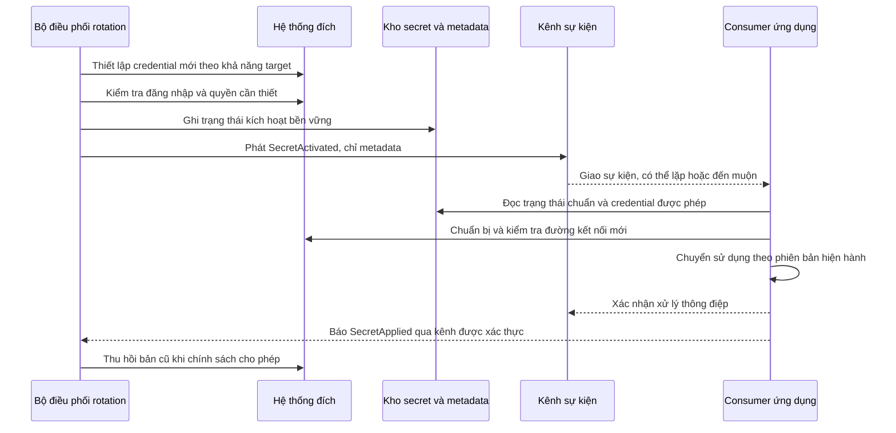

# Secret rotation event

## 1. Mục tiêu và tình huống thực tế

Trong hệ thống quản lý truy cập đặc quyền (PAM), đổi mật khẩu tài khoản dịch vụ trong vault chưa đủ để hoàn thành một lần luân chuyển bí mật. Ứng dụng có thể vẫn giữ mật khẩu cũ trong bộ nhớ, connection pool tiếp tục tạo kết nối bằng credential cũ, còn hệ thống giám sát chỉ nhìn thấy thao tác đổi mật khẩu thành công.

**Secret rotation event** là sự kiện thông báo một thay đổi có ý nghĩa trong vòng đời luân chuyển bí mật. Nó giúp các thành phần liên quan biết khi nào cần tải lại credential, xác nhận đã chuyển phiên bản, điều tra lỗi hoặc thu thập bằng chứng kiểm toán.

Ví dụ, dịch vụ thanh toán dùng tài khoản cơ sở dữ liệu do PAM quản lý. Sau khi credential mới được kiểm tra và công bố để sử dụng, một sự kiện kích hoạt được phát ra. Mỗi instance của dịch vụ nhận thông báo, lấy credential qua kênh được cấp quyền, chuẩn bị connection pool mới và chuyển lưu lượng. Credential cũ chỉ được thu hồi khi đáp ứng chính sách chuyển đổi, hoặc bị thu hồi ngay theo quy trình ứng phó sự cố đã được phê duyệt.

Sau bài học, người học có thể:

- Phân biệt yêu cầu rotation, kết quả rotation và tín hiệu consumer đã áp dụng credential.
- Thiết kế payload sự kiện không mang giá trị bí mật.
- Xử lý sự kiện trùng, đến muộn và sai thứ tự mà không đưa ứng dụng về credential cũ.
- Phối hợp reload, kiểm tra sức khỏe, thu hồi credential và lưu bằng chứng theo nguyên tắc least privilege.
- Xác định việc cần làm khi sự kiện thất lạc, consumer lỗi hoặc credential cũ bị nghi lộ.

## 2. Sự kiện biểu đạt điều gì?

Một yêu cầu như “hãy đổi secret này” là **command**. Một thông báo như “credential mới đã được công bố để sử dụng” là **event**. Consumer cần hiểu đúng ý nghĩa của từng loại, thay vì coi mọi thông báo có chữ `rotation` đều là tín hiệu tải lại.

Các tên dưới đây là quy ước minh họa cho bài học, không phải schema bắt buộc của một sản phẩm cụ thể.

| Loại thông điệp | Ý nghĩa | Hành động thường gặp |
| --- | --- | --- |
| `RotationRequested` | Một lần rotation được yêu cầu | Điều phối công việc, kiểm tra chính sách và phê duyệt |
| `RotationStarted` | Quy trình rotation đã bắt đầu | Theo dõi tiến độ; chưa yêu cầu ứng dụng dùng credential mới |
| `CandidateValidated` | Credential ứng viên vượt qua kiểm tra đã định | Chuẩn bị công bố theo chính sách; không mặc nhiên coi đã active |
| `SecretActivated` | Credential mới đã được công bố cho consumer sử dụng | Consumer kiểm tra trạng thái chuẩn và tải lại nếu cần |
| `SecretApplied` | Một consumer cụ thể xác nhận đã chuyển sang bản mới | Ghi nhận hội tụ, hỗ trợ quyết định thu hồi |
| `PreviousCredentialRevoked` | Credential trước đó đã bị vô hiệu hóa ở hệ thống đích | Đối chiếu bằng chứng, phát hiện consumer còn dùng bản cũ |
| `RotationFailed` | Một giai đoạn rotation gặp lỗi | Cảnh báo và xử lý theo trạng thái thực tế |

`SecretActivated` không chứng minh mọi consumer đã cập nhật. `SecretApplied` của một instance cũng không chứng minh toàn bộ cụm đã cập nhật. `PreviousCredentialRevoked` không tự động chứng minh phiên đăng nhập đã mở bằng credential cũ cũng đã bị kết thúc.

Phải định nghĩa rõ từ “hoàn tất”: hoàn tất thay đổi tại nguồn, hoàn tất chuyển đổi của consumer, hay hoàn tất cả thu hồi và đối soát. Nếu chỉ có một trạng thái `SUCCESS` chung, đội vận hành khó biết phần nào của quy trình còn thiếu.

## 3. Các thành phần và ranh giới tin cậy

Một mô hình tích hợp gồm năm nhóm trách nhiệm:

| Thành phần | Trách nhiệm | Quyền cần thiết |
| --- | --- | --- |
| Bộ điều phối rotation | Thực hiện các bước đổi và kiểm tra credential | Quyền rotation giới hạn trên đúng tài khoản, secret và môi trường |
| Kho secret và trạng thái chuẩn | Giữ credential, phiên bản và metadata kích hoạt | Áp dụng chính sách đọc/ghi riêng cho từng workload |
| Broker hoặc kênh sự kiện | Chuyển metadata tới subscriber | Publish/subscribe theo topic và phạm vi tài nguyên |
| Consumer ứng dụng | Tải credential được phép, chuyển sử dụng và báo kết quả | Đọc đúng secret bằng workload identity; không cần quyền rotation |
| Hệ thống audit và giám sát | Lưu dấu vết, phát hiện chậm hội tụ và bất thường | Đọc metadata cần thiết; không mặc nhiên được đọc secret |

Broker không phải nơi phân phối mật khẩu. Sự kiện chỉ mang định danh và metadata cần để consumer quyết định có cần kiểm tra nguồn chuẩn hay không. Giá trị secret đi qua kênh truy xuất được xác thực và phân quyền riêng.

Một consumer có thể được phép nghe sự kiện của một nhóm tài nguyên nhưng chỉ được đọc một secret cụ thể. Quyền nghe sự kiện không được biến thành quyền đọc mọi đường dẫn được nêu trong payload. Consumer phải đối chiếu tài nguyên với cấu hình và chính sách đã được cấp trước.

## 4. Vòng đời rotation và thời điểm phát sự kiện

Một quy trình có thể mô tả bằng các trạng thái:

```text
REQUESTED
   -> PREPARING
   -> CANDIDATE_CREATED
   -> TARGET_UPDATED
   -> VALIDATED
   -> ACTIVATED
   -> CONSUMERS_CONVERGED
   -> PREVIOUS_REVOKED
   -> CLOSED
```

Đây là mô hình khái niệm. Thứ tự thao tác cụ thể phụ thuộc vào khả năng của hệ thống đích. Khi target chỉ chấp nhận một mật khẩu tại một thời điểm, việc đổi mật khẩu có thể vô hiệu hóa mật khẩu cũ ngay trước khi consumer kịp cập nhật; không thể tự thêm một “khoảng chồng lấn” chỉ bằng thay đổi metadata trong vault.

Ngược lại, target có thể cho phép hai credential, hai tài khoản thay phiên hoặc một cơ chế tương đương. Khi đó có thể tạo và kiểm tra bản mới trước, chuyển consumer rồi thu hồi bản cũ. Khả năng này cần được kiểm chứng trên target, không suy ra từ việc vault có nhiều version.

Sự kiện kích hoạt chỉ nên phát sau khi trạng thái kích hoạt đã được ghi bền vững và các điều kiện đã định được thỏa mãn. Không phát thông báo “đã active” ngay khi tạo xong một giá trị ngẫu nhiên.



Với target chỉ hỗ trợ một credential, sơ đồ trên không hứa hẹn hoạt động liên tục trong khoảng đổi mật khẩu và chuyển consumer. Quy trình phải có cơ chế phối hợp, khả năng retry và ngân sách gián đoạn phù hợp; hoặc thay đổi thiết kế tài khoản nếu yêu cầu tính sẵn sàng cao hơn.

## 5. Thiết kế payload không chứa bí mật

Một sự kiện kích hoạt minh họa:

```json
{
  "schemaVersion": 1,
  "eventId": "evt-demo-8042",
  "eventType": "SecretActivated",
  "source": "pam-rotation-controller",
  "environment": "production",
  "secretResourceId": "secret-payment-db",
  "activationRevision": 42,
  "activeVersionId": "version-b",
  "previousVersionId": "version-a",
  "rotationId": "rot-demo-117",
  "correlationId": "change-demo-208",
  "occurredAt": "2026-04-12T08:30:00Z",
  "publishedAt": "2026-04-12T08:30:02Z",
  "reason": "scheduled",
  "producerIdentity": "workload-pam-rotator"
}
```

Các ID trong ví dụ là dữ liệu giả. Những trường quan trọng cần được quy định trong hợp đồng tích hợp:

- `eventId`: nhận diện một sự kiện để phát hiện giao trùng. Việc producer tạo lại một event ID khác cho cùng kết quả nghiệp vụ vẫn có thể xảy ra, nên consumer không chỉ dựa vào trường này.
- `secretResourceId`: định danh tài nguyên ổn định để đối chiếu với danh sách được phép. Không bắt buộc dùng đường dẫn vault lộ cấu trúc nội bộ.
- `activationRevision`: số thứ tự tăng đơn điệu do nguồn trạng thái chuẩn cấp cho từng secret. Đây là quy ước thiết kế của ví dụ, không phải đặc tính mặc định của mọi vault.
- `activeVersionId`: định danh phiên bản credential. Không so sánh thứ tự từ điển của các version ID để suy ra bản mới hơn.
- `rotationId`: gom các bước thuộc một lần rotation. `correlationId` liên kết với change, incident hoặc luồng nghiệp vụ liên quan.
- `occurredAt` và `publishedAt`: giúp đo độ trễ; đồng hồ và thời điểm đến không thay thế được thứ tự kích hoạt chuẩn.

Không đưa mật khẩu, private key, token, chuỗi kết nối có credential, nội dung secret cũ/mới hoặc URL có bearer token vào payload. Cũng không đưa hash trực tiếp của mật khẩu để “đối chiếu an toàn”; nó có thể tạo thêm dữ liệu hỗ trợ kiểm tra đoán mật khẩu và không cần thiết cho việc nhận diện phiên bản.

Metadata vẫn có thể nhạy cảm: tên tài khoản quản trị, môi trường và lịch rotation cho biết cấu trúc hệ thống. Cần giới hạn subscriber, thời gian lưu, khả năng replay và quyền xem log tương ứng.

## 6. Phát sự kiện đáng tin cậy

### 6.1. Lỗ hổng giữa cập nhật trạng thái và publish

Hai thao tác sau không tự động tạo thành một giao dịch:

```text
1. Ghi nhận credential mới đã active.
2. Publish SecretActivated.
```

Nếu tiến trình dừng giữa hai bước, credential đã active nhưng consumer không nhận được sự kiện. Nếu publish trước khi commit, consumer có thể nhận thông báo về một thay đổi chưa tồn tại hoặc cuối cùng không thành công.

Khi bộ điều phối quản lý trạng thái nghiệp vụ trong cơ sở dữ liệu có giao dịch, có thể dùng **transactional outbox**: cùng một giao dịch ghi trạng thái kích hoạt và bản ghi sự kiện cần phát; một publisher riêng đọc outbox, phát lại khi cần và đánh dấu đã gửi. Publisher vẫn có thể gửi trùng nếu dừng sau publish nhưng trước khi ghi nhận kết quả.

Outbox chỉ bảo đảm tính gắn kết giữa các ghi nằm trong cùng giao dịch đó. Nó không tự làm cho thao tác đổi mật khẩu ở target, ghi vault và ghi cơ sở dữ liệu riêng trở thành một giao dịch nguyên tử. Những ranh giới này cần máy trạng thái bền vững, kiểm tra kết quả thực tế và quy trình khôi phục có thể chạy lại.

Nếu nguồn secret phát sự kiện bằng cơ chế có sẵn, cần hiểu hợp đồng phát, retry, retention và khả năng truy vấn trạng thái của cơ chế đó. Không giả định có thể thêm outbox vào bên trong một dịch vụ bên ngoài mà mình không quản lý.

### 6.2. Thiết kế cho giao ít nhất một lần

Một thiết kế thực tế nên chịu được việc nhận cùng kết quả rotation nhiều lần. Consumer lưu dấu xử lý nghiệp vụ và thực hiện thao tác có tính lặp an toàn. Broker acknowledgement chỉ chứng minh thông điệp đã được xử lý theo hợp đồng của consumer; nó không phải bằng chứng toàn bộ fleet đã chuyển credential.

Producer nên có cơ chế phát hiện và phát lại bản ghi chưa gửi. Consumer cần reconciliation định kỳ vì sự kiện có thể hết retention, bị cấu hình sai subscription hoặc bị bỏ lỡ trong giai đoạn triển khai.

## 7. Thuật toán consumer: coi sự kiện là tín hiệu kiểm tra

Consumer không nên làm đơn giản như sau:

```text
Nhận event -> tải version trong event -> thay credential hiện tại.
```

Một event cũ được replay sau một lần rotation mới hơn sẽ khiến cách làm này quay về bản cũ. Cách tiếp cận an toàn hơn là dùng event để kích hoạt việc đối chiếu trạng thái chuẩn.

### 7.1. Trạng thái cần theo dõi

Với từng cặp `(consumer, secretResourceId)`, có thể lưu:

| Trường | Mục đích |
| --- | --- |
| `appliedRevision` | Revision thực sự đã được consumer áp dụng |
| `appliedVersionId` | Version gắn với cấu hình kết nối đang dùng |
| `processingState` | Phân biệt đang chuẩn bị, thành công và cần retry |
| `lastSuccessAt` | Đo độ trễ cập nhật và phát hiện consumer bị bỏ quên |
| `lastFailureCategory` | Hỗ trợ xử lý lỗi mà không lưu credential |

Trạng thái bền vững cần đi cùng kiểm tra runtime. Khi tiến trình khởi động lại, một bản ghi “đã áp dụng revision 42” không có nghĩa connection pool mới đã tồn tại trong tiến trình vừa khởi động. Khởi động phải tải lại trạng thái hiện hành và dựng kết nối trước khi nhận lưu lượng cần secret đó.

### 7.2. Luồng xử lý minh họa

Đoạn dưới là giả mã về hành vi, không phải API của một sản phẩm:

```text
handle(event):
    validate_schema_and_trusted_origin(event)
    require_resource_in_consumer_allowlist(event.secretResourceId)

    serialize_refresh_for_this_consumer_and_secret:
        desired = read_authoritative_active_metadata(event.secretResourceId)

        if runtime_is_ready_for(desired.activationRevision):
            acknowledge_message(event)
            return

        candidate = prepare_runtime_with_authorized_secret(desired.versionId)
        validate_candidate_access_and_health(candidate)

        current = read_authoritative_active_metadata(event.secretResourceId)
        if current.activationRevision != desired.activationRevision:
            dispose_candidate(candidate)
            schedule_refresh_again()
            keep_message_retryable()
            return

        switch_runtime_with_revision_guard(candidate, desired.activationRevision)
        persist_applied_state(desired)
        record_application_result_without_secret(desired)
        acknowledge_message(event)
```

Các thao tác truy xuất secret, chuẩn bị kết nối, xác thực và ghi trạng thái đều phải có timeout. Nếu lỗi, consumer chưa được ghi nhận revision đã áp dụng hoặc xác nhận thành công chỉ vì đã nhận thông điệp.

Việc đọc lại metadata trước khi chuyển giúp thu hẹp race với một lần rotation khác, nhưng không tạo ra giao dịch phân tán giữa vault và runtime. Cần cơ chế tuần tự hóa refresh, kiểm tra revision ở bước chuyển và vòng reconciliation để tiếp tục hội tụ khi nguồn chuẩn thay đổi ngay sau lần đọc cuối.

`switch_runtime_with_revision_guard` phải ngăn một tác vụ refresh cũ hoàn tất chậm ghi đè cấu hình mới hơn trong cùng consumer. Có thể dùng bộ điều phối refresh một luồng hoặc cơ chế compare-and-set trên revision của runtime. Nếu nhiều tiến trình cùng điều khiển một trạng thái chung, một lock có lease hết hạn chưa đủ để ngăn tiến trình cũ tiếp tục ghi; cần cơ chế ownership/fencing được nơi nhận thay đổi kiểm tra.

### 7.3. Xử lý trùng, sai thứ tự và replay

Giả sử consumer đã áp dụng revision 42 rồi nhận lại thông báo revision 41. Consumer vẫn có thể kiểm tra metadata chuẩn và thấy revision 42 đang active, sau đó xác nhận thông điệp cũ mà không tải credential 41.

Nếu consumer nhận revision 44 trước revision 43, mục tiêu là chuyển đến trạng thái hiện hành được nguồn chuẩn xác nhận, không bắt buộc lần lượt áp dụng mọi phiên bản trung gian. Các sự kiện audit vẫn được lưu theo yêu cầu; tối ưu cập nhật runtime không đồng nghĩa xóa lịch sử.

Nếu phải rollback về một giá trị credential trước đó và chính sách cho phép, thay đổi kích hoạt phải được ghi thành một revision mới lớn hơn. Không giảm `activationRevision` để mô tả rollback, vì consumer có thể coi đó là sự kiện cũ. Credential bị nghi đã lộ không phải ứng viên rollback hợp lệ chỉ vì nó từng hoạt động tốt.

## 8. Reload credential và connection pool

Thay một biến chứa password không đảm bảo thư viện kết nối đã sử dụng password mới. Cần xác định credential được đọc khi nào: lúc khởi động, khi tạo mỗi kết nối, qua secret agent, hay trong một cache riêng.

Với ứng dụng dùng connection pool, một quy trình chuyển đổi có thể gồm:

1. Lấy credential được phép cho version hiện hành bằng workload identity của ứng dụng.
2. Dựng pool ứng viên với giới hạn tài nguyên phù hợp, tránh nhân đôi số kết nối vượt khả năng target.
3. Kiểm tra đăng nhập và thao tác sức khỏe tối thiểu; không dùng một lệnh ghi nghiệp vụ thật làm phép thử chung.
4. Chuyển nơi cấp kết nối mới sang pool ứng viên theo revision đã xác minh.
5. Cho tác vụ đang chạy trên pool cũ kết thúc trong thời hạn đã định, rồi đóng pool và giải phóng tài nguyên.
6. Báo kết quả áp dụng với consumer ID, version/revision, thời điểm và phân loại kết quả.

Kết nối đã mở có thể tiếp tục sống sau khi mật khẩu được đổi, tùy hệ thống đích. Vì vậy, kiểm tra sức khỏe chỉ mượn lại một kết nối cũ không chứng minh credential mới hoạt động. Phép kiểm tra phải thực sự tạo đường xác thực mới khi mục tiêu là kiểm chứng credential.

Thời gian chồng lấn, thời gian drain và thời hạn thu hồi phải được phối hợp. Nếu một target cho phép hai credential, vẫn cần giới hạn rõ bản cũ được giữ bao lâu và ai được quyền kéo dài. Nếu target chỉ cho phép một credential, giữ pool cũ không bảo đảm mọi lần mở kết nối mới từ pool đó còn thành công.

Đối với tiến trình chỉ đọc secret lúc khởi động, event handler có thể yêu cầu một đợt triển khai có kiểm soát thay cho reload tại chỗ. Quyền triển khai là một quyền đặc biệt khác; không cấp quyền đó tùy ý cho mọi subscriber chỉ để xử lý rotation.

## 9. Thu hồi, thời hạn và tình huống khẩn cấp

Trong rotation định kỳ, quyết định thu hồi có thể dựa trên các consumer bắt buộc đã hội tụ, thời gian chuyển đổi tối đa và trạng thái target. “Không còn thấy lỗi” không tương đương “mọi consumer đã chuyển”. Cần danh sách consumer dự kiến, gồm cả batch job ít chạy, instance tạm thời và tác vụ theo lịch.

Một ngưỡng phần trăm đơn thuần có thể che khuất consumer quan trọng: 99 instance cập nhật nhưng một tác vụ quản trị đặc quyền chưa cập nhật vẫn là rủi ro đáng kể. Chính sách cần chỉ rõ consumer nào bắt buộc xác nhận, cách xử lý instance đã bị hủy và cách kiểm tra công việc chưa đến lịch chạy.

Khi credential bị nghi lộ, mục tiêu có thể chuyển sang chặn truy cập trái phép càng sớm càng tốt. Quy trình ứng phó có thể yêu cầu vô hiệu hóa bản cũ trước khi mọi consumer hội tụ, chấp nhận ảnh hưởng dịch vụ theo quyết định đã phê duyệt. Không tự kéo dài overlap để giữ tính sẵn sàng trong tình huống này.

Đổi mật khẩu cũng không bảo đảm hủy mọi phiên đăng nhập, token hoặc quyền tạm thời đã được cấp trước đó. Với từng target, phải xác định các đối tượng cần thu hồi bổ sung. Các bước này cần quyền riêng, audit riêng và không được suy ra là đã xong từ một event đổi secret.

## 10. Retry, lỗi độc và reconciliation

| Tình huống | Hướng xử lý |
| --- | --- |
| Metadata hoặc secret tạm thời không truy cập được | Retry có giới hạn, backoff và jitter; giữ trạng thái chưa áp dụng |
| Credential mới không xác thực được | Không báo thành công; giữ hoặc dừng runtime theo chính sách và cảnh báo cho bên điều phối |
| Consumer không có quyền đọc secret | Phân loại lỗi quyền; kiểm tra identity và policy, không tự mở rộng quyền |
| Sự kiện có schema không hỗ trợ | Cách ly theo hợp đồng, cảnh báo và giữ đủ metadata để xử lý |
| Event tham chiếu tài nguyên ngoài allowlist | Từ chối xử lý; ghi nhận metadata cần thiết để điều tra |
| Một rotation mới xuất hiện khi đang chuẩn bị pool | Hủy ứng viên không còn phù hợp và đối chiếu lại trạng thái chuẩn |
| Consumer khởi động sau khi event đã hết retention | Đọc trạng thái hiện hành khi khởi động; không phụ thuộc hoàn toàn vào replay |

Một thông điệp liên tục thất bại có thể được chuyển sang dead-letter queue theo giới hạn xử lý. Việc chuyển DLQ không làm consumer đạt trạng thái đã áp dụng. Cần cảnh báo, người chịu trách nhiệm và cách đưa thông điệp trở lại sau khi nguyên nhân được sửa.

Không retry vô hạn với tần suất cao khi lỗi do quyền hoặc schema. Nó làm tăng tải, gây nhiễu cảnh báo và có thể kích hoạt cơ chế khóa tài khoản tại target. Khi phát lại một đợt lớn, cần hạn chế đồng thời để tránh mọi instance cùng truy xuất vault và tạo kết nối mới.

Reconciliation so sánh trạng thái chuẩn với runtime và bản ghi áp dụng theo chu kỳ phù hợp với yêu cầu thu hồi. Chu kỳ này cần jitter giữa các instance. Nó không nhất thiết thực hiện một rotation mới; mục đích là phát hiện và sửa việc consumer chưa theo kịp rotation đã xảy ra.

## 11. Kiểm soát bảo mật của kênh sự kiện

Consumer phải tin cậy nguồn phát theo cơ chế của nền tảng: identity, chính sách publish, TLS và kiểm soát subscriber. Nếu kiến trúc dùng chữ ký thông điệp, cần xác minh chữ ký và quản lý khóa tương ứng; một trường `producerIdentity` tự khai trong JSON không chứng minh danh tính producer.

Các kiểm soát cần gắn với rủi ro cụ thể:

- Giới hạn publisher để một ứng dụng thông thường không giả mạo `SecretActivated` cho tài khoản quản trị.
- Giới hạn topic, queue và môi trường để thông báo thử nghiệm không tác động consumer production.
- Kiểm tra schema, kích thước, event type và định danh tài nguyên trước khi truy xuất secret.
- Không dùng một URL tùy ý trong payload làm địa chỉ truy xuất credential. Ánh xạ resource ID qua cấu hình đã được cấp quyền.
- Giới hạn quyền replay và quyền đọc DLQ vì metadata cũng mô tả tài nguyên nhạy cảm.
- Dùng identity riêng cho rotation controller, publisher và consumer; tránh dùng một token quản trị chung.

Một sự kiện giả có thể không lấy được secret nhưng vẫn gây reload liên tục và gián đoạn dịch vụ. Vì vậy, ngoài phân quyền, cần giới hạn tần suất refresh và gộp các yêu cầu cùng secret khi có thể, đồng thời vẫn bảo đảm hội tụ tới revision hiện hành.

## 12. Quan sát và bằng chứng kiểm toán

Một lần rotation cần nối được dấu vết từ yêu cầu đến thu hồi mà không ghi secret. Tối thiểu nên lưu `rotationId`, resource ID, revision, identity thực hiện, các mốc trạng thái, kết quả kiểm tra và mã thay đổi hoặc incident liên quan.

Đối với consumer, lưu danh tính instance/workload, revision đã áp dụng, thời điểm, kết quả và phân loại lỗi đã loại bỏ dữ liệu nhạy cảm. Kết quả do consumer tự báo là một nguồn bằng chứng; khi cần mức đảm bảo cao hơn, kết hợp với phép kiểm tra độc lập hoặc dữ liệu xác thực tại target.

Các số đo có ích gồm:

| Số đo | Câu hỏi được trả lời |
| --- | --- |
| Độ trễ publish | Mất bao lâu từ kích hoạt bền vững đến đưa event lên kênh? |
| Độ trễ hội tụ | Consumer mất bao lâu để thực sự áp dụng revision hiện hành? |
| Consumer chưa hội tụ | Những workload bắt buộc nào còn dùng bản cũ hoặc chưa xác định? |
| Lỗi xác thực sau rotation | Có consumer chưa reload hoặc credential mới sai quyền không? |
| Tuổi bản ghi outbox và DLQ | Có sự kiện chưa phát hoặc chưa xử lý vượt thời hạn không? |
| Thời gian credential cũ còn hiệu lực | Thu hồi có đáp ứng thời hạn của chính sách không? |

Không dùng event ID, rotation ID hoặc secret ID không giới hạn làm nhãn metric hàng loạt nếu gây bùng nổ số chuỗi thời gian. Có thể giữ chi tiết trong log hoặc trace được kiểm soát và tổng hợp metric theo các chiều phù hợp.

Thời hạn lưu, quyền xem và bảo vệ tính toàn vẹn của bằng chứng phải phục vụ chính sách kiểm toán thực tế. Chỉ lưu một dòng “rotation successful” mà không liên kết được version và consumer không đủ để chứng minh quá trình chuyển đổi đã diễn ra.

## 13. Ví dụ diễn tiến và lỗi đến sai thứ tự

Giả sử tài khoản dịch vụ của ứng dụng thanh toán hỗ trợ cơ chế credential chồng lấn đã được xác minh. Consumer đang dùng revision 41; một lần rotation công bố revision 42.

| Thời điểm | Diễn biến | Kết quả mong đợi |
| --- | --- | --- |
| T0 | Target và kho secret đạt trạng thái kích hoạt revision 42 | Producer ghi bền vững trạng thái và nhu cầu phát event |
| T1 | Instance A nhận event 42 hai lần | A chỉ giữ một luồng refresh hiệu lực; lần lặp không làm quay lại bản cũ |
| T2 | Instance B tạm thời không đọc được kho secret | B chưa báo đã áp dụng; retry có kiểm soát |
| T3 | Một rotation tiếp theo công bố revision 43 | Nguồn chuẩn thể hiện revision 43 đang active |
| T4 | B nhận lại event 42 | B đối chiếu nguồn chuẩn và chuyển đến 43, không cố dùng bản 42 |
| T5 | A nhận event 43 sau đó nhận event 41 bị replay | A hội tụ đến 43 và bỏ qua yêu cầu hạ về bản cũ |
| T6 | Các consumer bắt buộc đã hội tụ và chính sách cho phép | Bộ điều phối thu hồi các credential không còn được phép giữ |

Nếu B giữ trạng thái “đã thấy event 42” rồi không retry sau lỗi đọc secret, quy trình sẽ bỏ sót consumer này. Dấu “đã nhận” và dấu “đã áp dụng” phải tách biệt.

Nếu một batch job chưa chạy trong khoảng T0–T6, không thể coi nó đã cập nhật chỉ vì không có lỗi xác thực. Job phải đọc trạng thái hiện hành lúc bắt đầu, hoặc được kiểm tra bằng một cơ chế đại diện đã được phê duyệt.

## 14. Bài thực hành thiết kế

Xét một ứng dụng gồm ba instance trực tuyến và một tác vụ cuối ngày. Mỗi consumer có workload identity riêng; credential cơ sở dữ liệu được PAM quản lý. Hãy thiết kế hợp đồng event và luồng reload mà không dùng mật khẩu thật trong bài tập.

Thực hiện trên mô hình hoặc môi trường thử nghiệm được phép:

1. Định nghĩa rõ trạng thái nào cho phép phát `SecretActivated` và ai là nguồn chuẩn của revision.
2. Viết payload chỉ có metadata, kèm quy tắc allowlist cho resource ID.
3. Mô tả cách consumer khởi động, tạo đường xác thực mới và báo đã áp dụng.
4. Mô phỏng cùng event được giao hai lần, event cũ đến sau event mới và một lần đọc secret bị timeout.
5. Mô phỏng consumer dừng sau khi chuyển pool nhưng trước khi ghi nhận kết quả; khi chạy lại phải dựng runtime từ trạng thái hiện hành và xử lý lặp an toàn.
6. Xác định cách kiểm tra tác vụ cuối ngày trước khi thu hồi credential cũ, cùng thời hạn tối đa nếu tác vụ không phản hồi.
7. Lập bảng bằng chứng cho yêu cầu rotation, kích hoạt, từng consumer áp dụng và thu hồi.

Kết quả mong đợi là một luồng chịu được giao trùng và mất thông báo, không dùng event làm nơi mang secret, và không đồng nhất việc publish thành công với việc toàn hệ thống đã chuyển credential.

## 15. Những lỗi thiết kế cần nhận ra

| Lỗi | Hệ quả | Điều chỉnh |
| --- | --- | --- |
| Gửi credential mới trong event | Secret bị sao chép vào broker, log và DLQ | Event chỉ mang metadata; truy xuất qua kênh được phân quyền |
| Reload ngay khi nhận `RotationStarted` | Consumer dùng bản chưa kiểm tra hoặc chưa active | Chỉ xử lý trạng thái kích hoạt đúng hợp đồng |
| Đánh dấu đã áp dụng trước khi kiểm tra kết nối | Báo hội tụ sai, thu hồi quá sớm | Ghi thành công sau khi runtime chuyển và kiểm tra đạt |
| So sánh version ID bằng chuỗi hoặc timestamp event | Event sai thứ tự có thể gây hạ phiên bản | Dùng revision chuẩn hoặc cơ chế trạng thái tương đương |
| Tin rằng broker bảo đảm đúng một lần cho toàn quy trình | Bỏ sót lỗi giữa side effect và acknowledgement | Thiết kế thao tác lặp an toàn và reconciliation |
| Giữ credential cũ vô thời hạn khi consumer lỗi | Kéo dài khả năng truy cập bằng credential cần thu hồi | Có thời hạn, chủ sở hữu quyết định và xử lý ngoại lệ |
| Tự rollback về credential nghi lộ | Khôi phục đường truy cập của bên tấn công | Tạo credential sạch và xử lý theo quy trình incident |
| Chỉ kiểm tra kết nối đã mở | Không chứng minh credential mới xác thực được | Kiểm tra đường xác thực mới phù hợp với target |

Một tích hợp secret rotation event hoàn chỉnh phải nối được ba việc: nguồn chuẩn công bố credential hiện hành, consumer thực sự chuyển sang trạng thái đó, và credential không còn được phép dùng được thu hồi theo chính sách. Sự kiện giúp phối hợp các việc này; trạng thái chuẩn, quyền truy cập và bằng chứng kiểm chứng mới xác định kết quả thực tế.
