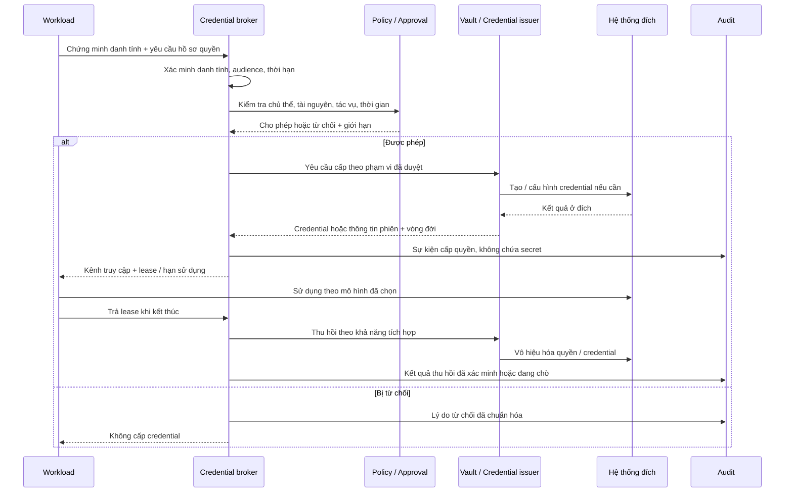

# Credential broker integration

## 1. Credential broker giải quyết vấn đề gì trong PAM?

Một ứng dụng cần truy cập cơ sở dữ liệu, pipeline cần triển khai lên hạ tầng, hoặc công cụ vận hành cần mở phiên quản trị. Nếu mỗi bên tự giữ một tài khoản đặc quyền lâu dài, tổ chức phải giải quyết đồng thời nhiều vấn đề: secret bị sao chép, quyền tồn tại ngoài thời gian cần thiết, khó xác định người dùng thực tế và khó thu hồi khi xảy ra sự cố.

**Credential broker** là thành phần trung gian tiếp nhận yêu cầu truy cập, kiểm tra danh tính và chính sách, rồi phối hợp với hệ thống quản lý bí mật hoặc hệ thống đích để cung cấp cách truy cập phù hợp. Trong PAM, broker phải gắn việc sử dụng credential với một chủ thể, một mục đích, một phạm vi quyền và một vòng đời có thể theo dõi.

Ví dụ: pipeline `payment-migration` cần cập nhật schema `payment_app` trong hai phút. Thay vì đọc mật khẩu DBA dùng chung từ biến môi trường, pipeline chứng minh danh tính workload và yêu cầu hồ sơ quyền `payment-schema-migrator`. Broker chỉ cấp tài khoản hoặc phiên có quyền phù hợp với schema này, trong thời gian chính sách cho phép.

Broker không tự làm cho một quyền rộng trở thành an toàn. Nếu role ở cơ sở dữ liệu vẫn là toàn quyền quản trị, việc cấp role đó qua API vẫn giữ nguyên mức độ rủi ro. Cần kết hợp kiểm kê tài khoản, least privilege, JIT, giới hạn thao tác khi hệ thống đích hỗ trợ, giám sát và bằng chứng kiểm toán.

### 1.1. Phân biệt các thành phần

| Thành phần | Trách nhiệm chính | Điều không nên mặc định |
| --- | --- | --- |
| Vault hoặc secret store | Lưu, bảo vệ và cung cấp secret theo cơ chế được cấu hình | Đọc secret từ vault không đồng nghĩa đã có phê duyệt nghiệp vụ hoặc quyền ngắn hạn |
| Credential broker | Kiểm tra yêu cầu, ánh xạ danh tính sang hồ sơ quyền, điều phối việc cấp và thu hồi | Không phải broker nào cũng sinh tài khoản động hoặc chặn được phiên đã mở |
| Hệ thống đích | Thực thi quyền thật trên tài khoản, token hoặc phiên | Broker ghi nhận hết hạn chưa đủ chứng minh quyền ở đích đã bị vô hiệu hóa |
| Session proxy | Trung chuyển kết nối, có thể giữ credential ngoài ứng dụng và kiểm soát phiên | Proxy vẫn cần chính sách, quản lý credential và xác minh danh tính |
| Approval hoặc workflow service | Ghi nhận quyết định phê duyệt theo người, công việc và phạm vi | Một mã ticket do client gửi lên chưa phải bằng chứng được phê duyệt |

Các trách nhiệm này có thể nằm trong một sản phẩm hoặc nhiều dịch vụ. Khi tích hợp, hãy xác định ai chịu trách nhiệm cho từng bước thay vì dựa vào tên gọi sản phẩm.

## 2. Chọn mô hình cung cấp quyền truy cập

Broker có thể tích hợp theo nhiều cách. Lựa chọn phụ thuộc vào khả năng của hệ thống đích và mức độ ứng dụng có thể thay đổi.

| Mô hình | Cách hoạt động | Lợi ích | Điểm cần kiểm soát |
| --- | --- | --- | --- |
| Cấp credential động | Tạo tài khoản, token hoặc credential riêng cho yêu cầu | Dễ gắn quyền với workload và vòng đời cụ thể | Tạo, hết hạn, thu hồi và dọn tài khoản ở hệ thống đích phải hoạt động thật |
| Phân phối credential tĩnh có quản lý | Broker lấy một credential hiện có từ vault để cung cấp cho client được phép | Phù hợp với hệ thống cũ chưa hỗ trợ danh tính tạm thời | Secret vẫn có thể bị sao chép; thời hạn phân phối không tự làm secret hết hiệu lực |
| Truy cập qua proxy | Client kết nối tới proxy; proxy dùng credential để kết nối đích | Giảm việc ứng dụng trực tiếp giữ credential đích | Cần kiểm soát đường kết nối, quyền proxy và cơ chế kết thúc phiên |

Với credential tĩnh dùng chung, không nên hứa rằng thu hồi một lease sẽ chỉ chặn đúng một client. Nếu các client cùng biết một mật khẩu, muốn vô hiệu hóa bản sao mật khẩu thường cần đổi mật khẩu ở đích và xử lý các bên phụ thuộc. Với credential động riêng, tác động có thể được khoanh vùng tốt hơn, nhưng vẫn phải kiểm tra khả năng vô hiệu hóa tài khoản và phiên.

Với truy cập qua proxy, cần ngăn đường đi vòng nếu mục tiêu là buộc mọi truy cập đặc quyền đi qua proxy. Chỉ đưa proxy vào sơ đồ mà vẫn cho phép cùng tài khoản đăng nhập trực tiếp sẽ tạo khoảng trống kiểm soát.

## 3. Kiến trúc và các ranh giới tin cậy

Một thiết kế cơ bản gồm workload, broker, bộ quyết định chính sách, vault hoặc bộ cấp credential, hệ thống đích và nơi lưu audit.



Sơ đồ dùng mô hình cấp credential trực tiếp để minh họa. Với proxy, workload kết nối qua proxy thay vì tự nhận credential đích; các bước xác thực, quyết định chính sách và quản lý vòng đời vẫn cần được làm rõ.

### 3.1. Danh tính của workload

Broker phải xác minh bằng chứng từ cơ chế danh tính đáng tin cậy, chẳng hạn chứng thư workload hoặc token được ký bởi hệ thống danh tính đã đăng ký. Các kiểm tra cụ thể phụ thuộc cơ chế, nhưng thường phải xác định được bên phát hành, chủ thể, bên nhận dự kiến và thời hạn sử dụng.

Không coi những dữ liệu sau là bằng chứng danh tính độc lập:

- Header `X-Workload-Name` do ứng dụng tự đặt.
- Tên repository hoặc tên pipeline nằm trong phần thân yêu cầu.
- Địa chỉ IP nội bộ mà không có cơ chế xác thực bổ sung phù hợp.
- Mã ticket chưa được xác minh với nguồn phê duyệt.

Các thuộc tính do client gửi có thể giúp mô tả yêu cầu, nhưng không được thay thế danh tính đã xác minh. Với pipeline, cần phân biệt môi trường được tin cậy với job chạy từ mã hoặc nhánh không được phép nhận quyền production.

### 3.2. Danh tính của broker

Client cũng phải xác minh broker qua kênh bảo mật phù hợp, bao gồm xác minh chứng thư và tên dịch vụ khi dùng TLS. Nếu ứng dụng chấp nhận broker giả, bằng chứng workload hoặc credential trả về có thể bị đánh cắp hay thay thế.

Danh tính kỹ thuật của broker hoặc connector ở đích cũng phải có phạm vi tối thiểu. Nếu nhiệm vụ chỉ là cấp role cho một schema, không mặc định cấp quyền quản trị toàn hệ thống. Tách quyền cấp credential, quyền đọc secret, quyền thay chính sách và quyền đọc audit khi cần để giảm tác động của một thành phần bị xâm nhập.

### 3.3. Tránh biến broker thành đại diện có quyền bị lợi dụng

Broker thường có quyền cao hơn workload. Rủi ro xuất hiện khi workload có thể khiến broker dùng quyền đó để lấy bất kỳ secret nào hoặc cấp quyền cho tài nguyên ngoài phạm vi được phép.

Vì vậy, client nên yêu cầu một hồ sơ quyền đã được đăng ký, không được tùy ý truyền đường dẫn vault, câu lệnh tạo user, chuỗi SQL cấp quyền hoặc địa chỉ đích bất kỳ. Broker ánh xạ hồ sơ quyền sang cấu hình nội bộ và kiểm tra nó đối với danh tính đã xác minh.

Ví dụ, workload `payment-migration` có thể yêu cầu `payment-schema-migrator`, nhưng không thể đổi trường `database` thành một cơ sở dữ liệu khác rồi nhận cùng quyền. Mỗi tổ hợp workload, môi trường, tài nguyên và hồ sơ quyền cần được đánh giá rõ ràng.

## 4. Thiết kế hợp đồng tích hợp

Hợp đồng phải cho client biết nó đang yêu cầu điều gì, nhận được quyền gì, quyền còn hiệu lực đến khi nào và phải xử lý lỗi ra sao. Không để client suy đoán từ tên trường hoặc từ mã HTTP thành công.

### 4.1. Yêu cầu cấp quyền

Ví dụ dưới đây là hợp đồng minh họa, không phải API của một sản phẩm cụ thể. Bằng chứng xác thực được truyền theo cơ chế đã chọn, không nằm trong JSON nghiệp vụ và không được ghi vào log.

```json
{
  "resourceRef": "db/payment-prod",
  "accessProfile": "payment-schema-migrator",
  "requestedTtlSeconds": 300,
  "purpose": "Apply approved schema migration",
  "changeRef": "CHG-DEMO-204",
  "requestId": "migration-run-482-attempt-1"
}
```

Ý nghĩa của các trường:

- `resourceRef`: định danh logic được ánh xạ sang đích đã đăng ký, không phải chuỗi kết nối tùy ý.
- `accessProfile`: phạm vi quyền có sẵn; broker kiểm tra workload có được yêu cầu hồ sơ này hay không.
- `requestedTtlSeconds`: mong muốn của client, chịu giới hạn chính sách và khả năng hệ thống đích.
- `purpose`: ngữ cảnh phục vụ vận hành; không tự tạo ra quyền.
- `changeRef`: tham chiếu để broker xác minh quyết định phê duyệt khi chính sách yêu cầu.
- `requestId`: hỗ trợ liên kết và xử lý yêu cầu lặp; phải được ràng buộc với chủ thể và nội dung yêu cầu.

Broker không nên âm thầm thay một hồ sơ bị từ chối bằng hồ sơ có quyền rộng hơn. Nếu phải chuẩn hóa TTL hoặc chọn một phương thức cấp khác trong phạm vi được phép, phản hồi cần thể hiện kết quả thực tế.

### 4.2. Phản hồi và thông tin vòng đời

Metadata phản hồi có thể gồm:

```json
{
  "leaseId": "lease-demo-9031",
  "resourceRef": "db/payment-prod",
  "accessProfile": "payment-schema-migrator",
  "deliveryMode": "DIRECT_DYNAMIC",
  "issuedAt": "2026-01-01T10:00:00Z",
  "credentialExpiresAt": "2026-01-01T10:05:00Z",
  "renewable": false,
  "policyVersion": "payment-access-v17",
  "correlationId": "corr-demo-6502"
}
```

Phần secret hoặc thông tin thiết lập phiên phải được chuyển qua kênh phân phối đã định nghĩa; không đưa vào metadata audit, URL, telemetry hay thông báo lỗi. Ví dụ chỉ thể hiện metadata, không phải toàn bộ phản hồi sử dụng credential.

Hợp đồng cần phân biệt ít nhất ba mốc:

1. **Thời hạn của bằng chứng danh tính workload**: dùng để xác thực yêu cầu tới broker.
2. **Thời hạn lease do broker quản lý**: dùng để theo dõi và điều phối vòng đời cấp quyền.
3. **Hiệu lực credential hoặc quyền ở hệ thống đích**: quyết định khả năng truy cập thật.

Ba mốc này không nhất thiết bằng nhau. Broker đánh dấu lease hết hạn không thể tự làm một mật khẩu tĩnh hết hiệu lực. Token hoặc credential mới hết hạn cũng có thể không chấm dứt phiên đã được xác thực trước đó; phải kiểm tra cơ chế phiên của đích.

`leaseId` là định danh điều khiển vòng đời, không nên mặc định là secret cho phép mọi người thu hồi hoặc gia hạn. Mọi thao tác trên lease vẫn phải kiểm tra danh tính và quyền đối với lease đó. Các giao diện tự thiết kế không nên dùng lease ID như một bearer credential.

### 4.3. Chính sách minh họa

```yaml
# Cấu hình khái niệm, không phải schema của một sản phẩm.
binding:
  verifiedWorkload: payment-migration
  environment: production
  resourceRef: db/payment-prod
  accessProfile: payment-schema-migrator
  maxTtlSeconds: 300
  renewable: false
  approvalRequired: true
  allowedDeliveryModes:
    - DIRECT_DYNAMIC
  onDependencyUnavailable: DENY_NEW_GRANTS
```

Role thực tế tại cơ sở dữ liệu phải được cấu hình riêng và kiểm chứng. Một tên role có chữ `migrator` không bảo đảm nó chỉ có quyền trong schema cần thiết. Hồ sơ cũng cần ghi rõ chủ sở hữu, người phê duyệt, điều kiện sử dụng và cách thu hồi.

## 5. Tích hợp vào vòng đời ứng dụng hoặc job

Ứng dụng nên xin quyền gần thời điểm sử dụng, giữ credential trong thời gian ngắn và trả lease sau khi hoàn tất. Không xin từ lúc build image rồi nhúng vào artifact để dùng khi deploy.

### 5.1. Luồng thực thi

```text
1. Lấy bằng chứng danh tính workload từ cơ chế bootstrap đã đăng ký.
2. Gửi yêu cầu hồ sơ quyền tới broker qua kênh đã xác minh.
3. Kiểm tra kết quả cấp: đích, hồ sơ quyền, cách phân phối, thời hạn thực tế.
4. Mở kết nối hoặc phiên bằng quyền vừa được cấp.
5. Thực hiện đúng công việc đã được cho phép.
6. Đóng kết nối / phiên theo cơ chế ứng dụng.
7. Yêu cầu trả lease trong khối dọn dẹp.
8. Nếu trả lease thất bại, gửi sự kiện không chứa secret để cơ chế đối soát xử lý.
```

Khối dọn dẹp của ứng dụng chỉ là một lớp bảo vệ. Process có thể bị kill hoặc máy có thể mất mạng trước bước 7, nên broker cần cơ chế hết hạn và đối soát độc lập với việc client chủ động trả lease.

### 5.2. Không chuyển secret sang nơi tồn tại lâu hơn

Client không nên đưa credential vào command line, log build, file cấu hình được commit, image, artifact, crash report hoặc trace. Nếu tích hợp đòi hỏi file tạm, cần giới hạn quyền đọc, vị trí lưu, thời gian tồn tại và cách dọn dẹp theo môi trường. Dùng bộ nhớ cũng không đồng nghĩa loại bỏ mọi khả năng rò rỉ; debug dump và thư viện telemetry vẫn phải được kiểm soát.

Biến môi trường có thể thuận tiện với một số công cụ cũ nhưng không phải nơi phân phối mặc định cho mọi workload. Cần đánh giá khả năng lộ qua công cụ debug, tiến trình con, cấu hình orchestrator và báo cáo lỗi. Chọn cơ chế tích hợp dựa trên hành vi thật của ứng dụng nhận secret.

### 5.3. Connection pool và credential ngắn hạn

Connection pool tạo ra hai tình huống khác nhau:

- Kết nối mới có thể không mở được sau khi credential hết hiệu lực.
- Kết nối cũ có thể tiếp tục tồn tại nếu hệ thống đích không tái xác thực hoặc không kết thúc phiên khi credential bị thu hồi.

Ứng dụng cần biết khi nào phải ngừng tạo kết nối mới, khi nào thay credential và khi nào làm cạn hoặc đóng pool cũ. Không tái sử dụng một pool lâu dài với credential đã đổi mà chưa biết driver xử lý ra sao.

Với job ngắn như migration, việc cấp một lần và đóng toàn bộ kết nối sau job thường dễ kiểm soát hơn cơ chế gia hạn kéo dài. Với dịch vụ chạy liên tục, cần thiết kế chuyển giao credential, xử lý kết nối đang chạy và khả năng quay lại trạng thái ổn định khi thay credential thất bại.

## 6. Lease, gia hạn, thu hồi và xoay vòng

### 6.1. Gia hạn là quyết định cấp quyền mới về mặt chính sách

Gia hạn không nên là cách giữ một quyền tồn tại vô thời hạn. Broker cần xác minh lại danh tính hoặc phiên xác thực theo thiết kế, kiểm tra quyền còn được phép và áp dụng giới hạn thời gian tích lũy khi phù hợp.

Nếu yêu cầu ban đầu được phê duyệt cho một cửa sổ bảo trì, gia hạn không được tự kéo quyền vượt cửa sổ đó. Client phải xử lý trường hợp gia hạn bị từ chối bằng cách ngừng bắt đầu công việc mới và kết thúc có kiểm soát, thay vì xin một tài khoản dự phòng rộng quyền hơn.

### 6.2. Thu hồi phải được theo dõi đến hệ thống đích

Một luồng thu hồi có thể gồm các trạng thái:

```text
ACTIVE → REVOCATION_REQUESTED → TARGET_CONFIRMED → CLOSED
                              ↘ RETRY_PENDING
```

`REVOCATION_REQUESTED` nghĩa là đã tiếp nhận yêu cầu, chưa phải đã chặn quyền. Nếu connector không liên lạc được với cơ sở dữ liệu, broker phải giữ bằng chứng lỗi và tiếp tục xử lý theo chính sách. Cần có cảnh báo cho lease quá hạn thu hồi và người chịu trách nhiệm xử lý.

Trạng thái `TARGET_CONFIRMED` cũng cần có định nghĩa cụ thể: tài khoản đã bị khóa, token đã bị vô hiệu hóa, quyền đã bị gỡ hay phiên đã bị chấm dứt? Những kết quả này không tương đương. Khi ứng phó sự cố, có thể phải kết hợp vô hiệu hóa credential với kết thúc phiên đang hoạt động.

### 6.3. Xoay vòng credential tĩnh

Xoay vòng là thay credential; thu hồi là làm mất khả năng sử dụng quyền đã cấp. Hai việc liên quan nhưng không thay thế nhau.

Với secret tĩnh dùng chung, cần kiểm kê bên phụ thuộc trước khi đổi, phối hợp cập nhật giá trị ở đích và nơi phân phối, rồi xác minh ứng dụng sử dụng phiên bản mới. Không đánh dấu xoay vòng thành công chỉ vì vault đã lưu một chuỗi mới trong khi đích vẫn nhận chuỗi cũ.

Nếu hệ thống hỗ trợ thời gian chuyển tiếp hai credential, phải giới hạn khoảng chồng lấp và xác minh credential cũ thực sự hết hiệu lực sau chuyển giao. Nếu chỉ có một mật khẩu, phải thiết kế thứ tự cập nhật và phương án phục hồi phù hợp với khả năng của đích, tránh tự tạo gián đoạn ngoài kế hoạch.

## 7. Xử lý lỗi mà không mở rộng quyền

| Tình huống | Hành vi tích hợp mong đợi | Bằng chứng cần giữ |
| --- | --- | --- |
| Danh tính không hợp lệ | Từ chối trước khi lấy hoặc cấp credential | Mã lý do, correlation ID; không lưu token gốc |
| Hồ sơ quyền không được phép | Từ chối, không thử role rộng hơn | Chủ thể đã xác minh, tài nguyên, policy version |
| Nguồn phê duyệt không truy cập được | Xử lý theo chính sách đã định; không giả định đã duyệt | Lỗi phụ thuộc và trạng thái quyết định |
| Đích đã tạo tài khoản nhưng phản hồi tới client bị mất | Tra cứu kết quả hoặc retry theo cơ chế chống cấp trùng | Request ID, lease ID và kết quả provisioning |
| Broker hoặc vault không sẵn sàng | Hạn chế retry; không tự lấy mật khẩu cũ ngoài luồng | Tỉ lệ lỗi, độ trễ, phạm vi workload bị ảnh hưởng |
| Thu hồi thất bại | Giữ trạng thái chưa hoàn tất, retry có kiểm soát và cảnh báo | Thời điểm, số lần thử, kết quả ở đích |
| Client chết trước khi trả lease | Cơ chế hết hạn và đối soát xử lý độc lập | Lease còn mở, thời hạn thực tế, kết quả dọn dẹp |

### 7.1. Retry và yêu cầu lặp

Timeout không chứng minh thao tác chưa xảy ra. Nếu broker đã tạo tài khoản nhưng client chưa nhận phản hồi, retry thiếu kiểm soát có thể tạo nhiều tài khoản và nhiều lease cho cùng một job.

Cơ chế idempotency cần quy định thời gian lưu, cách ràng buộc khóa với chủ thể, nội dung yêu cầu và hành vi khi một khóa được dùng cho nội dung khác. Không cho phép client khác dùng lại `requestId` để lấy credential của yêu cầu trước. Cũng không lưu nguyên phản hồi chứa secret trong log để phục vụ retry.

Client nên dùng giới hạn số lần thử và khoảng lùi phù hợp; tránh hàng nghìn workload đồng loạt xin lại credential khi broker vừa phục hồi. Nếu việc cấp quyền đã thất bại một phần, hệ thống cần nhận diện và dọn tài nguyên mồ côi thay vì chỉ xóa dấu vết phía broker.

### 7.2. Cache và tình huống broker ngừng hoạt động

Cache secret ở client làm tăng thời gian tồn tại và số nơi cần bảo vệ. Nếu có cache, phải ràng buộc với chủ thể, tài nguyên, hồ sơ quyền và hiệu lực thực tế; không trả credential của workload này cho workload khác. Không kéo dài TTL cục bộ để che lỗi phụ thuộc.

Việc một quyền đã cấp có tiếp tục dùng được khi broker ngừng hoạt động hay không phụ thuộc credential, hệ thống đích và chính sách. Cần mô tả rõ điều này, không gọi chung là “fail-closed” rồi mặc định mọi phiên đang mở đều đã bị ngắt.

Truy cập khẩn cấp, nếu được cho phép, phải có quy trình break-glass riêng, có thẩm quyền và audit. Một nhánh mã tự động đọc mật khẩu admin dự phòng khi broker lỗi không phải cơ chế phục hồi có kiểm soát.

## 8. Audit, giám sát và ứng phó sự cố

Một bản ghi cấp quyền hữu ích cần trả lời được: ai yêu cầu, truy cập gì, theo chính sách nào, trong thời gian nào, kết quả ra sao và quyền đã được thu hồi thế nào.

Các trường nên được thiết kế nhất quán giữa broker, issuer và đích:

```text
eventType
eventTime
verifiedSubject
workload / environment
resourceRef
accessProfile
requestId / correlationId
leaseReference
policyVersion
approvalReference (nếu có)
decision / resultCode
grantedExpiry
revocationState
```

Không ghi password, private key, bearer token, chuỗi kết nối chứa secret hoặc toàn bộ request header. Định danh lease, tài khoản đích và tham chiếu phê duyệt cũng cần phân loại và bảo vệ theo mức nhạy cảm; nếu định danh nào có khả năng điều khiển truy cập thì không được đối xử như metadata vô hại.

Giám sát nên bao gồm số yêu cầu bị từ chối, lỗi cấp quyền theo connector, lease quá hạn xử lý, độ trễ thu hồi, tài khoản mồ côi và thay đổi chính sách. Số lần API trả thành công không đủ chứng minh kiểm soát PAM hoạt động.

Khi một workload bị xâm nhập, cần xác định các lease của chủ thể đó, chặn việc cấp hoặc gia hạn tiếp, thu hồi quyền đã cấp và xử lý phiên ở đích theo khả năng tích hợp. Nếu workload đã nhận credential tĩnh dùng chung, phải đánh giá việc xoay vòng và ảnh hưởng tới các bên dùng chung, không chỉ đóng một lease trong cơ sở dữ liệu của broker.

Thiết kế cũng cần quy định việc lưu audit bền vững. Với thao tác có yêu cầu kiểm toán nghiêm ngặt, lỗi ghi nhận sự kiện phải có hành vi được định trước, chẳng hạn từ chối cấp mới hoặc dùng hàng đợi bền vững đã được phê duyệt. Không âm thầm bỏ audit để báo thành công.

## 9. Ví dụ tích hợp: pipeline migration cơ sở dữ liệu

### 9.1. Phạm vi

Một pipeline production chỉ được phép chạy migration trong schema `payment_app`. Job thông thường mất hai phút; chính sách minh họa cho phép tối đa năm phút và không gia hạn. Broker dùng danh tính workload của pipeline, không dùng một mật khẩu admin nhúng trong repository.

Các trách nhiệm được phân chia như sau:

- Nhóm ứng dụng xác định thao tác migration cần thiết và đóng kết nối khi job kết thúc.
- Chủ sở hữu cơ sở dữ liệu cấu hình, kiểm chứng role giới hạn và cơ chế vô hiệu hóa ở đích.
- Nhóm PAM quản lý broker, ánh xạ hồ sơ quyền, vòng đời lease và audit.
- Bên phê duyệt xác nhận đúng thay đổi, môi trường và cửa sổ thời gian theo chính sách.

### 9.2. Luồng bình thường

1. Pipeline nhận bằng chứng danh tính từ nền tảng chạy job; bằng chứng phải phù hợp với broker nhận nó.
2. Broker xác minh danh tính, môi trường và quyền yêu cầu hồ sơ `payment-schema-migrator`.
3. Broker kiểm tra tham chiếu phê duyệt từ nguồn có thẩm quyền, bao gồm phạm vi và thời gian cho phép.
4. Issuer tạo credential riêng, áp dụng role giới hạn ở cơ sở dữ liệu và trả kết quả cấp.
5. Pipeline mở kết nối, chạy migration, đóng kết nối và yêu cầu trả lease.
6. Broker theo dõi việc vô hiệu hóa ở đích, lưu kết quả và cảnh báo nếu chưa hoàn tất.

TTL năm phút chỉ là giá trị ví dụ. Cần chọn theo thời gian công việc, khả năng hết hạn và thu hồi ở đích, cùng yêu cầu vận hành. Nếu migration có thể vượt cửa sổ đó, phải xử lý trong thiết kế quy trình trước khi chạy; không dựa vào việc tự ý gia hạn quyền giữa chừng.

### 9.3. Những điểm phải kiểm chứng khi triển khai tích hợp

| Kịch bản | Kết quả cần quan sát |
| --- | --- |
| Workload đúng xin đúng hồ sơ | Nhận đúng phạm vi quyền và thời hạn đã cho phép |
| Workload khác xin cùng hồ sơ | Bị từ chối; không có tài khoản hoặc lease mới ngoài ý muốn |
| Pipeline đổi `resourceRef` sang đích ngoài phạm vi | Bị từ chối trước khi cấp quyền ở đích |
| Bằng chứng sai bên nhận hoặc hết hạn | Không cấp credential |
| Ticket không đúng môi trường hoặc quá cửa sổ | Không được dùng để cấp quyền production |
| Credential được dùng với schema ngoài phạm vi | Hệ thống đích từ chối thao tác ngoài quyền |
| Job chết ngay sau khi nhận credential | Lease được xử lý theo thời hạn; tài khoản không tồn tại vô hạn |
| Credential hết hạn trong khi còn phiên | Hành vi phiên được ghi nhận đúng với cơ chế ở đích; xử lý nếu cần kết thúc phiên |
| Đích mất kết nối khi thu hồi | Trạng thái còn chờ và cảnh báo được giữ; không báo đã thu hồi |
| Phản hồi cấp quyền bị mất rồi client retry | Không cấp trùng ngoài quy tắc; không lộ secret qua cơ chế tra cứu |
| Broker ngừng hoạt động | Không tự chuyển sang tài khoản admin dự phòng |
| Log và trace được thu thập | Có thể liên kết sự kiện mà không chứa credential |

Các kiểm chứng này thuộc việc triển khai hệ thống tích hợp, không phải một lần gọi API thử thành công. Chúng giúp xác định nơi chính sách của broker và quyền thực tế ở đích có thể lệch nhau.

## 10. Lộ trình áp dụng cho hệ thống hiện hữu

Không cần chuyển toàn bộ tài khoản đặc quyền sang broker trong một lần. Có thể bắt đầu từ một workload có chủ sở hữu rõ ràng và tác vụ dễ khoanh vùng.

Trước tiên, kiểm kê credential đang dùng, nơi lưu, tài nguyên đích, các bên phụ thuộc và quyền thực tế. Sau đó định nghĩa hồ sơ quyền tối thiểu, danh tính bootstrap và cách cấp phù hợp với đích. Chọn một luồng nhỏ để tích hợp, bao gồm cả audit, thu hồi và xử lý lỗi ngay từ đầu.

Trong giai đoạn chuyển đổi, tránh giữ đường truy cập cũ vô thời hạn. Khi đã kiểm chứng luồng mới, xử lý credential cũ và các bản sao đã biết theo kế hoạch, xác minh các workload liên quan hoạt động ổn định và xác định người chịu trách nhiệm với tài khoản còn lại. Nếu phải rollback, kế hoạch cần ghi rõ quyền nào được khôi phục, thời hạn và bằng chứng sử dụng; không tự động khôi phục tài khoản quản trị dùng chung mà không có kiểm soát.

Một tích hợp credential broker hoàn chỉnh phải nối được danh tính workload, quyết định cấp quyền, quyền ở hệ thống đích và bằng chứng thu hồi. Chính chuỗi liên kết này giúp PAM giảm quyền tồn tại thường trực và làm rõ trách nhiệm khi truy cập tài nguyên nhạy cảm.
