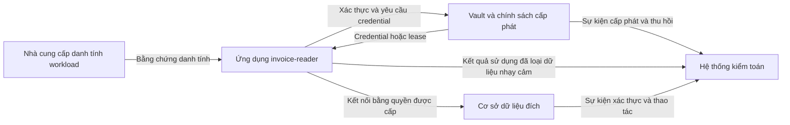

# Vault-to-application boundary

## 1. Ranh giới giữa vault và ứng dụng bảo vệ điều gì?

Vault là hệ thống quản lý bí mật, chẳng hạn mật khẩu dịch vụ, khóa API hoặc thông tin xác thực được cấp theo phiên. Đưa credential vào vault giúp kiểm soát nơi lưu trữ và quy trình cấp phát, nhưng chưa giải quyết toàn bộ bài toán sử dụng credential. Ứng dụng vẫn cần nhận một khả năng truy cập để kết nối tới cơ sở dữ liệu, dịch vụ hoặc hạ tầng đích. Chính thời điểm chuyển khả năng đó từ vault sang môi trường chạy ứng dụng tạo nên **vault-to-application boundary**.

Ranh giới này bao gồm danh tính yêu cầu secret, quyết định cấp quyền, kênh truyền, phương thức phân phối, bộ nhớ hoặc tệp chứa secret ở phía ứng dụng, vòng đời sử dụng và bằng chứng kiểm toán. Nếu dùng một proxy để kết nối thay ứng dụng, ranh giới còn bao gồm quyền gọi proxy và khả năng truy cập mà proxy thực hiện thay mặt workload.

Trong PAM, mục tiêu là giới hạn và truy vết quyền đặc biệt mà tài khoản dịch vụ hoặc thành phần tự động hóa có thể sử dụng. Vì vậy, thiết kế tích hợp cần trả lời hai câu hỏi riêng:

- Workload nào được vault cấp credential nào, trong hoàn cảnh nào?
- Credential đó cho phép làm gì tại hệ thống đích, trong bao lâu và có thể bị chấm dứt như thế nào?

Một quyền đọc secret rất hẹp vẫn có thể trao quyền tác động rất rộng nếu secret đó thuộc tài khoản quản trị toàn hệ thống. Ngược lại, credential có quyền hạn chế vẫn có thể bị lộ nếu đường phân phối quá rộng. Hai phía của ranh giới cần được thiết kế cùng nhau.

### Ví dụ xuyên suốt

Giả sử workload `invoice-reader` trong môi trường production cần đọc hóa đơn để tạo báo cáo. Ứng dụng chỉ cần đọc một tập dữ liệu đã xác định, không cần tạo người dùng, thay đổi cấu trúc cơ sở dữ liệu hoặc cấp quyền cho tài khoản khác.

Một thiết kế phù hợp sẽ gắn workload này với danh tính riêng, quyền yêu cầu credential đọc dữ liệu và quyền cơ sở dữ liệu tương ứng. Tài khoản quản trị vault, danh tính triển khai ứng dụng và tài khoản cơ sở dữ liệu phục vụ ứng dụng là các vai trò khác nhau. Không dùng một credential chung để thay thế cả ba.

## 2. Bản đồ các ranh giới tin cậy



Sơ đồ thể hiện một phương án ứng dụng nhận credential trực tiếp. Các cơ chế thực tế có thể dùng agent, tệp được mount hoặc proxy; khi đó cần vẽ thêm thành phần trung gian và nơi nó giữ credential.

| Ranh giới | Quyết định cần kiểm soát | Giới hạn cần hiểu rõ |
|---|---|---|
| Nền tảng danh tính → workload | Workload có thực sự là chủ thể được khai báo không? | Tên ứng dụng trong một tham số tự khai không đủ làm bằng chứng danh tính. |
| Workload → vault | Chủ thể được phép yêu cầu đúng loại credential nào? | Xác thực thành công không đồng nghĩa được đọc mọi secret. |
| Vault → nơi tiêu thụ secret | Thành phần nào nhận được giá trị và lưu ở đâu? | Mã hóa khi truyền không bảo vệ giá trị sau khi nó đã được giải mã ở đích. |
| Workload → hệ thống đích | Credential cho phép thực hiện những thao tác nào? | Policy tại vault không tự thay thế phân quyền của cơ sở dữ liệu hoặc API đích. |
| Luồng nghiệp vụ → kiểm toán | Có thể nối sự kiện cấp phát với phiên sử dụng không? | Log đầy đủ giá trị credential sẽ tạo thêm nơi rò rỉ. |

Ranh giới cũng đi qua các kênh vận hành thường bị bỏ sót: cấu hình triển khai, công cụ chẩn đoán, bản sao lưu, crash dump, thư mục tạm và quyền truy cập của người vận hành. Cần xét đường đi thực tế của secret thay vì chỉ đánh giá endpoint của vault.

## 3. Mô hình đe dọa và giới hạn bảo vệ

Trước khi chọn cách tích hợp, hãy xác định chủ thể có thể tiếp cận mỗi đoạn của luồng dữ liệu. Với ví dụ `invoice-reader`, những tình huống đáng xem xét gồm:

| Tình huống | Hậu quả có thể xảy ra | Hướng giảm thiểu |
|---|---|---|
| Một workload khác giả mạo danh tính ứng dụng | Lấy credential bằng quyền của `invoice-reader` | Kiểm tra bằng chứng danh tính, môi trường và phạm vi được chấp nhận. |
| Người triển khai thay đổi cấu hình trỏ tới secret mạnh hơn | Ứng dụng nhận tài khoản có quyền vượt nhu cầu | Ràng buộc policy theo workload và tài nguyên, không chỉ tin đường dẫn do ứng dụng gửi. |
| Ứng dụng bị thực thi mã trái phép | Kẻ tấn công dùng quyền truy cập mà ứng dụng đang có | Giảm quyền tại đích, giảm thời gian hiệu lực, phát hiện sử dụng bất thường và cô lập workload. |
| Agent dùng chung cho nhiều ứng dụng | Một ứng dụng lấy secret của ứng dụng khác | Tách danh tính, phạm vi truy cập và kênh trả kết quả theo từng workload. |
| Secret xuất hiện trong log hoặc bản dump | Người đọc hệ thống quan sát lấy được credential | Giảm dữ liệu được ghi, hạn chế dump và kiểm soát quyền đọc bằng chứng. |
| Credential đã bị thu hồi nhưng kết nối cũ còn sống | Quyền truy cập tiếp tục tồn tại ngoài dự kiến | Kiểm thử việc chấm dứt phiên và có cơ chế đóng kết nối hoặc vô hiệu hóa tại đích. |

Một giới hạn quan trọng: khi ứng dụng được phép lấy secret và dùng secret đó, mã độc kiểm soát tiến trình có thể sử dụng khả năng đã cấp. Vault không tự phân biệt được lời gọi hợp lệ của mã nghiệp vụ với lời gọi từ mã độc chạy dưới cùng danh tính. Bảo vệ ranh giới phải kết hợp với cách ly runtime, phân quyền đích và phát hiện sự cố.

Tương tự, việc thu hồi token truy cập vault thường chỉ ngăn các lần lấy secret hoặc thao tác vault về sau. Credential đã được cấp, bản sao đã bị lấy và phiên đã mở tại hệ thống đích phải được xử lý theo cơ chế riêng.

## 4. Danh tính workload và bài toán secret khởi tạo

Ứng dụng cần chứng minh danh tính trước khi nhận secret. Nếu phương án là nhúng một mật khẩu vault dài hạn vào mã nguồn hoặc image, hệ thống đã chuyển vị trí của bí mật mà chưa loại bỏ vấn đề phân phối bí mật ban đầu.

Ưu tiên một cơ chế danh tính workload do nền tảng tin cậy cung cấp, nếu môi trường hỗ trợ. Ví dụ về nguyên tắc là ứng dụng trao một bằng chứng có thời hạn, vault xác minh bên phát hành và các điều kiện ràng buộc rồi cấp quyền theo vai trò đã định nghĩa. Cấu hình cụ thể phụ thuộc cơ chế xác thực được chọn.

Các thuộc tính cần xem xét bao gồm:

- Bên phát hành bằng chứng có đúng nguồn được tin cậy không?
- Bằng chứng có dành cho dịch vụ nhận này không, nếu giao thức hỗ trợ ràng buộc đối tượng nhận?
- Chủ thể, môi trường và phạm vi workload có khớp vai trò được cấu hình không?
- Bằng chứng còn hiệu lực không, và có cách hạn chế việc phát lại hoặc sử dụng ngoài môi trường dự kiến không?
- Quyền thay đổi danh tính workload có bị kiểm soát chặt như quyền được cấp không?

Một token có chữ ký hợp lệ vẫn có thể không phù hợp nếu được phát cho môi trường thử nghiệm, cho một ứng dụng khác hoặc cho đối tượng nhận khác. Không nên chỉ kiểm tra chữ ký rồi bỏ qua phần ràng buộc ngữ cảnh.

Nếu buộc phải dùng secret khởi tạo, cần coi nó là một credential đặc quyền: phân phối qua kênh kiểm soát, giới hạn quyền trao đổi, đặt thời hạn phù hợp, theo dõi việc sử dụng và có quy trình thay thế. Tránh để secret khởi tạo có quyền đọc lại chính nó, cấp danh tính mới hoặc thay đổi policy.

Danh tính của pipeline triển khai cũng cần tách khỏi danh tính runtime. Pipeline có thể được phép triển khai một phiên bản đã phê duyệt; điều đó không mặc nhiên cho phép pipeline đọc mọi credential mà ứng dụng sẽ dùng khi chạy.

## 5. Phân quyền ở vault và tại hệ thống đích

### 5.1. Quyền yêu cầu credential

Policy nên giới hạn vào đúng tài nguyên và thao tác cần thiết. Không cấp quyền quản trị policy, quản trị phương thức xác thực hoặc đọc toàn bộ cây secret chỉ vì ứng dụng cần một credential.

Ví dụ dưới đây là **hợp đồng minh họa**, không phải cú pháp cấu hình của một sản phẩm vault:

```yaml
workload: invoice-reader
environment: production
identity_role: invoice-reader-runtime
allowed_request:
  credential_profile: invoice-report-readonly
  target: invoice-reporting-database
  operation: issue
forbidden_capabilities:
  - administer-vault-policy
  - create-workload-identity
  - request-database-admin-credential
  - read-unrelated-application-secret
```

Điểm cần bảo đảm là vault quyết định `credential_profile` được phép từ danh tính đã xác minh. Không để một trường như `requested_role: administrator` trong request tự trở thành căn cứ cấp quyền.

Nếu có broker trung gian, broker phải đối chiếu yêu cầu với danh tính bên gọi và tập tài nguyên được phép. Một broker giữ quyền đọc rất rộng nhưng chấp nhận mọi đường dẫn do caller truyền có thể trở thành bên dùng quyền mạnh của mình để lấy secret thay cho caller không đủ quyền.

### 5.2. Quyền sử dụng credential

Tại cơ sở dữ liệu đích, credential của `invoice-reader` chỉ nên có quyền đọc các bảng hoặc view phục vụ báo cáo theo thiết kế. Không sử dụng tài khoản chủ sở hữu cơ sở dữ liệu làm tài khoản ứng dụng để đơn giản hóa triển khai.

Với credential động, vai trò hoặc mẫu cấp phát tại hệ thống đích phải tạo đúng quyền tối thiểu. Với secret tĩnh được vault lưu giữ, quyền của tài khoản phía đích vẫn cần rà soát riêng; việc secret được lưu trong vault không làm tài khoản đó tự giảm quyền.

### 5.3. Tách quyền vận hành

Người quản trị nền tảng có thể cần khả năng sửa cấu hình hoặc hỗ trợ sự cố. Nếu họ có thể thay image, gắn debugger hoặc đọc bộ nhớ tiến trình, họ có thể có đường tiếp cận secret dù không có quyền đọc trực tiếp tại vault. Đây là một đường đặc quyền cần đưa vào PAM: phê duyệt phù hợp, giới hạn thời gian, giám sát phiên và lưu bằng chứng đối với thao tác quản trị nhạy cảm.

Đối với workload tự động, không nhất thiết đặt một bước phê duyệt thủ công trước từng lần lấy credential. Có thể phê duyệt chính sách cấp phát và thay đổi quyền, rồi để runtime nhận credential trong giới hạn đã duyệt. JIT cho người vận hành và credential ngắn hạn cho workload phục vụ các mục tiêu liên quan nhưng không thay thế nhau.

## 6. Chọn cách đưa secret đến ứng dụng

| Phương án | Nơi credential xuất hiện | Điểm cần kiểm soát |
|---|---|---|
| Ứng dụng gọi trực tiếp | Trong tiến trình ứng dụng | Xác thực, kiểm tra kết nối an toàn, cache, làm mới và xử lý lỗi do ứng dụng đảm nhiệm. |
| Agent hoặc sidecar | Trong agent và nơi chuyển giao sang ứng dụng | Danh tính agent, cách ly giữa workload, quyền truy cập kênh nội bộ và vòng đời cả hai phía. |
| Tệp được quản lý | Trong tệp và bộ nhớ khi ứng dụng đọc | Quyền đọc, phạm vi mount, cập nhật nguyên vẹn, xóa bản cũ và tránh đưa vào backup ngoài dự kiến. |
| Biến môi trường | Trong môi trường tiến trình và các bản sao phát sinh | Đường chẩn đoán, tiến trình con, cơ chế thay phiên bản và khả năng nhận giá trị mới. |
| Proxy kết nối thay ứng dụng | Trong proxy; ứng dụng giữ quyền gọi proxy | Xác thực caller, phân quyền đích, ngăn truy cập vòng qua proxy và kiểm toán hành động thay mặt. |

Không có phương án nào tự loại bỏ mọi rủi ro. Sidecar giảm phần mã tích hợp trong ứng dụng nhưng thêm một thành phần giữ quyền. Tệp thuận tiện cho phần mềm không tích hợp API, song ứng dụng phải thực sự nhận thay đổi. Proxy có thể giữ mật khẩu ngoài tiến trình ứng dụng, nhưng workload bị xâm nhập vẫn có thể lạm dụng quyền gọi proxy đang được cấp.

### Kênh truyền và kênh nội bộ

Ứng dụng phải kiểm tra danh tính máy chủ vault theo cơ chế kết nối được chọn. Không bỏ xác minh chứng thư chỉ để vượt qua lỗi cấu hình. Không chuyển credential sang một endpoint khác chỉ vì cấu hình runtime hoặc phản hồi chưa được tin cậy yêu cầu như vậy.

Kênh giữa agent và ứng dụng cũng là một ranh giới. Nếu dùng tệp hoặc socket nội bộ, cần giới hạn ai có thể đọc hoặc gọi. Khái niệm “chạy cùng máy” không đủ để kết luận rằng mọi tiến trình trên máy đều thuộc cùng phạm vi tin cậy.

### Secret trong bộ nhớ và dữ liệu phụ trợ

Tránh chuyển secret vào URL, tên metric, thông báo lỗi, nội dung tracing, tham số dòng lệnh hoặc dữ liệu phản hồi cho người dùng. Nếu phải giữ secret trong bộ nhớ, giữ phạm vi và thời gian tồn tại nhỏ nhất có thể trong thiết kế. Việc xóa một biến không bảo đảm mọi bản sao do runtime, thư viện hoặc dump tạo ra đã biến mất.

Đối với tệp, không ghi đè từng phần khiến ứng dụng đọc nhầm nội dung đang thay đổi. Có thể dùng cơ chế công bố một phiên bản mới hoàn chỉnh rồi chuyển tham chiếu theo khả năng của hệ điều hành và công cụ triển khai. Quyền tệp và cách xóa phiên bản cũ vẫn cần được kiểm soát.

## 7. Hợp đồng tiêu thụ secret

Hợp đồng giữa vault, thành phần tích hợp và ứng dụng cần mô tả cả thành công lẫn thất bại. Chỉ thống nhất một tên secret hoặc một đường dẫn API là chưa đủ.

Với `invoice-reader`, hợp đồng có thể quy định:

| Thuộc tính | Ý nghĩa trong hợp đồng |
|---|---|
| Chủ thể | Workload production đã được xác minh; không chấp nhận danh tính thử nghiệm. |
| Phạm vi quyền | Credential đọc báo cáo, không bao gồm quyền quản trị hoặc ghi nghiệp vụ. |
| Đích sử dụng | Cơ sở dữ liệu đã định danh trong cấu hình tin cậy. |
| Vòng đời | Phân biệt thời hạn bằng chứng danh tính, token vault, lease và credential tại đích. |
| Làm mới | Xác định bên chịu trách nhiệm và cách ứng dụng nhận phiên bản mới. |
| Khi không lấy được secret | Chặn kết nối mới hoặc dùng phiên bản còn hợp lệ trong giới hạn đã định nghĩa. |
| Khi bị từ chối quyền | Không thử một tài khoản mạnh hơn; phát sự kiện vận hành đã loại secret. |
| Thu hồi | Xác định ai thu hồi tại vault, ai chấm dứt tài khoản hoặc phiên tại đích. |
| Kiểm toán | Có định danh yêu cầu, workload, profile quyền, kết quả và liên kết với phiên sử dụng. |

Không giả định các thời hạn trên giống nhau. Token xác thực vault còn hạn không chứng minh credential cơ sở dữ liệu còn dùng được. Gia hạn một lease, nếu cơ chế hỗ trợ, cũng không tự chứng minh một tài khoản đích đã được thay mật khẩu hoặc một phiên cũ đã kết thúc.

Nếu API trả về một mã lease hoặc định danh phiên bản, ứng dụng và hệ thống kiểm toán cần thống nhất cách sử dụng. Không coi mọi định danh là an toàn để công khai; một số định danh vận hành có thể nhạy cảm hoặc cho phép suy luận cấu trúc nội bộ.

## 8. Vòng đời: cấp phát, sử dụng, chuyển đổi và thu hồi

### 8.1. Cấp phát và bắt đầu sử dụng

Một luồng tích hợp có thể gồm các bước sau:

1. Workload lấy bằng chứng danh tính từ nguồn tin cậy.
2. Thành phần tích hợp xác thực với vault và yêu cầu đúng profile quyền đã được cấp.
3. Kiểm tra kết quả trả về có đủ dữ liệu, đúng đích và có thông tin vòng đời cần thiết.
4. Tạo kết nối hoặc pool mới bằng credential vừa nhận.
5. Chỉ công bố trạng thái sẵn sàng phục vụ sau khi các điều kiện kết nối cần thiết đạt yêu cầu.

Không cần yêu cầu vault cấp một credential mới trước mọi câu truy vấn nếu mô hình được chọn sử dụng một lease và một pool kết nối. Tần suất cấp phát phải phù hợp với yêu cầu cách ly, vòng đời credential và khả năng vận hành, thay vì tăng số lần gọi vault một cách máy móc.

### 8.2. Làm mới và chuyển phiên bản

Lấy được secret mới chưa có nghĩa ứng dụng đã dùng secret mới. Ứng dụng có thể giữ pool cũ, cấu hình cũ hoặc kết nối dài hạn. Thiết kế cần chỉ rõ điều kiện chuyển đổi và cách kết thúc phần sử dụng cũ.

Pseudocode sau mô tả nguyên tắc chuyển đổi, không phải API của một vault hoặc thư viện kết nối cụ thể:

```text
on_refresh_due:
    candidate = request_authorized_credential()
    verify_candidate_metadata(candidate)
    replacement = build_connection_pool(candidate)

    if replacement_is_ready(replacement):
        previous = publish_new_pool_atomically(replacement)
        stop_new_borrows(previous)
        drain_with_bounded_deadline(previous)
        close_remaining_connections(previous)
        release_old_credential_when_supported()
    else:
        close_replacement_resources()
        apply_existing_credential_policy()

on_credential_invalid_or_revoked:
    stop_new_borrows(current_pool)
    close_connections_as_required_by_incident_policy()
    reject_work_that_requires_unavailable_access()
    emit_redacted_operational_event()
```

Khoảng chồng lấp giữa hai credential chỉ được dùng khi cơ chế phía đích hỗ trợ và chính sách cho phép. Một hệ thống thay mật khẩu trên cùng một tài khoản có thể hành xử khác với hệ thống cấp hai tài khoản ngắn hạn độc lập. Cần xác định hành vi của hệ thống được tích hợp thay vì suy ra từ từ “rotation”.

### 8.3. Hết hạn và thu hồi

TTL giúp giới hạn thời gian được cấp, nhưng hiệu lực thực tế phụ thuộc cơ chế xác thực và kiểm tra của hệ thống đích. Một phiên cơ sở dữ liệu đã mở có thể có vòng đời riêng so với credential dùng lúc đăng nhập. Việc xóa secret khỏi vault cũng không đồng nghĩa tài khoản đích hoặc các bản sao credential đã bị vô hiệu hóa.

Một quy trình thu hồi cần xử lý phù hợp các lớp:

- Ngăn workload tiếp tục lấy credential từ vault.
- Thu hồi lease hoặc yêu cầu vô hiệu hóa credential đã cấp, nếu cơ chế hỗ trợ.
- Xác minh trạng thái tài khoản hoặc quyền truy cập ở hệ thống đích.
- Chấm dứt các phiên và kết nối liên quan khi cần thiết.
- Xử lý bản sao trong cache, tệp phân phối và công cụ vận hành.

Phải có bằng chứng về kết quả ở phía đích, đặc biệt khi mục tiêu là chấm dứt quyền truy cập khẩn cấp.

## 9. Lỗi, cache và tính sẵn sàng

Khi vault không phản hồi, việc tiếp tục phục vụ phải dựa trên hợp đồng đã xác định. Một credential đã nhận có thể vẫn hợp lệ, nhưng cũng có thể đã bị thu hồi hoặc sắp hết hạn. Không mặc định kéo dài hạn sử dụng ở phía ứng dụng chỉ vì hệ thống cấp phát đang gặp lỗi.

| Lỗi quan sát được | Cách xử lý theo thiết kế |
|---|---|
| Lỗi mạng tạm thời trước khi hết hạn sử dụng | Retry có giới hạn, backoff và phân tán thời điểm thử lại; chỉ dùng credential cũ nếu chính sách cho phép. |
| Bị từ chối do quyền không phù hợp | Ghi sự kiện và báo vận hành; không tự thử profile quản trị hoặc danh tính dự phòng mạnh hơn. |
| Credential đã hết hạn hoặc bị vô hiệu hóa | Ngăn truy cập cần credential đó; xử lý kết nối cũ theo cơ chế phía đích và yêu cầu sự cố. |
| Nhận phản hồi thiếu trường cần thiết | Không công bố credential mới là sẵn sàng; giữ quy tắc xử lý phiên bản hiện tại. |
| Pool mới không kết nối được | Giải phóng tài nguyên tạo dở và áp dụng chính sách chuyển đổi hoặc dừng đã định nghĩa. |
| Hệ thống kiểm toán không nhận sự kiện | Dùng cơ chế hàng đợi hoặc trạng thái suy giảm được phê duyệt; tránh âm thầm mất bằng chứng. |

Cache cần được ràng buộc với danh tính workload, profile quyền, môi trường và đích sử dụng. Nếu chỉ dùng tên secret làm khóa cache, một thành phần dùng chung có thể trả nhầm credential giữa các chủ thể. Không sử dụng một cache chung rộng quyền như một vault thứ hai mà thiếu kiểm soát tương ứng.

Cơ chế retry cũng cần phân biệt thao tác đọc secret tĩnh với thao tác cấp credential mới. Khi request cấp phát bị timeout, phía vault hoặc hệ thống đích có thể đã tạo credential dù caller chưa nhận phản hồi. Nếu hệ thống có cơ chế chống trùng hoặc đối soát, cần dùng đúng hợp đồng đó; nếu không, phải có cách phát hiện và dọn các credential hoặc lease không được sử dụng.

Với `invoice-reader`, một quyết định nghiệp vụ có thể là tạm ngừng tạo báo cáo mới khi không còn truy cập hợp lệ, trong khi vẫn phục vụ báo cáo đã tạo nếu dữ liệu và quyền người dùng cho phép. Đây là trạng thái suy giảm được thiết kế trước, không phải lý do nhúng một mật khẩu quản trị dự phòng vào ứng dụng.

## 10. Quan sát và bằng chứng kiểm toán

Một log “đã đọc secret thành công” chưa chứng minh ứng dụng đã dùng đúng quyền, và cũng chưa chứng minh quyền đã được thu hồi. Cần nối được các sự kiện trong vòng đời mà không lưu giá trị bí mật.

Các dữ liệu quan sát hữu ích, nếu được cơ chế tích hợp cung cấp và chính sách cho phép, gồm:

- Danh tính workload và môi trường đã xác minh.
- Mã yêu cầu hoặc mã tương quan nội bộ.
- Profile quyền và định danh tài nguyên đích ở mức phù hợp.
- Kết quả cấp phát, làm mới, chuyển phiên bản và thu hồi.
- Thời điểm bắt đầu, hạn sử dụng và thời điểm kết thúc thực tế.
- Kết quả xác thực hoặc đóng phiên do hệ thống đích xác nhận.

Không ghi mật khẩu, token, private key, toàn bộ header xác thực hoặc nguyên phản hồi vault. Cũng cần tránh ghi chuỗi kết nối có nhúng credential. Bộ lọc log nên có kiểm thử cho cả đường thành công lẫn lỗi vì lỗi từ thư viện có thể chứa nhiều ngữ cảnh hơn dự kiến.

Với một tài khoản động riêng cho workload hoặc một phiên cấp phát, việc liên kết sự kiện thường rõ hơn so với tài khoản tĩnh dùng chung. Nếu dùng tài khoản chung, phải ghi nhận hạn chế quy trách nhiệm và bù bằng bằng chứng ở các lớp khác; không tuyên bố rằng log cơ sở dữ liệu tự phân biệt được mọi ứng dụng dùng chung tài khoản.

Các chỉ số có thể theo dõi gồm tỷ lệ cấp phát thất bại, số lần bị từ chối quyền, thời gian còn lại trước khi cần làm mới, số lần chuyển pool thất bại và thời gian từ yêu cầu thu hồi đến khi truy cập thực sự bị chấm dứt. Không đưa giá trị secret hoặc định danh quá chi tiết vào nhãn metric.

## 11. Phân công trách nhiệm vận hành

| Chủ thể | Trách nhiệm chính |
|---|---|
| Nhóm quản lý vault | Chính sách cấp phát, phương thức xác thực, khả năng phục hồi và sự kiện quản trị vault. |
| Nhóm phát triển ứng dụng | Tiêu thụ secret đúng phạm vi, xử lý vòng đời, chuyển kết nối và tránh làm lộ qua dữ liệu ứng dụng. |
| Nhóm nền tảng runtime | Danh tính workload, cách ly tiến trình, kênh phân phối và quyền chẩn đoán môi trường chạy. |
| Chủ sở hữu hệ thống đích | Quyền tối thiểu, khả năng đổi hoặc thu hồi credential và hành vi của phiên đang mở. |
| Nhóm an ninh và ứng phó sự cố | Tiêu chí cảnh báo, điều phối cô lập và kiểm tra bằng chứng chấm dứt quyền truy cập. |

Khi phát hiện credential có thể bị lộ, chỉ đổi secret tại vault là chưa đủ. Quy trình cần xác định phiên bản bị ảnh hưởng, các workload đã nhận nó, tài khoản đích và phiên còn hoạt động. Sau khi cô lập và thu hồi, cần kiểm tra lại khả năng kết nối bằng credential cũ trong môi trường kiểm thử hoặc bằng cơ chế xác minh được phép, đồng thời theo dõi truy cập bất thường tại đích.

Truy cập quản trị khẩn cấp cần có luồng riêng với thời hạn, phê duyệt và bằng chứng phù hợp. Không để ứng dụng tự chuyển sang credential break-glass khi quyền thông thường bị từ chối, vì như vậy một lỗi phân quyền có thể trở thành đường tự nâng quyền.

## 12. Thực hành thiết kế và xác minh ranh giới

### Bài tập: bảo vệ luồng đọc báo cáo hóa đơn

Thiết kế tích hợp cho `invoice-reader` với các điều kiện: workload production chỉ đọc dữ liệu báo cáo, không chia sẻ credential với môi trường thử nghiệm, có thể thay credential mà không để kết nối cũ tồn tại vô hạn và có bằng chứng thu hồi.

Trước tiên, vẽ sơ đồ đường đi của credential từ vault đến nơi mở kết nối. Đánh dấu tiến trình nào giữ giá trị thật, ai có quyền đọc tệp hoặc bộ nhớ liên quan và thành phần nào chịu trách nhiệm làm mới. Sau đó mô tả policy cấp phát và quyền tại cơ sở dữ liệu bằng hai phần riêng.

Các tình huống dưới đây nên được kiểm tra trong môi trường thử nghiệm được kiểm soát. Chúng là tiêu chí xác minh thiết kế, không phải kết quả kiểm thử đã thực hiện:

| Tình huống thử | Kết quả cần quan sát |
|---|---|
| Workload thử nghiệm dùng bằng chứng của chính nó để yêu cầu profile production | Bị từ chối; không có credential production được trả về. |
| `invoice-reader` yêu cầu profile quản trị | Bị từ chối dù quá trình xác thực danh tính thành công. |
| Credential báo cáo thử ghi hoặc cấp quyền tại cơ sở dữ liệu | Bị từ chối ở hệ thống đích. |
| Thay credential trong lúc có truy vấn đang chạy | Kết nối mới dùng phiên bản mới; kết nối cũ kết thúc trong giới hạn thiết kế. |
| Vault tạm thời không phản hồi | Retry và trạng thái suy giảm đúng hợp đồng; không có đường chuyển sang quyền cao hơn. |
| Thu hồi khi pool còn kết nối mở | Quan sát được hành vi thực tế, có cách chấm dứt phần truy cập còn lại nếu yêu cầu. |
| Gây lỗi kết nối và lỗi phản hồi trong môi trường thử | Log, trace và thông báo không chứa giá trị credential. |
| Một workload khác tiếp cận kênh agent hoặc tệp phân phối | Không đọc hoặc yêu cầu được credential của `invoice-reader`. |

Một bộ bằng chứng phù hợp có thể gồm cấu hình policy đã được phê duyệt, kết quả kiểm tra quyền tại đích, sự kiện cấp phát đã loại dữ liệu nhạy cảm, thời điểm chuyển pool và xác nhận kết thúc phiên. Không đưa secret thật vào tài liệu bài thực hành hoặc ảnh chụp kiểm thử.

### Tự kiểm tra lập luận

Nếu ứng dụng chỉ có quyền đọc một secret nhưng secret đó là tài khoản chủ sở hữu cơ sở dữ liệu, phạm vi quyền vẫn chưa phù hợp: cần giảm quyền tài khoản đích hoặc thay profile cấp phát. Nếu secret mới đã được vault cấp nhưng ứng dụng tiếp tục dùng pool cũ, quá trình chuyển đổi chưa hoàn tất. Nếu token vault đã bị thu hồi nhưng phiên cơ sở dữ liệu cũ vẫn truy vấn được, cần xử lý vòng đời phiên tại đích thay vì kết luận thu hồi đã thành công.

## 13. Những điểm cần ghi nhớ

Vault-to-application boundary là ranh giới trao và sử dụng khả năng truy cập. Thiết kế tốt phải nối được danh tính workload, quyền cấp phát ở vault, quyền tại hệ thống đích, đường phân phối, thời hạn sử dụng và bằng chứng kết thúc quyền truy cập.

Trong PAM, hãy đánh giá cả con người có thể can thiệp vào luồng này và credential mà workload thực sự sử dụng. Một ứng dụng chỉ nên nhận khả năng tối thiểu cho nhiệm vụ của nó; quyền quản trị, quyền triển khai và quyền khẩn cấp cần được kiểm soát theo các luồng tương ứng. Khi đánh giá thành công của tích hợp, hãy xác minh ứng dụng đã chuyển sang credential đúng và quyền cũ đã kết thúc theo yêu cầu, không chỉ dừng ở thông báo vault trả về thành công.
