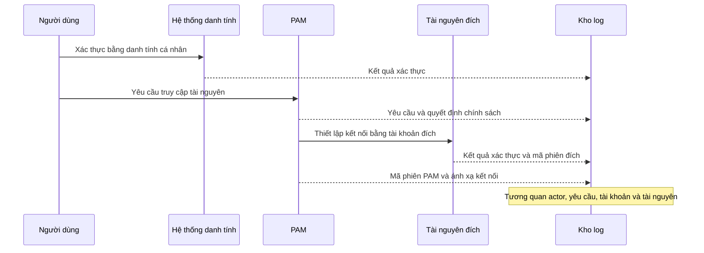

# Log đăng nhập đặc quyền

Một dòng log ghi “đăng nhập thành công bằng tài khoản quản trị” chưa đủ để trả lời ai đã truy cập máy chủ sản xuất, có được phép truy cập hay không và có đi qua hệ thống PAM hay không. Tài khoản đích có thể được nhiều người sử dụng thông qua cơ chế quản lý tập trung; địa chỉ nguồn mà máy chủ nhìn thấy có thể chỉ là địa chỉ của máy trung chuyển. Ngược lại, một lượt xác thực thành công tại cổng PAM chưa chứng minh rằng người dùng đã vào được tài nguyên đích.

Trong quản lý truy cập đặc quyền, log đăng nhập phải giúp dựng lại mối liên hệ giữa danh tính gốc, quyền được cấp, tài khoản đích và kết quả truy cập. Bài này trình bày cách xác định sự kiện cần ghi, thiết kế dữ liệu, đối chiếu nhiều nguồn và vận hành đường thu thập để các bản ghi thực sự có giá trị khi điều tra hoặc kiểm toán.

## 1. Mục tiêu và phạm vi

Sau bài học, người học có thể:

- Phân biệt đăng nhập cổng PAM, đăng nhập tài nguyên đích, cấp quyền và sử dụng quyền.
- Xác định những trường dữ liệu cần có để quy trách nhiệm một lần đăng nhập đặc quyền.
- Thiết kế chuỗi tương quan giữa yêu cầu truy cập, quyết định cho phép, phiên PAM và phiên đích.
- Nhận diện truy cập trực tiếp, chuỗi thất bại bất thường và khoảng trống thu thập log.
- Kiểm tra độ đầy đủ của log bằng các tình huống có kết quả biết trước trong môi trường thử nghiệm.

Phạm vi chính là sự kiện xác thực và mở phiên có liên quan đến tài khoản hoặc đường truy cập đặc quyền: tài khoản quản trị, tài khoản dịch vụ, tài khoản hạ tầng và danh tính máy được cấp quyền cao. Ghi lệnh, quay phiên, thay đổi cấu hình và truy cập dữ liệu là các lớp bằng chứng khác. Có thể liên kết đến chúng, nhưng log đăng nhập không thay thế được các lớp đó.

## 2. Hiểu đúng “đăng nhập đặc quyền”

### 2.1. Đặc quyền nằm trong ngữ cảnh tài nguyên

Không nên chỉ chọn những tài khoản có tên chứa `admin` hoặc `root`. Một tài khoản tên `deploy-bot` có thể có khả năng triển khai lên toàn bộ cụm sản xuất. Một người dùng thông thường có thể đăng nhập bằng danh tính cá nhân rồi nhận vai trò quản trị trong một khoảng thời gian giới hạn.

Việc phân loại cần dựa trên danh mục quyền và quan hệ tài khoản–tài nguyên, chẳng hạn:

- Tài khoản có quyền quản trị hệ điều hành trên máy đích.
- Danh tính có quyền quản trị cơ sở dữ liệu, thiết bị mạng hoặc nền tảng ảo hóa.
- Vai trò có quyền sửa chính sách truy cập hoặc quản lý credential.
- Tài khoản dịch vụ có quyền triển khai, thay đổi cấu hình hoặc đọc bí mật quan trọng.
- Tài khoản khẩn cấp được dùng khi đường truy cập thông thường không hoạt động.

Nên lưu lý do phân loại và phiên bản nguồn phân loại. Nếu quyền của tài khoản thay đổi sau sự kiện, hệ thống điều tra vẫn cần biết tài khoản được coi là đặc quyền theo ngữ cảnh nào tại thời điểm đăng nhập. Một tra cứu danh mục hiện tại không tự động phản ánh đúng trạng thái quá khứ.

### 2.2. Bốn mốc dễ bị nhầm

| Mốc | Điều có thể khẳng định | Điều chưa thể khẳng định |
| --- | --- | --- |
| Xác thực tại nhà cung cấp danh tính hoặc PAM thành công | Một danh tính đã vượt qua bước xác thực được ghi nhận | Người đó đã vào máy đích hoặc đã nhận quyền quản trị |
| Yêu cầu truy cập được cho phép | Chính sách hoặc người phê duyệt đã cho phép một phạm vi truy cập | Kết nối đã được thiết lập thành công |
| Đăng nhập đích thành công | Nguồn log đích xác nhận một lượt đăng nhập theo ngữ nghĩa của nó | Người dùng đã thực hiện hành động quản trị cụ thể |
| Nâng quyền hoặc nhận vai trò thành công | Một ngữ cảnh quyền cao đã được tạo hoặc kích hoạt | Mọi thao tác sau đó đều hợp lệ hay nằm trong mục đích đã duyệt |

Một giao thức có thể xác thực thành công nhưng không mở được phiên sử dụng do lỗi cấu hình, giới hạn kết nối hoặc chính sách khác. Do đó, hãy giữ nguyên khác biệt giữa `authentication.succeeded` và `session.started` nếu nguồn dữ liệu cung cấp được cả hai.

## 3. Mô hình danh tính để quy trách nhiệm

### 3.1. Danh tính người khởi tạo khác tài khoản đăng nhập đích

Giả sử Lan đăng nhập bằng danh tính cá nhân, được phép truy cập máy chủ `app-prod-07` rồi PAM dùng tài khoản `ops-admin` để mở phiên. Máy đích có thể chỉ ghi nhận `ops-admin` từ địa chỉ của gateway.

Chuỗi cần chứng minh là:

```text
Danh tính cá nhân của Lan
    → yêu cầu truy cập được phép
    → phiên kết nối do PAM quản lý
    → tài khoản ops-admin trên app-prod-07
    → kết quả xác thực và mở phiên tại đích
```

Không nên gộp tất cả thành một trường `username`. Ít nhất cần phân biệt:

- **Actor:** danh tính khởi tạo hành động. Với người dùng, đây thường là định danh cá nhân ổn định trong hệ thống danh tính.
- **Target principal:** tài khoản hoặc vai trò thực sự được dùng trên tài nguyên đích.
- **Broker:** thành phần trung gian thiết lập kết nối hoặc chuyển tiếp yêu cầu.
- **Target resource:** tài nguyên nhận kết nối, nên có định danh tài sản ngoài tên hiển thị.

Mỗi định danh cần đi kèm miền hoặc hệ thống cấp phát. Hai tài khoản cùng tên `admin` trên hai thiết bị không mặc nhiên là cùng một danh tính.

### 3.2. Danh tính máy cũng cần được quy về workload

Với tác vụ tự động, actor có thể là workload hoặc tài khoản dịch vụ thay vì con người. Log nên chỉ rõ đó là danh tính không tương tác, workload nào dùng nó và hệ thống nào sở hữu workload.

Ví dụ, pipeline `release-api` nhận credential ngắn hạn rồi đăng nhập máy triển khai. Bằng chứng hữu ích gồm định danh workload đã được xác thực, định danh lần chạy, tài khoản đích và tham chiếu quyết định cấp credential hoặc cấp quyền. Người kích hoạt pipeline có thể được ghi như một thuộc tính riêng nếu đã được hệ thống xác minh; không tự suy ra người đó là actor của mọi lần đăng nhập nền.

Tên workload do ứng dụng tự khai không có độ tin cậy tương đương định danh được nền tảng xác thực. Hãy lưu nguồn của thông tin để người điều tra hiểu giới hạn của phép gán danh tính.

### 3.3. Không suy đoán từ IP và thời gian

Địa chỉ IP hữu ích để điều tra nhưng không phải định danh duy nhất của con người. NAT, VPN, gateway, proxy và máy dùng chung đều có thể làm nhiều người xuất hiện dưới cùng một địa chỉ.

Ưu tiên mã liên kết được tạo và quản lý bởi hệ thống tin cậy. Nếu chỉ ghép được theo thời gian, địa chỉ và tài khoản, phải coi kết quả là ứng viên tương quan có thể nhầm, đặc biệt khi nhiều phiên diễn ra đồng thời.

## 4. Những sự kiện cần thu thập

Một thiết kế tối thiểu cần quan sát được cả thành công, thất bại và trường hợp bị chặn trước khi gửi tới đích.

| Nhóm sự kiện | Ví dụ trong PAM | Giá trị điều tra |
| --- | --- | --- |
| Xác thực vào đường truy cập | Đăng nhập cổng quản trị, gateway hoặc bastion | Xác định danh tính và điểm vào |
| Yêu cầu và quyết định truy cập | Yêu cầu tới máy sản xuất được chấp thuận hoặc từ chối | Đối chiếu việc đăng nhập với phạm vi được phép |
| Xác thực đích | Tài khoản quản trị được đích chấp nhận hoặc từ chối | Chứng minh kết quả tại tài nguyên |
| Mở và đóng phiên | Phiên đầu cuối hoặc giao diện quản trị bắt đầu, kết thúc | Xác định khoảng tồn tại của phiên và liên kết bằng chứng |
| Nâng quyền hoặc nhận vai trò | Một phiên chuyển sang ngữ cảnh có quyền cao | Bổ sung mốc đặc quyền khi đăng nhập ban đầu chưa có quyền cao |
| Hoạt động của đường log | Collector mất liên lạc, hàng đợi đầy, nguồn ngừng gửi | Phân biệt không có truy cập với không quan sát được truy cập |

Không phải mọi hệ thống đều có một phiên kéo dài. Truy cập API bằng danh tính máy có thể chỉ có sự kiện xác thực hoặc quyết định cho từng yêu cầu. Khi đó, liên kết bằng request ID hoặc định danh lần gọi thay vì tạo ra một phiên giả mà hệ thống thực tế không có.

Đăng xuất cũng không luôn có bản ghi tin cậy, chẳng hạn khi máy bị tắt đột ngột hoặc đường truyền đứt. Trạng thái `unknown` hoặc `terminated_by_timeout` phải khác với một sự kiện đăng xuất bình thường có nguồn chứng minh.

## 5. Thiết kế bản ghi đăng nhập

### 5.1. Các nhóm trường quan trọng

| Nhóm | Trường gợi ý | Ý nghĩa và lưu ý |
| --- | --- | --- |
| Định danh sự kiện | `event_id`, `schema_version`, `source_event_id` | Phân biệt bản ghi, theo dõi thay đổi schema và hỗ trợ khử trùng |
| Nguồn phát | `source_system`, `source_instance`, `collector_id` | Biết hệ thống nào khẳng định sự kiện và collector nào tiếp nhận |
| Thời gian | `event_time`, `observed_time`, `ingested_time` | Tách lúc sự kiện xảy ra, lúc collector thấy và lúc kho log nhận |
| Danh tính khởi tạo | `actor_id`, `actor_type`, `identity_authority` | Phân biệt người, dịch vụ và hệ thống cấp danh tính |
| Tài khoản đích | `target_account_id`, `target_account_name`, `target_account_scope` | Xác định đúng tài khoản trong đúng máy, miền hoặc tenant |
| Tài nguyên đích | `target_asset_id`, `target_name`, `environment` | Dùng định danh ổn định, kèm tên để hỗ trợ vận hành |
| Nguồn kết nối | `client_ip`, `peer_ip`, `gateway_id`, `access_path` | Phân biệt máy người dùng với nút kết nối trực tiếp tới đích |
| Ngữ nghĩa sự kiện | `event_type`, `outcome`, `reason_category` | Tách loại hành động, kết quả và nguyên nhân đã chuẩn hóa |
| Tương quan | `access_request_id`, `pam_session_id`, `target_session_id` | Nối các chặng; có thể để rỗng khi nguồn không cung cấp |
| Ngữ cảnh chính sách | `decision_id`, `policy_id`, `policy_version`, `grant_id` | Tham chiếu quyết định và quyền đã cấp tại thời điểm liên quan |
| Độ tin cậy dữ liệu | `actor_attribution`, `correlation_method`, `correlation_confidence` | Cho biết đâu là thông tin trực tiếp, đâu là suy luận |

Đây là schema minh họa, không phải tên trường bắt buộc của một sản phẩm. Khi triển khai, cần định nghĩa kiểu dữ liệu, độ dài, tập giá trị, quy tắc để rỗng và nguồn cung cấp cho từng trường.

Trường bắt buộc nên phụ thuộc loại sự kiện. Chẳng hạn, một lần PAM từ chối yêu cầu chưa có `target_session_id`; một kết nối đi thẳng ngoài PAM có thể không có `pam_session_id`. Thiếu những trường này là thông tin cần phân tích, không phải lý do để loại bỏ sự kiện.

### 5.2. Giữ riêng thời điểm xảy ra và thời điểm nhận

Nên dùng thời gian có múi giờ rõ ràng, thường chuẩn hóa sang UTC, với độ chính xác phù hợp nguồn. Một bản ghi nhận lúc 09:05 có thể mô tả lần đăng nhập xảy ra lúc 09:00 nhưng bị giữ trong hàng đợi năm phút.

Nếu chỉ lưu thời gian nhận, người điều tra dễ đặt nhầm thứ tự giữa phê duyệt và đăng nhập. Nếu chỉ lưu thời gian nguồn, khó phát hiện đường log bị trễ hoặc nguồn có đồng hồ sai.

Ngoài đồng bộ đồng hồ, nên theo dõi độ lệch và độ tin cậy thời gian của các nguồn quan trọng. Không dùng chênh lệch vài giây làm bằng chứng tuyệt đối khi độ lệch nguồn chưa được kiểm soát. Các sự kiện đến muộn phải có cách được bổ sung vào cửa sổ tương quan phù hợp.

### 5.3. Chuẩn hóa nhưng bảo toàn ý nghĩa nguồn

Một nguồn ghi “không được phép mở phiên”, nguồn khác ghi “sai credential”. Cả hai có thể có kết quả `failure`, nhưng nguyên nhân và hành động xử lý khác nhau.

Hệ thống chuẩn hóa nên:

- Giữ loại và mã kết quả gốc khi chúng không chứa dữ liệu cần loại bỏ.
- Ánh xạ sang nhóm nguyên nhân dùng chung như `authentication_rejected`, `policy_denied`, `account_restricted` hoặc `connection_error`.
- Dùng `unknown` khi chưa biết nguyên nhân; không ép mọi lỗi kết nối thành sai mật khẩu.
- Ghi phiên bản phép ánh xạ để có thể giải thích báo cáo được tạo trước và sau một lần thay đổi parser.

Nguyên nhân chi tiết phục vụ đội vận hành có thể được giới hạn quyền xem. Giao diện trả cho người dùng cuối không nhất thiết hiển thị toàn bộ chi tiết đó.

## 6. Ví dụ một bản ghi đã tương quan

Bản JSON sau là dữ liệu giả lập của một sự kiện xác thực đích thành công đã được bổ sung ngữ cảnh từ PAM. Bản ghi gốc tại đích và nguồn thông tin dùng để tương quan vẫn cần được bảo quản riêng theo chính sách log.

```json
{
  "schema_version": "1.0",
  "event_id": "norm-000481",
  "event_type": "target.authentication.succeeded",
  "event_time": "2026-04-18T02:15:32Z",
  "observed_time": "2026-04-18T02:15:33Z",
  "ingested_time": "2026-04-18T02:15:35Z",
  "source": {
    "system": "target-os",
    "instance": "asset-app-007",
    "source_event_id": "os-event-76422",
    "collector_id": "collector-prod-02"
  },
  "actor": {
    "id": "person-1042",
    "type": "human",
    "identity_authority": "corp-identity",
    "attribution": "correlated_from_pam"
  },
  "target": {
    "asset_id": "asset-app-007",
    "name": "app-prod-07",
    "environment": "production",
    "account_id": "account-ops-007",
    "account_name": "ops-admin",
    "account_scope": "asset-app-007"
  },
  "connection": {
    "protocol": "ssh",
    "access_path": "pam_gateway",
    "client_ip": "192.0.2.24",
    "client_ip_source": "pam",
    "peer_ip": "198.51.100.10",
    "gateway_id": "pam-gw-01"
  },
  "correlation": {
    "access_request_id": "req-3051",
    "pam_session_id": "pam-session-8119",
    "target_session_id": "target-session-518",
    "decision_id": "decision-3051-allow",
    "method": "trusted_connection_mapping",
    "confidence": "high"
  },
  "outcome": "success",
  "privilege_context": {
    "classification": "privileged_account",
    "inventory_version": "inventory-2026-04-18"
  }
}
```

Ví dụ này dùng hai địa chỉ khác nhau có chủ đích. `client_ip` là địa chỉ khách do PAM quan sát; `peer_ip` là nút mà đích thấy kết nối trực tiếp. Việc bổ sung `client_ip` không được làm mất `peer_ip` gốc hoặc khiến người đọc tưởng máy đích đã trực tiếp nhìn thấy máy khách.

Giá trị `trusted_connection_mapping` chỉ hợp lệ khi tích hợp thực sự có bảng ánh xạ đáng tin cậy giữa hai phiên. Không gắn độ tin cậy cao chỉ vì tên tài khoản và thời gian gần nhau.

Nếu chưa xác định actor, nên để `actor.id` rỗng theo schema và ghi trạng thái `unattributed`, đồng thời tạo công việc xử lý phù hợp. Một actor bị thiếu trung thực tốt hơn việc điền tên người được phỏng đoán.

## 7. Dựng chuỗi bằng chứng từ nhiều nguồn

### 7.1. Luồng truy cập qua PAM



Sơ đồ biểu diễn các sự kiện logic; trong hệ thống thực, đường truyền log thường đi qua agent hoặc collector và bản ghi có thể đến khác thứ tự.

Để kiểm tra một lần đăng nhập, hãy lần theo các câu hỏi:

1. Danh tính khởi tạo được hệ thống nào xác thực?
2. Quyết định cho phép áp dụng cho actor, tài khoản, tài nguyên và khoảng thời gian nào?
3. PAM đã tạo kết nối nào, bằng tài khoản nào?
4. Đích báo xác thực hoặc mở phiên thành công hay thất bại?
5. Có phép ánh xạ đáng tin cậy giữa sự kiện PAM và sự kiện đích không?

Một yêu cầu đã duyệt cho máy A không giải thích được đăng nhập vào máy B. Một quyền đã hết hạn không trở thành hợp lệ chỉ vì tồn tại một ticket có cùng tên người dùng.

### 7.2. Dùng khóa tương quan đúng phạm vi

Mã phiên đích có thể chỉ duy nhất trong một máy hoặc trong một lần khởi động. Khi lưu, cần kết hợp mã với phạm vi nguồn, chẳng hạn định danh tài sản và ngữ cảnh khởi động nếu hệ thống có cung cấp. Tương tự, request ID chỉ có ý nghĩa khi biết hệ thống đã sinh nó.

Không nên tin một header do khách tự gửi chỉ vì nó có tên `pam-session-id`. Nếu dùng mã truyền qua nhiều chặng, phải xác định ai sinh mã, thành phần nào được quyền gắn hoặc sửa mã và cách kiểm tra tính tin cậy của việc gắn mã.

Với nguồn không hỗ trợ truyền mã, tích hợp có thể tạo ánh xạ từ broker, thông tin kết nối và log đích. Cần mô tả giới hạn và trường hợp nhiều ứng viên. Không chọn ngẫu nhiên một actor để buộc mọi sự kiện có đủ trường.

### 7.3. Tài khoản dùng chung và credential checkout

Khi PAM cung cấp phiên proxy, hệ thống có thể liên kết từng phiên với người khởi tạo mà không phải cho người đó biết mật khẩu đích. Khi chỉ checkout credential, bằng chứng checkout cho thấy ai nhận credential trong một khoảng thời gian; nó không luôn chứng minh ai đã dùng credential cho từng lần đăng nhập.

Nếu hai người cùng có khả năng dùng một tài khoản đích, log chỉ ghi tên tài khoản sẽ thiếu khả năng quy trách nhiệm. Cần thiết kế thêm biện pháp như tài khoản cá nhân, quyền hoặc credential ngắn hạn có định danh riêng, kiểm soát checkout độc quyền phù hợp, hoặc bắt buộc đi qua đường truy cập có ánh xạ phiên. Không nên khẳng định quy trách nhiệm đầy đủ chỉ từ việc tài khoản đã nằm trong vault.

## 8. Các tình huống phát hiện quan trọng

### 8.1. Đăng nhập đặc quyền không khớp đường PAM

Một đăng nhập đích thành công nhưng chưa ghép được với phiên PAM có thể cho thấy truy cập trực tiếp, tài khoản chưa onboard, ngoại lệ khẩn cấp hoặc lỗi thu thập. Đây là tín hiệu cần kiểm tra, chưa tự động là hành vi xâm nhập.

Để tín hiệu hữu ích, cần có:

- Danh mục tài nguyên nào bắt buộc đi qua PAM và từ thời điểm nào.
- Danh mục tài khoản hoặc workload được phép dùng đường khác, có chủ sở hữu và hạn dùng ngoại lệ.
- Tình trạng tiếp nhận log từ PAM và đích trong khoảng thời gian đang xét.
- Khoảng chờ sự kiện đến muộn và tiêu chí tương quan được kiểm thử.

Truy vấn minh họa dưới đây dùng ba bảng logic, không phải cú pháp triển khai trực tiếp cho mọi hệ thống. Giả định các bảng đã được khử trùng, `target_logins` chứa đăng nhập trên tài nguyên bắt buộc qua PAM, và pipeline đối chiếu đã chờ hết độ trễ cho phép.

```sql
SELECT
    t.event_id,
    t.event_time,
    t.target_asset_id,
    t.target_account_id,
    t.peer_ip
FROM target_logins t
LEFT JOIN pam_target_links l
    ON l.target_event_id = t.event_id
LEFT JOIN approved_exceptions e
    ON e.target_asset_id = t.target_asset_id
   AND e.target_account_id = t.target_account_id
   AND t.event_time >= e.valid_from
   AND t.event_time < e.valid_until
   AND e.scope_match_verified = TRUE
WHERE t.outcome = 'success'
  AND t.privileged = TRUE
  AND l.target_event_id IS NULL
  AND e.exception_id IS NULL;
```

`scope_match_verified` biểu thị việc hệ thống đã kiểm tra các điều kiện bổ sung của ngoại lệ như nguồn kết nối, loại tác vụ và môi trường. Không dùng một ngoại lệ rộng chỉ theo tên tài khoản để bỏ qua mọi lần đăng nhập.

Kết quả truy vấn là danh sách đăng nhập cần điều tra. Khi nguồn PAM đang mất log, nên gắn trạng thái thiếu bằng chứng và xử lý sự cố quan sát song song; không tự coi toàn bộ kết quả là đăng nhập trái phép hoặc bỏ qua toàn bộ cảnh báo.

### 8.2. Nhiều thất bại rồi thành công

Chuỗi thất bại có thể đến từ thử credential, lỗi cấu hình hoặc một dịch vụ chưa cập nhật credential sau luân chuyển. Một lần thành công sau chuỗi thất bại làm tăng mức cần xem xét, nhưng không tự chứng minh tài khoản đã bị chiếm đoạt.

Nên xem xét đồng thời actor hoặc tài khoản đích, tài nguyên, đường truy cập, loại xác thực, nguồn kết nối và nhịp lặp. Tránh gộp mọi thất bại từ cùng gateway thành hoạt động của cùng một người.

Ví dụ một workload cứ thất bại đúng mỗi phút sau thời điểm luân chuyển credential có hướng xử lý khác với nhiều tài khoản đặc quyền bị thử từ một nguồn lạ. Ngưỡng cảnh báo cần được chọn theo dữ liệu vận hành và mức quan trọng của hệ thống, không lấy một con số minh họa làm quy tắc chung cho mọi môi trường.

### 8.3. Đăng nhập thành công ngoài phạm vi quyền

Đối chiếu sự kiện với quyền đã cấp tại thời điểm truy cập:

- Đúng actor hoặc workload được phép hay không?
- Đúng tài khoản, vai trò, tài nguyên và môi trường hay không?
- Thời điểm truy cập có nằm trong khoảng hiệu lực không?
- Phương thức truy cập có phù hợp quyết định chính sách không?
- Ngoại lệ khẩn cấp có bằng chứng và hậu kiểm theo quy trình không?

“Ngoài giờ làm việc” là yếu tố ngữ cảnh, không phải kết luận độc lập. Ca trực, triển khai có lịch và ứng phó sự cố đều có thể tạo truy cập hợp lệ ngoài giờ. Ngược lại, một lần đăng nhập trong giờ làm việc vẫn có thể không hợp lệ.

### 8.4. Mất log từ tài nguyên đặc quyền

Không có bản ghi thất bại không có nghĩa là không có ai thử đăng nhập. Nguồn có thể bị tắt audit, agent dừng, parser lỗi hoặc đường truyền gián đoạn.

Hãy theo dõi heartbeat, độ trễ nhận, hàng đợi, số lượng lỗi parse và mức đầy vùng đệm. Với hệ thống ít truy cập, việc “không có login trong một giờ” không phải phép kiểm tra sức khỏe đáng tin cậy; cần một tín hiệu vận hành độc lập với lưu lượng đăng nhập.

## 9. Bảo vệ dữ liệu log và đường truyền

### 9.1. Không đưa credential vào bằng chứng

Log có thể chứa phương thức xác thực, kết quả xác thực hoặc tham chiếu credential an toàn. Không ghi mật khẩu, khóa riêng, mã OTP, mã phục hồi, cookie phiên hoặc bearer token. Cũng cần tránh sao chép toàn bộ request có header xác thực chỉ để “đủ ngữ cảnh”.

Tham chiếu credential chỉ nên là định danh nội bộ được thiết kế để ghi log, không có khả năng dùng lại để truy cập. Mã định danh phiên phục vụ audit phải được tách khỏi token có thể dùng để chiếm phiên. Băm một token truy cập rồi ghi lại không mặc nhiên giải quyết mọi rủi ro và không thay thế việc thiết kế trường log phù hợp.

Địa chỉ IP, danh tính cá nhân, tên máy và mục đích truy cập cũng có thể là thông tin nhạy cảm. Chỉ thu thập dữ liệu cần thiết, phân quyền xem, kiểm soát xuất dữ liệu và xác định thời gian lưu phù hợp nhu cầu điều tra cùng nghĩa vụ của tổ chức.

### 9.2. Tách quyền quản trị đích khỏi quyền sửa bằng chứng

Nếu người quản trị máy đích có thể xóa cả log tập trung, việc thu thập không tạo được sự độc lập cần thiết. Nên chuyển log tới kho được bảo vệ bằng miền quản trị và quyền truy cập phù hợp, giới hạn thao tác xóa hoặc sửa, đồng thời ghi audit cho chính kho log.

Các cơ chế như lưu bất biến, giới hạn retention, chữ ký hoặc chuỗi băm có thể hỗ trợ phát hiện thay đổi tùy thiết kế. Chúng không chứng minh nguồn đã ghi đầy đủ mọi sự kiện, cũng không tự ngăn một nguồn bị chiếm quyền tạo bản ghi sai. Cần kết hợp bảo vệ nguồn, nhiều nguồn đối chiếu và giám sát độ đầy đủ.

Đường truyền nên xác thực thành phần gửi và bảo vệ dữ liệu trên đường đi. Tuy nhiên, bảo vệ đường truyền không đồng nghĩa bảo đảm tiếp nhận bền vững. Định nghĩa rõ khi nào bên gửi được coi sự kiện đã được nhận: mới nằm trong bộ nhớ collector hay đã được lưu bền vững theo cơ chế của hệ thống.

### 9.3. Chống mất, trùng và phá cấu trúc log

Khi mạng gián đoạn, nguồn hoặc collector có thể cần vùng đệm và cơ chế gửi lại. Phải có giới hạn dung lượng, cảnh báo khi gần đầy và cách xử lý khi hết chỗ. Không để việc mất log diễn ra âm thầm.

Gửi lại có thể tạo bản ghi trùng. Khử trùng nên dựa trên định danh sự kiện cùng phạm vi nguồn, theo đặc tính thực tế của nguồn; không xóa chỉ vì hai dòng có cùng người dùng và cùng giây. Hai lần đăng nhập thật có thể xảy ra rất gần nhau.

Giá trị như tên người dùng hoặc chuỗi lỗi có thể chứa ký tự không mong muốn. Ghi theo cấu trúc, escape đúng định dạng, giới hạn độ dài và không nối trực tiếp dữ liệu không tin cậy vào dòng log văn bản. Khi hiển thị dữ liệu trong công cụ điều tra, vẫn cần xử lý nội dung theo đúng ngữ cảnh hiển thị.

## 10. Quy trình đưa một nguồn đăng nhập vào vận hành

### Bước 1: Chọn tài nguyên và ngữ nghĩa cần chứng minh

Xác định loại tài nguyên, các phương thức truy cập, nhóm tài khoản đặc quyền và các đường truy cập được cho phép. Với từng nguồn, mô tả rõ sự kiện nào biểu thị xác thực, sự kiện nào biểu thị mở phiên và sự kiện nào chỉ là yêu cầu kết nối.

Đầu ra mong muốn là một bản mô tả ánh xạ nguồn và các câu hỏi điều tra mà nguồn có thể trả lời, kèm những giới hạn đã biết.

### Bước 2: Thiết lập và kiểm tra các trường

Trong môi trường thử nghiệm, tạo một lượt đăng nhập thành công và một lượt thất bại có kiểm soát. Đối chiếu log tại nguồn với bản nhận ở kho tập trung. Kiểm tra tài khoản, tài nguyên, địa chỉ, thời gian, loại hành động và kết quả có được bảo toàn hay không.

Chỉ thử thất bại trên tài khoản và môi trường được phép, với số lần đủ nhỏ để tránh gây khóa tài khoản hoặc ảnh hưởng vận hành.

### Bước 3: Kiểm tra tương quan PAM–đích

Tạo một lượt truy cập qua PAM có danh tính người dùng riêng. Xác minh có thể nối từ actor đến tài khoản đích và ngược lại. Lặp lại với hai phiên đồng thời để phát hiện phép ghép chỉ dựa trên thời gian hoặc tên tài khoản.

Nếu một đường truy cập chỉ dùng checkout credential và chưa quy được từng lần đăng nhập, ghi rõ giới hạn đó thay vì đánh dấu khả năng quy trách nhiệm là hoàn chỉnh.

### Bước 4: Thử các đường ngoại lệ được cấp phép

Trong lab, tạo một kết nối trực tiếp được kiểm soát tới tài nguyên bắt buộc qua PAM và xác minh hệ thống ghi nhận được việc chưa có liên kết PAM. Sau đó thử một ngoại lệ khẩn cấp hợp lệ để kiểm tra rằng nó vẫn được ghi log và mang đúng tham chiếu ngoại lệ.

Không tắt việc thu thập chỉ vì đăng nhập thuộc tài khoản break-glass. Truy cập khẩn cấp càng cần được ghi nhận và hậu kiểm.

### Bước 5: Thử sự cố thu thập

Mô phỏng gián đoạn đường log trong lab, khôi phục rồi kiểm tra sự kiện gửi lại, độ trễ, cảnh báo và bản ghi trùng. Kiểm tra cả lỗi parser: collector vẫn chạy nhưng bản ghi không được phân tích cũng có thể tạo vùng mù.

Nếu có chính sách chặn truy cập khi không bảo đảm audit, phải thiết kế rõ thành phần quyết định, điều kiện kích hoạt và đường truy cập khẩn cấp. Không tự áp dụng một hành vi chặn chung cho mọi hệ thống chỉ vì kho log đang trễ.

### Bước 6: Chốt tiêu chí vận hành

Xác định chủ sở hữu nguồn, người xử lý sự cố, mục tiêu độ trễ, thời gian lưu, cách kiểm tra định kỳ và phạm vi cảnh báo. Các giá trị cần được tổ chức chọn theo mức rủi ro và năng lực thực tế; không có một thời gian lưu hoặc ngưỡng cảnh báo duy nhất phù hợp cho tất cả nguồn.

## 11. Tình huống thực hành

Đội vận hành nhận cảnh báo về ba sự kiện trên `app-prod-07`:

| Thời điểm UTC | Sự kiện | Bằng chứng hiện có |
| --- | --- | --- |
| 02:15:32 | `ops-admin` đăng nhập thành công | Log đích khớp phiên PAM của Lan và quyết định truy cập còn hiệu lực |
| 02:18:10 | `ops-admin` đăng nhập thành công | Log đích từ một nguồn khác, chưa thấy phiên PAM tương ứng |
| 02:20:00 | Collector của một gateway mất liên lạc | Chưa biết dữ liệu có đang được giữ trong vùng đệm hay đã mất |

Không nên kết luận sự kiện thứ hai chắc chắn là truy cập trái phép chỉ từ ba dòng này. Cũng không nên bỏ qua nó vì sau đó có sự cố collector.

Một cách xử lý có căn cứ:

1. Giữ nguyên log nguồn và kho tập trung liên quan, ghi nhận phạm vi thời gian điều tra.
2. Kiểm tra định danh tài sản, tài khoản và địa chỉ của sự kiện 02:18:10 để tránh nhầm máy hoặc nhầm tài khoản cùng tên.
3. Xác minh nguồn PAM nào lẽ ra phải có bằng chứng và sức khỏe thu thập của nguồn đó trước, trong và sau sự kiện.
4. Tìm phiên hoặc yêu cầu truy cập đến muộn, kiểm tra ngoại lệ được phép và đối chiếu thông tin mạng thích hợp.
5. Xác minh tài khoản có thể được dùng ngoài PAM không và ai có khả năng sử dụng tại thời điểm đó.
6. Nếu vẫn không có liên kết đáng tin cậy, giữ trạng thái chưa quy trách nhiệm và xử lý theo quy trình sự cố tương ứng.

Kết quả của bước điều tra phải phân biệt sự kiện quan sát trực tiếp, thông tin suy luận và phần chưa xác định. “Không tìm thấy log PAM trong kho hiện tại” là kết quả tìm kiếm; “không hề có phiên PAM” là khẳng định mạnh hơn cần đủ bằng chứng.

## 12. Lỗi thiết kế thường gặp

| Lỗi | Hệ quả | Cách khắc phục |
| --- | --- | --- |
| Chỉ ghi đăng nhập thành công | Không thấy thử credential hoặc lỗi sau luân chuyển | Thu thập thành công, thất bại và quyết định bị từ chối theo đúng ngữ nghĩa |
| Dùng một trường tên tài khoản cho mọi chặng | Mất quan hệ giữa người dùng và tài khoản đích | Tách actor, target principal và phạm vi danh tính |
| Xem đăng nhập PAM là đăng nhập máy đích | Báo cáo truy cập thành công dù kết nối chưa tới đích | Đối chiếu kết quả PAM với xác thực hoặc mở phiên tại đích |
| Xem IP gateway là IP người dùng | Quy trách nhiệm sai hoặc gộp nhầm nhiều người | Lưu riêng địa chỉ khách và peer mà đích quan sát |
| Tự điền actor theo phiên gần nhất | Gán nhầm khi có truy cập đồng thời | Dùng ánh xạ tin cậy hoặc ghi rõ chưa xác định |
| Bỏ sự kiện vì thiếu request ID | Mất chính những truy cập ngoài đường quản lý | Giữ sự kiện và đánh dấu thiếu ngữ cảnh |
| Chỉ đếm số log để chứng minh đầy đủ | Nguồn im lặng hoặc gửi trùng làm sai kết luận | Theo dõi sức khỏe nguồn, độ trễ, khử trùng và kiểm tra đầu cuối |
| Lưu credential để hỗ trợ điều tra | Kho log trở thành nguồn lộ bí mật | Chỉ lưu phương thức và tham chiếu an toàn |
| Mặc định mọi sự kiện bất thường là tấn công | Tăng nhiễu, bỏ sót lỗi vận hành thật | Đánh giá chính sách, ngoại lệ, chất lượng log và bằng chứng liên quan |

## 13. Danh sách tự kiểm tra

Trước khi coi log đăng nhập đặc quyền là một nguồn bằng chứng có thể sử dụng, hãy tự trả lời:

- Có biết tài khoản và tài nguyên nào được phân loại là đặc quyền tại thời điểm sự kiện không?
- Có phân biệt danh tính khởi tạo với tài khoản đăng nhập đích và workload tự động không?
- Có tách xác thực, quyết định truy cập, mở phiên và nâng quyền không?
- Có thu thập kết quả thành công lẫn thất bại từ các nguồn cần thiết không?
- Có giữ cả thời điểm xảy ra lẫn thời điểm tiếp nhận và giám sát độ trễ không?
- Có thể giải thích cách tương quan, phạm vi mã định danh và độ tin cậy của phép ghép không?
- Có nhìn thấy đăng nhập trực tiếp, ngoại lệ khẩn cấp và các sự kiện thiếu liên kết PAM không?
- Có bảo vệ log, loại bỏ credential và kiểm soát quyền đọc, xuất, sửa hoặc xóa bằng chứng không?
- Có phát hiện nguồn ngừng gửi, parser lỗi, vùng đệm đầy và bản ghi trùng không?
- Có chứng minh đường thu thập hoạt động bằng các tình huống lab có kết quả biết trước không?

Một thiết kế đáp ứng các câu hỏi này giúp đội vận hành truy ngược từ một lần đăng nhập tới đúng actor, quyền đã cấp và tài nguyên liên quan, đồng thời chỉ rõ nơi bằng chứng còn thiếu. Đó là nền tảng để đánh giá truy cập đặc quyền và điều tra sự cố bằng dữ liệu có nguồn gốc rõ ràng.
