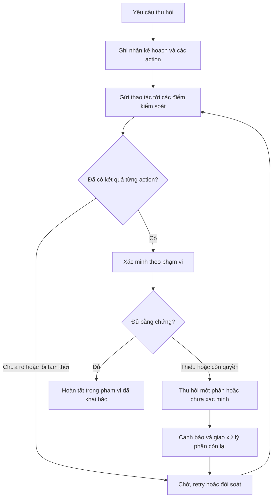

# Log thu hồi quyền

## 1. Mục đích của log thu hồi quyền trong PAM

Thu hồi quyền là quá trình làm mất khả năng sử dụng một đặc quyền đã được cấp. Trong hệ thống Privileged Access Management (PAM), điều này có thể bao gồm xóa một thành viên khỏi nhóm quản trị, kết thúc một grant JIT, khóa khả năng lấy credential từ vault, hủy token, vô hiệu hóa credential cũ hoặc kết thúc một phiên quản trị đang mở.

Log thu hồi quyền ghi lại ai yêu cầu thu hồi, thu hồi quyền của chủ thể nào, trên tài nguyên nào, vì lý do gì, hệ thống đã thực hiện đến đâu và có bằng chứng nào cho thấy quyền thực sự không còn dùng được. Đây là một phần của vòng đời kiểm kê, cấp quyền có giới hạn, sử dụng, thu hồi và lưu bằng chứng.

Ví dụ, một kỹ sư được cấp quyền quản trị cơ sở dữ liệu trong 30 phút để xử lý sự cố. Khi hết thời gian, PAM gửi yêu cầu xóa quyền. Một bản ghi `HTTP 202` từ API chỉ chứng minh yêu cầu đã được tiếp nhận. Nó chưa chứng minh quyền đã bị gỡ tại cơ sở dữ liệu, cache phân quyền đã cập nhật hay phiên SQL đang mở đã bị kết thúc.

Vì vậy, câu hỏi cần trả lời không chỉ là “đã gọi API thu hồi chưa?”, mà còn là “đến thời điểm nào, trong phạm vi nào, đặc quyền không còn khả dụng, và kết luận đó dựa trên nguồn nào?”.

Sau bài học này, người học cần có khả năng:

- Phân biệt log yêu cầu thu hồi, log thực thi và log xác minh hiệu lực.
- Thiết kế bản ghi có đủ định danh, thời gian, phạm vi, kết quả và liên kết bằng chứng.
- Theo dõi thu hồi không đồng bộ, thu hồi một phần, retry và sự kiện đến muộn.
- Đối soát cấp quyền với thu hồi cho tài khoản quản trị, tài khoản dịch vụ và phiên đặc quyền.
- Phát hiện trường hợp hệ thống báo hoàn tất nhưng quyền vẫn còn sử dụng được.

## 2. Phân biệt những điều thường bị gộp thành “đã thu hồi”

### 2.1. Thu hồi grant khác với thu hồi mọi khả năng truy cập

Một chủ thể có thể có nhiều đường nhận cùng một đặc quyền. Xóa grant JIT `grant-731` không đồng nghĩa xóa quyền quản trị thường trực của cùng người đó từ một nhóm khác. Tương tự, chặn lấy mật khẩu mới từ vault không làm người dùng quên mật khẩu đã nhận trước đó.

Log cần nêu chính xác đối tượng thu hồi: một grant, một membership, một credential version, một token, một session hay toàn bộ các quyền nằm trong phạm vi một yêu cầu điều phối. Khi kết luận về quyền hiệu lực, hệ thống phải xem xét các đường cấp quyền có liên quan trong phạm vi đã công bố.

| Hành động được ghi nhận | Bằng chứng có thể thu được | Điều chưa được chứng minh chỉ bằng hành động đó |
|---|---|---|
| Đóng grant JIT trong PAM | Trạng thái grant chuyển sang không hoạt động | Membership tại hệ thống đích đã bị xóa |
| Xóa membership ở hệ thống đích | Truy vấn lại không còn membership đó | Không còn role khác tạo ra cùng quyền; phiên cũ đã đổi quyền |
| Chặn checkout từ vault | Một yêu cầu checkout mới bị từ chối theo policy | Credential đã checkout trước đó không còn dùng được |
| Vô hiệu hóa credential cũ | Hệ thống đích từ chối credential/version trong phạm vi kiểm tra | Token hoặc session được tạo trước đó đã hết hiệu lực |
| Yêu cầu kết thúc phiên | Gateway nhận yêu cầu đóng session | Mọi kết nối trực tiếp hoặc phiên ngoài gateway cũng đã đóng |

### 2.2. Bốn lớp kết quả

Có thể tổ chức bằng chứng theo bốn lớp:

1. **Yêu cầu:** chính sách, người vận hành hoặc bộ lập lịch tạo yêu cầu thu hồi.
2. **Thực thi:** connector gửi lệnh và nhận phản hồi từ một điểm kiểm soát.
3. **Áp dụng:** hệ thống đích báo trạng thái thay đổi đã được áp dụng.
4. **Xác minh hiệu lực:** kiểm tra được định nghĩa trước xác nhận đặc quyền không còn sử dụng được trong phạm vi kiểm tra.

Không phải hệ thống nào cũng cung cấp đủ cả bốn lớp. Khi thiếu nguồn xác minh, cần ghi `NOT_VERIFIED` hoặc `UNKNOWN`, kèm lý do và thời điểm kiểm tra tiếp theo. Không nâng mức chắc chắn chỉ để làm đẹp dashboard.

Ngay cả một phép thử bị từ chối cũng cần diễn giải đúng: lỗi mạng, sai mật khẩu thử hoặc tài nguyên không tồn tại không chứng minh rằng policy thu hồi đã hoạt động. Kết quả cần phân biệt từ chối do phân quyền, lỗi xác thực, lỗi kết nối và lỗi của chính phép kiểm tra.

## 3. Những tác nhân kích hoạt cần được ghi lại

Thu hồi có thể xuất phát từ nhiều tình huống:

- Hết thời hạn JIT/JEA hoặc kết thúc một phiên làm việc đã phê duyệt.
- Nhân sự nghỉ việc, chuyển vai trò hoặc hết hợp đồng.
- Chủ sở hữu hệ thống đóng yêu cầu công việc trước hạn.
- Phát hiện tài khoản, credential hoặc thiết bị có dấu hiệu bị xâm phạm.
- Hủy phê duyệt, thay đổi policy hoặc phát hiện cấp sai phạm vi.
- Kết thúc sử dụng break-glass và đưa hệ thống trở lại kiểm soát thông thường.
- Vô hiệu hóa credential cũ sau một đợt luân chuyển đã kiểm chứng.
- Đối soát phát hiện quyền tồn dư sau một lần thu hồi trước đó.

Nên có `reason_code` ổn định để truy vấn, đồng thời có trường mô tả ngắn khi cần. Ví dụ `JIT_EXPIRED`, `ROLE_CHANGED`, `INCIDENT_CONTAINMENT`, `MANUAL_EARLY_CLOSE` hoặc `RECONCILIATION_REPAIR`. Đây là mã minh họa do tổ chức tự thiết kế, không phải tập mã chuẩn bắt buộc.

Đối với thu hồi khẩn cấp, log cần liên kết vụ việc, người hoặc policy kích hoạt và cơ sở sử dụng quyền khẩn cấp. Không nên buộc một thao tác cô lập khẩn cấp phải chờ một phê duyệt không thuộc quy trình ứng phó đã được tổ chức cho phép. Tuy nhiên, việc bỏ qua bước thông thường phải có dấu vết và người chịu trách nhiệm.

## 4. Thiết kế dữ liệu cho một sự kiện thu hồi

### 4.1. Các nhóm trường quan trọng

| Nhóm | Trường minh họa | Ý nghĩa |
|---|---|---|
| Định danh sự kiện | `event_id`, `event_type`, `schema_version` | Phân biệt sự kiện và hiểu đúng schema |
| Liên kết nghiệp vụ | `revocation_id`, `grant_id`, `request_id`, `incident_id` | Nối thu hồi với cấp quyền, công việc và sự cố |
| Chủ thể thao tác | `actor.id`, `actor.type`, `initiator.id` | Phân biệt service thực thi với người hoặc policy khởi tạo |
| Chủ thể bị thu hồi | `subject.id`, `subject.type`, `tenant_id` | Xác định đúng người, workload hoặc tài khoản dịch vụ |
| Phạm vi | `resource.id`, `entitlement.id`, `control_point`, `scope` | Chỉ rõ quyền nào, trên tài nguyên nào, tại đâu |
| Thời gian | `occurred_at`, `observed_at`, `ingested_at` | Phân biệt lúc xảy ra, lúc quan sát và lúc nhận log |
| Thực thi | `attempt_id`, `attempt_number`, `operation`, `result` | Phân biệt một lần gọi với kết quả cả yêu cầu |
| Hiệu lực | `effectiveness.status`, `verification_method`, `verified_at` | Nêu mức độ xác minh và cách xác minh |
| Bằng chứng | `evidence_refs`, `source_event_id`, `source_system` | Tìm lại phản hồi, trạng thái và sự kiện nguồn |
| Ngoại lệ | `error_code`, `remaining_actions`, `next_check_at` | Cho biết phần việc chưa xong và hướng xử lý |

Không nhất thiết mọi event phải có mọi trường. Ví dụ, `verified_at` phải để trống khi chưa xác minh; `grant_id` có thể không tồn tại khi xử lý một quyền thường trực chưa được quản lý bằng grant. Khi đó, cần định danh entitlement hoặc membership cụ thể để đối soát.

### 4.2. ID ổn định quan trọng hơn tên hiển thị

Tên tài khoản và tên nhóm có thể được đổi hoặc tái sử dụng. Log chỉ chứa `admin1` khó chứng minh đó là tài khoản nào trong một sự cố xảy ra nhiều tháng trước. Nên lưu ID bất biến nếu nguồn cung cấp, miền hoặc tenant, và tên hiển thị tại thời điểm sự kiện.

Đối với tài khoản dùng chung, cần giữ được liên kết giữa danh tính con người, yêu cầu cấp quyền, lần checkout và phiên truy cập. Chỉ ghi “root đã bị thu hồi” không xác định được ai đã sử dụng đặc quyền và bản sao credential nào có thể còn tồn tại.

Với workload, cần phân biệt tài khoản dịch vụ với một instance cụ thể của workload. Xóa quyền của instance đã dừng không chứng minh instance mới dùng cùng service identity đã mất quyền.

### 4.3. Tách trạng thái điều phối và trạng thái hiệu lực

`workflow.status` trả lời “bộ điều phối đang ở bước nào?”. `effectiveness.status` trả lời “đã biết gì về khả năng sử dụng quyền?”. Hai trường này không thay thế nhau.

Ví dụ:

```json
{
  "workflow": { "status": "VERIFYING" },
  "effectiveness": {
    "status": "NOT_VERIFIED",
    "reason": "TARGET_STATE_NOT_YET_OBSERVED"
  }
}
```

Một connector hoàn tất việc gửi lệnh vẫn có thể để yêu cầu ở trạng thái chờ xác minh. Ngược lại, nếu hệ thống đích xác nhận quyền đã không còn từ trước, thu hồi có thể được ghi nhận là trạng thái mong muốn đã đạt mà không cần thực hiện lại thay đổi.

## 5. Ví dụ chuỗi log cho một grant JIT

Giả sử một kỹ sư nhận grant `grant-731`, cho phép quản trị `db-prod-07` thông qua membership tạm thời và phiên do gateway PAM quản lý. Phạm vi thu hồi đã được định nghĩa gồm xóa membership này, chặn checkout mới theo grant và kết thúc phiên `sess-920`. Tất cả ID dưới đây chỉ phục vụ minh họa.

### 5.1. Yêu cầu thu hồi

```json
{
  "schema_version": 1,
  "event_id": "evt-revoke-001",
  "event_type": "pam.revocation.requested",
  "occurred_at": "2026-11-27T03:30:00.000Z",
  "revocation_id": "rev-482",
  "grant_id": "grant-731",
  "initiator": { "id": "jit-expiry-policy", "type": "POLICY" },
  "actor": { "id": "pam-scheduler", "type": "SERVICE" },
  "subject": { "id": "person-184", "type": "HUMAN" },
  "tenant_id": "tenant-example",
  "resource": { "id": "db-prod-07", "type": "DATABASE" },
  "reason_code": "JIT_EXPIRED",
  "scope": {
    "entitlement_id": "ent-db-maintenance",
    "membership_id": "member-temp-731",
    "session_ids": ["sess-920"],
    "checkout_scope": "grant-731"
  },
  "workflow": { "status": "REQUESTED" },
  "effectiveness": { "status": "NOT_VERIFIED" }
}
```

Event này không mang credential, access token hay nội dung câu lệnh SQL. Nó định danh phạm vi công việc và điểm bắt đầu để liên kết các bước tiếp theo.

### 5.2. API tiếp nhận một thao tác

```json
{
  "schema_version": 1,
  "event_id": "evt-revoke-002",
  "event_type": "pam.revocation.action.accepted",
  "occurred_at": "2026-11-27T03:30:00.450Z",
  "revocation_id": "rev-482",
  "action_id": "action-membership",
  "attempt_id": "attempt-membership-1",
  "attempt_number": 1,
  "control_point": "database-identity-api",
  "operation": "REMOVE_MEMBERSHIP",
  "result": "ACCEPTED",
  "provider_operation_id": "provider-op-619",
  "effectiveness": { "status": "NOT_VERIFIED" }
}
```

Phản hồi tiếp nhận không phải kết quả hiệu lực. Các thao tác chặn checkout và đóng phiên cần có `action_id` riêng, cùng thuộc `revocation_id` này. Không dùng một phản hồi thành công của database để đại diện cho kết quả của cả ba điểm kiểm soát.

### 5.3. Tổng hợp sau khi xác minh

```json
{
  "schema_version": 1,
  "event_id": "evt-revoke-009",
  "event_type": "pam.revocation.verified",
  "occurred_at": "2026-11-27T03:30:08.200Z",
  "revocation_id": "rev-482",
  "grant_id": "grant-731",
  "workflow": { "status": "COMPLETED" },
  "effectiveness": {
    "status": "VERIFIED_FOR_DECLARED_SCOPE",
    "verified_at": "2026-11-27T03:30:08.200Z",
    "checks": [
      {
        "action_id": "action-membership",
        "method": "TARGET_MEMBERSHIP_READ",
        "result": "MEMBERSHIP_ABSENT",
        "evidence_ref": "evidence://rev-482/membership-read"
      },
      {
        "action_id": "action-checkout",
        "method": "GRANT_SCOPED_AUTHORIZATION_CHECK",
        "result": "CHECKOUT_DENIED_BY_POLICY",
        "evidence_ref": "evidence://rev-482/checkout-check"
      },
      {
        "action_id": "action-session",
        "method": "GATEWAY_SESSION_STATE_READ",
        "result": "SESSION_TERMINATED",
        "evidence_ref": "evidence://rev-482/session-state"
      }
    ],
    "limitations": ["DIRECT_CONNECTIONS_OUTSIDE_DECLARED_SCOPE_NOT_CHECKED"]
  }
}
```

`evidence://` là ký hiệu tham chiếu minh họa; khi triển khai phải thay bằng định danh kho bằng chứng có kiểm soát truy cập. Event tổng hợp cần được sinh từ các kết quả nguồn có thể truy xuất, không phải chỉ từ cờ `success=true` của một hàm điều phối.

Kết luận ở đây giới hạn trong phạm vi đã khai báo. Nếu yêu cầu nghiệp vụ là “người này không còn quyền quản trị database dưới bất kỳ đường nào”, phạm vi phải rộng hơn, bao gồm quyền trực tiếp, nhóm khác, role kế thừa và các đường truy cập liên quan. Không thể mở rộng kết luận chỉ bằng cách đổi nhãn trạng thái.

## 6. Mô hình vòng đời và xử lý thu hồi một phần

Một mô hình điều phối minh họa:



Các trạng thái như `REQUESTED`, `EXECUTING`, `VERIFYING`, `PARTIALLY_EFFECTIVE`, `COMPLETED` hoặc `ESCALATED` là thiết kế của hệ thống, không phải chuẩn chung. Cần định nghĩa rõ điều kiện chuyển trạng thái và không gộp `FAILED` với “chắc chắn quyền còn hiệu lực”. Một thao tác timeout có thể đã được áp dụng ở đích; kết quả lúc đó là chưa biết, cần truy vấn lại.

### 6.1. Khi chỉ một phần thao tác thành công

Ví dụ, quyền checkout đã bị chặn nhưng gateway chưa đóng được phiên vì connector mất kết nối. Log nên thể hiện:

- Action chặn checkout: đã áp dụng và đã xác minh.
- Action xóa membership: đã áp dụng, còn chờ quan sát ở hệ thống đích.
- Action đóng phiên: timeout, hiệu lực chưa biết.
- Tổng yêu cầu: chưa hoàn tất; chủ sở hữu xử lý và thời điểm kiểm tra tiếp theo đã được xác định.

Không nên tự cấp lại những quyền đã thu hồi thành công để đưa mọi thứ về trạng thái đồng nhất. Nếu cần khôi phục quyền vì nghiệp vụ, đó là một quyết định cấp quyền mới với phê duyệt, lý do và log tương ứng.

### 6.2. Retry và idempotency

Mỗi yêu cầu cần một `revocation_id` ổn định; mỗi action có `action_id`; mỗi lần thử có `attempt_id` mới. Nếu API hỗ trợ idempotency key, dùng key ổn định cho cùng một action theo hợp đồng của API. Không coi việc tự thêm một trường idempotency vào log là đã làm API có tính idempotent.

Trước khi retry thao tác có kết quả không chắc chắn, nên đọc trạng thái hiện tại hoặc truy vấn operation của nhà cung cấp khi có thể. Nếu membership đã không còn, ghi kết quả `DESIRED_STATE_ALREADY_PRESENT` cùng bằng chứng đọc lại; không giả tạo một lần xóa thành công mới.

Retry cần có giới hạn, khoảng lùi phù hợp và điều kiện chuyển người xử lý. Mỗi lỗi vẫn được giữ trong lịch sử. Một lần retry thành công không xóa mất bằng chứng rằng quyền từng tồn tại quá hạn.

### 6.3. Thay đổi đồng thời và cấp lại quyền

Trong lúc thu hồi `grant-731`, một yêu cầu mới có thể cấp `grant-732` cho cùng người và tài nguyên. Không nên thực hiện “xóa mọi quyền của user” nếu phạm vi chỉ là grant cũ. Ngược lại, không được giữ membership cũ chỉ vì thấy một grant mới mà không đối chiếu nguồn và quyền cụ thể.

Cần liên kết entitlement với nguồn cấp, phiên bản hoặc thế hệ grant, thời hạn và các tham chiếu phụ thuộc. Nếu hệ thống đích chỉ có một membership dùng chung cho nhiều grant, bộ điều phối phải có quy tắc tổng hợp quyền rõ ràng. Log cần cho biết membership còn vì grant hợp lệ nào, thay vì báo thu hồi thất bại một cách mơ hồ.

Đối với quyền bị tái cấp ngoài quy trình, tạo một sự kiện phát hiện drift mới. Không sửa sự kiện xác minh trước đó: nó phản ánh quan sát tại một thời điểm, không phải cam kết quyền sẽ vĩnh viễn không xuất hiện lại.

## 7. Phiên, token và credential: ba nguồn quyền tồn dư

### 7.1. Phiên đang mở

Xóa role có thể chỉ ảnh hưởng lần xác thực hoặc kiểm tra quyền tiếp theo, tùy cơ chế của hệ thống đích. Một phiên hiện tại có thể giữ trạng thái phân quyền đã chụp lúc đăng nhập. Vì vậy, policy phải xác định có cần kết thúc phiên, làm mới quyền hay chỉ chặn lần truy cập tiếp theo.

Log phiên nên liên kết `session_id`, gateway, tài nguyên đích, danh tính người khởi tạo, grant và nguyên nhân đóng. Phân biệt yêu cầu đóng, gateway đã đóng và quan sát từ đích nếu có. Một bản ghi “không còn trên gateway” chưa tự chứng minh không tồn tại đường truy cập trực tiếp.

### 7.2. Token đã phát hành

Vô hiệu hóa tài khoản hoặc client có thể không lập tức làm mọi token đã phát hành bị từ chối. Hiệu lực phụ thuộc cơ chế xác minh token, introspection, danh sách thu hồi, cache, TTL và hành vi của bên chấp nhận token.

Log cần ghi loại token bằng định danh an toàn, phạm vi cần thu hồi, thời điểm hết hạn đã biết và các điểm kiểm tra có liên quan. Nếu chỉ có thể chặn phát hành token mới và chờ token cũ hết hạn, phải biểu diễn rõ cửa sổ còn hiệu lực; không ghi thời điểm chặn phát hành như thời điểm tất cả token cũ đã mất tác dụng.

### 7.3. Credential và tài khoản dịch vụ

Luân chuyển credential không đồng nghĩa thu hồi bản cũ ngay lập tức. Có hệ thống hỗ trợ hai version cùng hoạt động để chuyển đổi consumer; có hệ thống chỉ cho phép một secret tại một thời điểm. Kế hoạch và log phải phản ánh cơ chế thực tế.

Đối với tài khoản dịch vụ, cần biết credential version nào đã bị vô hiệu hóa, consumer nào đã chuyển đổi, phép kiểm tra cũ bị từ chối và phép kiểm tra mới thành công nếu việc duy trì dịch vụ nằm trong kế hoạch. Không ghi giá trị secret vào log để đối chiếu; dùng version ID hoặc tham chiếu kho bí mật.

Nếu một consumer chưa chuyển đổi và có ngoại lệ được phê duyệt cho credential cũ, ghi owner, phạm vi và thời hạn ngoại lệ. Trong vụ việc nghi xâm phạm, quyết định giữ credential cũ phải do quy trình ứng phó và người có thẩm quyền xác định, không do connector tự suy đoán.

## 8. Bảo đảm chất lượng và độ tin cậy của log

### 8.1. Thời gian và thứ tự

Sử dụng timestamp có múi giờ rõ ràng; có thể chuẩn hóa về UTC để tổng hợp. Giữ cả thời gian nguồn và thời gian thu thập nếu hai hệ thống khác nhau. Đồng hồ lệch hoặc log đến muộn có thể khiến thứ tự nhận khác thứ tự xảy ra.

Nếu nguồn có sequence number hoặc operation version, lưu lại để hỗ trợ sắp xếp. Không suy ra quan hệ nhân quả chỉ từ hai timestamp gần nhau. `revocation_id`, `action_id` và ID sự kiện nguồn giúp nối chuỗi đáng tin cậy hơn.

Với số đo độ trễ, ghi rõ cặp thời điểm và điều kiện hợp lệ. Nếu đồng hồ nguồn không đáng tin hoặc thời gian kết thúc nhỏ hơn thời gian bắt đầu, đánh dấu vấn đề dữ liệu thay vì công bố độ trễ âm hoặc tự sửa timestamp nguồn.

### 8.2. Không để đường thu hồi tự làm mất bằng chứng

Một lỗi thiết kế là dùng chính credential sắp bị thu hồi để gửi những log cuối cùng. Sau khi credential bị vô hiệu hóa, log xác nhận không còn gửi được. Kênh audit nên có danh tính và quyền riêng, được kiểm soát độc lập với chủ thể đang bị thu hồi.

Ở luồng thông thường, có thể dùng journal bền vững hoặc transactional outbox để ghi nhận ý định trước khi thực hiện side effect, rồi phát log ra kho tập trung. Hệ thống cần theo dõi backlog, bản ghi chưa gửi, lỗi ghi và cơ chế đối soát; outbox không tự bảo đảm log đã đến SIEM.

Với thu hồi khẩn cấp, chính sách phải định nghĩa cách tiếp tục cô lập khi đích thu log không khả dụng, chẳng hạn journal cục bộ được bảo vệ và chuyển tiếp sau. Không mặc định bỏ qua cô lập chỉ vì SIEM đang lỗi, cũng không lặng lẽ bỏ log. Đường xử lý khẩn cấp cần có dấu vết và cảnh báo vận hành phù hợp.

### 8.3. Bảo vệ tính toàn vẹn và quyền truy cập

Kho log nên giới hạn quyền thêm, đọc, xuất và quản trị theo vai trò; người bị thu hồi không được có khả năng xóa bằng chứng về chính mình. Cơ chế lưu append-only, lưu trữ chống sửa đổi hoặc kiểm soát tương đương cần phù hợp với mô hình đe dọa và khả năng vận hành.

Checksum giúp phát hiện thay đổi khi có bản đối chiếu đáng tin, nhưng checksum đặt cạnh file trong cùng một nơi mà kẻ tấn công sửa được không chứng minh nguồn gốc. Nếu dùng chữ ký, hash chain hoặc dấu thời gian từ một dịch vụ độc lập, cần bảo vệ khóa, điểm neo và quy trình xác minh tương ứng.

Log đến muộn hoặc kết quả được sửa phải được biểu diễn bằng sự kiện bổ sung có tham chiếu bản ghi cũ. Không xóa sự kiện thất bại rồi thay bằng thành công. Có thể cập nhật một projection phục vụ dashboard, nhưng lịch sử sự kiện nguồn cần giữ để truy nguyên.

### 8.4. Hạn chế dữ liệu nhạy cảm

Không ghi mật khẩu, private key, bearer token, refresh token, cookie phiên hoặc toàn bộ phản hồi chứa secret. Cũng không ghi nguyên dữ liệu chẩn đoán từ connector nếu chưa biết nó có mang thông tin nhạy cảm hay không.

Ưu tiên mã lỗi đã chuẩn hóa, tham chiếu bằng chứng có kiểm soát và định danh không phải credential. Văn bản người dùng nhập cần được serialize đúng định dạng để tránh chèn dòng giả vào log. Quyền đọc log và thời hạn lưu cần theo chính sách phân loại dữ liệu, điều tra và kiểm toán của tổ chức; không có một thời hạn duy nhất phù hợp mọi hệ thống.

## 9. Đối soát và phát hiện bất thường

### 9.1. Đối soát từ grant đến quyền thực tế

Một quy trình đối soát có thể thực hiện như sau:

1. Lấy các grant đã hết hạn, bị hủy hoặc phải kết thúc theo một vụ việc.
2. Xác định các quyền, credential và phiên nằm trong phạm vi thu hồi của từng grant.
3. Tìm yêu cầu thu hồi và trạng thái từng action theo ID ổn định.
4. Đối chiếu với trạng thái quan sát tại các điểm kiểm soát, không chỉ projection của PAM.
5. Tạo công việc xử lý cho quyền tồn dư, trạng thái chưa biết hoặc bằng chứng bị thiếu.

Phải tính cả grant không có event thu hồi. Nếu chỉ truy vấn bảng revocation, những trường hợp scheduler không bao giờ tạo yêu cầu sẽ không xuất hiện.

### 9.2. Các điều kiện cảnh báo hữu ích

| Điều kiện | Ý nghĩa cần kiểm tra | Hướng xử lý ban đầu |
|---|---|---|
| Grant hết hạn nhưng không có yêu cầu thu hồi | Scheduler lỗi, event bị mất hoặc liên kết sai | Kiểm tra nguồn grant, journal và hàng đợi |
| API báo nhận lệnh nhưng quá hạn vẫn chưa xác minh | Chậm lan truyền, connector lỗi hoặc đích không áp dụng | Truy vấn operation và trạng thái đích |
| Có truy cập đặc quyền sau mốc xác minh | Đường quyền khác, phiên tồn dư, tái cấp hoặc sai đồng hồ | Đối chiếu grant, session, tài nguyên và thời gian |
| Chỉ một action thất bại liên tục | Điểm kiểm soát có vấn đề hoặc quyền connector không đủ | Giao owner tương ứng và xử lý phần còn lại |
| Có quyền thực tế nhưng không còn grant hợp lệ | Quyền tồn dư hoặc cấp ngoài quy trình | Tạo sự kiện drift và điều tra nguồn cấp |
| Tăng mạnh số lần thu hồi không có actor/initiator | Mất trường dữ liệu hoặc thay đổi tích hợp | Kiểm tra schema và đường phát log |

“Có truy cập sau thu hồi” cần được phân tích trước khi kết luận vi phạm. Một sự kiện có thể được thu thập muộn, thuộc grant mới hợp lệ hoặc phản ánh hoạt động đọc không nằm trong đặc quyền đã thu hồi. Ngược lại, không nên bỏ qua chỉ vì dashboard PAM đã hiển thị màu xanh.

### 9.3. Chỉ số vận hành

Các chỉ số nên có mẫu số và ý nghĩa rõ ràng:

- **Độ bao phủ yêu cầu thu hồi:** số grant đến hạn có yêu cầu thu hồi chia cho số grant đến hạn trong cửa sổ theo dõi.
- **Độ bao phủ xác minh:** số yêu cầu đã đủ bằng chứng trong phạm vi chia cho số yêu cầu cần xác minh.
- **Độ trễ hiệu lực đã xác minh:** chênh lệch từ mốc yêu cầu đến mốc đủ bằng chứng; chỉ tính trên ca có dữ liệu thời gian hợp lệ, đồng thời công bố số ca chưa xác minh.
- **Tồn đọng quá hạn:** số action hoặc yêu cầu còn mở quá mục tiêu xử lý, chia theo hệ thống đích và mức rủi ro.
- **Quyền tồn dư sau xác minh:** số phát hiện quyền xuất hiện lại hoặc còn sử dụng được, với phân loại nguyên nhân sau đối soát.

Trong ví dụ ở trên, thời gian từ yêu cầu đến đủ bằng chứng là 8,2 giây. Đây là số đo minh họa cho một ca, không phải SLA khuyến nghị. Không dùng trung bình độ trễ của các ca thành công để che các yêu cầu đang treo lâu mà chưa có thời điểm kết thúc.

## 10. Tình huống thực hành: đóng phiên thất bại sau khi hết JIT

### 10.1. Dữ kiện

Một kỹ sư được cấp quyền bảo trì máy chủ qua PAM đến 10:30. Khi đến hạn, PAM chặn checkout mới và xóa membership quản trị. Gateway gửi lệnh đóng phiên nhưng timeout. Đến 10:32, hệ thống đích vẫn ghi nhận một thao tác quản trị từ tài khoản đó.

Không được kết luận ngay rằng kỹ sư đã vượt quyền; cũng không được kết luận thu hồi thành công chỉ vì membership đã bị xóa.

### 10.2. Cách đọc bằng chứng

Trước hết, nối sự kiện bằng grant, account, session và tài nguyên. Kiểm tra thời gian nguồn của thao tác quản trị, không chỉ thời điểm SIEM nhận log. Xác định thao tác có thuộc phiên cũ và có nằm trong đặc quyền phải thu hồi hay không.

Sau đó, xem timeout của gateway là kết quả không chắc chắn. Truy vấn trạng thái phiên ở gateway và, nếu có khả năng phù hợp, đối chiếu kết nối ở đích. Nếu phiên vẫn hoạt động, cập nhật bằng event mới rằng thu hồi mới có hiệu lực một phần; giao đóng phiên theo quy trình được cấp quyền.

Nếu không còn phiên trên gateway nhưng vẫn có hoạt động ở đích, điều tra đường truy cập trực tiếp, phiên khác hoặc grant mới. Chặn checkout mới không xử lý được credential mà người dùng đã biết. Việc cần luân chuyển credential hoặc vô hiệu hóa tài khoản phải dựa vào phạm vi thu hồi và mức độ sự cố, có log cho từng quyết định.

### 10.3. Tiêu chí hoàn thành

Ca chỉ được đánh dấu hoàn tất khi từng nghĩa vụ trong phạm vi đã có kết quả phù hợp, hoặc một thay đổi phạm vi được người có thẩm quyền chấp thuận và được ghi rõ. Những điều chưa quan sát được phải còn thể hiện là giới hạn, không biến mất khỏi báo cáo.

Gói bằng chứng cần đủ để một người khác dựng lại chuỗi: grant ban đầu, mốc hết hạn, yêu cầu thu hồi, các lần thử, kết quả đọc lại, hành động xử lý và kết luận theo phạm vi. Nội dung ghi hình phiên, nếu dùng, được tham chiếu qua kho được bảo vệ thay vì nhúng toàn bộ vào log điều phối.

## 11. Bài tập tự kiểm tra

### Bài tập 1: API trả thành công

Connector trả `200 OK` cho yêu cầu xóa role, nhưng hệ thống không đọc lại trạng thái đích. Nên ghi trạng thái nào?

**Gợi ý:** có thể ghi thao tác API thành công theo hợp đồng của API; trạng thái hiệu lực cần thể hiện chưa được xác minh nếu chưa có bằng chứng phù hợp. Cần biết API đó xác nhận đã áp dụng hay chỉ xác nhận tiếp nhận, và phép kiểm tra nào chứng minh yêu cầu nghiệp vụ.

### Bài tập 2: Quyền vẫn tồn tại từ một grant khác

Grant tạm thời đã được thu hồi, nhưng cùng user còn grant được phê duyệt cho một công việc khác. Một phép kiểm tra thấy user vẫn có quyền. Có nhất thiết thu hồi thất bại không?

**Gợi ý:** đối chiếu phạm vi. Thu hồi một grant có thể hoàn tất trong khi user vẫn có quyền từ nguồn khác hợp lệ. Nếu yêu cầu là xóa toàn bộ khả năng quản trị của user, nguồn quyền còn lại phải được đưa vào kế hoạch xử lý.

### Bài tập 3: Không có event thu hồi

Dashboard không thấy yêu cầu thu hồi nào thất bại, nhưng có nhiều grant hết hạn. Làm sao kiểm tra?

**Gợi ý:** lấy tập grant đến hạn làm nguồn đối chiếu, tìm grant thiếu yêu cầu hoặc thiếu xác minh. Truy vấn chỉ các event thất bại không phát hiện sự kiện chưa từng được tạo.

### Bài tập 4: Credential cũ còn dùng được

Vault đã ngăn checkout và đã tạo secret version mới, nhưng phép xác thực bằng version cũ vẫn thành công. Cần ghi gì?

**Gợi ý:** ghi riêng kết quả chặn checkout và tạo version mới; ghi credential cũ chưa bị vô hiệu hóa hoặc còn trong giai đoạn chuyển đổi theo policy. Xác định owner, deadline, consumer liên quan và rủi ro; không báo toàn bộ quá trình thu hồi đã hiệu lực.

## 12. Những điểm cần nhớ khi thiết kế

Log thu hồi quyền có giá trị khi nối được ý định thu hồi với thay đổi ở từng điểm kiểm soát và bằng chứng về hiệu lực. Phạm vi phải cụ thể đến grant, quyền, tài nguyên, credential hoặc phiên liên quan; kết luận luôn gắn với phạm vi và thời điểm quan sát.

Một thiết kế tốt giữ được lịch sử thử lại, biểu diễn trung thực trạng thái chưa biết, phát hiện cả yêu cầu bị thiếu và quyền tồn dư. Quyền thu hồi, quyền phát log và quyền quản trị kho bằng chứng cần được bố trí để việc vô hiệu hóa một tài khoản không làm mất dấu vết điều tra về tài khoản đó.
