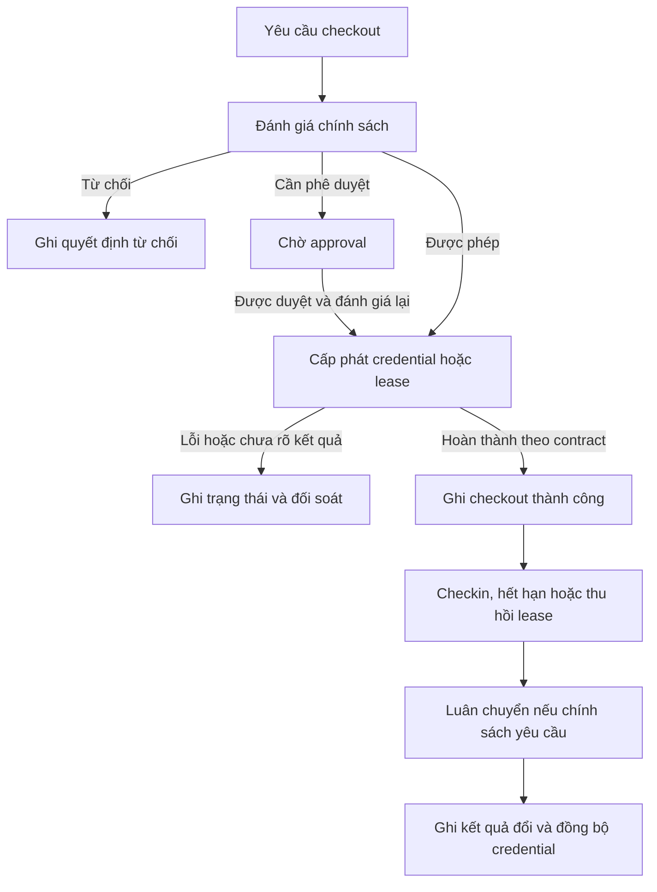

# Log checkout credential

## 1. Checkout credential cần để lại bằng chứng gì?

Trong hệ thống quản lý truy cập đặc quyền (PAM), **checkout credential** là thao tác một người dùng hoặc workload yêu cầu lấy một credential được quản lý để thực hiện công việc có quyền cao. Credential có thể là mật khẩu tài khoản quản trị, khóa truy cập hoặc một bí mật tương đương.

Tùy cơ chế, PAM có thể hiển thị secret cho người dùng, trả secret qua API hoặc cấp một lease cho phép truy xuất secret. Một số hệ thống chỉ chèn credential vào phiên kết nối mà không cho người dùng nhìn thấy. Những cách này có mức độ phơi lộ khác nhau và phải được phân biệt trong log.

Log checkout credential phải giúp trả lời:

- Chủ thể nào yêu cầu và chủ thể nào được PAM xác thực?
- Credential của tài khoản, tài nguyên và môi trường nào được yêu cầu?
- Chính sách nào quyết định cho phép hoặc từ chối? Approval nào được áp dụng?
- PAM đã thực hiện đến bước nào: nhận yêu cầu, cấp lease, xuất secret hay gặp lỗi?
- Khoảng thời gian được phép sử dụng là bao lâu?
- Sau khi kết thúc, credential đã được checkin, hết hạn, thu hồi hoặc luân chuyển như thế nào?

Điểm cần nhớ: **log thành công của checkout không chứng minh credential đã được sử dụng trên hệ thống đích**. Tương tự, log checkin không chứng minh mọi bản sao secret đã biến mất hoặc mọi phiên đang mở đã kết thúc.

Ví dụ, kỹ sư vận hành cần mật khẩu tài khoản quản trị của một máy chủ cơ sở dữ liệu để xử lý sự cố. Bằng chứng cần liên kết người yêu cầu, yêu cầu thay đổi, approval, tài khoản đích, lease và kết quả luân chuyển sau sử dụng. Bằng chứng không cần và không được chứa chính mật khẩu.

## 2. Phân biệt checkout với các thao tác liên quan

| Thao tác | Điều xảy ra | Ý nghĩa đối với audit |
| --- | --- | --- |
| Yêu cầu checkout | Chủ thể đề nghị lấy credential | Có nhu cầu truy cập; chưa được phép nhận secret |
| Authorization/approval | Chính sách và người duyệt đánh giá yêu cầu | Có quyết định truy cập; chưa chứng minh secret đã được xuất |
| Checkout thành công | Dịch vụ PAM hoàn thành việc cấp phát theo định nghĩa của sản phẩm | Có một lần cấp phát credential hoặc quyền lấy credential |
| Reveal/read secret | Secret được xuất qua giao diện hoặc API | Có thêm một lần có thể làm lộ secret cho chủ thể |
| Kết nối qua broker | PAM sử dụng credential để mở phiên | Có truy cập được môi giới; người dùng có thể không nhận secret |
| Checkin/release lease | Chủ thể hoặc dịch vụ trả lại lease | Kết thúc quyền giữ lease theo cơ chế PAM |
| Rotation | Credential tại nguồn quản lý và hệ thống đích được đổi, đồng bộ theo quy trình | Có thay đổi hiệu lực credential; cần kiểm tra kết quả thực tế |
| Session termination | Phiên trên hệ thống đích bị kết thúc | Chấm dứt phiên cụ thể; độc lập với việc đổi mật khẩu |

Không gộp tất cả thành một sự kiện chung như `password_accessed`. Sự kiện chung không cho biết secret đã được tiết lộ, chỉ được broker sử dụng, hay yêu cầu bị từ chối trước đó.

Một API của sản phẩm có thể gộp lease và reveal trong cùng thao tác. Khi đó, tài liệu schema phải ghi rõ `checkout.succeeded` có nghĩa gì. Không suy diễn từ tên endpoint rằng người dùng đã đọc thành công secret hoặc đã đăng nhập.

Nếu người dùng nhấn “hiển thị lại” credential nhiều lần trong một lease, cần ghi các lần reveal theo mô hình của hệ thống. Chỉ ghi checkout đầu tiên sẽ che khuất số lần secret được xuất.

## 3. Xác định đúng chủ thể: ai yêu cầu, ai được phục vụ?

PAM thường có nhiều lớp danh tính:

1. **Actor đã xác thực:** danh tính mà PAM xác minh tại thời điểm yêu cầu.
2. **Subject được đại diện:** người hoặc workload mà actor đang hành động thay mặt, nếu có cơ chế delegation.
3. **Client gọi API:** ứng dụng, agent hoặc connector gửi yêu cầu.
4. **Tài khoản đích:** tài khoản có credential được checkout.

Ví dụ, kỹ sư đăng nhập cổng vận hành; cổng dùng workload identity gọi PAM thay mặt kỹ sư. Nếu log chỉ ghi danh tính workload của cổng, điều tra viên không biết người nào khởi tạo. Nếu log chỉ ghi tên kỹ sư do client tự khai báo, kẻ gọi API có thể giả mạo danh tính.

Cần ghi chuỗi đại diện được xác thực, đồng thời phân biệt rõ trường nào do hệ thống chứng thực và trường nào chỉ là thông tin khai báo. Không tin một HTTP header chứa tên người dùng nếu header đó không được thiết lập và bảo vệ bởi thành phần đáng tin cậy.

Danh tính nên dùng ID ổn định, kèm loại như `human`, `workload` hoặc `service`. Tên hiển thị có thể thay đổi; ID hỗ trợ đối chiếu xuyên thời gian. Việc ghi tên thật, địa chỉ nguồn hoặc thông tin thiết bị phải phù hợp nhu cầu điều tra và chính sách bảo vệ dữ liệu.

Với MFA, ghi phương thức hoặc mức bảo đảm và tham chiếu ngữ cảnh xác thực nếu cần. Không ghi OTP, recovery code, token, cookie hay toàn bộ assertion xác thực.

## 4. Mô hình sự kiện và vòng đời lease

Một vòng đời minh họa:



Đây là mô hình khái niệm, không phải yêu cầu mọi sản phẩm phải có đúng số sự kiện này. Trong thực tế, rotation có thể xảy ra trước checkout, sau checkin hoặc theo lịch riêng.

Các sự kiện hữu ích gồm:

| Nhóm | Tên minh họa | Nội dung cần thể hiện |
| --- | --- | --- |
| Tiếp nhận | `pam.credential.checkout.requested` | Danh tính, credential tham chiếu, mục đích, thời hạn yêu cầu |
| Quyết định | `pam.credential.checkout.authorized` hoặc `denied` | Chính sách, phiên bản, kết quả, mã lý do |
| Chờ duyệt | `pam.credential.checkout.pending_approval` | Approval cần có; không được xem như checkout thành công |
| Cấp phát | `pam.credential.checkout.succeeded` | Lease, thời hạn thực cấp, access mode, kết quả phía PAM |
| Thất bại | `pam.credential.checkout.failed` | Giai đoạn lỗi, mã lỗi đã lọc, khả năng retry hoặc đối soát |
| Kết thúc lease | `pam.credential.lease.released`, `expired`, `revoked` | Nguyên nhân và chủ thể thực hiện chuyển trạng thái |
| Đổi credential | `pam.credential.rotation.succeeded` hoặc `failed` | Lần rotation, tham chiếu version và kết quả đồng bộ |

Approval có thể bị thu hồi hoặc hết hạn trước khi cấp phát. Vì vậy, một approval hợp lệ lúc nhận yêu cầu không tự động đủ điều kiện để checkout ở thời điểm sau. Audit cần phản ánh quyết định thực sự được áp dụng tại lúc cấp phát.

Nếu kết quả thao tác chưa biết vì timeout hoặc mất kết nối, ghi `unknown` hoặc sự kiện đối soát phù hợp với schema. Không đổi “không nhận được phản hồi” thành “chắc chắn thất bại” khi tác dụng phụ có thể đã xảy ra.

## 5. Schema tối thiểu cho một sự kiện checkout

Nên tổ chức sự kiện theo nhóm thay vì chuỗi văn bản tự do khó phân tích.

| Nhóm trường | Ví dụ | Mục đích |
| --- | --- | --- |
| Định danh sự kiện | `event_id`, `event_type`, `schema_version` | Phân biệt sự kiện, hỗ trợ thay đổi schema |
| Thời gian | `occurred_at`, `ingested_at` | Tách thời điểm nguồn phát sinh và lúc hệ thống nhận |
| Nguồn | `producer_id`, `environment`, `tenant_id` | Xác định hệ thống và ranh giới dữ liệu |
| Chủ thể | `actor.id`, `actor.type`, `client.id` | Quy trách nhiệm cho người hoặc workload |
| Đối tượng | `credential_ref`, `target_resource_ref`, `target_account_ref` | Biết credential và tài khoản đích mà không chép secret |
| Liên kết | `request_id`, `operation_id`, `lease_id` | Nối yêu cầu, lần thực thi và vòng đời lease |
| Quyết định | `decision`, `reason_code`, `policy_ref`, `policy_version` | Giải thích căn cứ cho phép hoặc từ chối |
| Approval | `approval_ref` | Liên kết bằng chứng duyệt, nếu chính sách cần |
| Cấp phát | `access_mode`, `issued_at`, `expires_at` | Phân biệt xuất secret với broker và thời hạn thực cấp |
| Kết quả | `outcome`, `failure_stage`, `error_code` | Thể hiện thành công, thất bại hoặc chưa rõ |
| Liên hệ nghiệp vụ | `purpose_code`, `change_ref` | Nối tới mục đích và yêu cầu thay đổi có kiểm soát |

Những điểm thiết kế quan trọng:

- `event_id` định danh một sự kiện, không phải một lease. Nhiều sự kiện của cùng lease có các event ID khác nhau.
- `request_id` và `operation_id` phải có ý nghĩa được tài liệu hóa. Một yêu cầu HTTP retry có thể tương ứng cùng một thao tác nghiệp vụ.
- `lease_id` dùng trong log phải là tham chiếu không có khả năng cấp quyền. Nếu lease token thực tế có thể dùng để truy xuất secret, tạo một audit reference riêng.
- `credential_ref` là ID đối tượng bí mật; không phải giá trị credential, đường dẫn chứa token hay URL ký sẵn.
- `credential_version_ref`, nếu sử dụng, là ID phiên bản không bí mật. Không tính hash mật khẩu để tạo trường audit này.
- Nếu có thời hạn yêu cầu và thời hạn thực cấp, ghi riêng để nhìn thấy việc chính sách rút ngắn TTL.
- Trường không áp dụng cần được biểu diễn nhất quán bằng cách bỏ trường hoặc dùng `null` theo schema, không bịa approval ID.

Tham chiếu tới approval và policy chỉ có ích nếu dữ liệu lịch sử còn truy xuất được. Khi đối tượng nguồn có thể bị sửa, cần giữ phiên bản hoặc bằng chứng quyết định đủ để tái dựng căn cứ lúc xảy ra sự kiện.

## 6. Ví dụ log checkout thành công

JSON dưới đây là schema minh họa tự thiết kế, không phải output mặc định của một sản phẩm PAM:

```json
{
  "schema_version": "1",
  "event_id": "evt-70041",
  "event_type": "pam.credential.checkout.succeeded",
  "occurred_at": "2026-11-27T02:15:04Z",
  "producer_id": "pam-vault-prod-01",
  "tenant_id": "tenant-ops",
  "environment": "production",
  "actor": {
    "id": "usr-1042",
    "type": "human"
  },
  "client": {
    "id": "ops-portal"
  },
  "authentication": {
    "context_ref": "authctx-912",
    "assurance": "mfa-verified"
  },
  "request_id": "req-3901",
  "operation_id": "op-5801",
  "lease_id": "lease-audit-921",
  "credential_ref": "cred-205",
  "credential_version_ref": "version-88",
  "target_resource_ref": "resource-db-prod-07",
  "target_account_ref": "account-db-admin-02",
  "authorization": {
    "decision": "allow",
    "reason_code": "APPROVED_JIT_REQUEST",
    "policy_ref": "policy-db-emergency",
    "policy_version": "12",
    "approval_ref": "approval-663"
  },
  "purpose_code": "INCIDENT_RECOVERY",
  "change_ref": "incident-2407",
  "access_mode": "secret_reveal",
  "lease": {
    "issued_at": "2026-11-27T02:15:04Z",
    "expires_at": "2026-11-27T02:30:04Z"
  },
  "outcome": "success"
}
```

Trong ví dụ này:

- Dịch vụ PAM đã cấp phát theo contract checkout của nó.
- `secret_reveal` cho biết cơ chế cho phép secret được xuất, khác với chỉ mở phiên bằng broker.
- TTL thực cấp là 15 phút.
- Tài khoản đích và người yêu cầu có ID khác nhau.
- Lease reference chỉ dùng audit; không dùng để lấy secret.
- Log không chứa mật khẩu, OTP, token, response body hoặc lệnh kết nối chứa credential.

Sự kiện trên chưa chứng minh tài khoản `account-db-admin-02` đã đăng nhập vào cơ sở dữ liệu. Muốn chứng minh sử dụng, cần đối chiếu với log xác thực, log phiên hoặc bằng chứng hệ thống đích.

Nếu secret được trả trong HTTP response nhưng kết nối bị đứt, phía PAM có thể không biết client đã nhận đầy đủ hay chưa. Cần ghi nhận ngữ nghĩa kết quả phía dịch vụ và trạng thái delivery riêng nếu có bằng chứng. Không phát biểu chắc chắn rằng người dùng “đã nhìn thấy mật khẩu” chỉ vì máy chủ tạo được response.

## 7. Ghi nhận từ chối và thất bại đúng ý nghĩa

Yêu cầu bị từ chối cũng là bằng chứng quan trọng. Các mã lý do có thể gồm:

- `POLICY_DENIED`: chủ thể không đáp ứng chính sách.
- `APPROVAL_REQUIRED`: chưa có approval hợp lệ.
- `APPROVAL_EXPIRED`: approval đã hết hiệu lực.
- `MFA_REQUIRED`: thiếu ngữ cảnh xác thực cần thiết.
- `LEASE_CONFLICT`: có lease xung đột theo chính sách độc quyền.
- `TARGET_UNAVAILABLE`: không thể hoàn tất bước liên quan hệ thống đích.
- `AUDIT_DURABILITY_UNAVAILABLE`: không bảo đảm ghi audit bền vững theo yêu cầu.
- `DELIVERY_RESULT_UNKNOWN`: không xác định được kết quả giao secret từ bằng chứng hiện có.

Các mã này là ví dụ thiết kế. Một mã từ chối chính sách không nên dùng thay lỗi hạ tầng, và lỗi hạ tầng không được ghi như một quyết định cho phép.

Ví dụ rút gọn:

```json
{
  "schema_version": "1",
  "event_id": "evt-70042",
  "event_type": "pam.credential.checkout.denied",
  "occurred_at": "2026-11-27T02:16:00Z",
  "producer_id": "pam-vault-prod-01",
  "actor": {
    "id": "usr-2099",
    "type": "human"
  },
  "request_id": "req-3902",
  "credential_ref": "cred-205",
  "authorization": {
    "decision": "deny",
    "reason_code": "APPROVAL_REQUIRED",
    "policy_ref": "policy-db-emergency",
    "policy_version": "12"
  },
  "outcome": "denied"
}
```

Không có lease được cấp nên ví dụ không có `lease_id`. Không tạo lease giả để đủ schema.

Với yêu cầu từ chối trước xác thực, không khẳng định tên người dùng khai báo là actor đã được xác thực. Có thể ghi identity claim đã giảm thiểu cùng trạng thái xác thực, theo contract riêng cho sự kiện thất bại.

Đối với log nội bộ, mã lý do nên đủ để điều tra. Đối với thông báo trả về client không có quyền, cần tránh tiết lộ không cần thiết rằng một credential hoặc tài khoản đặc quyền cụ thể tồn tại.

## 8. Checkin, expiry và rotation phải nối được với checkout

Giả sử có chuỗi sự kiện:

| Thời điểm UTC | Sự kiện | Diễn giải |
| --- | --- | --- |
| 02:15:04 | Checkout thành công | Lease được cấp cho credential version 88 |
| 02:22:10 | Lease được release | Người dùng kết thúc giữ lease trước hạn |
| 02:22:11 | Rotation bắt đầu | Dịch vụ chuẩn bị thay credential theo chính sách |
| 02:22:14 | Rotation thành công | Credential đích và trạng thái quản lý đã đồng bộ theo contract |
| 02:22:17 | Phiên đích kết thúc | Có bằng chứng riêng nếu hệ thống hỗ trợ giám sát phiên |

Chuỗi cần nối bằng tham chiếu lease, credential và rotation operation. Nếu rotation nằm ngoài luồng checkout, có thể thêm nguyên nhân hoặc tham chiếu sự kiện kích hoạt.

Ba giới hạn dễ bị hiểu sai:

**Lease hết hạn không tự làm mật khẩu tĩnh hết hiệu lực.** TTL của lease có thể chỉ giới hạn quyền truy xuất trên PAM. Nếu credential đã được sao chép, nó có thể còn dùng được cho tới khi đích vô hiệu hóa hoặc thay credential.

**Rotation thành công không mặc định đóng phiên đã đăng nhập.** Nhiều giao thức giữ phiên sau khi xác thực xong. Cần bằng chứng session termination riêng nếu yêu cầu nghiệp vụ là kết thúc truy cập.

**Một credential có thể có nhiều lease.** Nếu cho phép checkout đồng thời cùng một mật khẩu, rotation khi một lease kết thúc có thể ảnh hưởng lease khác. Chính sách phải định nghĩa độc quyền, chia sẻ hoặc cách quản lý phiên bản; log phải phản ánh đúng mô hình đó.

Nếu thay mật khẩu ở đích thành công nhưng cập nhật kho quản lý thất bại, không ghi một sự kiện thành công trọn vẹn. Cần thể hiện trạng thái lệch, bước lỗi và hoạt động khôi phục, đồng thời tránh log giá trị mới để “hỗ trợ debug”.

## 9. Độ tin cậy của luồng audit

Một thiết kế có log đầy đủ khi mọi thứ thuận lợi vẫn có thể mất bằng chứng ở thời điểm sự cố. Cần xét các điểm lỗi cụ thể.

### 9.1. Tách sinh sự kiện khỏi chuyển tới hệ thống phân tích

Dịch vụ PAM nên có cơ chế ghi bền vững tại nguồn hoặc hàng đợi bền vững trước khi phụ thuộc vào việc gửi tới SIEM. SIEM tạm ngừng nhận không nhất thiết làm mất audit nếu sự kiện đã được lưu bền vững và sẽ gửi lại.

Cần phân biệt:

- Sự kiện đã tạo trong bộ nhớ.
- Sự kiện đã ghi bền vững.
- Sự kiện đã chuyển thành công.
- Sự kiện đã được hệ thống nhận lưu hoặc lập chỉ mục.

Một HTTP response “accepted” của collector không tự chứng minh sự kiện đã sẵn sàng cho truy vấn điều tra. Ngữ nghĩa xác nhận phụ thuộc contract của collector.

### 9.2. Không ghi success trước khi thao tác thực sự hoàn thành

Luồng khái niệm có thể được biểu diễn bằng pseudocode:

```text
authenticate and authorize request
durably record checkout intent with operation reference
attempt credential allocation and release using operation reference
durably record observed outcome
deliver outcome to caller according to the operation contract
export audit records with retry and duplicate detection
```

Đây không phải thuật toán giao dịch đầy đủ. Việc xuất secret, ghi log và phản hồi mạng không thể mặc định là một giao dịch nguyên tử. Sự cố giữa các bước phải có trạng thái và cơ chế đối soát.

Nếu metadata lease và audit record cùng nằm trong một cơ sở dữ liệu hỗ trợ giao dịch phù hợp, transactional outbox có thể giúp tránh việc metadata đã commit nhưng sự kiện chưa được xếp hàng. Nó không tự giải quyết sự không chắc chắn khi secret đã đi qua mạng hoặc hệ thống đích được thay đổi ngoài giao dịch đó.

Sau crash, một intent chưa có outcome cần được kiểm tra bằng operation state hoặc bằng chứng nguồn. Không tự tạo success chỉ vì có intent; cũng không xóa intent để che đi khoảng chưa xác định.

### 9.3. Chính sách khi không ghi được audit

Với checkout có rủi ro cao, chính sách thường cần chặn cấp phát nếu không bảo đảm ghi audit bền vững. Quyết định này phải nằm trong thiết kế vận hành và được thử nghiệm, không phát sinh tùy hứng ở nhánh xử lý lỗi.

Nếu tổ chức cho phép break-glass khi hệ thống audit chính gặp sự cố, phải có đường ghi bằng chứng dự phòng đã định nghĩa, định danh người thực hiện và quy trình đối soát sau đó. Không coi break-glass là cờ “tắt audit”.

Cần giám sát dung lượng buffer, lỗi ghi, sự kiện bị bỏ, tuổi sự kiện chưa chuyển và khoảng mất kết nối nguồn. Im lặng từ nguồn có thể là mất quan sát, không phải không có checkout.

## 10. Retry, trùng lặp và thứ tự sự kiện

Trong luồng phân tán, retry có thể tạo hai vấn đề khác nhau:

- **Trùng truyền sự kiện:** cùng một sự kiện được chuyển nhiều lần.
- **Lặp thao tác checkout:** client gửi lại yêu cầu và có thể gây cấp phát thêm lần nữa.

Dùng `event_id` ổn định khi gửi lại cùng một sự kiện giúp phía nhận khử trùng truyền. Không sinh event ID mới cho mỗi lần export retry rồi coi đó là nhiều checkout.

Idempotency của thao tác nghiệp vụ cần cơ chế riêng. Idempotency key phải được ràng buộc với principal, đối tượng credential và ngữ cảnh được phép, theo thiết kế của API. Không cho phép một actor khác dùng lại key để lấy kết quả chứa secret.

Không lưu secret trong log hoặc kho idempotency không được bảo vệ chỉ để trả lại response. Việc có được xuất secret lần nữa hay không cần được xác định trong contract bảo mật của API và ghi audit tương ứng.

Ví dụ:

```text
request req-A -> operation op-91 -> lease L-7 -> event evt-11
client retry  -> operation op-91 -> không cấp lease thứ hai
export retry  -> event evt-11     -> phía nhận khử trùng event
```

Đối với thứ tự, thời gian ingest có thể đến muộn hoặc đảo thứ tự. Không kết luận “checkin xảy ra trước checkout” chỉ từ thứ tự hàng trong SIEM. Cần dùng thời gian nguồn, liên kết operation và sequence nếu nguồn hỗ trợ.

Đồng bộ thời gian và giám sát độ lệch là cần thiết. Một sequence trong một producer không tự tạo thứ tự toàn cục giữa mọi producer; clock timestamp cũng không thay thế trạng thái nghiệp vụ.

## 11. Không để audit trở thành kho secret thứ hai

Các dữ liệu không được ghi vào log checkout gồm:

- Mật khẩu, private key, seed, access token và refresh token.
- Header Authorization, cookie phiên, OTP và recovery code.
- Lease token hoặc URL có khả năng cấp quyền.
- Request/response body chứa secret.
- Connection string, câu lệnh hoặc biến môi trường có nhúng credential.
- Nội dung lỗi hoặc stack trace chưa lọc có thể mang theo dữ liệu nhạy cảm.

Không dùng “chỉ ghi vài ký tự đầu/cuối mật khẩu” làm định danh. Không hash mật khẩu để so sánh các lần checkout trong audit: điều đó vẫn tạo dữ liệu phụ thuộc secret và có thể hỗ trợ suy đoán mật khẩu yếu. Dùng ID đối tượng và ID phiên bản không bí mật.

Mục đích công việc do người dùng nhập tự do cũng có rủi ro. Người dùng có thể dán mật khẩu, dữ liệu khách hàng hoặc ký tự điều khiển vào đó. Nên ưu tiên purpose code, tham chiếu ticket, giới hạn độ dài và xử lý đầu vào theo schema.

Log có cấu trúc giúp tránh việc xuống dòng giả mạo một sự kiện mới, nhưng chỉ khi serializer được dùng đúng. Không ghép thủ công chuỗi JSON từ dữ liệu người dùng. Cần escape an toàn khi hiển thị trên giao diện, vì log viewer cũng có thể là nơi dữ liệu độc hại được render.

Nếu bộ lọc phát hiện secret trong trường tự do, áp dụng quy tắc loại bỏ hoặc che phù hợp và ghi chỉ báo xử lý. Không tạo thêm log cảnh báo chứa nguyên đoạn secret vừa bị phát hiện.

## 12. Bảo vệ log và quyền truy cập bằng chứng

Log checkout tiết lộ cấu trúc tài khoản đặc quyền, lịch vận hành và mục tiêu có giá trị. Vì vậy, dù không chứa secret, log vẫn cần bảo vệ.

Các biện pháp nền tảng gồm:

- Truyền qua kênh được xác thực và mã hóa; producer chỉ được gửi trong phạm vi của mình.
- Tách quyền quản trị credential khỏi quyền xóa hoặc sửa bằng chứng.
- Giới hạn quyền đọc log theo vai trò và ranh giới tenant.
- Ghi audit cho việc truy vấn nhạy cảm, export và thay đổi chính sách lưu log.
- Duy trì bản lưu hoặc cơ chế chống sửa phù hợp yêu cầu bằng chứng.
- Có quy trình xử lý khi khóa mã hóa, khóa ký hoặc tài khoản collector bị xâm phạm.

Hash chain hoặc chữ ký có thể giúp phát hiện thay đổi trong tập dữ liệu được bảo vệ đúng cách. Chúng không tự chứng minh rằng nguồn đã ghi mọi sự kiện; một nguồn bị kiểm soát có thể không phát sinh sự kiện ngay từ đầu. Cần kết hợp giám sát nguồn, đối soát hoạt động và bảo vệ bản lưu độc lập.

Chính sách retention cần cân bằng nhu cầu điều tra, kiểm toán, bảo vệ dữ liệu, chi phí và yêu cầu áp dụng cho tổ chức. Không đặt một số ngày chung cho mọi hệ thống. Nếu giữ log lâu hơn dữ liệu danh tính tham chiếu, cần có phương án giải nghĩa ID lịch sử mà vẫn kiểm soát truy cập.

Khi export làm bằng chứng, giữ nguyên dữ liệu nguồn, ghi điều kiện truy vấn, khoảng thời gian, timezone, phiên bản schema và hash của gói export theo quy trình. Hash của gói export hỗ trợ kiểm tra tính toàn vẹn gói, không thay thế bằng chứng nguồn hay chuỗi quản lý bằng chứng.

## 13. Từ sự kiện checkout đến phát hiện bất thường

Các tín hiệu nên được đánh giá cùng ngữ cảnh nghiệp vụ:

| Tín hiệu | Giả thuyết cần kiểm tra | Ngữ cảnh bổ sung |
| --- | --- | --- |
| Một actor checkout nhiều credential production trong thời gian ngắn | Thu thập credential hàng loạt hoặc tác vụ tự động hợp lệ | Vai trò, lịch tác vụ, change/incident |
| Nhiều lần từ chối rồi checkout thành công | Thăm dò quyền hoặc thay đổi chính sách vừa được duyệt | Lịch sử approval, policy version, actor |
| Checkout thành công nhưng thiếu approval khi policy yêu cầu | Lỗi luồng kiểm soát hoặc bypass | Bằng chứng policy áp dụng tại thời điểm đó |
| Lease quá hạn chưa có trạng thái kết thúc | Lỗi thu hồi, luồng sự kiện thiếu hoặc xử lý trễ | Lease state tại PAM và độ trễ ingest |
| Rotation thất bại sau release | Credential đã lộ còn hiệu lực lâu hơn dự kiến | Trạng thái đích, kế hoạch khôi phục |
| Nguồn log ngừng phát trong khi có truy cập đặc quyền ở đích | Mất quan sát hoặc đường truy cập ngoài PAM | Heartbeat, log đích, trạng thái collector |

Một nguyên tắc truy vấn logic:

```text
chọn checkout thành công trong khoảng thời gian T
khử trùng theo event_id
nhóm theo actor.id và environment
đếm operation_id khác nhau
đối chiếu số credential_ref khác nhau và lịch công việc
```

Đếm `event_id` một cách máy móc có thể tính cả nhiều sự kiện của cùng thao tác. Đếm theo `operation_id` cũng chỉ đúng khi semantics operation đã thống nhất giữa các nguồn. Cần định nghĩa rõ “một lần checkout” trước khi xây metric.

Một alert không tự chứng minh hành vi xấu. Ví dụ workload backup có thể checkout nhiều credential theo lịch. Ngược lại, đưa workload đó vào allowlist vô thời hạn có thể làm mất tín hiệu khi nó bị xâm phạm. Ngoại lệ cần có phạm vi, người sở hữu và thời hạn xem xét.

## 14. Quy trình điều tra một checkout đáng ngờ

Giả sử SOC nhận cảnh báo actor `usr-1042` checkout credential production ngoài lịch dự kiến.

Một trình tự điều tra có thể là:

1. Xác minh nguồn log, event ID, thời gian và độ trễ ingest; loại bản trùng khi dựng timeline.
2. Đối chiếu actor với hệ thống danh tính và ngữ cảnh xác thực. Kiểm tra chuỗi delegation nếu request đi qua cổng trung gian.
3. Xem chính sách và approval ở đúng phiên bản áp dụng, mục đích và ticket liên quan.
4. Xác định credential, tài khoản đích, access mode và TTL thực cấp.
5. Tìm log xác thực/phiên ở đích để biết credential có được sử dụng hay không; không suy từ checkout.
6. Kiểm tra release, expiry, revocation, rotation và trạng thái đích. Phân biệt kết thúc lease với kết thúc phiên.
7. Nếu có khoảng thiếu dữ liệu, ghi rõ điều chưa xác định và tìm bằng chứng từ nguồn độc lập.
8. Lưu bằng chứng và kết quả đối chiếu theo quy trình ứng phó của tổ chức.

Kết luận tốt có thể là: “PAM ghi nhận cấp credential theo lease L; hệ thống đích ghi nhận một phiên tương ứng; rotation hoàn tất sau release.” Nếu thiếu log đích, kết luận phải giới hạn ở cấp phát, không khẳng định đã thực thi lệnh.

Trong điều tra, không yêu cầu người vận hành dán secret vào ticket để “xác nhận đúng credential”. ID đối tượng, version reference và bằng chứng nguồn là cơ sở đối chiếu phù hợp hơn.

## 15. Bài thực hành thiết kế audit checkout

Một nhóm vận hành cho phép người dùng checkout mật khẩu quản trị máy chủ với TTL 15 phút. Approval là bắt buộc đối với production; mỗi credential chỉ có một lease đang hoạt động. Khi lease kết thúc, PAM phải chạy rotation theo chính sách.

Hãy mô tả sự kiện và bằng chứng mong đợi cho các tình huống:

### Tình huống A: checkout hợp lệ, release trước hạn

Người dùng có MFA, approval hợp lệ, checkout thành công và release sau 7 phút.

Kết quả cần nhìn thấy: actor đã xác thực, policy version, approval reference, lease, TTL thực cấp, access mode, release và kết quả rotation. Không cần log giá trị mật khẩu.

### Tình huống B: client timeout rồi retry

Dịch vụ đã cấp lease, nhưng client không nhận được phản hồi rõ ràng.

Kết quả cần nhìn thấy: operation reference ổn định, trạng thái phía nguồn, các lần thử truyền hoặc gọi lại theo contract; không mặc định cấp thêm lease. Nếu không xác định được secret đã tới client, giữ kết luận giới hạn và đối soát.

### Tình huống C: approval hết hạn trong khi chờ

Yêu cầu được tạo khi approval còn hiệu lực, nhưng đến lúc cấp phát thì approval đã hết hạn.

Kết quả cần nhìn thấy: quyết định ở thời điểm cấp phát từ chối hoặc yêu cầu duyệt lại theo chính sách. Không phát sinh checkout thành công chỉ vì từng có approval.

### Tình huống D: SIEM mất kết nối

PAM vẫn ghi được vào buffer bền vững, nhưng chưa chuyển sự kiện đi được.

Kết quả cần nhìn thấy: dữ liệu được giữ theo chính sách, export retry, cảnh báo backlog và tuổi sự kiện. Phân biệt mất kết nối SIEM với mất khả năng ghi bền vững tại nguồn.

### Tình huống E: rotation sau release thất bại

Lease đã release, nhưng hệ thống đích từ chối thay credential.

Kết quả cần nhìn thấy: release thành công và rotation thất bại là hai trạng thái riêng. Có bằng chứng lỗi đã lọc, tình trạng rủi ro và hoạt động xử lý tiếp theo; không dùng release để kết luận credential cũ đã vô hiệu.

### Tình huống F: yêu cầu chứa secret trong phần lý do

Người dùng dán nhầm token vào mô tả mục đích.

Kết quả cần nhìn thấy: chính sách xử lý đầu vào và redaction được áp dụng; log audit không giữ token, và log lỗi của bộ lọc cũng không tái lộ token đó.

Đầu ra của bài thực hành là một schema, timeline cho từng tình huống và các kết luận mà bằng chứng cho phép rút ra. Không cần dùng credential thật hoặc thực hiện checkout trên production để thiết kế bài.

## 16. Các lỗi thiết kế cần tránh

| Lỗi | Hậu quả | Cách thiết kế phù hợp hơn |
| --- | --- | --- |
| Chỉ ghi checkout thành công | Không thấy truy cập bị chặn hoặc bước lỗi | Ghi intent, quyết định và outcome theo contract |
| Ghi toàn bộ request/response để debug | Secret đi vào log và bản sao downstream | Chọn trường theo allowlist, lọc lỗi và dữ liệu tự do |
| Dùng tên hiển thị làm danh tính duy nhất | Khó quy trách nhiệm sau đổi tên | Dùng ID ổn định và lịch sử ánh xạ được kiểm soát |
| Dùng lease token thật làm correlation ID | Người đọc log có thể có thêm quyền truy cập | Dùng audit reference không có khả năng cấp quyền |
| Coi release là rotation thành công | Đánh giá thấp credential còn hiệu lực | Theo dõi hai vòng đời và kết quả riêng |
| Coi rotation là đóng phiên | Bỏ sót phiên đã xác thực còn hoạt động | Thu thập bằng chứng session termination nếu cần |
| Chỉ dựa vào SIEM, không có buffer bền vững | Mất sự kiện khi đường truyền lỗi | Ghi tại nguồn, chuyển lại và giám sát backlog |
| Dựa hoàn toàn vào thứ tự ingest | Timeline sai khi sự kiện tới trễ | Dùng thời gian nguồn, operation state và correlation |
| Xóa sự kiện chưa rõ kết quả | Mất bằng chứng tại thời điểm sự cố | Giữ trạng thái chưa xác định và đối soát có dấu vết |

Một log checkout hữu ích phải chứng minh được việc **cấp phát quyền tiếp cận credential** trong ngữ cảnh cụ thể, đồng thời giữ ranh giới rõ với việc sử dụng credential và kết thúc truy cập. Giá trị của audit nằm ở danh tính đáng tin cậy, ngữ nghĩa sự kiện nhất quán, khả năng nối vòng đời và độ bền của bằng chứng; không nằm ở việc thu thập càng nhiều dữ liệu càng tốt.
