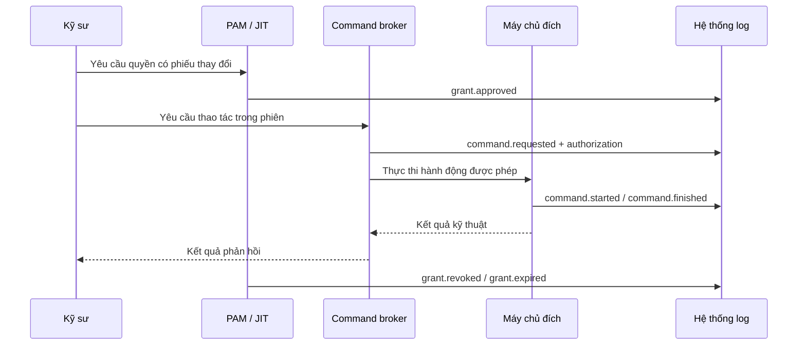

# Log privileged command: ghi nhận lệnh đặc quyền để truy vết và điều tra

## 1. Mục tiêu của bài học

Trong quản lý truy cập đặc quyền (Privileged Access Management — PAM), cấp đúng quyền chưa đủ. Tổ chức còn cần trả lời được: ai đã dùng quyền, trên tài nguyên nào, để làm gì, lệnh có thực sự chạy hay không và bằng chứng có đáng tin cậy không.

Bài học này tập trung vào **log lệnh đặc quyền**: ghi nhận có cấu trúc các lệnh hoặc thao tác quản trị trong mối liên hệ với danh tính, quyết định cấp quyền, phiên làm việc và kết quả thực thi. Sau bài học, bạn có thể:

- Phân biệt command log, session recording và audit log của hệ điều hành hoặc ứng dụng.
- Thiết kế chuỗi bằng chứng từ yêu cầu JIT/JEA đến lệnh được thực thi trên đích.
- Chọn các trường log phục vụ điều tra mà hạn chế thu thập secret và dữ liệu cá nhân.
- Nhận diện giới hạn của command log, các đường truy cập chưa được bao phủ và dấu hiệu mất bằng chứng.
- Xây dựng tiêu chí kiểm thử cho một luồng ghi log lệnh quản trị.

Các cấu trúc sự kiện và quy tắc dưới đây là **mô hình minh họa trung lập với nhà cung cấp**, không phải schema bắt buộc của một sản phẩm PAM cụ thể.

## 2. Log privileged command thực sự ghi lại điều gì?

Một command log tốt không chỉ là dòng văn bản như `restart order-api`. Nó là một sự kiện gắn thao tác với ngữ cảnh kiểm soát quyền:

> Danh tính `user-042` đã dùng grant JIT `grant-317`, thông qua phiên `session-702`, để yêu cầu khởi động lại dịch vụ `order-api` trên máy `app-prod-03`; quyết định cấp quyền cho phép thao tác này; tiến trình thực thi đã kết thúc với mã trả về được ghi nhận.

Cần phân biệt ít nhất bốn mức khẳng định:

| Bằng chứng quan sát được | Có thể kết luận | Chưa thể tự kết luận |
| --- | --- | --- |
| Người dùng gửi một chuỗi lệnh | Có yêu cầu thực hiện thao tác | Lệnh đã được chấp nhận hoặc chạy |
| Bộ thực thi ghi nhận bắt đầu | Thao tác đã bắt đầu tại điểm quan sát đó | Thao tác đã hoàn tất hoặc đạt mục tiêu |
| Tiến trình kết thúc với mã trả về | Có kết quả kỹ thuật của tiến trình | Trạng thái nghiệp vụ sau thao tác là đúng |
| Kiểm tra độc lập xác nhận trạng thái đích | Có bằng chứng về kết quả mong muốn tại thời điểm kiểm tra | Không có tác dụng phụ hoặc thay đổi tiếp theo |

Ví dụ, một công cụ quản trị có thể trả về thành công sau khi gửi yêu cầu bất đồng bộ. Dịch vụ đích vẫn có thể khởi động lỗi vài giây sau đó. Vì vậy, không chuyển thẳng `exit_code=0` thành “hệ thống đã hoạt động bình thường”.

### 2.1. Đặc quyền có thể nằm ngoài terminal

Đối tượng cần ghi nhận bao gồm cả:

- Lệnh thực thi với tài khoản quản trị hoặc cơ chế nâng quyền trên máy chủ.
- Thao tác quản trị cơ sở dữ liệu, thiết bị mạng hoặc nền tảng container.
- Yêu cầu API thay đổi chính sách, tạo credential, cấp role hoặc thay đổi cấu hình.
- Job tự động dùng service account có quyền cao.
- Lệnh break-glass trong tình huống khẩn cấp.

Với các giao diện khác nhau, “command” có thể là một tiến trình, một câu lệnh quản trị, một phương thức API hoặc một hành động có cấu trúc. Không nên ép tất cả thành chuỗi shell rồi đánh mất thông tin gốc.

### 2.2. Ba nguồn bằng chứng bổ sung cho nhau

| Nguồn | Giá trị chính | Giới hạn thường gặp |
| --- | --- | --- |
| Command log tại PAM gateway hoặc command broker | Liên kết yêu cầu với người dùng, grant, chính sách và phiên | Có thể chỉ thấy yêu cầu gửi qua gateway; không tự chứng minh toàn bộ thực thi bên trong đích |
| Audit log tại hệ điều hành, dịch vụ hoặc ứng dụng đích | Quan sát hoạt động ở gần nơi thực thi | Mức chi tiết tùy cơ chế; có thể thiếu danh tính người dùng gốc nếu chỉ thấy tài khoản dùng chung |
| Session recording | Bổ sung diễn biến tương tác và ngữ cảnh xem lại | Hình ảnh hoặc luồng terminal không thay thế sự kiện có cấu trúc; có thể chứa dữ liệu nhạy cảm |

Lịch sử shell là một tiện ích cho người sử dụng, không nên được coi là nguồn bằng chứng duy nhất. Nó có thể thiếu lệnh, không có đủ ngữ cảnh nâng quyền, được ghi trễ hoặc bị thay đổi theo quyền của người dùng.

## 3. Tình huống xuyên suốt: khởi động lại một dịch vụ sản xuất

Kỹ sư trực vận hành cần khởi động lại `order-api` trên `app-prod-03` trong cửa sổ bảo trì đã được phê duyệt.

Thiết kế truy cập gồm:

1. Kỹ sư đăng nhập bằng danh tính cá nhân và đáp ứng yêu cầu xác thực của PAM.
2. Một yêu cầu JIT cấp quyền trong khoảng thời gian giới hạn, tham chiếu phiếu thay đổi `CHG-LAB-031`.
3. Chính sách JEA chỉ cho phép hành động quản trị cần thiết trên dịch vụ được chỉ định.
4. PAM broker hoặc môi trường quản trị được kiểm soát thực hiện thao tác bằng tài khoản đích phù hợp; credential được quản lý trong vault theo thiết kế của hệ thống.
5. Các sự kiện cấp quyền, mở phiên, yêu cầu lệnh, quyết định cho phép, bắt đầu thực thi và kết thúc được liên kết.
6. Kiểm tra độc lập xác nhận tình trạng dịch vụ; khi hết thời hạn hoặc kết thúc công việc, quyền tạm thời được thu hồi.



Sơ đồ là luồng logic. Một triển khai thực tế có thể gom hoặc tách các thành phần. Quan trọng là xác định rõ **mỗi nguồn thực sự quan sát được sự kiện nào**, thay vì xem log của broker là bằng chứng thay cho mọi hoạt động trên đích.

Thông tin vault cấp hoặc xoay vòng credential chỉ cần được liên kết qua mã sự kiện hay định danh credential phù hợp. Không đưa giá trị credential vào command log để “làm đầy đủ bằng chứng”.

## 4. Xác định phạm vi thu thập trước khi chọn trường log

Trước khi bật thu thập hàng loạt, hãy lập bản đồ đường đi của quyền quản trị:

| Đường truy cập | Điểm quan sát cần xem xét | Câu hỏi về khoảng trống |
| --- | --- | --- |
| Terminal qua PAM gateway | Gateway, cơ chế nâng quyền, audit tại máy đích | Người dùng có thể đi thẳng đến đích không? |
| Command broker với tập hành động JEA | Broker và dịch vụ thực thi | Hành động được phép có mở thêm shell hoặc chạy mã tùy ý không? |
| Công cụ quản trị cơ sở dữ liệu | Proxy hoặc audit của hệ quản trị | Thao tác qua GUI/API có được bao phủ không? |
| Automation dùng service account | Nền tảng job, workload identity, API đích | Có xác định được job và phiên bản workflow đã dùng quyền không? |
| Break-glass | Hệ thống cấp quyền khẩn cấp và nguồn audit đích | Có đường thu thập bằng chứng khi PAM chính bị gián đoạn không? |

Không có một lớp ghi log duy nhất mặc nhiên bao phủ mọi đường truy cập. Nếu máy đích cho phép đăng nhập trực tiếp ngoài gateway, việc gateway không ghi nhận lệnh không chứng minh rằng không có lệnh đã chạy.

Mỗi phạm vi nên có chủ sở hữu, nguồn log, loại hoạt động được ghi, thời điểm bắt đầu bao phủ và giới hạn đã biết. Đây là cơ sở đánh giá mức tin cậy khi điều tra.

## 5. Thiết kế bản ghi có cấu trúc

### 5.1. Danh tính: người yêu cầu và tài khoản thực thi là hai đối tượng

Một phiên có thể xuất phát từ danh tính cá nhân nhưng thực thi bằng tài khoản quản trị dùng chung. Ngược lại, automation có thể không có người dùng tương tác tại thời điểm chạy.

Nên lưu tách biệt:

- `actor.id`: danh tính khởi tạo yêu cầu; ưu tiên định danh ổn định thay cho tên hiển thị.
- `actor.type`: người dùng, workload hoặc loại danh tính phù hợp.
- `effective_principal`: tài khoản hoặc security context thực thi trên đích.
- `grant.id`: lần cấp quyền có hiệu lực đối với thao tác.
- `session.id`: phiên quản trị chứa yêu cầu, nếu có.
- `automation.run_id`: mã lần chạy khi actor là workload hoặc job.
- `change_ref`: tham chiếu công việc đã được phê duyệt, khi quy trình yêu cầu.

Với automation, có thể bổ sung tham chiếu người phê duyệt hoặc chủ sở hữu workflow. Không gán tùy tiện người đã commit code thành người trực tiếp thực thi mọi lệnh của job.

### 5.2. Lệnh: giữ ý nghĩa nhưng hạn chế dữ liệu nhạy cảm

Chỉ giữ một trường `command_text` sẽ gây khó khăn cho tìm kiếm và kiểm soát dữ liệu. Khi nguồn hỗ trợ, nên lưu:

- Loại hành động có cấu trúc, chẳng hạn `service.restart`.
- Định danh dịch vụ hoặc đối tượng được tác động.
- Executable thực tế và các đối số đã qua xử lý dữ liệu nhạy cảm.
- Thư mục làm việc hoặc namespace nếu cần phân biệt phạm vi.
- Danh tính yêu cầu và security context hiệu lực.
- Quyết định chính sách cùng mã phiên bản chính sách.
- Thông tin cho biết sự kiện đến từ broker, hệ điều hành hay ứng dụng.

Cần phân biệt **lệnh được yêu cầu** với **lệnh hoặc hành động được quan sát khi thực thi**. Shell có thể mở rộng biến, alias, wildcard, pipeline hoặc chạy script; chuỗi nhập ban đầu không nhất thiết bằng tập hành động cuối cùng.

Không mặc định thu thập toàn bộ biến môi trường, stdin, stdout và stderr. Các luồng này có thể chứa mật khẩu, token, khóa riêng, chuỗi kết nối hoặc dữ liệu nghiệp vụ.

### 5.3. Thời gian và trạng thái thu thập

| Trường | Mục đích |
| --- | --- |
| `event.id` | Phân biệt sự kiện; hỗ trợ khử trùng lặp |
| `event.type` | Phân biệt yêu cầu, bắt đầu, kết thúc hoặc thay đổi quyền |
| `occurred_at` | Thời điểm nguồn ghi nhận hoạt động |
| `received_at` | Thời điểm hệ thống thu thập nhận bản ghi |
| `source.id` và `source.sequence` | Theo dõi nguồn và thứ tự trong phạm vi mà nguồn bảo đảm |
| `command.id` hoặc `operation.id` | Liên kết vòng đời một lần thực thi |
| `schema_version` | Diễn giải dữ liệu đúng theo phiên bản |
| `capture.coverage` | Mô tả mức quan sát: yêu cầu, tiến trình hoặc thao tác ứng dụng |
| `capture.redaction` | Cho biết trường hoặc giá trị nào đã được loại bỏ/che |

Hai nguồn có thể lệch đồng hồ; mạng có thể làm sự kiện đến sai thứ tự. Vì vậy, sắp xếp theo `received_at` không tự tạo ra thứ tự nhân quả. Mã thao tác và sequence có phạm vi rõ ràng thường hữu ích hơn việc chỉ dựa vào timestamp.

Sequence chỉ có ý nghĩa khi biết nó tăng trong phạm vi nào: từng collector, từng phiên hay từng tiến trình. Khoảng nhảy sequence có thể là dấu hiệu cần kiểm tra, nhưng cũng có thể do bộ lọc hoặc cách phân vùng nguồn nếu không hiểu hợp đồng dữ liệu.

### 5.4. Ví dụ một sự kiện kết thúc

```json
{
  "schema_version": "pam.command.v1",
  "event": {
    "id": "event-lab-0194",
    "type": "command.finished",
    "occurred_at": "2026-01-15T09:14:32.441Z",
    "received_at": "2026-01-15T09:14:32.830Z"
  },
  "source": {
    "id": "host-audit-app-prod-03",
    "sequence": 194
  },
  "actor": {
    "id": "user-042",
    "type": "human"
  },
  "effective_principal": "svc-operator",
  "grant": {
    "id": "grant-317"
  },
  "session": {
    "id": "session-702"
  },
  "change_ref": "CHG-LAB-031",
  "target": {
    "id": "asset-app-prod-03",
    "environment": "production"
  },
  "command": {
    "id": "command-088",
    "action": "service.restart",
    "resource": "order-api",
    "display": "service-control restart order-api"
  },
  "authorization": {
    "decision": "allow",
    "decision_id": "decision-088",
    "policy_ref": "operator-order-api-v3"
  },
  "result": {
    "state": "finished",
    "exit_code": 0,
    "business_outcome": "not_verified"
  },
  "capture": {
    "coverage": "process_completion",
    "redaction": "applied",
    "output_collected": false
  }
}
```

`service-control` ở ví dụ là tên công cụ giả định, không phải lệnh cần sao chép để chạy. Bản ghi đã được làm giàu từ các nguồn tương quan; một cảm biến trên máy đích có thể không tự biết toàn bộ `actor`, `grant` và quyết định cấp quyền.

Khi làm giàu, cần giữ nguồn gốc trường dữ liệu và trạng thái tương quan. Nếu không tìm được phiên phù hợp, ghi `unresolved` hoặc giá trị thiếu theo schema; không đoán actor từ người đăng nhập gần nhất.

## 6. Ghi nhận đầy đủ vòng đời một thao tác

### 6.1. Tách yêu cầu, cấp quyền và thực thi

Một mô hình sự kiện có thể gồm:

1. `command.requested`: yêu cầu đã đến điểm kiểm soát.
2. `command.authorized` hoặc `command.denied`: kết quả đánh giá quyền.
3. `command.started`: nguồn thực thi xác nhận bắt đầu.
4. `command.finished`: có kết quả kết thúc được quan sát.
5. `command.observation_lost`: cơ chế thu thập mất khả năng theo dõi, nếu nền tảng hỗ trợ trạng thái này.

Các tên trên là quy ước minh họa. Không phải hệ thống nào cũng phát đủ năm sự kiện. Thiết kế cần ghi rõ mức bao phủ thực tế, thay vì tự tạo một sự kiện “đã chạy” từ bản ghi “đã cho phép”.

Nếu thao tác bị từ chối trước khi thực thi, cần có bằng chứng từ chối và không nên có sự kiện bắt đầu do chính lần yêu cầu đó tạo ra. Nếu vẫn quan sát được thực thi, phải điều tra xem có đường đi khác, lỗi tương quan hoặc lỗi kiểm soát quyền.

### 6.2. Không có kết quả cuối không có nghĩa là thất bại

Khi một sự kiện bắt đầu không có sự kiện kết thúc, các khả năng gồm:

- Lệnh vẫn đang chạy lâu hơn khoảng theo dõi.
- Collector hoặc đường truyền bị gián đoạn.
- Máy đích khởi động lại.
- Tiến trình được giao cho cơ chế chạy nền hoặc hệ thống khác.
- Bản ghi bị mất hoặc chưa đến hệ thống trung tâm.

Trạng thái phù hợp là “chưa xác định kết quả” hoặc “thiếu quan sát kết thúc”, kèm nguyên nhân biết được. Không tự điền exit code, không đánh dấu thành công vì phiên terminal đã đóng.

Với tác vụ bất đồng bộ, liên kết yêu cầu ban đầu với mã job của hệ thống đích và sự kiện hoàn tất của job. Kết thúc request HTTP hay kết thúc tiến trình client có thể chỉ chứng minh việc gửi yêu cầu.

### 6.3. Tái gửi và khử trùng lặp

Khi mạng gián đoạn, collector có thể gửi lại một sự kiện. Hệ thống nên dùng định danh ổn định để nhận diện bản sao, đồng thời phân biệt **gửi lại log** với **thực thi lệnh lần nữa**.

Một command được retry có thể là một lần thực thi mới với kết quả khác; nên có `command.id` mới và liên kết với yêu cầu gốc hoặc lần thử trước. Không khử trùng lặp theo mỗi chuỗi lệnh và timestamp làm tròn, vì hai lệnh giống nhau vẫn có thể là hai hành động riêng.

## 7. Bảo vệ secret và dữ liệu nhạy cảm ngay trong thiết kế

Một hệ thống log quá chi tiết có thể trở thành nơi tập trung credential. Khi đó, tài khoản có quyền đọc log lại gián tiếp có quyền truy cập hệ thống mà nó không được cấp.

### 7.1. Giảm dữ liệu trước, che dữ liệu sau

Ưu tiên theo thứ tự:

1. Thiết kế công cụ để secret không xuất hiện trong đối số hoặc chuỗi lệnh; dùng cơ chế truyền credential phù hợp với nền tảng và mô hình đe dọa.
2. Chỉ thu thập những trường cần cho mục đích truy vết đã xác định.
3. Loại bỏ hoặc che dữ liệu nhạy cảm trước khi ghi vào các đích lưu trữ bền vững, bao gồm hàng đợi, file spool và log chẩn đoán.
4. Kiểm soát quyền đọc, xuất, tìm kiếm và thời hạn giữ đối với dữ liệu còn lại.
5. Kiểm thử redaction bằng dữ liệu giả trong môi trường thử nghiệm.

Ví dụ minh họa:

```text
Không nên lưu nguyên bản:
  admin-client --user operator --password <giá-trị-secret>

Bản hiển thị sau xử lý:
  admin-client --user operator --password [REDACTED]

Trường có cấu trúc:
  executable = admin-client
  credential_source = managed-reference
  credential_value_collected = false
```

Dòng đầu mô tả rủi ro cần tránh, không phải cách khuyến nghị truyền mật khẩu.

### 7.2. Vì sao chỉ dùng regex không đủ?

Secret có thể nằm trong đối số không mang tên `password`, trong URL, chuỗi kết nối, payload, script hoặc dữ liệu được biến đổi. Một bộ lọc chỉ nhận diện vài từ khóa có thể bỏ sót chúng. Ngược lại, bộ lọc quá rộng có thể xóa mất tên tài nguyên hoặc bằng chứng quan trọng.

Giải pháp tốt hơn là ưu tiên các hành động có schema, biết rõ trường nào được phép lưu và trường nào phải bỏ. Regex có thể là lớp bổ sung, không phải bảo đảm duy nhất.

Đánh dấu rõ log đã được xử lý; đừng diễn giải `[REDACTED]` là giá trị thực mà người dùng đã nhập. Không giữ bản raw trong một kho khác chỉ vì “có thể cần sau này” nếu chưa có mục đích, quyền truy cập và cơ chế bảo vệ tương xứng.

Hash của một secret có độ ngẫu nhiên thấp có thể hỗ trợ dò đoán ngoại tuyến, nên hash không mặc nhiên thay thế cho việc loại bỏ secret. Ngược lại, fingerprint của script hoặc artifact quản trị có thể hữu ích để xác định phiên bản đã chạy, miễn là nội dung được quản lý an toàn và fingerprint không bị hiểu nhầm thành bằng chứng về mọi hành vi của script.

### 7.3. Log injection và hiển thị an toàn

Dữ liệu lệnh là đầu vào không đáng tin. Một chuỗi có ký tự xuống dòng hoặc ký tự điều khiển có thể khiến log dạng text trông như nhiều sự kiện khác nhau; một giao diện hiển thị kém có thể diễn giải dữ liệu như HTML.

Dùng định dạng có cấu trúc và serializer đúng cách; tách trường dữ liệu khỏi metadata do hệ thống tạo. Giao diện xem log cần escape nội dung theo ngữ cảnh hiển thị. Khi có giới hạn độ dài, ghi rõ `truncated=true` và phần nào bị cắt, không âm thầm trình bày bản thiếu như một lệnh đầy đủ.

## 8. Độ tin cậy của pipeline ghi log

### 8.1. Tách quyền vận hành và quyền sửa bằng chứng

Người được quản trị ứng dụng không nên đồng thời có quyền tùy ý xóa bản ghi trung tâm của chính hoạt động đó. Có thể áp dụng:

- Gửi log từ máy đích hoặc broker đến hệ thống tập trung bằng danh tính dịch vụ riêng.
- Hạn chế quyền của nguồn gửi ở mức cần thiết, tránh cấp quyền sửa/xóa lịch sử.
- Tách vai trò quản trị PAM, quản trị lưu trữ log và người xem bằng chứng.
- Ghi audit cho việc đọc, xuất hoặc thay đổi cấu hình thu thập log.
- Bảo vệ dữ liệu khi truyền và khi lưu theo thiết kế của tổ chức.

Nếu một tài khoản quản trị có thể làm thay đổi hoặc dừng cảm biến ngay trên đích, log tại đích không đủ để chứng minh tính toàn vẹn tuyệt đối. Đẩy dữ liệu ra ngoài sớm giúp giảm phạm vi có thể sửa lại lịch sử, nhưng vẫn phải theo dõi khả năng vô hiệu hóa thu thập và những hoạt động xảy ra trước khi bản ghi được gửi.

### 8.2. Theo dõi sức khỏe thu thập như một tín hiệu riêng

Cần quan sát:

- Nguồn nào còn gửi heartbeat và nguồn nào im lặng.
- Độ trễ giữa `occurred_at` và `received_at`.
- Hàng đợi, dung lượng bộ đệm, số sự kiện bị bỏ và lỗi parse.
- Thay đổi cấu hình cảm biến, bộ lọc hoặc chính sách audit.
- Sai lệch đồng hồ và việc tái đồng bộ.
- Tình trạng xác thực của collector khi gửi dữ liệu.

“Không có command log” có hai cách diễn giải rất khác nhau: không có hoạt động, hoặc không có khả năng quan sát. Dashboard cần tách hai trạng thái này.

### 8.3. Xử lý khi kho log không sẵn sàng

Tùy mức nhạy cảm và yêu cầu vận hành, tổ chức có thể quyết định chặn thao tác mới, dùng bộ đệm được bảo vệ hoặc đi qua quy trình khẩn cấp có bù trừ. Đây là quyết định phải được thiết kế và kiểm thử trước.

Cần xác định giới hạn bộ đệm, hành vi khi đầy, cảnh báo và cách khôi phục. Không im lặng bỏ log trong khi tiếp tục báo rằng phiên được audit đầy đủ. Cũng không áp dụng chặn mọi lệnh một cách máy móc nếu điều đó làm mất khả năng khắc phục sự cố quan trọng; quy trình break-glass phải nêu rõ mức mất quan sát, người phê duyệt và bằng chứng bổ sung.

### 8.4. Chống sửa đổi không đồng nghĩa với chứng minh đầy đủ

Kho lưu trữ hạn chế sửa/xóa, chữ ký số hoặc chuỗi hash có thể hỗ trợ phát hiện một số kiểu thay đổi dữ liệu. Tuy nhiên:

- Chữ ký chỉ chứng minh dữ liệu gắn với khóa ký trong những giả định về bảo vệ khóa.
- Chuỗi hash cần điểm neo hoặc bằng chứng kiểm chứng được bảo vệ; nếu toàn bộ dữ liệu và điểm neo đều bị thay thế thì giá trị kiểm chứng suy giảm.
- Một tập bản ghi không bị sửa vẫn có thể thiếu sự kiện chưa từng được thu thập.

Vì vậy, tính toàn vẹn bản ghi, mức bao phủ và tính liên tục của thu thập là ba vấn đề cần đánh giá riêng.

## 9. Từ log đến cảnh báo có ngữ cảnh

Không nên chỉ cảnh báo dựa trên một danh sách từ khóa như `delete`, `root` hoặc `restart`. Những từ đó có thể xuất hiện trong lệnh hợp lệ, tên file, tham số hoặc phần mô tả.

Những điều kiện có giá trị hơn gồm:

| Dấu hiệu | Ngữ cảnh cần đối chiếu | Hướng xử lý |
| --- | --- | --- |
| Lệnh ngoài phạm vi JEA | Hành động, resource, policy version, quyết định thực tế | Kiểm tra bị chặn hay đã thực thi; rà soát đường vượt kiểm soát |
| Thực thi ngoài cửa sổ JIT | Hiệu lực grant tại điểm kiểm soát và thời điểm thực thi | Kiểm tra độ trễ, phiên dài hạn và cách áp dụng thu hồi |
| Hoạt động dùng tài khoản đặc quyền nhưng chưa gắn actor | Audit đích, phiên, job, collector | Tạo sự kiện cần điều tra; không tự gán người dùng |
| Đổi cấu hình hoặc dừng thu thập log | Quyền quản trị, phiếu thay đổi và sức khỏe collector | Ưu tiên xác minh mất khả năng quan sát |
| Chuỗi nhiều lần bị từ chối rồi có thực thi tương tự | Grant, phiên, đường truy cập và tài nguyên | Kiểm tra truy cập qua đường khác hoặc sai tương quan |
| Break-glass phát sinh lệnh nhạy cảm | Quy trình khẩn cấp, người phê duyệt và thời hạn | Rà soát sau sự cố và đóng quyền đúng hạn |

### 9.1. Ví dụ logic phát hiện

```text
Đầu vào: một sự kiện command.started được xác nhận từ nguồn thực thi

Nếu chưa tương quan được actor hoặc grant:
    tạo finding "privileged execution with unresolved attribution"
    giữ nguyên trạng thái chưa xác định, không tự suy người thực hiện

Nếu đã tương quan được grant:
    đối chiếu target, action và resource với phạm vi grant
    đối chiếu thời hạn và ngữ nghĩa áp dụng chính sách của hệ thống
    nếu ngoài phạm vi:
        tạo finding kèm bằng chứng quyết định cấp quyền và thực thi

Nếu sức khỏe collector không bảo đảm:
    gắn thêm finding về khoảng trống quan sát
    không kết luận "không có lệnh khác"
```

Đây là giả mã giải thích, không phải cú pháp của một sản phẩm SIEM. Một finding là tín hiệu cần điều tra, chưa phải kết luận có tấn công.

### 9.2. Đối chiếu thời hạn phải hiểu đúng cơ chế cấp quyền

Grant hết hạn không phải lúc nào cũng làm tiến trình đang chạy bị dừng. Một nền tảng có thể kiểm tra quyền khi mở phiên, một nền tảng khác kiểm tra từng thao tác. Việc thu hồi có thể tác động đến yêu cầu mới nhưng không hủy tác vụ đã được chấp nhận.

Khi đánh giá một lệnh chạy sau thời điểm hết hạn, cần biết điểm kiểm tra quyền nằm ở đâu và chính sách đã cam kết điều gì. Log phải giúp phân biệt “được chấp nhận trước khi hết hạn” với “yêu cầu mới được chấp nhận sau khi hết hạn”.

## 10. Điều tra một lần sử dụng quyền từ đầu đến cuối

Giả sử có phản ánh rằng `order-api` bị gián đoạn ngay sau một phiên quản trị. Một quy trình đọc bằng chứng hợp lý là:

1. Xác định asset ổn định và khoảng thời gian cần điều tra; ghi nhận độ lệch đồng hồ đã biết.
2. Tìm sự kiện thực thi tại đích, thay vì chỉ tìm một chuỗi lệnh trong giao diện PAM.
3. Liên kết `command.id` với phiên, grant, actor và phiếu thay đổi.
4. Đối chiếu yêu cầu, quyết định chính sách, thời điểm bắt đầu và kết thúc.
5. Kiểm tra sự kiện dịch vụ, cấu hình hoặc ứng dụng để xác nhận tác động thực tế.
6. Xem sức khỏe thu thập, đoạn thiếu kết quả và các đường truy cập ngoài PAM.
7. Trích xuất bằng chứng cần thiết theo quy trình của tổ chức, lưu nguồn và các bước xử lý.

### 10.1. Timeline minh họa

| Thời gian UTC | Sự kiện | Diễn giải thận trọng |
| --- | --- | --- |
| 09:10:00 | Grant được cấp cho `order-api` trên `app-prod-03` | Có quyền tạm thời theo phạm vi được ghi |
| 09:14:31 | Broker cho phép `service.restart` | Yêu cầu đã qua điểm kiểm soát của broker |
| 09:14:32 | Audit đích ghi nhận thao tác kết thúc | Có kết quả kỹ thuật tại nguồn đích |
| 09:14:36 | Health check báo chưa sẵn sàng | Trạng thái dịch vụ chưa đạt kỳ vọng tại lần kiểm tra này |
| 09:15:10 | Log ứng dụng báo lỗi nạp cấu hình | Có tín hiệu để điều tra nguyên nhân gián đoạn |
| 09:20:00 | Grant hết hạn | Quyền tạm thời kết thúc theo cơ chế được cấu hình |

Timeline cho thấy sự gần nhau về thời gian, chưa tự chứng minh rằng kỹ sư đã tạo ra cấu hình lỗi. Có thể cấu hình đã được thay đổi trước đó và chỉ lộ lỗi khi dịch vụ khởi động lại. Cần tiếp tục đối chiếu lịch sử thay đổi cấu hình hoặc triển khai.

### 10.2. Giữ nguồn gốc khi xuất bằng chứng

Một gói bằng chứng nên ghi rõ truy vấn, khoảng thời gian, nguồn, schema, thời điểm xuất, người thực hiện và các bước lọc/che dữ liệu. Nếu tạo checksum cho file xuất, checksum hỗ trợ kiểm tra file đó có bị thay đổi sau khi tạo; nó không tự chứng minh các nguồn đã đầy đủ hoặc các sự kiện là đúng.

Giữ phân biệt giữa dữ liệu nguồn, dữ liệu được làm giàu và diễn giải của người điều tra. Không chỉnh bản ghi để “khớp” timeline; nếu sửa lỗi chuẩn hóa, cần giữ dấu vết xử lý và khả năng truy ngược.

## 11. Những khoảng trống dễ bị bỏ qua

### 11.1. Ghi nhận nâng quyền nhưng không thấy việc sau đó

Một sự kiện mở shell đặc quyền có thể chỉ chứng minh shell được khởi tạo. Nó không tự cung cấp đầy đủ các lệnh bên trong shell đó. Muốn truy vết sâu hơn cần cơ chế quan sát phù hợp tại đích, command broker hoặc tập hành động giới hạn.

### 11.2. Chỉ nhìn tên executable

Một interpreter, trình soạn thảo hoặc công cụ quản trị có thể thực hiện nhiều hoạt động khác nhau tùy tham số, file đầu vào hoặc cấu hình. Cho phép một executable không đồng nghĩa với giới hạn được hành vi của nó.

JEA cần được đánh giá ở mức khả năng thực tế. Không dựa riêng vào command log để bù cho một chính sách cấp quyền quá rộng.

### 11.3. Không phải mọi hành động đều tạo tiến trình mới

Một số thao tác được thực hiện bên trong tiến trình đang tồn tại hoặc qua API. Cảm biến chỉ ghi việc khởi tạo tiến trình có thể không quan sát được đầy đủ những hành động đó. Cần dùng audit của ứng dụng hoặc dịch vụ khi mục tiêu là truy vết thao tác ở tầng này.

### 11.4. Bỏ qua hành động đọc dữ liệu

Không chỉ thay đổi cấu hình mới nhạy cảm. Đọc secret, xuất dữ liệu hoặc xem thông tin quản trị cũng có thể là hoạt động đặc quyền cần theo dõi. Phân loại theo tài nguyên và khả năng, thay vì chỉ chia “lệnh đọc an toàn” và “lệnh ghi nguy hiểm”.

### 11.5. Thu thập nhiều nhưng không truy vấn được

Nếu mỗi nguồn dùng tên máy, tên tài khoản và định dạng thời gian khác nhau, dữ liệu khó liên kết. Cần định danh asset ổn định, ánh xạ danh tính có kiểm soát, schema rõ ràng và chỉ mục phù hợp với câu hỏi điều tra.

### 11.6. Nhầm khả năng audit với ngăn chặn

Log giúp phát hiện, quy trách nhiệm và điều tra; bản thân việc ghi log không chặn lệnh nguy hiểm. Kiểm soát phòng ngừa vẫn cần least privilege, JIT/JEA, vault, quản lý credential và giới hạn đường truy cập.

## 12. Quyền đọc log, lưu giữ và vận hành

Người xem command log có thể biết kiến trúc hệ thống, tên tài nguyên, tài khoản đặc quyền và nội dung công việc. Cần phân quyền xem theo nhu cầu, hạn chế xuất dữ liệu rộng và ghi nhận các lượt truy cập bằng chứng nhạy cảm.

Thời hạn lưu giữ cần dựa trên nhu cầu điều tra, vận hành, phân loại dữ liệu và nghĩa vụ áp dụng của tổ chức. Không có một con số mặc định phù hợp cho mọi hệ thống. Có thể dùng nhiều lớp lưu trữ với thời gian tìm kiếm và quyền truy cập khác nhau, miễn là chính sách được mô tả rõ và dữ liệu vẫn truy xuất được khi cần.

Nên định kỳ kiểm tra khả năng tìm lại một phiên mẫu, xuất bằng chứng và giải thích các trường dữ liệu. “Đã đẩy log vào kho” chưa chứng minh rằng đội vận hành có thể dùng được nó trong sự cố.

Các thay đổi schema, policy redaction hoặc phiên bản collector cần được quản lý như thay đổi kỹ thuật: có người sở hữu, thử nghiệm tính tương thích và theo dõi lỗi sau triển khai.

## 13. Bài thực hành: thiết kế và kiểm chứng một luồng log lệnh

Thực hiện trong môi trường lab được cấp phép, dùng danh tính, tài nguyên và dữ liệu giả. Không cần thao tác trên hệ thống sản xuất để hoàn thành bài tập.

### 13.1. Thiết lập tình huống

Chọn một hành động quản trị có giới hạn, chẳng hạn yêu cầu khởi động lại một dịch vụ mô phỏng. Tạo:

- Một actor cá nhân và một tài khoản đích tách biệt.
- Một grant có thời hạn và một phạm vi tài nguyên cụ thể.
- Một phiên quản trị hoặc một operation ID cho thao tác không có phiên.
- Hai nguồn quan sát giả lập: broker và dịch vụ đích.
- Một kho sự kiện có thể truy vấn theo actor, grant, phiên và thao tác.

Bạn có thể dựng tập sự kiện tổng hợp trên giấy hoặc trong công cụ học tập. Nếu kiểm thử nền tảng thực tế, dùng tính năng thử nghiệm chính thức của nền tảng và phạm vi lab được phép.

### 13.2. Các ca kiểm tra

| Ca | Dữ liệu hoặc tình huống thử | Kết quả mong đợi |
| --- | --- | --- |
| Thao tác được phép | Grant còn hiệu lực, đúng target/action | Liên kết được yêu cầu, quyết định và thực thi |
| Thao tác bị từ chối | Yêu cầu ngoài phạm vi JEA trong lab | Có log từ chối; không có thực thi từ chính yêu cầu bị chặn |
| Kết thúc bị thiếu | Tập sự kiện tổng hợp chỉ có bắt đầu | Hiển thị kết quả chưa xác định và tín hiệu thiếu quan sát |
| Dữ liệu đến sai thứ tự | Gửi sự kiện kết thúc trước bản ghi bắt đầu | Tương quan theo ID; không sửa timestamp để ép thứ tự |
| Bản ghi gửi lại | Lặp cùng event ID | Nhận diện bản sao mà không xóa lần thực thi khác |
| Secret giả | Đối số chứa marker giả, không dùng credential thật | Marker không xuất hiện ở log bền vững và file xuất |
| Chuỗi có xuống dòng | Giá trị dữ liệu chứa ký tự điều khiển | Không tạo sự kiện giả; giao diện hiển thị an toàn |
| Mất nguồn quan sát | Mô phỏng heartbeat thiếu bằng dữ liệu thử | Phân biệt mất thu thập với không có hoạt động |
| Hành động bất đồng bộ | Request trả về trước khi job hoàn tất | Tách kết quả gửi request khỏi kết quả job |

Ca secret giả cần kiểm tra cả bản ghi chính, hàng đợi hoặc bộ đệm trong phạm vi lab, lỗi parse và file export. Chỉ nhìn trường `display` đã che là chưa đủ nếu trường đối số gốc vẫn lưu giá trị đó.

### 13.3. Tiêu chí hoàn thành

Một thiết kế đạt yêu cầu khi có thể trả lời bằng bằng chứng:

- Actor nào khởi tạo, tài khoản nào thực thi và mức chắc chắn của phép tương quan?
- Grant, policy và phạm vi quyền nào được áp dụng?
- Điểm quan sát nào xác nhận yêu cầu, bắt đầu, kết thúc và tác động?
- Trường nhạy cảm nào bị bỏ hoặc che, ở giai đoạn nào?
- Có nguồn mất tín hiệu, dữ liệu bị cắt hoặc kết quả chưa xác định không?
- Ai được xem hoặc xuất log và các thao tác đó có được audit không?

Không đánh dấu bài thực hành đạt nếu một kết quả “thành công” được suy ra chỉ từ việc broker chấp nhận yêu cầu.

## 14. Câu hỏi tự kiểm tra

1. Vì sao một dòng lịch sử shell không đủ để chứng minh toàn bộ hoạt động đặc quyền?
2. Trong phiên dùng tài khoản quản trị chung, cần những định danh nào để truy ngược người khởi tạo?
3. Nếu có `command.started` nhưng thiếu `command.finished`, bạn nên báo trạng thái gì và kiểm tra những nguồn nào?
4. Vì sao `exit_code=0` không đồng nghĩa với dịch vụ đã sẵn sàng phục vụ?
5. Che trường hiển thị nhưng giữ nguyên đối số trong log raw còn tạo ra rủi ro gì?
6. Một kho log không cho sửa bản ghi có chứng minh được rằng mọi lệnh đã được thu thập không?
7. Làm sao phân biệt một sự kiện được gửi lại với một lệnh thực sự được chạy lần hai?
8. Khi grant hết hạn, vì sao cần biết điểm kiểm tra quyền trước khi kết luận có vi phạm?

## 15. Những điểm cần ghi nhớ

Log lệnh đặc quyền có giá trị khi kết nối được **danh tính → quyền được cấp → yêu cầu → thực thi → kết quả**, đồng thời thể hiện rõ nguồn quan sát và những điều chưa biết.

Thiết kế hiệu quả kết hợp command log có cấu trúc với audit tại đích và bằng chứng phiên phù hợp; hạn chế secret ngay từ đầu; tách quyền sửa bằng chứng khỏi quyền vận hành; theo dõi sức khỏe thu thập; và kiểm thử khả năng điều tra bằng những tình huống cụ thể.

Mục tiêu không phải lưu lại mọi ký tự người quản trị đã nhìn thấy, mà là có đủ bằng chứng đáng tin để giải thích việc sử dụng quyền trong phạm vi được quan sát.
