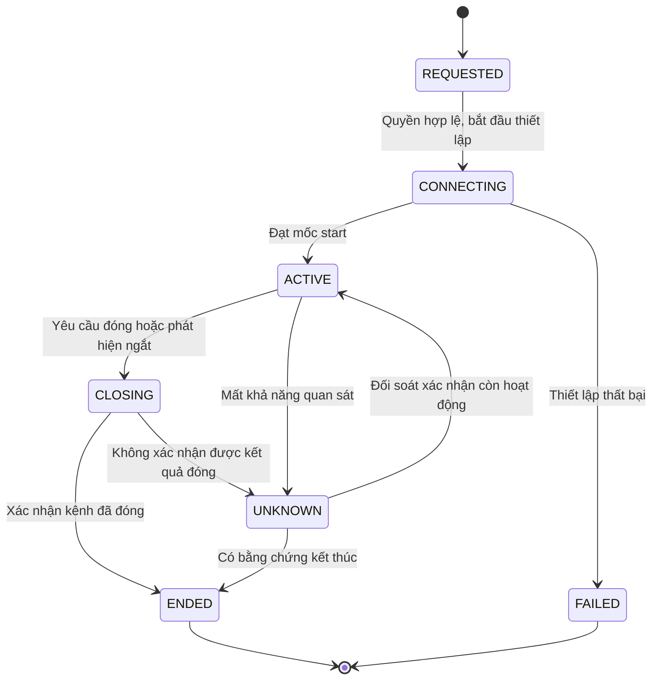

# Log session start stop trong PAM

## 1. Mục tiêu của log mở và đóng phiên

Một quản trị viên được duyệt truy cập máy chủ thanh toán trong 30 phút. PAM cấp quyền đúng chính sách và chuyển tiếp kết nối đến máy chủ. Khi kiểm toán hỏi “ai đã truy cập, từ lúc nào đến lúc nào, bằng tài khoản nào và phiên kết thúc ra sao?”, bản ghi phê duyệt chưa đủ để trả lời: quyền có thể được cấp nhưng chưa bao giờ sử dụng; kết nối có thể thất bại trước khi phiên thực sự bắt đầu; cửa sổ cấp quyền có thể hết hạn trong khi tiến trình trên đích vẫn đang chạy.

Log session start và session stop ghi nhận vòng đời phiên truy cập đặc quyền mà một thành phần có trách nhiệm quan sát. Trong bài này, thành phần đó thường là PAM gateway, proxy hoặc session manager. Nếu chỉ có nhật ký đăng nhập trực tiếp tại máy đích, cần ghi rõ nguồn quan sát vì ý nghĩa sự kiện có thể khác.

Sau bài học, người học có thể:

- Định nghĩa thời điểm bắt đầu và kết thúc phiên phù hợp với kiến trúc PAM.
- Thiết kế cặp sự kiện đủ thông tin để liên kết người yêu cầu, tài khoản đặc quyền, tài nguyên và bằng chứng phiên.
- Phân biệt kết thúc đã xác nhận, mất kết nối, hết thời gian chờ và trạng thái chưa biết.
- Đối soát sự kiện trùng, đến trễ, sai thứ tự hoặc thiếu stop mà không tạo bằng chứng giả.
- Dùng dữ liệu phiên để hỗ trợ kiểm toán, phát hiện bất thường và ứng phó sự cố.

Phạm vi là log vòng đời phiên. Nội dung lệnh, hình ảnh màn hình, truy vấn cơ sở dữ liệu và thao tác nghiệp vụ cần nguồn audit hoặc bản ghi phiên riêng; start/stop không tự cung cấp các thông tin đó.

## 2. Định nghĩa “phiên” trước khi đặt tên sự kiện

### 2.1. Quyền được cấp, kết nối và phiên là ba khái niệm khác nhau

Một luồng truy cập có thể diễn ra như sau:

```text
Yêu cầu truy cập
    → phê duyệt / đánh giá chính sách
    → tạo grant có thời hạn
    → thử mở kết nối đến đích
    → đích chấp nhận và kênh đặc quyền sẵn sàng
    → người dùng thực hiện thao tác
    → đóng hoặc mất kênh
    → xác nhận kết thúc / đối soát trạng thái
```

Không phải mọi bước đều xảy ra. Người dùng có thể không sử dụng grant; đích có thể từ chối xác thực; gateway có thể mất mạng trước khi xác nhận kết nối thành công. Vì thế cần tách các loại sự kiện:

| Sự kiện minh họa | Điều được quan sát | Không nên suy ra |
|---|---|---|
| `access.grant.created` | Quyền truy cập đã được cấp | Người dùng đã đăng nhập |
| `session.connection.attempted` | Có một lần thử thiết lập kết nối | Phiên đặc quyền đã hoạt động |
| `session.connection.failed` | Lần thử thất bại ở một bước xác định | Đã có một phiên thành công rồi kết thúc |
| `pam.session.started` | Đạt mốc bắt đầu đã định nghĩa | Mọi thao tác sau đó đều được ghi nội dung |
| `pam.session.ended` | Thành phần phát log xác nhận phiên kết thúc trong phạm vi quan sát | Mọi tiến trình hoặc credential trên đích đều đã bị thu hồi |
| `session.state.unknown` | Không đủ bằng chứng xác nhận tình trạng hiện tại | Phiên chắc chắn đã đóng |

Các tên trên là quy ước của bài học, không phải bộ tên bắt buộc của mọi sản phẩm PAM.

### 2.2. Chọn mốc start có thể kiểm chứng

Với một phiên được gateway chuyển tiếp, có thể quy định:

> Phiên bắt đầu khi gateway đã thiết lập thành công kênh đến tài nguyên đích dưới danh tính được cấp và kênh đó sẵn sàng cho thao tác của chủ thể truy cập.

Mốc này khác thời điểm nhận yêu cầu HTTP tạo phiên và khác thời điểm mở cửa sổ ứng dụng phía người dùng. Với giao thức có nhiều giai đoạn, cần xác định rõ “sẵn sàng” là xác thực thành công, tạo được shell, tạo được desktop hay một mốc khác mà hệ thống thực sự quan sát được.

Không gắn nhãn `started` chỉ vì đã ghi một dòng “connecting”. Nếu chưa nhận được bằng chứng từ lớp giao thức phù hợp, trạng thái vẫn là đang thiết lập hoặc chưa biết.

### 2.3. Chọn mốc stop và ranh giới quan sát

Với cùng gateway, có thể quy định:

> Phiên kết thúc khi session manager xác nhận kênh đặc quyền do nó quản lý đã đóng và không còn cho phép thao tác qua phiên đó.

Đây là kết luận về kênh do PAM quản lý. Nó không mặc nhiên chứng minh shell chạy nền trên máy đích đã dừng, job đã bị hủy, phiên ứng dụng độc lập đã hết hiệu lực hoặc mật khẩu đã được xoay vòng. Mỗi điều cần được chứng minh bằng sự kiện và cơ chế kiểm soát tương ứng.

Ví dụ, một quản trị viên chạy tác vụ nền rồi ngắt SSH. Gateway có thể ghi stop hợp lệ cho kênh SSH, nhưng tác vụ nền vẫn tiếp tục. Báo cáo phải giữ đúng nghĩa này, tránh diễn giải “session ended” thành “mọi hoạt động đặc quyền đã kết thúc”.

### 2.4. Phiên logic và kết nối vật lý

Một phiên logic có thể gồm nhiều kết nối khi người dùng reconnect hoặc khi hệ thống chuyển node. Nên có:

- `session_id`: định danh duy nhất cho vòng đời phiên logic.
- `connection_id`: định danh từng kết nối hoặc lần gắn lại vào phiên.
- `attempt_id`: định danh lần thử thiết lập, kể cả lần thử thất bại.
- `grant_id`: quyền truy cập mà phiên sử dụng.

Nếu sản phẩm coi mỗi reconnect là một phiên mới, hãy cấp `session_id` mới và giữ một tham chiếu đến phiên trước khi cần. Nếu reconnect tiếp tục cùng phiên logic, ghi sự kiện detach/attach hoặc connection closed/opened; không tạo thêm một start logic chỉ để làm số liệu có vẻ cân bằng.

## 3. Mô hình trạng thái cho vòng đời phiên

Một mô hình giản lược:



`UNKNOWN` là trạng thái quan sát của hệ thống, không phải một kiểu kết thúc bình thường. Một bản ghi tổng hợp có thể ghi nhận “chưa biết từ thời điểm X”, nhưng không được tự gán thời điểm kết thúc thực tế bằng thời điểm phát hiện lỗi.

Các nguyên tắc khi chuyển trạng thái:

1. Chỉ phát start logic sau khi đạt mốc start đã công bố.
2. Một phiên logic có tối đa một kết quả kết thúc có hiệu lực trong mô hình tổng hợp; các lần gửi lại sự kiện không tạo phiên mới.
3. Giữ các sự kiện gốc và lịch sử hiệu chỉnh khi có thông tin mới. Không âm thầm sửa log cũ để làm vòng đời “đẹp”.
4. Grant hết hạn hoặc một yêu cầu thu hồi chỉ là đầu vào cho quá trình đóng. Chỉ xác nhận stop sau khi điều kiện kết thúc đã được quan sát.
5. Lỗi thành phần phát log phải tạo khoảng trống có thể phát hiện và đối soát, thay vì được coi là không có hoạt động.

## 4. Bộ trường cần có trong log start và stop

### 4.1. Danh tính, tài nguyên và mối liên hệ

| Nhóm | Trường minh họa | Ý nghĩa |
|---|---|---|
| Nhận diện sự kiện | `event_id`, `event_type`, `schema_version` | Phân biệt sự kiện và phiên bản hợp đồng |
| Phạm vi | `tenant_id`, `environment` | Tránh nhầm phiên giữa các tenant và môi trường |
| Liên kết vòng đời | `session_id`, `connection_id`, `attempt_id` | Ghép đúng start/stop và tách lần thử kết nối |
| Chủ thể thực | `actor.subject_id`, `actor.identity_provider` | Người hoặc workload yêu cầu truy cập |
| Danh tính đặc quyền | `effective_identity.account_id` | Tài khoản được dùng trên tài nguyên đích |
| Tài nguyên | `target.resource_id`, `target.protocol` | Đích truy cập ổn định và loại kênh |
| Cơ sở cấp quyền | `grant_id`, `approval_ref`, `policy_id`, `policy_version` | Liên hệ quyết định cấp quyền tại thời điểm thực hiện |
| Nguồn phát | `emitter.node_id`, `emitter.boot_id`, `emitter.role` | Nơi quan sát và miền thứ tự sự kiện |
| Bằng chứng bổ sung | `recording_id`, `trace_id` | Tra cứu recording hoặc luồng xử lý liên quan |

Một `account_id` dùng chung như `root` hoặc tài khoản quản trị miền không thay thế được danh tính của người thực sự thao tác. Cần liên kết về `actor.subject_id` đã xác thực và giữ định danh ổn định, kể cả khi tên hiển thị hoặc email của người đó thay đổi.

Đối với workload, actor là danh tính workload phù hợp, không điền một tên người giả cho đủ schema. Nếu một người khởi động job sử dụng service account, có thể lưu cả actor trực tiếp và tham chiếu người khởi tạo, với ý nghĩa được định nghĩa rõ.

### 4.2. Thời gian và chất lượng quan sát

Nên phân biệt:

- `occurred_at`: thời điểm sự kiện xảy ra theo đồng hồ của nguồn phát.
- `observed_at`: thời điểm thành phần thu thập quan sát hoặc nhận sự kiện.
- `ingested_at`: thời điểm nền tảng log tiếp nhận lưu trữ.
- `time_quality`: trạng thái đồng bộ hoặc độ tin cậy của thời gian nguồn.
- `sequence`: số thứ tự trong miền được định nghĩa, chẳng hạn một emitter và một boot.

Dùng biểu diễn thời gian có múi giờ rõ ràng, thường chuẩn hóa về UTC. Không dùng một chuỗi như `02:15:03` mà thiếu ngày và múi giờ. Giữ thời điểm gốc khi chuyển đổi phục vụ hiển thị.

Độ dài phiên nên được đo bằng nguồn thời gian đơn điệu tại thành phần quản lý phiên, nếu vòng đời nằm trong cùng miền đo hợp lệ. Đồng hồ tường có thể bị điều chỉnh; lấy hai timestamp rồi trừ nhau có thể tạo thời lượng âm hoặc sai lệch. Tuy nhiên, giá trị đơn điệu của hai máy hoặc hai lần khởi động không tự so sánh được. Khi failover, chỉ công bố thời lượng tổng với phương pháp đo có thể giải thích; nếu chỉ ước tính từ timestamp thì gắn nhãn ước tính và trạng thái chất lượng.

### 4.3. Kết quả và nguyên nhân kết thúc

Stop nên có ít nhất:

- Kết quả quan sát, ví dụ `ended_confirmed`.
- Nguyên nhân có cấu trúc: `user_logout`, `admin_terminated`, `idle_timeout`, `maximum_duration`, `transport_lost` hoặc mã phù hợp với hệ thống.
- Thành phần hoặc chủ thể khởi phát việc đóng, nếu biết.
- Thời lượng và phương pháp đo, nếu xác định được.
- Trạng thái recording và tham chiếu tra cứu, nếu có recording.

`reason` mô tả vì sao phiên kết thúc; nó không phải kết luận “an toàn” hay “có vi phạm”. Một phiên logout bình thường vẫn có thể chứa hành động trái phép. Một phiên mất mạng cũng không tự chứng minh có tấn công.

Nếu nguyên nhân thật chưa rõ, dùng mã `unknown` với bằng chứng hiện có. Không ép mọi trường hợp vào `user_logout` để thuận tiện làm dashboard.

## 5. Ví dụ cặp sự kiện hoàn chỉnh

Các giá trị sau là dữ liệu minh họa. Các trường tùy chọn chỉ xuất hiện khi có dữ liệu phù hợp; hệ thống cần quy định rõ trường bắt buộc, trường tùy chọn và cách thể hiện giá trị chưa biết.

### 5.1. Start

```json
{
  "schema_version": "1.0",
  "event_id": "evt-start-93a1",
  "event_type": "pam.session.started",
  "occurred_at": "2026-10-12T02:15:03.120Z",
  "observed_at": "2026-10-12T02:15:03.126Z",
  "ingested_at": "2026-10-12T02:15:03.440Z",
  "tenant_id": "tenant-training",
  "environment": "production",
  "session_id": "sess-7c12",
  "connection_id": "conn-01",
  "attempt_id": "attempt-a813",
  "actor": {
    "subject_id": "person-1042",
    "identity_provider": "corporate-idp"
  },
  "effective_identity": {
    "account_id": "managed-account-88"
  },
  "target": {
    "resource_id": "server-payment-03",
    "protocol": "ssh"
  },
  "grant_id": "grant-4b20",
  "approval_ref": "approval-2048",
  "policy_id": "policy-maintenance",
  "policy_version": "12",
  "recording_id": "recording-7c12",
  "recording_state": "active",
  "emitter": {
    "node_id": "pam-gateway-02",
    "boot_id": "boot-57",
    "role": "session_gateway"
  },
  "sequence": 10451,
  "time_quality": "synchronized",
  "start_boundary": "target_channel_ready",
  "trace_id": "trace-e906"
}
```

`recording_state: active` chỉ xuất hiện vì ví dụ giả định gateway đã xác nhận bộ ghi đang hoạt động. Không gán trạng thái này chỉ vì chính sách yêu cầu recording. Nếu bộ ghi chưa khởi động, hệ thống phải ghi đúng tình trạng và thực thi chính sách tương ứng.

### 5.2. Stop

```json
{
  "schema_version": "1.0",
  "event_id": "evt-end-98b5",
  "event_type": "pam.session.ended",
  "occurred_at": "2026-10-12T02:35:15.620Z",
  "observed_at": "2026-10-12T02:35:15.625Z",
  "ingested_at": "2026-10-12T02:35:15.910Z",
  "tenant_id": "tenant-training",
  "environment": "production",
  "session_id": "sess-7c12",
  "connection_id": "conn-01",
  "actor": {
    "subject_id": "person-1042",
    "identity_provider": "corporate-idp"
  },
  "effective_identity": {
    "account_id": "managed-account-88"
  },
  "target": {
    "resource_id": "server-payment-03",
    "protocol": "ssh"
  },
  "grant_id": "grant-4b20",
  "outcome": "ended_confirmed",
  "reason": "user_logout",
  "initiated_by": "actor",
  "duration_ms": 1212500,
  "duration_basis": "gateway_monotonic_same_boot",
  "recording_id": "recording-7c12",
  "recording_state": "finalized",
  "emitter": {
    "node_id": "pam-gateway-02",
    "boot_id": "boot-57",
    "role": "session_gateway"
  },
  "sequence": 10584,
  "time_quality": "synchronized",
  "end_boundary": "managed_target_channel_closed",
  "trace_id": "trace-e906"
}
```

Hai sự kiện có cùng `session_id` nhưng khác `event_id`. Thời lượng là 20 phút 12,5 giây. Ví dụ giữ đồng hồ ổn định nên phép trừ timestamp cũng khớp với thời lượng đơn điệu; trong hệ thống thật, hai cách đo không phải lúc nào cũng bằng nhau.

`recording_state: finalized` nghĩa là tại thời điểm phát stop, thành phần đã nhận xác nhận hoàn tất recording theo hợp đồng của hệ thống. Nếu recording hoàn tất bất đồng bộ sau stop, nên dùng trạng thái như `finalizing` và phát một sự kiện hoàn tất riêng; không trì hoãn vô hạn log kết thúc phiên chỉ để chờ đóng tệp video.

## 6. Sinh log đúng khi có lỗi

### 6.1. Kết nối thất bại trước start

Đích từ chối xác thực. Hệ thống ghi `session.connection.failed` với `attempt_id`, tài nguyên và mã lỗi đã chuẩn hóa. Nó không tạo một cặp start/stop giả chỉ để mọi lần thử đều có hai dòng log.

Nếu đã cấp trước `session_id` để liên kết luồng yêu cầu, có thể giữ định danh đó trong sự kiện thất bại. Sự tồn tại của định danh không có nghĩa đã có phiên hoạt động. Báo cáo phải dựa trên loại sự kiện và mốc trạng thái.

### 6.2. Người dùng đóng cửa sổ hoặc mất mạng

Đóng cửa sổ phía máy khách có thể chưa làm gateway phát hiện ngay. Gateway có thể vẫn giữ kênh đến đích trong thời gian chờ reconnect. Cần ghi thời điểm detach nếu quan sát được và chỉ phát stop logic theo định nghĩa phiên đã chọn.

Khi TCP mất kết nối hoặc hết thời gian chờ, mô tả chính xác điều đã biết: transport đã mất, gateway đã đóng kênh do nó quản lý, hoặc chưa xác nhận được phía đích. Nếu chưa biết kênh đặc quyền còn hoạt động hay không, giữ trạng thái `UNKNOWN` và kích hoạt đối soát.

### 6.3. Idle timeout và hết hạn JIT

Idle timeout cần có định nghĩa “hoạt động”: tín hiệu mạng, input của người dùng hay thao tác có ý nghĩa. Keepalive có thể giữ kết nối sống nhưng không đại diện cho việc người dùng đang làm việc. Log nên liên hệ `policy_id` và phiên bản chính sách để giải thích vì sao timeout xảy ra.

Với JIT, thời hạn của grant và thời hạn phiên cần được quản lý riêng. Nếu chính sách yêu cầu ngắt phiên khi grant hết hạn, hệ thống cần yêu cầu đóng, quan sát kết quả và ghi stop sau xác nhận. Chỉ ghi “grant expired” không chứng minh quyền đang sử dụng đã bị chấm dứt.

### 6.4. Quản trị viên cưỡng chế kết thúc

Nên phân biệt hai sự kiện:

```text
termination.requested
    actor = người yêu cầu ngắt
    target_session_id = phiên cần ngắt
    reason_ref = lý do / ticket

pam.session.ended
    actor = người đang sử dụng phiên
    termination_initiator = người hoặc dịch vụ đã ngắt
    reason = admin_terminated
    outcome = ended_confirmed
```

Giữ actor của phiên để biết ai đang truy cập, đồng thời lưu người khởi phát việc ngắt. Không thay actor của phiên bằng quản trị viên đã nhấn nút terminate rồi làm mất dấu người dùng thực.

Nếu thao tác terminate thất bại, ghi kết quả thất bại riêng và giữ phiên ở trạng thái thực tế. Bản ghi yêu cầu không thay thế được xác nhận thực thi.

### 6.5. Gateway crash hoặc failover

Sau khi node chết, nguồn phát có thể không còn cơ hội ghi stop. Một thành phần đối soát cần đọc trạng thái bền vững và kiểm tra các kênh hoặc nguồn đích phù hợp. Kết quả có thể là còn hoạt động, kết thúc đã xác nhận hoặc chưa biết.

Nếu chỉ biết phiên đã biến mất trong khoảng từ heartbeat cuối đến thời điểm kiểm tra, lưu khoảng thời gian hoặc trường thời điểm ước tính với nhãn chất lượng. Không tạo timestamp stop chính xác giả bằng thời điểm gateway khởi động lại.

Khi hệ thống ghi thêm một kết luận đối soát, nêu rõ `emitter.role` là reconciler, `evidence_source` và tham chiếu sự kiện nguồn. Giữ phân biệt giữa sự kiện kết thúc quan sát trực tiếp và kết luận được suy ra sau sự cố.

### 6.6. Không ghi được audit log

Thiết kế cần trả lời: tại thời điểm nào một sự kiện được coi là đã lưu bền vững, và hệ thống xử lý ra sao nếu chưa đạt mốc đó?

Một kiến trúc có thể ghi sự kiện vào kho cục bộ bền vững hoặc outbox, rồi chuyển tiếp đến nền tảng log. Gửi lại dùng cùng `event_id` để hệ nhận loại trùng. Outbox giúp giảm khoảng trống giữa trạng thái ứng dụng và sự kiện, nhưng không tự bảo đảm tính nguyên tử với việc mở một kênh mạng bên ngoài; vẫn cần đối soát các tình huống crash giữa các bước.

Với tài nguyên yêu cầu bắt buộc có audit, chính sách có thể từ chối mở phiên nếu không thể lưu start ở mức bền vững đã quy định. Nếu có cơ chế khẩn cấp cho phép tiếp tục, nó cần quyền phê duyệt, dấu vết và cảnh báo riêng. Không dùng bộ đệm trong bộ nhớ rồi báo rằng bằng chứng đã được bảo toàn.

## 7. Thu thập và liên kết sự kiện đáng tin cậy

### 7.1. Gửi ít nhất một lần và loại trùng

Khi kết nối tới hệ log bị gián đoạn, retry có thể tạo nhiều bản sao của cùng sự kiện. Hệ thống tổng hợp cần loại trùng theo định danh và phạm vi đã công bố, chẳng hạn `(tenant_id, event_id)`. Nếu cùng định danh mà payload khác nhau, đó là xung đột cần điều tra; không lặng lẽ giữ bản đến sau.

Không loại trùng chỉ bằng `(session_id, event_type)` nếu vòng đời cho phép các sự kiện cùng loại lặp lại hợp lệ. Việc loại trùng bản tin và việc áp dụng quy tắc trạng thái là hai bước khác nhau.

### 7.2. Stop có thể đến trước start

Hàng đợi, retry và nhiều tuyến thu thập có thể khiến stop được ingest trước start. Pipeline không nên kết luận stop vô hiệu rồi bỏ đi. Nó có thể giữ một bản ghi chờ start, liên kết lại khi start tới và đánh dấu chất lượng trong thời gian chờ.

Thời gian chờ phải xuất phát từ đặc điểm giao nhận và yêu cầu vận hành. Hết thời gian chờ chỉ có nghĩa là chưa ghép được trong cửa sổ đó; không có nghĩa start sẽ không bao giờ xuất hiện.

### 7.3. Khóa ghép cần giữ phạm vi

Khóa tổng hợp phiên nên gồm tenant hoặc miền sở hữu cùng `session_id`. Tên người dùng và hostname không đủ làm khóa: một người có thể mở nhiều phiên đồng thời đến cùng máy; tài khoản quản trị dùng chung có thể phục vụ nhiều người; hostname có thể được tái sử dụng.

Không ghép theo nguyên tắc “stop gần start nhất” nếu thiếu định danh. Cách đó có thể gán sai thời lượng và sai người truy cập, đặc biệt khi có phiên song song hoặc khi đồng hồ lệch.

### 7.4. Thuật toán tổng hợp minh họa

```text
Khi nhận sự kiện:
    kiểm tra schema, nguồn và phạm vi tenant
    nếu event_id đã thấy:
        nếu payload khớp: bỏ qua bản sao ở lớp tổng hợp
        nếu payload khác: lưu xung đột, cảnh báo, không ghi đè im lặng
        kết thúc xử lý bản tin

    lưu sự kiện gốc vào kho audit
    tìm bản ghi tổng hợp theo tenant_id + session_id

    nếu là start:
        thêm bằng chứng start
        nếu đã có stop phù hợp: ghép và đánh giá chất lượng
        nếu chưa có stop: trạng thái quan sát là open

    nếu là stop:
        thêm bằng chứng stop
        nếu đã có start phù hợp: ghép và đánh giá chất lượng
        nếu chưa có start: giữ trạng thái awaiting_start

    nếu nhận thêm start/stop có nội dung mâu thuẫn:
        giữ mọi bằng chứng và đánh dấu conflict

    nếu là kết quả đối soát:
        cập nhật kết luận có nguồn bằng chứng và lịch sử hiệu chỉnh
```

Đây là mô tả logic, chưa phải mã sản xuất. Trong triển khai, lưu sự kiện và cập nhật trạng thái cần xử lý được việc worker bị ngắt giữa các bước; có thể tái tạo projection từ log hoặc dùng cơ chế ghi nguyên tử phù hợp. Việc loại trùng cũng phải an toàn khi nhiều consumer xử lý cùng một phiên.

## 8. Dùng log để kiểm toán và phát hiện bất thường

### 8.1. Bản ghi phiên phục vụ tra cứu

Một dòng tổng hợp hữu ích thường chứa actor, tài nguyên, tài khoản đặc quyền, thời điểm start, thời điểm stop nếu có, duration, reason, grant và chất lượng bằng chứng. Giữ các trạng thái dữ liệu riêng biệt:

| Trạng thái dữ liệu | Ý nghĩa | Việc nên làm |
|---|---|---|
| `paired_confirmed` | Ghép được start và stop phù hợp | Tra cứu thêm hoạt động và recording khi cần |
| `open` | Có start, chưa có stop; phiên có thể vẫn hợp lệ | Đối chiếu trạng thái đang hoạt động |
| `awaiting_start` | Có stop nhưng chưa nhận được start | Kiểm tra độ trễ, tuyến thu thập và retry |
| `unresolved` | Đã quá cửa sổ vận hành mà vẫn chưa đủ bằng chứng | Điều tra cùng chủ hệ thống |
| `conflict` | Nhiều bằng chứng không nhất quán | Giữ dữ liệu gốc, phân tích nguồn gây xung đột |

`open` trong kho log không luôn đồng nghĩa kênh còn sống. Nó chỉ nói rằng pipeline chưa có bằng chứng kết thúc phù hợp. Tương tự, `paired_confirmed` chứng minh vòng đời đã ghép được theo hợp đồng log, không chứng minh mọi hành động trong phiên là hợp lệ.

### 8.2. Các tín hiệu cần quan sát

- Phiên kéo dài vượt cửa sổ được cấp hoặc vượt ngưỡng chính sách.
- Nhiều start chưa có stop, tập trung ở cùng gateway hoặc cùng thời điểm triển khai.
- Stop không có start tăng đột biến sau thay đổi pipeline.
- Actor mở nhiều phiên đồng thời bất thường đến tài nguyên nhạy cảm.
- Start tham chiếu grant không tồn tại, đã bị thu hồi hoặc không phù hợp tài nguyên.
- Stop báo recording lỗi trong khi chính sách yêu cầu ghi phiên.
- Độ trễ ingest tăng, sequence có khoảng trống hoặc nguồn log ngừng phát heartbeat.

Đánh giá các tín hiệu cùng ngữ cảnh. Ví dụ, phiên dài có thể là tác vụ bảo trì đã được duyệt; nhiều orphan start có thể do collector hỏng chứ không phải tất cả người dùng quên logout. Cảnh báo nên chỉ ra bằng chứng và thiếu sót cần xác minh.

### 8.3. Truy vấn minh họa

Giả sử hệ thống đã xây bảng tổng hợp `pam_session_summary` sau khi loại trùng và ghép vòng đời, một truy vấn tìm phiên chưa có stop có thể viết như sau:

```sql
SELECT tenant_id,
       session_id,
       actor_subject_id,
       target_resource_id,
       started_at,
       data_quality
FROM pam_session_summary
WHERE started_at IS NOT NULL
  AND ended_at IS NULL
  AND started_at < :cutoff_utc;
```

`:cutoff_utc` là tham số do hệ thống tính theo thời gian chờ phù hợp. Kết quả là danh sách cần đối soát, không phải bằng chứng rằng mọi phiên trong đó vẫn hoạt động. Tên bảng và cú pháp tham số là minh họa, cần điều chỉnh cho nền tảng triển khai.

Không suy thời lượng bằng cách đếm số dòng log, vì retry có thể làm tăng số dòng mà không có thêm phiên. Khi thống kê, cần chỉ rõ mẫu số là phiên đã bắt đầu, phiên đã kết thúc hay phiên được đối soát thành công trong kỳ.

## 9. Bảo vệ log và giảm lộ thông tin nhạy cảm

Log phải đủ cho truy vết nhưng không trở thành kho secret thứ hai. Không ghi mật khẩu, private key, token truy cập, cookie phiên hay credential được checkout từ vault. Tránh ghi nguyên chuỗi kết nối chứa secret hoặc URL ký sẵn để xem recording. Dùng định danh tham chiếu và cơ chế phân quyền tra cứu ở kho bằng chứng.

Nội dung lỗi từ client hoặc tài nguyên đích cũng có thể chứa dữ liệu nhạy cảm. Chuẩn hóa mã lỗi và kiểm soát trường chi tiết thay vì đẩy nguyên mọi chuỗi vào log. Dùng serializer có cấu trúc để tránh việc dữ liệu đầu vào chèn xuống dòng và giả mạo sự kiện.

Các biện pháp bảo vệ thường cần phối hợp:

- Xác thực nguồn gửi và bảo vệ kênh truyền log.
- Hạn chế quyền sửa, xóa và cấu hình pipeline; tách quyền quản trị PAM khỏi quyền quản lý bằng chứng khi phù hợp.
- Áp dụng lưu trữ chống thay đổi hoặc cơ chế phát hiện sửa đổi theo nhu cầu của tổ chức.
- Theo dõi người truy cập, xuất hoặc xóa log và recording.
- Quy định thời hạn lưu, quyền riêng tư và quy trình xử lý dữ liệu theo yêu cầu áp dụng.
- Kiểm tra chất lượng thời gian, khoảng trống giao nhận và khả năng khôi phục pipeline.

Một giá trị hash riêng lẻ không tự chứng minh rằng chưa ai thay cả log lẫn hash. Muốn phát hiện sửa đổi có ý nghĩa, cần bảo vệ điểm neo tin cậy, quyền ghi và cách xác minh tương ứng. Tương tự, lưu trữ chống sửa đổi không tự phát hiện sự kiện chưa từng được phát; vẫn cần đối soát độ đầy đủ.

## 10. Bài thực hành: đối soát một ca bảo trì

### 10.1. Bối cảnh

Nhân viên vận hành được cấp quyền JIT 30 phút để bảo trì một máy chủ thử nghiệm qua PAM. Chính sách yêu cầu có audit vòng đời và recording. Các sự kiện dùng định danh giả, không chứa secret hay thông tin cá nhân thật.

Chuẩn bị bốn tình huống dữ liệu trên môi trường thử nghiệm hoặc bằng tập bản tin mô phỏng:

1. Một phiên hoạt động bình thường rồi logout.
2. Một lần kết nối bị từ chối xác thực trước start.
3. Một phiên có start nhưng gateway mất khả năng quan sát trước khi phát stop.
4. Một cặp start/stop được giao sai thứ tự và stop được gửi lại hai lần.

### 10.2. Các bước thực hiện

**Bước 1 — Viết hợp đồng mốc sự kiện.** Ghi rõ start quan sát ở lớp nào, stop xác nhận điều gì, reconnect tạo phiên mới hay tiếp tục phiên cũ và heartbeat có ý nghĩa gì. Không thực hiện bước ghép dữ liệu trước khi những định nghĩa này thống nhất.

**Bước 2 — Kiểm tra schema.** Mỗi bản tin phải có định danh sự kiện, loại sự kiện, thời gian, nguồn và phạm vi. Bản tin start/stop có đủ khóa ghép phiên. Các trường actor và effective identity phân biệt người truy cập với tài khoản trên đích.

**Bước 3 — Nạp bản tin và quan sát projection.** Với dữ liệu sai thứ tự, stop được giữ chờ start. Với bản sao cùng `event_id` và payload, số phiên và thời lượng không thay đổi. Với cùng ID nhưng payload khác, hệ thống ghi nhận conflict.

**Bước 4 — Đối soát phiên thiếu stop.** Kiểm tra trạng thái session manager và bằng chứng phía đích được phép truy cập. Nếu vẫn chưa đủ dữ liệu, kết quả là unresolved hoặc unknown. Nếu có bằng chứng kết thúc, lưu nguồn và độ chính xác của mốc kết thúc thay vì giả lập logout.

**Bước 5 — Đối chiếu chính sách và recording.** Dùng grant để kiểm tra cửa sổ quyền và đích được phép. Dùng `recording_id` để xác minh recording có thể tra cứu bằng quyền phù hợp. Không mặc định có recording chỉ vì trường định danh tồn tại.

### 10.3. Kết quả mong đợi

| Tình huống | Kết quả đúng |
|---|---|
| Logout bình thường | Một phiên đã ghép; actor, tài nguyên, thời lượng và reason nhất quán |
| Xác thực thất bại trước start | Một lần thử thất bại; không tính là phiên thành công |
| Mất khả năng quan sát | Có dấu hiệu thiếu bằng chứng và luồng đối soát; không bịa stop |
| Stop đến trước start, có retry | Một phiên sau khi ghép; bản sao không tăng số phiên |

Trong thử nghiệm, việc tắt thành phần hay mô phỏng mất mạng cần được giới hạn ở môi trường được phép. Mục tiêu là kiểm chứng tính đúng của log và đối soát, không tạo gián đoạn trên hệ thống đang phục vụ người dùng.

## 11. Những lỗi thiết kế dễ gặp

| Lỗi | Hậu quả | Cách thiết kế phù hợp |
|---|---|---|
| Ghi start lúc nhận request | Tính cả lần kết nối chưa thành công | Gắn start với mốc kênh thực sự sẵn sàng |
| Ghép theo tên người dùng và thời gian gần nhau | Nhầm các phiên song song | Dùng session ID có phạm vi rõ ràng |
| Ghi stop ngay khi gửi lệnh terminate | Báo đóng dù thực thi thất bại | Tách yêu cầu đóng và kết quả xác nhận |
| Tự đóng mọi phiên khi gateway reboot | Che mất khoảng trống bằng chứng | Đối soát và công bố độ chắc chắn |
| Tính duration bằng đồng hồ tường mà không kiểm tra | Thời lượng âm hoặc sai | Dùng phép đo thích hợp, gắn chất lượng dữ liệu |
| Bỏ stop vì chưa thấy start | Mất dữ liệu khi giao nhận sai thứ tự | Giữ sự kiện và ghép lại khi có dữ liệu |
| Đồng nhất hết grant với đóng phiên | Bỏ sót quyền còn đang được dùng | Kiểm tra thực thi thu hồi và trạng thái kênh |
| Dùng start/stop thay audit thao tác | Không biết hành động nào đã diễn ra | Liên kết log đích, sự kiện thao tác và recording |
| Ghi secret vào thông báo lỗi | Mở rộng phạm vi rò rỉ | Chuẩn hóa, che dữ liệu và lưu tham chiếu |
| Chỉ đo số dòng đã ingest | Không phát hiện thiếu sự kiện hoặc bản sao | Đo chất lượng nguồn, phiên, độ trễ và kết quả đối soát |

## 12. Câu hỏi tự kiểm tra

1. Vì sao một grant được cấp thành công chưa đủ để ghi nhận phiên đã bắt đầu?
2. Khi gateway ghi `transport_lost`, cần thêm bằng chứng nào để kết luận về hoạt động trên máy đích?
3. Nếu stop đến trước start, vì sao không nên bỏ bản tin hoặc tự tạo một start có timestamp suy đoán?
4. Một phiên kéo dài qua hai lần khởi động gateway có thể dùng trực tiếp hai giá trị đồng hồ đơn điệu để tính duration hay không?
5. Làm thế nào để phân biệt người đang truy cập với quản trị viên đã cưỡng chế kết thúc phiên đó?
6. Hai bản tin có cùng `event_id` nhưng payload khác nhau nên được xử lý thế nào?
7. Vì sao recording ID tồn tại chưa chứng minh recording đầy đủ và xem lại được?
8. Khi start có nhưng stop thiếu quá cửa sổ chờ, đâu là kết luận có thể đưa ra ngay và đâu là điều còn phải xác minh?

Một thiết kế log session start/stop có giá trị khi mỗi kết luận đều gắn với mốc quan sát và nguồn bằng chứng rõ ràng. Cặp sự kiện giúp trả lời vòng đời truy cập đặc quyền; định danh ổn định, xử lý lỗi và đối soát giúp câu trả lời đó vẫn đáng tin khi hệ thống không hoạt động hoàn hảo.
