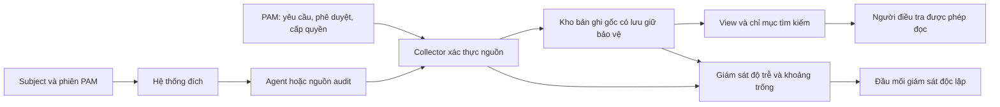

# Không cho subject sửa audit log

## Mục tiêu và tình huống đặt ra

Trong hệ thống quản lý truy cập đặc quyền (Privileged Access Management — PAM), subject là thực thể thực hiện hành động: một quản trị viên, tài khoản dịch vụ, workload tự động hoặc phiên truy cập được cấp quyền. Audit log là bằng chứng để trả lời ai đã yêu cầu quyền, ai phê duyệt, quyền nào được cấp, hành động nào diễn ra và kết quả ra sao.

Vấn đề xuất hiện khi cùng một subject vừa thực hiện thao tác nhạy cảm vừa có thể sửa bằng chứng về thao tác đó. Một quản trị viên được cấp quyền quản trị máy chủ có thể dừng agent, xóa file log hoặc đổi cấu hình chuyển log. Một workload có quyền quản trị kho lưu trữ có thể xóa các bản ghi cho thấy chính nó đã đọc credential. Khi đó, việc “có bật audit” chưa tạo ra bằng chứng đáng tin cậy.

Mục tiêu của bài học là thiết kế sao cho subject không thể sửa hoặc loại bỏ bằng chứng đã được hệ thống tiếp nhận, đồng thời phát hiện việc subject cố làm gián đoạn thu thập log. Người học cần phân biệt ba yêu cầu:

- **Toàn vẹn:** bản ghi đã lưu không bị thay đổi trái phép.
- **Đầy đủ:** các sự kiện cần ghi thực sự được tạo và chuyển tới nơi lưu.
- **Sẵn có:** người có trách nhiệm có thể truy xuất bằng chứng trong thời hạn cần thiết.

Ba yêu cầu liên quan nhưng không thay thế cho nhau. Một bản ghi bất biến có thể hoàn toàn chính xác về nội dung đã nhận mà vẫn thiếu một khoảng sự kiện do nguồn bị tắt.

## 1. “Không cho sửa” bao gồm những hành động nào?

Không nên chỉ hiểu “sửa log” là thay một dòng trong file văn bản. Subject có thể làm mất giá trị bằng chứng bằng nhiều đường khác nhau.

| Đường tác động | Ví dụ trong PAM | Điều cần kiểm soát |
|---|---|---|
| Sửa nội dung | Thay kết quả đọc secret từ thành công thành thất bại | Không cấp quyền cập nhật bản ghi đã tiếp nhận |
| Xóa bản ghi hoặc cả kho | Xóa object chứa log của phiên quản trị | Chặn xóa trong thời gian lưu bắt buộc |
| Ghi đè định danh cũ | Gửi lại một object cùng tên để thay bản cũ | Định danh do bên nhận tạo; không có đường upsert cho subject |
| Ngừng phát sinh log | Tắt audit trên vault hoặc dịch vụ đích | Bảo vệ cấu hình và phát hiện thay đổi từ nguồn độc lập |
| Ngừng chuyển log | Dừng agent hoặc đổi địa chỉ collector | Theo dõi heartbeat, độ trễ, hàng đợi và cấu hình |
| Làm log không đọc được | Hủy khóa giải mã hoặc khóa quyền truy cập kho | Tách quyền quản trị khóa và đường đọc bằng chứng |
| Tác động vòng đời | Rút retention hoặc đặt lifecycle xóa sớm | Cơ chế lưu giữ được thực thi tại kho và quyền thay đổi tách biệt |
| Làm sai ngữ cảnh | Đổi mapping tài khoản để không xác định được người dùng | Lưu định danh ổn định và lịch sử ánh xạ cần thiết |
| Chèn dữ liệu gây hiểu sai | Gửi event giả hoặc ký tự xuống dòng thành bản ghi mới | Kiểm tra schema, nguồn xác thực và an toàn hiển thị |

Quy tắc bảo vệ phải bao phủ cả **data plane** và **control plane**. Data plane gồm ghi, đọc, cập nhật, xóa dữ liệu. Control plane gồm policy, cấu hình tuyến log, khóa mã hóa, tài khoản vận hành và vòng đời lưu trữ. Chặn quyền xóa object nhưng để subject đổi policy kho là một khoảng trống.

Một thao tác bị từ chối ở giao diện PAM cũng chưa đủ. Subject có thể có API token, tài khoản cloud, quyền quản trị hệ điều hành hoặc pipeline triển khai để đi vòng qua giao diện đó.

## 2. Đặt ranh giới tin cậy trước khi đặt quyền

### 2.1. Xác định đúng subject cần ngăn chặn

Giả sử một kỹ sư được cấp quyền quản trị cơ sở dữ liệu trong 20 phút để sửa sự cố. Các thành phần liên quan có thể dùng những danh tính khác nhau:

1. Danh tính người yêu cầu tại hệ thống định danh.
2. Danh tính phiên PAM và mã lần cấp quyền.
3. Tài khoản đích dùng để thao tác cơ sở dữ liệu.
4. Danh tính agent hoặc dịch vụ chuyển log.
5. Danh tính collector ghi vào kho audit.
6. Danh tính người vận hành kho và người đọc phục vụ điều tra.

Các danh tính này phải liên kết được để điều tra, nhưng không vì thế mà dùng chung credential hoặc cùng được gán một vai trò quản trị. Nếu kỹ sư có thể lấy token của collector từ máy đang quản trị, quyền “chỉ dành cho collector” vẫn có thể bị kỹ sư sử dụng.

Một bảng mô hình quyền nên ghi rõ: subject có quyền trên tài nguyên nào, có thể lấy danh tính nào khác, có thể cấp lại quyền cho chính mình hay không, và có kiểm soát nơi thực thi chính sách hay không.

### 2.2. Không đặt toàn bộ bằng chứng trong miền mà subject kiểm soát

Nếu subject có quyền quản trị đầy đủ trên một máy, file audit chỉ nằm trên máy đó khó có thể được coi là bằng chứng bất biến trước chính subject. Subject có thể thay file, thay tiến trình ghi hoặc sửa trạng thái hệ thống mà tiến trình quan sát.

Vì vậy, một thiết kế điển hình chuyển sự kiện tới collector và kho lưu thuộc miền quản trị tách biệt. Miền này có thể là tài khoản, dự án hoặc hệ thống thu thập độc lập, tùy kiến trúc tổ chức. Ranh giới có ý nghĩa khi quyền ở hệ thống nghiệp vụ không kéo theo quyền quản trị đường log.

Tên gọi “tài khoản riêng” chưa chứng minh được sự tách biệt. Cần xét các đường kế thừa quyền:

- Một nhóm quản trị cấp cao có thể quản trị cả hai miền không?
- Subject có thể giả mạo hoặc assume danh tính vận hành kho không?
- Pipeline mà subject sửa được có thể triển khai policy cho kho không?
- Credential quản trị kho có nằm trong vault mà subject được quyền đọc không?
- Subject có thể thay cấu hình IdP để tự nhận vai trò người giữ bằng chứng không?

Không có thiết kế nào bảo đảm tuyệt đối trước một thực thể kiểm soát toàn bộ gốc tin cậy của nó. Khi tổ chức giữ một quyền quản trị tối cao có thể thay đổi cả hệ thống, cần nêu rõ quyền đó nằm trong mô hình đe dọa nào, giám sát bằng miền độc lập và áp dụng kiểm soát nhiều người ở các đường có thể thực thi.

## 3. Tách quyền tạo sự kiện, tiếp nhận và bảo quản

Một mô hình tối thiểu gồm các vai trò sau.

| Vai trò | Quyền cần thiết | Quyền không nên đi kèm |
|---|---|---|
| Subject thực hiện công việc | Quyền nghiệp vụ theo lần cấp JIT/JEA | Sửa kho audit hoặc cấu hình thu thập về chính mình |
| Nguồn phát sự kiện | Gửi loại event được phép tới endpoint tiếp nhận | Chọn nơi ghi tùy ý, ghi đè hoặc xóa lịch sử |
| Collector | Tiếp nhận, xác thực nguồn, tạo bản ghi và ghi kho | Quản trị mọi policy, rút retention hoặc hủy khóa lưu trữ |
| Người đọc audit | Tìm kiếm và đọc phần dữ liệu được giao | Thay bản ghi nguồn hoặc thay cơ chế lưu giữ |
| Người quản lý lưu giữ | Quản lý vòng đời theo phạm vi được giao | Tự ý xóa dữ liệu đang được bảo vệ hoặc thực hiện công việc nghiệp vụ được kiểm toán |
| Người quản trị nền tảng audit | Bảo trì hạ tầng trong phạm vi cần thiết | Quyền toàn năng thường trực không có giám sát độc lập |

Đây là mô hình trách nhiệm, không phải yêu cầu mỗi hàng luôn phải có một con người riêng. Một tổ chức nhỏ có thể dùng tự động hóa và phê duyệt để thực hiện nhiều trách nhiệm. Tuy nhiên, việc phân công cho cùng một người không được biến thành một danh tính có thể tự tạo hành động, xóa bằng chứng rồi tự phê duyệt việc xóa.

### 3.1. Dùng JIT/JEA cho cả nền tảng audit

Quyền vận hành collector và kho audit cũng là quyền đặc biệt:

- Chỉ cấp quyền bảo trì khi có nhu cầu và giới hạn thời gian.
- Giới hạn thao tác theo nhiệm vụ; bảo trì agent không đồng nghĩa quản trị toàn bộ retention.
- Có người phê duyệt độc lập với người yêu cầu cho thay đổi nhạy cảm.
- Ghi lại quyết định cấp quyền, chính sách được áp dụng và thao tác thực tế.
- Tự thu hồi phiên và credential theo thiết kế; kiểm tra kết quả thu hồi.

JIT làm giảm thời gian tồn tại của quyền, nhưng không tự biến một quyền nguy hiểm thành an toàn. Một quyền xóa toàn bộ kho trong hai phút vẫn có thể phá hủy toàn bộ bằng chứng trong hai phút đó.

### 3.2. Phân biệt quyền đọc với quyền sửa

Một quản trị viên có thể cần xem log để khắc phục sự cố. Việc cho phép đọc không bắt buộc phải cho phép cập nhật hoặc xóa. Nếu log chứa dữ liệu nhạy cảm, có thể cung cấp một view đã lọc hoặc giới hạn phạm vi truy vấn.

Ngược lại, vai trò “chỉ đọc” không đủ an toàn nếu nó được phép xuất hàng loạt dữ liệu có chứa bí mật. Toàn vẹn và tính bí mật là hai trục kiểm soát riêng: không cho sửa log đồng thời phải tránh làm log trở thành kênh rò rỉ credential.

## 4. Một đường ghi audit có thể bảo vệ được

Sơ đồ sau mô tả luồng logic, không phụ thuộc sản phẩm cụ thể:



Subject không có đường ghi quản trị trực tiếp tới kho bản ghi gốc. Nguồn phát log chỉ được gửi event qua một giao diện hẹp. Collector xác định nguồn, bổ sung thông tin tiếp nhận và ghi bản ghi theo cơ chế không cập nhật lịch sử đã lưu.

### 4.1. Nguồn phát không được sở hữu toàn bộ tên và vòng đời bản ghi

Một thiết kế tiếp nhận dễ sai là cho nguồn gửi một tên file và dùng thao tác “tạo hoặc thay thế”. Nếu nguồn được chọn lại tên cũ, nó có thể ghi đè lịch sử mà vẫn chỉ dùng API “ghi log”.

Một thiết kế chặt hơn có các tính chất:

- Nguồn được xác thực và gắn với phạm vi nguồn đã đăng ký.
- Collector tạo định danh tiếp nhận riêng và xác định vùng lưu.
- Event có định danh phía nguồn để chống ghi trùng; định danh này không trao quyền cập nhật bản cũ.
- Event lặp đúng nội dung có thể được nhận diện như lần gửi lại theo chính sách.
- Cùng định danh phía nguồn nhưng khác nội dung được ghi nhận là xung đột hoặc bị từ chối; không thay lịch sử âm thầm.
- Các giới hạn kích thước, schema và tốc độ gửi được kiểm soát tại bên nhận.

Cơ chế chống trùng phải đủ rõ để không xóa nhầm các sự kiện nghiệp vụ khác nhau. Một lần đọc secret thứ hai không được gộp với lần thứ nhất chỉ vì cùng người, cùng đường dẫn và gần thời điểm.

### 4.2. Giữ bản gốc và tách dữ liệu dẫn xuất

Kho bản ghi gốc nên tách khỏi chỉ mục phục vụ tìm kiếm. Chỉ mục có thể được dựng lại, bổ sung trường phân loại hoặc tái xử lý khi thay parser. Việc đó không cần làm thay đổi bằng chứng gốc.

Khi phát hiện bản ghi có thông tin sai, cách xử lý phù hợp thường là tạo một bản ghi hiệu chỉnh liên kết tới bản cũ, nêu rõ lý do, người thực hiện và thời điểm. Không thay lịch sử để khiến hệ thống trông như chưa từng ghi sai.

Thông tin được làm giàu về sau cũng cần nhận diện: trường nào do nguồn phát cung cấp, trường nào do collector bổ sung, trường nào do công cụ phân tích suy ra. Điều tra viên phải phân biệt quan sát gốc với kết luận dẫn xuất.

### 4.3. Xác thực kênh không thay thế độ tin cậy của nội dung

Một kênh được mã hóa và xác thực giúp bảo vệ việc truyền dữ liệu, đồng thời xác định danh tính gửi. Nó không chứng minh sự kiện phản ánh đầy đủ thực tế.

Ví dụ, một agent bị subject kiểm soát vẫn có thể dùng đúng credential để gửi một event hợp lệ về cấu trúc nhưng sai về nội dung. Muốn giảm rủi ro này, cần đối chiếu nhiều nguồn độc lập: lần cấp quyền từ PAM, sự kiện xác thực tại đích, hoạt động tại vault, sự kiện phía hạ tầng và ghi nhận phiên nếu có.

## 5. Append-only, lưu giữ bất biến và kiểm tra toàn vẹn

### 5.1. Append-only là thuộc tính của quyền được thực thi

“Chỉ thêm” có nghĩa danh tính được xét chỉ có thể thêm bản ghi mới theo giao diện được phép, không cập nhật hoặc xóa bản ghi cũ. Cần trả lời thêm: ai có thể thay giao diện, policy hoặc danh tính đó?

Một bảng cơ sở dữ liệu không có chức năng xóa trên giao diện người dùng chưa chắc là append-only trước tài khoản quản trị cơ sở dữ liệu. Tương tự, một file mở ở chế độ append trong ứng dụng vẫn có thể bị tài khoản hệ điều hành có quyền cao thay thế.

Vì vậy, phải chỉ rõ thuộc tính áp dụng trước đối tượng nào: người dùng nghiệp vụ, quản trị viên máy nguồn, collector hay quản trị viên kho.

### 5.2. Bảo vệ thời gian lưu giữ tại nơi lưu

Kho có cơ chế write-once hoặc retention lock có thể chặn sửa, xóa trong khoảng thời gian xác định, theo đúng khả năng và cấu hình của nền tảng được chọn. Cần kiểm chứng trực tiếp:

- Cơ chế nào thực thi thời hạn lưu của từng bản ghi hoặc object?
- Danh tính nào có thể rút ngắn thời hạn, bỏ khóa hoặc dùng đường bỏ qua?
- Các phiên bản cũ và bản sao có cùng mức bảo vệ cần thiết không?
- Thay lifecycle có làm mất dữ liệu sớm hơn cam kết không?
- Hủy khóa mã hóa hoặc tài khoản sở hữu có làm bằng chứng không thể đọc được không?
- Hết thời hạn thì quy trình xóa được kiểm soát và ghi nhận ra sao?

Không nên coi các chế độ lưu giữ của mọi sản phẩm là tương đương. Nếu chưa xác minh cấu hình cụ thể, chỉ có thể nói thiết kế yêu cầu thuộc tính nào, chưa thể kết luận rằng triển khai đã đáp ứng.

Thời hạn lưu là một lựa chọn quản trị dữ liệu của tổ chức. Bài học này không ấn định một số ngày áp dụng cho mọi hệ thống. Cần cân bằng mục tiêu điều tra, yêu cầu áp dụng và việc giới hạn lưu dữ liệu nhạy cảm.

### 5.3. Hash và chữ ký giúp phát hiện thay đổi, không tự ngăn xóa

Hash của bản ghi hỗ trợ kiểm tra nội dung có thay đổi so với giá trị tham chiếu hay không. Nếu subject sửa được cả bản ghi lẫn hash nằm cạnh nó, phép kiểm tra đó không còn là bằng chứng độc lập.

Một chuỗi hash có thể liên kết các bản ghi theo thứ tự:

```text
h_i = HASH(h_truoc || ma_hoa_chuan(event_i) || sequence_i)
```

Ví dụ trên chỉ mô tả ý tưởng. Triển khai cần định nghĩa chính xác cách mã hóa, ranh giới trường, thuật toán và cách quản lý điểm bắt đầu. Không ghép chuỗi tùy tiện rồi coi là cơ chế toàn vẹn hoàn chỉnh.

Muốn kiểm tra đáng tin cậy cần có giá trị tham chiếu hoặc checkpoint được giữ ở miền mà subject không thay được. Một chuỗi chỉ nằm trong cùng file có thể bị viết lại toàn bộ; phần cuối có thể bị cắt mà không ai nhận ra nếu không có checkpoint độc lập.

Chữ ký số hỗ trợ xác minh bên nắm khóa ký đã ký nội dung. Nếu subject lấy được khóa đó hoặc điều khiển dịch vụ ký, chữ ký không chứng minh nội dung là sự thật. Chữ ký cũng không tự chứng minh rằng không có sự kiện bị bỏ sót.

Lựa chọn lưu giữ bất biến và lựa chọn kiểm tra mật mã giải quyết những phần khác nhau của bài toán; có thể kết hợp nhưng không được đánh đồng.

## 6. Gắn bằng chứng với đúng người và đúng lần cấp quyền

Trong PAM, một tài khoản đích có thể được dùng cho nhiều phiên qua cơ chế broker. Chỉ ghi tên tài khoản đích không đủ để xác định ai chịu trách nhiệm.

Một bản ghi tiếp nhận có thể mang các trường logic như sau. Đây là ví dụ dữ liệu giả, không phải schema bắt buộc:

```json
{
  "receipt_id": "rcpt-demo-00418",
  "source_id": "pam-control-plane-demo",
  "source_event_id": "event-demo-02031",
  "event_type": "credential_access_decision",
  "actor_id": "person-demo-017",
  "workload_id": null,
  "session_id": "session-demo-088",
  "grant_id": "grant-demo-031",
  "request_id": "request-demo-226",
  "target_id": "database-demo-prod",
  "action": "read_credential",
  "outcome": "denied",
  "reason_code": "grant_expired",
  "event_time": "2030-05-12T08:31:04Z",
  "received_time": "2030-05-12T08:31:06Z",
  "source_sequence": 2031,
  "schema_version": 1
}
```

Các trường cần được sử dụng đúng nguồn gốc:

- `actor_id` dùng định danh ổn định để không mất liên kết khi người dùng đổi tên hiển thị.
- `session_id`, `grant_id` và `request_id` nối hoạt động với phiên, quyền cấp và quyết định phê duyệt.
- `event_time` là thời gian nguồn ghi nhận; `received_time` do phía nhận cung cấp. Chênh lệch hỗ trợ phát hiện độ trễ hoặc vấn đề đồng hồ.
- `source_sequence` chỉ có ý nghĩa phát hiện khoảng trống khi hợp đồng nguồn quy định cách tăng số, khởi động lại và phân vùng.
- `outcome` phải nói rõ đang mô tả quyết định cho phép, kết quả thao tác hay trạng thái nhận log.

Không tin trực tiếp trường `actor_id` do một nguồn bất kỳ gửi lên. Collector cần gắn event với danh tính nguồn đã xác thực, kiểm tra loại dữ liệu nguồn đó được phép khai báo và giữ khả năng đối chiếu.

Không đưa mật khẩu, token, private key hoặc toàn bộ nội dung secret vào audit log. Thông thường chỉ cần định danh tài nguyên, hành động, kết quả và dấu vết liên kết. Nếu một lệnh có thể chứa bí mật, cần xử lý che dữ liệu có chủ đích trước khi nội dung lan tới kho và các chỉ mục; không mặc định ghi mọi tham số rồi hy vọng xóa sau.

## 7. Bảo vệ cấu hình và phát hiện khoảng trống

### 7.1. Audit cho chính nền tảng audit

Những thay đổi sau cần được giám sát như thao tác đặc quyền:

- Bật, tắt hoặc thay mức audit.
- Thêm nguồn, bỏ nguồn, đổi endpoint collector.
- Đổi quyền ghi, đọc, xóa hoặc quyền assume vai trò.
- Đổi retention, lifecycle, cơ chế lưu giữ hoặc cấu hình khóa.
- Dừng collector, thay parser, triển khai phiên bản mới.
- Tắt cảnh báo, đổi người nhận hoặc thay ngưỡng phát hiện.
- Dùng tài khoản break-glass trên nền tảng audit.

Bản ghi về thay đổi cấu hình phải được chuyển tới nơi mà người thực hiện thay đổi không dễ sửa cùng lúc. Nếu cảnh báo tắt audit chỉ nằm trong chính luồng audit vừa bị tắt, khả năng phát hiện sẽ rất yếu.

Giám sát độc lập có thể đọc trạng thái control plane, kiểm tra cấu hình định kỳ hoặc nhận sự kiện quản trị từ miền khác. Tổ chức cần kiểm tra đường độc lập đó thật sự không cùng chịu một quyền quản trị.

### 7.2. Theo dõi sự im lặng, không chỉ sự kiện xấu

Không có event không đồng nghĩa không có hoạt động. Một thiết kế phát hiện khoảng trống thường kết hợp:

- Heartbeat hoặc trạng thái sức khỏe nguồn.
- Độ trễ từ thời gian sự kiện tới thời gian nhận.
- Hàng đợi chưa gửi và tỷ lệ gửi lỗi.
- Khoảng thiếu sequence trong phạm vi được định nghĩa.
- Mức thay đổi bất thường về lưu lượng sự kiện.
- Đối chiếu phiên đã mở tại PAM với hoạt động nhận từ đích.
- Kiểm tra việc phiên đã đóng nhưng chưa nhận đủ bằng chứng dự kiến.

Ngưỡng phải theo đặc tính nguồn. Một máy nhàn rỗi có thể không có sự kiện nghiệp vụ trong nhiều giờ; cần heartbeat để phân biệt với agent đã bị tắt. Một nguồn gửi theo lô có độ trễ dự kiến khác nguồn trực tuyến.

Sequence cũng không phải bằng chứng tuyệt đối: một nguồn bị kiểm soát có thể tạo lại dãy số liên tục. Nó hữu ích để phát hiện lỗi truyền hoặc một số hành vi can thiệp, nhưng cần kết hợp các quan sát độc lập.

### 7.3. Quyết định khi mất đường audit

Không phải hệ thống nào cũng nên áp dụng cùng một chính sách khi collector không nhận log. Cần định nghĩa trước theo hành động và rủi ro:

| Tình huống | Hướng xử lý có thể thiết kế | Bằng chứng cần giữ |
|---|---|---|
| Yêu cầu phiên quản trị mới, mức nhạy cảm cao | Tạm dừng cấp quyền khi chưa bảo đảm điều kiện audit | Quyết định từ chối và trạng thái đường audit |
| Phiên đang thực hiện công việc quan trọng | Theo chính sách: giới hạn thao tác, dừng an toàn hoặc tiếp tục trong cửa sổ đã quy định | Khoảng thời gian suy giảm và hành động đã chọn |
| Mất kết nối tạm thời, nguồn còn tin cậy | Đệm có giới hạn và gửi lại sau kết nối | Số lượng tồn, thời gian đệm, kết quả gửi lại |
| Hàng đợi gần đầy hoặc nguồn không còn tin cậy | Báo động và áp dụng chính sách suy giảm đã phê duyệt | Phần dữ liệu có thể thiếu và phạm vi ảnh hưởng |

Đây là các phương án thiết kế, không phải quy tắc luôn dừng hoặc luôn tiếp tục. Subject không được tự chọn chế độ “bỏ audit” để thuận tiện thao tác.

Bộ đệm local có thể giúp chống mất kết nối nhưng vẫn nằm trong miền của máy nguồn. Nếu subject quản trị máy đó, bộ đệm không có cùng độ tin cậy với bản đã được collector độc lập tiếp nhận. Không báo “đã bảo toàn bằng chứng” chỉ dựa trên thông báo ghi thành công ở local.

## 8. Ma trận kiểm thử phủ định

Kiểm thử phải dùng đúng danh tính subject và các đường truy cập thực tế. Việc quản trị viên kho tự kiểm tra rằng giao diện không có nút xóa không chứng minh subject bị chặn.

Trước kiểm thử, tạo dữ liệu giả và xác nhận phạm vi thử. Với các thao tác có thể phá hủy, dùng tài nguyên thử có cùng chính sách bảo vệ; không tháo bảo vệ kho thật để chứng minh thao tác xóa được.

| Ca kiểm thử | Kết quả mong đợi | Cách thu bằng chứng |
|---|---|---|
| Subject cập nhật bản ghi đã tiếp nhận | Bị từ chối | Kết quả thao tác, policy áp dụng, bản gốc còn nguyên |
| Subject xóa object trong thời hạn được bảo vệ | Bị từ chối | Phản hồi kho và đọc lại object |
| Nguồn gửi lại cùng ID với payload khác | Không ghi đè bản trước | Bản gốc, kết quả xử lý xung đột |
| Subject đổi policy để tự có quyền xóa | Bị từ chối qua mọi đường được kiểm tra | Event quản trị ở nơi độc lập |
| Subject rút retention hoặc dùng đường bỏ qua | Bị từ chối trong mô hình quyền đã công bố | Cấu hình trước/sau và kết quả kiểm tra |
| Subject dừng agent trên máy mà mình quản trị được | Có thể dừng ở nguồn, nhưng phải phát hiện khoảng trống | Heartbeat mất, cảnh báo và đối chiếu phiên PAM |
| Collector tạm thời không kết nối được | Xử lý theo chính sách suy giảm đã định | Độ trễ, hàng đợi và quyết định cấp phiên |
| Subject tìm cách giả mạo nguồn khác | Bị chặn hoặc không được gắn danh tính nguồn giả | Kết quả xác thực và sự kiện từ chối |
| Quản trị viên được phép rebuild chỉ mục | Chỉ mục thay đổi nhưng bản gốc được giữ | Đối chiếu kho gốc và nguồn dữ liệu tái dựng |
| Truy xuất lại bằng chứng sau bảo trì khóa | Dữ liệu còn giải mã và truy cập được | Kết quả đọc bằng danh tính được phép |

Ca “dừng agent” cho thấy ranh giới giữa ngăn chặn và phát hiện. Nếu subject có quyền đủ cao trên máy nguồn, không nên đặt tiêu chí sai rằng nó tuyệt đối không thể dừng mọi tiến trình. Tiêu chí thực tế là quyền ở nguồn không cho sửa bản đã chuyển đi, sự suy giảm được phát hiện và các hành động tiếp theo tuân theo chính sách.

Mỗi kết quả nên ghi danh tính thực thi, tài nguyên, thời điểm, quyền có hiệu lực, kết quả kỳ vọng, kết quả thực tế và vị trí bằng chứng. Với kiểm tra bị từ chối, cần phân biệt “đúng policy chặn” với “API lỗi mạng”, “sai endpoint” hoặc “không tìm thấy object”.

Kiểm thử cho phép cũng cần thiết. Collector phải vẫn ghi được event hợp lệ và người điều tra phải đọc được dữ liệu được giao. Một kho từ chối mọi hoạt động không đáp ứng mục tiêu vận hành audit.

## 9. Ví dụ xuyên suốt: phiên sửa cơ sở dữ liệu

Giả sử kỹ sư An cần thay cấu hình một cơ sở dữ liệu sản xuất. Tổ chức thiết kế luồng như sau:

1. An gửi yêu cầu có mục đích công việc, tài nguyên và thời hạn.
2. Người có trách nhiệm khác phê duyệt quyền theo phạm vi cho phép.
3. PAM tạo lần cấp quyền JIT, mở phiên broker và ghi định danh phiên.
4. Hệ thống đích ghi sự kiện xác thực và thao tác trong khả năng quan sát của nó.
5. Sự kiện từ PAM và đích được collector độc lập tiếp nhận; bản gốc được lưu theo chính sách bảo vệ.
6. Hết hạn, PAM kết thúc quyền và ghi kết quả thu hồi.

An có quyền đủ cao để thay một số cấu hình hệ điều hành ở đích. An thử dừng agent rồi tiếp tục thao tác ngoài phạm vi công việc.

Thiết kế cần bảo đảm các kết quả sau:

- Sự kiện yêu cầu, phê duyệt và mở phiên đã nhận không bị An sửa được.
- An không đọc được credential dùng để quản trị kho audit từ đích.
- Đường heartbeat hoặc giám sát độc lập phát hiện agent ngừng gửi.
- Chính sách phiên quy định rõ có chặn thao tác tiếp, giới hạn phiên hay kết thúc an toàn.
- Người ứng cứu nhận cảnh báo kèm mã phiên, thời điểm cuối nhận log và tình trạng nguồn.
- Việc thu hồi quyền của An tạo dấu vết độc lập với máy đích bị nghi ngờ.
- Báo cáo điều tra nêu rõ khoảng quan sát bị thiếu; không suy diễn rằng khoảng đó chắc chắn không có hành động.

Nếu collector có một sự kiện “An đóng phiên thành công” nhưng máy đích mất log trước đó, chỉ có thể khẳng định collector đã tiếp nhận sự kiện đóng phiên từ nguồn tương ứng. Không thể từ một event đó suy ra rằng mọi thao tác trong phiên đều đã được quan sát.

## 10. Break-glass và vòng đời bằng chứng

### 10.1. Break-glass không được thành đường xóa dấu vết

Nền tảng audit có thể cần truy cập khẩn cấp để phục hồi dịch vụ. Đường break-glass phải được thiết kế trước:

- Danh tính khẩn cấp được giữ và cấp theo quy trình riêng.
- Quyền chỉ đủ để phục hồi những chức năng đã xác định.
- Việc sử dụng được phát hiện qua đường giám sát độc lập khi có thể.
- Thao tác nhạy cảm có kiểm soát nhiều người ở nơi thực thi hỗ trợ.
- Sau sự cố, thu hồi phiên, thay credential liên quan và kiểm tra lại quyền.

Nếu một danh tính khẩn cấp có thể hủy khóa hoặc thay toàn bộ chính sách lưu, đó là một ngoại lệ quyền lực phải được ghi nhận rõ. Không gọi kho “không ai sửa được” khi vẫn có đường này.

Một phê duyệt trên ticket chưa tạo ra chặn kỹ thuật nếu một người vẫn có credential thực hiện trực tiếp. Cần phân biệt kiểm soát quy trình với kiểm soát được hệ thống thực thi.

### 10.2. Xóa hợp lệ sau thời hạn

Bảo vệ audit không có nghĩa lưu mọi dữ liệu mãi mãi. Khi hết thời hạn và không có điều kiện giữ lại khác, cơ chế vòng đời có thể xóa dữ liệu theo chính sách đã được phê duyệt.

Điểm quan trọng là subject của hoạt động được audit không tự quyết định xóa bằng chứng về mình trong thời gian cần bảo vệ. Việc xóa hợp lệ cần có phạm vi, thời hạn, danh tính thực thi và bằng chứng hoạt động phù hợp; bằng chứng về vòng đời cũng cần được bảo vệ theo nhu cầu.

Khi phát hiện secret vô tình lọt vào log, không để subject tự sửa bản gốc nhằm “dọn cho sạch”. Cần hạn chế truy cập, xoay credential bị lộ, xử lý các bản sao/chỉ mục và áp dụng quy trình xử lý dữ liệu nhạy cảm được giao quyền. Cách xử lý bản gốc phải phù hợp với cơ chế lưu giữ thực tế, đồng thời giữ dấu vết quyết định và tác động.

## 11. Những lỗi thiết kế thường gặp

**Dùng cùng một tài khoản cho quản trị nghiệp vụ và quản trị audit.** Khi tài khoản bị chiếm, kẻ tấn công có cả quyền hành động và quyền sửa bằng chứng. Cần tách danh tính, credential và đường cấp quyền.

**Chỉ bảo vệ file trên nguồn.** Quyền file có thể chặn người dùng thường nhưng không tạo ranh giới trước quản trị viên có quyền kiểm soát máy. Cần chuyển bản ghi ra miền độc lập và phát hiện mất nguồn.

**Chỉ chặn DELETE nhưng cho UPDATE hoặc ghi đè.** Bằng chứng có thể bị thay nội dung mà không cần xóa. Cần xét đầy đủ thao tác và phiên bản dữ liệu.

**Chỉ bảo vệ object, bỏ qua khóa mã hóa và policy.** Dữ liệu vẫn tồn tại nhưng không còn đọc được, hoặc quyền xóa được cấp lại qua control plane. Cần phân tích cả chuỗi quyền.

**Coi checksum cạnh file là chống giả mạo.** Nếu cùng subject sửa cả hai thì không có giá trị tham chiếu độc lập. Cần bảo vệ điểm tham chiếu hoặc cơ chế xác thực thích hợp.

**Coi mọi log có chữ ký đều đầy đủ.** Chữ ký xác nhận nội dung đã ký theo khóa, không xác nhận rằng nguồn đã ghi mọi sự kiện. Cần đối chiếu nguồn và giám sát khoảng trống.

**Chỉ kiểm tra đường UI.** API, CLI, pipeline và quyền kế thừa có thể cho phép cùng một thao tác. Kiểm thử phải bám quyền hiệu lực và các đường truy cập có thật.

**Để người vận hành tắt cả audit lẫn cảnh báo.** Một thay đổi có thể làm mất bằng chứng mà không ai biết. Cần giám sát các thay đổi kiểm soát từ miền phù hợp.

**Ghi credential để “điều tra cho dễ”.** Log trở thành một kho secret ngoài kiểm soát vault. Cần ghi định danh và kết quả, giảm dữ liệu nhạy cảm ngay từ nguồn.

## 12. Bài tập tự kiểm tra

### Tình huống A: kho riêng nhưng cùng quyền quản trị

Một nhóm có hai tài khoản hạ tầng: tài khoản ứng dụng và tài khoản audit. Mọi thành viên nhóm quản trị ứng dụng đều được assume vai trò quản trị trong tài khoản audit.

**Câu hỏi:** Tách tài khoản như vậy đã ngăn subject sửa bằng chứng chưa?

**Định hướng trả lời:** Chưa. Quyền của subject vẫn đi qua ranh giới tài khoản để tác động kho. Cần kiểm tra và thu hẹp quyền assume, quyền cấp vai trò, pipeline và các danh tính có thể sử dụng; sau đó kiểm thử bằng chính subject. Tên hoặc vị trí tài nguyên khác nhau không thay thế sự tách biệt quyền hiệu lực.

### Tình huống B: dữ liệu bất biến nhưng khóa có thể bị hủy

Subject không xóa được log đang được bảo vệ, nhưng có thể yêu cầu hủy khóa duy nhất cần để giải mã log.

**Câu hỏi:** Mục tiêu bảo vệ bằng chứng đã đạt chưa?

**Định hướng trả lời:** Chưa. Tính bất biến của byte không bảo đảm khả năng sử dụng bằng chứng. Cần tách quyền quản trị khóa, xét các điều kiện bảo vệ và phục hồi mà nền tảng hỗ trợ, giám sát thay đổi và kiểm thử khả năng đọc sau các tác vụ bảo trì hợp lệ.

### Tình huống C: hash kiểm tra đúng nhưng thiếu 15 phút

Mọi bản ghi đã nhận đều kiểm tra hash hợp lệ. Tuy nhiên, giữa một phiên PAM đang mở có khoảng 15 phút không nhận event từ đích.

**Câu hỏi:** Có thể kết luận subject không thực hiện thao tác trong khoảng đó không?

**Định hướng trả lời:** Không. Hash chỉ hỗ trợ kiểm tra bản ghi hiện có so với tham chiếu. Cần điều tra sức khỏe nguồn, kết nối, hàng đợi, thời gian hệ thống và các nguồn quan sát khác; báo rõ giới hạn bằng chứng.

### Tình huống D: hiệu chỉnh thông tin điều tra

Một event ghi nhầm tên hiển thị vì dữ liệu đồng bộ chậm. Người điều tra muốn thay tên trong bản gốc.

**Câu hỏi:** Cách nào giữ được lịch sử tốt hơn?

**Định hướng trả lời:** Giữ bản gốc, tạo thông tin hiệu chỉnh có liên kết và nguồn gốc, dùng định danh ổn định để tra cứu lịch sử ánh xạ. View điều tra có thể hiển thị giá trị đã hiệu chỉnh nhưng phải cho phép nhận biết nội dung gốc và thời điểm hiệu chỉnh.

## Kết luận

Không cho subject sửa audit log là một yêu cầu về ranh giới quyền và vòng đời bằng chứng. Cần bảo vệ bản ghi đã tiếp nhận, cấu hình thu thập, chính sách lưu giữ, khóa mã hóa và các đường cấp quyền có thể tác động tới chúng.

Trong PAM, thiết kế có giá trị khi liên kết được hành động với người và lần cấp quyền, giữ được bản gốc ngoài miền subject kiểm soát, phát hiện phần quan sát bị gián đoạn và chứng minh các thuộc tính đó bằng kiểm thử quyền thực tế. Bản ghi không bị sửa và bằng chứng đầy đủ là hai mục tiêu phải được đánh giá riêng.
