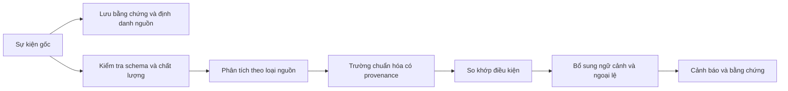

# Pattern matching trong phân tích lệnh đặc quyền

## 1. Vì sao PAM cần so khớp mẫu lệnh?

Một phiên truy cập được PAM phê duyệt vẫn có thể chứa thao tác vượt mục đích ban đầu. Người vận hành có thể dùng đúng tài khoản, đúng máy đích và đúng cửa sổ bảo trì nhưng thực hiện một lệnh ngoài phạm vi công việc. Vì vậy, kiểm soát đăng nhập và cấp quyền cần đi cùng khả năng quan sát hành động sau khi phiên bắt đầu.

**Pattern matching**, hay so khớp mẫu, là việc kiểm tra dữ liệu quan sát được có thỏa một điều kiện đã mô tả hay không. Trong command analytics, điều kiện có thể áp dụng cho tên chương trình, đối số, tài nguyên đích, câu lệnh đã ghi nhận hoặc một nhóm trường của sự kiện.

Ví dụ, một tổ chức muốn phát hiện yêu cầu dừng dịch vụ thu thập nhật ký trên máy sản xuất. Mẫu hữu ích cần phân biệt được:

- Xem trạng thái dịch vụ với thay đổi trạng thái dịch vụ.
- Máy thử nghiệm với máy sản xuất.
- Yêu cầu đã bị từ chối với thao tác có kết quả xác nhận thành công.
- Công việc được phê duyệt đúng tài nguyên với ngoại lệ chung chung.

Nếu chỉ tìm chuỗi `auditd` trong mọi dòng lệnh, cả việc kiểm tra trạng thái lẫn việc đọc tài liệu đều có thể tạo cảnh báo. Nếu chỉ tìm đúng một chuỗi đầy đủ, hệ thống lại có thể bỏ sót những cách biểu diễn khác của cùng hành động.

Mục tiêu của bài là xây dựng một mẫu **có ý nghĩa vận hành, giải thích được và kiểm thử được**. Pattern matching hỗ trợ giám sát phiên, phát hiện sử dụng quyền sai mục đích và tạo bằng chứng phục vụ điều tra; nó không tự chứng minh ý định của người sử dụng.

## 2. Bắt đầu từ câu hỏi nghiệp vụ, không bắt đầu từ regex

Một quy tắc nên bắt đầu bằng mô tả ngắn gọn:

> Phát hiện yêu cầu dừng dịch vụ thu thập nhật ký trên tài sản sản xuất, do một danh tính đang sử dụng quyền đặc biệt thực hiện.

Từ mô tả này, tách ra bốn thành phần:

| Thành phần | Câu hỏi cần trả lời | Ví dụ trong bài |
| --- | --- | --- |
| Hành động | Người dùng đang yêu cầu làm gì? | Dừng dịch vụ |
| Đối tượng | Tác động lên tài nguyên nào? | Dịch vụ nhật ký được quản lý |
| Ngữ cảnh | Điều kiện nào làm hành động đáng chú ý? | Tài sản sản xuất, quyền đặc biệt |
| Bằng chứng | Dữ liệu nào xác nhận điều kiện? | Sự kiện thực thi, đối số, metadata tài sản |

Sau đó mới chọn trường và kiểu so khớp phù hợp. Nếu nguồn đã tách tên chương trình và danh sách đối số, việc so khớp cấu trúc thường rõ ràng hơn một biểu thức dài trên chuỗi lệnh thô.

Quy tắc cũng cần ghi rõ **không kết luận điều gì**. Chẳng hạn, phát hiện một yêu cầu dừng dịch vụ không đủ để nói dịch vụ đã dừng, nhật ký đã mất hay tài khoản đã bị chiếm quyền. Những kết luận đó cần thêm kết quả thực thi và dữ liệu đối chiếu.

Trong phạm vi PAM, câu hỏi này còn giúp nối kết detection với least privilege và JIT/JEA: sau khi phát hiện những thao tác thường xuyên vượt mục đích cấp quyền, tổ chức có thể xem lại phạm vi quyền hoặc phương thức quản trị được phép.

## 3. Chọn đúng lớp dữ liệu để so khớp

Cùng một hoạt động có thể xuất hiện ở nhiều nguồn với độ tin cậy và mức chi tiết khác nhau.

| Lớp dữ liệu | Điểm mạnh | Giới hạn cần ghi trong quy tắc |
| --- | --- | --- |
| Dòng terminal hoặc bản ghi phiên | Gắn với phiên PAM, hữu ích khi xem lại diễn biến | Có thể gồm lệnh đang gõ, kết quả hiển thị, chuỗi bị cắt hoặc ký tự điều khiển |
| Lịch sử shell | Dễ đối chiếu một số thao tác tương tác | Không phải nguồn đầy đủ hoặc bất biến; cách ghi phụ thuộc cấu hình |
| Sự kiện tạo tiến trình | Có thể cung cấp chương trình và đối số đã quan sát | Không mặc định thấy mọi shell builtin, nội dung script hoặc API gọi bên trong tiến trình |
| Nhật ký quản trị của hệ thống đích | Gần với hành động và tài nguyên được quản lý | Cần ánh xạ danh tính, phiên và thời gian với nguồn PAM |
| Sự kiện có kết quả nghiệp vụ | Hữu ích để xác nhận thay đổi thực tế | Có thể đến muộn hoặc thiếu liên kết trực tiếp với lệnh |

Một dòng đầu ra chứa từ khóa không đồng nghĩa người dùng đã thực thi lệnh chứa từ khóa đó. Một tiến trình được tạo không đồng nghĩa tác vụ bên trong đã thành công. Một phiên không có bản ghi phù hợp cũng không đồng nghĩa phiên đó an toàn nếu nguồn giám sát đang thiếu dữ liệu.

Quy tắc phải ghi rõ `event_type`, nguồn thu thập và trường được sử dụng. Nếu chỉ có dữ liệu terminal, tên cảnh báo nên phản ánh điều đó, ví dụ “Chuỗi phù hợp được quan sát trong phiên”, thay vì “Thao tác thay đổi đã thành công”.

### Mô hình sự kiện dùng trong ví dụ

Đây là schema minh họa cho bài học, không phải cấu hình của một sản phẩm PAM cụ thể:

```json
{
  "event_id": "evt-1042",
  "event_time": "2026-01-15T09:15:12Z",
  "event_type": "process_execution",
  "session_id": "pam-session-042",
  "actor_id": "operator-17",
  "effective_identity": "root",
  "asset_id": "server-prod-07",
  "environment": "production",
  "executable_path": "/usr/bin/systemctl",
  "executable_name": "systemctl",
  "argv": ["stop", "auditd.service"],
  "collection_status": "complete",
  "normalizer_version": "cmd-normalizer-3",
  "raw_event_ref": "evidence/evt-1042"
}
```

Trường `effective_identity` cho biết ngữ cảnh quyền đang được dùng; `actor_id` hỗ trợ truy về người hoặc workload chịu trách nhiệm. Với tài khoản dùng chung, cần dữ liệu từ PAM để liên kết hai danh tính này. Không suy ra người thực hiện chỉ từ tên tài khoản đích.

## 4. Các kiểu pattern matching và khi nào sử dụng

### 4.1. So khớp chính xác

So khớp chính xác phù hợp cho các giá trị có tập hữu hạn, ví dụ:

```text
event_type == "process_execution"
environment == "production"
argv[0] == "stop"
```

Ưu điểm là dễ giải thích, ít tạo kết quả ngoài dự kiến và thường dễ kiểm thử. Nhược điểm là cần quản lý những biểu diễn tương đương đã được xác nhận, chẳng hạn tên dịch vụ có hoặc không có hậu tố `.service`.

Không áp dụng một quy tắc chuyển chữ thường cho mọi trường. Tên tài sản, tên tệp, định danh và đối số có thể có quy tắc phân biệt hoa thường khác nhau tùy hệ thống. Chuẩn hóa phải theo ngữ nghĩa của từng trường.

### 4.2. Danh sách giá trị

Nếu chỉ có một số tài nguyên cần giám sát, dùng một tập giá trị thường rõ hơn regex:

```text
target_service IN {"auditd", "auditd.service"}
```

Danh sách này nên bắt nguồn từ inventory và được quản lý như một phần của quy tắc. Khi tổ chức sử dụng dịch vụ khác để thu thập nhật ký, cần cập nhật tập đích theo tài sản thực tế thay vì giả định mọi máy dùng cùng tên.

### 4.3. Prefix, suffix và glob

Prefix hoặc suffix hữu ích với namespace có cấu trúc. Glob thường được dùng cho mẫu tên hoặc đường dẫn, nhưng ý nghĩa ký tự đại diện phụ thuộc bộ máy thực thi.

Ví dụ, `*` trong một bộ glob không có cùng ý nghĩa với `*` trong regex. Một số bộ glob xử lý dấu phân cách thư mục theo cách riêng. Không chuyển nguyên mẫu từ sản phẩm này sang sản phẩm khác mà bỏ qua kiểm thử.

So khớp đường dẫn theo prefix cũng cần ranh giới thành phần. Prefix `/srv/admin` có thể vô tình khớp `/srv/admin-backup`. Nếu yêu cầu là thư mục và các phần tử con, phải biểu diễn điều đó rõ ràng.

### 4.4. Biểu thức chính quy

Regex hữu ích khi trường dữ liệu có một dạng chuỗi cần nhận diện. Ví dụ sau mô tả một số giá trị đơn giản:

```regex
^(?:auditd|auditd\.service)$
```

Mẫu này có ý nghĩa khi đầu vào là **một trường tên dịch vụ đã được tách**, không phải cả dòng lệnh. Dấu neo đầu và cuối giúp tránh khớp một phần trong tên khác.

Một ví dụ khác, khi đã xác định tập đường dẫn được nguồn ghi nhận:

```regex
^(?:/usr/bin/)?systemctl$
```

Mẫu trên chỉ minh họa tập biểu diễn được chấp nhận trong bài. Nó không chứng minh tệp thực thi là chương trình tin cậy, không bao phủ mọi vị trí cài đặt và không xác nhận nội dung của tệp. Nếu cần xác thực chương trình, phải dùng thêm dữ liệu như đường dẫn đã giải quyết, nguồn gói hoặc thuộc tính tin cậy phù hợp với hệ thống.

Regex cần được gắn với tên engine và cách dùng của API. Một engine có thể hỗ trợ cú pháp mà engine khác không hỗ trợ; hàm tìm chuỗi con cũng có hành vi khác hàm khớp toàn bộ. Không coi mẫu “đúng ở công cụ thử” là đã đúng ở bộ xử lý production.

### 4.5. So khớp có cấu trúc

Với sự kiện đã được chuẩn hóa, có thể biểu diễn ý nghĩa trực tiếp:

```text
executable_name == "systemctl"
AND parsed.action == "stop"
AND parsed.target_service IN protected_logging_services
AND environment == "production"
AND privileged_context == true
```

Ở đây, `parsed.action` và `parsed.target_service` phải do bộ phân tích phù hợp tạo ra, kèm trạng thái phân tích. Không giả định `argv[0]` luôn là hành động nếu chương trình cho phép tùy chọn đứng trước nó.

Cách này giảm sự phụ thuộc vào khoảng trắng, dấu nháy và vị trí tùy chọn. Đổi lại, chất lượng của bộ phân tích trở thành một phần của độ tin cậy của quy tắc.

## 5. Chuẩn hóa dữ liệu mà vẫn giữ nguyên bằng chứng

Luồng xử lý nên giữ cả bản gốc và dữ liệu dẫn xuất:



Bản chuẩn hóa phục vụ tìm kiếm, liên kết và phát hiện. Bản gốc phục vụ đối chiếu, giải thích và điều tra. Không ghi đè dữ liệu gốc bằng kết quả chuẩn hóa.

### Những việc có thể chuẩn hóa có kiểm soát

- Thống nhất cách biểu diễn thời gian, đồng thời giữ thời gian sự kiện và thời gian tiếp nhận.
- Ánh xạ tài sản về định danh inventory ổn định.
- Tách trường theo schema được nguồn công bố.
- Chuẩn hóa một tên dịch vụ tương đương nếu quy tắc tương đương đã được xác nhận.
- Ghi rõ parser, phiên bản parser và mức độ thành công của việc phân tích.

### Những cách làm dễ thay đổi ý nghĩa

**Gộp khoảng trắng toàn cục.** Khoảng trắng trong chuỗi được trích dẫn có thể là một phần của đối số. Việc gộp tùy tiện có thể làm mất khác biệt giữa hai đầu vào.

**Xóa mọi dấu nháy.** Dấu nháy ảnh hưởng cách shell chia đối số và xử lý ký tự đặc biệt. Loại bỏ trước khi hiểu cú pháp có thể tạo ra một lệnh “tưởng tượng” mà người dùng chưa thực thi.

**Tách bằng dấu cách đơn giản.** Đối số có dấu cách, escape và chuỗi trích dẫn sẽ bị tách sai. Với sự kiện đã có mảng đối số, ưu tiên dùng mảng đó.

**Giải mã lặp vô hạn.** Một chuỗi có vẻ được mã hóa không mặc định phải được giải mã. Nếu có nhu cầu phân tích, ghi rõ lớp giải mã, giới hạn tài nguyên và lưu provenance của từng kết quả.

**Thực thi để xem lệnh có nghĩa gì.** Bộ phân tích không được gọi shell, `eval` hoặc chạy lệnh người dùng để “chuẩn hóa”. Phân tích dữ liệu không được biến thành thực thi dữ liệu.

Nếu không phân tích chắc chắn được, cần giữ trạng thái không xác định thay vì cố tạo một kết quả hợp lệ. Trạng thái này có thể sinh tín hiệu chất lượng dữ liệu hoặc yêu cầu người phân tích kiểm tra phiên.

## 6. Thiết kế một quy tắc mẫu có phạm vi rõ ràng

Quy tắc dưới đây phát hiện **yêu cầu dừng dịch vụ nhật ký**, không xác nhận dịch vụ đã dừng. Các trường `parsed.*` là kết quả của parser được kiểm thử; nếu nguồn không cung cấp đủ dữ liệu, quy tắc trả trạng thái không đủ bằng chứng.

```yaml
rule_id: PAM-CMD-LOGGING-STOP
rule_version: 3
purpose: Phát hiện yêu cầu dừng dịch vụ nhật ký trên tài sản production
mode: detect
required_event_type: process_execution
required_fields:
  - event_id
  - session_id
  - asset_id
  - actor_id
  - environment
  - privileged_context
  - parsed.program
  - parsed.action
  - parsed.target_service
  - parsed.status
conditions:
  environment_equals: production
  privileged_context_equals: true
  parser_status_equals: complete
  program_equals: systemctl
  action_equals: stop
  target_service_in:
    - auditd
    - auditd.service
on_match:
  finding: privileged_logging_stop_requested
  base_severity: high
  retain_raw_event_reference: true
on_missing_data:
  result: insufficient_data
```

Đây là mô hình tác giả dùng để diễn đạt logic. Không dán nguyên YAML này vào sản phẩm mà chưa chuyển sang schema và khả năng thực tế của sản phẩm đó.

### Điều kiện kỹ thuật và điều kiện vận hành

Quy tắc có hai lớp đánh giá riêng:

1. **Lớp nhận diện:** sự kiện có biểu thị hành động cần theo dõi hay không?
2. **Lớp xử lý:** cần ưu tiên cảnh báo thế nào, có ngoại lệ hợp lệ không, ai tiếp nhận?

Một change ticket hợp lệ không làm biến mất việc hành động đã xảy ra. Nó có thể thay đổi luồng xử lý từ điều tra khẩn sang ghi nhận bảo trì, trong khi kết quả so khớp và bằng chứng vẫn được lưu.

Cũng không mặc định rằng thiếu ticket luôn là tấn công. Đây là một thuộc tính ngữ cảnh để điều tra, còn nguyên nhân thực tế có thể là vi phạm quy trình, tích hợp lỗi hoặc sự cố danh tính.

## 7. Dùng ba trạng thái thay cho một giá trị boolean

Một phép so khớp chỉ trả `true/false` dễ che giấu trường hợp mất dữ liệu. Nên phân biệt:

| Kết quả | Ý nghĩa | Cách xử lý điển hình |
| --- | --- | --- |
| MATCH | Có đủ dữ liệu và thỏa điều kiện của mẫu | Lưu finding, bổ sung ngữ cảnh, xử lý theo chính sách |
| NO_MATCH | Có đủ dữ liệu nhưng không thỏa điều kiện | Không tạo finding của quy tắc này |
| INSUFFICIENT_DATA | Không đủ bằng chứng để đánh giá đúng | Theo dõi chất lượng dữ liệu hoặc điều tra bổ sung |

`NO_MATCH` chỉ có nghĩa sự kiện không khớp quy tắc cụ thể; nó không phải nhãn “an toàn” cho toàn bộ sự kiện hoặc phiên.

Giả mã minh họa:

```text
function evaluate(event, rule, inventorySnapshot):
    if event.event_type != rule.required_event_type:
        return OUT_OF_SCOPE

    if requiredFieldsMissing(event, rule):
        return INSUFFICIENT_DATA("missing_required_field")

    if event.collection_status != "complete":
        return INSUFFICIENT_DATA("incomplete_collection")

    if event.parsed.status != "complete":
        return INSUFFICIENT_DATA("parser_incomplete")

    if event.environment != "production":
        return NO_MATCH

    if event.privileged_context != true:
        return NO_MATCH

    if event.parsed.program != "systemctl":
        return NO_MATCH

    if event.parsed.action != "stop":
        return NO_MATCH

    if event.parsed.target_service not in inventorySnapshot.loggingServices:
        return NO_MATCH

    return MATCH(
        reason = "privileged_logging_stop_requested",
        event_id = event.event_id,
        rule_version = rule.version,
        inventory_version = inventorySnapshot.version
    )
```

Trong một triển khai cụ thể, hệ thống có thể loại sự kiện ngoài phạm vi trước khi kiểm tra mọi trường khác. Điều cần giữ là **thiếu trường quan trọng không được âm thầm biến thành NO_MATCH**. Thứ tự kiểm tra và cách đếm sự kiện cần được mô tả để số liệu có thể đối chiếu.

Nếu một tài sản chưa ánh xạ được môi trường, đừng tự gán nó vào môi trường thử nghiệm. Nếu không liên kết được danh tính PAM, đừng coi người thực hiện là không có quyền đặc biệt. Những mặc định này có thể tạo điểm mù.

## 8. Ngoại lệ phải hẹp, có thời hạn và có dấu vết

Ngoại lệ thường cần thiết trong bảo trì, kiểm thử và ứng phó sự cố. Một ngoại lệ tốt mô tả rõ ai, làm gì, trên tài nguyên nào và trong thời gian nào.

```yaml
exception_id: EX-LOGGING-MAINT-017
applies_to_rule: PAM-CMD-LOGGING-STOP
actor_id: operator-17
asset_ids:
  - server-prod-07
allowed_action: stop
allowed_target_service: auditd.service
valid_from: "2026-01-15T09:00:00Z"
valid_until: "2026-01-15T09:30:00Z"
change_reference: CHG-017
approved_by_role: security-operations-approver
retain_match_evidence: true
```

Ví dụ cũng là schema minh họa. Việc phê duyệt phải được xác minh từ nguồn quy trình có thẩm quyền; không tin một chuỗi ticket do người dùng tự nhập trong dòng lệnh.

Không tạo ngoại lệ “bỏ qua mọi lệnh của quản trị viên”. Điều đó loại bỏ chính đối tượng mà PAM cần kiểm soát. Ngoại lệ theo cả nhóm tài khoản, toàn bộ subnet hoặc mọi phiên break-glass cũng dễ làm phạm vi miễn trừ lớn hơn nhu cầu.

Với break-glass, tổ chức có thể chấp nhận thao tác khẩn cấp nhưng vẫn cần tăng quan sát, lưu lý do và rà soát sau sự kiện. Tài khoản khẩn cấp không phải lý do xóa dấu vết của mẫu đã khớp.

Đối với hành động cần chặn, thứ tự giữa điều kiện cho phép và điều kiện từ chối phải được quy định riêng trong chính sách enforcement. Không lấy quy tắc giảm nhiễu cảnh báo làm quyền cho phép thực thi.

## 9. Kiểm thử mẫu bằng cả ca dương tính và âm tính

Một pattern chỉ được thử với ví dụ mong muốn rất dễ tạo cảm giác đúng giả. Bộ kiểm thử cần bao gồm những trường hợp trông giống nhau nhưng có ý nghĩa khác.

Các dòng lệnh dưới đây là dữ liệu minh họa để phân tích; không phải hướng dẫn thực thi trên hệ thống đang vận hành.

| Ca | Dữ liệu hoặc ngữ cảnh | Kết quả mong đợi | Lý do |
| --- | --- | --- | --- |
| T01 | `systemctl stop auditd.service`, production, quyền đặc biệt, parser đầy đủ | MATCH | Đúng chương trình, hành động và đối tượng |
| T02 | `systemctl status auditd.service`, cùng ngữ cảnh | NO_MATCH | Chỉ kiểm tra trạng thái |
| T03 | `systemctl stop app-demo.service`, cùng ngữ cảnh | NO_MATCH | Không thuộc tập dịch vụ nhật ký của quy tắc |
| T04 | `systemctl stop auditd`, parser ánh xạ tên tương đương đã được xác nhận | MATCH | Biểu diễn tương đương trong phạm vi hỗ trợ |
| T05 | `systemctl stop auditd.service`, môi trường test đã xác minh | NO_MATCH | Ngoài điều kiện production của mẫu này |
| T06 | Dòng đầu ra terminal chỉ chứa chuỗi của T01 | OUT_OF_SCOPE | Không phải sự kiện thực thi yêu cầu |
| T07 | T01 nhưng nguồn báo đối số bị cắt | INSUFFICIENT_DATA | Không đủ dữ liệu đáng tin để đánh giá |
| T08 | T01 và ngoại lệ bảo trì khớp đủ điều kiện | MATCH, xử lý theo ngoại lệ | Giữ finding, thay đổi luồng xử lý |
| T09 | T01 nhưng chưa xác định được tài sản thuộc môi trường nào | INSUFFICIENT_DATA | Không được tự coi là test |
| T10 | T01 được ghi nhận hai lần với cùng event ID và nguồn | Một finding sau xử lý trùng | Không nhân đôi một bằng chứng |
| T11 | Một lần chạy script có tên chung, không thấy lệnh bên trong | Không kết luận hành động bên trong | Cần nguồn bổ sung hoặc quy tắc khác |
| T12 | T01 nhưng thao tác bị hệ thống đích từ chối | MATCH yêu cầu, kết quả thất bại | Hành vi yêu cầu khác kết quả thay đổi |

### Bộ kiểm thử còn cần những lớp nào?

**Ranh giới tên.** Kiểm tra tên dịch vụ gần giống, chuỗi dài hơn, trường rỗng và giá trị không đúng kiểu dữ liệu. Mục tiêu là tránh khớp một phần ngoài ý muốn.

**Biểu diễn được hỗ trợ.** Kiểm tra đường dẫn chương trình, hậu tố dịch vụ và vị trí tùy chọn mà parser thực sự hiểu. Biểu diễn không hỗ trợ cần xuất hiện trong thống kê parser thay vì bị che giấu.

**Chất lượng dữ liệu.** Thử sự kiện đến muộn, thiếu session ID, mất ánh xạ tài sản và dữ liệu bị cắt. Kết quả phải chỉ ra giới hạn quan sát.

**Chi phí xử lý.** Thử đầu vào dài, chuỗi gần khớp nhưng thất bại ở cuối và nhiều sự kiện cùng lúc. Mẫu đúng về nội dung nhưng gây nghẽn pipeline vẫn không đáp ứng vận hành.

Mỗi lần thay regex, parser, tập dịch vụ hoặc logic ngoại lệ đều cần chạy lại những ca liên quan. Giữ bộ dữ liệu kiểm thử đã khử thông tin nhạy cảm cùng phiên bản quy tắc để có thể tái hiện kết quả.

## 10. Đo chất lượng mà không tự tạo số liệu đẹp

Hai chỉ số thường dùng cho bộ dữ liệu có nhãn:

```text
Precision = TP / (TP + FP)
Recall    = TP / (TP + FN)
```

Trong đó:

- **TP:** sự kiện thuộc hành vi cần phát hiện và đã được phát hiện.
- **FP:** sự kiện không thuộc hành vi cần phát hiện nhưng lại tạo finding đó.
- **FN:** sự kiện thuộc hành vi cần phát hiện nhưng bị bỏ sót.

Phải định nghĩa nhãn theo đúng mục đích quy tắc. Nếu quy tắc nhận diện “yêu cầu dừng dịch vụ”, một lần dừng đã được phê duyệt vẫn là hành vi khớp mẫu. Nó có thể là cảnh báo không cần điều tra theo quy trình, nhưng không tự động là lỗi nhận diện.

Ví dụ, bộ kiểm thử có 20 sự kiện thuộc hành vi mục tiêu. Quy tắc phát hiện 18 sự kiện và tạo thêm 6 finding sai trên những sự kiện khác:

```text
TP = 18
FN = 2
FP = 6

Precision = 18 / 24 = 75%
Recall    = 18 / 20 = 90%
```

Các tỷ lệ này chỉ mô tả bộ dữ liệu có nhãn đang dùng. Không suy ra recall trên toàn hệ thống khi chưa biết những sự kiện bị bỏ sót.

Ngoài precision và recall, cần quan sát:

- Tỷ lệ sự kiện phân tích thành công.
- Tỷ lệ thiếu trường và tỷ lệ bị cắt.
- Độ trễ từ lúc phát sinh đến lúc tạo finding.
- Số finding trùng.
- Tỷ lệ ngoại lệ và số ngoại lệ hết hạn.
- Tải cảnh báo theo tài sản, nhóm người dùng và ca trực.

Không bỏ các sự kiện `INSUFFICIENT_DATA` khỏi báo cáo mà không nêu số lượng. Một detector có precision cao nhưng chỉ đánh giá được một phần nhỏ lưu lượng có thể có mức bao phủ kém.

## 11. Tránh regex gây nghẽn và mẫu quá rộng

Đầu vào lệnh có thể dài hoặc bất thường. Nếu engine regex sử dụng backtracking, một số cấu trúc có thể tạo chi phí xử lý lớn trên đầu vào không khớp. Mẫu chứa lượng từ lồng nhau như `(a+)+$` là ví dụ để hiểu rủi ro, không phải mẫu nên đưa vào production.

Các nguyên tắc thiết kế:

1. Dùng so khớp chính xác hoặc tập giá trị khi đủ biểu đạt điều kiện.
2. Áp regex lên trường ngắn, có kiểu rõ ràng, sau bước kiểm tra schema.
3. Tránh lượng từ lồng nhau và các nhánh có phần khớp chồng lấn nếu không cần thiết.
4. Giới hạn kích thước đầu vào và tài nguyên xử lý theo khả năng của engine.
5. Ghi nhận timeout hoặc lỗi regex thành lỗi đánh giá, không thành NO_MATCH.
6. Kiểm thử hiệu năng bằng dữ liệu hợp lệ và dữ liệu gần khớp nhưng thất bại.

Giới hạn kích thước cần đi cùng cờ dữ liệu bị cắt. Nếu pipeline cắt một dòng rồi so khớp phần còn lại, kết quả có thể không phản ánh toàn bộ hành động. Không xem “không thấy mẫu trong phần bị cắt” là bằng chứng không có hành vi.

Không nội suy trực tiếp giá trị từ ticket, tên tài sản hoặc dữ liệu người dùng vào regex. Nếu cần xây mẫu từ giá trị literal, phải dùng cơ chế escape phù hợp với engine hoặc chuyển sang phép so sánh trường. Điều này ngăn dữ liệu vô tình thay đổi cấu trúc của mẫu.

## 12. Từ một mẫu đơn lẻ đến tương quan trong phiên

Một mẫu lệnh thường chỉ cung cấp một tín hiệu. Kết hợp với dữ liệu PAM và hệ thống đích sẽ giúp xác định ưu tiên xử lý.

Ví dụ một chuỗi cần xem xét:

```text
09:10  Phiên JIT được cấp để kiểm tra trạng thái ứng dụng
09:12  Người dùng truy cập đúng máy được cấp
09:15  Có yêu cầu dừng dịch vụ nhật ký
09:16  Hệ thống đích ghi nhận trạng thái dịch vụ thay đổi
09:18  Không có change ticket phù hợp trong phạm vi phiên
```

Dữ liệu này hỗ trợ điều tra một hoạt động có thể vượt mục đích cấp quyền. Nó vẫn cần được đối chiếu với công việc thực tế và quy trình ứng phó sự cố.

Khi tương quan, ưu tiên định danh ổn định như `session_id`, `asset_id`, `actor_id` và quan hệ tiến trình nếu có. Không ghép chỉ bằng tên tài khoản, vì nhiều phiên có thể dùng cùng một tài khoản đích.

Cửa sổ thời gian phải tính đến sự kiện đến muộn và lệch đồng hồ. “Đến pipeline trước” không luôn có nghĩa “xảy ra trước”. Nên giữ thời gian nguồn, thời gian nhận và độ tin cậy của đồng hồ.

Tương quan cũng phải có giới hạn: một finding không được lan thành nghi vấn cho mọi người cùng nhóm chỉ vì dùng chung jump host. Mỗi kết luận cần chỉ ra sự kiện và quan hệ cụ thể đã hỗ trợ nó.

## 13. Phân biệt detection với chặn thực thi

Trong PAM, cùng một mẫu có thể được dùng để cảnh báo, yêu cầu phê duyệt hoặc chặn. Ba mục đích này có yêu cầu khác nhau.

| Mục đích | Yêu cầu nổi bật | Rủi ro khi thiết kế sai |
| --- | --- | --- |
| Ghi nhận và cảnh báo | Bao phủ, giải thích, giảm trùng và bổ sung ngữ cảnh | Bỏ sót hoặc tạo quá nhiều cảnh báo |
| Yêu cầu xác nhận bổ sung | Xác định rõ người phê duyệt, thời hạn và hành động | Chậm vận hành hoặc phê duyệt không đúng phạm vi |
| Chặn thực thi | Điểm chặn thực sự nằm trên luồng thực thi, parser đủ chính xác | Chặn nhầm, gây gián đoạn hoặc tạo cảm giác kiểm soát giả |

Một sự kiện được phân tích sau khi tiến trình đã chạy không thể chặn ngược hành động đã xảy ra. Nếu công cụ chỉ quan sát terminal, nó cũng không mặc định kiểm soát mọi tiến trình, API hoặc đường truy cập khác.

Trước khi dùng mẫu để chặn, cần xác định rõ phạm vi kênh được kiểm soát và thử nghiệm trên tập tác vụ hợp lệ. Chính sách xử lý khi parser lỗi hoặc nguồn không phản hồi phải được thiết kế theo hệ thống cụ thể; không có một lựa chọn mặc định phù hợp cho mọi môi trường.

Pattern matching không thay thế việc giới hạn quyền. Với tác vụ lặp lại, một quy trình JEA hoặc thao tác quản trị có phạm vi hẹp thường giúp giảm khả năng thực hiện hành động ngoài mục đích ngay từ đầu.

## 14. Bằng chứng cần lưu để giải thích một kết quả so khớp

Một cảnh báo chỉ chứa “matched regex” khó hỗ trợ điều tra. Tối thiểu nên có:

| Nhóm bằng chứng | Nội dung cần giữ |
| --- | --- |
| Định danh | Event ID, session ID, tài sản, actor và danh tính hiệu lực |
| Quy tắc | Rule ID, phiên bản, các điều kiện đã thỏa |
| Dữ liệu | Tham chiếu sự kiện gốc, trường chuẩn hóa và phần trường đã khớp |
| Chất lượng | Trạng thái thu thập, parser, cắt dữ liệu hoặc lỗi đánh giá |
| Ngữ cảnh | Inventory, change ticket, ngoại lệ và phiên bản được dùng |
| Xử lý | Finding ID, người tiếp nhận, quyết định và thời gian phản hồi |

Để tái hiện kết quả, cần giữ phiên bản hoặc snapshot liên quan. Nếu inventory hoặc ngoại lệ thay đổi sau sự kiện, việc chạy lại trên dữ liệu hiện tại có thể cho kết quả khác. Phải phân biệt “đánh giá theo trạng thái tại thời điểm đó” với “đánh giá lại theo chính sách mới”.

Lệnh và đối số có thể chứa credential, token hoặc dữ liệu nhạy cảm. Không sao chép nguyên văn vào thông báo gửi rộng. Tầng lưu bằng chứng có thể áp dụng quyền truy cập chặt hơn; tầng cảnh báo hiển thị dữ liệu đã che phù hợp nhưng vẫn giữ định danh để người có thẩm quyền truy xuất.

Che dữ liệu cũng cần kiểm soát: nếu che trước khi matching làm mất trường cần thiết, detector có thể bị giảm bao phủ. Kiến trúc phải xác định vị trí matching, vị trí che dữ liệu, quyền truy cập và thời hạn lưu theo yêu cầu thực tế.

Một hash giúp kiểm tra một số dạng thay đổi đối với dữ liệu đã thu, nhưng không tự chứng minh rằng nguồn đã ghi đủ hay toàn bộ chuỗi thu thập đáng tin. Tính đầy đủ và tính toàn vẹn là hai yêu cầu khác nhau.

## 15. Vận hành và cải tiến quy tắc

Một quy tắc cần chủ sở hữu, phạm vi và vòng đời. Hồ sơ nên bao gồm mục đích, các nguồn được hỗ trợ, giới hạn parser, dữ liệu kiểm thử, tiêu chí xử lý và cách rollback.

Một cách triển khai theo từng mức:

1. Chạy trên bộ dữ liệu kiểm thử có nhãn và kiểm tra kết quả mong đợi.
2. Chạy quan sát với nguồn thực tế để đo bao phủ và nhiễu.
3. Rà soát các finding cùng nhóm vận hành và an ninh.
4. Mở cảnh báo cho một phạm vi tài sản đã chọn.
5. Theo dõi lỗi parser, độ trễ và khối lượng cảnh báo.
6. Mở rộng sau khi có bằng chứng phù hợp với phạm vi mới.

Khi có thay đổi chương trình quản trị, định dạng log hoặc công cụ PAM, kiểm tra lại parser và bộ test. Khi một rule mới gây vấn đề, rollback phiên bản rule có kiểm soát; không tắt toàn bộ thu thập hoặc xóa bằng chứng để giảm cảnh báo.

Các finding lặp lại cũng là nguồn cải tiến quản trị quyền. Ví dụ, nhiều phiên “chỉ kiểm tra trạng thái” thường xuyên có thao tác thay đổi cấu hình có thể cho thấy mô hình cấp quyền quá rộng hoặc mô tả mục đích JIT chưa đủ cụ thể.

## 16. Bài tập áp dụng

Một nhóm có quy tắc hiện tại:

```text
Nếu chuỗi lệnh chứa "auditd" thì tạo cảnh báo mức cao.
```

Dữ liệu gồm:

- E01: xem trạng thái dịch vụ nhật ký trên production.
- E02: yêu cầu dừng dịch vụ nhật ký trên production, quyền đặc biệt.
- E03: đầu ra tài liệu trong terminal nhắc đến dịch vụ nhật ký.
- E04: yêu cầu dừng dịch vụ nhật ký trên máy thử nghiệm.
- E05: sự kiện thực thi trên production nhưng đối số bị cắt.
- E06: cùng hành động như E02, có ngoại lệ bảo trì đúng actor, tài sản và thời hạn.

Hãy thiết kế lại quy tắc để phát hiện yêu cầu dừng dịch vụ nhật ký trên production và xác định kết quả cho từng sự kiện.

### Gợi ý đáp án

Trước hết, giới hạn nguồn vào sự kiện thể hiện yêu cầu thực thi hoặc hành động quản trị tương ứng. Tiếp theo, dùng chương trình, hành động và đối tượng đã được parser xác nhận, kết hợp môi trường và quyền hiệu lực.

- **E01:** NO_MATCH vì hành động chỉ xem trạng thái.
- **E02:** MATCH; bổ sung kết quả thực thi trước khi kết luận dịch vụ đã dừng.
- **E03:** OUT_OF_SCOPE vì đây là đầu ra terminal, không phải sự kiện thực thi yêu cầu.
- **E04:** NO_MATCH đối với quy tắc chỉ dành cho production; môi trường phải được xác minh.
- **E05:** INSUFFICIENT_DATA; cần xử lý chất lượng dữ liệu và tra cứu nguồn bổ sung.
- **E06:** MATCH và xử lý theo ngoại lệ hợp lệ; tiếp tục giữ bằng chứng.

Nếu E02 được ghi nhận từ ba nguồn khác nhau, không được mặc định đó là ba lần thực hiện. Cần liên kết và xử lý trùng theo định danh, quan hệ và độ tin cậy của từng nguồn.

Sau bài tập, người học cần giải thích được: mẫu đang nhận diện điều gì, dựa trên trường nào, trường hợp nào không thể đánh giá, và bằng chứng nào cần thêm trước khi quyết định xử lý phiên. Đó là nền tảng để command analytics hỗ trợ PAM một cách có thể kiểm chứng.

