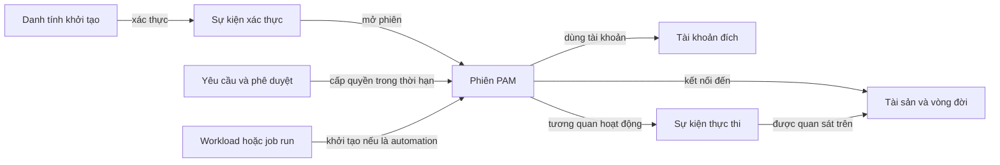

# User và asset correlation

## 1. Từ một câu lệnh đến người thực hiện và tài sản bị tác động

Trong Command analytics của hệ thống Privileged Access Management (PAM), một câu lệnh chỉ có ý nghĩa điều tra khi được đặt vào đúng bối cảnh: ai khởi tạo hành động, dùng danh tính đặc quyền nào, đi qua phiên nào và tác động lên tài sản nào tại thời điểm đó.

Giả sử nhật ký trên máy đích ghi:

```text
2026-04-18T02:15:30Z  user=root  host=db-primary  action=service-restart
```

Bản ghi này mô tả một hoạt động dưới tài khoản `root`, nhưng chưa đủ để kết luận một người cụ thể đã thực hiện. `root` có thể được sử dụng bởi quản trị viên qua PAM, tác vụ tự động hoặc một phiên truy cập ngoài PAM. Tên `db-primary` cũng có thể đã được tái sử dụng sau khi máy cũ bị thay thế.

**User correlation** liên kết các danh tính và phiên để xác định chủ thể đứng sau hoạt động. **Asset correlation** liên kết các định danh và ngữ cảnh tài sản để xác định đối tượng thực sự chịu tác động. Hai quá trình này cần cùng trục thời gian và cùng phạm vi tổ chức.

Kết quả mong muốn không chỉ là “lệnh này do root chạy trên db-primary”, mà có dạng:

> Hoạt động thuộc phiên PAM `PS-481`, do danh tính `U-142` khởi tạo sau khi xác thực, sử dụng tài khoản đích `TA-009` trên tài sản `A-702`. Liên kết người–phiên và phiên–tài sản được xác nhận bằng định danh phiên và kết nối; bản ghi thực thi trên máy đích hỗ trợ việc đối chiếu. Quyền truy cập có hiệu lực trong khoảng thời gian tương ứng.

Ở tình huống thiếu bằng chứng, kết luận đúng có thể là:

> Có hai phiên phù hợp với bản ghi. Chưa đủ dữ liệu để quy hoạt động cho một người duy nhất.

Giữ nguyên sự mơ hồ có căn cứ tốt hơn việc tạo ra một kết luận trông chắc chắn nhưng không thể kiểm chứng.

## 2. Phân biệt các vai trò danh tính

Một chuỗi truy cập đặc quyền thường có nhiều danh tính. Không nên gộp chúng thành một trường `username`.

| Thành phần | Ý nghĩa | Ví dụ |
| --- | --- | --- |
| Người hoặc chủ thể khởi tạo | Chủ thể bắt đầu yêu cầu hoặc phiên | Nhân viên với `user_id=U-142` |
| Danh tính xác thực | Tài khoản được nhà cung cấp danh tính xác nhận | `issuer=corp-idp`, `subject=S-882` |
| Tài khoản PAM | Danh tính tại nền tảng môi giới truy cập | `pam_user_id=PU-204` |
| Tài khoản đích | Tài khoản được dùng để đăng nhập tài sản | `root`, `administrator`, `db_ops` |
| Danh tính thực thi | Danh tính thực tế tại điểm hành động xảy ra | `root` sau nâng quyền từ `ops` |
| Chủ thể tự động | Workload hoặc tác vụ khởi phát hành động | Pipeline `deploy-prod`, run `RUN-82` |
| Chủ sở hữu nghiệp vụ | Người hoặc nhóm chịu trách nhiệm quản lý | Nhóm Database Platform |

Chủ sở hữu một service account không mặc nhiên là người thực hiện mọi hoạt động của tài khoản đó. Tương tự, người phê duyệt yêu cầu không phải là người thao tác trong phiên.

Trong một phiên Linux, người dùng có thể đăng nhập bằng `ops`, sau đó nâng quyền để thực thi dưới `root`. Correlation cần giữ được cả tài khoản đăng nhập và tài khoản thực thi, đồng thời giữ liên kết về danh tính ban đầu nếu có bằng chứng. Việc chỉ lưu `effective_user=root` sẽ làm mất phần lớn khả năng quy trách nhiệm.

Với automation, nên biểu diễn chuỗi riêng:

```text
người kích hoạt hoặc lịch chạy
  → pipeline/job và lần chạy cụ thể
  → workload identity
  → tài khoản đặc quyền
  → tài sản đích
  → hoạt động
```

Nếu tác vụ chạy theo lịch và không có người kích hoạt trực tiếp, hãy ghi nhận điều đó. Không thay một chủ thể tự động bằng tên của người sở hữu repository chỉ để làm đầy trường dữ liệu.

## 3. Asset không chỉ là hostname hoặc địa chỉ IP

Một tài sản cần được nhận diện trong đúng không gian định danh và vòng đời. Các tên dễ đọc như `db-primary` rất hữu ích cho hiển thị, nhưng thường không đủ làm khóa liên kết.

Những thay đổi phổ biến gồm:

- Một IP được cấp lại cho máy khác.
- Máy ảo bị hủy rồi tạo lại với cùng hostname.
- Cùng tên máy tồn tại ở production và staging.
- Một cơ sở dữ liệu được truy cập qua endpoint logic, còn node xử lý thay đổi.
- Container hoặc pod được thay thế trong khi tên dịch vụ vẫn giữ nguyên.
- Một cluster, namespace và tài khoản cục bộ có tên giống nhau ở nhiều môi trường.

Nên tách ít nhất ba khái niệm:

| Khái niệm | Ví dụ | Vai trò |
| --- | --- | --- |
| Định danh tài sản | `asset_id=A-702`, kèm phạm vi nguồn | Liên kết ổn định trong hệ thống quản lý |
| Định danh phiên bản tồn tại | `asset_incarnation=I-03` | Phân biệt các lần tạo lại của tài sản |
| Alias theo thời gian | IP, hostname, DNS, endpoint | Tra cứu và hiển thị tại thời điểm sự kiện |

Một định danh do nhà cung cấp hoặc hệ thống quản lý phát hành cũng cần phạm vi. Ví dụ, khóa tài sản cloud có thể phải chứa tài khoản hoặc subscription, loại tài nguyên và định danh tài nguyên. Không giả định mọi ID từ mọi nguồn đều duy nhất toàn cục.

Với endpoint logic, có thể lưu hai mức đích:

```text
logical_target = database-service/orders-prod
observed_target = database-node/A-702/I-03
```

Nếu chỉ quan sát được endpoint dịch vụ, chưa có bằng chứng về node phía sau, hãy giữ `observed_target` chưa xác định. Không tự chọn node đang active ở thời điểm điều tra để gán cho một hoạt động trong quá khứ.

## 4. Mô hình liên kết: các cạnh có bằng chứng và thời hạn

Có thể hình dung correlation như một đồ thị. Mỗi cạnh cần nêu nguồn, khoảng hiệu lực và mức xác nhận.



Đồ thị này là mô hình dữ liệu, không phải lời khẳng định rằng nguồn nào cũng cung cấp đầy đủ mọi cạnh.

Ví dụ, bản ghi mở phiên có thể xác nhận `U-142 → PS-481`; bản ghi proxy xác nhận `PS-481 → A-702`; audit trên máy đích xác nhận một sự kiện thực thi thuộc kết nối tương ứng. Từng cạnh có độ chắc chắn khác nhau.

Một liên kết dựa trên số hiệu phiên được truyền xuyên suốt có thể mạnh hơn liên kết chỉ dựa trên IP và gần nhau về thời gian. Tuy nhiên, ngay cả số hiệu phiên cũng cần được kiểm tra phạm vi, khả năng tái sử dụng và nguồn phát hành. Chuỗi ID trùng nhau từ hai hệ thống độc lập không tự tạo thành một quan hệ.

Một bản ghi quan hệ tối thiểu có thể gồm:

```yaml
relation_type: pam_session_to_target
left_id: pam-prod/PS-481
right_id: inventory-prod/A-702/I-03
valid_from: "2026-04-18T02:10:00Z"
valid_to: "2026-04-18T02:25:00Z"
source: pam-proxy-prod
evidence_event_ids:
  - PROXY-E-301
decision: confirmed
reason: connection_id_and_target_binding
```

Các ID và dữ liệu trong bài đều là dữ liệu giả lập. Không đưa credential, token truy cập hoặc nội dung bí mật vào mô hình quan hệ.

## 5. Nguồn dữ liệu và điều mỗi nguồn thực sự chứng minh

Các nguồn thường được đối chiếu gồm nhà cung cấp danh tính, PAM, vault, điểm thực thi, inventory và hệ thống yêu cầu truy cập. Mỗi nguồn trả lời một phần câu hỏi.

| Nguồn | Có thể hỗ trợ xác nhận | Không tự chứng minh |
| --- | --- | --- |
| Nhật ký xác thực | Một danh tính hoàn thành bước xác thực theo cơ chế đã ghi | Danh tính đó thực hiện mọi lệnh xuất hiện sau đó |
| PAM session hoặc proxy | Người mở phiên, đường kết nối, tài khoản và đích đã ghi | Mọi tiến trình con đều được quan sát đầy đủ |
| Vault hoặc cơ chế cấp credential | Chủ thể nhận hoặc được cấp quyền sử dụng credential | Chủ thể chắc chắn đã dùng credential để chạy một lệnh cụ thể |
| Audit trên máy hoặc dịch vụ đích | Hoạt động được quan sát tại điểm thực thi | Người thật nếu chỉ có tài khoản dùng chung |
| Inventory hoặc CMDB | Quan hệ tài sản, alias và chủ sở hữu được quản lý | Lịch sử chính xác nếu chỉ lưu trạng thái mới nhất |
| Ticket, JIT/JEA, phê duyệt | Phạm vi và thời hạn quyền được chấp thuận | Hoạt động thực tế nằm trong phạm vi được phép |

Sự kiện checkout secret là bằng chứng về việc cấp hoặc nhận secret, không phải bằng chứng trực tiếp về việc thực thi. Một phiên được phê duyệt cũng không làm mọi hành động trong phiên trở thành hợp lệ.

Nên tách ba câu hỏi trong phân tích:

1. **Attribution:** Có thể liên kết hành động với chủ thể nào?
2. **Authorization context:** Tại thời điểm đó, quyền nào có hiệu lực và cho mục đích gì?
3. **Behavior assessment:** Hoạt động có phù hợp với quyền, mục đích và chuẩn hành vi không?

Nếu gộp cả ba, hệ thống có thể bỏ qua hành động bất thường chỉ vì tìm thấy một ticket hợp lệ.

## 6. Chuẩn hóa sự kiện trước khi nối dữ liệu

Trước khi correlation, cần thống nhất cách biểu diễn các trường nhưng vẫn bảo toàn dữ liệu gốc phù hợp với chính sách lưu trữ.

Một cấu trúc minh họa:

```yaml
event_id: TARGET-E-908
event_type: privileged_operation
source: target-audit-prod
source_event_id: AUD-33081

event_time: "2026-04-18T02:15:30Z"
ingest_time: "2026-04-18T02:15:36Z"
clock_quality: synchronized

tenant_id: org-lab
environment: production
actor_subject_id: null
pam_session_id: PS-481
connection_id: CONN-221
target_account_id: TA-009
effective_account: root

asset_id: A-702
asset_incarnation: I-03
observed_hostname: db-primary
observed_address: 192.0.2.20

operation_category: service_restart
operation_result: success
raw_evidence_ref: evidence/TARGET-E-908
```

Một số nguyên tắc chuẩn hóa quan trọng:

- Giữ `event_time` và `ingest_time` riêng. Thời điểm nhận log không thay thế thời điểm hành động.
- Ghi timezone hoặc chuẩn hóa về UTC; giữ thông tin độ chính xác và chất lượng đồng hồ nếu có.
- Phân biệt trường nguồn quan sát với trường được suy ra. Ví dụ, `observed_hostname` không nên bị ghi đè bởi hostname hiện tại trong CMDB.
- Không ép chữ thường mọi username một cách máy móc. Quy tắc phân biệt hoa/thường phụ thuộc hệ thống danh tính và đích.
- Không nối bằng tên hiển thị khi đã có định danh bất biến được xác minh.
- Namespace các ID theo tổ chức và hệ thống nguồn để tránh trùng.
- Phân biệt không có dữ liệu, không áp dụng và dữ liệu mâu thuẫn; không biến tất cả thành một giá trị `unknown` khó diễn giải.

Các trường minh họa không bắt buộc phải có trong mọi sản phẩm PAM. Việc không có `pam_session_id` trên máy đích là tình huống cần xử lý bằng quan hệ bổ sung, không phải lý do tự điền một ID gần nhất.

## 7. Xây dựng liên kết người dùng theo thời gian

### 7.1. Dùng khóa có phạm vi

Một khóa danh tính có thể là cặp `issuer + subject` từ hệ thống xác thực hoặc một ID nhân sự được quản lý theo hợp đồng rõ ràng. Email và tên đăng nhập vẫn nên được lưu làm alias, nhưng không mặc định chúng là danh tính vĩnh viễn.

Ví dụ:

```text
corp-idp / S-882
  → identity-registry / U-142
  → pam-prod / PU-204
```

Mỗi quan hệ phải được hình thành từ nguồn có thẩm quyền hoặc bằng chứng đã xác minh. Không liên kết hai tài khoản chỉ vì cùng phần tên trước dấu `@`.

### 7.2. Lưu lịch sử alias và trạng thái

Giả sử một nhân viên đổi tên đăng nhập từ `an.ops` sang `an.platform`. Một sự kiện cũ vẫn phải được giải theo alias có hiệu lực tại thời điểm đó. Nếu `an.ops` được cấp lại cho người khác, việc dùng danh bạ hiện tại để nối log cũ có thể gán nhầm trách nhiệm.

Một bảng quan hệ có thể chứa:

```text
identity_id | alias_namespace | alias_value | valid_from | valid_to
U-142       | corp-login      | an.ops      | T1         | T2
U-142       | corp-login      | an.platform | T2         | chưa kết thúc
U-391       | corp-login      | an.ops      | T3         | chưa kết thúc
```

Khoảng hiệu lực nên dùng quy ước rõ ràng, chẳng hạn `[valid_from, valid_to)`: bao gồm thời điểm bắt đầu, không bao gồm thời điểm kết thúc. Quy ước này tránh hai quan hệ cùng nhận một sự kiện đúng tại ranh giới chuyển giao.

### 7.3. Không suy người thật từ tài khoản dùng chung

Nếu hai người có thể dùng `root`, trường `root` không phân biệt được họ. Cần bằng chứng bổ sung như phiên PAM, kết nối, cơ chế nâng quyền hoặc audit riêng của hệ thống đích.

Khi credential đã được checkout để sử dụng ngoài proxy, khả năng quan sát có thể giảm. Hệ thống cần thể hiện giới hạn này trong kết quả attribution. Việc một người nhận secret sớm hơn không loại trừ người khác đang giữ bản sao hoặc một workload đã có quyền sử dụng.

### 7.4. Giữ chuỗi ủy quyền

Một người khởi tạo job có thể không trực tiếp thực thi thao tác đích. Nên giữ quan hệ `initiated_by`, `executed_by`, `approved_by` và `owned_by` riêng. Điều này vừa hỗ trợ điều tra, vừa tránh quy một hoạt động tự động thành thao tác thủ công.

## 8. Xây dựng liên kết tài sản theo thời gian

Asset correlation thường bắt đầu từ một trong các khóa: target ID của PAM, ID tài nguyên của nền tảng, agent ID, địa chỉ mạng hoặc hostname.

Quy trình hợp lý gồm:

1. Xác định phạm vi nguồn và môi trường của sự kiện.
2. Ưu tiên ID tài sản hoặc target mapping được xác minh.
3. Tra vòng đời tài sản có hiệu lực tại `event_time`.
4. Nếu chỉ có alias, tra lịch sử alias trong đúng phạm vi.
5. Giữ mọi ứng viên khi có nhiều kết quả hợp lệ.
6. Lưu phương pháp và bằng chứng đã dùng để phân giải.

Ví dụ IP được cấp lại:

| Khoảng thời gian | IP | Tài sản |
| --- | --- | --- |
| 01:00–02:00 | `192.0.2.20` | `A-701/I-01` |
| 02:05–03:00 | `192.0.2.20` | `A-702/I-03` |

Một sự kiện lúc 01:40 không thuộc `A-702` chỉ vì inventory hiện tại cho biết IP đang gắn với tài sản đó. Sự kiện lúc 02:03 nằm trong khoảng chưa có ánh xạ được xác nhận; hệ thống nên trả về chưa phân giải được.

Không tự nối hai khoảng hiệu lực để lấp khoảng trống. Khoảng trống có thể phản ánh độ trễ cập nhật, tài sản chưa được quản lý hoặc một giai đoạn thực sự không có chủ thể sở hữu IP.

Với NAT hoặc bastion, địa chỉ nguồn mà máy đích thấy có thể là địa chỉ của lớp trung gian. Cần giữ chuỗi kết nối hoặc bản ghi ánh xạ tương ứng. Nhiều người dùng đi qua cùng bastion không trở thành cùng một chủ thể.

## 9. Correlation dựa trên phiên và sự kiện thực thi

Một pipeline correlation nên đi từ bằng chứng cụ thể đến các quan hệ yếu hơn, thay vì bắt đầu bằng phép nối rộng theo thời gian.

### 9.1. Thứ tự xử lý minh họa

```text
nhận sự kiện
  → chuẩn hóa và kiểm tra phạm vi
  → loại bản sao theo khóa nguồn phù hợp
  → tìm liên kết trực tiếp bằng session/connection ID
  → kiểm tra tài khoản, tài sản, vòng đời và thời gian
  → nếu thiếu: tạo tập ứng viên bằng các thuộc tính bổ sung
  → đánh giá mâu thuẫn và độ đầy đủ
  → xuất kết quả cùng bằng chứng
```

Một liên kết trực tiếp cũng cần kiểm tra tính hợp lý. Ví dụ, cùng `session_id` nhưng tenant khác hoặc thời điểm nằm ngoài vòng đời phiên là dấu hiệu xung đột, không nên được bỏ qua vì ID trùng.

### 9.2. Cửa sổ thời gian không phải bằng chứng duy nhất

Cửa sổ thời gian giúp giới hạn ứng viên khi log có sai lệch đồng hồ hoặc độ trễ. Nó không tự xác nhận quan hệ.

Nếu phiên A và B cùng dùng tài khoản `root` trên một máy, cả hai đang mở lúc 02:15, thì phép nối theo `host + account + time` sẽ tạo hai ứng viên. Chọn phiên có thời điểm bắt đầu gần nhất là một quy tắc suy đoán, không phải chứng cứ xác định.

Cần cấu hình dung sai dựa trên đặc tính nguồn, quan sát chất lượng đồng hồ và loại sự kiện. Không dùng một cửa sổ lớn chung cho mọi hệ thống rồi coi tất cả kết quả bên trong là chính xác.

### 9.3. Thời điểm đóng phiên và tác vụ nền

Khoảng mở phiên hữu ích để giới hạn hoạt động tương tác, nhưng không bao phủ mọi tác vụ được khởi phát từ phiên. Một tiến trình hoặc job có thể tiếp tục sau khi người dùng thoát.

Muốn liên kết một hoạt động sau phiên với phiên ban đầu, cần chuỗi bằng chứng về process, job hoặc transaction phù hợp. Không tự kéo dài phiên vô hạn, cũng không tự gán mọi hoạt động về tài khoản đó cho phiên vừa đóng.

### 9.4. Chống nối dữ liệu làm tăng giả số lượng hoạt động

Một sự kiện kết hợp với hai alias và ba bản ghi session có thể tạo sáu dòng sau phép nối. Đó không có nghĩa đã xảy ra sáu hành động.

Kết quả nên giữ `event_id` duy nhất và một tập ứng viên riêng. Các chỉ số hành vi phải đếm sự kiện nguồn hoặc sự kiện chuẩn hóa theo hợp đồng, không đếm trực tiếp số dòng trung gian của phép join.

## 10. Ví dụ điều tra xuyên ba nguồn

Xét dữ liệu giả lập sau:

```text
IdP:
AUTH-17 | 02:09:50 | issuer=corp-idp | subject=S-882 | success

PAM:
OPEN-41 | 02:10:00 | user=U-142 | auth=AUTH-17 | session=PS-481
BIND-42 | 02:10:01 | session=PS-481 | connection=CONN-221
        | account=TA-009 | asset=A-702 | incarnation=I-03

Target audit:
EXEC-91 | 02:15:30 | connection=CONN-221 | effective_user=root
        | operation=service_restart | result=success
```

Nếu nguồn và phạm vi các ID đã được xác minh, chuỗi liên kết là:

```text
S-882 → U-142 → PS-481 → CONN-221 → EXEC-91
                         └────────→ A-702 / I-03
```

Kết luận có căn cứ:

- `EXEC-91` được quan sát trong kết nối đã gắn với `PS-481`.
- Phiên được mở bởi `U-142` dựa trên sự kiện xác thực `AUTH-17`.
- Kết nối được gắn với tài khoản `TA-009` và tài sản `A-702/I-03`.
- Tài khoản thực thi được điểm đích quan sát là `root`.

Kết luận này chưa trả lời việc restart có đúng mục đích được phê duyệt hay không. Muốn đánh giá, cần đối chiếu request, phạm vi JIT/JEA và điều kiện công việc riêng.

Bây giờ bỏ trường `connection` khỏi audit, đồng thời có thêm phiên `PS-482` dùng cùng `root` trên cùng máy trong thời gian đó. Khi ấy:

```yaml
event_id: EXEC-91
attribution_state: ambiguous
candidate_sessions:
  - PS-481
  - PS-482
reason: overlapping_sessions_without_execution_binding
```

Không được giữ kết luận “U-142 thực hiện” chỉ vì phiên của người này xuất hiện trước trong dữ liệu.

## 11. Thuật toán minh họa: ưu tiên bằng chứng, giữ mâu thuẫn

Pseudocode dưới đây mô tả cách ra quyết định, không phải cấu hình của một sản phẩm cụ thể.

```text
function correlate(event):
    if invalid_scope_or_timestamp(event):
        return unresolved("invalid_or_incomplete_context")

    direct_links = find_verified_execution_bindings(event)

    if has_conflicting_direct_links(direct_links):
        return conflicted(direct_links, "inconsistent_execution_binding")

    if direct_links has one compatible result:
        return confirmed(
            result=direct_links[0],
            evidence=direct_links[0].evidence,
            method="verified_execution_binding"
        )

    candidates = find_candidates(
        tenant=event.tenant,
        environment=event.environment,
        account=event.target_account,
        asset_at_event_time=resolve_asset(event),
        time_constraints=source_specific_time_constraints(event)
    )

    candidates = retain_compatible_candidates_and_reasons(candidates)

    if candidates is empty:
        return unresolved("no_supported_candidate")

    if candidates has more than one result:
        return ambiguous(candidates, "multiple_supported_candidates")

    return inferred(
        result=candidates[0],
        evidence=candidates[0].evidence,
        method="contextual_match",
        limitations="no_direct_execution_binding"
    )
```

Một ứng viên duy nhất không nhất thiết là một quan hệ được xác nhận. Có thể dữ liệu của các ứng viên khác đang bị thiếu. Vì vậy, thuật toán phân biệt `confirmed` với `inferred`.

Cũng không nên âm thầm bỏ một liên kết trực tiếp bị xung đột để chuyển xuống phương pháp suy luận yếu hơn rồi báo thành công. Xung đột là một thông tin cần điều tra.

## 12. Biểu diễn kết quả để người điều tra có thể kiểm chứng

Một kết quả correlation tốt giữ được đường đi từ kết luận về nguồn.

```yaml
event_id: EXEC-91
correlation_state: confirmed
actor:
  identity_id: U-142
  authentication_event_id: AUTH-17
execution:
  pam_session_id: PS-481
  connection_id: CONN-221
  target_account_id: TA-009
  effective_account: root
target:
  asset_id: A-702
  asset_incarnation: I-03
method: verified_execution_binding
evidence_event_ids:
  - AUTH-17
  - OPEN-41
  - BIND-42
  - EXEC-91
limitations:
  - Authorization and business purpose require separate evaluation.
correlation_rule_version: lab-rule-3
evaluated_at: "2026-04-18T02:16:00Z"
```

Có thể dùng các trạng thái như:

| Trạng thái | Ý nghĩa |
| --- | --- |
| `confirmed` | Có chuỗi liên kết đáp ứng tiêu chí xác nhận đã công bố |
| `inferred` | Có ứng viên phù hợp nhưng thiếu bằng chứng xác định |
| `ambiguous` | Nhiều ứng viên còn hợp lệ |
| `unresolved` | Chưa đủ dữ liệu để tạo liên kết có căn cứ |
| `conflicted` | Các nguồn hoặc định danh tạo ra kết luận mâu thuẫn |

Các trạng thái này là thiết kế minh họa, cần định nghĩa rõ khi triển khai. Không có một thang điểm confidence chung áp dụng đúng cho mọi hệ thống.

Nếu sử dụng điểm số nội bộ, cần công bố các đặc trưng, hiệu chỉnh bằng tình huống đã xác minh và giữ các điều kiện chặn như sai tenant hoặc sai vòng đời. Không để điểm cộng từ nhiều tín hiệu yếu che lấp một mâu thuẫn mạnh.

Kết quả cũng phải thể hiện mức xác nhận theo từng cạnh. Có thể asset được xác định chắc chắn nhưng actor vẫn mơ hồ; một nhãn tổng duy nhất dễ che mất sự khác biệt đó.

## 13. Từ correlation đến phát hiện rủi ro trong PAM

Correlation giúp biến cảnh báo rời rạc thành một câu chuyện có thể điều tra. Một số câu hỏi có giá trị:

- Người nào thực hiện thao tác đặc quyền ngoài khoảng JIT được cấp?
- Một chủ thể có đang truy cập đồng thời các tài sản nhạy cảm vượt phạm vi công việc?
- Tài khoản dịch vụ có hoạt động tương tác trong khi thiết kế chỉ cho phép automation?
- Một sự kiện trên tài sản nhạy cảm có bằng chứng thực thi nhưng thiếu liên kết với phiên PAM?
- Một phiên được cấp quyền hạn chế có xuất hiện hoạt động dưới danh tính thực thi mạnh hơn phạm vi cho phép?
- Có hoạt động tiếp diễn sau thu hồi quyền cần truy vết qua job hoặc tiến trình không?

Cần diễn giải cẩn thận trường hợp “không tìm thấy phiên PAM”. Điều này có thể là truy cập ngoài kiểm soát, nhưng cũng có thể do thiếu nguồn log, mất sự kiện hoặc sai lệch thời gian. Correlation phải đưa thông tin chất lượng dữ liệu vào cảnh báo.

Ví dụ:

```text
Phát hiện:
Hoạt động đặc quyền trên A-702 chưa liên kết được với phiên PAM.

Bối cảnh:
Audit đích hoạt động bình thường.
Nguồn PAM chậm 18 phút theo telemetry của pipeline.

Trạng thái:
Chờ đối soát nguồn PAM; chưa kết luận truy cập bypass.
```

Với hành động phản ứng tự động như chấm dứt phiên hoặc thu hồi quyền, cần chính sách riêng về độ tin cậy, mức ảnh hưởng và xử lý ngoại lệ. Một liên kết chỉ dựa trên IP dùng chung không đủ căn cứ để quy trách nhiệm chắc chắn cho một người.

## 14. Sự kiện đến muộn, inventory sửa lại và khả năng tái lập

Correlation không kết thúc ngay khi log đầu tiên đến. Nhật ký xác thực, proxy, inventory và audit đích có thể đến không cùng lúc.

Nên phân biệt:

- **Thời gian hiệu lực:** Quan hệ đúng trong thế giới vận hành vào lúc nào.
- **Thời gian ghi nhận:** Hệ thống phân tích biết về quan hệ đó vào lúc nào.

Ví dụ, ngày hôm sau inventory xác nhận IP đã chuyển từ `A-701` sang `A-702` lúc 02:05. Kết quả ban đầu có thể được đối soát lại, nhưng cần giữ dấu vết rằng kết luận đã thay đổi do bằng chứng mới.

Một bản ghi cập nhật nên cho phép trả lời:

```text
Kết quả cũ: unresolved
Kết quả mới: inferred → A-702/I-03
Lý do: bổ sung lịch sử IP từ nguồn inventory
Bằng chứng mới: INV-221
Phiên bản quy tắc: lab-rule-3
Thời điểm đánh giá lại: 2026-04-19T01:00:00Z
```

Không sửa âm thầm kết luận đã dùng trong điều tra. Giữ phiên bản hoặc lịch sử thay đổi phù hợp với cơ chế lưu trữ, để có thể tái lập kết quả tại thời điểm báo cáo.

Cơ chế xử lý sự kiện đến muộn cần có giới hạn và trách nhiệm rõ ràng. Khi dữ liệu vượt thời hạn đối soát thông thường, có thể đưa vào luồng điều tra hoặc chạy đối soát lịch sử được kiểm soát thay vì làm thay đổi vô hạn mọi cảnh báo cũ.

## 15. Chất lượng dữ liệu và quyền riêng tư

### 15.1. Đo khả năng phân giải, không chỉ số lượng cảnh báo

Các chỉ số hữu ích gồm tỷ lệ sự kiện có asset xác định, tỷ lệ có actor xác định, số trường hợp mơ hồ, tỷ lệ mâu thuẫn và độ trễ đến của từng nguồn.

Mẫu số phải rõ. Ví dụ:

```text
Tỷ lệ actor confirmed =
  số sự kiện trong phạm vi có actor confirmed
  / tổng số sự kiện đặc quyền trong phạm vi đủ điều kiện đánh giá
```

Báo riêng số sự kiện bị loại vì thiếu dữ liệu. Nếu chỉ đo trên tập đã phân giải thành công, tỷ lệ cao có thể che lấp phần log chưa được xử lý.

Cần theo dõi theo tài sản, môi trường và nguồn. Một tỷ lệ tổng đẹp không thể hiện việc nhóm cơ sở dữ liệu quan trọng đang thiếu hoàn toàn session binding.

### 15.2. Không thu thập bí mật để làm giàu correlation

Các trường cần thiết thường là ID, thời gian, quan hệ phiên, tài khoản và asset. Không cần đưa mật khẩu, token, private key hoặc toàn bộ đầu ra lệnh vào bảng liên kết.

Nếu nội dung lệnh có thể chứa bí mật hoặc dữ liệu cá nhân, cần áp dụng chính sách che thông tin và hạn chế truy cập tại nguồn hoặc trước khi đưa vào hệ thống phân tích. Giữ tham chiếu đến bằng chứng được kiểm soát thay vì nhân bản dữ liệu nhạy cảm vào nhiều chỉ mục.

Việc che thông tin phải được ghi nhận để người điều tra hiểu giới hạn. Không gọi một bản sao đã biến đổi là bằng chứng nguyên vẹn nếu không có mô tả về cách biến đổi.

### 15.3. Kiểm soát chính dữ liệu correlation

Đồ thị người–tài khoản–tài sản có thể tiết lộ cấu trúc quyền đặc biệt và thói quen quản trị. Nên giới hạn truy cập theo nhiệm vụ, ghi audit việc tra cứu, bảo vệ tính toàn vẹn và áp dụng thời hạn lưu phù hợp.

Bảo vệ log và lịch sử mapping là một phần của PAM: nếu người tấn công có thể sửa quan hệ danh tính hoặc asset, họ có thể làm sai kết luận dù log lệnh vẫn tồn tại.

## 16. Thực hành bằng dữ liệu giả lập

Không cần chạy lệnh đặc quyền trên hệ thống thật để thực hành bài này. Có thể xây dựng bảng dữ liệu hoặc pseudocode với các bản ghi giả lập.

### 16.1. Bộ dữ liệu đầu vào

Tạo các tập logic sau trong bài thực hành:

```text
identity_alias:
  U-142 ↔ corp-idp/S-882
  U-391 ↔ corp-idp/S-990

pam_sessions:
  PS-481 | U-142 | TA-009 | A-702/I-03 | 02:10–02:25 | CONN-221
  PS-482 | U-391 | TA-009 | A-702/I-03 | 02:12–02:22 | CONN-222

asset_alias:
  org-lab/prod/192.0.2.20 → A-701/I-01 | 01:00–02:00
  org-lab/prod/192.0.2.20 → A-702/I-03 | 02:05–03:00

target_events:
  E1 | 02:15 | CONN-221 | TA-009 | A-702/I-03
  E2 | 02:16 | không có | TA-009 | 192.0.2.20
  E3 | 01:40 | không có | TA-009 | 192.0.2.20
  E4 | 02:03 | không có | TA-009 | 192.0.2.20
```

Các khoảng thời gian thuộc cùng ngày và cùng timezone UTC; áp dụng quy ước khoảng nửa mở đã nêu.

### 16.2. Kết quả cần đạt

| Sự kiện | Kết quả tài sản | Kết quả chủ thể | Giải thích |
| --- | --- | --- | --- |
| E1 | `A-702/I-03` | `U-142`, confirmed nếu binding được xác minh | Có kết nối cụ thể liên kết về phiên |
| E2 | `A-702/I-03` | ambiguous giữa hai phiên | Cùng tài khoản, cùng đích, phiên chồng thời gian |
| E3 | `A-701/I-01` | unresolved | IP lịch sử xác định asset, chưa có bằng chứng actor |
| E4 | unresolved | unresolved | Nằm trong khoảng trống của lịch sử IP |

Không được gán `E3` cho tài sản hiện tại, và không được gán `E2` cho người có phiên mở gần nhất.

### 16.3. Thử các tình huống biên

Bổ sung lần lượt các biến thể:

1. Hai tenant có cùng `PS-481`: phải tách phạm vi, không nối xuyên tenant.
2. Một event đến muộn: dùng thời điểm xảy ra để tra alias, giữ thời điểm nhận riêng.
3. Hostname được tái sử dụng: phải phân biệt vòng đời tài sản.
4. Người dùng đổi alias: log cũ vẫn quy về danh tính lịch sử đúng.
5. Một event bị gửi lại: không đếm thành hoạt động mới.
6. ID phiên trùng nhưng asset mâu thuẫn: đánh dấu conflicted hoặc lỗi nguồn theo hợp đồng.
7. Job tiếp tục sau đóng phiên: chỉ liên kết về phiên nếu có chuỗi bằng chứng job/process.
8. Nguồn PAM tạm mất: báo thiếu dữ liệu, không tự kết luận bypass.

Đầu ra của mỗi biến thể cần có tập ứng viên, lý do chọn hoặc không chọn, tham chiếu bằng chứng và giới hạn kết luận. Chỉ một cột `confidence=high` không đủ để kiểm tra cách hệ thống ra quyết định.

## 17. Những lỗi thiết kế cần tránh

| Lỗi | Hậu quả | Cách xử lý |
| --- | --- | --- |
| Dùng email hoặc hostname hiện tại để giải log quá khứ | Gán nhầm người hoặc tài sản | Dùng định danh có phạm vi và lịch sử alias |
| Đồng nhất `root` với người mở phiên | Mất chuỗi nâng quyền và tài khoản dùng chung | Tách actor, tài khoản đích và danh tính thực thi |
| Xem checkout secret là bằng chứng thực thi | Quy trách nhiệm vượt quá chứng cứ | Giữ checkout như một quan hệ cấp quyền hoặc cấp secret |
| Nối theo IP và thời gian rồi chọn kết quả đầu | Tạo attribution sai khi phiên chồng nhau | Giữ tập ứng viên và yêu cầu bằng chứng bổ sung |
| Gộp log nhận trễ theo ingest time | Liên kết nhầm phiên và alias | Dùng event time với thông tin đồng hồ |
| Đếm dòng sau join | Phóng đại số thao tác | Đếm event ID theo quy tắc chống trùng |
| Chỉ giữ kết luận cuối | Không tái lập được điều tra | Lưu phương pháp, nguồn, phiên bản và lịch sử thay đổi |
| Đưa nguyên lệnh chứa secret vào mọi bảng | Mở rộng phạm vi lộ dữ liệu | Tối thiểu hóa dữ liệu và kiểm soát bằng chứng |

Một hệ thống correlation có ích không phải là hệ thống luôn tìm ra một người. Đó là hệ thống phân biệt được điều đã được chứng minh, điều đang được suy luận và điều cần thêm bằng chứng.

## 18. Tự kiểm tra mức hiểu

Sau bài học, hãy tự giải thích các điểm sau bằng ví dụ:

- Vì sao một câu lệnh chạy dưới `root` chưa xác định được người thực hiện?
- Khi nào một asset ID cần đi kèm phạm vi và phiên bản vòng đời?
- Tại sao phê duyệt JIT không chứng minh một thao tác cụ thể đã được thực hiện đúng mục đích?
- Vì sao một ứng viên duy nhất vẫn có thể chỉ là inferred?
- Khi IP được cấp lại, cần dùng thời điểm nào để tra lịch sử?
- Hai phiên chồng nhau trên cùng tài khoản phải được biểu diễn thế nào nếu thiếu execution binding?
- Cần giữ những thông tin nào để giải thích một kết luận đã thay đổi sau khi log đến muộn?

Trong PAM, user và asset correlation nối hành động đặc quyền với chuỗi danh tính, phiên, tài khoản và tài sản có hiệu lực tại thời điểm xảy ra. Giá trị của nó nằm ở khả năng cung cấp một kết luận có nguồn chứng minh và giới hạn rõ ràng, giúp điều tra hành vi, đánh giá least privilege, đối soát JIT/JEA và lưu bằng chứng có thể kiểm tra lại.
