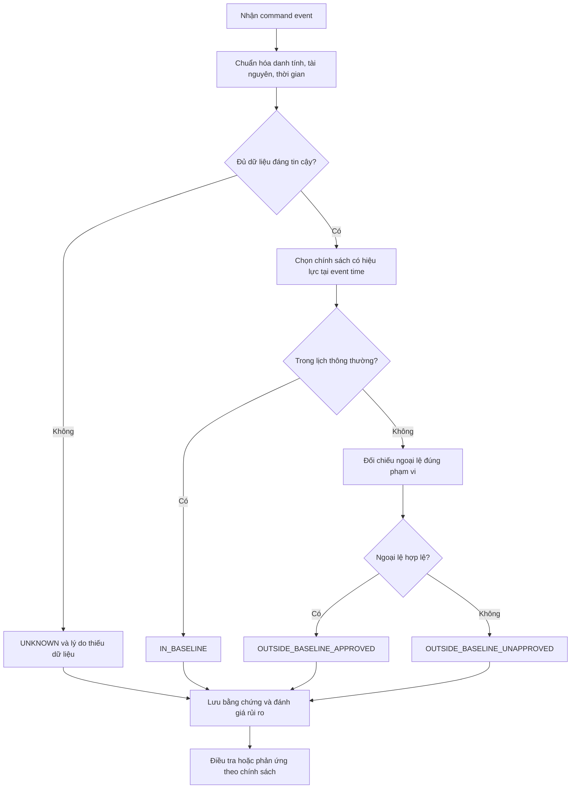

# Phát hiện command ngoài giờ

## 1. Mục tiêu và phạm vi trong PAM

Trong quản lý truy cập đặc quyền (Privileged Access Management — PAM), một command có thể hoàn toàn quen thuộc nhưng vẫn cần được xem xét nếu xuất hiện vào thời điểm không phù hợp. Ví dụ, thao tác kiểm tra trạng thái dịch vụ lúc 09:00 của ca làm việc khác với cùng thao tác lúc 02:00 từ một phiên quản trị không có lịch trực hoặc phiếu thay đổi tương ứng.

Phát hiện command ngoài giờ là đối chiếu thời điểm command thực thi với lịch hoạt động đã được xác định cho đúng danh tính, tài nguyên và loại công việc. Kết quả tạo ra một tín hiệu để điều tra hoặc áp dụng chính sách. Nó không tự chứng minh command độc hại, người dùng vi phạm hay tài khoản đã bị chiếm quyền.

Bài học đặt tín hiệu thời gian trong bối cảnh PAM: danh tính cá nhân và tài khoản dịch vụ, quyền tối thiểu, quyền cấp đúng lúc (JIT), phạm vi thao tác được phép (JEA), phiên đặc quyền và bằng chứng kiểm toán. Mục tiêu là xác định command nào thực sự xảy ra ngoài phạm vi thời gian được phép, xử lý được lịch vận hành thực tế và giữ đủ ngữ cảnh để người trực ra quyết định.

Sau bài học, người học có thể:

- Phân biệt thời gian thực thi command với thời gian bắt đầu phiên và thời gian hệ thống nhận log.
- Xây dựng lịch theo múi giờ, ngày làm việc, ca qua nửa đêm, ngày nghỉ và cửa sổ bảo trì.
- Đối chiếu ngoại lệ theo đúng danh tính, tài nguyên, loại hành động và thời hạn phê duyệt.
- Thiết kế kết quả phát hiện có lý do, phiên bản chính sách và trạng thái thiếu dữ liệu.
- Tổ chức cảnh báo và phản ứng theo rủi ro mà vẫn giữ bằng chứng của hoạt động hợp lệ.

## 2. “Ngoài giờ” là ngoài lịch nào?

### 2.1. Không có một lịch duy nhất cho mọi tài khoản

Quy tắc “sau 18:00 là bất thường” chỉ có ý nghĩa khi đã xác định giờ đó thuộc múi giờ nào và áp dụng cho nhóm hoạt động nào. Một doanh nghiệp có kỹ sư ở nhiều quốc gia, ca trực đêm, công việc sao lưu và tài khoản tự động hóa sẽ cần nhiều lịch khác nhau.

| Đối tượng | Lịch tham chiếu phù hợp | Điều cần kiểm tra thêm |
|---|---|---|
| Quản trị viên làm giờ hành chính | Lịch của vai trò vận hành và phạm vi tài nguyên được giao | Phiên PAM, MFA, thiết bị nguồn, phiếu công việc |
| Người trực sự cố | Ca trực được phân công và phạm vi được phép xử lý | Người thực hiện có đúng người trực, sự cố có tồn tại |
| Tài khoản dịch vụ | Lịch workload hoặc đặc tả hoạt động liên tục | Danh tính máy, nguồn chạy, loại command, thay đổi lịch |
| Tài khoản triển khai | Cửa sổ phát hành đã được phê duyệt | Mã thay đổi, môi trường, tác vụ cho phép |
| Tài khoản khẩn cấp | Chính sách break-glass và tình huống được kích hoạt | Lý do, người xác nhận, thời hạn, giám sát tăng cường |

Tài khoản dịch vụ hoạt động 24/7 không nên bị gán lịch hành chính của chủ sở hữu. Tuy vậy, “được phép hoạt động 24/7” cũng không có nghĩa mọi command từ tài khoản đó đều hợp lệ. Một kết nối tương tác mới hoặc hành động nằm ngoài nhiệm vụ workload vẫn là tín hiệu riêng cần phát hiện.

### 2.2. Tách ba câu hỏi

Một thiết kế rõ ràng trả lời độc lập ba câu hỏi:

1. Command có nằm trong lịch vận hành thông thường không?
2. Nếu không, có ngoại lệ hợp lệ bao phủ đúng command này không?
3. Dù trong hay ngoài lịch, command có dấu hiệu rủi ro khác không?

Ví dụ, command lúc 20:00 có thể nằm ngoài lịch thông thường nhưng được một cửa sổ bảo trì hợp lệ bao phủ. Kết quả nên giữ cả hai thông tin: `outside_baseline=true` và `approved_exception=true`. Không nên biến sự kiện đó thành “trong giờ hành chính”, vì như vậy sẽ làm mất dấu vết về hoạt động ngoài giờ.

Ngược lại, command lúc 10:00 có thể nằm đúng lịch nhưng vẫn sử dụng quyền quá rộng. Tín hiệu thời gian không thay thế việc kiểm tra quyền, loại hành động hoặc tài nguyên đích.

## 3. Mô hình dữ liệu tối thiểu

Bộ phát hiện cần dữ liệu đủ để nối command với phiên và với chính sách. Chỉ có chuỗi command và một cột giờ thường chưa đủ.

| Nhóm | Trường minh họa | Ý nghĩa |
|---|---|---|
| Định danh sự kiện | `event_id`, `source_id` | Phân biệt sự kiện và nguồn phát sinh |
| Thời gian | `event_time`, `ingested_at` | Thời điểm command xảy ra và thời điểm nhận log |
| Liên kết phiên | `session_id`, `grant_id` | Nối với phiên PAM và lần cấp quyền JIT |
| Danh tính | `actor_id`, `effective_account`, `actor_type` | Ai thực hiện, dùng tài khoản nào, là người hay workload |
| Tài nguyên | `resource_id`, `environment` | Máy, cơ sở dữ liệu hoặc dịch vụ đích |
| Hành động | `command_category`, `execution_result` | Loại hành động và kết quả quan sát được |
| Ngữ cảnh | `change_id`, `incident_id`, `source_device` | Thay đổi, sự cố, thiết bị nguồn |
| Chất lượng | `timestamp_quality`, `capture_mode` | Độ tin cậy thời gian và cách thu command |

`actor_id` và `effective_account` không đồng nghĩa. Một kỹ sư tên An có thể dùng tài khoản quản trị dùng chung thông qua PAM. Nếu chỉ đối chiếu lịch của tài khoản dùng chung, hệ thống không biết ai thực hiện command hoặc người đó có đang trực hay không.

Một sự kiện chuẩn hóa minh họa:

```json
{
  "event_id": "evt-demo-001",
  "source_id": "pam-gateway-demo",
  "event_time": "2026-11-23T11:15:00Z",
  "ingested_at": "2026-11-23T11:15:03Z",
  "session_id": "session-demo-18",
  "grant_id": "grant-demo-18",
  "actor_id": "user-an",
  "effective_account": "ops-shared",
  "actor_type": "HUMAN",
  "resource_id": "app-prod-01",
  "environment": "PRODUCTION",
  "command_category": "SERVICE_STATUS_READ",
  "execution_result": "SUCCESS",
  "change_id": null,
  "incident_id": null,
  "timestamp_quality": "TRUSTED"
}
```

Nếu chính sách sử dụng múi giờ `Asia/Ho_Chi_Minh`, thời điểm thực thi ở trên tương ứng 18:15 theo giờ địa phương của chính sách. Trường `ingested_at` cho biết log đến chậm ba giây; nó không được dùng thay cho giờ thực thi.

`command_category` là nhãn do bước chuẩn hóa hoặc phân loại hành động cung cấp. Không nên nhận nhãn do bên gửi không đáng tin cậy tự khai rồi coi đó là sự thật. Khi thiếu khả năng phân loại, giữ trạng thái không xác định và cho người điều tra xem bằng chứng phù hợp quyền truy cập.

## 4. Chuẩn hóa thời gian trước khi áp dụng quy tắc

### 4.1. Dùng thời điểm thực thi của từng command

Giả sử một phiên PAM mở lúc 17:20, trong khi lịch thông thường kết thúc lúc 17:30. Command chạy lúc 17:40 vẫn nằm ngoài giờ dù phiên được mở trong giờ.

Tương tự, một phiên mở lúc 07:50 và command thực thi lúc 08:40 có thể nằm trong lịch bắt đầu lúc 08:30. Giờ mở phiên là ngữ cảnh bổ sung, không phải đại diện cho mọi command trong phiên.

Nếu nguồn chỉ có thời gian đăng nhập hoặc thời gian kết thúc phiên, hệ thống chỉ có thể đánh giá phiên. Không nên báo rằng đã xác định chính xác command ngoài giờ khi chưa có timestamp ở cấp command.

### 4.2. Giữ thời điểm tuyệt đối và múi giờ chính sách

Lưu thời điểm thực thi dưới dạng một instant có ý nghĩa tuyệt đối, chẳng hạn timestamp UTC có hậu tố `Z`. Khi đánh giá lịch, chuyển instant đó sang múi giờ do chính sách chỉ định.

Không lấy múi giờ từ terminal của người dùng làm căn cứ cho quyền truy cập. Người vận hành có thể thay cấu hình máy cá nhân, trong khi lịch được phép cần xuất phát từ chính sách đã quản lý.

Một bản ghi quyết định nên lưu:

- Timestamp gốc và timestamp đã chuẩn hóa.
- Múi giờ của chính sách.
- Giờ địa phương đã dùng khi đối chiếu.
- ID và phiên bản lịch.
- Lý do chọn lịch đó cho danh tính và tài nguyên.

Tên múi giờ theo vùng địa lý giúp mô tả chính sách theo giờ dân sự. Offset cố định như `+07:00` đủ biểu diễn một thời điểm cụ thể nhưng không thay thế đầy đủ một lịch khu vực có thể thay đổi offset theo mùa hoặc theo lịch sử.

### 4.3. Ca qua nửa đêm và ngày nghỉ

Với ca từ 22:00 thứ Sáu đến 02:00 thứ Bảy, đoạn sau 00:00 thuộc ngày lịch thứ Bảy nhưng vẫn thuộc ca bắt đầu thứ Sáu. Quy tắc phải mô tả cách neo ca; không thể chỉ kiểm tra “thứ Sáu và giờ lớn hơn 22”.

Một cách diễn đạt theo giờ địa phương:

```text
Nếu start < end:
    thuộc ca khi ngày sự kiện là ngày bắt đầu ca
    và start <= giờ sự kiện < end

Nếu start > end:
    thuộc ca nếu:
      - đúng ngày bắt đầu ca và giờ sự kiện >= start
      hoặc
      - đúng ngày kế tiếp và giờ sự kiện < end

Nếu start == end:
    cấu hình không rõ nghĩa; không tự suy thành ca 24 giờ
```

Đối với ngày nghỉ, phải quyết định rõ ngày nghỉ đóng cả ngày dân sự hay hủy toàn bộ ca có ngày bắt đầu là ngày nghỉ. Hai cách có thể tạo kết quả khác nhau cho ca qua nửa đêm. Chọn một cách theo nhu cầu vận hành, ghi trong chính sách và đưa vào tập ví dụ kiểm chứng.

Một cửa sổ đã phê duyệt bằng hai instant cụ thể sẽ ít mơ hồ hơn một chuỗi mô tả như “đêm thứ Sáu”. Cần chuyển yêu cầu phê duyệt thành thời điểm bắt đầu và kết thúc rõ ràng trước khi áp dụng.

### 4.4. Giờ mùa hè, log trễ và đồng hồ lệch

Ở khu vực có thay đổi giờ mùa hè, một giờ địa phương có thể không tồn tại hoặc xuất hiện hai lần. Khi sự kiện có instant đáng tin cậy, việc chuyển sang giờ địa phương vẫn xác định được thời điểm thực tế. Tuy nhiên, chính sách phải nói rõ một khung giờ lặp có bao phủ cả hai lần xuất hiện hay chỉ một lần.

Một lịch biểu diễn bằng giờ dân sự có thể bao phủ cả hai lần của giờ lặp. Nếu yêu cầu vận hành chỉ cho phép một lần cụ thể, hãy biểu diễn cửa sổ đó bằng instant hoặc offset đã xác minh.

Với log đến muộn, đánh giá theo `event_time`, đồng thời gắn cờ độ trễ. Với timestamp không có offset hoặc múi giờ nguồn chưa được xác định, không tự gán múi giờ máy xử lý.

Nếu đồng hồ nguồn có dấu hiệu sai lệch hoặc timestamp nằm bất thường trong tương lai, trả về trạng thái chất lượng thời gian không đủ tin cậy. “Không đánh giá được” phải là một kết quả nhìn thấy được, không được âm thầm chuyển thành “trong giờ”.

## 5. Biểu diễn chính sách và ngoại lệ

Một chính sách minh họa cho nhóm quản trị ứng dụng:

```yaml
policy_id: pam-app-operators-hours
version: 7
timezone: Asia/Ho_Chi_Minh
scope:
  actor_group: app-operators
  environment: PRODUCTION
baseline:
  weekdays:
    - MONDAY
    - TUESDAY
    - WEDNESDAY
    - THURSDAY
    - FRIDAY
  start_local: "08:30"
  end_local: "17:30"
  interval: START_INCLUSIVE_END_EXCLUSIVE
  holiday_calendar: vn-operations-calendar
exception_requirements:
  approval_required: true
  match_actor: true
  match_resource: true
  match_command_category: true
  require_active_at_event_time: true
```

Đây là cấu trúc minh họa cho bài học, không phải schema của một sản phẩm PAM cụ thể.

Với khoảng `[08:30, 17:30)`, command đúng 08:30 thuộc lịch; command đúng 17:30 nằm ngoài lịch. Dùng nhất quán khoảng bao gồm đầu và loại trừ cuối giúp tránh việc hai cửa sổ liền nhau cùng nhận một thời điểm biên.

Một ngoại lệ bảo trì cần cụ thể hơn việc có một mã phiếu:

```yaml
exception_id: exception-demo-42
change_id: change-demo-42
actor_id: user-an
resource_id: app-prod-01
command_categories:
  - SERVICE_STATUS_READ
start_at: "2026-11-23T11:30:00Z"
end_at: "2026-11-23T12:30:00Z"
approval:
  state: APPROVED
  approved_by: approver-demo
  approved_at: "2026-11-23T10:00:00Z"
revoked_at: null
```

Ngoại lệ trên chỉ bao phủ đúng người, đúng tài nguyên và đúng nhóm hành động, trong khoảng 18:30 đến trước 19:30 theo múi giờ chính sách. Command lúc 18:15 không được bao phủ. Command trên tài nguyên khác cũng không được bao phủ.

Hệ thống thực tế cần kiểm tra nguồn phê duyệt có thẩm quyền, người phê duyệt có phù hợp quy tắc phân tách nhiệm vụ và ngoại lệ có bị thu hồi hay không. Người dùng chỉ nhập một `change_id` vào phiên chưa đủ chứng minh quyền thực hiện.

Khi xử lý log trễ hoặc phát lại dữ liệu, hãy xác định rõ chính sách đang trả lời câu hỏi nào:

- “Tại thời điểm command chạy, người dùng có ngoại lệ hợp lệ không?” cần trạng thái phê duyệt và thu hồi tại thời điểm đó.
- “Nếu cùng hành vi xảy ra bây giờ thì có được phép không?” sử dụng chính sách hiện tại và là một phép mô phỏng khác.

Không trộn hai kết quả rồi đưa ra kết luận kiểm toán. Phê duyệt được bổ sung sau sự kiện có thể là một ghi chú xử lý, nhưng không làm thay đổi sự thật rằng tại lúc thực thi chưa có phê duyệt tương ứng.

## 6. Luồng phát hiện từ command đến cảnh báo



### 6.1. Thứ tự xử lý

Bước đầu là xác minh timestamp, danh tính và tài nguyên. Nếu chưa định danh được người thực hiện hoặc không có lịch phù hợp, trả về `UNKNOWN` kèm lý do.

Sau đó chọn chính sách. Một người có thể thuộc nhiều nhóm; nếu nhiều chính sách cùng khớp nhưng mâu thuẫn, cần quy tắc ưu tiên đã định trước. Không tùy tiện chọn chính sách đầu tiên từ kết quả truy vấn.

Tiếp theo, đối chiếu lịch thông thường và ngoại lệ. Ngoại lệ phải đúng phạm vi và có hiệu lực tại thời điểm command. Chỉ sau khi có kết quả thời gian mới kết hợp các tín hiệu khác để đặt mức độ cảnh báo.

Cuối cùng, ghi một bản đánh giá có thể truy lại. Nếu sau này thay đổi lịch, bản đánh giá cũ vẫn cần giải thích được vì sao hệ thống đã đưa ra quyết định ở thời điểm xử lý.

### 6.2. Chống lặp và xử lý lại

Một nguồn có thể gửi lại cùng command event. Khử trùng theo ID ổn định kết hợp định danh nguồn, không chỉ theo chuỗi command và timestamp. Hai command giống nhau trong cùng một giây có thể là hai lần thực thi thật.

Nếu đánh giá lại khi bổ sung dữ liệu hoặc đổi quy tắc, giữ phiên bản đánh giá và quan hệ với sự kiện gốc. Tránh tạo nhiều cảnh báo độc lập cho cùng một sự kiện chỉ vì pipeline được chạy lại.

Khi command đến sai thứ tự, vẫn dùng thời điểm xảy ra của nó. Phát hiện muộn cần ghi rõ độ trễ và tác động: một command xảy ra hai giờ trước không đồng nghĩa phiên hiện tại vẫn đang mở để có thể ngắt.

## 7. Ví dụ Java: phân loại lịch và ngoại lệ có phạm vi

Ví dụ dưới đây dùng các kiểu ngày giờ của Java để minh họa một lịch hành chính ban ngày và một ngoại lệ đã được hệ thống tin cậy xác nhận. Ví dụ không kết nối PAM, không thực thi command và không tự cấp quyền.

Phạm vi ví dụ cố ý giới hạn ở lịch `start < end`, một danh tính đã chuẩn hóa, một tài nguyên và một loại command. Lịch trực qua nửa đêm, lịch sử phê duyệt, lựa chọn chính sách và đánh giá mức độ rủi ro cần được xử lý ở các thành phần tương ứng trong hệ thống thực tế.

```java
import java.time.DayOfWeek;
import java.time.Instant;
import java.time.LocalDate;
import java.time.LocalTime;
import java.time.ZoneId;
import java.time.ZonedDateTime;
import java.util.EnumSet;
import java.util.List;
import java.util.Set;

public class AfterHoursCommandDemo {

    enum ScheduleResult {
        IN_BASELINE,
        OUTSIDE_BASELINE_APPROVED,
        OUTSIDE_BASELINE_UNAPPROVED,
        UNKNOWN
    }

    record CommandEvent(
            String actorId,
            String resourceId,
            String commandCategory,
            Instant executedAt,
            boolean timestampTrusted) {
    }

    record DayCalendar(
            ZoneId zone,
            Set<DayOfWeek> workdays,
            LocalTime start,
            LocalTime end,
            Set<LocalDate> holidays) {

        DayCalendar {
            if (zone == null || workdays == null || start == null
                    || end == null || holidays == null) {
                throw new IllegalArgumentException("Missing calendar field");
            }
            if (!start.isBefore(end)) {
                throw new IllegalArgumentException(
                        "This example supports daytime windows only");
            }
            workdays = Set.copyOf(workdays);
            holidays = Set.copyOf(holidays);
        }

        boolean includes(Instant instant) {
            ZonedDateTime local = instant.atZone(zone);
            LocalTime time = local.toLocalTime();

            return workdays.contains(local.getDayOfWeek())
                    && !holidays.contains(local.toLocalDate())
                    && !time.isBefore(start)
                    && time.isBefore(end);
        }
    }

    // Input to this record must come from trusted approval resolution.
    // "approvedAtEventTime" includes approval/revocation history checks.
    record ApprovedWindow(
            String exceptionId,
            String actorId,
            String resourceId,
            Set<String> categories,
            Instant start,
            Instant end,
            boolean approvedAtEventTime) {

        ApprovedWindow {
            if (exceptionId == null || actorId == null || resourceId == null
                    || categories == null || start == null || end == null) {
                throw new IllegalArgumentException("Missing exception field");
            }
            if (!start.isBefore(end)) {
                throw new IllegalArgumentException("Invalid exception window");
            }
            categories = Set.copyOf(categories);
        }

        boolean covers(CommandEvent event) {
            return approvedAtEventTime
                    && actorId.equals(event.actorId())
                    && resourceId.equals(event.resourceId())
                    && categories.contains(event.commandCategory())
                    && !event.executedAt().isBefore(start)
                    && event.executedAt().isBefore(end);
        }
    }

    static ScheduleResult evaluate(
            CommandEvent event,
            DayCalendar calendar,
            List<ApprovedWindow> resolvedExceptions) {

        if (event == null || calendar == null || resolvedExceptions == null
                || event.executedAt() == null || !event.timestampTrusted()
                || event.actorId() == null || event.actorId().isBlank()
                || event.resourceId() == null || event.resourceId().isBlank()
                || event.commandCategory() == null
                || event.commandCategory().isBlank()) {
            return ScheduleResult.UNKNOWN;
        }

        if (calendar.includes(event.executedAt())) {
            return ScheduleResult.IN_BASELINE;
        }

        boolean approved = resolvedExceptions.stream()
                .anyMatch(window -> window.covers(event));

        return approved
                ? ScheduleResult.OUTSIDE_BASELINE_APPROVED
                : ScheduleResult.OUTSIDE_BASELINE_UNAPPROVED;
    }

    public static void main(String[] args) {
        DayCalendar calendar = new DayCalendar(
                ZoneId.of("Asia/Ho_Chi_Minh"),
                EnumSet.range(DayOfWeek.MONDAY, DayOfWeek.FRIDAY),
                LocalTime.of(8, 30),
                LocalTime.of(17, 30),
                Set.of());

        ApprovedWindow maintenance = new ApprovedWindow(
                "exception-demo-42",
                "user-an",
                "app-prod-01",
                Set.of("SERVICE_STATUS_READ"),
                Instant.parse("2026-11-23T11:30:00Z"),
                Instant.parse("2026-11-23T12:30:00Z"),
                true);

        CommandEvent duringWork = new CommandEvent(
                "user-an", "app-prod-01", "SERVICE_STATUS_READ",
                Instant.parse("2026-11-23T02:00:00Z"), true);

        CommandEvent beforeMaintenance = new CommandEvent(
                "user-an", "app-prod-01", "SERVICE_STATUS_READ",
                Instant.parse("2026-11-23T11:15:00Z"), true);

        CommandEvent duringMaintenance = new CommandEvent(
                "user-an", "app-prod-01", "SERVICE_STATUS_READ",
                Instant.parse("2026-11-23T11:45:00Z"), true);

        CommandEvent differentResource = new CommandEvent(
                "user-an", "db-prod-02", "SERVICE_STATUS_READ",
                Instant.parse("2026-11-23T11:45:00Z"), true);

        List<ApprovedWindow> exceptions = List.of(maintenance);
        System.out.println(evaluate(duringWork, calendar, exceptions));
        System.out.println(evaluate(beforeMaintenance, calendar, exceptions));
        System.out.println(evaluate(duringMaintenance, calendar, exceptions));
        System.out.println(evaluate(differentResource, calendar, exceptions));
    }
}
```

Kết quả dự kiến:

```text
IN_BASELINE
OUTSIDE_BASELINE_UNAPPROVED
OUTSIDE_BASELINE_APPROVED
OUTSIDE_BASELINE_UNAPPROVED
```

Ở trường hợp thứ ba, command xảy ra lúc 18:45, nằm ngoài lịch hành chính nhưng trong ngoại lệ đúng phạm vi. Trường hợp thứ tư giữ nguyên thời điểm và người thực hiện, chỉ đổi tài nguyên; ngoại lệ không còn bao phủ.

Giá trị `approvedAtEventTime` không phải dữ liệu người dùng tự nhập. Thành phần phân giải ngoại lệ phải xác định nó từ nguồn phê duyệt tin cậy và trạng thái lịch sử. Nếu không truy cập được nguồn này, cần biểu diễn “chưa xác minh được ngoại lệ” trong mô hình kết quả thực tế; không được mặc định coi danh sách ngoại lệ rỗng là bằng chứng chắc chắn chưa từng có phê duyệt.

Tương tự, `IN_BASELINE` chỉ nói về lịch. Ví dụ không kiểm tra JIT grant, tính hợp lệ của phiên, quyền truy cập hay mức độ nhạy cảm của command. Những kiểm tra đó vẫn cần thực hiện độc lập.

## 8. Từ tín hiệu thời gian đến mức độ ưu tiên

Ngoài giờ thường là một yếu tố tăng mức cần chú ý. Mức ưu tiên còn phụ thuộc môi trường, loại hành động, nguồn truy cập và sự phù hợp với nhiệm vụ.

| Tình huống minh họa | Kết quả thời gian | Hướng xử lý |
|---|---|---|
| Đọc trạng thái trong cửa sổ bảo trì đúng phạm vi | Ngoài lịch, có ngoại lệ | Lưu bằng chứng và tiếp tục các kiểm tra khác |
| Đọc trạng thái ngoài lịch, chưa có ngữ cảnh công việc | Ngoài lịch, chưa có ngoại lệ xác minh | Yêu cầu người trực xác minh danh tính và mục đích |
| Thay đổi quyền nhạy cảm ngoài lịch, grant đã hết hạn | Ngoài lịch cùng vi phạm quyền | Ưu tiên cao theo chính sách ứng phó |
| Workload chạy đúng lịch tự động đã đăng ký | Trong lịch workload | Đánh giá hành vi và danh tính máy như bình thường |
| Timestamp không đáng tin cậy trên tài nguyên quan trọng | Không đánh giá được lịch | Điều tra chất lượng log cùng các tín hiệu hiện có |
| Break-glass đang được kích hoạt hợp lệ | Theo chính sách khẩn cấp | Theo dõi tăng cường và hậu kiểm riêng |

Các mức ưu tiên cụ thể do tổ chức quy định; bảng không phải bộ ngưỡng chung cho mọi hệ thống.

Có thể dùng điểm tổng hợp để xếp thứ tự điều tra, nhưng phải giữ các thành phần lý do. Một con số đơn lẻ khó giải thích vì sao hai command được xử lý khác nhau.

Ví dụ:

```text
reason_codes:
  - OUTSIDE_BASELINE
  - NO_SCOPED_EXCEPTION_CONFIRMED
  - PRODUCTION_RESOURCE
  - JIT_GRANT_EXPIRED
```

Mã `NO_SCOPED_EXCEPTION_CONFIRMED` chỉ phù hợp khi đã kiểm tra đầy đủ nguồn ngoại lệ tin cậy. Nếu nguồn bị lỗi, dùng một lý do riêng như `EXCEPTION_LOOKUP_UNAVAILABLE`, để người trực không nhầm lỗi hạ tầng thành vi phạm của người dùng.

Không giảm mức rủi ro của hành động nhạy cảm xuống thấp chỉ vì có lịch bảo trì. Ngoại lệ thời gian không thay thế quyền thực hiện command đó.

## 9. Phản ứng trong hệ thống PAM

### 9.1. Thông tin cần có trong cảnh báo

Một cảnh báo hữu ích giúp người trực hiểu ngay chuyện gì xảy ra và đối chiếu được bằng chứng:

```yaml
alert_type: PAM_COMMAND_OUTSIDE_BASELINE
event_id: evt-demo-001
session_id: session-demo-18
actor_id: user-an
effective_account: ops-shared
resource_id: app-prod-01
event_time: "2026-11-23T11:15:00Z"
policy_timezone: Asia/Ho_Chi_Minh
local_event_time: "2026-11-23T18:15:00+07:00"
baseline_description: "Thứ Hai–Thứ Sáu, [08:30, 17:30)"
policy_id: pam-app-operators-hours
policy_version: 7
schedule_result: OUTSIDE_BASELINE_UNAPPROVED
reason_codes:
  - OUTSIDE_BASELINE
  - NO_SCOPED_EXCEPTION_CONFIRMED
evidence_reference: evidence-demo-001
```

Nội dung này là dữ liệu minh họa. Trong triển khai, liên kết bằng chứng cần được kiểm soát truy cập; cảnh báo qua kênh phổ thông không nên chứa credential, token hoặc toàn bộ tham số có thể mang dữ liệu nhạy cảm.

### 9.2. Chọn phản ứng theo quyền hạn và khả năng quan sát

Có thể bắt đầu bằng ghi nhận và cảnh báo, sau đó tăng dần mức tự động hóa khi lịch và ngoại lệ đủ tin cậy. Các hành động như yêu cầu xác minh bổ sung, thu hồi grant hoặc kết thúc phiên cần tuân theo chính sách ứng phó đã được phê duyệt.

Cần phân biệt phát hiện sau thực thi với kiểm soát trước thực thi:

- Log command được gửi sau khi command chạy chỉ hỗ trợ phát hiện và phản ứng tiếp theo. Cảnh báo không thể hoàn tác hành động đã xảy ra.
- Muốn chặn trước khi thực thi cần một điểm cưỡng chế phù hợp trên đường thực hiện hành động và có dữ liệu để quyết định đúng lúc.
- Thu hồi quyền trong kho cấp phát chưa chắc kết thúc một phiên hoặc token đang có hiệu lực. Phải biết cơ chế của tài nguyên đích và kiểm tra kết quả thực tế.

Một command đọc thông tin ngoài giờ không nên luôn dẫn đến ngắt phiên ngay lập tức. Với hành động nhạy cảm, phiên không xác định người thực hiện hoặc dấu hiệu chiếm quyền, chính sách có thể yêu cầu phản ứng mạnh hơn.

Đối với tài khoản dịch vụ, ngắt đột ngột có thể gây gián đoạn workload. Chọn phản ứng phù hợp với loại danh tính, mức rủi ro và phương án vận hành đã được xác lập.

### 9.3. Trình tự điều tra

Người trực nên nối sự kiện với phiên PAM, xác nhận người thực hiện và đối chiếu lịch trực hoặc thay đổi tại thời điểm sự kiện. Sau đó kiểm tra grant, phạm vi command, tài nguyên và các sự kiện trước/sau có liên quan.

Khi xác định hoạt động hợp lệ, ghi rõ căn cứ và nguyên nhân hệ thống chưa nhận biết được ngoại lệ. Khi xác định vi phạm, ghi lại hành động ứng phó và kết quả xác minh.

Không dùng kết quả đóng cảnh báo để tự động mở rộng lịch vĩnh viễn. Một lần làm việc muộn được chấp nhận không đồng nghĩa mọi command tương lai cùng giờ đều được phép.

## 10. Hạn chế nhiễu mà không làm mất tín hiệu

### 10.1. Ngoại lệ hẹp, có thời hạn

Ưu tiên ngoại lệ theo một danh tính, một tập tài nguyên và một tập hành động xác định. Tránh cấu hình “bỏ qua mọi hoạt động của nhóm quản trị sau giờ làm”, vì điều đó loại bỏ chính tín hiệu cần quan sát.

Ngoại lệ cần người chịu trách nhiệm, thời điểm hết hạn và lý do. Khi hết thời hạn, tự kết thúc hiệu lực theo chính sách. Nếu công việc lặp lại thường xuyên, xem xét sửa lịch chính thức qua quy trình quản lý thay đổi thay vì gia hạn ngoại lệ không giới hạn.

### 10.2. Lịch sử hành vi chỉ là nguồn tham khảo

Nếu một người thường xuyên chạy command lúc 23:00, đó là bằng chứng về thói quen, không tự động là bằng chứng được phép.

Có thể dùng lịch sử để đề xuất rà soát lịch trực hoặc xác định mức độ khác thường so với chính người dùng. Tuy nhiên, cần tách lịch được phê duyệt khỏi baseline thống kê. Hành vi không được phép không nên dần trở thành hợp lệ chỉ vì đã xuất hiện nhiều lần.

### 10.3. Nhóm cảnh báo nhưng giữ từng command

Một phiên có hàng trăm command ngoài giờ có thể tạo quá nhiều thông báo. Có thể nhóm theo phiên, danh tính, tài nguyên và khoảng thời gian phù hợp để giảm số thông báo.

Nhóm cảnh báo không đồng nghĩa xóa bằng chứng. Giữ thời điểm đầu/cuối, số lượng sự kiện, các loại hành động và liên kết đến từng command. Một hành động nhạy cảm mới trong nhóm cần có khả năng nâng mức ưu tiên dù nhóm đã được thông báo trước đó.

Khoảng nhóm cũng không phải cửa sổ được phép. Nó chỉ là cách trình bày cho vận hành.

## 11. Bộ tình huống biên cần dự liệu

Bảng sau sử dụng lịch hành chính `Asia/Ho_Chi_Minh`, thứ Hai đến thứ Sáu, `[08:30, 17:30)`, trừ khi tình huống ghi khác.

| Tình huống | Kết quả mong đợi | Điều cần bảo toàn |
|---|---|---|
| Command thứ Hai lúc 08:29:59 | Ngoài lịch | Không làm tròn thành 08:30 |
| Command thứ Hai đúng 08:30:00 | Trong lịch | Bao gồm đầu khoảng |
| Command thứ Hai đúng 17:30:00 | Ngoài lịch | Loại trừ cuối khoảng |
| Phiên mở 17:20, command chạy 17:40 | Ngoài lịch | Dùng giờ command |
| Command lúc 16:00, log đến 20:00 cùng ngày | Trong lịch, có độ trễ | Giữ cả event time và ingestion time |
| Command vào ngày nghỉ đã cấu hình | Ngoài lịch thông thường | Dùng đúng phiên bản lịch nghỉ |
| Command 18:45, ngoại lệ 18:30–19:30 đúng phạm vi | Ngoài lịch, có ngoại lệ | Không đổi thành trong baseline |
| Cùng thời điểm, tài nguyên khác ngoại lệ | Ngoài lịch, không được ngoại lệ bao phủ | Đối chiếu resource ID |
| Command đúng thời điểm kết thúc ngoại lệ | Không còn được ngoại lệ bao phủ | Loại trừ cuối khoảng |
| Timestamp thiếu offset và nguồn chưa có múi giờ | Không đánh giá được | Không đoán múi giờ |
| Nguồn phê duyệt không truy cập được | Chưa xác minh được ngoại lệ | Không kết luận chắc chắn thiếu phê duyệt |
| Hai nguồn gửi lại cùng một event ID của cùng nguồn gốc | Một sự kiện, xử lý chống lặp | Không nhân số command thực tế |
| Tài khoản workload chạy theo lịch riêng | Dùng lịch workload | Không dùng lịch hành chính của người sở hữu |
| Ca 22:00–02:00, command 01:00 ngày kế tiếp | Theo phần đuôi ca, nếu lịch cho phép | Neo ca và quy tắc ngày nghỉ |
| Giờ địa phương lặp do đổi giờ mùa hè | Theo quy tắc đã công bố | Giữ instant và offset của sự kiện |

Nếu lịch không tồn tại hoặc xung đột, kết quả cần nêu nguyên nhân. Không thể đánh giá đúng ngoài giờ nếu chưa xác định được lịch được phép.

## 12. Bằng chứng và đo lường hiệu quả

Để phục vụ kiểm toán và ứng phó sự cố, lưu liên kết giữa command gốc, dữ liệu chuẩn hóa và quyết định. Thông tin quan trọng gồm timestamp, danh tính, tài khoản hiệu lực, phiên, grant, tài nguyên, kết quả command, chính sách và trạng thái ngoại lệ đã dùng.

Khi cần lưu command đầy đủ, kiểm soát quyền truy cập vì tham số có thể chứa dữ liệu nhạy cảm. Có thể dùng bản đã che dữ liệu để gửi cảnh báo và bản bằng chứng được bảo vệ để điều tra. Việc che dữ liệu cần được ghi nhận; không âm thầm thay thế chứng cứ gốc rồi tuyên bố hai bản giống nhau.

Các chỉ số nên giúp nhìn thấy cả hiệu quả phát hiện và chất lượng dữ liệu:

| Chỉ số | Cách hiểu |
|---|---|
| Tỷ lệ command đánh giá được lịch | Số command có kết quả xác định chia tổng command trong phạm vi |
| Tỷ lệ `UNKNOWN` theo lý do | Chỉ ra thiếu timestamp, lịch, danh tính hoặc nguồn ngoại lệ |
| Độ trễ phát hiện | Khoảng từ event time đáng tin cậy đến khi tạo phát hiện |
| Tỷ lệ cảnh báo được xác nhận vi phạm | Cần kết quả điều tra, không suy từ mức ưu tiên ban đầu |
| Ngoại lệ hết hạn nhưng còn được sử dụng | Chỉ ra lỗi đồng bộ hoặc lỗi áp dụng thời hạn |
| Tỷ lệ cảnh báo hợp lệ về nghiệp vụ nhưng thiếu ngữ cảnh | Giúp cải thiện tích hợp lịch trực và quản lý thay đổi |

Không chỉ đo số cảnh báo giảm đi. Số cảnh báo giảm vì mất log hoặc mở ngoại lệ quá rộng là kết quả xấu dù bảng điều khiển có vẻ yên tĩnh hơn.

Khi tính độ trễ, tách riêng sự kiện có đồng hồ nguồn không đáng tin cậy. Giá trị âm hoặc quá lớn có thể phản ánh lỗi timestamp, không phải tốc độ thực của bộ phát hiện.

## 13. Bài tập vận dụng

Một nhóm quản trị ứng dụng làm việc thứ Hai đến thứ Sáu từ 08:30 đến trước 17:30 theo `Asia/Ho_Chi_Minh`. Người dùng `user-an` có một ngoại lệ đọc trạng thái trên `app-prod-01` từ 18:30 đến trước 19:30 ngày 23/11/2026. Nguồn phê duyệt đã được xác minh và chưa bị thu hồi trong khoảng đó.

Xem các sự kiện sau:

| Sự kiện | Thời điểm địa phương | Tài nguyên và ngữ cảnh |
|---|---|---|
| A | 17:29 | Đọc trạng thái trên `app-prod-01` |
| B | 17:40 | Cùng phiên đã mở lúc 17:00, đọc trạng thái trên `app-prod-01` |
| C | 18:45 | Đọc trạng thái trên `app-prod-01` |
| D | 18:45 | Đọc trạng thái trên `db-prod-02` |
| E | 19:30 | Đọc trạng thái trên `app-prod-01` |
| F | Không xác định | Log chỉ có chuỗi giờ không offset, chưa xác định múi giờ nguồn |

Hãy phân loại kết quả thời gian, chỉ ra lý do và đề xuất thông tin cần đưa vào cảnh báo.

Hướng giải thích:

- A nằm trong baseline; các kiểm tra quyền và hành vi vẫn áp dụng.
- B nằm ngoài baseline vì xét thời điểm command 17:40, không xét riêng giờ mở phiên.
- C nằm ngoài baseline nhưng được ngoại lệ đúng phạm vi bao phủ.
- D nằm ngoài baseline và ngoại lệ không bao phủ tài nguyên này.
- E nằm ngoài baseline và ở đúng cuối khoảng nên ngoại lệ đã hết hiệu lực.
- F cần `UNKNOWN` cùng lý do thiếu ngữ cảnh thời gian; chưa đủ dữ liệu để kết luận trong hoặc ngoài giờ.

Nếu thêm một sự kiện lúc 18:45 nhưng loại hành động khác với đọc trạng thái, cần kiểm tra phạm vi hành động của ngoại lệ. Có cùng người, cùng máy và cùng giờ chưa đủ để được bao phủ.

## 14. Những điểm cần ghi nhớ

Phát hiện command ngoài giờ bắt đầu từ lịch được phép, không bắt đầu từ một con số giờ cố định áp dụng cho mọi người. Lịch phải gắn với danh tính, tài nguyên, múi giờ và loại công việc.

Đánh giá từng command theo thời điểm thực thi đáng tin cậy. Giữ riêng kết quả ngoài baseline, ngoại lệ đã xác minh và các dấu hiệu rủi ro khác. Khi dữ liệu không đủ, trả về trạng thái chưa xác định có lý do.

Trong PAM, tín hiệu này chỉ phát huy tác dụng khi nối được với phiên, grant JIT, phạm vi thao tác, lịch trực hoặc thay đổi và bằng chứng. Kết quả tốt là một quyết định có thể giải thích và điều tra, cùng phản ứng tương xứng với rủi ro của hành động.
