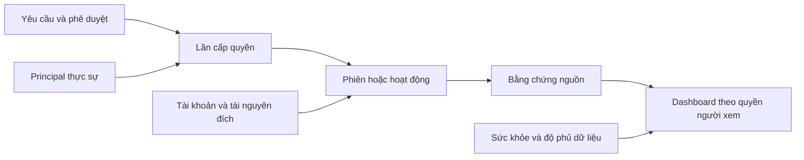

# Privileged access dashboard

## 1. Dashboard truy cập đặc quyền dùng để quyết định điều gì?

Privileged access dashboard là bảng điều khiển tập hợp tình trạng quyền đặc biệt, hoạt động sử dụng quyền và sức khỏe của các biện pháp kiểm soát PAM. Một dashboard hữu ích giúp người vận hành trả lời nhanh: ai đang giữ hoặc sử dụng quyền mạnh, trên tài nguyên nào, vì mục đích gì, bằng cơ chế nào và có điểm nào cần xử lý ngay.

Trong phạm vi PAM, đối tượng theo dõi không chỉ là tài khoản quản trị của con người. Cần bao gồm tài khoản dịch vụ, workload, khóa SSH, credential ứng dụng, danh tính cloud và những đường truy cập có thể cấp hoặc sử dụng quyền mạnh. Danh sách chính xác phụ thuộc inventory và phạm vi triển khai của tổ chức.

Dashboard không phải bản thay thế cho vault, hệ thống cấp quyền, cơ chế ghi phiên hay hồ sơ kiểm toán. Nó là lớp quan sát và dẫn hướng đến bằng chứng của những hệ thống đó. Một ô hiển thị “MFA đạt” chỉ có ý nghĩa khi người xem biết nó đang nói về chính sách được cấu hình, lần xác thực thực tế hay toàn bộ đường truy cập đã được kiểm tra.

Một ví dụ mở đầu:

> SOC thấy ba phiên đặc quyền đang hoạt động trên môi trường production. Hai phiên có yêu cầu đã duyệt và thời hạn còn hiệu lực. Phiên còn lại dùng tài khoản khẩn cấp, thiếu mã sự cố và nguồn log đích đã ngừng gửi dữ liệu. Dashboard phải làm nổi bật cả vấn đề sử dụng quyền lẫn việc chưa đủ dữ liệu để kết luận phiên đó diễn ra như thế nào.

Nếu chỉ hiện “3 active sessions” hoặc tô xanh toàn bộ vì không có cảnh báo mới, dashboard chưa giúp người vận hành đưa ra quyết định đúng.

Sau bài học, người học cần có thể:

- Xác định người sử dụng dashboard và quyết định mỗi nhóm cần đưa ra.
- Thiết kế các vùng hiển thị cho inventory, least privilege, JIT/JEA, vault, credential, phiên và cảnh báo.
- Định nghĩa chỉ số với mẫu số, cửa sổ thời gian, phạm vi và nguồn dữ liệu rõ ràng.
- Phân biệt trạng thái an toàn đã được chứng minh với tình trạng thiếu dữ liệu.
- Thiết kế drill-down có kiểm soát và liên kết tới bằng chứng.
- Dùng một tình huống vận hành để kiểm tra dashboard từ phát hiện đến xác nhận khắc phục.

## 2. Bắt đầu từ người xem và quyết định cần đưa ra

Không nên đưa mọi số liệu lên cùng một màn hình rồi yêu cầu mọi người tự tìm ý nghĩa. Các nhóm có câu hỏi và quyền xem khác nhau.

| Người xem | Câu hỏi chính | Thông tin cần ưu tiên | Hành động tiếp theo |
| --- | --- | --- | --- |
| SOC hoặc trực vận hành | Có hoạt động đặc quyền cần xử lý ngay không? | Phiên rủi ro, break-glass, truy cập ngoài luồng, dữ liệu bị gián đoạn | Mở điều tra, đối chiếu yêu cầu, liên hệ người phụ trách |
| Đội PAM | Biện pháp kiểm soát nào đang hỏng hoặc thiếu độ phủ? | Rotation lỗi, credential quá hạn, connector lỗi, thu hồi quyền thất bại | Khắc phục tích hợp, xử lý backlog, xác minh lại |
| Chủ hệ thống | Tài nguyên của tôi có quyền dư thừa hoặc ngoại lệ chưa xử lý không? | Quyền đứng thường trực, owner thiếu, ngoại lệ sắp hết hạn | Rà soát và đề nghị thu hẹp quyền |
| Quản lý an ninh | Rủi ro và chất lượng kiểm soát đang thay đổi ra sao? | Xu hướng có mẫu số, tài nguyên trọng yếu chưa bao phủ, tuổi backlog | Ưu tiên nguồn lực và theo dõi cam kết |
| Kiểm toán viên | Một kết luận tuân thủ dựa trên bằng chứng nào? | Phạm vi, thời điểm, phiên bản chính sách, chuỗi phê duyệt, nguồn bằng chứng | Truy xuất hồ sơ theo quyền được cấp |

Những màn hình này có thể dùng cùng một mô hình dữ liệu nhưng không nhất thiết hiển thị cùng chi tiết. Ví dụ, quản lý cần biết tỷ lệ phiên có bằng chứng ghi nhận hợp lệ; không vì vậy mà họ cần quyền phát lại toàn bộ bản ghi phiên.

Một thiết kế ban đầu có thể tách ba chế độ xem:

1. **Theo dõi trực:** ưu tiên phiên, cấp quyền đang hiệu lực, cảnh báo và sức khỏe nguồn dữ liệu.
2. **Tình trạng kiểm soát:** ưu tiên độ phủ PAM, quyền tồn tại lâu dài, rotation, owner và ngoại lệ.
3. **Bằng chứng theo kỳ:** ưu tiên snapshot, phạm vi kỳ báo cáo, truy xuất và khả năng tái lập số liệu.

Phải ghi rõ chế độ nào cập nhật gần thời gian thực và chế độ nào dựa trên snapshot. Không đặt số liệu của hai thời điểm khác nhau cạnh nhau mà bỏ nhãn thời gian.

## 3. Biên phạm vi và các bộ lọc bắt buộc

Dashboard cần có phạm vi rõ ngay ở đầu trang. Một số liệu “98% được quản lý” không có giá trị nếu chưa biết nó bao gồm môi trường nào hoặc loại danh tính nào.

Nhóm bộ lọc cơ bản gồm:

- Môi trường: production, staging, development.
- Đơn vị sở hữu, ứng dụng, dịch vụ hoặc nhóm tài nguyên.
- Loại principal: con người, tài khoản dịch vụ, workload.
- Mức độ quan trọng của tài nguyên.
- Kênh truy cập: phiên qua gateway, SSH, API, cơ chế cloud hoặc kênh khác đã được kiểm kê.
- Loại quyền: quyền thường trực, quyền được cấp có thời hạn, quyền khẩn cấp.
- Cửa sổ thời gian và múi giờ hiển thị.

Các bộ lọc phải áp dụng nhất quán cho thẻ số, biểu đồ, bảng chi tiết và export. Nếu một thành phần không chịu tác động của bộ lọc, cần ghi rõ ngay tại thành phần đó. Khi chuyển từ biểu đồ sang chi tiết, giữ nguyên ngữ cảnh lọc để người xem không điều tra nhầm môi trường.

Cần phân biệt hai phạm vi:

**Phạm vi quan sát được** là tập đối tượng có dữ liệu hiện diện trong hệ thống phân tích.

**Phạm vi được kỳ vọng** là tập đối tượng phải được quản lý hoặc theo dõi theo inventory và chính sách.

Hai tập có thể khác nhau. Nếu inventory chỉ chứa 80 trong 100 tài khoản đặc quyền thực tế, việc quản lý đủ 80 tài khoản đã biết không chứng minh toàn bộ 100 tài khoản được bao phủ. Vì vậy, dashboard cần trình bày ngày đối soát inventory, nguồn phát hiện và số đối tượng chưa được phân loại.

## 4. Bố cục dashboard theo thứ tự xử lý

Một bố cục có thể bắt đầu từ tính tin cậy của dữ liệu, rồi đi từ tình huống cần hành động tới xu hướng dài hạn.

```text
+---------------------------------------------------------------------+
| Phạm vi: Production / Nhóm thanh toán | Thời gian | Múi giờ           |
| Dữ liệu: suy giảm | Vault đến 09:58 | Đích SSH đến 09:43 | Xem nguồn   |
+---------------------------------------------------------------------+
| Cần xử lý: 1 break-glass thiếu hồ sơ | 2 lần thu hồi quyền chưa xác nhận|
+---------------------------------------------------------------------+
| Phiên đang mở | Quyền JIT còn hạn | Rotation quá hạn | Tài nguyên hở  |
|      3       |        8          |        4         |       5        |
+----------------------------------+----------------------------------+
| Phiên và cấp quyền cần điều tra   | Độ phủ kiểm soát theo tài nguyên  |
+----------------------------------+----------------------------------+
| Quyền thường trực / quyền chưa dùng | Vault và vòng đời credential  |
+----------------------------------+----------------------------------+
| Ngoại lệ, owner, hạn xử lý        | Xu hướng và bằng chứng theo kỳ    |
+---------------------------------------------------------------------+
```

Điểm cần chú ý trong bố cục này:

- Trạng thái dữ liệu đặt ở nơi dễ thấy; không giấu trong trang cấu hình.
- Khu vực cần xử lý thể hiện mức độ ảnh hưởng, người nhận và tuổi vấn đề.
- Số phiên đang mở đi kèm thời điểm xác nhận, không chỉ giá trị đếm.
- Các tỷ lệ có đường dẫn xem mẫu số và danh sách đối tượng chưa đạt.
- Xu hướng đi cùng thông tin thay đổi phạm vi hoặc thay đổi chính sách.

Không chỉ dùng màu để diễn đạt. Nhãn “Thiếu dữ liệu”, “Vi phạm”, “Ngoại lệ còn hiệu lực” và “Đạt” giúp người xem phân biệt các tình trạng có ý nghĩa khác nhau.

## 5. Những nhóm thông tin cốt lõi

### 5.1. Inventory và độ phủ PAM

Nhóm này trả lời: tổ chức biết những principal, tài khoản và tài nguyên nào có quyền mạnh; bao nhiêu đối tượng thuộc diện phải kiểm soát đã được đưa vào cơ chế phù hợp.

Các trường hữu ích gồm số tài khoản đã phát hiện, số tài khoản có owner, số đối tượng được đánh giá thuộc phạm vi, số được quản lý, số chưa quản lý và số chưa xác định trạng thái.

Không coi “có bản ghi trong vault” là đồng nghĩa với “được bảo vệ đầy đủ”. Một tài khoản có thể đã lưu credential trong vault nhưng vẫn được sử dụng trực tiếp, rotation không hoạt động hoặc tài khoản đích vẫn có một đường truy cập khác không quan sát được.

Nên chia độ phủ theo từng kiểm soát, chẳng hạn:

- Quản lý credential.
- Cấp quyền theo chính sách.
- Xác nhận thu hồi quyền.
- Ghi nhận hoạt động hoặc phiên.
- Có owner và hồ sơ ngoại lệ.
- Có dữ liệu đủ mới để đánh giá.

### 5.2. Least privilege và quyền thường trực

Hiển thị số principal còn quyền quản trị thường trực, quyền đã lâu chưa có bằng chứng sử dụng, quyền không có owner và quyền vượt hồ sơ được phê duyệt.

“Không thấy sử dụng” chỉ là tín hiệu để rà soát. Nếu nguồn telemetry không bao phủ hết kênh truy cập hoặc cửa sổ quan sát quá ngắn, dashboard phải chỉ ra giới hạn đó. Không tự suy ra rằng quyền có thể bị xóa an toàn.

Một danh sách rà soát nên có principal, tài nguyên, quyền, nguồn cấp quyền, ngày cấp, lần sử dụng gần nhất đã quan sát, độ phủ dữ liệu và owner chịu trách nhiệm quyết định.

### 5.3. JIT/JEA và hiệu lực của quyền

Đối với quyền cấp tạm thời, cần quan sát cả quy trình và kết quả thực thi:

- Yêu cầu đã duyệt nhưng chưa cấp.
- Quyền đã cấp và còn trong thời hạn.
- Quyền đã hết hạn nhưng chưa có xác nhận thu hồi thành công.
- Phạm vi thực tế khác với phạm vi được duyệt.
- Phiên hoặc hoạt động không liên kết được với lần cấp quyền.

JIT tập trung vào thời điểm và thời hạn có quyền. JEA tập trung vào phạm vi thao tác được phép. Dashboard có thể cho biết quyền có thời hạn nhưng vẫn cần dữ liệu khác để xác nhận người dùng chỉ thực hiện được đúng nhóm thao tác được phép.

### 5.4. Vault và vòng đời credential

Theo dõi tình trạng checkout hoặc cấp credential, rotation đến hạn, rotation thất bại, lần xác nhận credential hoạt động và sự khác biệt giữa trạng thái vault với hệ thống đích.

Cần phân biệt:

- Một lần rotation được khởi chạy.
- Một lần rotation được báo thành công.
- Credential mới đã được xác nhận trên hệ thống đích theo quy trình.
- Ứng dụng phụ thuộc đã sử dụng được credential sau thay đổi.

Tùy kiến trúc, không phải mọi bước đều có telemetry. Dashboard phải ghi rõ bằng chứng hiện có thay vì gộp tất cả thành một nhãn “rotation OK”.

### 5.5. Phiên, hoạt động và bằng chứng

Theo dõi phiên đang mở, thời lượng, người khởi tạo thực, tài khoản được sử dụng, tài nguyên đích, kênh truy cập, yêu cầu liên quan và mức độ đầy đủ của bằng chứng.

Đối với workload dùng API hoặc secret ngắn hạn, “phiên tương tác” có thể không tồn tại. Khi đó cần mô hình lượt cấp credential, lượt gọi hoặc khoảng hiệu lực quyền phù hợp. Không ép mọi dạng truy cập vào một bảng phiên SSH/RDP.

Chỉ số ghi phiên cần phân biệt “cấu hình yêu cầu ghi”, “đã nhận sự kiện bắt đầu ghi”, “đã có artifact” và “artifact truy xuất được theo quyền”. Những trạng thái này không thể thay thế nhau.

### 5.6. Break-glass và ngoại lệ

Hiển thị lần sử dụng tài khoản khẩn cấp, nguyên nhân, người chịu trách nhiệm, tài nguyên liên quan, thời điểm phải rà soát sau sử dụng và tình trạng thay credential hoặc thu hồi quyền nếu quy trình yêu cầu.

Ngoại lệ được duyệt không làm biến mất mức phơi nhiễm. Dashboard nên hiển thị riêng:

- Kiểm soát đạt yêu cầu.
- Có ngoại lệ được duyệt và còn hiệu lực.
- Ngoại lệ đã hết hạn hoặc thiếu hồ sơ.
- Chưa đủ dữ liệu để đánh giá.

Nhờ đó, người xem không nhầm một tập lớn ngoại lệ đang được chấp nhận với trạng thái đã áp dụng đầy đủ kiểm soát.

## 6. Hợp đồng định nghĩa chỉ số

Mỗi chỉ số quan trọng cần một định nghĩa có thể kiểm tra và tái lập. Tên chỉ số ngắn trên dashboard có thể mở ra phần mô tả chi tiết.

Một hợp đồng chỉ số nên chứa:

| Thuộc tính | Nội dung cần xác định |
| --- | --- |
| Mã và mục đích | Chỉ số dùng để đưa ra quyết định nào |
| Đơn vị đếm | Principal, tài khoản, tài nguyên, phiên hay lần thực hiện |
| Tử số | Điều kiện cụ thể để được tính là đạt |
| Mẫu số | Tập đối tượng thuộc diện đánh giá |
| Thời gian | Snapshot tại thời điểm hay hoạt động trong một cửa sổ |
| Quy tắc loại trừ | Đối tượng ngoài phạm vi và lý do |
| Xử lý unknown | Thiếu dữ liệu có được tính đạt hay không |
| Dữ liệu nguồn | Nguồn nào chứng minh từng điều kiện |
| Độ mới | Điều kiện nguồn đủ mới và thời điểm đánh giá |
| Phiên bản | Phiên bản định nghĩa, chính sách và tập phạm vi |

Ví dụ các chỉ số có thể dùng:

| Chỉ số | Cách định nghĩa minh họa | Điều cần tránh |
| --- | --- | --- |
| Độ phủ quản lý credential | Tài khoản đủ điều kiện đã được xác nhận quản lý / tổng tài khoản đủ điều kiện | Dùng tổng tài khoản nhìn thấy trong vault làm mẫu số |
| Độ phủ owner | Đối tượng có owner hợp lệ / tổng đối tượng phải có owner | Đếm trường owner không rỗng nhưng đã hết hiệu lực |
| Thu hồi quyền đúng hạn | Lần cấp quyền đến hạn được xác nhận thu hồi trong hạn / tổng lần cấp quyền đến hạn trong kỳ | Đếm yêu cầu thu hồi như kết quả thu hồi |
| Bằng chứng phiên đầy đủ | Phiên kết thúc cần ghi nhận có bộ bằng chứng đạt tiêu chí / tổng phiên kết thúc cần ghi nhận trong kỳ | Gộp phiên đang mở khi artifact chưa đến hạn hoàn tất |
| Rotation đúng hạn | Đối tượng đến hạn đã có kết quả đạt theo chính sách / tổng đối tượng đến hạn trong kỳ | Nhầm số lần retry với số đối tượng đã xử lý |
| Tuổi backlog | Thời gian từ lúc vấn đề được xác nhận đến thời điểm hiện tại hoặc xử lý xong | Chỉ hiển thị số lượng mà bỏ tuổi và mức độ ảnh hưởng |

Những định nghĩa trong bảng là mẫu thiết kế. Nhóm triển khai phải xác nhận điều kiện đạt, hạn xử lý và nguồn bằng chứng theo chính sách thực tế.

### 6.1. Ví dụ tỷ lệ có trạng thái chưa xác định

Giả sử snapshot lúc 10:00 có 100 tài khoản thuộc diện quản lý credential:

- 80 tài khoản đã xác nhận đạt.
- 12 tài khoản đã xác nhận chưa đạt.
- 8 tài khoản chưa đánh giá được vì thiếu dữ liệu đủ mới.

Dashboard có thể hiển thị:

```text
Đã xác nhận đạt: 80/100 = 80%
Chưa đạt:        12/100 = 12%
Chưa xác định:    8/100 = 8%
Tỷ lệ đạt trong tập đã đánh giá: 80/92 ≈ 87,0%
```

Tỷ lệ 87,0% chỉ mô tả tập đã đánh giá. Nếu dùng nó làm con số chính mà giấu 8 đối tượng chưa xác định, người xem có thể đánh giá quá cao độ phủ thực tế.

Với mẫu số bằng 0, hiển thị “Không có đối tượng trong phạm vi” hoặc “N/A” theo định nghĩa. Không hiển thị 100% vì phép tính không có đối tượng đánh giá.

### 6.2. Snapshot khác với số liệu theo cửa sổ

“Quyền quản trị đang tồn tại lúc 10:00” là một snapshot. “Số lần cấp quyền trong 24 giờ” là một dòng sự kiện. Một người được cấp quyền năm lần trong ngày có thể chỉ là một principal ở snapshot hiện tại.

Cần đặt tên đúng đơn vị, ví dụ:

- “Principal đang có quyền đặc biệt”.
- “Tài khoản đặc quyền”.
- “Lần cấp quyền JIT”.
- “Phiên đã kết thúc”.
- “Tài nguyên thuộc phạm vi”.

Không cộng những số này thành một tổng “privileged access” không rõ nghĩa.

## 7. Dữ liệu và quan hệ cần có

Một dashboard PAM thường cần kết hợp dữ liệu kiểm kê, xác thực, phê duyệt, cấp quyền, vault, đích truy cập và quản lý sự cố. Việc kết hợp phải dựa trên định danh ổn định, không chỉ chuỗi tên hiển thị.

Mô hình tối thiểu có thể gồm:

| Thực thể | Ví dụ định danh | Vai trò |
| --- | --- | --- |
| Principal | principal_id | Con người hoặc workload thực sự khởi tạo hoạt động |
| Tài khoản được sử dụng | account_id | Tài khoản quản trị, tài khoản dịch vụ hoặc danh tính đích |
| Tài nguyên | resource_id | Máy chủ, database, tenant hoặc tài nguyên nhạy cảm |
| Quyền | entitlement_id | Nhóm quyền, vai trò hoặc tập thao tác được cấp |
| Yêu cầu | request_id | Mục đích, người duyệt, phạm vi và thời hạn |
| Lần cấp quyền | grant_id | Kết quả cấp quyền cùng thời gian hiệu lực |
| Phiên hoặc lượt hoạt động | session_id hoặc activity_id | Sử dụng quyền thực tế |
| Sự kiện | source_id + event_id | Bản ghi nguồn cần chống trùng |
| Bằng chứng | evidence_ref | Tham chiếu đến hồ sơ được kiểm soát truy cập |

Đối với tài khoản dùng chung, cần giữ cả principal thực sự và account được sử dụng. Nếu log chỉ cho biết tài khoản `admin`, dashboard không được tự gán hành động cho một con người chỉ vì người đó có một yêu cầu đang mở.

Một sự kiện chuẩn hóa minh họa:

```json
{
  "source_id": "pam-gateway-prod-a",
  "event_id": "evt-00821",
  "event_type": "privileged_session_started",
  "occurred_at": "2026-01-15T09:52:00Z",
  "ingested_at": "2026-01-15T09:52:04Z",
  "principal_id": "person-024",
  "account_id": "account-db-admin-07",
  "resource_id": "db-payment-prod-02",
  "request_id": "request-017",
  "grant_id": "grant-091",
  "session_id": "session-044",
  "access_channel": "brokered_database",
  "policy_version": "pam-policy-v7",
  "evidence_ref": "evidence/session-044/start"
}
```

Đây là schema minh họa cho mô hình phân tích, không phải hợp đồng API của một sản phẩm cụ thể. Không đưa password, private key, token hay nội dung secret vào sự kiện.

Một chuỗi liên kết mong muốn là:



Khi liên kết thất bại, cần giữ trạng thái “chưa liên kết” để điều tra. Không tạo kết quả khớp chắc chắn chỉ dựa vào hai sự kiện gần nhau về thời gian.

## 8. Pipeline từ dữ liệu nguồn tới ô hiển thị

Một pipeline phân tích có thể chia thành các bước:

1. Thu nhận sự kiện và snapshot từ các nguồn đã được xác định.
2. Chuẩn hóa thời gian, mã kết quả, loại principal và định danh tài nguyên.
3. Loại trùng theo khóa nguồn; giữ đủ thông tin để truy vết bản ghi gốc.
4. Làm giàu bằng owner, môi trường, mức quan trọng và chính sách có hiệu lực.
5. Liên kết yêu cầu, lần cấp quyền, phiên và bằng chứng.
6. Tính trạng thái tại thời điểm hoặc tổng hợp theo cửa sổ.
7. Công bố chỉ số cùng thời điểm dữ liệu và trạng thái chất lượng.

Dữ liệu thô, dữ liệu chuẩn hóa và kết quả tổng hợp phục vụ các mục đích khác nhau. Tổng hợp giúp dashboard tải nhanh; bằng chứng điều tra vẫn cần truy được về dữ liệu nguồn theo chính sách lưu trữ.

### 8.1. Thời điểm xảy ra và thời điểm nhận

`occurred_at` mô tả lúc sự kiện xảy ra ở nguồn. `ingested_at` mô tả lúc pipeline nhận sự kiện. Chênh lệch giữa hai thời điểm có thể do đường truyền, hàng đợi hoặc đồng hồ nguồn sai.

Nếu một phiên kết thúc lúc 09:55 nhưng sự kiện đóng phiên tới lúc 10:10, dashboard lúc 10:00 có thể còn hiển thị phiên đang mở. Phải có cơ chế cập nhật lại kết quả khi sự kiện đến muộn và ghi rõ độ mới dữ liệu. Không chỉ trừ số sự kiện đóng phiên khỏi số sự kiện mở phiên trong cùng một cửa sổ ngắn: một phiên có thể bắt đầu trước cửa sổ đó.

Đối với trạng thái đang hoạt động, cần tái dựng vòng đời theo định danh phiên và đối soát với snapshot hoặc heartbeat phù hợp. Nếu không nhận được trạng thái đích, sử dụng nhãn “chưa xác nhận còn hoạt động” thay vì tự kết luận chắc chắn phiên vẫn mở.

### 8.2. Dữ liệu đến trùng, sai thứ tự và thiếu

Connector có thể gửi lại cùng một sự kiện. Một lần retry rotation có thể tạo nhiều sự kiện cho cùng một đối tượng. Vì vậy:

- Số sự kiện nhận không phải số hoạt động nghiệp vụ.
- Số lần thử không phải số đối tượng đã xử lý thành công.
- Sự kiện đến sau không luôn mô tả trạng thái mới hơn.
- Không có sự kiện thất bại không chứng minh kiểm soát hoạt động.

Quy tắc chống trùng cần xác định theo nguồn. Chỉ dùng `event_id` nếu mã đó duy nhất trong phạm vi đã biết; nếu nó chỉ duy nhất theo connector thì phải ghép `source_id`.

### 8.3. Trạng thái lịch sử

Owner, mức quan trọng và quyền có thể thay đổi. Muốn tái lập báo cáo kỳ trước, cần biết các thuộc tính có hiệu lực tại thời điểm đánh giá.

Ví dụ, tài khoản đổi owner hôm nay không có nghĩa mọi hoạt động tháng trước thuộc trách nhiệm của owner mới. Dashboard cho điều tra lịch sử nên hiển thị rõ owner tại thời điểm hoạt động và owner hiện tại nếu cả hai hữu ích.

## 9. Ví dụ tính toán chỉ số từ snapshot chuẩn hóa

Giả sử hệ thống phân tích có bảng `pam_account_snapshot`, với một hàng cho mỗi tài khoản trong một snapshot đã hoàn tất. Các trường bao gồm:

```text
snapshot_id
account_id
environment
in_scope
management_state     -- managed | unmanaged | unknown
owner_state          -- valid | missing | unknown
credential_state     -- within_policy | overdue | unknown
```

Truy vấn SQL dưới đây minh họa cách giữ riêng unknown. Tham số `:snapshot_id` được ứng dụng truyền vào bằng cơ chế bind phù hợp với nền tảng.

```sql
SELECT
    COUNT(*) AS in_scope_accounts,
    SUM(CASE WHEN management_state = 'managed' THEN 1 ELSE 0 END)
        AS confirmed_managed,
    SUM(CASE WHEN management_state = 'unmanaged' THEN 1 ELSE 0 END)
        AS confirmed_unmanaged,
    SUM(CASE WHEN management_state = 'unknown' THEN 1 ELSE 0 END)
        AS unknown_accounts,
    100.0 * SUM(
        CASE WHEN management_state = 'managed' THEN 1 ELSE 0 END
    ) / NULLIF(COUNT(*), 0) AS confirmed_managed_pct
FROM pam_account_snapshot
WHERE snapshot_id = :snapshot_id
  AND environment = 'production'
  AND in_scope = TRUE;
```

Ví dụ giả định bảng chỉ có ba giá trị trạng thái hợp lệ và có ràng buộc duy nhất theo `snapshot_id, account_id`. Nếu không bảo đảm được điều đó, phải xử lý chất lượng dữ liệu trước khi tin vào kết quả đếm.

Không ghép trực tiếp bảng tài khoản với toàn bộ sự kiện phiên rồi `COUNT(*)` để tính số tài khoản. Một tài khoản có mười phiên sẽ tạo mười hàng sau phép join và làm phình mẫu số. Có thể tổng hợp theo đơn vị tài khoản trước, dùng tập định danh duy nhất hoặc chọn mô hình truy vấn phù hợp.

Tương tự, để tìm lần cấp quyền hết hạn mà chưa xác nhận thu hồi, mô hình phân tích cần trạng thái vòng đời đã được đối soát, không chỉ một sự kiện hết hạn:

```text
grant_id: grant-091
expires_at: 10:00
revocation_requested_at: 10:00
revocation_confirmed_at: null
target_observation_state: stale
evaluation: chưa xác nhận thu hồi; cần đối soát đích
```

Dữ liệu này chưa đủ để khẳng định quyền chắc chắn vẫn tồn tại trên đích, nhưng đã đủ để cho thấy tổ chức chưa có bằng chứng hoàn tất kiểm soát thu hồi.

## 10. Sức khỏe dữ liệu là một phần của trạng thái an ninh

Một dashboard PAM phải thể hiện khi chính nó đang thiếu khả năng quan sát.

Các thông tin cần theo dõi cho từng nguồn gồm:

- Lần nhận dữ liệu gần nhất và watermark xử lý.
- Độ trễ từ lúc xảy ra đến lúc nhận.
- Tình trạng connector và lần đồng bộ snapshot gần nhất.
- Số sự kiện bị từ chối, đưa vào vùng cách ly hoặc không chuẩn hóa được.
- Tỷ lệ không ánh xạ được principal, tài khoản hoặc tài nguyên.
- Số sự kiện không liên kết được request, grant hoặc session.
- Phạm vi tài nguyên mà nguồn đó bao phủ.

Không suy ra mất kết nối chỉ từ việc không có sự kiện nghiệp vụ mới. Một hệ thống không có hoạt động có thể hoàn toàn bình thường. Tín hiệu liveness nên dựa trên heartbeat, poll hoặc cơ chế kiểm tra thích hợp, đồng thời kiểm tra xem tiến trình đọc dữ liệu có thực sự tiến triển hay không.

Một mô hình trạng thái có thể là:

| Trạng thái | Ý nghĩa hiển thị |
| --- | --- |
| Đủ dữ liệu theo điều kiện | Nguồn và phạm vi đáp ứng tiêu chí tính chỉ số |
| Suy giảm | Một phần dữ liệu chậm, lỗi hoặc thiếu; kết quả có giới hạn |
| Không có dữ liệu đủ dùng | Chưa thể đánh giá kiểm soát trong phạm vi này |
| Ngoài phạm vi | Đối tượng không thuộc tiêu chí đánh giá đã công bố |

Thời hạn để xem dữ liệu là đủ mới phải được đặt theo loại nguồn và nhu cầu sử dụng. Số liệu điều hành phiên đang diễn ra cần độ mới khác báo cáo kiểm kê theo ngày.

Khi nguồn bị chậm, một thiết kế hợp lý có thể giữ giá trị gần nhất nhưng gắn nhãn thời điểm và trạng thái suy giảm. Không giữ con số cũ rồi hiển thị như vừa được xác nhận.

## 11. Từ dashboard đến điều tra và xử lý

Mỗi hàng đáng chú ý cần cho người xem chuyển từ tổng quan sang ngữ cảnh cụ thể theo quyền.

Một luồng drill-down có thể là:

```text
Thẻ: 2 lần thu hồi chưa được xác nhận
  → Danh sách grant thuộc đúng phạm vi và thời điểm
  → Chi tiết một grant: yêu cầu, principal, tài nguyên, hạn quyền
  → Timeline: phê duyệt → cấp → sử dụng → yêu cầu thu hồi → phản hồi
  → Tham chiếu bằng chứng và hồ sơ xử lý
  → Kết quả xác minh sau khắc phục
```

Trang chi tiết cần phân biệt dữ kiện nguồn với kết luận của rule phân tích. Ví dụ:

- Dữ kiện: đích chưa phản hồi xác nhận thu hồi.
- Dữ kiện: connector của đích bị chậm mười phút.
- Kết luận: chưa có bằng chứng quyền đã được thu hồi.
- Hành động điều tra: đối soát trạng thái quyền bằng kênh được ủy quyền.

Không đổi kết luận thành “tài khoản bị xâm nhập” khi chưa có bằng chứng tương ứng.

Một dashboard có thể tích hợp tạo ticket hoặc liên kết runbook. Nếu có chức năng kết thúc phiên, khóa tài khoản hoặc thu hồi quyền, đó là thao tác thay đổi hệ thống và cần đi qua cơ chế điều khiển riêng với xác thực, phân quyền, điều kiện chính sách, kiểm tra kết quả và audit. Quyền xem dashboard không tự động mang lại quyền thực hiện những hành động này.

Trạng thái “đã nhận xử lý” chỉ cho biết người phụ trách đã tiếp nhận. Trạng thái “đã đóng cảnh báo” không tự chứng minh vấn đề trên đích đã được khắc phục. Cần lưu riêng trạng thái hồ sơ xử lý và trạng thái kiểm soát kỹ thuật.

## 12. Tình huống minh họa: phiên break-glass và nguồn log chậm

Giả sử phạm vi là các tài nguyên thanh toán production. Tại 10:00, dashboard có:

| Tín hiệu | Giá trị |
| --- | --- |
| Phiên tương tác đang được ghi nhận | 3 |
| Phiên dùng tài khoản khẩn cấp | 1 |
| Hồ sơ sự cố liên kết với lần dùng khẩn cấp | Chưa có |
| Nguồn gateway | Cập nhật đến 09:59 |
| Nguồn audit từ database đích | Cập nhật đến 09:43 |
| Trạng thái ghi phiên khẩn cấp | Có sự kiện bắt đầu; artifact cuối chưa đến hạn kiểm tra |

Cách đọc phù hợp là:

1. Có bằng chứng gateway ghi nhận sử dụng tài khoản khẩn cấp.
2. Chưa có liên kết hồ sơ sự cố theo tiêu chí theo dõi.
3. Chưa đủ dữ liệu audit đích từ sau 09:43 để kết luận toàn bộ thao tác.
4. Phiên chưa kết thúc nên không đánh dấu artifact cuối bị thiếu chỉ vì chưa xuất hiện.
5. Cần xử lý cả việc xác minh sử dụng khẩn cấp lẫn khôi phục khả năng quan sát.

Người trực mở chi tiết và thấy principal, resource, thời điểm bắt đầu, mã phiên, quy trình break-glass áp dụng và owner. Sau khi đối chiếu với người phụ trách, một hồ sơ sự cố hợp lệ được liên kết. Dashboard giữ lịch sử “thiếu liên kết tại 10:00” và ghi thời điểm bổ sung; không viết lại lịch sử như thể hồ sơ luôn hiện diện.

Khi connector khôi phục, sự kiện đến muộn được liên kết vào timeline. Nếu phát hiện một hành động ngoài phạm vi xử lý được cho phép, đó là tín hiệu điều tra tiếp. Nếu mọi thao tác phù hợp, có thể ghi kết quả rà soát nhưng vẫn giữ sự cố mất độ mới dữ liệu trong hồ sơ vận hành.

Sau khi phiên kết thúc, quy trình hậu kiểm xác nhận bằng chứng, việc thu hồi quyền và thay credential nếu chính sách yêu cầu. Dashboard chỉ chuyển từng kiểm soát sang đạt khi có dữ liệu chứng minh tương ứng.

Tình huống này cho thấy một chỉ số đơn lẻ không đủ. Phải kết hợp danh tính, mục đích, thời hạn quyền, hoạt động, bằng chứng và chất lượng dữ liệu.

## 13. Phân quyền và bảo vệ thông tin trên dashboard

Dashboard tập trung nhiều thông tin nhạy cảm: tài khoản quản trị, tài nguyên quan trọng, mô hình truy cập và bằng chứng hoạt động. Chính nó cũng cần được kiểm soát.

Các nguyên tắc thiết kế gồm:

- Phân quyền theo vai trò và phạm vi tài nguyên, thực thi ở phía dịch vụ dữ liệu.
- Kiểm tra quyền lại khi truy xuất chi tiết, export hoặc bằng chứng; không chỉ ẩn nút trên giao diện.
- Dùng định danh hoặc che bớt thông tin khi tên đầy đủ không cần cho quyết định.
- Giữ secret ngoài log, cache, URL, export và nội dung tooltip.
- Tách quyền xem metadata phiên khỏi quyền xem bản ghi phiên.
- Audit truy cập dữ liệu nhạy cảm và các thao tác điều khiển.
- Kiểm soát thời hạn, phạm vi và quyền tải các báo cáo được xuất.

Bộ lọc đơn vị trên giao diện không phải ranh giới phân quyền. Người dùng không được thay tham số API để xem dữ liệu của nhóm khác. Cache cũng phải tránh dùng chung kết quả có dữ liệu nhạy cảm giữa các phạm vi người xem.

Liên kết bằng chứng nên dẫn tới dịch vụ kiểm tra quyền hiện tại, thay vì nhúng đường dẫn truy cập lâu dài có thể bị chia sẻ. Chính sách lưu trữ phải xét cả bằng chứng gốc lẫn dữ liệu tổng hợp, export và cache.

Không mặc định rằng người có quyền quản trị nền tảng dashboard phải có quyền xóa hoặc sửa hồ sơ audit. Tách trách nhiệm phù hợp giúp giảm khả năng một chủ thể vừa sử dụng quyền mạnh vừa tự che dấu hoạt động của mình.

## 14. Lỗi thiết kế thường gặp

### 14.1. Dùng số hoạt động làm bằng chứng kiểm soát tốt

Nhiều phiên được broker qua PAM cho thấy mức sử dụng kênh đó, nhưng không chứng minh không còn đường truy cập khác. Cần so sánh với dữ liệu đích hoặc biện pháp đối soát phù hợp để nhận diện hoạt động ngoài luồng.

### 14.2. Tô xanh khi không có cảnh báo

Không có cảnh báo có thể do không có vi phạm, rule chưa bao phủ hoặc nguồn dữ liệu hỏng. Dashboard phải hiển thị đồng thời trạng thái kiểm soát và trạng thái dữ liệu.

### 14.3. Bỏ mẫu số và thay đổi phạm vi

Tăng từ 80 lên 90 tài khoản quản lý có thể là tiến bộ, nhưng nếu inventory tăng từ 100 lên 150 thì độ phủ đã giảm từ 80% xuống 60%. Biểu đồ xu hướng cần hiển thị cả số tuyệt đối, tỷ lệ và biến động phạm vi.

### 14.4. Đánh đồng sự kiện với kết quả

Có yêu cầu cấp quyền không có nghĩa quyền đã được cấp. Có yêu cầu thu hồi không có nghĩa đích đã thu hồi. Có tác vụ rotation không có nghĩa credential mới đã được xác nhận. Chỉ số cần bám trạng thái và bằng chứng cụ thể.

### 14.5. Biến ngoại lệ thành “đạt”

Ngoại lệ có hồ sơ là một dạng xử lý rủi ro, không phải bằng chứng kiểm soát đã được triển khai. Cần biểu diễn riêng số lượng, mức ảnh hưởng, owner và hạn ngoại lệ.

### 14.6. Chỉ có biểu đồ, thiếu đường xử lý

Một biểu đồ đẹp nhưng không tìm được đối tượng, không có owner và không truy được bằng chứng sẽ làm chậm xử lý. Mỗi nhóm phát hiện quan trọng cần có danh sách chi tiết và lối đi đến quy trình phụ trách.

### 14.7. Tạo một điểm rủi ro không giải thích được

Nếu dùng điểm tổng hợp, cần công bố yếu tố cấu thành và cho phép xem từng yếu tố. Không để một điểm trung bình che khuất một tài nguyên trọng yếu đang thiếu kiểm soát hoặc một nguồn dữ liệu đã mất.

## 15. Thực hành thiết kế dashboard

Dùng dữ liệu giả, không đưa credential hoặc bản ghi nhạy cảm thật vào bài tập.

### Bước 1: Chốt người xem và phạm vi

Chọn dashboard cho đội PAM quản lý production. Liệt kê những quyết định trong ca trực: ưu tiên lỗi thu hồi, rotation quá hạn, sử dụng break-glass và tài nguyên chưa được bao phủ.

### Bước 2: Tạo snapshot minh họa

Giả sử có 120 tài khoản thuộc phạm vi:

- 96 tài khoản đã xác nhận được quản lý.
- 14 tài khoản chưa được quản lý.
- 10 tài khoản chưa xác định vì chưa đối soát dữ liệu.
- Trong 120 tài khoản có 9 đối tượng thiếu owner hợp lệ.
- Có 6 đối tượng đến hạn rotation trong kỳ; 4 đối tượng đạt tiêu chí hoàn tất, 1 thất bại và 1 chưa có kết quả.

Hai nhóm số liệu cuối là những góc nhìn khác của cùng tập dữ liệu, không phải các nhóm luôn loại trừ nhau. Không cộng 9 đối tượng thiếu owner vào 14 đối tượng chưa quản lý để suy ra tổng đối tượng lỗi.

### Bước 3: Tính và đặt nhãn đúng

Các kết quả minh họa:

```text
Đã xác nhận quản lý:             96/120 = 80%
Chưa quản lý:                   14/120 ≈ 11,7%
Chưa xác định quản lý:           10/120 ≈ 8,3%
Thiếu owner hợp lệ:               9/120 = 7,5%
Rotation đạt trong tập đến hạn:     4/6 ≈ 66,7%
Rotation chưa có kết quả:           1/6 ≈ 16,7%
```

“Rotation đạt 66,7%” phải đi cùng cửa sổ kỳ đánh giá và điều kiện hoàn tất. Không đổi mẫu số sang toàn bộ 120 tài khoản, vì chỉ có 6 đối tượng đến hạn trong kỳ theo dữ liệu giả.

### Bước 4: Thêm lỗi quan sát

Cho connector của một nhóm tài nguyên bị chậm. Xác định những thẻ nào chuyển sang suy giảm, những giá trị nào chỉ được giữ như dữ liệu gần nhất và những kết luận nào phải chuyển sang chưa xác định.

Thử cả trường hợp hệ thống không có hoạt động nhưng heartbeat vẫn bình thường để tránh báo mất nguồn sai.

### Bước 5: Kiểm tra drill-down

Chọn một rotation thất bại. Đảm bảo người có quyền xem có thể truy ra tài khoản, tài nguyên, owner, hạn, lần thực hiện, mã kết quả, tham chiếu bằng chứng và ticket.

Người ngoài phạm vi phải bị từ chối ở dịch vụ truy vấn chi tiết và export, kể cả khi họ biết định danh đối tượng.

### Bước 6: Kiểm tra một thay đổi theo thời gian

Thêm 20 tài khoản mới vào inventory nhưng chưa đánh giá. Dashboard cần phản ánh mẫu số thay đổi và số lượng unknown tăng; biểu đồ không được diễn đạt biến động này như 20 lỗi kiểm soát đã được xác nhận.

Kết quả bài tập nên gồm bản bố cục, định nghĩa chỉ số, schema dữ liệu tối thiểu, một timeline điều tra và ví dụ màn hình khi dữ liệu suy giảm.

## 16. Tiêu chí tự kiểm tra

Trước khi sử dụng một thiết kế dashboard, người học có thể tự đối chiếu:

- Mỗi thẻ số có đơn vị đếm, phạm vi, thời điểm và định nghĩa không?
- Mẫu số lấy từ inventory thuộc diện quản lý hay chỉ từ nguồn PAM nhìn thấy?
- Có phân biệt đạt, chưa đạt, ngoại lệ và chưa xác định không?
- Có nhận diện principal thực sự khi dùng tài khoản chia sẻ không?
- Quyền hết hạn được đánh giá bằng kết quả thu hồi hay chỉ bằng yêu cầu thu hồi?
- Dữ liệu đến muộn hoặc trùng có làm sai số phiên và số đối tượng không?
- Biểu đồ xu hướng có thể giải thích thay đổi inventory, chính sách và phạm vi không?
- Dashboard có chỉ rõ nơi telemetry bị gián đoạn không?
- Có thể đi từ phát hiện tới đối tượng, owner, bằng chứng và kết quả khắc phục không?
- Phân quyền có được thực thi với truy vấn chi tiết, bằng chứng và export không?

Mục tiêu của privileged access dashboard là giúp tổ chức nhìn thấy trạng thái quyền đặc biệt trong đúng bối cảnh và chuyển những điểm cần chú ý thành công việc có người chịu trách nhiệm. Giá trị của nó đến từ định nghĩa chỉ số rõ ràng, dữ liệu có thể truy vết và việc biểu diễn trung thực giới hạn quan sát.
