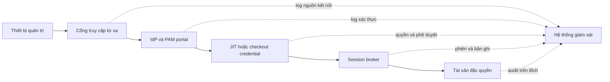

# Atypical location: phát hiện vị trí truy cập đặc quyền bất thường

## 1. Vị trí bất thường trong giám sát PAM

Một quản trị viên thường đi qua cổng truy cập từ xa của doanh nghiệp để vào PAM, nhận quyền quản trị có thời hạn và mở phiên tới máy chủ sản xuất. Một ngày, cùng danh tính đó yêu cầu lấy credential từ một mạng chưa từng xuất hiện. Yêu cầu vẫn có thể vượt qua bước đăng nhập nếu kẻ khác đã chiếm được phiên hoặc phương tiện xác thực. Dấu hiệu vị trí mới giúp đội vận hành đặt câu hỏi: đường truy cập này có phù hợp với người dùng, thiết bị, công việc và quyền đang được yêu cầu hay không?

**Atypical location** là vị trí hoặc nguồn truy cập khác đáng kể so với phạm vi được phê duyệt và hành vi hợp lệ đã quan sát của một danh tính. Trong Privileged Access Management (PAM), đối tượng giám sát có thể là đăng nhập quản trị, yêu cầu nâng quyền, checkout credential, truy xuất secret, kết nối SSH/RDP qua broker hoặc sử dụng tài khoản khẩn cấp.

“Location” không chỉ là tên quốc gia. Nó có thể là vùng mạng doanh nghiệp, điểm thoát VPN, ASN của nhà mạng, hạ tầng cloud, vùng triển khai của workload hoặc tuyến truy cập bắt buộc. Một nguồn cùng thành phố nhưng bỏ qua đường quản trị được kiểm soát có thể đáng chú ý hơn một nguồn khác quốc gia nhưng đi đúng quy trình đã được xác nhận.

Sau bài học, người học có thể:

- Phân biệt vị trí địa lý ước lượng với nguồn mạng và đích truy cập.
- Chọn đúng địa chỉ nguồn khi có VPN, reverse proxy, bastion hoặc session broker.
- Xây dựng baseline phù hợp cho người quản trị và tài khoản dịch vụ.
- Kết hợp vị trí mới với JIT/JEA, thiết bị, tài sản đích và bằng chứng phiên để phân loại cảnh báo.
- Thiết kế cách điều tra, ngoại lệ có thời hạn và bài kiểm thử mà không biến thay đổi IP thành kết luận tài khoản bị xâm nhập.

## 2. Xác định chính xác điều đang quan sát

### 2.1. Vị trí nguồn và vị trí tài sản đích

Vị trí nguồn trả lời “yêu cầu xuất phát qua đâu?”. Vị trí đích trả lời “đang truy cập hệ thống nào?”. Đây là hai chiều độc lập.

Ví dụ, quản trị viên kết nối từ mạng văn phòng tới máy chủ tại trung tâm dữ liệu ở một vùng khác. Vùng của máy chủ không phải vị trí của quản trị viên. Ngược lại, một workload triển khai ở vùng mới nhưng vẫn gọi tới vault cũ có thay đổi ở nguồn, dù đích không đổi.

Khi định nghĩa rule, cần ghi rõ loại sự kiện và điểm quan sát:

| Điểm quan sát | Nguồn mạng thường nhìn thấy | Điều có thể suy ra | Điều chưa thể suy ra |
|---|---|---|---|
| Cổng VPN/ZTNA | Địa chỉ kết nối đến cổng | Nguồn vào hạ tầng truy cập từ xa tại thời điểm đó | Vị trí vật lý chính xác của người sử dụng |
| PAM portal sau reverse proxy | Peer của proxy; có thể có nguồn gốc được proxy xác minh | Nguồn ngoài nếu chuỗi proxy tin cậy đã được cấu hình | Nguồn thật từ một header do client tùy ý gửi |
| Session broker | Client đã kết nối tới broker | Điểm khởi tạo phiên PAM theo log broker | Danh tính con người nếu chỉ có tài khoản dùng chung |
| Máy chủ đích | Địa chỉ broker hoặc bastion | Phiên đến từ đường quản trị nào | IP ban đầu của người dùng chỉ từ log mạng đích |
| Vault API | Egress/NAT hoặc workload gọi API | Nguồn mạng của lượt truy xuất secret | Người chịu trách nhiệm nếu thiếu workload identity và metadata triển khai |

Một rule ghi “nguồn ở vùng chưa từng thấy” nhưng lấy địa chỉ broker chung làm nguồn sẽ không đo được hành vi của quản trị viên. Nó chủ yếu đo vị trí của broker.

### 2.2. Ba lớp thông tin vị trí

Có thể phân tách dữ liệu thành ba lớp:

1. **Dữ liệu quan sát:** địa chỉ peer, địa chỉ nguồn gốc đã xác minh, cổng vào, thời gian sự kiện, thiết bị, session ID và danh tính.
2. **Dữ liệu làm giàu:** quốc gia ước lượng, ASN, loại mạng, vùng cloud, nhãn VPN doanh nghiệp hoặc vùng mạng quản trị.
3. **Diễn giải chính sách:** nguồn được phê duyệt, nguồn mới, nguồn ngoài vùng triển khai, nguồn không xác định hoặc vi phạm tuyến truy cập.

Giữ ba lớp này riêng giúp tránh lưu một kết luận như thể đó là sự thật thô. Nếu dữ liệu geolocation được cập nhật, đội điều tra vẫn biết sự kiện gốc là gì và phiên bản làm giàu nào đã tạo ra nhãn vị trí.

### 2.3. Nguồn chưa biết không đồng nghĩa nguồn xấu

IP riêng, dữ liệu thiếu, dải địa chỉ mới hoặc nguồn không có bản ghi geolocation có thể tạo ra trạng thái `UNKNOWN`. Trạng thái này cần một nhánh xử lý riêng, không được tự đổi thành “quốc gia khác” hay “quốc gia được phép”.

Tuy nhiên, nếu chính sách bắt buộc truy cập qua cổng quản trị đã đăng ký mà log lại không xác định được đường vào, hệ thống vẫn có thể yêu cầu xác minh bổ sung. Quyết định đó dựa trên **yêu cầu bảo đảm nguồn truy cập**, không dựa trên việc đã chứng minh người dùng ở một vị trí nguy hiểm.

## 3. Thu thập nguồn đúng qua các tầng trung gian

### 3.1. Chuỗi sự kiện cần tương quan

Một phiên truy cập đặc quyền có thể đi qua chuỗi sau:



Các sự kiện cần ghép theo định danh bền vững như ID người dùng tại nguồn danh tính, mã yêu cầu PAM, session ID, workload identity và ID thiết bị nếu có. Tên hiển thị hoặc tên tài khoản dùng chung không đủ để nhận diện người đã thực hiện hành động.

Một người có thể đăng nhập qua IdP từ nguồn A, rồi gọi một API đặc quyền từ nguồn B. Cần giữ nguồn của từng hành động. Không lấy vị trí của lần đăng nhập gần nhất gán cho mọi lượt dùng credential về sau.

### 3.2. Không tin header nguồn một cách trực tiếp

Các header chuyển tiếp như `X-Forwarded-For` có thể chứa địa chỉ không đáng tin nếu được client tự cung cấp. Hệ thống nhận log chỉ nên sử dụng nguồn gốc đã được thành phần biên đáng tin xác minh, theo cấu hình chuỗi proxy cụ thể của hệ thống.

Thiết kế cần xác định:

- Proxy nào được phép cung cấp metadata nguồn.
- Header từ bên ngoài được loại bỏ hoặc xử lý thế nào tại biên.
- Cách xác định hop đáng tin trong chuỗi proxy.
- Có lưu peer trực tiếp và nguồn gốc riêng biệt để điều tra hay không.
- Cách nhận diện khi cấu hình thay đổi khiến toàn bộ người dùng bỗng mang IP của proxy.

Không dùng quy tắc chung “luôn lấy IP đầu tiên” hoặc “luôn lấy IP cuối cùng” cho mọi triển khai. Ý nghĩa của chuỗi phụ thuộc vào đường đi và cách proxy tạo dữ liệu.

### 3.3. Đặt nhãn nguồn kèm độ tin cậy

Một sự kiện chuẩn hóa nên phân biệt địa chỉ với nguồn gốc bằng chứng:

```json
{
  "event_id": "evt-lab-004",
  "occurred_at": "2026-11-20T02:15:00Z",
  "received_at": "2026-11-20T02:15:08Z",
  "event_type": "pam.session.request",
  "actor_id": "id-admin-17",
  "actor_type": "HUMAN",
  "device_id": "device-managed-17",
  "peer_ip": "192.0.2.10",
  "origin_ip": "198.51.100.27",
  "origin_evidence": "VERIFIED_ACCESS_GATEWAY",
  "origin_confidence": "HIGH",
  "source_zone": "REMOTE_EGRESS_B",
  "geo_label": "GEO_B",
  "geo_confidence": "MEDIUM",
  "enrichment_version": "lab-geo-v1",
  "target_id": "db-prod-01",
  "target_tier": "CRITICAL",
  "requested_role": "db-maintainer",
  "jit_request_id": "jit-lab-204",
  "pam_session_id": "session-lab-104"
}
```

Đây là dữ liệu giả lập. Các địa chỉ dùng cho tài liệu, còn `GEO_B` và `REMOTE_EGRESS_B` là nhãn tự đặt trong bài thực hành; chúng không phải kết quả định vị thực tế của các IP đó. Độ tin cậy của nguồn mạng và độ tin cậy của vị trí địa lý cũng không phải cùng một giá trị: có thể biết chắc IP kết nối nhưng chỉ ước lượng được khu vực.

Không đưa password, secret, token hay nội dung nhạy cảm của phiên vào sự kiện làm giàu vị trí. Chỉ lưu tham chiếu cần thiết tới kho bằng chứng có kiểm soát truy cập.

## 4. Vì sao IP và địa lý có thể gây hiểu nhầm?

IP công khai thường đại diện cho điểm ra Internet hoặc điểm trung gian. Nó không bảo đảm vị trí vật lý của người sử dụng. Một số trường hợp thường gặp:

| Tình huống | Hiệu ứng đối với tín hiệu vị trí | Hệ quả khi thiết kế rule |
|---|---|---|
| VPN doanh nghiệp đổi điểm thoát | Nhiều người cùng chuyển sang một vùng mới | Tương quan với thay đổi hạ tầng đã xác nhận, tránh coi mỗi tài khoản là một sự cố độc lập |
| NAT hoặc mạng nhà cung cấp dùng chung | Nhiều thiết bị dùng chung IP | Không dùng IP làm định danh duy nhất của người hoặc thiết bị |
| Mạng di động hoặc IP động | IP và đôi khi nhãn khu vực thay đổi | Ưu tiên thiết bị, nguồn mạng và hành vi thay vì yêu cầu IP phải bất biến |
| Dữ liệu geolocation sai hoặc cũ | Một nguồn hợp lệ bị gán sai khu vực | Lưu phiên bản làm giàu, xác minh thêm trước quyết định có tác động lớn |
| Bastion/session broker tập trung | Đích chỉ thấy IP của broker | Lấy nguồn khởi tạo phiên tại lớp phù hợp và ghép bằng session ID |
| Tác nhân đi qua mạng gần người dùng | Địa lý có vẻ quen thuộc | Vị trí quen thuộc không đủ để bỏ qua cảnh báo khác |
| Workload failover hoặc đổi egress | Tài khoản dịch vụ xuất hiện từ vùng mới | Đối chiếu triển khai, danh tính workload và danh sách vùng đã phê duyệt |

Các nhãn proxy, VPN hoặc hosting cũng là dữ liệu làm giàu có sai số và độ trễ. Không tự coi việc dùng một nhà cung cấp cloud là bằng chứng tấn công. Điều cần đánh giá là nguồn đó có phù hợp với loại danh tính và đường truy cập đã được phê duyệt hay không.

Không nên dùng thành phố làm điều kiện ngắt phiên mặc định nếu dữ liệu không có chất lượng phù hợp. Trong nhiều môi trường, vùng mạng quản trị, cổng truy cập và danh tính thiết bị tạo ra tín hiệu vận hành rõ hơn tọa độ địa lý ước lượng.

## 5. Xây baseline phù hợp với danh tính

### 5.1. Phân biệt tập được phép và tập đã từng thấy

Hai tập dữ liệu có mục đích khác nhau:

- **Approved scope:** các vùng mạng, cổng vào hoặc vùng triển khai được chính sách phê duyệt cho danh tính và loại hành động cụ thể.
- **Observed baseline:** các nguồn hợp lệ đã được quan sát trong một khoảng lịch sử xác định.

Một nguồn đã từng xuất hiện vẫn có thể vi phạm chính sách. Ngược lại, một nguồn mới có thể hợp lệ nếu nằm trong phạm vi phê duyệt và có yêu cầu thay đổi đã xác minh. Vì vậy, không tự mở rộng danh sách được phép chỉ vì địa chỉ đó đã truy cập thành công nhiều lần.

Baseline nên lấy từ sự kiện được đánh giá đủ tin cậy: phiên đã xác minh, thay đổi hạ tầng đã duyệt hoặc hoạt động đã được xác nhận hợp lệ. Sự kiện đang điều tra, hành vi đã bị chặn và nguồn chưa rõ không được tự động trở thành “bình thường” chỉ nhờ lặp lại.

### 5.2. Danh tính con người

Với người quản trị, baseline có thể xét tổ hợp:

```text
actor_id + lớp hành động + môi trường đích
    -> cổng truy cập hợp lệ
    -> vùng nguồn đã được xác nhận
    -> thiết bị quản lý quen thuộc
    -> lịch và loại công việc được phê duyệt
```

Không cần tạo một baseline cực nhỏ cho từng tổ hợp nếu lịch sử quá ít. Có thể dùng nhiều tầng: cá nhân khi đủ dữ liệu, nhóm vận hành có cùng nhiệm vụ khi dữ liệu cá nhân chưa đủ, cuối cùng là chính sách chung của tổ chức. Mỗi kết luận cần ghi rõ nó dựa trên tầng nào.

Người mới nhận nhiệm vụ hoặc tài khoản quản trị vừa được cấp sẽ có trạng thái **cold start**. “Chưa có lịch sử” không nên được chấm cùng mức với “lệch rõ khỏi lịch sử đã xác nhận”. Trong giai đoạn này, kiểm soát nguồn được phê duyệt, thiết bị quản lý, quyền tối thiểu và JIT có giá trị hơn một điểm bất thường hành vi thiếu dữ liệu.

### 5.3. Danh tính dịch vụ và workload

Tài khoản dịch vụ không có khái niệm đi công tác. Baseline của nó cần gắn với workload và môi trường chạy:

- Workload identity hoặc cơ chế xác thực dành cho máy.
- Cụm, vùng triển khai và egress đã đăng ký.
- Secret path và loại quyền thực sự cần dùng.
- Khoảng hoạt động và tần suất phù hợp với công việc.
- Thay đổi rollout, scale-out hoặc failover đã được xác minh.

Ví dụ, một pipeline thường lấy secret từ hai egress của môi trường CI. Cùng danh tính đó xuất hiện từ một nguồn ngoài các vùng CI là dấu hiệu cần điều tra, kể cả IP được gán cùng quốc gia với cụm CI.

Không đánh giá tài khoản dùng chung như một con người duy nhất để tính khoảng cách di chuyển. Nếu chưa gắn được hành động với người hoặc workload thực sự, cần ghi nhận giới hạn quy trách nhiệm và cải thiện ánh xạ danh tính trước.

### 5.4. Chọn đơn vị so sánh

So sánh IP chính xác dễ nhạy với thay đổi mạng. So sánh quốc gia lại có thể quá rộng. Có thể dùng các mức sau, với vai trò rõ ràng:

| Đơn vị | Phù hợp để phát hiện | Giới hạn |
|---|---|---|
| IP hoặc dải mạng được quản lý | Ra ngoài tuyến truy cập cụ thể đã duyệt | Cần cập nhật khi hạ tầng đổi; không áp dụng tùy tiện cho IP động |
| Cổng vào hoặc source zone | Bỏ qua đường quản trị chuẩn | Cần metadata đáng tin từ hạ tầng |
| ASN/loại mạng | Chuyển từ mạng doanh nghiệp sang loại nguồn khác | ASN rộng và không nhận diện người dùng |
| Quốc gia/vùng địa lý ước lượng | Khác biệt lớn về khu vực | Có sai số và chịu ảnh hưởng VPN/proxy |
| Vùng cloud/cụm workload | Workload chạy ngoài phạm vi triển khai | Cần gắn đúng danh tính và nguồn metadata triển khai |

Nên giữ nguồn chính xác và nhãn tổng hợp cùng nhau để điều tra. Không tự suy một subnet bất kỳ là “mạng doanh nghiệp” nếu chưa có kiểm kê và phê duyệt.

## 6. Tách các loại phát hiện trước khi chấm mức độ

### 6.1. Nguồn mới nhưng chưa vi phạm

Danh tính truy cập từ một source zone chưa có trong baseline, nhưng vẫn đi qua cổng được phê duyệt và dùng thiết bị quản lý. Đây có thể là thay đổi hợp lệ. Rule có thể tạo tín hiệu điều tra hoặc yêu cầu xác thực tăng cường tùy độ nhạy của thao tác.

Không cần đợi nhiều lần xuất hiện mới ghi nhận lần đầu tiên. Ngược lại, nếu cứ cảnh báo lại mỗi phút cho cùng một phiên, hệ thống sẽ tạo nhiễu. Cần có khóa gom nhóm và thời hạn gom phù hợp.

### 6.2. Nguồn vi phạm phạm vi được phê duyệt

Ví dụ, tài khoản quản trị sản xuất bắt buộc vào qua gateway quản trị A, nhưng yêu cầu checkout credential xuất hiện trực tiếp ở kênh B. Nếu bằng chứng đường đi đáng tin, đây là **vi phạm chính sách truy cập**, ngay cả khi vị trí địa lý quen thuộc.

Chính sách tại điểm thực thi có thể từ chối yêu cầu mới hoặc yêu cầu bước xác minh trước khi cấp quyền. Cần phân biệt quyết định thực thi này với cảnh báo hành vi để người điều tra hiểu vì sao hành động bị chặn.

### 6.3. Di chuyển không khả thi hoặc phiên đồng thời

Hai sự kiện của cùng người ở hai khu vực xa nhau trong thời gian ngắn có thể gợi ý phiên bị chiếm dụng hoặc credential bị chia sẻ. Tuy nhiên, VPN, các điểm thoát tập trung, token được sử dụng qua dịch vụ trung gian và sai số geolocation cũng có thể tạo ra mẫu tương tự.

Một phép tính minh họa là:

```text
v_ước_lượng = khoảng_cách_giữa_hai_điểm_ước_lượng / thời_gian_giữa_hai_sự_kiện
```

Chỉ cân nhắc phép tính khi hai nguồn có geolocation đủ chất lượng, cùng quy về một người, dùng thời gian sự kiện đã chuẩn hóa và khoảng thời gian dương. Kết quả không chứng minh người đó đã di chuyển với tốc độ tương ứng; nó đo mức không nhất quán giữa hai quan sát mạng.

Không có một ngưỡng tốc độ mặc định phù hợp mọi tổ chức. Rule cần được hiệu chỉnh với kiến trúc truy cập thực tế. Khi vị trí là điểm thoát VPN chung, phép tính có thể không có ý nghĩa đối với sự di chuyển của con người.

### 6.4. Không đủ dữ liệu vị trí

Thiếu địa chỉ nguồn gốc, log chậm hoặc mất ánh xạ gateway tạo ra khoảng trống quan sát. Cần tạo tín hiệu chất lượng dữ liệu riêng và xác định ảnh hưởng tới quyết định cấp quyền.

Không biến sự cố pipeline log thành hàng trăm kết luận tài khoản bị xâm nhập. Đồng thời, không âm thầm gắn nguồn thiếu dữ liệu thành nguồn tin cậy để duy trì tỷ lệ đăng nhập thành công.

## 7. Kết hợp vị trí với quyền và bằng chứng PAM

Vị trí chỉ là một chiều. Mức độ ưu tiên nên phản ánh cả **độ bất thường**, **độ tin cậy bằng chứng** và **hậu quả có thể xảy ra**.

Các ngữ cảnh làm tăng nhu cầu xử lý gồm tài sản Tier cao, quyền quản trị diện rộng, credential có thể tái sử dụng, thiết bị chưa quản lý, thay đổi phương tiện xác thực gần thời điểm truy cập, không có yêu cầu JIT phù hợp hoặc phiên đang thực hiện hành vi nhạy cảm.

Các ngữ cảnh hỗ trợ giải thích hợp lệ gồm thay đổi egress đã xác minh, lịch trực được duyệt, thiết bị đúng chủ thể và JIT có phạm vi khớp công việc. Chúng không phải điều kiện miễn kiểm tra toàn bộ. Một yêu cầu JIT hợp lệ không chứng minh mọi hành vi bên trong phiên đều hợp lệ.

| Tổ hợp tín hiệu | Cách đánh giá ví dụ | Hành động có thể cân nhắc |
|---|---|---|
| Nguồn mới; thiết bị quản lý; gateway đúng; JIT phù hợp | Có khác biệt cần giải thích nhưng có bằng chứng hỗ trợ | Ghi nhận, xác minh thay đổi hoặc xác thực tăng cường theo chính sách |
| Nguồn ngoài phạm vi; checkout secret quản trị sản xuất | Vi phạm có tác động lớn nếu bằng chứng nguồn đáng tin | Từ chối yêu cầu mới theo chính sách, mở điều tra và đánh giá credential đã cấp |
| Hai nguồn không nhất quán; thiết bị mới; phiên nhạy cảm đang hoạt động | Nhiều tín hiệu độc lập cùng làm tăng nghi vấn | Ưu tiên điều tra, xác minh qua kênh tin cậy và thực hiện cô lập có kiểm soát |
| Hàng loạt người cùng đổi nguồn sau thay gateway đã xác nhận | Có thể là nguyên nhân hạ tầng chung | Gom nhóm sự kiện, xác minh thay đổi rồi cập nhật mapping phù hợp |
| Workload gọi vault từ vùng ngoài triển khai; không có rollout | Lệch phạm vi vận hành của danh tính máy | Xác minh workload, hạn chế đường gọi mới và đánh giá secret đã bị truy xuất |
| Tài khoản break-glass từ nguồn mới | Cần phản hồi nhanh vì đặc tính khẩn cấp và quyền cao | Kiểm tra kích hoạt khẩn cấp, người chịu trách nhiệm, phạm vi và bằng chứng phiên |

Đây là các phương án thiết kế, không phải bảng mức độ bắt buộc cho mọi doanh nghiệp. Điểm số nếu có phải giải thích được bằng tín hiệu cụ thể; tránh dùng một tổng điểm không cho biết yếu tố nào đã dẫn tới quyết định.

### JIT/JEA và giám sát vị trí hỗ trợ nhau

JIT giới hạn thời gian có quyền; JEA giới hạn thao tác được phép trong phạm vi thiết kế. Giám sát vị trí bổ sung câu hỏi về nguồn truy cập và tính nhất quán của phiên. Khi phát hiện nguồn lạ, có thể tạm dừng cấp thêm quyền, yêu cầu xác minh lại hoặc giới hạn phiên mới theo chính sách. Không cần cấp quyền rộng hơn để “thuận tiện điều tra”.

Với break-glass, kế hoạch phản hồi phải tính tới việc duy trì khả năng khôi phục hệ thống. Không tự động khóa mọi tài khoản khẩn cấp chỉ vì một nhãn địa lý thiếu chắc chắn. Mỗi lần sử dụng vẫn cần giám sát, người chịu trách nhiệm và kiểm tra sau sự kiện.

## 8. Luồng xử lý và mã giả minh họa

Một thiết kế dễ vận hành nên tách chuẩn hóa, làm giàu, kiểm tra chính sách, đối chiếu baseline, tương quan và quyết định phản hồi. Tách các bước giúp điều tra vì sao rule đã phát tín hiệu hoặc vì sao nó không phát tín hiệu.

```text
function inspect_privileged_event(event, policy, baselines):
    if not is_supported_privileged_event(event):
        return NO_MATCH

    normalized = normalize_event(event)
    if already_processed(normalized.event_id):
        return DUPLICATE

    origin = resolve_origin_with_trusted_provenance(normalized)
    if not origin.has_required_evidence:
        emit_data_quality_signal(normalized, "ORIGIN_NOT_VERIFIED")
        apply_origin_assurance_policy_if_required(normalized, policy)
        return NEEDS_ORIGIN_CONTEXT

    context = enrich_origin_and_load_access_context(normalized, origin)
    findings = []

    if violates_approved_source_scope(context, policy):
        findings.add("SOURCE_SCOPE_VIOLATION")

    baseline = baselines.for_identity_and_action(context)
    if baseline.has_sufficient_trusted_history:
        if is_new_source_context(context, baseline):
            findings.add("ATYPICAL_LOCATION")
    else:
        findings.add("LIMITED_HISTORY")

    if context.actor_type == HUMAN:
        previous = find_eligible_previous_event(context)
        if eligible_for_location_consistency_check(previous, context):
            if location_sequence_is_inconsistent(previous, context):
                findings.add("LOCATION_SEQUENCE_ANOMALY")

    if findings.is_empty:
        record_monitoring_decision(context, "NO_LOCATION_FINDING")
        return NO_LOCATION_FINDING

    exception = find_scoped_unexpired_exception(context, findings)
    decision = assess_with_privilege_device_and_session_context(
        context, findings, exception, policy
    )
    emit_or_group_signal_with_reasons(context, findings, decision)
    execute_only_preapproved_response(decision)
    return decision
```

Đây là mã giả, không phải API hay cú pháp của một sản phẩm cụ thể. `NO_LOCATION_FINDING` chỉ có nghĩa rule này chưa tìm thấy bất thường về vị trí, không phải đánh giá tổng thể phiên an toàn. `LIMITED_HISTORY` là bối cảnh thiếu dữ liệu, không tự mang mức độ của một vi phạm.

Một ngoại lệ chỉ được áp dụng vào các tín hiệu và hành động đã được phê duyệt. Nó không được bỏ qua kiểm tra thiết bị, tắt ghi log hay làm biến mất bằng chứng của phiên.

### Xử lý thời gian, sự kiện muộn và trùng

Phép so sánh chuỗi vị trí cần dùng thời điểm hành động xảy ra (`occurred_at`), không chỉ dùng thời điểm hệ thống nhận log (`received_at`). Log đến muộn có thể khiến thứ tự nhận khác với thứ tự xảy ra.

Cần quy định cửa sổ tương quan, độ trễ chấp nhận, cơ chế cập nhật kết luận khi có sự kiện muộn và đồng bộ thời gian giữa các thành phần. Sự kiện có thời gian thiếu hoặc không đáng tin phải mang nhãn chất lượng dữ liệu. Không tính tốc độ khi khoảng thời gian bằng không hoặc âm.

Chống trùng bằng khóa ổn định từ nguồn log khi có. Gom nhóm cảnh báo theo danh tính, phiên và loại phát hiện trong một khoảng phù hợp, nhưng giữ riêng các phiên hoặc tài sản có hậu quả khác nhau nếu việc gộp làm che khuất phạm vi ảnh hưởng.

## 9. Điều tra một cảnh báo vị trí bất thường

### Bước 1: xác nhận điều kiện đã kích hoạt

Đọc lý do rule phát hiện: nguồn mới, ngoài phạm vi, chuỗi vị trí không nhất quán hay thiếu nguồn đáng tin. Kiểm tra phiên bản rule và baseline. Xác định vị trí quan sát là IP gốc, egress VPN, broker hay đích.

Nếu chính nguồn dữ liệu sai, phân loại đúng lỗi pipeline hoặc mapping. Không đóng cảnh báo bằng lý do “người dùng xác nhận bình thường” trong khi chưa giải quyết lỗi hệ thống khiến nguồn không thể được quy trách nhiệm.

### Bước 2: nối danh tính với phiên và quyền

Đối chiếu ID danh tính, thiết bị, sự kiện xác thực, yêu cầu JIT, phê duyệt, credential checkout, session ID và tài sản đích. Xác định quyền đã thực sự được cấp hay mới chỉ được yêu cầu.

Với tài khoản dùng chung, tìm bản ghi PAM ánh xạ người checkout vào phiên đích. Với workload, đối chiếu danh tính máy và triển khai được phê duyệt thay vì hỏi một người dùng đang “ở đâu”.

### Bước 3: tìm lời giải thích có bằng chứng

Kiểm tra thay đổi gateway, failover, lịch công tác, lịch trực hoặc thay đổi triển khai. Một lời giải thích hợp lệ phải khớp thời điểm, danh tính, thiết bị, nguồn và phạm vi công việc; chỉ có tên một ticket không đủ.

Nếu cần liên hệ người dùng, sử dụng kênh đã biết và phù hợp quy trình tổ chức. Không gửi yêu cầu xác minh hoặc hướng dẫn cung cấp secret qua chính phiên đang bị nghi ngờ. Không yêu cầu người dùng chia sẻ OTP, password hoặc token để chứng minh danh tính.

### Bước 4: đánh giá phạm vi và thực hiện phản hồi

Kiểm tra phiên nào còn hoạt động, quyền nào chưa hết hạn, secret nào đã được lấy, tài sản nào đã được truy cập và hành vi nào đã xảy ra. Tách biện pháp ngăn yêu cầu mới với biện pháp xử lý quyền hoặc credential đã cấp.

Các lựa chọn có thể gồm yêu cầu xác thực lại bằng phương thức phù hợp, tạm ngừng cấp JIT mới, thu hồi quyền còn hiệu lực, kết thúc phiên, vô hiệu hóa phiên xác thực liên quan hoặc luân chuyển credential bị ảnh hưởng. Lựa chọn cần theo playbook, bằng chứng và tác động vận hành.

Đăng xuất khỏi portal không bảo đảm mọi credential đã được checkout mất hiệu lực. Thu hồi một token cũng không mặc nhiên đóng mọi phiên độc lập trên tài sản đích. Cần kiểm tra hiệu lực tại từng lớp liên quan và xác nhận kết quả phản hồi bằng log.

### Bước 5: giữ bằng chứng và đóng kết luận

Lưu tham chiếu tới log gốc, thời gian, phiên, yêu cầu phê duyệt, phiên bản rule, dữ liệu làm giàu và thao tác phản hồi. Nếu có bản ghi phiên, bảo toàn theo cơ chế lưu trữ và kiểm soát truy cập của tổ chức; không sao chép tràn lan nội dung phiên vào ticket cảnh báo.

Kết luận nên phân biệt sự cố thực sự, hành vi hợp lệ nhưng mới, vi phạm chính sách không có bằng chứng chiếm đoạt và lỗi dữ liệu. Mỗi loại dẫn tới hành động khác nhau: ứng phó sự cố, cập nhật phạm vi đã duyệt, nhắc quy trình hoặc sửa pipeline.

## 10. Thiết kế ngoại lệ và cập nhật baseline

Một ngoại lệ vị trí có ích khi nó đủ hẹp và có hạn sử dụng. Ví dụ, người quản trị được phê duyệt làm việc qua một egress thay thế trong thời gian bảo trì gateway. Ngoại lệ cần thể hiện ít nhất:

```yaml
exception_id: ex-lab-021
actor_id: id-admin-17
allowed_source_zone: REMOTE_EGRESS_B
entry_gateway: gateway-admin-secondary
allowed_action: pam.session.request
allowed_target_group: maintenance-staging
valid_from: '2026-11-20T01:00:00Z'
valid_until: '2026-11-20T05:00:00Z'
approval_ref: change-lab-031
owner: access-operations
effect: reduce_location_novelty_notification
logging_required: true
```

Đây là schema minh họa cho thiết kế, không phải cấu hình có thể đưa trực tiếp vào một sản phẩm. Ngoại lệ trên chỉ giảm thông báo về nguồn mới trong phạm vi cụ thể; nó không cho phép truy cập nhóm tài sản khác, bỏ JIT hay vô hiệu hóa cảnh báo về hành vi trong phiên.

Tránh các ngoại lệ dạng “cho phép mọi IP cùng quốc gia”, “bỏ cảnh báo tài khoản admin này vĩnh viễn” hoặc “không giám sát tài khoản dịch vụ”. Khi ngoại lệ hết hạn, rule phải quay lại xử lý bình thường. Kiểm thử cả trước, trong và sau thời hạn.

Một thay đổi hạ tầng lâu dài có thể cần cập nhật approved scope và mapping nguồn. Baseline hành vi được cập nhật theo quy trình đã định, có nguồn gốc và khả năng truy vết. Không học trực tiếp từ chính phiên đang cảnh báo trước khi phiên đó được xác nhận hợp lệ; nếu làm vậy, hệ thống có thể bình thường hóa hành vi của tác nhân xấu.

## 11. Bài thực hành với dữ liệu giả lập

### 11.1. Chính sách và baseline đầu vào

Giả sử môi trường lab có các quy tắc:

- `admin-17` thường sử dụng thiết bị quản lý `device-17` qua `gateway-admin-primary`, nguồn `CORP_EGRESS_A`.
- Quản trị sản xuất bắt buộc đi qua một gateway quản trị đã phê duyệt và có JIT khớp tài sản, vai trò, thời hạn.
- `job-backup` là workload chỉ được lấy secret từ `WORKLOAD_ZONE_1` hoặc `WORKLOAD_ZONE_2`.
- `admin-new` vừa được cấp quyền, chưa đủ lịch sử cá nhân.
- Một thay đổi gateway đã duyệt áp dụng cho nhóm vận hành trong một cửa sổ cụ thể. Ngoài cửa sổ đó không được dùng thay đổi này làm lý do miễn cảnh báo.

Các nhãn vùng dưới đây đều do bài lab quy ước. Bài thực hành không thực hiện định vị IP thật và không kết nối tới hệ thống sản xuất.

### 11.2. Bộ sự kiện và kết quả mong đợi

| Sự kiện | Quan sát | Phát hiện mong đợi | Cần kiểm tra thêm |
|---|---|---|---|
| E1 | `admin-17`, `CORP_EGRESS_A`, thiết bị và gateway quen thuộc, JIT đúng | Không có phát hiện vị trí trong tình huống này | Các rule hành vi khác vẫn hoạt động |
| E2 | `admin-17`, nguồn mới `REMOTE_EGRESS_B`, gateway hợp lệ, thiết bị quản lý | Nguồn mới so với baseline | Ngoại lệ có khớp toàn bộ phạm vi và thời hạn không |
| E3 | `admin-17`, cùng nhãn địa lý với E1 nhưng yêu cầu đi ngoài gateway bắt buộc | Vi phạm phạm vi hoặc tuyến truy cập | Bằng chứng nguồn và credential đã được cấp hay chưa |
| E4 | Hai sự kiện của `admin-17` ở hai vùng xa nhau trong thời gian ngắn; cả hai là egress VPN chung | Không tự kết luận di chuyển vật lý bất khả thi | Nguồn trước VPN và sự nhất quán danh tính, thiết bị |
| E5 | `job-backup` lấy secret từ `WORKLOAD_ZONE_3`, chưa có thay đổi triển khai | Nguồn ngoài vùng workload được phê duyệt | Workload identity, phiên bản triển khai, secret đã truy xuất |
| E6 | `admin-new` qua gateway đúng, thiết bị quản lý, chưa có lịch sử | Bối cảnh cold start | Áp chính sách nguồn và JIT, không giả định có baseline cá nhân |
| E7 | Client gửi header nguồn tùy ý; không có xác nhận từ proxy tin cậy | Không đủ bằng chứng nguồn gốc | Tạo tín hiệu chất lượng dữ liệu và áp chính sách bảo đảm nguồn |
| E8 | Nhiều quản trị viên đổi sang egress mới đúng lúc thay gateway đã xác minh | Nhận diện nguyên nhân chung | Kiểm tra mapping, phạm vi thay đổi, các phiên ngoài phạm vi |
| E9 | Bản sao của E2 được gửi lại cùng event ID | Không phát thêm cảnh báo độc lập | Cơ chế chống trùng và liên kết với bản ghi đã xử lý |
| E10 | Một sự kiện cũ đến sau sự kiện mới | Sắp xếp và đánh giá theo thời điểm xảy ra | Độ trễ, cửa sổ tương quan, khả năng cập nhật kết luận |

### 11.3. Thực hiện bài lab

1. Tạo biểu diễn sự kiện trong bộ nhớ hoặc công cụ thử rule nội bộ, không dùng credential thật. Ghi đủ thời điểm xảy ra và thời điểm nhận.
2. Xây mapping nguồn từ dữ liệu lab đáng tin. Giữ riêng peer, origin, nhãn vùng và bằng chứng nguồn gốc.
3. Cài đặt hoặc diễn giải ba nhánh: ngoài phạm vi phê duyệt, nguồn mới so với baseline, thiếu bằng chứng nguồn.
4. Thêm tương quan thiết bị, JIT, tài sản đích và phiên. Ghi lý do đưa ra kết luận thay vì chỉ một điểm số.
5. Chạy lần lượt E1–E10; kiểm tra sự kiện trùng không làm nhân đôi cảnh báo và sự kiện muộn không tạo phép tính thời gian âm.
6. Áp ngoại lệ cho E2 trong một khoảng hẹp, sau đó thử lại với tài sản ngoài phạm vi và thời điểm sau hết hạn. Hai trường hợp sau không được hưởng ngoại lệ đó.
7. Mô phỏng E5 được xác nhận là failover hợp lệ. Chỉ cập nhật phạm vi hoặc baseline sau khi có bằng chứng phê duyệt; giữ lại quyết định ban đầu để truy vết.
8. Mô tả phản hồi nếu E3 đã dẫn tới checkout credential: ngăn lượt cấp mới, xác định credential bị ảnh hưởng, đánh giá nhu cầu luân chuyển và xác minh hiệu lực trên đích.

Đầu ra cần có bảng sự kiện đã chuẩn hóa, lý do phát hiện, hành động đề xuất, bằng chứng còn thiếu và kết quả xử lý ngoại lệ. Hoàn thành bài lab không yêu cầu tự động khóa tài khoản hoặc ngắt phiên thật.

## 12. Đo chất lượng giám sát

Mục tiêu vận hành là phát hiện đáng tin và phản hồi đúng thời điểm, không phải tăng số cảnh báo. Các chỉ số nên gắn với phạm vi rõ ràng:

| Chỉ số | Câu hỏi được trả lời | Lưu ý diễn giải |
|---|---|---|
| Tỷ lệ sự kiện đặc quyền có nguồn gốc đã xác minh | Có đủ dữ liệu để đánh giá vị trí không? | Mẫu số phải là loại sự kiện thực sự cần nguồn, theo từng kênh truy cập |
| Độ trễ nhận log | Hệ thống đang nhìn gần thời gian thực tới mức nào? | Tách thời gian xảy ra và thời gian nhận; kiểm tra đồng hồ nguồn |
| Tỷ lệ cảnh báo được xác nhận có vấn đề | Bao nhiêu cảnh báo đã điều tra dẫn tới phát hiện hữu ích? | Chỉ tính trên tập đã có kết luận; một mẫu nhỏ chưa đại diện toàn bộ |
| Tỷ lệ cảnh báo do lỗi mapping/egress | Nhiễu đến từ dữ liệu hay hành vi? | Cần sửa nguyên nhân chung thay vì thêm ngoại lệ từng tài khoản |
| Thời gian phát hiện và thời gian xử lý | Đội vận hành mất bao lâu để biết và hành động? | Định nghĩa điểm bắt đầu, điểm kết thúc và ảnh hưởng log đến muộn |
| Số ngoại lệ quá hạn hoặc quá rộng | Cơ chế giảm nhiễu có đang tạo khoảng trống? | Kiểm tra chủ sở hữu, phạm vi, thời hạn và việc dùng thực tế |
| Kết quả bài kiểm thử có kiểm soát | Rule có nhận ra các tình huống đã thiết kế không? | Kết quả lab không chứng minh đã đo hết mọi trường hợp bỏ sót ngoài thực tế |

Không suy ra tỷ lệ bỏ sót chỉ từ số cảnh báo ít. Muốn đánh giá khả năng phát hiện cần có tập kiểm thử, mô phỏng đã được cho phép hoặc sự kiện có nhãn độc lập. Có thể vận hành rule ở chế độ chỉ quan sát trước khi kích hoạt phản hồi tác động lớn, rồi hiệu chỉnh bằng dữ liệu thực tế đã được đánh giá.

## 13. Bằng chứng, quyền riêng tư và bảo trì

Vị trí truy cập của nhân viên là thông tin có thể nhạy cảm. Chỉ thu thập mức chi tiết cần thiết cho mục đích bảo vệ truy cập đặc quyền, giới hạn người được xem và thời gian lưu theo chính sách tổ chức. Không cần thu GPS hay theo dõi di chuyển cá nhân để giải quyết bài toán nguồn truy cập PAM trong bài học này.

Nhật ký quyết định nên có ID sự kiện, ID phiên, nguồn dữ liệu, phiên bản làm giàu, phiên bản rule, baseline được dùng, ngoại lệ đã áp dụng và tham chiếu phản hồi. Phân quyền người xem bằng chứng, người chỉnh rule và người duyệt ngoại lệ để hạn chế việc một người tự tạo quyền miễn giám sát cho chính mình.

Rule cũng cần bảo trì khi thay VPN, gateway, broker, dải egress, kiến trúc cloud hoặc cơ chế workload identity. Sau mỗi thay đổi liên quan, kiểm tra đường đi nguồn qua từng lớp và chạy lại các tình huống nguồn giả, nguồn thiếu, cold start, log muộn và ngoại lệ hết hạn.

Không ghi đè log gốc khi sửa mapping. Cần giữ khả năng giải thích cả quyết định tại thời điểm phát hiện lẫn kết quả đánh giá lại sau khi bổ sung dữ liệu.

## 14. Những lỗi thiết kế cần tránh

- **Đồng nhất IP với con người:** nhiều người dùng chung NAT, một người dùng nhiều điểm thoát. Cần nối danh tính, thiết bị và phiên.
- **Lấy vị trí đích làm vị trí nguồn:** máy chủ hoặc broker ở vùng nào không xác định người dùng ở vùng đó.
- **Tin geolocation tuyệt đối:** vị trí là dữ liệu ước lượng; quyết định tác động lớn cần bằng chứng phù hợp.
- **Dùng lịch sử thay cho chính sách:** nguồn xuất hiện nhiều lần không tự có quyền truy cập.
- **Học ngay từ phiên nghi ngờ:** có thể làm baseline chấp nhận hành vi xấu. Cần dữ liệu đủ tin cậy và quy trình xác nhận.
- **Đánh giá người và workload giống nhau:** người dùng có thay đổi nơi làm việc; workload cần khớp phạm vi triển khai và danh tính máy.
- **Để ngoại lệ tắt toàn bộ giám sát:** ngoại lệ phải có phạm vi, chủ sở hữu, thời hạn và vẫn giữ bằng chứng.
- **Cho rằng MFA hoặc JIT hợp lệ xóa mọi nghi vấn:** đó là tín hiệu quan trọng nhưng không chứng minh mọi hành động của phiên đều được phép.
- **Ngắt phiên hàng loạt vì thay egress:** cần nhận diện nguyên nhân hạ tầng chung và tác động vận hành.
- **Đóng cảnh báo mà không đánh giá credential đã cấp:** quyền có thể còn hiệu lực ngoài portal; cần xác minh tới tài sản đích.

## 15. Câu hỏi tự kiểm tra

1. Máy chủ đích chỉ thấy IP của broker. Cần lấy thêm log ở đâu để phân tích vị trí khởi tạo phiên? Vì sao chỉ log đích chưa đủ?
2. Một quản trị viên truy cập từ IP mới nhưng đúng gateway, thiết bị và yêu cầu JIT. Những bằng chứng nào giúp phân biệt thay đổi hợp lệ với phiên bị chiếm dụng?
3. Vì sao một nguồn cùng quốc gia vẫn có thể vi phạm chính sách PAM? Hãy nêu ví dụ liên quan tuyến truy cập bắt buộc.
4. Hai sự kiện xuất hiện ở hai khu vực xa nhau trong năm phút. Trước khi gọi đó là di chuyển không khả thi, cần kiểm tra những điều kiện dữ liệu nào?
5. Tài khoản dịch vụ xuất hiện từ vùng mới trong lúc failover. Baseline và approved scope nên được xử lý như thế nào để vừa hỗ trợ vận hành vừa giữ kiểm soát?
6. Rule sẽ làm gì khi client gửi header nguồn tùy ý nhưng proxy chưa xác minh? Vì sao không được coi giá trị header là vị trí thật?
7. Khi một cảnh báo dẫn tới xác nhận credential đã bị lộ, vì sao kết thúc phiên portal có thể chưa đủ? Cần xác minh hiệu lực phản hồi ở những lớp nào?
8. Một ngoại lệ cho phép nguồn mới đã hết hạn nhưng rule vẫn giảm mức thông báo. Đây là lỗi ở khâu nào và bài kiểm thử nào sẽ phát hiện được?

Một thiết kế tốt trả lời được ba câu hỏi cho từng cảnh báo: **đã quan sát nguồn nào với mức tin cậy nào, nguồn đó khác điều được phép hoặc hành vi hợp lệ ra sao, và quyền đặc biệt nào đang chịu ảnh hưởng**. Khi nối được ba phần này với bằng chứng phiên và quy trình phản hồi, atypical location trở thành tín hiệu hữu ích trong kiểm soát truy cập đặc quyền.
