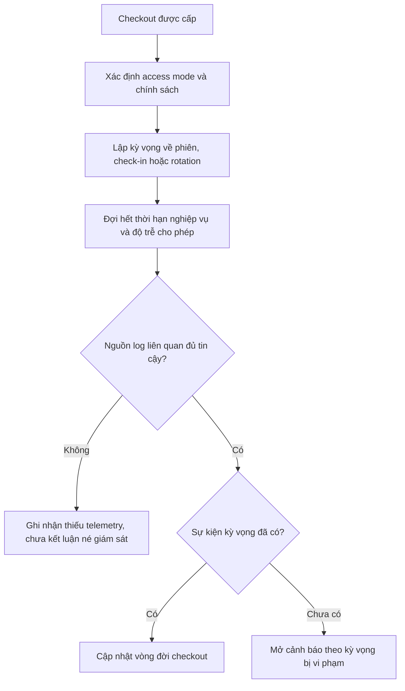

# Phát hiện bất thường khi checkout credential trong PAM

## 1. Mục tiêu và phạm vi

Trong Privileged Access Management (PAM), **credential checkout** là việc một chủ thể được cấp quyền lấy hoặc sử dụng một thông tin xác thực do hệ thống quản lý. Chủ thể có thể là quản trị viên, tài khoản dịch vụ, pipeline triển khai hoặc một workload. Credential có thể là mật khẩu, khóa SSH, token hay một bí mật dùng để truy cập tài nguyên đặc quyền.

Một lần checkout được PAM chấp nhận vẫn có thể đáng ngờ: người yêu cầu dùng tài khoản bị chiếm đoạt, chọn sai tài nguyên, truy xuất hàng loạt bí mật, dùng phê duyệt hết hiệu lực hoặc lấy credential rồi sử dụng ngoài đường truy cập được giám sát. Vì vậy, monitoring phải kiểm tra cả quyết định cấp quyền, hành vi truy xuất và những gì xảy ra sau đó.

Sau bài học, người học có thể:

- Phân biệt bất thường hành vi với vi phạm chính sách đã có bằng chứng.
- Xác định các sự kiện cần thu thập mà không đưa giá trị credential vào log.
- Thiết kế quy tắc dựa trên danh tính, tài nguyên, phê duyệt, tần suất và vòng đời checkout.
- Điều tra cảnh báo bằng cách nối sự kiện PAM với IAM, máy đích, hệ thống phiên và quy trình thay đổi.
- Chọn biện pháp xử lý tương xứng, có xét rủi ro gián đoạn của tài khoản quản trị và tài khoản dịch vụ.

Các tên trường, sơ đồ sự kiện, ngưỡng và quy tắc trong bài là mô hình minh họa độc lập sản phẩm. Khi triển khai, phải ánh xạ sang dữ liệu và khả năng thực tế của hệ thống PAM, vault, SIEM và tài nguyên đích.

## 2. Hiểu đúng một lần checkout

### 2.1. Tách yêu cầu, cấp quyền và sử dụng

Không gộp mọi hoạt động thành một sự kiện mang tên `checkout`. Cần phân biệt ít nhất các mốc sau:

| Mốc | Điều có thể kết luận | Điều chưa thể kết luận |
| --- | --- | --- |
| Yêu cầu truy cập được gửi | Có chủ thể yêu cầu một credential hoặc quyền sử dụng | Credential đã được cấp |
| Yêu cầu được phê duyệt | Một phê duyệt tồn tại với phạm vi và thời hạn cụ thể | Checkout sau đó nằm đúng phạm vi phê duyệt |
| Checkout được cấp | PAM đã tạo quyền sử dụng hoặc cho phép truy xuất theo cơ chế của nó | Giá trị bí mật đã được hiển thị, hay đăng nhập đích đã thành công |
| Bí mật được hiển thị hoặc trả về | Một bên nhận đã có khả năng tiếp cận giá trị bí mật, nếu cơ chế có xuất bí mật | Bên nhận đã dùng bí mật |
| Credential được dùng trên đích | Có dấu vết xác thực hoặc phiên tương ứng trên đích | Mọi hành động trong phiên đều hợp lệ |
| Check-in hoặc hết thời hạn checkout | Một trạng thái quản lý trong PAM đã kết thúc | Mọi bản sao của bí mật hoặc mọi phiên đang mở đã mất hiệu lực |
| Rotation và xác minh thành công | Credential mới đã được áp dụng và kiểm tra theo cơ chế tương ứng | Mọi token hay phiên phát sinh trước đó đều bị thu hồi |

Ở cơ chế broker hoặc credential injection, người dùng có thể mở phiên mà không nhìn thấy mật khẩu. Khi đó, sự kiện truy xuất nội bộ bởi connector không nên bị gán cho hành vi tải mật khẩu thủ công của người dùng. Ngược lại, khi bí mật tĩnh đã được xuất ra, việc đóng cửa sổ checkout không xóa được bản sao mà bên nhận đã giữ.

### 2.2. Bất thường, vi phạm chính sách và sự cố

**Bất thường** là độ lệch so với hành vi được kỳ vọng trong một ngữ cảnh. Ví dụ, quản trị viên lần đầu checkout lúc nửa đêm từ thiết bị mới. Điều này có thể là một ca trực hợp lệ.

**Vi phạm chính sách** có thể được xác nhận khi có đủ bằng chứng đối chiếu với chính sách có hiệu lực tại thời điểm hành động. Ví dụ, checkout credential quản trị cơ sở dữ liệu production trong khi phê duyệt chỉ cho phép tài khoản chỉ đọc của môi trường kiểm thử.

**Sự cố an ninh** là kết luận cần điều tra thêm theo quy trình tổ chức. Một vi phạm có thể bắt nguồn từ cấu hình sai, lỗi tích hợp, thao tác nhầm hoặc tài khoản bị chiếm đoạt. Không tự động diễn giải mọi cảnh báo thành hành vi đánh cắp credential.

Ba lớp này cần trường kết quả riêng trong hồ sơ điều tra. Nếu dùng nhãn `compromised` ngay khi phát hiện một nguồn truy cập mới, đội vận hành sẽ khó phân biệt nghi vấn với sự kiện đã được xác minh.

## 3. Dữ liệu giám sát và khóa liên kết

### 3.1. Các nguồn dữ liệu cần nối

Chỉ đếm log của vault thường không đủ. Mô hình điều tra nên kết nối các nguồn sau trong phạm vi quyền được cấp:

| Nguồn | Dữ liệu hữu ích | Câu hỏi được hỗ trợ |
| --- | --- | --- |
| PAM hoặc vault | Yêu cầu, quyết định, checkout, reveal, check-in, rotation | Ai được cấp credential nào và khi nào? |
| IAM và xác thực | Đăng nhập, phương thức xác thực, phiên danh tính, thay đổi quyền | Chủ thể đã được xác thực ra sao? Quyền vừa thay đổi không? |
| Hệ thống phê duyệt hoặc quản lý thay đổi | Phạm vi tài nguyên, người phê duyệt, cửa sổ thao tác, trạng thái phiếu | Hành động có đúng việc và đúng thời hạn được duyệt không? |
| Broker hoặc session manager | Phiên đặc quyền, connector, đích, thời điểm mở và đóng | Checkout có đi qua đường truy cập được quản lý không? |
| Máy đích và ứng dụng | Kết quả xác thực, tài khoản đích, hành động nhạy cảm | Credential có được dùng và đã tác động gì? |
| Giám sát pipeline log | Độ trễ, mất nguồn, lỗi parser, watermark | Có đủ dữ liệu để kết luận một sự kiện không xuất hiện không? |

Dùng nguồn có thẩm quyền cho từng thuộc tính. Tên phiếu do người dùng nhập không chứng minh phiếu đã được duyệt; địa chỉ IP nhìn thấy tại vault có thể là proxy; người gọi API có thể là connector thay mặt người khác.

### 3.2. Mô hình sự kiện tối thiểu

Ví dụ dưới đây chỉ ghi định danh và ngữ cảnh kiểm soát, không ghi giá trị bí mật:

```json
{
  "event_id": "evt-000184",
  "event_type": "credential_checkout_granted",
  "event_time": "2026-06-18T02:11:00Z",
  "ingest_time": "2026-06-18T02:11:04Z",
  "tenant_id": "org-lab",
  "pam_instance_id": "pam-primary",
  "actor_id": "user-184",
  "actor_type": "human",
  "requester_id": "connector-02",
  "identity_session_id": "ids-8301",
  "checkout_id": "co-5107",
  "request_id": "req-5107",
  "credential_id": "cred-db-prod-admin",
  "credential_version_id": "ver-17",
  "target_id": "db-prod-03",
  "environment": "production",
  "privilege_tier": "critical",
  "access_mode": "reveal",
  "approval_id": "apr-810",
  "policy_version": "pam-policy-42",
  "source_device_id": "device-92",
  "source_network_zone": "admin-network",
  "checkout_expires_at": "2026-06-18T02:26:00Z",
  "decision": "allow",
  "managed_session_id": null
}
```

Ý nghĩa của một số trường cần được thống nhất trước khi xây rule:

- `actor_id` là chủ thể hưởng hoặc thực hiện quyền, còn `requester_id` là bên gửi yêu cầu kỹ thuật. Một connector không được làm mất danh tính người đứng sau.
- `credential_id` là định danh ổn định của đối tượng bí mật; `credential_version_id` phân biệt các phiên bản nếu sản phẩm có cung cấp. Không dùng chính mật khẩu làm khóa nối.
- `checkout_id` liên kết vòng đời checkout. Khi ID chỉ duy nhất trong từng hệ thống, khóa đầy đủ phải gồm cả tenant và PAM instance.
- `request_id`, `approval_id` và `managed_session_id` liên kết các thực thể khác nhau, không được thay thế lẫn nhau.
- `event_time` dùng để tái dựng thứ tự nghiệp vụ; `ingest_time` giúp đánh giá độ trễ và giải thích sự kiện đến sai thứ tự.
- `policy_version` hỗ trợ đối chiếu chính sách tại thời điểm cấp quyền. Dùng cấu hình hiện tại để phán xét sự kiện cũ có thể tạo kết luận sai.

Giá trị `null` của `managed_session_id` chỉ có nghĩa trường này chưa có giá trị trong sự kiện đó. Nó có thể do access mode không dùng broker, thiếu tích hợp hoặc log phiên đến muộn. Không tự kết luận người dùng đã né giám sát.

### 3.3. Không thu thập bí mật vào pipeline phát hiện

Loại khỏi log mật khẩu, private key, token truy cập, cookie phiên, authorization header và nội dung phản hồi chứa bí mật. Payload lỗi, bản ghi debug hoặc URL có query string cũng có thể làm lộ credential.

Không băm mật khẩu rồi dùng hash như một cách thay thế mặc định. Với bí mật yếu hoặc có không gian giá trị nhỏ, hash vẫn có thể hỗ trợ dò đoán. Định danh credential do vault cấp và định danh phiên bản phù hợp hơn cho mục đích liên kết.

Log an ninh cũng cần kiểm soát đọc, lưu giữ và truy vết truy cập. Đội điều tra thường cần biết tài khoản nào đã được cấp quyền, nhưng không vì thế cần được đọc toàn bộ bí mật của tài khoản đó.

## 4. Xây baseline theo ngữ cảnh

Baseline trả lời câu hỏi: đối với chủ thể này, loại tài nguyên này và loại công việc này, hành vi nào thường được kỳ vọng? Một baseline chung cho toàn bộ người dùng và workload rất dễ che khuất bất thường.

### 4.1. Các chiều cần phân nhóm

| Chiều phân nhóm | Ví dụ | Lý do cần phân biệt |
| --- | --- | --- |
| Loại chủ thể | Người dùng, workload, tài khoản khẩn cấp | Tần suất và cách xác thực khác nhau |
| Vai trò và nhiệm vụ | DBA, quản trị hệ điều hành, triển khai ứng dụng | Phạm vi credential hợp lệ khác nhau |
| Môi trường và mức đặc quyền | Lab, staging, production; tài khoản root hoặc read-only | Cùng hành vi nhưng tác động khác nhau |
| Kênh truy cập | Broker, reveal thủ công, API của workload | Ý nghĩa của một lần đọc bí mật khác nhau |
| Thời gian | Lịch trực, cửa sổ thay đổi, múi giờ công việc | Ngoài giờ hành chính chưa chắc ngoài nhiệm vụ |
| Chu kỳ nghiệp vụ | Triển khai, sao lưu, khôi phục, diễn tập | Một đợt burst có thể được lên kế hoạch |

Với một workload triển khai, vài trăm lần gọi lấy cùng một bí mật có thể xuất phát từ retry hoặc thiếu cache phù hợp. Với một quản trị viên, lần đầu truy xuất nhiều credential production thuộc các nhóm tài sản khác nhau đáng được xem xét riêng. Vì vậy phải đo cả tổng số sự kiện và số credential khác nhau.

### 4.2. Baseline có lịch sử và baseline cho chủ thể mới

Với chủ thể có đủ lịch sử sạch, có thể theo dõi phân bố số credential khác nhau trong một cửa sổ, thời lượng giữ checkout và nhóm tài nguyên thường truy cập. Loại bỏ sự kiện trùng trước khi tính.

Với chủ thể mới hoặc vai trò vừa thay đổi, dữ liệu cá nhân chưa đủ tin cậy. Có thể tham chiếu nhóm đồng cấp cùng nhiệm vụ, kết hợp chính sách phạm vi và xác minh tăng cường cho hành động nhạy cảm. Ghi rõ `insufficient_history` thay vì biến sự thiếu dữ liệu thành điểm hành vi bất thường tuyệt đối.

Không tự học mọi sự kiện gần nhất thành bình thường. Một hành vi lạm dụng kéo dài có thể làm lệch baseline. Các sự kiện đang điều tra, vi phạm đã xác nhận và cửa sổ dữ liệu chất lượng thấp cần được xử lý theo quy trình quản trị mô hình hoặc rule.

### 4.3. Ngưỡng chỉ là giả thuyết vận hành

Ví dụ, ngưỡng minh họa `>= 6 credential khác nhau trong 10 phút` chỉ có ý nghĩa đối với một nhóm chủ thể, môi trường và kênh truy cập xác định. Không áp dụng nguyên giá trị này cho mọi workload.

Trước khi bật thông báo chính thức, chạy rule ở chế độ quan sát, kiểm tra các đợt triển khai và bảo trì hợp lệ, rồi điều chỉnh theo tác động và khả năng xử lý của đội vận hành. Một rule phát hiện rất nhiều sự kiện nhưng không ai có thể điều tra kịp có thể làm tăng thời gian bỏ sót sự cố thực.

## 5. Những nhóm bất thường cần phát hiện

### 5.1. Checkout không khớp quyền hoặc phê duyệt

Đối chiếu credential, tài nguyên đích, môi trường, mức đặc quyền, danh tính hưởng quyền, phương thức truy cập và thời hạn với quyền được cấp. Một phiếu được duyệt cho `db-staging-ro` không cho phép checkout `db-prod-admin`.

Kiểm tra phê duyệt có hiệu lực tại thời điểm checkout theo hợp đồng của chính sách. Nếu chính sách yêu cầu quyền sử dụng tiếp tục nằm trong cửa sổ được duyệt, cần kiểm tra cả khoảng sử dụng; nếu chỉ quy định thời điểm bắt đầu thì không tự thêm điều kiện khác.

Các tín hiệu có giá trị gồm:

- Checkout được cấp khi quyết định độc lập cho thấy chủ thể không có entitlement tương ứng.
- Dùng lại phê duyệt cho tài nguyên, người hưởng quyền hoặc access mode ngoài phạm vi.
- Checkout bắt đầu sau khi phê duyệt bị thu hồi hoặc hết hiệu lực.
- Tự phê duyệt trong khi chính sách đang áp dụng yêu cầu tách biệt người yêu cầu và người duyệt.

Nếu không truy xuất được bản phê duyệt, kết quả đúng là chưa xác minh được phê duyệt. Chỉ kết luận không có phê duyệt khi nguồn dữ liệu đủ đầy và chính sách yêu cầu loại phê duyệt đó.

### 5.2. Truy xuất tăng đột biến hoặc quét nhiều credential

Theo dõi ít nhất ba đại lượng khác nhau:

1. Tổng số lần checkout hoặc reveal, để thấy retry và tải truy cập.
2. Số credential khác nhau, để phát hiện mở rộng phạm vi truy xuất.
3. Số nhóm tài nguyên hoặc mức đặc quyền khác nhau, để thấy việc vượt ra khỏi nhiệm vụ thông thường.

Có thể gom theo chủ thể hưởng quyền, phiên danh tính và cửa sổ thời gian, thay vì chỉ theo IP. Một IP NAT có thể đại diện cho nhiều người; một người có thể dùng nhiều kết nối.

Chuỗi yêu cầu bị từ chối rồi được cấp credential đặc quyền cao là tín hiệu điều tra hữu ích. Tuy nhiên, từ chối lặp lại cũng có thể do ứng dụng dùng sai đường dẫn hoặc lỗi quyền sau một thay đổi. Cần giữ cả kết quả và lý do từ chối để phân biệt.

### 5.3. Nguồn truy cập hoặc ngữ cảnh mới

Checkout từ thiết bị chưa được quản lý, vùng mạng mới hoặc phiên danh tính có bất thường có thể làm tăng mức ưu tiên. Không đánh đồng IP mới với thiết bị mới; không suy vị trí vật lý chính xác từ địa chỉ IP của proxy hay VPN.

Đối với workload, các thuộc tính như workload identity, môi trường chạy, job triển khai, namespace và đường gọi được kỳ vọng thường hữu ích hơn khái niệm giờ làm việc. Một job sao lưu chạy hằng đêm không phải bất thường chỉ vì diễn ra ngoài giờ hành chính.

Khi dữ liệu trạng thái thiết bị thiếu hoặc lỗi thời, giữ trạng thái `unknown`. Biến `unknown` thành `untrusted` có thể gây cảnh báo sai hàng loạt khi nguồn quản lý thiết bị gặp lỗi.

### 5.4. Reveal bất thường và sử dụng ngoài đường được quản lý

Nếu chính sách chỉ cho phép broker hoặc injection, một sự kiện reveal thủ công được cấp có thể là vi phạm đáng ưu tiên. Phải đối chiếu cấu hình ngoại lệ tại thời điểm đó, đặc biệt với quy trình break-glass.

Nếu credential đã được reveal rồi tài khoản đích được dùng từ đường mạng hoặc thiết bị ngoài phạm vi cho phép, ghép các bằng chứng lại. Với tài khoản dùng chung, trùng thời gian và tên tài khoản chưa đủ để quy trách nhiệm cho một cá nhân. Mức tin cậy tăng khi có thêm liên kết phiên, nguồn kết nối và dấu vết hoạt động.

Không có bản ghi phiên quản lý chưa chứng minh đã truy cập trực tiếp. Cần biết access mode có bắt buộc tạo phiên hay không, nguồn log phiên có hoạt động không và đã qua thời gian chờ dữ liệu đến muộn chưa.

### 5.5. Vòng đời checkout kéo dài hoặc credential chưa được vô hiệu hóa

Phát hiện checkout quá hạn theo chính sách, check-in thiếu, nhiều checkout đồng thời ngoài giới hạn, rotation lỗi hoặc xác minh credential mới thất bại sau một lần sử dụng cần rotation.

Cần tách hai vấn đề:

- Trạng thái checkout trong PAM chưa kết thúc đúng kỳ vọng.
- Credential cũ có còn được chấp nhận trên tài nguyên đích hay không.

Một bản ghi `checkout_expired` chỉ giải quyết vấn đề đầu theo ngữ nghĩa sản phẩm. Với mật khẩu tĩnh đã được lộ, muốn giảm khả năng dùng lại thường cần thay credential trên đích và xác minh kết quả. Với credential động, cần kiểm tra khả năng hết hạn hoặc thu hồi thực sự tại hệ thống đích. Các phiên đã mở có thể cần xử lý riêng.

Không tự động coi `rotation_requested` hay `rotation_started` là đã an toàn. Sự kiện hoàn tất, kết quả xác minh và tác động tới các consumer mới là dữ liệu quyết định.

### 5.6. Tài khoản break-glass và tài khoản dịch vụ

Break-glass cần được nhận diện rõ trong pipeline. Quy trình khẩn cấp có thể hợp lệ dù không theo luồng phê duyệt thường, nhưng vẫn cần thông báo, lý do, giới hạn phạm vi, theo dõi sử dụng và hậu kiểm theo chính sách tổ chức.

Tài khoản dịch vụ cần quy tắc phù hợp với consumer. Một lần tải credential của dịch vụ từ giao diện người dùng có thể đáng chú ý dù tổng số lần checkout thấp. Ngược lại, burst API đúng workload trong một đợt scale-out không nên bị coi như một người tải hàng loạt mật khẩu.

Việc chặn hoặc thay credential dùng chung có thể làm gián đoạn nhiều dịch vụ. Kế hoạch xử lý phải xác định owner, consumer, cơ chế cập nhật và phương án khôi phục trước các hành động có tác động lớn.

## 6. Từ tín hiệu thành cảnh báo có thể điều tra

### 6.1. Tách mức độ nghiêm trọng khỏi độ tin cậy

Mức độ nghiêm trọng phản ánh tác động tiềm tàng; độ tin cậy phản ánh chất lượng bằng chứng. Một checkout vào tài khoản Tier 0 có tác động cao dù thiếu log để quy kết. Một vi phạm phê duyệt đã đối chiếu đầy đủ có độ tin cậy cao dù tài nguyên chỉ là lab.

Cấu trúc cảnh báo nên giữ hai chiều này cùng với lý do cụ thể:

```yaml
alert_type: credential_checkout_anomaly
entity:
  tenant_id: org-lab
  actor_id: user-184
  checkout_id: co-5107
  credential_id: cred-db-prod-admin
severity: high
confidence: high
reasons:
  - approval_scope_mismatch
  - approval_expired_before_checkout
  - distinct_credential_burst
evidence:
  checkout_event_id: evt-000184
  approval_snapshot_id: approval-snapshot-810
  policy_version: pam-policy-42
telemetry:
  pam_source_healthy: true
  approval_source_healthy: true
  target_log_state: delayed
investigation_status: open
```

Ví dụ này chưa kết luận danh tính đã bị chiếm đoạt. Nó nêu rõ điều gì được phát hiện, bằng chứng ở đâu và nguồn nào còn chậm.

### 6.2. Phối hợp các tín hiệu độc lập

Có thể dùng điểm rủi ro để sắp thứ tự điều tra, nhưng không nên để một tổng điểm che mất vi phạm chính sách chắc chắn. Một thiết kế minh họa:

| Nhóm | Cách xử lý minh họa |
| --- | --- |
| Vi phạm chính sách đã được đối chiếu | Áp dụng mức ưu tiên tối thiểu tương ứng tác động tài nguyên |
| Ngữ cảnh danh tính hoặc nguồn mới | Tính một đóng góp cho nhóm ngữ cảnh, tránh cộng lặp IP mới và vùng mạng mới cho cùng nguyên nhân |
| Burst hoặc mở rộng phạm vi tài nguyên | Tính một đóng góp hành vi dựa trên baseline phù hợp |
| Vòng đời và rotation | Tăng ưu tiên khi khả năng tái sử dụng credential còn tồn tại hoặc chưa xác minh |
| Chất lượng dữ liệu | Ghi riêng để điều chỉnh độ tin cậy; không cộng như bằng chứng tấn công |

Nếu dùng điểm số, giới hạn đóng góp trong từng nhóm và lưu phiên bản công thức. Các ngưỡng phân mức phải được hiệu chỉnh từ dữ liệu vận hành. Không diễn giải điểm `80/100` thành xác suất 80% bị xâm nhập nếu chưa có mô hình được hiệu chuẩn cho ý nghĩa đó.

### 6.3. Logic phát hiện burst minh họa

Đây là giả mã cho xử lý sự kiện, không phải cú pháp của một SIEM hoặc API PAM cụ thể:

```text
when event.type == credential_checkout_granted:
    validate tenant, actor, credential, event_time
    deduplicate using (tenant_id, pam_instance_id, event_id)

    group = (tenant_id, actor_id, actor_type, environment, access_mode)
    add event to an event-time rolling window for group
    distinct_credentials = count_distinct(credential_id within 10 minutes)

    if group.actor_type == human
       and group.environment == production
       and group.access_mode == reveal
       and distinct_credentials >= 6:
        upsert alert using the configured episode-correlation policy
        attach contributing event IDs and baseline context
        mark threshold as illustrative until locally calibrated
```

Việc đếm phải xác định rõ cửa sổ có bao gồm đầu và cuối hay không, cách xử lý sự kiện đến muộn và cách gộp một chuỗi cảnh báo. Nếu chỉ dùng bucket cố định 10 phút, một burst nằm vắt qua ranh giới bucket có thể bị tách đôi. Cửa sổ trượt giúp giảm trường hợp này, nhưng cần kiểm soát chi phí và trạng thái.

Một pipeline có thể nhận lại cùng sự kiện sau retry. Chỉ đếm sau khi khử trùng; nếu nguồn không có `event_id`, phải thiết kế khóa thay thế và đánh giá nguy cơ gộp nhầm hai sự kiện thực sự khác nhau.

### 6.4. Phát hiện thiếu sự kiện theo điều kiện

Đối với một checkout đã được cấp, có thể đặt các kỳ vọng về check-in, phiên hoặc rotation theo access mode và chính sách. Kỳ vọng cần có thời hạn và điều kiện dữ liệu:



Ví dụ, chỉ phát hiện `missing_managed_session` khi chính sách bắt buộc broker, checkout đã đạt mốc cần mở phiên, nguồn log phiên còn hoạt động và đã qua độ trễ cho phép. Một checkout được cấp rồi người dùng hủy thao tác có thể không bao giờ tạo phiên; chính sách phải xác định trường hợp đó có thực sự là vi phạm hay chỉ cần kết thúc quyền đã cấp.

## 7. Quy trình điều tra và ứng phó

### 7.1. Xác nhận đối tượng và chất lượng dữ liệu

Bắt đầu từ `checkout_id`, tenant và PAM instance. Kiểm tra sự kiện có bị lặp, parser có đúng, múi giờ đã được chuẩn hóa và thời gian nguồn có đáng tin không. Phân biệt sự kiện hiện tại với log cũ vừa được chuyển lại sau gián đoạn.

Kiểm tra actor là người hay workload, requester có phải connector không, credential thuộc tài nguyên nào và mức đặc quyền thực tế ra sao. Với tài khoản dùng chung, giữ danh tính người yêu cầu và tài khoản đích ở hai trường khác nhau.

### 7.2. Xác minh quyền và công việc được duyệt

Đối chiếu phiên bản chính sách, entitlement và phê duyệt tại thời điểm checkout. Kiểm tra tài nguyên, thời hạn, người hưởng quyền, access mode và điều kiện tách biệt nhiệm vụ nếu có.

Đọc trạng thái thực của phiếu thay đổi, thay vì chỉ nhìn thấy một ticket ID trong lý do truy cập. Liên hệ người dùng hoặc owner qua kênh đã biết để xác minh công việc khi cần; phản hồi trong chính phiên bị nghi ngờ không phải bằng chứng độc lập đủ mạnh.

### 7.3. Tái dựng việc sử dụng

Lập dòng thời gian từ yêu cầu, cấp quyền, reveal hoặc injection đến đăng nhập đích, thao tác nhạy cảm, check-in và rotation. Giữ riêng sự kiện quan sát được với suy luận.

Nếu thấy đăng nhập bằng cùng tài khoản đích trong khoảng thời gian checkout, ghi mức độ liên kết và giới hạn quy trách nhiệm. Khi một tài khoản dùng chung có nhiều checkout đồng thời, cần bổ sung bằng chứng trước khi gắn toàn bộ hành động cho một người.

Nếu không thấy sử dụng, kiểm tra độ bao phủ và độ trễ log. Một credential bị truy xuất ngoài quyền vẫn có thể cần xử lý ngay dù chưa quan sát thấy lần sử dụng nào.

### 7.4. Chọn hành động theo bằng chứng và tác động

| Tình trạng quan sát được | Hành động có thể cân nhắc theo thẩm quyền | Điểm phải xác minh |
| --- | --- | --- |
| Thiết bị hoặc thời gian mới, công việc vẫn đúng quyền | Xác minh danh tính, yêu cầu xác thực tăng cường, theo dõi | Có phải ca trực hoặc thay đổi hợp lệ không? |
| Checkout sai phạm vi phê duyệt | Ngăn checkout mới trong phạm vi liên quan, thu hồi quyền còn hiệu lực | Quyền thu hồi tác động tới ai và dịch vụ nào? |
| Bí mật đã được xuất và nghi bị lộ | Rotation hoặc thu hồi credential tại đích theo runbook | Credential cũ đã bị vô hiệu hóa và consumer đã được cập nhật chưa? |
| Phiên đặc quyền đang có hành vi nguy hiểm | Cô lập hoặc kết thúc đúng phiên nếu được phép | Có ảnh hưởng tới tác vụ đang chạy và bằng chứng điều tra không? |
| Rotation của tài khoản dịch vụ thất bại | Phối hợp owner, sửa trạng thái credential và consumer | Tránh tạo lệch credential làm ngừng dịch vụ |
| Nguồn log mất hoặc chậm | Khôi phục telemetry và bổ sung giám sát tạm thời | Chưa được coi dữ liệu thiếu là hành vi tấn công |

Xác thực tăng cường cho lần truy cập sau không thu hồi bí mật đã xuất trước đó. Tương tự, rotation có thể không kết thúc một phiên đã được xác thực. Runbook phải liệt kê riêng việc chặn cấp mới, thu hồi quyền, vô hiệu hóa credential cũ và xử lý phiên.

Với tài khoản production quan trọng, xác định consumer và đường khôi phục trước thao tác thay đổi có nguy cơ gián đoạn, trừ khi quy trình khẩn cấp đã cho phép biện pháp tức thời tương ứng. Không chạy thử credential nghi lộ bằng cách đăng nhập thủ công ngoài quy trình kiểm soát.

### 7.5. Lưu bằng chứng và đóng cảnh báo

Hồ sơ nên chứa ID sự kiện nguồn, thời gian và nguồn đồng hồ, bản chụp chính sách hoặc phê duyệt liên quan, các liên kết phiên, hành động ứng phó, người thực hiện, kết quả xác minh và các khoảng trống dữ liệu.

Không đưa giá trị bí mật vào hồ sơ sự cố. Nếu phát hiện log đã chứa bí mật, xử lý phần dữ liệu bị lộ và credential liên quan theo quy trình riêng, không tiếp tục sao chép payload đó vào nhiều công cụ.

Kết quả đóng có thể là hành vi hợp lệ, lỗi cấu hình hoặc tích hợp, vi phạm chính sách, sự cố đã xác nhận hoặc chưa đủ bằng chứng. Ghi lý do và thay đổi rule có liên quan; không thêm allowlist chỉ vì muốn giảm số lượng cảnh báo.

## 8. Tình huống minh họa

Một quản trị viên được duyệt truy cập tài khoản chỉ đọc `db-staging-ro` từ 01:00 đến 01:30 UTC. Lúc 02:11 UTC, hệ thống lại cấp checkout cho `db-prod-admin`, access mode `reveal`, tham chiếu cùng phê duyệt. Trong 10 phút gần đó, người này đã checkout sáu credential production khác nhau. Thiết bị truy cập chưa từng xuất hiện trong lịch sử sạch của người dùng.

| Thời điểm UTC | Sự kiện | Diễn giải điều tra |
| --- | --- | --- |
| 01:00–01:30 | Cửa sổ phê duyệt cho tài khoản staging chỉ đọc | Phạm vi được duyệt không bao gồm admin production |
| 02:03–02:11 | Sáu credential production khác nhau được cấp checkout | Đạt ngưỡng burst minh họa của nhóm người dùng |
| 02:11 | `db-prod-admin` được cấp và reveal theo phê duyệt cũ | Có bằng chứng sai phạm vi và bắt đầu sau thời hạn |
| 02:12 | Máy đích ghi nhận đăng nhập bằng tài khoản admin từ nguồn ngoài đường quản lý | Cần nối thêm nguồn và phiên để xác định bên sử dụng |
| 02:18 | Rotation của credential thất bại | Chưa thể xác nhận credential cũ đã mất hiệu lực |

Ưu tiên điều tra cao vì checkout đã vượt phạm vi và thời hạn phê duyệt trên tài nguyên đặc quyền cao. Burst và thiết bị mới bổ sung bối cảnh. Chưa thể kết luận tài khoản người dùng bị chiếm đoạt chỉ từ các tín hiệu này.

Nhóm xử lý kiểm tra bằng chứng phê duyệt, xác minh chủ thể qua kênh độc lập, giới hạn checkout mới theo thẩm quyền và đánh giá phiên đang hoạt động. Vì bí mật đã được reveal, họ phối hợp owner để thay credential trên đích, xác minh credential cũ không còn được chấp nhận bằng cơ chế kiểm tra được phê duyệt và xử lý riêng phiên hiện hữu.

Nếu phát hiện một cấu hình connector cho phép bỏ qua phạm vi approval, cần sửa nguyên nhân sau khi kiểm soát tình huống. Việc sửa rule cảnh báo không khắc phục đường cấp quyền sai.

## 9. Thực hành bằng sự kiện tổng hợp

Bài thực hành dùng dữ liệu giả; không gọi vault thật và không đưa credential thật vào log. Giả sử chính sách phòng lab quy định người dùng chỉ reveal trong phạm vi được duyệt. Ngưỡng thử nghiệm là sáu credential production khác nhau trong cửa sổ trượt 10 phút cho cùng người dùng.

### 9.1. Tập tình huống và kết quả mong đợi

| Mã | Sự kiện đầu vào | Kết quả mong đợi |
| --- | --- | --- |
| T1 | Người dùng A reveal một credential staging đúng phạm vi và thời hạn | Không mở cảnh báo burst hoặc sai phê duyệt |
| T2 | Người dùng A reveal sáu credential production khác nhau trong tám phút | Một cảnh báo burst theo chính sách gộp episode |
| T3 | Sự kiện thứ ba của T2 được nhận lại với cùng event ID | Số credential và bằng chứng không tăng do bản sao |
| T4 | Cùng người dùng có ba credential trước và ba credential sau ranh giới bucket, toàn bộ trong tám phút | Cửa sổ trượt vẫn phát hiện đủ sáu credential |
| T5 | Workload B đọc cùng một credential nhiều lần trong đợt triển khai hợp lệ | Không áp rule burst dành riêng cho người dùng; có thể mở điều tra tải hoặc retry riêng |
| T6 | Checkout tham chiếu phê duyệt staging nhưng credential thực thuộc production | Mở cảnh báo sai phạm vi sau khi đối chiếu được nguồn phê duyệt |
| T7 | Không có log phiên trong khi nguồn session manager đang mất kết nối | Ghi thiếu telemetry, chưa kết luận né phiên |
| T8 | Log phiên đến muộn nhưng vẫn trong thời gian chờ dữ liệu đã cấu hình | Cập nhật liên kết, tránh mở cảnh báo thiếu phiên quá sớm |
| T9 | Checkout hết hạn, rotation mới bắt đầu và chưa có kết quả | Vòng đời credential chưa được xác nhận an toàn |
| T10 | Có kết quả rotation thành công và xác minh đích, nhưng phiên cũ vẫn còn mở | Tách trạng thái credential với trạng thái phiên |
| T11 | Break-glass đúng quy trình khẩn cấp, đủ lý do và owner | Thông báo và hậu kiểm theo chính sách break-glass, không gán sai quy tắc approval thường |
| T12 | Một actor ID giống nhau ở hai tenant khác nhau | Không gộp hành vi hoặc bằng chứng giữa hai tenant |

### 9.2. Các bước thực hiện

1. Tạo hoặc mô phỏng sự kiện chỉ gồm định danh, thời gian, loại sự kiện và ngữ cảnh kiểm soát.
2. Chuẩn hóa event time, định danh tenant, actor, credential và access mode; kiểm tra trường bắt buộc.
3. Khử trùng sự kiện rồi dựng cửa sổ trượt cho nhóm người dùng đã xác định.
4. Đối chiếu snapshot phê duyệt và chính sách cho T6; tách trường hợp không lấy được dữ liệu đối chiếu.
5. Mô phỏng sự kiện đến muộn và nguồn log mất kết nối để xác nhận logic thiếu sự kiện.
6. Kiểm tra mỗi cảnh báo có lý do, bằng chứng nguồn và giới hạn kết luận.
7. Ghi quyết định xử lý cho T9 và T10, nêu rõ hành động nào liên quan credential và hành động nào liên quan phiên.

Điều kiện đạt là các tình huống được phân biệt đúng và có thể giải thích từ bằng chứng. Không chỉ kiểm tra tổng số cảnh báo; T2 tạo nhiều cảnh báo trùng hoặc T7 bị gắn nhãn tấn công đều là kết quả không đạt yêu cầu thiết kế.

## 10. Vận hành rule lâu dài

### 10.1. Đo độ bao phủ cùng hiệu quả phát hiện

Các chỉ số cần có mẫu số và định nghĩa rõ:

- Tỷ lệ credential đặc quyền trong phạm vi có log checkout sử dụng được trên tổng credential đặc quyền thuộc phạm vi quản lý.
- Tỷ lệ sự kiện checkout cần approval được nối thành công với bản phê duyệt có thẩm quyền.
- Tỷ lệ cảnh báo đã điều tra được xác nhận là vi phạm hoặc sự cố trên tổng cảnh báo đã có kết luận; ghi riêng số cảnh báo còn mở.
- Thời gian từ event time đến tạo cảnh báo, thời gian từ cảnh báo đến hành động và thời gian xác minh hoàn tất biện pháp xử lý.
- Tỷ lệ lỗi hoặc thiếu sự kiện vòng đời, cùng độ trễ log theo từng nguồn.
- Số episode bị mở lại vì sự kiện đến muộn, lỗi parser hoặc rotation chưa được xác minh.

Không thể suy ra số sự cố bị bỏ sót chỉ từ các cảnh báo đang có. Muốn đánh giá khả năng phát hiện, cần các tình huống kiểm thử có kết quả biết trước, diễn tập được phê duyệt và đối chiếu các sự cố thực đã được xác nhận.

### 10.2. Quản lý ngoại lệ và thay đổi

Ngoại lệ nên giới hạn theo chủ thể, credential hoặc nhóm tài nguyên, mục đích, kênh truy cập và thời hạn. Gắn owner và ngày rà soát. Một ngoại lệ cho workload triển khai không mặc nhiên áp dụng cho cùng tài khoản khi truy cập qua giao diện quản trị.

Khi thêm connector, thay cấu trúc log, đổi cách phê duyệt hoặc chuyển từ reveal sang injection, kiểm tra lại ý nghĩa sự kiện trước khi giữ nguyên rule. Theo dõi phiên bản parser và rule để có thể giải thích vì sao cùng hành vi được xử lý khác nhau ở hai thời điểm.

Nếu một đợt cảnh báo tăng đồng loạt, kiểm tra sức khỏe nguồn log và thay đổi tích hợp cùng với khả năng có sự cố. Không tắt cả nhóm kiểm soát bằng một allowlist rộng khi chưa biết nguyên nhân.

## 11. Tự kiểm tra kiến thức

**1. Checkout được PAM cấp có đồng nghĩa người dùng đã đăng nhập máy đích không?**

Không. Cần sự kiện reveal hoặc injection và bằng chứng xác thực hoặc phiên ở đích theo cơ chế sử dụng. Sự kiện grant chỉ chứng minh quyền hoặc khả năng truy xuất đã được cấp ở mốc tương ứng.

**2. Vì sao đếm credential khác nhau thường hữu ích hơn chỉ đếm tổng request?**

Tổng request dễ tăng do retry hoặc một workload đọc lặp cùng bí mật. Số credential khác nhau giúp thấy phạm vi truy xuất mở rộng, nhưng vẫn phải xét nhiệm vụ và nhóm chủ thể.

**3. Không có session ID có đủ để kết luận người dùng né giám sát không?**

Không. Phải biết access mode có yêu cầu phiên hay không, nguồn log có đủ không và dữ liệu có đến muộn không. Thiếu liên kết là một khoảng trống cần điều tra.

**4. Check-in hoặc hết hạn checkout đã giải quyết nguy cơ của mật khẩu tĩnh được reveal chưa?**

Chưa chắc. Trạng thái PAM kết thúc không xóa bản sao bí mật. Cần kiểm tra cơ chế thay hoặc thu hồi credential trên đích và xử lý phiên hiện hữu theo chính sách.

**5. Nếu credential chỉ đọc của staging được duyệt nhưng admin production được cấp, cần đợi baseline bất thường mới cảnh báo không?**

Không. Khi đối chiếu đầy đủ cho thấy sai phạm vi theo chính sách, đó là bằng chứng độc lập cần được xử lý. Baseline chỉ bổ sung bối cảnh và ưu tiên.

**6. Khi nào có thể đóng cảnh báo rotation thất bại?**

Khi nguyên nhân và tác động đã được xử lý, kết quả thay hoặc thu hồi credential được xác minh theo cơ chế phù hợp, consumer liên quan được kiểm tra và trạng thái phiên còn tồn tại đã được đánh giá. Một sự kiện bắt đầu rotation chưa đủ.

## 12. Những điểm cần nhớ

Giám sát credential checkout hiệu quả cần giữ được chuỗi danh tính, quyền được duyệt, credential, tài nguyên đích và vòng đời sử dụng. Checkout hợp lệ về mặt kỹ thuật vẫn cần được kiểm tra theo mục đích, phạm vi và ngữ cảnh.

Baseline hỗ trợ nhận ra hành vi khác thường; chính sách và bằng chứng có thẩm quyền giúp xác định vi phạm. Chất lượng telemetry quyết định giới hạn kết luận, đặc biệt khi rule dựa trên việc thiếu một sự kiện.

Biện pháp xử lý cần hướng tới trạng thái thực của credential và phiên trên đích. Với tài khoản dịch vụ hoặc credential dùng chung, phối hợp owner và consumer là một phần của việc kiểm soát rủi ro, không chỉ là thao tác thay một mật khẩu.
