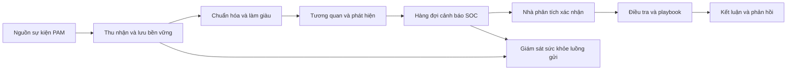

# Alert đến SOC

## 1. Mục tiêu của cảnh báo PAM gửi đến SOC

Trong hệ thống Privileged Access Management (PAM), một hoạt động bất thường chỉ có giá trị vận hành khi đến được người có trách nhiệm, kèm đủ ngữ cảnh để họ quyết định. Ghi nhận một lần dùng tài khoản quản trị ngoài chính sách, hiển thị biểu tượng đỏ trên giao diện PAM hoặc gửi thành công một yêu cầu HTTP chưa chứng minh SOC đã tiếp nhận và xử lý sự việc.

SOC (Security Operations Center) cần biết ai đang làm gì, trên tài sản nào, quyền đến từ đâu, hành vi có được phê duyệt không và cần hành động tiếp theo nào. Với quyền đặc biệt, sự chậm trễ hoặc hiểu sai ngữ cảnh có thể ảnh hưởng cả hệ thống sản xuất. Ngược lại, gửi mọi sự kiện thành cảnh báo khẩn cấp sẽ làm hàng đợi quá tải và che khuất các tình huống thật sự quan trọng.

Bài học tập trung vào thiết kế đường đi từ tín hiệu PAM đến hàng đợi xử lý của SOC: chọn tín hiệu, chuẩn hóa dữ liệu, tương quan và làm giàu, phân tuyến, bảo đảm chuyển giao, xác nhận tiếp nhận và phản hồi kết quả. Các tên trường, mốc thời gian và tình huống dưới đây là ví dụ thiết kế, không phải cấu hình bắt buộc của một sản phẩm PAM hay SIEM cụ thể.

Sau bài học, người học có thể:

- Phân biệt sự kiện, phát hiện, cảnh báo và hồ sơ sự cố.
- Thiết kế cảnh báo để SOC điều tra được mà không mang theo credential hoặc dữ liệu nhạy cảm không cần thiết.
- Xây dựng cơ chế giao nhận có retry, chống trùng, theo dõi thất bại và chuyển tuyến khi không có người nhận.
- Gắn cảnh báo với playbook phù hợp, quyền thực thi và bằng chứng kết thúc.
- Đo chất lượng toàn bộ luồng cảnh báo thay vì chỉ đếm số thông báo đã gửi.

## 2. Phân biệt sự kiện, phát hiện, cảnh báo và sự cố

| Khái niệm | Ý nghĩa | Ví dụ trong PAM |
| --- | --- | --- |
| Sự kiện (event) | Một bản ghi về điều đã xảy ra hoặc trạng thái được quan sát | Một tài khoản bắt đầu phiên quản trị lúc 09:00 |
| Phát hiện (detection) | Kết quả đánh giá một hay nhiều sự kiện theo logic giám sát | Phiên có thao tác sau hạn của quyền JIT |
| Cảnh báo (alert) | Đơn vị cần được phân loại hoặc xử lý, có mức ưu tiên và ngữ cảnh | Yêu cầu SOC kiểm tra phiên còn thao tác sau khi quyền hết hạn |
| Hồ sơ sự cố (incident/case) | Hồ sơ phối hợp điều tra, quyết định và theo dõi xử lý | Một hồ sơ tập hợp nhiều phiên có dấu hiệu sử dụng credential bị lộ |
| Thông báo (notification) | Phương tiện báo cho người hoặc hệ thống biết về cảnh báo | Tin nhắn trực ca chứa mã cảnh báo và liên kết hồ sơ |

Không nên tạo một hồ sơ sự cố cho từng dòng log. Một lần thử đăng nhập thất bại có thể chỉ là sự kiện, nhiều lần thất bại kèm truy cập thành công từ nguồn chưa biết có thể tạo phát hiện, và một hồ sơ sự cố có thể tập hợp nhiều cảnh báo cùng nguyên nhân.

Thông báo cũng không phải nơi lưu hồ sơ chính thức. Tin nhắn có thể bị bỏ qua, email có thể đến chậm và cuộc gọi có thể không được trả lời. Hàng đợi SOC hoặc hệ thống quản lý hồ sơ mới là nơi theo dõi người nhận, thời điểm xác nhận, quyết định và bằng chứng.

## 3. Luồng bàn giao từ PAM đến SOC

Một luồng điển hình có thể được tổ chức như sau:



Các vai trò trong sơ đồ là chức năng, không nhất thiết tương ứng với các sản phẩm riêng. Một nền tảng có thể làm nhiều chức năng; một tổ chức khác có thể phân tách PAM, bộ thu log, SIEM, hệ thống quản lý hồ sơ và SOAR.

### 3.1. Nguồn sự kiện cần quan sát

Nguồn PAM có thể bao gồm yêu cầu cấp quyền, quyết định phê duyệt, checkout credential, kết quả luân chuyển, bắt đầu và kết thúc phiên, thao tác quản trị, thay đổi chính sách và hoạt động của thành phần ghi hình phiên. Hệ điều hành hoặc ứng dụng đích cũng có thể cung cấp dữ liệu để đối chiếu.

Không nên coi sự vắng mặt của sự kiện từ một nguồn là bằng chứng hoạt động không xảy ra. Nếu kẻ tấn công hoặc sự cố kỹ thuật làm gián đoạn nguồn thu nhận, SOC có thể mất tầm nhìn đúng lúc cần quan sát nhất. Vì vậy, cần cảnh báo riêng về mất nguồn log, tăng độ trễ hoặc lỗi collector.

### 3.2. Thu nhận trước, thông báo sau

Với cảnh báo quan trọng, đường gửi cần có cơ chế lưu lại dữ liệu trước khi phụ thuộc vào một đích nhận từ xa. Hàng đợi bền vững hoặc nhật ký gửi giúp phục hồi khi đích nhận bảo trì, đường truyền gián đoạn hoặc tiến trình gửi khởi động lại.

Lưu bền vững không loại bỏ mọi rủi ro. Cần xác định dung lượng, thời gian giữ, hành vi khi đầy và người xử lý. Nếu đệm đầy mà hệ thống âm thầm bỏ dữ liệu, giao diện có thể vẫn báo hoạt động bình thường trong khi SOC đang mất cảnh báo.

### 3.3. Làm giàu bằng dữ liệu có nguồn và thời điểm

Một cảnh báo hữu ích thường cần thêm chủ sở hữu tài sản, môi trường, mức quan trọng, yêu cầu cấp quyền, ticket thay đổi và trạng thái phê duyệt. Cần ghi nhận nguồn làm giàu và thời điểm dữ liệu có hiệu lực.

Ví dụ, thông tin tài sản truy vấn lúc 10:10 có thể khác với thông tin tại thời điểm phiên bắt đầu lúc 10:00. Nếu không có dữ liệu lịch sử, cảnh báo phải thể hiện đây là ngữ cảnh hiện tại, không trình bày như bằng chứng chắc chắn về trạng thái quá khứ.

## 4. Chọn tín hiệu PAM cần đưa vào hàng đợi SOC

Không có một danh sách mức ưu tiên cố định áp dụng cho mọi tổ chức. Có thể dùng các nhóm sau làm điểm xuất phát rồi điều chỉnh theo tài sản, khả năng kiểm soát và mô hình trực ca.

| Tín hiệu | Điều SOC cần xác minh | Ngữ cảnh ảnh hưởng mức ưu tiên |
| --- | --- | --- |
| Quyền JIT đã hết hạn nhưng vẫn có thao tác mới | Hạn quyền thực tế, thời điểm thao tác và chính sách thu hồi phiên | Tài sản sản xuất, loại thao tác, khả năng tiếp tục dùng quyền |
| Sử dụng break-glass | Lý do khẩn cấp, danh tính người dùng và phạm vi đã cấp | Có sự cố đang được chỉ huy không, có giám sát và review sau dùng không |
| Truy cập đặc quyền thiếu phê duyệt hợp lệ | Có kênh cấp quyền khác, ngoại lệ hoặc dữ liệu phê duyệt đến chậm không | Mức nhạy cảm tài sản, độ đầy đủ của dữ liệu và chính sách thực tế |
| Thay đổi chính sách ghi log hoặc ghi hình | Ai thay đổi, có được phép và có ticket không | Phạm vi mất quan sát, có phiên đặc quyền đang hoạt động không |
| Luân chuyển credential thất bại | Credential cũ còn hiệu lực ở đâu và nguyên nhân thất bại | Có dấu hiệu lộ credential không, số hệ thống phụ thuộc và mức ảnh hưởng |
| Tài khoản dịch vụ có hành vi tương tác bất thường | Tài khoản có được phép dùng tương tác hay không | Tài sản, nguồn truy cập, baseline và thay đổi hợp lệ gần đây |
| Mất nguồn sự kiện hoặc tăng backlog | Nguồn đang ngừng hoạt động hay collector gặp lỗi | Các nguồn thay thế, khoảng thời gian mất tầm nhìn và lượng dữ liệu bị ảnh hưởng |

Break-glass được dùng đúng quy trình vẫn có thể phải thông báo hoặc tạo cảnh báo để bảo đảm review. Nó không tự động đồng nghĩa tài khoản đã bị xâm nhập. Tương tự, thất bại luân chuyển credential có thể là sự cố vận hành nhưng trở thành vấn đề an ninh ưu tiên cao nếu credential đang bị nghi lộ và chưa thu hồi được.

Một phiên vẫn kết nối sau khi quyền JIT hết hạn cũng chưa đủ chứng minh có thao tác trái phép. Chính sách có thể cho phép hoàn tất một tác vụ đã bắt đầu hoặc chỉ chặn kết nối mới. Rule cần phản ánh đúng hợp đồng quyền của hệ thống, phân biệt trạng thái kết nối với hoạt động mới đã được xác thực.

## 5. Hợp đồng dữ liệu của cảnh báo

### 5.1. Các trường giúp SOC bắt đầu điều tra

Một cảnh báo nên có tối thiểu các nhóm thông tin sau:

| Nhóm | Trường ví dụ | Mục đích |
| --- | --- | --- |
| Định danh | `alert_id`, `rule_id`, `rule_version`, `schema_version` | Theo dõi, chống trùng và giải thích logic đã áp dụng |
| Thời gian | `event_time`, `detected_at`, `emitted_at` | Phân biệt lúc xảy ra, phát hiện và gửi |
| Danh tính | ID người yêu cầu, người thực hiện, tài khoản đích, loại danh tính | Tránh đồng nhất người dùng PAM với tài khoản quản trị được dùng |
| Tài sản | ID ổn định, môi trường, mức quan trọng, đội sở hữu | Đánh giá phạm vi và phân tuyến |
| Quyền | Yêu cầu cấp quyền, phê duyệt, chính sách, hạn hiệu lực | Xác định cơ sở cho hoạt động đặc quyền |
| Phiên | `session_id`, giao thức, ID nguồn kết nối | Liên kết sự kiện thành một chuỗi điều tra |
| Đánh giá | Mức nghiêm trọng, độ tin cậy, lý do và chất lượng dữ liệu | Giúp SOC hiểu vì sao cảnh báo được tạo |
| Bằng chứng | ID sự kiện nguồn, tham chiếu bản ghi được bảo vệ | Truy xuất tài liệu gốc và kiểm tra diễn biến |
| Xử lý | Đội nhận, mã playbook, hành động đề nghị | Xác định bước tiếp theo và trách nhiệm |

Nên dùng ID ổn định để liên kết; tên hiển thị có thể thay đổi hoặc trùng nhau. Nếu một phiên dùng tài khoản quản trị dùng chung thông qua PAM, cần giữ liên kết với danh tính đã xác thực, yêu cầu cấp quyền và phiên tương ứng. Không suy ra người thực hiện chỉ từ tên tài khoản dùng chung.

Khi dữ liệu thiếu, dùng giá trị `null`, trạng thái `unknown` hoặc một danh sách trường thiếu có ý nghĩa rõ ràng theo schema. Không biến thiếu dữ liệu phê duyệt thành kết luận chắc chắn rằng hoạt động chưa từng được phê duyệt.

### 5.2. Ví dụ payload cảnh báo

Ví dụ dưới đây mô tả một cảnh báo tổng hợp. ID và địa chỉ đều giả lập; thời gian sử dụng UTC để thuận tiện đối chiếu giữa hệ thống.

```json
{
  "schema_version": "1.0",
  "alert_id": "pam-alert-lab-010",
  "rule_id": "pam.jit.activity_after_expiry",
  "rule_version": "3",
  "event_time": "2026-11-20T02:05:12Z",
  "detected_at": "2026-11-20T02:05:18Z",
  "emitted_at": "2026-11-20T02:05:19Z",
  "severity": "high",
  "confidence": "medium",
  "reason": "Quan sát thao tác mới sau hạn quyền; cần xác minh trạng thái thực thi chính sách",
  "actor": {
    "person_id": "person-lab-017",
    "target_account_id": "acct-lab-admin-02",
    "identity_type": "human"
  },
  "target": {
    "asset_id": "asset-lab-db-02",
    "environment": "production-simulation",
    "criticality": "high",
    "owner_team": "database-operations"
  },
  "access": {
    "request_id": "req-lab-411",
    "approval_id": "approval-lab-291",
    "policy_id": "policy-lab-jit",
    "expires_at": "2026-11-20T02:00:00Z"
  },
  "session": {
    "session_id": "session-lab-901",
    "source_ip": "192.0.2.17",
    "protocol": "ssh"
  },
  "evidence": {
    "event_ids": ["event-lab-501", "event-lab-509"],
    "recording_ref": "recording-lab-901",
    "data_quality": "approval_history_available"
  },
  "routing": {
    "queue": "soc-privileged-access",
    "playbook_id": "PB-PAM-JIT-EXPIRED",
    "notification_profile": "high-priority-on-call"
  },
  "automation": {
    "containment_mode": "approval_required"
  }
}
```

Các nhãn `high`, `medium` và tên playbook cần được ánh xạ theo chính sách nội bộ. Không giả định chúng có cùng ý nghĩa giữa PAM, SIEM và hệ thống quản lý hồ sơ. Nếu dịch mức ưu tiên, lưu cả giá trị nguồn và giá trị sau ánh xạ để có thể truy vết.

### 5.3. Dữ liệu không nên đưa vào thông báo rộng

Không đính kèm mật khẩu, private key, token, cookie phiên, chuỗi kết nối có credential hoặc đường dẫn truy cập chứa bí mật. Bản ghi màn hình và dòng lệnh cũng có thể chứa dữ liệu nhạy cảm; cần giảm thiểu và che dữ liệu ở các lớp hiển thị phù hợp.

Thông báo trực ca chỉ nên chứa mã cảnh báo, mức ưu tiên, mô tả ngắn, tài sản cần quan tâm và liên kết đến hồ sơ có kiểm soát truy cập. SOC truy xuất bằng chứng qua cơ chế được cấp quyền; không biến việc nhận được liên kết thành quyền xem bản ghi phiên.

Bằng chứng gốc và bản đã che dữ liệu có thể cần được lưu riêng. Chính sách lưu giữ, mã hóa, phân quyền và nhật ký truy cập phải bao phủ cả hai. Nếu dùng hash để kiểm tra tính toàn vẹn, hash cần đi kèm nguồn gốc, quá trình thu thập và kiểm soát lưu trữ; riêng một hash không chứng minh bằng chứng được tạo bởi nguồn tin cậy.

## 6. Chuẩn hóa thời gian và tương quan trước khi phát cảnh báo

### 6.1. Thời gian xảy ra khác thời gian nhận

Một thao tác lúc 09:02 có thể đến SIEM lúc 09:06 do mạng gián đoạn. Nếu quyền hết hạn lúc 09:05, so sánh thời gian nhận với hạn quyền sẽ tạo kết luận sai rằng thao tác diễn ra sau hết hạn.

Giữ riêng ít nhất thời gian sự kiện, thời gian thu nhận, thời gian phát hiện và thời gian bàn giao. Ghi rõ múi giờ; các thành phần cần có cơ chế đồng bộ thời gian và phát hiện độ lệch đồng hồ. Khi độ lệch không xác định, giảm độ tin cậy hoặc đánh dấu cần xác minh thay vì âm thầm coi timestamp là chính xác.

Cửa sổ tương quan phải xử lý sự kiện đến muộn và sai thứ tự. Cần quyết định phát hiện có được cập nhật khi dữ liệu phê duyệt đến sau không, trong bao lâu, và cách ghi lại lý do thay đổi kết luận. Không xóa dấu vết cảnh báo cũ chỉ để số liệu trông sạch hơn.

### 6.2. Logic phát hiện cần nói rõ điều kiện và giới hạn

Ví dụ logic khái niệm cho cảnh báo về JIT:

```text
Khi nhận một sự kiện thao tác đặc quyền:
  1. Kiểm tra schema, nguồn và ID sự kiện.
  2. Tra quyền hiệu lực tại thời điểm xảy ra thao tác.
  3. Đối chiếu person_id, target_account_id, asset_id và session_id.
  4. Nếu không đủ lịch sử quyền:
       đánh dấu thiếu dữ liệu; đưa vào luồng xác minh phù hợp.
  5. Nếu có quyền đã hết hạn:
       kiểm tra chính sách có cấm thao tác mới sau hạn hay không.
       kiểm tra ngoại lệ được phê duyệt và dung sai thời gian đã quy định.
  6. Nếu thỏa điều kiện phát hiện:
       tạo hoặc cập nhật cảnh báo cho episode tương ứng.
       lưu ID bằng chứng và phiên bản rule.
```

Đây là pseudocode để diễn tả quyết định, không phải câu truy vấn có thể dán trực tiếp vào SIEM. Dung sai thời gian phải có căn cứ từ độ chính xác nguồn và chính sách; không dùng một khoảng dung sai tùy ý để che lỗi thu hồi quyền.

Một rule tốt cũng chỉ rõ điều nó chưa chứng minh. Quan sát thao tác sau hạn có thể cho thấy lỗi thực thi kiểm soát hoặc hành vi không được phép, nhưng chưa tự nó chứng minh động cơ của người dùng hay việc credential đã bị đánh cắp.

### 6.3. Tương quan nhưng không gộp mất phạm vi

Có thể gộp nhiều sự kiện của cùng một phiên và cùng điều kiện vi phạm vào một cảnh báo. Cảnh báo vẫn phải cập nhật số lần, thời điểm đầu/cuối, loại hoạt động và tập tài sản bị ảnh hưởng.

Không nên gộp mọi tài khoản quản trị cùng tên trên nhiều hệ thống chỉ vì tên giống nhau. Không kéo dài một cửa sổ gộp vô hạn để che một đợt hoạt động mới. Episode cần ranh giới rõ ràng, ví dụ phiên cụ thể, khoảng quyền cụ thể hoặc một đợt hành vi được tách theo chính sách tương quan.

## 7. Phân cấp ưu tiên và định tuyến đúng người

Mức ưu tiên nên phản ánh tác động tiềm tàng, độ tin cậy và tình trạng kiểm soát. Một tín hiệu có độ tin cậy cao nhưng tác động thấp khác với tín hiệu chưa chắc chắn trên tài sản cực kỳ quan trọng. SOC cần thấy cả hai chiều, không chỉ một con số tổng hợp.

Các câu hỏi hữu ích khi phân cấp gồm:

1. Tài sản có phải hệ thống sản xuất nhạy cảm hoặc hạ tầng định danh không?
2. Quyền đang được dùng có cho phép thay đổi diện rộng, đọc dữ liệu hoặc vô hiệu hóa kiểm soát không?
3. Hoạt động còn tiếp diễn không, đã bị chặn hay mới chỉ là một lần thử thất bại?
4. Có bằng chứng độc lập xác nhận và lịch sử quyền đầy đủ không?
5. Có ngoại lệ hợp lệ và người chịu trách nhiệm đang theo dõi không?
6. Nếu chậm xử lý, phạm vi ảnh hưởng có thể tăng nhanh đến mức nào?

Ví dụ định tuyến dưới đây chỉ để minh họa cách thiết kế:

| Mức nội bộ | Tình huống minh họa | Đích nhận và cơ chế theo dõi |
| --- | --- | --- |
| P1 | Dấu hiệu tin cậy cao về hoạt động đặc quyền trái phép đang tiếp diễn trên tài sản quan trọng | Hàng đợi SOC khẩn cấp, gọi trực ca và chuyển tuyến nếu không xác nhận |
| P2 | Hành vi cần điều tra sớm nhưng chưa thấy tác động diện rộng | Hàng đợi SOC ưu tiên cao, có hạn xác nhận và phối hợp đội sở hữu |
| P3 | Vi phạm hoặc bất thường cần xác minh theo lịch vận hành | Hàng đợi điều tra thông thường, review trong ca phù hợp |
| Thông tin | Hoạt động cần lưu và kiểm tra định kỳ nhưng chưa cần xử lý tức thời | Dashboard, báo cáo hoặc lịch review có chủ sở hữu |

Mức ưu tiên phải được thống nhất với khả năng trực ca. Một SLA ghi nhận phản hồi trong vài phút sẽ không có ý nghĩa nếu người nhận chỉ làm giờ hành chính và không có đội dự phòng. Khi bàn giao ngoài giờ, cần biết ai có quyền xác nhận, ai có quyền chỉ huy và ai có quyền thực hiện biện pháp trên tài sản.

Phân tuyến thường dựa trên loại tài sản, môi trường, vùng vận hành và loại hành vi. Đội PAM chịu trách nhiệm giải thích quyền và hoạt động nền tảng; SOC chịu trách nhiệm phân loại an ninh; đội sở hữu tài sản đánh giá tác động vận hành. Cảnh báo cần có người chịu trách nhiệm chính ngay cả khi nhiều đội cùng tham gia.

## 8. Bảo đảm cảnh báo đến được SOC

### 8.1. Các lớp xác nhận không thay thế nhau

Cần phân biệt các mốc sau:

- **Nguồn đã lưu:** sự kiện hoặc cảnh báo đã nằm trong vùng lưu trữ bền vững của bên gửi.
- **Đích đã nhận về mặt kỹ thuật:** giao thức hoặc API trả xác nhận theo hợp đồng.
- **Hồ sơ đã được tạo bền vững:** đích trả ID hồ sơ hoặc cung cấp cách đối soát chắc chắn.
- **SOC đã xác nhận xử lý:** một nhà phân tích hoặc quy trình trực ca nhận trách nhiệm.
- **Sự việc đã được giải quyết:** có kết luận, hành động và bằng chứng phù hợp.

HTTP `202` có thể chỉ nghĩa yêu cầu đã được chấp nhận để xử lý; HTTP `200` cũng chỉ có ý nghĩa theo hợp đồng API. Không mặc định mã thành công chứng minh hồ sơ đã được lưu bền vững hoặc đã có người đọc. Nếu đích xử lý bất đồng bộ, cần theo dõi trạng thái, callback được xác thực hoặc đối soát bằng ID.

### 8.2. Retry và chống trùng

Lỗi thường gặp là đích đã tạo hồ sơ nhưng bên gửi không nhận được phản hồi do timeout. Nếu gửi lại như một cảnh báo hoàn toàn mới, SOC có thể nhận hai hồ sơ cho một tình huống.

Có thể thiết kế cơ chế giao ít nhất một lần kết hợp xử lý idempotent:

```text
Tạo alert_id một lần cho episode phát hiện.
Lưu alert_id và payload vào outbox bền vững.
Gửi cùng alert_id trong mọi lần thử lại.
Đích ánh xạ alert_id tới một hồ sơ chính thức.
Nếu hồ sơ đã tồn tại, cập nhật hoặc trả ID đã có.
Chỉ ghi nhận giao thành công sau khi đủ bằng chứng theo hợp đồng đích.
Định kỳ đối soát outbox với hồ sơ tại SOC.
```

`alert_id` là định danh ổn định của cảnh báo; khóa tương quan dùng để quyết định episode nào thuộc cùng cảnh báo. Hai vai trò này không nên bị trộn lẫn. Khóa chống trùng và thời gian giữ trạng thái cũng cần đủ dài cho thời gian retry hoặc replay dự kiến.

Với lỗi tạm thời, áp dụng backoff tăng dần kèm jitter và tôn trọng chỉ dẫn giới hạn tốc độ nếu đích cung cấp. Lỗi schema hoặc quyền truy cập thường cần sửa nguyên nhân; retry liên tục cùng payload sẽ chỉ tăng tải.

Thông điệp không thể xử lý sau số lần thử đã quy định được chuyển vào hàng đợi lỗi hoặc trạng thái cần can thiệp. Hàng đợi lỗi phải có người sở hữu, cảnh báo về tuổi dữ liệu và quy trình replay. Replay cần giữ định danh cũ để không tạo loạt hồ sơ trùng.

### 8.3. Kênh chính, kênh phụ và mất kết nối

Đích hồ sơ SOC thường là kênh chính để theo dõi trách nhiệm. Kênh thông báo như email, chat hoặc công cụ gọi trực ca hỗ trợ gọi người đến xử lý. Nếu dùng kênh phụ khi đích chính lỗi, thông báo cần mang ID ổn định và tình trạng hiện tại để khi phục hồi có thể nối lại cùng sự việc.

Giám sát sức khỏe không nên phụ thuộc hoàn toàn vào chính đường gửi đang được giám sát. Khi khả thi, cần một kênh theo dõi độc lập cho lỗi collector, backlog hoặc lỗi tạo hồ sơ. Một heartbeat thành công chỉ chứng minh đường kiểm tra còn hoạt động; kiểm tra tổng hợp từ sự kiện giả lập đến hồ sơ SOC giúp xác minh được nhiều lớp hơn.

Không âm thầm hạ cảnh báo ưu tiên cao chỉ vì đích tạm thời không nhận được. Trạng thái giao nhận và mức nghiêm trọng của sự việc là hai thuộc tính riêng.

## 9. Vòng đời cảnh báo và trách nhiệm xử lý

Một vòng đời mẫu có thể là:

```text
NEW → QUEUED → DELIVERED → ACKNOWLEDGED → INVESTIGATING → RESOLVED → CLOSED
         │          │
         └→ RETRY / DELIVERY_FAILED
```

Tên trạng thái tùy hệ thống. Điều quan trọng là tách trạng thái vận chuyển khỏi trạng thái điều tra; nếu đặt chung trong một sơ đồ đơn giản như trên, phải có định nghĩa và dấu thời gian rõ ràng.

Cần tránh dùng `ACKNOWLEDGED` để chỉ việc webhook trả thành công. Trong quy trình SOC, nó nên nghĩa có người hoặc vai trò trực ca nhận trách nhiệm. Nếu hệ thống dùng thuật ngữ khác, lưu riêng `delivery_ack` và `analyst_ack` để không nhầm trong báo cáo.

| Vai trò | Trách nhiệm chính |
| --- | --- |
| Đội vận hành PAM | Duy trì nguồn sự kiện, giải thích trạng thái quyền/phiên, xử lý lỗi kiểm soát thuộc PAM |
| Kỹ sư phát hiện | Sở hữu logic rule, schema, tương quan và thay đổi cấu hình phát hiện |
| Nhà phân tích SOC | Xác nhận, phân loại, điều tra và ghi bằng chứng theo playbook |
| Đội sở hữu tài sản | Xác minh tác động ứng dụng, hỗ trợ hành động trên hệ thống đích |
| Người chỉ huy sự cố | Điều phối khi phạm vi lớn hoặc cần quyết định vượt quyền xử lý thông thường |

Khi hết hạn xác nhận, chuyển tuyến đến vai trò dự phòng. Khi hết hạn điều tra, xem xét lại mức ưu tiên hoặc tăng cấp xử lý. Hai loại thời hạn này khác nhau và không nên bị một nút “đã đọc” xóa hết.

Kết quả đóng cần phân biệt hoạt động độc hại được xác nhận, vi phạm chính sách không độc hại, hoạt động hợp lệ nhưng cần điều chỉnh rule, lỗi dữ liệu và kết luận chưa đủ bằng chứng. Nếu không phân biệt các nhóm này, việc tối ưu cảnh báo dễ biến thành loại bỏ những tín hiệu khó điều tra.

## 10. Playbook SOC cho cảnh báo PAM

### 10.1. Kiểm tra tính xác thực và chất lượng tín hiệu

Nhà phân tích kiểm tra nguồn gửi, ID cảnh báo, phiên bản rule và bằng chứng gốc. Xác minh đồng hồ, độ trễ và tình trạng collector trước khi diễn giải chuỗi thời gian.

Phải coi nội dung log, tên lệnh và ghi chú do người dùng tạo là dữ liệu không tin cậy. Giao diện cần hiển thị an toàn; quy trình tự động không chạy chuỗi lệnh được chép từ payload. Với webhook, áp dụng xác thực kết nối hoặc chữ ký theo giao thức được chọn, kiểm tra replay và giới hạn phạm vi tài khoản tích hợp.

### 10.2. Xác minh danh tính và cơ sở cấp quyền

Đối chiếu danh tính người dùng với tài khoản đích, yêu cầu JIT/JEA, phê duyệt và ticket thay đổi. Kiểm tra phạm vi tài sản và hành động được phép; có một phê duyệt không đồng nghĩa mọi hành động trong phiên đều hợp lệ.

Nếu cần xác nhận với người yêu cầu, dùng kênh liên hệ đã được xác minh. Không chỉ dựa vào số điện thoại hoặc địa chỉ liên hệ do chính sự kiện nghi vấn cung cấp.

### 10.3. Xác định hoạt động còn tiếp diễn và phạm vi ảnh hưởng

Kiểm tra phiên đang mở, tác vụ nền, credential còn hiệu lực và hoạt động trên hệ thống đích. Kết thúc một phiên không bảo đảm tác vụ đã được khởi chạy cũng kết thúc. Thu hồi yêu cầu quyền không mặc định vô hiệu hóa mọi credential đã được sao chép hoặc mọi phiên xác thực đang tồn tại.

Tìm các cảnh báo liên quan theo danh tính, tài khoản, tài sản và thời gian; giữ mối liên hệ với hồ sơ gốc. Khi phát hiện phạm vi rộng hơn, chuyển việc điều phối sang hồ sơ sự cố thay vì xử lý từng cảnh báo một cách tách rời.

### 10.4. Chọn hành động theo thẩm quyền

Hành động có thể gồm chặn yêu cầu cấp quyền mới, thu hồi quyền, kết thúc phiên cụ thể, luân chuyển credential hoặc cô lập hệ thống. Mỗi hành động cần xét tác động và yêu cầu phê duyệt đã được thống nhất.

Ví dụ, vô hiệu hóa ngay một tài khoản dịch vụ dùng chung có thể làm gián đoạn nhiều ứng dụng. Một playbook phù hợp phải xác định tài khoản nào được xử lý tự động, điều kiện nào cần người phê duyệt và cách xác minh sau hành động.

Với tự động hóa qua SOAR, cần xác thực mục tiêu bằng ID ổn định, kiểm tra trạng thái hiện tại, giới hạn quyền tài khoản thực thi và ghi lại kết quả. Nếu phải retry, thao tác cần được thiết kế an toàn khi lặp lại hoặc kiểm tra trạng thái trước khi thực hiện tiếp. Không suy ra thành công chỉ từ việc gửi được yêu cầu hành động.

### 10.5. Lưu kết luận và phản hồi về rule

Hồ sơ cần giữ diễn biến, dữ liệu đã kiểm tra, người quyết định, hành động, kết quả và giới hạn còn tồn tại. Nếu đóng do ngoại lệ hợp lệ, lưu ID ngoại lệ, phạm vi và ngày hết hạn.

SOC phản hồi cho đội phát hiện về trường dữ liệu thiếu, nguồn nhiễu và tín hiệu hữu ích. Thay đổi rule cần có phiên bản, phạm vi áp dụng và cách đánh giá; không để một lần đóng cảnh báo tự động tạo ngoại lệ vĩnh viễn cho tài khoản.

## 11. Giảm nhiễu mà vẫn giữ khả năng phát hiện

Ba kỹ thuật thường dùng có mục tiêu khác nhau:

- **Chống trùng:** tránh nhiều bản sao do retry hoặc cùng sự kiện bị thu nhận nhiều lần.
- **Tương quan:** tập hợp nhiều tín hiệu liên quan thành một cảnh báo hoặc hồ sơ có ý nghĩa.
- **Ức chế có điều kiện:** tạm hạn chế thông báo cho một phạm vi đã được phê duyệt, trong khoảng thời gian xác định.

Nếu một đợt bảo trì hợp lệ tạo nhiều tín hiệu, ngoại lệ cần gắn với tài sản, người hoặc nhóm, loại hành vi, ticket và thời hạn. Không dùng ngoại lệ “mọi tài khoản admin trong cuối tuần” khi chỉ một phiên thay đổi đã được phê duyệt.

Ức chế thông báo không nhất thiết có nghĩa ngừng thu thập bằng chứng. Các sự kiện vẫn cần được lưu theo chính sách để điều tra sau này. Một số tín hiệu có thể phải vượt qua cơ chế ức chế, chẳng hạn vô hiệu hóa giám sát ngoài phạm vi bảo trì hoặc xuất hiện tài sản mới không nằm trong ngoại lệ.

Khi xảy ra bão cảnh báo, cần cơ chế kiểm soát tải và tổng hợp có hiển thị số lượng bị gộp hoặc chậm xử lý. Nếu buộc phải bỏ dữ liệu do giới hạn tài nguyên, phải ghi nhận rõ phạm vi mất dữ liệu và báo cho người sở hữu; không báo tỷ lệ giao nhận hoàn hảo trên phần dữ liệu còn lại.

## 12. Tình huống xuyên suốt: thao tác sau hạn JIT

Giả sử một kỹ sư được cấp quyền quản trị đến 09:00 trên máy chủ cơ sở dữ liệu giả lập. Chính sách của môi trường cấm thao tác mới sau hạn. Lúc 09:05:12, nguồn ghi nhận một thao tác mới gắn với phiên đó.

| Mốc minh họa | Diễn biến | Điều cần lưu |
| --- | --- | --- |
| 09:00:00 | Quyền hết hạn | ID yêu cầu, hạn quyền và chính sách áp dụng |
| 09:05:12 | Có thao tác mới được ghi nhận | ID sự kiện, timestamp nguồn và ID phiên |
| 09:05:18 | Rule tạo phát hiện | Phiên bản rule, dữ liệu quyền và độ tin cậy |
| 09:05:19 | Cảnh báo vào outbox | `alert_id`, đích nhận và lần thử gửi |
| 09:05:20 | Đích SOC trả ID hồ sơ theo hợp đồng | ID hồ sơ và bằng chứng tạo hồ sơ |
| 09:07:00 | Nhà phân tích nhận trách nhiệm | Người nhận và thời điểm xác nhận |
| 09:10:00 | Đối chiếu với đội PAM và chủ tài sản | Phạm vi, chính sách phiên, phê duyệt bổ sung nếu có |
| 09:14:00 | Thực hiện hành động được cho phép | Lệnh hành động ở mức tham chiếu, người phê duyệt và kết quả |

Các mốc sau khi phát hiện chỉ minh họa một luồng, không phải cam kết SLA.

Nhà phân tích cần xác minh timestamp, dữ liệu phê duyệt và ý nghĩa thực tế của sự kiện. Nếu đây chỉ là log đến muộn của thao tác trước 09:00, kết luận sẽ khác. Nếu thao tác thật sự mới và chính sách chưa được thực thi, có thể phải xử lý đồng thời lỗi kiểm soát PAM và rủi ro phiên đang hoạt động.

Một thông báo trực ca gọn có thể như sau:

```text
[P2 minh họa] PAM: hoạt động sau hạn JIT cần xác minh
Alert: pam-alert-lab-010
Tài sản: asset-lab-db-02
Phiên: session-lab-901
Tín hiệu: có thao tác mới sau hạn quyền theo dữ liệu hiện có
Việc tiếp theo: nhận hồ sơ, kiểm tra lịch sử quyền và trạng thái phiên
Bằng chứng: truy cập qua hồ sơ SOC theo quyền được cấp
Containment: cần phê duyệt theo PB-PAM-JIT-EXPIRED
```

Thông báo giữ đủ thông tin để gọi đúng người nhưng không mang credential hoặc toàn bộ bản ghi phiên.

## 13. Đo chất lượng từ phát hiện đến xử lý

Chỉ đếm số cảnh báo gửi thành công không phản ánh chất lượng luồng. Cần đo riêng từng chặng và nêu rõ mẫu số.

| Chỉ số | Cách hiểu | Câu hỏi vận hành |
| --- | --- | --- |
| Độ trễ thu nhận | `ingested_at - event_time` | Nguồn có đến chậm hoặc mất đồng bộ thời gian không? |
| Độ trễ phát hiện | `detected_at - event_time` | Bao lâu từ hoạt động đến khi hệ thống phát hiện? |
| Độ trễ bàn giao | `case_created_at - emitted_at` | Đích SOC hoặc đường gửi có nghẽn không? |
| Thời gian xác nhận | `analyst_ack_at - case_created_at` | Hàng đợi có người nhận theo mức ưu tiên không? |
| Tuổi cảnh báo chưa nhận | Thời gian hiện tại trừ thời điểm tạo hồ sơ chưa có người nhận | Có cảnh báo bị bỏ quên không? |
| Tỷ lệ giao đúng hạn | Số cảnh báo được tạo hồ sơ trong hạn chia tổng cảnh báo thuộc cohort đã đủ thời gian đánh giá | Những cảnh báo nào chưa tới đích hoặc tới trễ? |
| Tỷ lệ cảnh báo trùng | Số bản ghi trùng ngoài thiết kế chia số cảnh báo được nhận trong phạm vi đo | Retry và tương quan có hoạt động đúng không? |
| Chất lượng ngữ cảnh | Tỷ lệ cảnh báo có đủ các trường bắt buộc theo schema | SOC có phải điều tra trong tình trạng thiếu dữ liệu không? |

Với cảnh báo chưa giao được, không tự loại khỏi mẫu số vì chưa có `case_created_at`. Với cảnh báo chưa đủ thời gian để đánh giá một hạn giao nhận, báo riêng nhóm đang chờ thay vì lẫn chúng vào nhóm đạt hoặc trượt hạn.

Nên theo dõi phân vị độ trễ và phân tách theo mức ưu tiên, nguồn và loại rule. Giá trị trung bình có thể che một nhóm nhỏ cảnh báo quan trọng bị chậm lâu. Khi đồng hồ nguồn không đáng tin, các phép trừ thời gian cần được đánh dấu và phân tích riêng.

Tỷ lệ cảnh báo hữu ích được xác định từ các hồ sơ đã phân loại, có mô tả rõ nhóm nào được coi là hữu ích. Nó không chứng minh tỷ lệ bỏ sót thấp: việc không phát hiện được một tình huống sẽ không xuất hiện trong hàng đợi để tính. Cần bổ sung thử nghiệm tổng hợp và diễn tập có kiểm soát để kiểm tra độ phủ.

## 14. Bài thực hành trong môi trường cô lập

Mục tiêu thực hành là kiểm chứng đường chuyển giao và cách SOC hiểu cảnh báo. Dùng tài khoản, tài sản và credential giả lập; không cố tình vi phạm quyền trên hệ thống sản xuất.

### 14.1. Chuẩn bị

Tạo một nguồn sự kiện thử nghiệm, hàng đợi bền vững hoặc cơ chế gửi có nhật ký, đích nhận SOC thử nghiệm và rule phát hiện đơn giản. Quy định rõ cách nhận biết cảnh báo thử nghiệm, người nhận và thao tác dọn dữ liệu. Không dùng nhãn thử nghiệm để bỏ qua toàn bộ logic cần kiểm tra.

Xác định các trường bắt buộc, thời hạn xác nhận minh họa và hành vi khi đích ngừng nhận. Chuẩn bị bản ghi quyền hợp lệ cùng một tình huống quyền hết hạn, sử dụng ID riêng để tránh trộn với dữ liệu khác.

### 14.2. Kịch bản và bằng chứng mong đợi

| Kịch bản | Cách mô phỏng | Kết quả cần quan sát |
| --- | --- | --- |
| Hoạt động trong hạn | Gửi sự kiện có quyền hợp lệ tại thời điểm xảy ra | Không tạo cảnh báo vi phạm; sự kiện vẫn tra cứu được |
| Hoạt động sau hạn | Gửi sự kiện mới sau hạn theo chính sách thử nghiệm | Một cảnh báo chứa đúng danh tính, tài sản, phiên và bằng chứng quyền |
| Gửi trùng | Gửi lại cùng sự kiện hoặc retry cùng `alert_id` | Không sinh hồ sơ trùng ngoài thiết kế; giữ dấu vết lần nhận |
| Timeout sau khi đích đã lưu | Đích tạo hồ sơ nhưng giả lập mất phản hồi | Retry trả về hoặc tìm được cùng ID hồ sơ |
| Đích SOC ngừng nhận | Tạm dừng đích thử nghiệm | Dữ liệu được giữ, tuổi backlog tăng và có thông báo sức khỏe |
| Payload sai schema | Bỏ một trường bắt buộc trong bản thử nghiệm | Có trạng thái lỗi rõ ràng, không mất âm thầm và không retry vô hạn |
| Dữ liệu đến muộn | Gửi thao tác có thời điểm trước hạn nhưng nhận sau hạn | Rule đánh giá theo thời gian sự kiện và chất lượng đồng hồ |
| Không ai xác nhận | Giữ hồ sơ chưa có người nhận đến hết hạn thử nghiệm | Chuyển tuyến đúng người dự phòng và lưu lại dấu thời gian |
| Thiếu lịch sử quyền | Gửi sự kiện chưa có dữ liệu phê duyệt tương ứng | Đánh dấu chưa đủ dữ liệu thay vì bịa phê duyệt hoặc kết luận chắc chắn |

### 14.3. Sản phẩm cần nộp

Lưu payload đã giảm dữ liệu nhạy cảm, ID cảnh báo, ID hồ sơ, các mốc thời gian, số lần retry và kết quả phân loại. Với mỗi kịch bản, ghi điều mong đợi, điều quan sát và chênh lệch còn tồn tại.

Sau thử nghiệm, kiểm tra rằng hàng đợi lỗi và backlog đã được xử lý theo kế hoạch; không xóa bằng chứng chỉ để làm hàng đợi trống. Kết quả đạt cần chứng minh cảnh báo đến đúng đích, đúng ngữ cảnh và có trách nhiệm tiếp nhận, chứ không chỉ có ảnh chụp thông báo.

## 15. Những lỗi thiết kế cần nhận ra

| Lỗi | Hệ quả | Cách khắc phục |
| --- | --- | --- |
| Đánh đồng API thành công với SOC đã nhận trách nhiệm | Cảnh báo nằm im dù dashboard bên gửi báo xanh | Theo dõi riêng xác nhận vận chuyển, tạo hồ sơ và xác nhận của nhà phân tích |
| Tạo ID mới mỗi lần retry | Nhiều hồ sơ cho cùng sự việc | Giữ `alert_id` ổn định và đối soát ID đích |
| So sánh hạn quyền với thời gian thu nhận | Cảnh báo sai khi log đến chậm | Dùng thời gian sự kiện và quản lý độ lệch đồng hồ |
| Đính kèm bản ghi phiên vào email rộng | Lộ credential hoặc dữ liệu nghiệp vụ | Gửi tham chiếu có kiểm soát truy cập và giảm dữ liệu nhạy cảm |
| Tự động khóa tài khoản dịch vụ theo một tín hiệu yếu | Gây gián đoạn ứng dụng | Playbook theo loại tài khoản, tác động và thẩm quyền |
| Không theo dõi hàng đợi lỗi | Cảnh báo bị giữ mãi mà không ai biết | Có người sở hữu, cảnh báo tuổi dữ liệu và quy trình replay |
| Ngoại lệ không có hạn và phạm vi | Mất khả năng phát hiện lâu dài | Gắn ngoại lệ với ticket, tài sản, hành vi và ngày hết hạn |
| Đóng hồ sơ nhưng không phản hồi dữ liệu thiếu | SOC lặp lại cùng thao tác thủ công ở mọi lần sau | Ghi phản hồi cho schema, enrichment và rule bằng thay đổi có phiên bản |

## 16. Câu hỏi tự kiểm tra

1. Một webhook trả `202` nhưng chưa có ID hồ sơ SOC. Bạn có đủ bằng chứng để ghi nhận SOC đã tiếp nhận chưa? Còn cần xác minh lớp nào?
2. Vì sao phải lưu cả danh tính người dùng PAM và tài khoản đích trong cảnh báo về tài khoản quản trị dùng chung?
3. Một thao tác xảy ra trước hạn quyền nhưng đến SIEM sau hạn. Những timestamp nào giúp tránh kết luận sai?
4. Nếu bên gửi timeout sau khi đích đã lưu hồ sơ, thiết kế nào giúp retry không tạo hồ sơ trùng?
5. Tại sao một cảnh báo về luân chuyển credential thất bại có thể cần phối hợp vận hành trước khi chọn biện pháp an ninh?
6. Khi cảnh báo thiếu lịch sử phê duyệt, cần thể hiện hạn chế dữ liệu ra sao để SOC không nhầm sự không biết với bằng chứng vi phạm?
7. Tỷ lệ cảnh báo được SOC xác nhận cao có đủ để chứng minh hệ thống không bỏ sót hoạt động đặc quyền trái phép không?
8. Khi kênh chuyển giao cảnh báo gặp lỗi, cơ chế nào bảo đảm lỗi đó vẫn đến được người có trách nhiệm?

Một luồng alert đến SOC đạt yêu cầu khi có thể truy vết từ sự kiện PAM tới hồ sơ, người tiếp nhận, quyết định và kết quả xử lý; đồng thời phát hiện được chính những khoảng đứt gãy trong quá trình chuyển giao đó.
