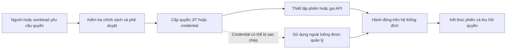

# Credential theft: phát hiện đánh cắp thông tin xác thực trong PAM

## 1. Mục tiêu của bài học

Đánh cắp thông tin xác thực, hay **credential theft**, là việc một đối tượng không được phép lấy được mật khẩu, khóa, token hoặc vật liệu xác thực để sử dụng danh tính của người khác. Trong quản lý truy cập đặc quyền (Privileged Access Management — PAM), hậu quả có thể vượt xa một lần đăng nhập sai: kẻ tấn công có thể vận hành máy chủ, đọc dữ liệu nhạy cảm, thay đổi cấu hình bảo mật hoặc sử dụng danh tính dịch vụ để tiếp cận nhiều hệ thống.

Bài học tập trung vào **phát hiện và điều tra** credential theft đối với tài khoản quản trị, tài khoản dịch vụ và hạ tầng nhạy cảm. Mục tiêu là nhận ra chuỗi sự kiện đáng nghi, phân biệt bằng chứng với suy đoán, rồi phối hợp thu hồi quyền và bảo toàn bằng chứng.

Sau bài này, bạn có thể:

- Phân biệt việc credential bị lấy cắp với việc credential bị sử dụng trái phép.
- Xác định nguồn log và trường dữ liệu cần thiết để theo dõi một credential qua vault, phiên PAM và hệ thống đích.
- Xây dựng giả thuyết phát hiện dựa trên hành vi, phạm vi quyền và bối cảnh JIT/JEA.
- Phân loại cảnh báo, xử lý các trường hợp dễ báo nhầm và nhận biết khoảng trống quan sát.
- Lập kế hoạch cô lập, thu hồi credential và kiểm tra khôi phục phù hợp với loại danh tính.

Một lần đăng nhập thành công chỉ chứng minh cơ chế xác thực đã chấp nhận yêu cầu. Nó không tự chứng minh người sử dụng credential là chủ thể được phép.

## 2. Credential nào cần bảo vệ?

Credential không chỉ là mật khẩu. Trong PAM, cần kiểm kê cả những vật liệu xác thực và cơ chế ủy nhiệm có thể tạo ra quyền truy cập đặc biệt.

| Loại | Ví dụ trong phạm vi PAM | Điều cần lưu ý khi phát hiện |
|---|---|---|
| Mật khẩu | Mật khẩu tài khoản quản trị cục bộ, tài khoản cơ sở dữ liệu | Cần liên kết lần đọc hoặc cấp mật khẩu với lần sử dụng; đăng nhập hợp lệ không loại trừ mất cắp |
| Khóa riêng | Khóa SSH của quản trị viên hoặc tác vụ tự động | Định danh bằng key ID hoặc fingerprint; việc khóa công khai còn được tin cậy có thể cho phép sử dụng bản sao khóa riêng |
| API key và secret của ứng dụng | Danh tính dùng để gọi API quản trị | Phải biết ứng dụng, workload, môi trường và tập API được phép |
| Token truy cập | Token có thời hạn được cấp cho người hoặc workload | Cần theo dõi phiên cấp phát, thời hạn, phạm vi và khả năng thu hồi của hệ thống phát hành |
| Chứng thư cùng khóa riêng | Danh tính máy hoặc workload dùng xác thực bằng chứng thư | Theo dõi serial, issuer và liên kết với workload; chỉ có chứng thư công khai không tương đương nắm khóa riêng |
| Vật liệu xác thực dẫn xuất | Hash mật khẩu hoặc ticket có thể bị lạm dụng trong một số cơ chế xác thực | Không được giả định chỉ mật khẩu dạng rõ mới có giá trị với kẻ tấn công |
| Vật liệu hỗ trợ xác thực | Recovery code, yếu tố xác thực hoặc phiên đã được xác thực | Cần phân biệt chiếm yếu tố xác thực, đánh cắp phiên và lấy mật khẩu để chọn biện pháp xử lý |

**Bí mật khác với định danh bí mật.** Hệ thống phát hiện thường cần `credential_id`, phiên bản secret, fingerprint khóa, token ID hoặc session ID; không cần lưu nguyên giá trị bí mật vào SIEM.

Đối với token hoặc cơ chế xác thực không có định danh an toàn sẵn có, cần thiết kế cách liên kết tại nguồn phát hành. Không tự đưa token dạng đầy đủ vào log để giải quyết khó khăn tương quan.

### 2.1. Danh tính con người và danh tính dịch vụ

Với quản trị viên, một quy trình hợp lệ thường có người yêu cầu, người phê duyệt, thiết bị truy cập, cửa sổ thời gian và hệ thống đích.

Với tài khoản dịch vụ, bối cảnh tương ứng có thể là pipeline, phiên bản triển khai, workload identity, lịch chạy và môi trường. Không nên áp tiêu chí “không có người phê duyệt từng lần” cho một dịch vụ vốn được cấp quyền tự động theo chính sách.

Một tài khoản dịch vụ đột nhiên được dùng trong phiên tương tác có thể đáng nghi, nhưng cần đối chiếu tài liệu vận hành. Một số hệ thống cũ vẫn có ngoại lệ đã được phê duyệt; ngoại lệ phải có chủ sở hữu, phạm vi và ngày hết hạn.

## 3. Phân biệt bốn trạng thái thường bị nhầm lẫn

### 3.1. Credential bị lộ

Credential xuất hiện ở nơi không nên có, như log ứng dụng, tệp cấu hình không được bảo vệ, ticket hỗ trợ hoặc kho mã nguồn.

Đây là sự cố phơi lộ dù chưa quan sát thấy ai sử dụng. Không cần chờ đăng nhập bất thường mới xử lý bí mật đã bị công khai.

### 3.2. Credential bị lấy cắp

Có bằng chứng một chủ thể không được phép đã thu được credential. Bằng chứng có thể đến từ điều tra endpoint, hệ thống kiểm soát dữ liệu hoặc kết quả phân tích sự cố.

Một lần gọi API đọc secret từ danh tính hợp lệ chưa đủ để kết luận lấy cắp. Cần xem chủ thể đó có được phép đọc đúng secret trong đúng ngữ cảnh hay không.

### 3.3. Credential bị sử dụng trái phép

Có hành động xác thực hoặc gọi API không được ủy quyền bằng credential đó. Một credential có thể bị lạm dụng rất lâu sau khi bị lấy cắp.

Nếu chỉ quan sát thấy hành vi sử dụng, kết luận điều tra nên là “nghi ngờ sử dụng trái phép credential”, không khẳng định đã xác định được thời điểm và cách credential bị đánh cắp.

### 3.4. Quyền hợp lệ bị lạm dụng

Người dùng có quyền chính đáng nhưng sử dụng ngoài mục đích được phê duyệt. Trường hợp này có thể là insider misuse, tài khoản bị chiếm hoặc sai sót vận hành.

PAM cần xử lý rủi ro của hành động, nhưng phân loại nguyên nhân phải dựa trên bằng chứng. Việc một lệnh ngoài phạm vi được chạy không tự chứng minh có credential theft.

| Quan sát | Có thể kết luận ngay | Chưa thể kết luận ngay |
|---|---|---|
| Secret nằm trong log mà người không liên quan có thể đọc | Credential đã bị phơi lộ | Đã có người lấy hoặc sử dụng secret |
| Truy cập quản trị từ thiết bị chưa được ghi nhận | Có bất thường so với dữ liệu hiện có | Chắc chắn là kẻ tấn công |
| Khóa bị xác nhận đã sao chép ra ngoài phạm vi cho phép | Có sự kiện mất kiểm soát khóa | Mọi hành động dùng khóa trước đó đều độc hại |
| Phiên chạy tác vụ nằm ngoài phạm vi cấp quyền | Có dấu hiệu vi phạm phạm vi | Nguyên nhân là đánh cắp mật khẩu thay vì lạm dụng quyền |

## 4. Credential theft nằm ở đâu trong chuỗi truy cập đặc quyền?

Một luồng PAM được quản lý có thể gồm:



Sơ đồ cho thấy vì sao chỉ giám sát vault là chưa đủ. Credential có thể được cấp đúng quy trình rồi bị sử dụng ngoài luồng sau đó. Ngược lại, tài khoản quản trị tồn tại ngoài kiểm kê PAM có thể bị sử dụng mà không có sự kiện vault nào.

Các điểm quan sát quan trọng gồm:

1. **Trước khi cấp credential:** yêu cầu quyền, thay đổi chính sách, thiết bị và danh tính yêu cầu.
2. **Khi cấp hoặc đọc credential:** secret nào, phiên bản nào, ai đọc, từ workload nào, gắn với yêu cầu nào.
3. **Khi sử dụng:** phương thức xác thực, tài nguyên đích, phiên, địa chỉ nguồn và kết quả.
4. **Sau xác thực:** thay đổi quyền, thao tác nhạy cảm, truy cập dữ liệu và hoạt động theo chuỗi.
5. **Khi kết thúc:** quyền JIT đã bị gỡ chưa, token có hết hạn không, credential có được luân chuyển theo chính sách không.

Mức độ kiểm soát phụ thuộc kiến trúc. Có hệ thống chỉ cấp một credential dùng lại; có hệ thống làm trung gian phiên; có hệ thống cấp token ngắn hạn. Không được giả định mọi PAM đều che được credential khỏi người dùng hoặc thu hồi được mọi phiên.

## 5. Xây dựng nền tảng dữ liệu trước khi viết rule

### 5.1. Các nguồn log cần tương quan

| Nguồn | Câu hỏi chính | Hạn chế cần biết |
|---|---|---|
| Vault hoặc bộ quản lý secret | Ai đọc, tạo, sửa hoặc luân chuyển credential nào? | Không nhất thiết thấy mọi lần credential được sử dụng sau khi cấp |
| Bộ điều phối quyền JIT/JEA | Quyền nào được cấp, cho ai, trong thời gian và phạm vi nào? | Quyền đã cấp không chứng minh mọi hành động trong cửa sổ đều được phép |
| Gateway hoặc proxy PAM | Phiên nào đi qua điểm kiểm soát, ai mở và đến đâu? | Không thấy đường truy cập trực tiếp nếu đường đó vẫn tồn tại |
| IdP và hệ thống xác thực | Danh tính nào được xác thực, bằng phương thức và thiết bị nào? | Không phải mọi tài khoản cục bộ hoặc API key đều qua IdP |
| Hệ điều hành, cơ sở dữ liệu, API quản trị | Credential có được dùng và hành động nào diễn ra? | Chất lượng log phụ thuộc cấu hình và khả năng ghi nhận của đích |
| Endpoint hoặc workload runtime | Có dấu hiệu truy cập bất thường vào vật liệu xác thực không? | Không có cảnh báo không đồng nghĩa endpoint không bị xâm nhập |
| CMDB, kiểm kê tài khoản, thay đổi triển khai | Tài nguyên, chủ sở hữu và thay đổi có hợp lệ không? | Dữ liệu kiểm kê cũ có thể tạo ra tương quan sai |

Một sự kiện “không tìm thấy phiên PAM” chỉ có ý nghĩa khi bạn biết tài nguyên đó bắt buộc đi qua PAM và dữ liệu phiên đã được thu thập đủ.

### 5.2. Bộ trường tương quan tối thiểu

Một schema khái niệm có thể như sau:

```yaml
event_id: evt-example-1001
event_time: "2026-11-20T02:10:00Z"
ingest_time: "2026-11-20T02:10:04Z"
event_type: credential.read
actor_id: user-admin-17
actor_type: human
subject_account_id: account-db-admin-02
credential_id: credential-db-admin-02
credential_version: version-08
request_id: req-example-51
approval_id: approval-example-51
pam_session_id: null
source_device_id: managed-device-08
source_ip: 192.0.2.10
target_resource_id: database-prod-example
result: success
```

Đây là dữ liệu minh họa, không phải schema bắt buộc của một sản phẩm. Địa chỉ trong ví dụ không đại diện cho hạ tầng thật. Giá trị `null` thể hiện không có dữ liệu ở trường đó; nó không tự động là bằng chứng vi phạm.

Cần phân biệt:

- `actor_id`: người hoặc workload thực hiện yêu cầu.
- `subject_account_id`: tài khoản đặc quyền được truy cập hoặc sử dụng.
- `credential_id`: đối tượng credential đã được cấp hoặc dùng.
- `pam_session_id`: một phiên quản lý cụ thể, nếu có.
- `request_id` và `approval_id`: liên kết với quyền được phê duyệt.

Nếu nhiều người cùng sử dụng tài khoản quản trị dùng chung, tên tài khoản đích không đủ để truy nguyên người thực hiện. Phải giữ được ánh xạ giữa danh tính cá nhân, lần cấp credential và phiên truy cập.

### 5.3. Chuẩn hóa thời gian và xử lý dữ liệu đến muộn

Dùng thời điểm phát sinh sự kiện để dựng dòng thời gian; giữ riêng thời điểm thu nhận để đo độ trễ. Đồng bộ đồng hồ và chuẩn hóa múi giờ trước khi so sánh.

Nếu log vault đến sau log đích vài phút, rule chạy quá sớm có thể báo “không có lần cấp credential”. Bộ tương quan cần cửa sổ cho dữ liệu đến muộn và cơ chế cập nhật kết quả.

Một cửa sổ thời gian chỉ là phép xấp xỉ khi không có ID liên kết. Cần ghi rõ độ tin cậy thấp hơn, đặc biệt khi một tài khoản có nhiều lần cấp credential gần nhau.

### 5.4. Chất lượng dữ liệu là một phần của phát hiện

Theo dõi ít nhất các tình trạng:

- Nguồn log ngừng gửi hoặc giảm đột ngột.
- Trường định danh quan trọng bị thiếu.
- Ánh xạ tài khoản dịch vụ sang workload không còn đúng.
- Thay đổi phiên bản collector làm sai tên trường.
- Độ trễ thu nhận lớn hơn cửa sổ tương quan.
- Đồng hồ lệch khiến sự kiện hợp lệ trông như xảy ra ngoài cửa sổ JIT.

Khi thiếu dữ liệu, kết quả nên là “chưa đủ bằng chứng để đối chiếu” hoặc một cảnh báo sức khỏe dữ liệu riêng. Không tự biến “không quan sát thấy” thành “không tồn tại”.

## 6. Các giả thuyết phát hiện trọng tâm

### 6.1. Sử dụng credential từ nguồn không thuộc phạm vi được phép

**Giả thuyết:** một credential bị sao chép và dùng từ thiết bị hoặc workload khác với nơi được cấp.

Tương quan các yếu tố:

- Tài khoản và credential đang được dùng.
- Thiết bị hoặc workload được phê duyệt.
- Tài nguyên đích và môi trường.
- Cửa sổ quyền hợp lệ.
- Quan hệ giữa địa chỉ nguồn quan sát ở đích và gateway, NAT hoặc proxy.

**Ví dụ:** secret của pipeline sản xuất vốn chỉ được dùng bởi runner đã đăng ký, nhưng xuất hiện trong một yêu cầu API quản trị từ máy trạm cá nhân. Tín hiệu có giá trị hơn khi có định danh workload hoặc thiết bị, thay vì chỉ khác IP.

**Báo nhầm thường gặp:** thay runner, failover, thay NAT hoặc thay gateway mà kiểm kê chưa cập nhật. Không mở ngoại lệ vĩnh viễn cho cả dải mạng chỉ vì một lần triển khai hợp lệ.

### 6.2. Credential được dùng sau khi quyền JIT hết hạn

**Giả thuyết:** credential còn hiệu lực hoặc phiên vẫn tồn tại sau khi quyền tạm thời lẽ ra đã kết thúc.

Cần phân biệt:

- Phiên đã được mở trong cửa sổ hợp lệ và được chính sách cho phép tiếp tục.
- Phiên đáng lẽ phải bị ngắt nhưng chưa bị ngắt.
- Một lần xác thực mới sau thời điểm hết hạn.
- Quyền JIT đã gỡ ở bộ điều phối nhưng chưa được gỡ tại đích.

Sử dụng sau thời hạn có thể là lỗi thực thi chính sách, không nhất thiết là credential theft. Dù vậy, đây vẫn là rủi ro cần xử lý.

### 6.3. Đọc nhiều credential bất thường rồi truy cập nhiều đích

**Giả thuyết:** một danh tính bị chiếm quyền đang thu thập secret và mở rộng phạm vi truy cập.

Không chỉ đếm tổng số lần đọc. Cần xem:

- Số credential khác nhau và độ nhạy cảm của chúng.
- Các đích trước đây danh tính này có được phép quản lý không.
- Có tác vụ triển khai hoặc khôi phục nào giải thích chuỗi truy cập không.
- Credential được đọc có được sử dụng ngay sau đó không.
- Hành động sau xác thực có vượt phạm vi công việc không.

Một tác vụ luân chuyển secret hợp lệ cũng có thể đọc hoặc cập nhật nhiều đối tượng. Baseline cần tách tác vụ tự động đó khỏi phiên quản trị của con người.

### 6.4. Đăng nhập thành công nhưng không khớp một luồng PAM bắt buộc

**Giả thuyết:** credential được dùng để đi thẳng đến đích, tránh điểm kiểm soát PAM.

Chỉ áp dụng khi đã xác minh chính sách bắt buộc đi qua PAM đối với tài khoản, tài nguyên và phương thức truy cập đang xét. Tài khoản break-glass được phép có thể theo quy trình khác nhưng vẫn cần ghi nhận và kiểm tra riêng.

Tăng độ tin cậy bằng các tín hiệu độc lập như thiết bị lạ, quyền mới được thêm, credential vừa bị phơi lộ hoặc tác vụ nhạy cảm không có yêu cầu tương ứng.

Không có `pam_session_id` trong log đích không đủ để kết luận bypass, vì đích có thể không ghi trường này.

### 6.5. Tài khoản dịch vụ chuyển sang hành vi tương tác

**Giả thuyết:** credential của dịch vụ đang bị con người hoặc tiến trình ngoài dự kiến sử dụng.

Tín hiệu gồm phiên tương tác, nguồn truy cập ngoài tập workload, truy cập đích mới và thao tác quản trị không thuộc chức năng dịch vụ.

Đối chiếu loại đăng nhập hoặc loại client phải dựa vào ý nghĩa trường log của hệ thống cụ thể. Không suy ra “tương tác” chỉ từ tên công cụ.

### 6.6. Credential cũ vẫn được sử dụng sau luân chuyển

**Giả thuyết:** có bản sao credential nằm ngoài kiểm soát hoặc quá trình thu hồi chưa hoàn tất.

Cần tách các khả năng sau:

- Một ứng dụng hợp lệ chưa cập nhật secret và đang xác thực thất bại.
- Một nguồn không hợp lệ vẫn thử sử dụng credential cũ.
- Credential cũ vẫn xác thực thành công vì hệ thống đích chấp nhận đồng thời nhiều khóa hoặc phương thức.
- Token được cấp trước luân chuyển vẫn còn hiệu lực theo vòng đời riêng.

Nếu log chỉ ghi tên tài khoản mà không ghi key ID hoặc phiên bản, không được khẳng định chắc chắn “phiên bản cũ” đã được dùng. Khi đó cần điều tra cấu hình xác thực và nguồn sử dụng.

### 6.7. Dấu hiệu trên endpoint đi kèm sự kiện xác thực đặc quyền

**Giả thuyết:** có sự kiện đáng nghi liên quan đến vật liệu xác thực trên một endpoint, tiếp theo là truy cập quản trị từ nguồn hoặc ngữ cảnh bất thường.

Giá trị đến từ chuỗi bằng chứng: cảnh báo endpoint, thời điểm, danh tính đã hoạt động trên máy, credential có khả năng bị ảnh hưởng và sự kiện sử dụng sau đó.

Không cần ghi nội dung credential vào sự kiện điều tra. Lưu định danh, phạm vi bị ảnh hưởng và bằng chứng kỹ thuật theo quy trình kiểm soát truy cập.

## 7. Thiết kế rule tương quan có thể giải thích

### 7.1. Bắt đầu bằng một câu hỏi cụ thể

Một rule hữu ích nên trả lời được:

> Có lần sử dụng tài khoản đặc quyền nào nằm ngoài phạm vi nguồn, đích hoặc thời gian của lần cấp quyền tương ứng, trong khi dữ liệu kiểm soát đủ để đối chiếu không?

Câu hỏi này rõ hơn “phát hiện credential theft bằng AI”, vì có đầu vào, điều kiện và giới hạn kết luận có thể kiểm tra.

### 7.2. Pseudocode cho một luồng tương quan

```text
FOR each successful privileged authentication:
    resolve canonical account, target, source device or workload

    IF required telemetry is incomplete:
        create or update telemetry-health finding
        mark authorization correlation as INDETERMINATE
        continue with other available detection signals

    grants = find grants matching:
        account identity
        authorized target
        effective time window
        source or workload constraints
        supported credential/session linkage

    IF no matching grant exists:
        create finding "privileged use without matching authorization"

    IF credential exposure evidence exists:
        attach exposure evidence to the same investigation

    IF sensitive post-authentication action exists:
        attach action evidence and raise investigation priority
```

Đây là logic minh họa, không phải truy vấn dùng trực tiếp cho SIEM. Khi triển khai cần ánh xạ sang schema thực tế, xử lý log trùng, dữ liệu đến muộn và mô hình quyền của hệ thống.

Một rule có thể cho kết quả “không khớp quyền được cấp” mà vẫn chưa xác định credential bị lấy cắp. Tên cảnh báo và nội dung giải thích nên giữ đúng mức kết luận này.

### 7.3. Mỗi finding cần có bằng chứng và lý do

Một bản ghi cảnh báo nên chứa:

```yaml
finding_type: privileged_use_outside_grant
account_id: account-db-admin-02
target_resource_id: database-prod-example
authentication_event_id: evt-example-1002
grant_match: none_after_late_event_window
telemetry_health: sufficient_for_this_correlation
observed_source_device_id: unmanaged-device-example
expected_source_scope: approved_admin_devices
credential_exposure_evidence: not_observed
interpretation: suspected_unauthorized_credential_use
decision: analyst_review_required
```

Trường `credential_exposure_evidence: not_observed` không có nghĩa credential chưa bị lộ. Nó chỉ ghi nhận nguồn dữ liệu hiện tại chưa cung cấp bằng chứng đó.

Các hệ thống phân tích cần bảo vệ bản ghi cảnh báo vì chúng chứa thông tin về tài khoản đặc quyền, tài nguyên nhạy cảm và cấu trúc kiểm soát.

### 7.4. Tách mức độ ảnh hưởng và độ tin cậy

**Mức độ ảnh hưởng** phụ thuộc quyền của tài khoản, tài nguyên đích và hành động có thể thực hiện.

**Độ tin cậy** phụ thuộc chất lượng bằng chứng và mức độ loại trừ giải thích hợp lệ.

| Tình huống | Ảnh hưởng tiềm tàng | Độ tin cậy ban đầu | Hướng xử lý |
|---|---|---|---|
| IP thay đổi nhưng cùng thiết bị quản trị, đúng yêu cầu | Tùy quyền tài khoản | Thấp nếu chỉ có thay đổi IP | Đối chiếu mạng và thiết bị |
| Tài khoản quản trị đăng nhập từ thiết bị chưa kiểm soát, không có quyền cấp tương ứng | Cao | Trung bình đến cao nếu log đầy đủ | Điều tra ưu tiên, xác minh với chủ sở hữu |
| Secret được xác nhận đã phơi lộ, sau đó dùng ngoài phạm vi | Cao | Cao đối với việc sử dụng đáng ngờ | Kích hoạt xử lý sự cố theo quy trình |
| Tài khoản dịch vụ xác thực thất bại sau luân chuyển từ workload quen thuộc | Có thể ảnh hưởng khả dụng | Thấp đối với giả thuyết trộm credential | Kiểm tra triển khai và cập nhật secret |

Không nên biến tổng điểm thành “xác suất bị tấn công” nếu chưa có cơ sở hiệu chuẩn. Điểm ưu tiên chỉ là cách sắp xếp công việc của đội vận hành.

## 8. Ví dụ điều tra một chuỗi sự kiện

Giả sử một quản trị viên được cấp quyền bảo trì cơ sở dữ liệu sản xuất từ 09:00 đến 09:30. Chính sách yêu cầu đi qua gateway PAM và chỉ từ thiết bị quản trị đã đăng ký.

Các mốc dưới đây dùng cùng một múi giờ đã được chuẩn hóa:

| Thời điểm | Quan sát | Ý nghĩa ban đầu |
|---|---|---|
| 09:01 | Yêu cầu bảo trì được phê duyệt | Có cơ sở cấp quyền trong phạm vi yêu cầu |
| 09:03 | Vault cấp credential cho phiên PAM được liên kết | Luồng cấp credential quan sát được |
| 09:05 | Đăng nhập đích qua gateway đúng chính sách | Chưa thấy lệch phạm vi |
| 09:12 | Một lần đăng nhập khác vào cùng tài khoản từ thiết bị ngoài tập cho phép | Có dấu hiệu sử dụng bất thường |
| 09:13 | Phiên thứ hai thực hiện thay đổi quyền không thuộc yêu cầu bảo trì | Tăng mức ảnh hưởng và ưu tiên điều tra |
| 09:15 | Không tìm thấy phiên gateway tương ứng sau khi đã chờ log đến muộn | Củng cố giả thuyết truy cập ngoài luồng bắt buộc |

### 8.1. Điều đã biết

Có hai ngữ cảnh sử dụng cùng tài khoản; phiên thứ hai khác nguồn được phê duyệt và có hành động ngoài phạm vi.

### 8.2. Điều còn chưa biết

Chưa biết credential được lấy ở đâu, ai thực sự điều khiển thiết bị ngoài tập cho phép, hoặc có đường truy cập ngoại lệ hợp lệ chưa được đưa vào dữ liệu hay không.

Cũng chưa chắc hai phiên sử dụng cùng một loại credential nếu tài khoản đích chấp nhận nhiều phương thức xác thực. Cần kiểm tra key ID, phương thức hoặc dữ liệu nguồn phát hành nếu có.

### 8.3. Kiểm tra tiếp theo

1. Xác nhận dữ liệu thời gian, ánh xạ tài khoản và sức khỏe nguồn log.
2. Kiểm tra chính sách áp dụng cho đúng tài nguyên và thời điểm.
3. Đối chiếu thiết bị, gateway, thay đổi mạng và ngoại lệ đã phê duyệt.
4. Xác minh phiên thứ hai cùng các thay đổi đã thực hiện trên đích.
5. Kiểm tra dấu hiệu phơi lộ hoặc truy cập credential không hợp lệ.
6. Phối hợp chủ sở hữu và đội ứng phó để cô lập theo mức rủi ro.

Liên hệ quản trị viên qua một kênh độc lập đã biết trước. Nếu tài khoản chat hoặc email của họ cũng có thể bị chiếm, lời xác nhận từ chính tài khoản đó không đủ để đóng sự cố.

## 9. Ứng phó khi nghi ngờ credential theft

Phát hiện chỉ tạo giá trị khi dẫn đến một quyết định phù hợp. Mục tiêu là ngăn sử dụng trái phép, bảo vệ dịch vụ và giữ được bằng chứng cho điều tra.

### 9.1. Định phạm vi trước và trong khi cô lập

Xác định:

- Danh tính con người, tài khoản dịch vụ và credential có khả năng liên quan.
- Tài nguyên đã truy cập và quyền đã được cấp.
- Phiên đang hoạt động, token và credential dẫn xuất còn hiệu lực.
- Các phụ thuộc dịch vụ có thể bị ảnh hưởng khi thu hồi.
- Mức quyền cho phép đội ứng phó tự động hoặc thủ công xử lý.

Với dấu hiệu rõ ràng và tác động cao, không cần chờ hoàn tất mọi phân tích mới áp dụng biện pháp cô lập đã được phê duyệt. Thu thập bằng chứng nên tiến hành song song trong khả năng cho phép.

### 9.2. Chọn biện pháp theo loại credential

| Đối tượng | Biện pháp có thể áp dụng theo khả năng hệ thống | Điều phải kiểm tra |
|---|---|---|
| Mật khẩu quản trị | Đổi mật khẩu và cập nhật vault | Các phiên hoặc token đã cấp có còn hoạt động không |
| Khóa SSH | Gỡ tin cậy khóa bị ảnh hưởng, cấp khóa thay thế | Mọi đích đang tin cậy khóa đã được cập nhật chưa |
| API key | Thu hồi key và cấp key thay thế có phạm vi phù hợp | Ứng dụng hợp lệ có chuyển sang key mới thành công không |
| Token | Thu hồi hoặc chặn theo cơ chế hệ thống hỗ trợ | Thời gian hiệu lực còn lại và phạm vi thu hồi thực tế |
| Danh tính dịch vụ | Cô lập workload, đổi credential và cập nhật phụ thuộc | Có gây gián đoạn không, có đường khôi phục được kiểm soát không |
| Quyền tạm thời | Gỡ quyền JIT và chấm dứt phiên khi chính sách yêu cầu | Việc thu hồi đã thực sự có hiệu lực tại đích chưa |

Đổi mật khẩu không bảo đảm mọi phiên đã xác thực bị chấm dứt. Luân chuyển secret trong vault cũng không tự chứng minh secret cũ đã mất hiệu lực ở tất cả hệ thống đích.

MFA giúp giảm một số rủi ro xác thực nhưng không phải bằng chứng rằng credential hoặc phiên không thể bị chiếm. Cần xem phương thức xác thực, vòng đời phiên và kiểm soát trên đường sử dụng thực tế.

### 9.3. Bảo toàn bằng chứng

Lưu các dữ liệu liên quan theo phạm vi vụ việc:

- Event ID, thời điểm, nguồn log và trạng thái đồng bộ thời gian.
- Yêu cầu quyền, phê duyệt, phiên PAM và ánh xạ danh tính.
- Sự kiện đọc, cấp, thay đổi hoặc thu hồi credential.
- Hành động tại hệ thống đích và bằng chứng thay đổi cấu hình.
- Các quyết định cô lập: ai thực hiện, khi nào, vì sao, kết quả ra sao.

Giữ nguyên bản log gốc khi có thể, kiểm soát quyền truy cập và theo dõi quá trình thu thập. Hash kiểm tra toàn vẹn hỗ trợ phát hiện thay đổi của dữ liệu đã thu thập; tự nó không chứng minh nguồn log đã phản ánh đầy đủ sự kiện thực tế.

Không đính kèm mật khẩu, khóa riêng hoặc token đang hoạt động vào ticket. Nếu bằng chứng chứa secret, cần lưu trong kho bằng chứng có kiểm soát phù hợp và thu hồi credential theo quy trình.

### 9.4. Kiểm tra sau thu hồi

Một sự cố chưa được xử lý xong chỉ vì thao tác “rotate” trả về thành công.

Cần xác minh:

1. Credential bị ảnh hưởng không còn xác thực được ở các đích liên quan, theo cách kiểm tra đã được phê duyệt.
2. Phiên hoặc token cần chấm dứt đã hết khả năng sử dụng.
3. Workload hợp lệ sử dụng credential mới và hoạt động bình thường.
4. Quyền hoặc cơ chế truy cập bổ sung do phiên đáng nghi tạo ra đã được điều tra.
5. Nguồn log tiếp tục ghi nhận được quá trình khôi phục.
6. Các cảnh báo tiếp diễn được đánh giá, không bị đóng hàng loạt vì đã đổi secret.

Việc credential cũ không còn dùng được không loại trừ những thay đổi quyền đã được tạo trước khi thu hồi.

## 10. Kiểm thử khả năng phát hiện một cách có kiểm soát

Dùng môi trường thử nghiệm, tài khoản và credential dành riêng cho bài tập. Có thể kiểm thử rule bằng sự kiện tổng hợp trước khi tạo hoạt động xác thực thật trong lab.

Không cần thực hiện kỹ thuật lấy cắp credential để kiểm tra một rule phát hiện sử dụng ngoài phạm vi. Bạn có thể tạo các luồng truy cập đã được cho phép trong lab và mô phỏng bối cảnh tương quan.

### 10.1. Ma trận kiểm thử

| Ca | Dữ liệu đưa vào | Kết quả mong đợi |
|---|---|---|
| Truy cập hợp lệ | Quyền cấp đúng nguồn, đúng đích, đúng giờ | Không tạo finding ngoài phạm vi |
| Nguồn không được phép | Có xác thực nhưng thiết bị không thuộc phạm vi grant | Tạo finding kèm lý do sai nguồn |
| Ngoài thời gian | Xác thực mới sau thời điểm grant hết hiệu lực | Tạo finding hoặc chuyển điều tra theo chính sách phiên |
| Thiếu log vault | Log đích có nhưng nguồn vault đang mất dữ liệu | Đánh dấu thiếu dữ liệu; không khẳng định chắc chắn không có grant |
| Log đến muộn | Grant xuất hiện sau sự kiện xác thực trong giới hạn xử lý | Tương quan được cập nhật, tránh giữ cảnh báo sai đã biết |
| Tác vụ dịch vụ hợp lệ | Nhiều lần đọc secret từ workload đã phê duyệt | Không áp nhầm baseline quản trị viên |
| Secret đã phơi lộ | Có bằng chứng phơi lộ dù chưa thấy sử dụng | Tạo luồng xử lý phơi lộ theo quy trình |
| Thu hồi hoàn tất | Credential cũ thất bại, credential mới hợp lệ, phiên cũ đã xử lý | Có bằng chứng kỹ thuật cho khôi phục |

Đối với mỗi ca, lưu đầu vào, kỳ vọng, kết quả thực tế và các trường bằng chứng. Kết quả phải kiểm tra được bởi người khác.

### 10.2. Kiểm thử lỗi tương quan

Ngoài ca tấn công giả định, cần kiểm thử những lỗi bình thường:

- Cùng tên tài khoản ở hai môi trường khác nhau.
- Nhiều người dùng chung một tài khoản đích.
- Nhiều gateway hoặc đường NAT.
- Sự kiện được gửi lại hoặc đến sai thứ tự.
- Một credential được cấp cho nhiều đích theo chính sách.
- Thay đổi workload hợp lệ chưa đồng bộ kiểm kê.
- Hệ thống không cung cấp key ID hoặc phiên bản credential.

Nếu không thể phân biệt một trường hợp do thiếu dữ liệu nguồn, ghi rõ giới hạn thay vì bổ sung một phép suy đoán rồi coi là bằng chứng chắc chắn.

## 11. Đo hiệu quả và cải thiện kiểm soát

Không đánh giá chất lượng chỉ bằng số lượng cảnh báo. Một đội nhận nhiều cảnh báo nhưng không xác định được danh tính hoặc đích bị ảnh hưởng vẫn có thể phản ứng rất chậm.

Các chỉ số hữu ích gồm:

- Tỷ lệ tài khoản và tài nguyên đặc quyền có đủ nguồn log cần thiết.
- Tỷ lệ xác thực đặc quyền liên kết được với người hoặc workload cụ thể.
- Độ trễ từ sự kiện đến finding và từ finding đến quyết định điều tra.
- Tỷ lệ cảnh báo phải đóng vì dữ liệu thiếu hoặc kiểm kê lỗi.
- Tỷ lệ credential được thu hồi có bằng chứng kiểm tra tại đích.
- Số ngoại lệ còn hiệu lực, có chủ sở hữu và có ngày hết hạn.
- Khả năng phát hiện những ca thử nghiệm đã xác định trong ma trận.

Tỷ lệ báo nhầm cần dựa trên các cảnh báo đã được phân loại với tiêu chí nhất quán. Những cảnh báo chưa đủ dữ liệu không nên bị tự động gộp vào “lành tính”.

Nếu chỉ biết kết quả của các cảnh báo hệ thống đã tạo, bạn chưa thể tính đầy đủ tỷ lệ bỏ sót. Có thể dùng tập tình huống thử nghiệm đã biết để đo mức bao phủ của tập đó, nhưng cần ghi rõ giới hạn.

Kết quả điều tra cũng nên quay lại cải thiện PAM: loại bỏ tài khoản không có chủ sở hữu, giảm quyền thường trực, giảm thời gian sống credential, ràng buộc workload, thực thi đường truy cập quản lý và thu hồi quyền đúng hạn. Mỗi thay đổi cần được kiểm tra với hoạt động hợp lệ của dịch vụ.

## 12. Những lỗi tư duy cần tránh

**“Đăng nhập thành công nghĩa là người dùng hợp lệ.”** Cơ chế xác thực có thể chấp nhận một credential đúng dù người sử dụng không được phép.

**“Credential nằm trong vault thì không thể bị đánh cắp.”** Credential có thể bị lộ sau cấp phát, tại workload sử dụng hoặc trong một đường truy cập chưa được đưa vào PAM.

**“IP lạ là bằng chứng bị tấn công.”** IP là một thuộc tính bối cảnh; NAT, proxy, thay đổi mạng và failover cần được xem xét.

**“Không có log đọc secret nghĩa là không có credential.”** Secret có thể đã được cấp trước đó, tồn tại ngoài vault hoặc nguồn log đang thiếu.

**“Đã rotate thì sự cố kết thúc.”** Phiên, token, khóa khác hoặc quyền mới tạo có thể còn hiệu lực.

**“Cứ vượt ngưỡng đọc secret là lấy cắp.”** Một tác vụ luân chuyển hoặc khôi phục hợp lệ cũng có thể có tần suất cao. Ngưỡng cần đi kèm vai trò và ngữ cảnh.

**“Có phê duyệt là mọi hành động đều được phép.”** Phê duyệt có phạm vi đích, thời gian, nguồn và loại tác vụ. Các giới hạn đó phải được đối chiếu với hành động thực tế.

**“Đưa secret vào log sẽ dễ điều tra hơn.”** Điều này tạo thêm nơi phơi lộ. Dùng định danh và liên kết tại nguồn, bảo vệ dữ liệu điều tra.

## 13. Bài tập tự kiểm tra

### Tình huống 1: tài khoản dịch vụ đổi nguồn

Một tài khoản dịch vụ đọc secret từ runner mới sau khi nhóm triển khai chuyển hạ tầng. API quản trị ghi nhận truy cập từ IP chưa có trong baseline.

Bạn cần kiểm tra ánh xạ workload, thay đổi triển khai, phạm vi quyền và lịch cập nhật kiểm kê. Chỉ riêng IP mới chưa đủ kết luận credential bị lấy cắp. Nếu runner mới không thuộc phạm vi cho phép thì vẫn cần xử lý sai lệch chính sách.

### Tình huống 2: mất dữ liệu phiên

Hệ thống đích ghi một lần đăng nhập quản trị, nhưng collector của gateway ngừng gửi log trong cùng thời gian.

Kết luận đúng là chưa đủ dữ liệu để đối chiếu luồng gateway. Có thể tiếp tục điều tra bằng các nguồn độc lập, đồng thời mở vấn đề sức khỏe log; không khẳng định chắc chắn đã bypass PAM.

### Tình huống 3: credential cũ sau luân chuyển

Sau khi đổi secret, một workload quen thuộc liên tục xác thực thất bại, trong khi nguồn không quen thuộc có một lần thành công.

Cần xác định các nguồn đang dùng loại credential nào, quá trình cập nhật ứng dụng và khả năng tồn tại phương thức xác thực khác. Một lần thành công của cùng tên tài khoản chưa tự chứng minh secret cũ còn hiệu lực nếu không có định danh credential.

### Tình huống 4: secret bị đưa vào ticket

Chưa thấy đăng nhập bất thường nhưng credential quản trị đã xuất hiện trong ticket có quyền đọc rộng.

Phơi lộ đã đủ cơ sở kích hoạt quy trình thu hồi phù hợp. Cần xác định phạm vi người có thể truy cập ticket, bảo vệ bằng chứng, xử lý các bản sao theo quy trình và theo dõi việc sử dụng; không chờ cảnh báo hành vi mới phản ứng.

## 14. Điểm cần ghi nhớ

Phát hiện credential theft trong PAM là bài toán nối **danh tính, credential, quyền được cấp, phiên và hành động trên đích**. Càng giữ được liên kết định danh rõ ràng, đội vận hành càng ít phải suy đoán từ một địa chỉ IP hoặc tên tài khoản dùng chung.

Một hệ thống phát hiện tốt phải phân biệt được bằng chứng phơi lộ, dấu hiệu sử dụng trái phép, sai lệch chính sách và khoảng trống dữ liệu. Ứng phó cần xác minh hiệu lực thu hồi trên hệ thống thực tế, đồng thời kiểm tra các phiên và thay đổi quyền còn tồn tại.

