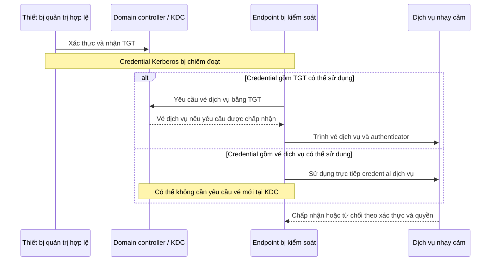

# Pass-the-ticket: phát hiện việc sử dụng trái phép vé Kerberos trong PAM

## 1. Mục tiêu và phạm vi

Pass-the-ticket (PtT) là cách sử dụng vé Kerberos đã bị chiếm đoạt để xác thực dưới danh tính của người khác mà không cần biết mật khẩu của họ. MITRE ATT&CK phân loại kỹ thuật này là **T1550.003 — Pass the Ticket**. Vé bị lấy có thể là ticket-granting ticket (TGT) hoặc vé cho một dịch vụ cụ thể. [MITRE ATT&CK: Pass the Ticket](https://attack.mitre.org/techniques/T1550/003/)

Trong quản lý truy cập đặc quyền (PAM), câu hỏi điều tra quan trọng là: **danh tính này có đang được sử dụng từ đúng thiết bị, đúng đường truy cập, đúng thời gian và đúng phạm vi đã phê duyệt hay không?** Một lần xác thực thành công chỉ chứng minh hệ thống đã chấp nhận vật liệu xác thực; nó chưa chứng minh người sử dụng là chủ tài khoản được cấp quyền.

Sau bài này, người học có thể:

- Phân biệt sử dụng TGT bị lấy cắp với sử dụng vé dịch vụ bị lấy cắp.
- Xác định dữ liệu cần nối giữa domain controller, máy nguồn, máy đích và PAM.
- Thiết kế giả thuyết phát hiện có điều kiện, giải thích được giới hạn và báo động sai.
- Điều tra theo bằng chứng, khoanh vùng ticket, tài khoản và phiên truy cập bị ảnh hưởng.
- Đề xuất biện pháp PAM để giảm khả năng lấy cắp vé và hạn chế hậu quả khi vé đã lộ.

Bài tập tập trung vào môi trường Active Directory sử dụng Kerberos. Các tình huống, tên máy, tài khoản, thời gian và trọng số bên dưới là ví dụ học tập; không phải chữ ký nhận diện hay cấu hình mặc định của một sản phẩm.

## 2. Hiểu đúng vật liệu xác thực Kerberos

### 2.1. Những thành phần cần biết

| Thành phần | Vai trò trong xác thực | Ý nghĩa đối với điều tra |
|---|---|---|
| Principal | Danh tính của người dùng, máy tính hoặc dịch vụ | Chuẩn hóa danh tính trước khi nối dữ liệu |
| KDC | Thành phần cấp vé; trong AD thường chạy trên domain controller | Cần thu thập sự kiện từ các DC liên quan |
| TGT | Vé để tiếp tục yêu cầu vé dịch vụ | TGT bị lộ có thể dẫn tới yêu cầu truy cập nhiều dịch vụ trong quyền của danh tính |
| Vé dịch vụ | Vé dành cho principal dịch vụ đích | Kiểm tra dịch vụ, tài nguyên và quyền thực tế tại đích |
| Session key | Khóa phiên đi cùng ngữ cảnh credential | Không đồng nhất một blob ticket bắt được trên mạng với credential đầy đủ có thể sử dụng |
| Ticket cache | Nơi client giữ credential Kerberos | Là một điểm cần bảo vệ trên endpoint |
| Authenticator | Thông điệp chứng minh client sử dụng khóa phiên trong lần xác thực | Phải phân biệt với bản thân ticket |
| SPN | Tên định danh một instance dịch vụ | Cần ánh xạ sang tài khoản dịch vụ và tài nguyên đúng thời điểm |

Trong mô hình Kerberos, client giữ ticket cùng bản sao khóa phiên của mình. Khi xác thực với dịch vụ, client trình ticket và authenticator được bảo vệ bằng khóa phiên. Do đó, “lấy được ticket” trong ngữ cảnh PtT thường có nghĩa là lấy được credential có thể sử dụng, bao gồm vật liệu khóa cần thiết, chứ không đơn giản là sao chép bất kỳ gói tin mã hóa nào. [Microsoft: Session Tickets](https://learn.microsoft.com/en-us/windows/win32/secauthn/session-tickets)

Không suy ra “có TGT là có quyền quản trị mọi máy”. Quyền hiệu lực vẫn phụ thuộc danh tính, dữ liệu ủy quyền, ACL, chính sách và cách dịch vụ xử lý yêu cầu. Rủi ro tăng mạnh khi vé thuộc tài khoản quản trị có phạm vi rộng hoặc được sử dụng ở nhiều tầng hạ tầng.

### 2.2. Hai con đường sử dụng vé bị lấy cắp



Sơ đồ biểu diễn giả thuyết tấn công để định vị bằng chứng, không biểu diễn một quy trình thực hành lấy hoặc nạp vé.

Nhánh thứ nhất gợi ý tìm hoạt động xin vé dịch vụ từ máy bất thường. Nhánh thứ hai nhắc rằng chỉ quan sát domain controller có thể bỏ sót việc sử dụng credential đã có. Cả hai nhánh đều cần kiểm tra hành vi ở tài nguyên đích.

### 2.3. Vì sao replay cache không đồng nghĩa ngăn được PtT?

Kerberos có cơ chế phát hiện authenticator bị trình lại. Replay cache theo dõi các authenticator gần đây để phát hiện yêu cầu trùng lặp. Nhưng người có credential và khóa phiên có thể tạo authenticator mới; việc đó khác với phát lại nguyên xi một thông điệp đã thu được. Vì vậy không thể lấy trạng thái “replay cache đang bật” làm bằng chứng rằng PtT không thể xảy ra. [MIT Kerberos: replay cache](https://web.mit.edu/Kerberos/www/krb5-1.13/doc/basic/rcache_def.html)

Đồng bộ thời gian giúp hệ thống vận hành và điều tra chính xác. Nó không thay thế việc bảo vệ credential trên endpoint.

## 3. Phân biệt các kỹ thuật gần nhau

Các thuật ngữ sau giúp đặt đúng câu hỏi điều tra. Một sự cố có thể chứa nhiều kỹ thuật nối tiếp nhau; bảng không phải các nhãn loại trừ lẫn nhau.

| Kỹ thuật | Vật liệu hoặc hành vi trung tâm | Câu hỏi cần làm rõ |
|---|---|---|
| Pass-the-ticket | Sử dụng credential Kerberos đã có dưới danh tính khác | Credential xuất phát từ đâu và được dùng ở ngữ cảnh nào? |
| Pass-the-hash | Dùng NTLM hash để thực hiện xác thực NTLM | Giao thức thực tế ở lần truy cập đang xét là NTLM hay Kerberos? |
| Overpass-the-hash / pass-the-key | Dùng vật liệu khóa dài hạn để xin credential Kerberos | Có hoạt động cấp vé mới và dấu vết nguồn lấy khóa hay không? |
| Golden Ticket | Giả mạo TGT bằng vật liệu khóa của tài khoản KRBTGT | Có căn cứ về xâm phạm hạ tầng danh tính hoặc khóa KRBTGT không? |
| Silver Ticket | Giả mạo vé dịch vụ bằng vật liệu khóa dịch vụ | Dịch vụ nào và khóa tài khoản dịch vụ nào có thể đã bị ảnh hưởng? |
| SSO hợp lệ | Tái sử dụng credential của đúng chủ thể trong luồng cho phép | Thiết bị, phiên, mục tiêu và mục đích có khớp chính sách không? |

Việc sử dụng ticket giả mạo có thể giao nhau với hành vi PtT. Tuy nhiên, thiếu một sự kiện cấp TGT chưa đủ để gắn nhãn Golden Ticket, cũng như không thấy yêu cầu vé dịch vụ mới chưa đủ để khẳng định Silver Ticket.

Đối với báo cáo sự cố, tách ba nhận định:

1. **Đã quan sát:** ví dụ xác thực Kerberos từ máy không được phép.
2. **Giả thuyết:** ví dụ credential của tài khoản quản trị có thể đã bị sử dụng trái phép.
3. **Chưa xác định:** ví dụ credential là vé bị lấy cắp hay vé giả mạo.

Cách viết này giữ cho quyết định ứng phó bám vào bằng chứng thực tế.

## 4. Vì sao PtT là vấn đề của PAM?

Xét mô hình quản trị giả định:

- Người vận hành dùng tài khoản thường để làm việc hằng ngày.
- Tài khoản `adm.minh` chỉ được dùng từ máy quản trị `PAW-01`.
- Truy cập `FS-ADMIN-01` phải qua `PAM-GW-01`.
- Quyền quản trị được cấp JIT trong một cửa sổ đã phê duyệt.
- Phiên PAM gắn với người yêu cầu, người duyệt, mục tiêu và hồ sơ thay đổi.

Nếu `adm.minh` xuất hiện trên `WS-23`, sau đó truy cập trực tiếp `FS-ADMIN-01`, hệ thống có hai vấn đề cần kiểm tra: credential có thể đã thoát khỏi vùng quản trị, và đường mạng cho phép đi vòng luồng PAM.

Không cần chờ chứng minh hoàn chỉnh PtT mới xử lý một vi phạm đường truy cập đã được xác nhận. Ngược lại, không nên gọi mọi kết nối ngoài PAM là PtT: có thể còn đường truy cập cũ, tác vụ tự động hoặc ngoại lệ vận hành chưa được ghi nhận.

### 4.1. Các biện pháp PAM giải quyết những phần khác nhau

| Biện pháp | Đóng góp chính | Giới hạn cần nhớ |
|---|---|---|
| Vault và luân chuyển mật khẩu | Quản lý bí mật dài hạn, hạn chế chia sẻ mật khẩu | Không tự chứng minh credential phiên đã được thu hồi |
| MFA khi vào PAM | Kiểm tra mạnh hơn lúc bắt đầu luồng quản trị | Không mặc định tạo thử thách mới ở mọi lần dùng Kerberos ticket phía sau |
| Máy quản trị riêng và phân tầng | Hạn chế nơi credential đặc quyền xuất hiện | Cần kiểm tra cả endpoint, tài khoản và đường đăng nhập thực tế |
| JIT | Thu hẹp thời gian cấp quyền | Hết cửa sổ JIT không bảo đảm mọi ticket hoặc phiên đang tồn tại lập tức mất hiệu lực |
| JEA | Hạn chế thao tác quản trị được phép | Phụ thuộc endpoint và dịch vụ có thực thi đúng mô hình hạn chế |
| Session broker | Tập trung đường truy cập và gắn phiên với người vận hành | Cần kiểm soát các đường truy cập trực tiếp ngoài broker |
| Ghi hình và audit phiên | Hỗ trợ truy vết hành động trong luồng được quản lý | Không bao phủ mặc định phiên phát sinh bên ngoài PAM |

Mục tiêu là nối được **người thật → yêu cầu cấp quyền → tài khoản kỹ thuật → máy nguồn → phiên → tài nguyên → hành động**. Mỗi mắt xích bị thiếu đều làm giảm khả năng giải thích một lần sử dụng danh tính đặc quyền.

## 5. Thu thập và hiểu dữ liệu phát hiện

### 5.1. Dữ liệu từ domain controller

Sự kiện **4768** liên quan việc yêu cầu/cấp TGT và xuất hiện trên domain controller. Khi điều tra, lấy thời điểm, danh tính, địa chỉ client, kết quả và DC phát sinh sự kiện. Không chỉ tìm trên một DC nếu client có thể sử dụng DC khác. [Microsoft: Event 4768](https://learn.microsoft.com/en-us/previous-versions/windows/it-pro/windows-10/security/threat-protection/auditing/event-4768)

Sự kiện **4769** ghi nhận yêu cầu vé dịch vụ tại KDC, trên domain controller. Trường Logon GUID có thể hỗ trợ nối sự kiện nhưng có trường hợp là GUID toàn số 0. Trường Service Name cần được hiểu theo schema và ánh xạ dịch vụ; không mặc định đó là SPN đầy đủ. [Microsoft: Event 4769](https://learn.microsoft.com/en-us/previous-versions/windows/it-pro/windows-10/security/threat-protection/auditing/event-4769)

Một yêu cầu vé dịch vụ thành công chưa chứng minh client đã sử dụng vé, cũng chưa chứng minh truy cập ứng dụng thành công. Phải tìm bằng chứng phía dịch vụ.

Không đặt điều kiện “4768 phải xuất hiện trong vòng năm phút trước mọi 4769”. Một TGT hợp lệ có thể phục vụ nhiều yêu cầu trong thời gian tồn tại của nó. Cửa sổ tìm kiếm phải phù hợp chính sách ticket, chu kỳ làm việc và độ bao phủ log.

### 5.2. Dữ liệu từ máy đích

Sự kiện **4624** phát sinh nơi tạo phiên đăng nhập, thường là máy được truy cập. Khi phân tích, kiểm tra đúng tài khoản đích, authentication package, logon type, địa chỉ nguồn và Logon ID. Đăng nhập mạng loại 3 không tự mang nghĩa tấn công; trường nguồn cũng có thể thiếu tùy ngữ cảnh. [Microsoft: Event 4624](https://learn.microsoft.com/en-us/previous-versions/windows/it-pro/windows-10/security/threat-protection/auditing/event-4624)

Sự kiện **4672** cho biết một số đặc quyền nhạy cảm được gán cho phiên mới. Nó hỗ trợ đánh giá mức độ nhạy cảm, không chứng minh đặc quyền đã được dùng hay đang bị lạm dụng. Có thể nối Logon ID với 4624 trên cùng máy và ngữ cảnh thời gian thích hợp. [Microsoft: Event 4672](https://learn.microsoft.com/en-us/previous-versions/windows/it-pro/windows-10/security/threat-protection/auditing/event-4672)

Bổ sung audit dịch vụ để biết hành động: tài nguyên nào đã được mở, thao tác nào được thực hiện, kết quả ra sao. Một lần đăng nhập được chấp nhận và một lần đọc dữ liệu nhạy cảm là hai sự kiện có ý nghĩa khác nhau.

### 5.3. Dữ liệu từ máy nguồn, mạng và PAM

| Nguồn | Dữ liệu cần có | Giá trị điều tra |
|---|---|---|
| EDR trên máy nguồn | Process tree, người chạy, dấu hiệu truy cập vùng credential, kết nối đi ra | Nối hoạt động endpoint với lần sử dụng danh tính |
| EDR trên máy đích | Tiến trình, dịch vụ, tác vụ và hoạt động tài nguyên sau đăng nhập | Xác định hậu quả và phạm vi |
| Mạng | Cặp nguồn–đích, thời điểm, cổng/dịch vụ và điểm quan sát | Kiểm tra có đi đúng gateway hay đi trực tiếp |
| PAM | Session ID, tài khoản đích, người vận hành, mục tiêu, thời gian, trạng thái cấp quyền | Giải thích một lần truy cập có nằm trong luồng phê duyệt |
| CMDB / inventory | Device ID, chủ sở hữu, vai trò, tầng quản trị | Phân biệt máy quản trị với máy làm việc thông thường |
| DHCP / VPN / gateway | Lịch sử ánh xạ địa chỉ và đường kết nối | Tránh gán IP hiện tại cho sai máy trong quá khứ |
| Quản lý thay đổi | Công việc, người chịu trách nhiệm, thời gian và ngoại lệ | Kiểm tra giả thuyết hoạt động hợp lệ |

Nếu endpoint dùng chung hoặc IP đi qua NAT, hai địa chỉ không luôn tương ứng hai người và hai máy độc lập. Cần khôi phục danh tính thiết bị theo thời điểm, thay vì dùng bảng ánh xạ mới nhất.

Nếu sản phẩm identity phát sinh cảnh báo nghi PtT, lưu cả tên detector và bằng chứng gốc. Microsoft Defender for Identity có nhóm cảnh báo liên quan; tên hiển thị có thể khác giữa các định dạng cảnh báo. Đây là đầu vào điều tra, không thay thế việc xác minh dữ liệu nền. [Microsoft: Defender for Identity alerts](https://learn.microsoft.com/en-us/defender-for-identity/alerts-xdr)

### 5.4. Điều kiện chất lượng dữ liệu

Trước khi đánh giá một rule, kiểm tra:

1. Audit cần thiết đã bật trên các nhóm máy và DC liên quan.
2. Log được gửi liên tục, đủ retention và có nhận biết độ trễ.
3. Thời gian được chuẩn hóa về cùng múi giờ; giữ cả event time và ingestion time.
4. Parser dùng tên trường XML, kiểm tra version và không phụ thuộc vị trí cột hiển thị.
5. Danh tính được chuẩn hóa có xét domain/realm; ưu tiên SID khi trường đó tồn tại.
6. IPv4-mapped IPv6, địa chỉ gateway và thiết bị có nhiều giao diện được xử lý nhất quán.
7. Bản ghi thô vẫn được giữ để kiểm tra lại phép nối.

**Không có log** là trạng thái cần điều tra chất lượng dữ liệu. Nó khác với **đã xác minh không có hoạt động**.

## 6. Xây dựng giả thuyết phát hiện

### 6.1. Giả thuyết A: danh tính đặc quyền xuất hiện trên máy nguồn không được phép

Chuỗi điều kiện:

- Tài khoản nằm trong inventory đặc quyền ở thời điểm sự kiện.
- Nguồn truy cập không thuộc nhóm nguồn được cho phép đối với tài khoản và mục tiêu đó.
- Có yêu cầu Kerberos hoặc hoạt động phía dịch vụ phù hợp thời điểm.
- Không có ngoại lệ hợp lệ giải thích đường truy cập.

Đây là phát hiện **sử dụng danh tính trái chính sách**, có thể dẫn đến giả thuyết PtT. Nó vẫn có giá trị nếu chưa biết credential đã bị lấy bằng cách nào.

Giới hạn: kiểm kê thiết bị lỗi thời, gateway mới, máy thay thế khẩn cấp hoặc ánh xạ IP sai có thể gây báo động sai.

### 6.2. Giả thuyết B: cùng danh tính được dùng ở hai ngữ cảnh khó giải thích

Ví dụ: `adm.minh` hoạt động từ PAW trong phiên đã duyệt, đồng thời phát sinh kết nối từ máy người dùng thông thường tới nhiều máy chủ quản trị.

Mức nghi ngờ tăng nếu có thêm:

- Nguồn thứ hai thuộc tầng bị cấm với tài khoản đó.
- Hành vi trên nguồn thứ hai khác phạm vi nhiệm vụ đã duyệt.
- EDR ghi nhận hoạt động đáng ngờ liên quan credential.
- Người vận hành xác nhận không thực hiện hoạt động đó.

Sự đồng thời chỉ là dấu hiệu tương quan. Người quản trị có thể có nhiều phiên hợp lệ, broker có thể mở kết nối từ nhiều node, hoặc ứng dụng có cơ chế delegation cần được mô hình hóa.

### 6.3. Giả thuyết C: chuỗi cấp vé và sử dụng dịch vụ không phù hợp

Một 4769 từ nguồn mới nhưng không tìm được lịch sử cấp TGT tương ứng là điểm bắt đầu tìm kiếm, không phải kết luận. Cần mở rộng tìm kiếm theo DC, thời gian, renewal, trust và delegation liên quan.

Ngược lại, hoạt động Kerberos trên máy đích không có 4769 mới gần đó có thể là sử dụng vé đã cache hợp lệ hoặc credential dịch vụ bị lấy cắp. Kiểm tra ngữ cảnh endpoint và đường truy cập sẽ giúp phân biệt.

Không dùng sự thiếu vắng 4768/4769 làm điều kiện duy nhất để tự động cô lập máy.

### 6.4. Giả thuyết D: hoạt động nhạy cảm tiếp nối tín hiệu endpoint

Chuỗi có giá trị điều tra cao hơn:

```text
Tín hiệu truy cập credential đáng ngờ trên endpoint
    → Danh tính quản trị xuất hiện trong kết nối bất thường
    → Truy cập tài nguyên ngoài phạm vi công việc
    → Hành động quản trị hoặc thay đổi nhạy cảm trên đích
```

Các bước phải được nối bằng thiết bị, tài khoản và thời gian đủ tin cậy. Không nối hai cảnh báo độc lập chỉ vì cùng xuất hiện trong một giờ.

Nếu kẻ tấn công sử dụng credential ngay trên máy quản trị đã bị chiếm quyền, nguồn vẫn có thể nằm trong allowlist. Vì vậy phát hiện còn phải xét process, phiên điều khiển, mục tiêu và thao tác; allowlist máy nguồn không bảo đảm an toàn.

## 7. Logic tương quan minh họa

### 7.1. Mô hình dữ liệu chuẩn hóa

Ví dụ dưới đây là schema học tập, không phải các trường có sẵn trong mọi SIEM:

```text
KerberosServiceUse:
  event_time, ingest_time
  account_key, source_device_id, source_ip
  target_device_id, service_key
  outcome, evidence_reference

PrivilegedAccessPolicy:
  account_key, valid_from, valid_to
  allowed_sources, allowed_targets, required_route

PamSession:
  session_id, operator_id, account_key
  source_or_gateway_id, target_device_id
  start_time, end_time, approval_state

EndpointSignal:
  device_id, event_time, category, confidence
  process_reference, evidence_reference
```

`KerberosServiceUse` phải đại diện cho hoạt động dịch vụ đã được quan sát hoặc xác thực từ nguồn phù hợp. Không biến mọi sự kiện xin vé 4769 thành “đã truy cập thành công”.

`account_key` cần tránh gộp hai tài khoản cùng tên ở hai domain. `service_key` cần phản ánh chất lượng ánh xạ, không tự suy SPN chính xác từ tên tài khoản dịch vụ.

### 7.2. Pseudocode của rule

```text
for each observed Kerberos service use:
    policy = lookup policy valid at event_time
    if policy is absent:
        record inventory gap
        continue with separate risk review

    source_context = resolve device identity at event_time
    pam_context = find session matching account, target, route and time
    telemetry_health = evaluate relevant collectors and delay

    reasons = []
    if source_context violates policy:
        reasons += "SOURCE_POLICY_VIOLATION"
    if observed route violates policy:
        reasons += "ROUTE_POLICY_VIOLATION"
    if PAM data is healthy and no matching session after delay allowance:
        reasons += "NO_MATCHING_PAM_SESSION"
    if a related endpoint credential signal exists:
        reasons += "RELATED_ENDPOINT_SIGNAL"
    if activity exceeds approved target or operation scope:
        reasons += "APPROVED_SCOPE_MISMATCH"

    if policy violation exists and independent corroboration exists:
        create investigation candidate with raw evidence references
    else:
        retain context for hunting and data-quality review
```

“Independent corroboration” trong ví dụ có thể là tín hiệu endpoint phù hợp hoặc audit hành động bất thường ở máy đích. Hai alert cùng được sinh từ một sự kiện 4769 không phải hai nguồn bằng chứng độc lập.

Không áp dụng anti-join PAM đơn giản khi collector PAM đang lỗi. Nếu dữ liệu PAM không sẵn sàng, kết quả phải là `UNKNOWN`, không phải `NO_SESSION`.

### 7.3. Ưu tiên cảnh báo và hành động

Một nhóm có thể thử trọng số sau trong lab: vi phạm nguồn +3, vi phạm đường truy cập +3, không có phiên PAM khi dữ liệu khỏe +2, tín hiệu endpoint liên quan +4. Đây là thiết kế minh họa để thử nghiệm, cần hiệu chỉnh bằng dữ liệu thực.

Điểm số giúp xếp hàng điều tra. Quyết định khoanh vùng phải xét độ tin cậy, độ nhạy cảm tài nguyên, tác động vận hành và bằng chứng cụ thể. Không coi điểm cao là bằng chứng xác nhận PtT.

Rule nên xuất được lời giải thích: tài khoản nào, chính sách nào, nguồn nào, bằng chứng nào, phần dữ liệu nào còn thiếu. Một cảnh báo không giải thích được phép nối sẽ khó kiểm toán và khó cải tiến.

## 8. Tình huống điều tra mẫu

### 8.1. Bối cảnh

Miền lab `LAB.EXAMPLE` cho phép `adm.minh` quản trị `FS-ADMIN-01` qua PAM trong 08:00–08:30. `PAW-01` là nguồn được duyệt, `WS-23` là máy làm việc thông thường.

Bảng dưới dùng thời gian giả định đã chuẩn hóa UTC. Các bản ghi đã được ghép từ nhiều nguồn, không phải kết quả trực tiếp của một event duy nhất.

| Thời điểm | Quan sát | Nhận định ban đầu |
|---|---|---|
| 08:00 | PAM mở phiên S-204 cho `adm.minh` từ luồng PAW | Có phiên quản trị hợp lệ |
| 08:01 | DC-A ghi nhận cấp TGT cho tài khoản từ ngữ cảnh PAW | Phù hợp luồng dự kiến |
| 08:12 | EDR tại `WS-23` báo hành vi nghi truy cập credential | Cần kiểm tra process và mức tin cậy |
| 08:14 | DC-B ghi nhận 4769 cho `adm.minh`, nguồn được ánh xạ tới `WS-23` | Danh tính xuất hiện trên nguồn ngoài chính sách |
| 08:15 | Máy đích ghi nhận đăng nhập Kerberos và kết nối trực tiếp từ nguồn đó | Có bằng chứng sử dụng dịch vụ ngoài gateway |
| 08:16 | Audit tài nguyên ghi nhận thao tác ngoài công việc phê duyệt | Có dấu hiệu vượt phạm vi |
| 08:18 | Người vận hành xác nhận chỉ dùng PAW qua PAM | Bổ sung lời khai, cần lưu cùng bằng chứng kỹ thuật |

Kết luận ban đầu phù hợp: **nghi sử dụng trái phép credential Kerberos của tài khoản quản trị**, ưu tiên điều tra cao. Chưa đủ căn cứ để khẳng định loại ticket, phương pháp lấy credential hoặc khả năng giả mạo vé.

### 8.2. Các việc cần kiểm tra tiếp

1. Xác minh ánh xạ IP–thiết bị của `WS-23` tại 08:14, không dựa vào IP hiện tại.
2. Đối chiếu collector, raw XML và thời gian của DC-A, DC-B, máy đích.
3. Xác định 4769 liên quan dịch vụ nào và dịch vụ đó ánh xạ tới tài nguyên nào.
4. Nối phiên đích với audit tài nguyên bằng khóa tương quan có ý nghĩa tại cùng máy.
5. Kiểm tra tín hiệu EDR có liên hệ trực tiếp với chuỗi truy cập hay chỉ là cảnh báo nền.
6. Kiểm tra PAM có node gateway dự phòng, delegation hoặc công việc tự động chưa được đưa vào mô hình.
7. Mở rộng tìm kiếm cho tài khoản, máy nguồn và các mục tiêu khác trong khoảng sự cố.

Việc xác nhận người vận hành không thực hiện thao tác làm tăng nghi ngờ, nhưng không tự chứng minh credential đã bị đánh cắp. Tài khoản dùng chung hoặc nhật ký vận hành thiếu có thể làm lời khai không đủ để phân biệt chủ thể.

### 8.3. Biến thể cần thay đổi cách tìm kiếm

Nếu không có 4769 mới nhưng audit đích vẫn ghi nhận Kerberos từ `WS-23`, không loại bỏ giả thuyết. Hãy kiểm tra khả năng dùng credential dịch vụ đã có, việc cache hợp lệ, log bị thiếu và luồng delegation.

Nếu mọi hoạt động phát sinh từ `PAW-01`, cũng không đóng cảnh báo chỉ vì nguồn hợp lệ. Cần kiểm tra PAW có bị điều khiển, phiên có bị chiếm dụng, process có phù hợp và thao tác có đúng nhiệm vụ.

## 9. Thực hành quan sát bằng lệnh chỉ đọc

Chỉ chạy trong phạm vi lab hoặc máy được giao điều tra. Các lệnh dưới đây phục vụ xem thông tin; không lấy khóa phiên, xuất credential hay nạp ticket.

### 9.1. Quan sát ticket trong phiên hiện tại

```powershell
klist
klist tgt
```

Trên Windows, `klist` liệt kê ticket trong cache của ngữ cảnh phiên tương ứng; `klist tgt` hiển thị thông tin TGT. Ghi nhận client, server, thời gian và flags cần thiết cho điều tra. Kết quả phiên hiện tại không đại diện cho tất cả phiên trên máy. [Microsoft: klist](https://learn.microsoft.com/en-us/windows-server/administration/windows-commands/klist)

Không đưa output chứa thông tin nhạy cảm lên kênh chia sẻ rộng. Metadata ticket cũng tiết lộ tài khoản, tên dịch vụ và cấu trúc môi trường.

### 9.2. Đọc sự kiện đăng nhập trên máy đích

Ví dụ chạy ngay trên máy đích bằng quyền đọc log đã được cấp:

```powershell
$investigationStart = (Get-Date).AddMinutes(-30)

Get-WinEvent -FilterHashtable @{
    LogName   = 'Security'
    Id        = 4624
    StartTime = $investigationStart
} | ForEach-Object {
    $eventXml = [xml]$_.ToXml()
    $fields = @{}
    foreach ($item in $eventXml.Event.EventData.Data) {
        $fields[[string]$item.Name] = [string]$item.'#text'
    }

    [pscustomobject]@{
        TimeCreated           = $_.TimeCreated
        Computer              = $_.MachineName
        RecordId              = $_.RecordId
        Account               = $fields['TargetUserName']
        Domain                = $fields['TargetDomainName']
        AuthenticationPackage = $fields['AuthenticationPackageName']
        LogonType             = $fields['LogonType']
        SourceIp              = $fields['IpAddress']
        TargetLogonId         = $fields['TargetLogonId']
        LogonGuid             = $fields['LogonGuid']
    }
}
```

Đây là truy vấn quan sát ngắn để hiểu trường dữ liệu, chưa phải rule SIEM. Cửa sổ 30 phút là ví dụ; đổi theo phạm vi sự cố. Một số trường có thể trống và lỗi đọc log phải được ghi nhận thay vì diễn giải thành không có hoạt động.

Khi tìm 4768/4769, dùng nguồn log DC đã thu thập và bộ phân tích phù hợp. Không chạy truy vấn đăng nhập cục bộ rồi giả định đã quan sát toàn miền.

## 10. Triage và bảo toàn bằng chứng

### 10.1. Các câu hỏi theo thứ tự ưu tiên

1. **Có hoạt động thực sự tại đích không?** Phân biệt yêu cầu vé, xác thực thành công và thao tác tài nguyên.
2. **Danh tính có đặc quyền gì ở thời điểm đó?** Xét quyền trên tài nguyên, nhóm, vai trò và cấp quyền tạm thời.
3. **Nguồn được xác định chắc tới mức nào?** Kiểm tra DHCP, VPN, gateway, nhiều giao diện và khoảng thời gian ánh xạ.
4. **Luồng có được phép không?** So sánh nguồn, gateway, mục tiêu và cửa sổ phê duyệt.
5. **Có dấu hiệu endpoint hoặc hậu quả độc lập không?** Xem process, audit đích và thay đổi nhạy cảm.
6. **Độ phủ log có đủ để kết luận phần nào?** Nêu rõ DC, host hoặc mốc thời gian còn thiếu.
7. **Phạm vi cần mở rộng tới đâu?** Tìm theo danh tính, thiết bị, dịch vụ và quan hệ quản trị.

Không bắt đầu bằng việc tìm một tên công cụ tấn công rồi bỏ qua mọi hoạt động khác. Hành vi sử dụng credential có thể tồn tại dù không có tên công cụ quen thuộc.

### 10.2. Hồ sơ bằng chứng tối thiểu

Giữ event gốc, nguồn, Record ID, thời gian, collector và tham chiếu tới alert. Với file thu thập theo quy trình điều tra, ghi người thu, thời điểm, nơi lưu và checksum để phát hiện thay đổi.

Lưu phiên bản rule, policy PAM và inventory đã dùng trong phép nối. Nếu tài khoản được thêm vào allowlist sau sự cố, báo cáo vẫn phải giải thích được chính sách tại thời điểm truy cập.

Tách vật liệu credential khỏi báo cáo thông thường. Ticket hoặc dump có thể tiếp tục là bí mật dùng được; chỉ thu theo thẩm quyền và quy trình chuyên biệt, có kiểm soát truy cập tương ứng.

## 11. Ứng phó khi nghi ngờ hoặc xác nhận sử dụng vé trái phép

### 11.1. Chặn đường sử dụng và khống chế máy bị ảnh hưởng

Ưu tiên theo mức rủi ro và kế hoạch ứng phó: hạn chế kết nối nguồn tới tài nguyên nhạy cảm, cô lập endpoint nghi bị kiểm soát, chặn đường đi vòng PAM và kết thúc các phiên liên quan tại nơi quản lý phiên.

Việc dừng một phiên ở giao diện PAM không chứng minh kết nối trực tiếp ngoài PAM đã bị đóng. Kiểm tra tại gateway, máy đích và dịch vụ đang phục vụ kết nối.

Trong tình huống có nguy cơ gây hại ngay, khoanh vùng có thể phải diễn ra trước khi thu đủ mọi bằng chứng. Ghi rõ quyết định, thời điểm và tác động lên khả năng điều tra.

### 11.2. Xử lý tài khoản và các dạng credential

Đổi mật khẩu hoặc khóa tài khoản có thể là một phần của kế hoạch, nhưng không xem đó là bảo đảm hủy tức thì mọi TGT, vé dịch vụ và phiên đã được thiết lập. Phải kiểm tra riêng trạng thái tài khoản, credential còn tồn tại, phiên phía dịch vụ và đường mạng.

Xóa cache trên một máy chỉ tác động ngữ cảnh bị xóa; không chứng minh bản sao đã bị lấy sang máy khác biến mất. Tương tự, ticket hết hạn không đồng nghĩa mọi kết nối ứng dụng đang tồn tại đều tự kết thúc ngay.

Đối với tài khoản dịch vụ, xác định phụ thuộc trước khi luân chuyển khóa hoặc khởi động lại dịch vụ. Sau thay đổi, kiểm chứng khả năng vận hành và khả năng sử dụng lại credential cũ theo kịch bản đã được cho phép.

Không tự động đặt lại KRBTGT cho mọi cảnh báo PtT. Nghi xâm phạm khóa KRBTGT hoặc vé giả mạo đòi hỏi quy trình phục hồi AD chuyên biệt, xét replication, phạm vi và ảnh hưởng vận hành.

### 11.3. Loại bỏ nguyên nhân và kiểm chứng phục hồi

Điều tra vì sao credential xuất hiện ở điểm không phù hợp: tài khoản quản trị đăng nhập máy thường, endpoint bị kiểm soát, luồng delegation rủi ro, bí mật dịch vụ bị lộ hay đường quản trị dùng chung.

Sau khắc phục, xác minh:

- Máy nguồn đã được xử lý theo quy trình và không còn dấu hiệu kiểm soát trái phép.
- Đường truy cập ngoài chính sách đã bị chặn ở nơi thực thi.
- Credential thuộc phạm vi ảnh hưởng đã được xử lý cùng các phiên liên quan.
- Truy cập hợp lệ qua PAM vẫn hoạt động và có audit đầy đủ.
- Hoạt động bất thường không còn xuất hiện trong thời gian quan sát đã định.
- Các khoảng trống dữ liệu hoặc giới hạn kết luận được ghi vào hồ sơ.

Không đóng sự cố chỉ vì mật khẩu đã đổi hoặc một alert đã được đánh dấu resolved.

## 12. Giảm rủi ro bằng thiết kế PAM và endpoint

### 12.1. Giảm nơi credential đặc quyền có thể xuất hiện

Dùng tài khoản quản trị riêng, máy quản trị chuyên dụng và phân tầng truy cập. Chặn đăng nhập tài khoản tầng cao lên máy tầng thấp ở nơi chính sách được thực thi, thay vì chỉ ghi hướng dẫn sử dụng.

Rà soát service account có quyền rộng, công việc tự động và delegation. Hạn chế đường truyền credential không cần thiết; xác định chủ sở hữu, máy được phép chạy và mục tiêu của từng danh tính dịch vụ.

Nếu có broker, quản lý cả hai phía: ai được mở phiên vào broker và broker được truy cập những tài nguyên nào. Broker là một thành phần nhạy cảm cần được giám sát, không chỉ là vị trí để gom kết nối.

### 12.2. Bảo vệ credential trên hệ điều hành

Credential Guard dùng VBS để cô lập và bảo vệ một số bí mật, trong đó có TGT, góp phần giảm nguy cơ trộm credential. Cần kiểm tra trạng thái thực thi và khả năng tương thích trong môi trường; không suy ra mọi loại ticket, mọi ứng dụng hoặc mọi máy đều được bảo vệ giống nhau. [Microsoft: Credential Guard](https://learn.microsoft.com/en-us/windows/security/identity-protection/credential-guard/)

Kết hợp bảo vệ endpoint, giảm quyền quản trị cục bộ, vá lỗi và kiểm soát ứng dụng. Endpoint đã bị điều khiển vẫn có thể tạo rủi ro qua chính phiên hợp lệ, kể cả khi việc trích xuất một số bí mật bị hạn chế.

Protected Users và authentication policies/silos có thể tăng hạn chế cho tài khoản phù hợp. Phải kiểm thử yêu cầu xác thực, delegation và ứng dụng trước khi áp dụng. Microsoft lưu ý không đưa tài khoản dịch vụ và máy tính vào Protected Users. [Microsoft: Configure protected accounts](https://learn.microsoft.com/en-us/windows-server/identity/ad-ds/manage/how-to-configure-protected-accounts)

### 12.3. Thu hẹp thời gian và phạm vi thiệt hại

Thiết kế JIT/JEA theo công việc cụ thể. Thời hạn quyền, thời hạn ticket và thời hạn phiên ứng dụng là các khái niệm khác nhau; kế hoạch kết thúc quyền phải xét cả ba.

Lựa chọn vòng đời ticket theo rủi ro và phụ thuộc vận hành. Không lấy một con số cố định làm đáp án cho mọi tổ chức, cũng không coi thuật toán mã hóa mạnh là cơ chế chống sử dụng credential đã bị chiếm đoạt.

Thực thi đường quản trị bắt buộc bằng kiểm soát mạng và cấu hình đích. Nếu máy làm việc thông thường vẫn kết nối trực tiếp được tới dịch vụ quản trị nhạy cảm, khả năng giám sát qua PAM sẽ còn khoảng trống.

## 13. Bài tập phân tích và tiêu chí hoàn thành

### 13.1. Dữ liệu giả lập

```text
A. 09:00  PAM mở phiên cho adm.ha → DB-01, nguồn PAW-02.
B. 09:04  DC ghi nhận 4769 cho adm.ha từ nguồn được xác minh là WS-18.
C. 09:05  DB-01 ghi nhận Kerberos network logon từ WS-18.
D. 09:06  Audit ứng dụng ghi thao tác quản trị ngoài phạm vi phê duyệt.
E. Collector EDR tại WS-18 không gửi dữ liệu từ 08:50.
F. Không tìm thấy 4768 trong tập log DC của 15 phút gần nhất.
```

Yêu cầu:

1. Viết kết luận tạm thời không vượt quá bằng chứng.
2. Chỉ ra hai vi phạm chính sách và ít nhất ba thông tin còn thiếu.
3. Giải thích vì sao F chưa xác nhận PtT hoặc Golden Ticket.
4. Xác định hành động khoanh vùng cần đánh giá, cùng ảnh hưởng vận hành.
5. Đề xuất một cải tiến PAM và một cải tiến chất lượng dữ liệu.

### 13.2. Hướng phân tích

Một kết luận phù hợp là: “Đã quan sát tài khoản quản trị truy cập ngoài nguồn và luồng được duyệt, kèm thao tác vượt phạm vi; nghi sử dụng credential trái phép. Chưa xác định cách lấy hoặc tạo credential.”

Các thông tin cần bổ sung gồm ánh xạ tài khoản–dịch vụ, độ phủ và retention của tất cả DC liên quan, chính sách ticket, ngoại lệ gateway/delegation, chi tiết thao tác đích và nguyên nhân mất EDR.

Mất EDR là khoảng trống quan sát, không phải bằng chứng máy sạch. Thiếu 4768 trong 15 phút không loại trừ TGT được cấp sớm hơn, DC khác hoặc log chưa tới.

Có thể đánh giá hạn chế nguồn tới DB-01 và kết thúc phiên ngoài chính sách, đồng thời phối hợp chủ hệ thống để tránh gián đoạn không cần thiết. Không cần giả định đã xác nhận một họ công cụ cụ thể để xem xét xử lý vi phạm truy cập đã có bằng chứng.

### 13.3. Tiêu chí hoàn thành

Người học đạt yêu cầu khi có thể giải thích được: ticket và khóa phiên khác nhau thế nào; vì sao xác thực thành công vẫn có thể là sử dụng trái phép; log nào ghi cấp vé và log nào chứng minh hành động; cách dùng ngữ cảnh PAM để tăng độ tin cậy; và vì sao phục hồi phải xét cả endpoint, tài khoản, credential, phiên và đường mạng.

Sản phẩm thực hành nên gồm một timeline có nguồn chứng cứ, một giả thuyết phát hiện có giới hạn rõ ràng, một phương án ứng phó theo phạm vi và một phép kiểm chứng phục hồi. Không cần tạo hoặc sử dụng ticket bị đánh cắp để hoàn thành bài tập này.
