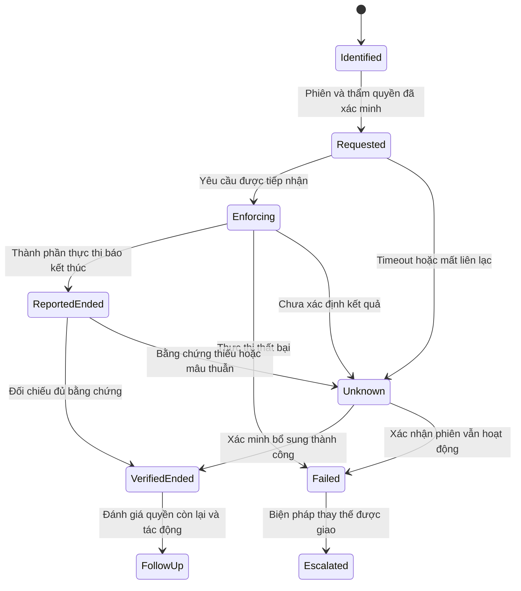

# Terminate privileged session — Chấm dứt phiên đặc quyền trong ứng phó sự cố

## 1. Mục tiêu của việc chấm dứt phiên

Một phiên đặc quyền đang hoạt động cho phép người dùng hoặc công cụ thực hiện thao tác quản trị trên tài sản nhạy cảm. Khi phiên bị nghi chiếm quyền, tiếp tục hoạt động ngoài phạm vi được duyệt hoặc gây tác động nguy hiểm, đội ứng phó cần có khả năng chấm dứt quyền điều khiển đó trong thời gian phù hợp với rủi ro.

Trong Privileged Access Management (PAM), **terminate privileged session** là hành động chủ động kết thúc một phiên truy cập đặc quyền đã xác định. Kết quả cần đạt không chỉ là cửa sổ truy cập biến mất, mà là đường điều khiển thuộc phạm vi xử lý thực sự ngừng hoạt động, trạng thái được xác minh và bằng chứng được giữ lại.

Bài học tập trung vào cách lựa chọn đúng phiên, thực hiện chấm dứt, đánh giá kết quả và phối hợp các biện pháp ngăn truy cập trở lại. Các thao tác phục hồi máy chủ, xử lý toàn bộ mã độc hay khôi phục hệ thống thuộc kế hoạch ứng phó rộng hơn.

Sau bài học, người học có thể:

- Phân biệt kết thúc phiên với ngắt giao diện, thu hồi quyền và vô hiệu hóa tài khoản.
- Xác định phiên từ danh tính gốc đến tài khoản đặc quyền và tài sản đích.
- Thực hiện quy trình chấm dứt có kiểm soát, kể cả khi hệ thống báo lỗi hoặc mất kết nối.
- Xác minh bằng chứng ở cả PAM và hệ thống đích, đồng thời đánh giá khả năng tái kết nối.
- Ghi lại quyết định, kết quả và rủi ro còn lại để phục vụ điều tra, kiểm toán.

## 2. Phân biệt các hành động thường bị nhầm lẫn

Một phiên có thể đi qua trình duyệt, PAM gateway, máy trung chuyển và hệ thống đích. Ngắt một đoạn của đường đi chưa chắc kết thúc mọi thành phần phía sau.

| Hành động | Ý nghĩa chính | Điều chưa thể kết luận chỉ từ hành động này |
|---|---|---|
| Đóng cửa sổ truy cập | Giao diện phía người dùng ngừng hiển thị | Phiên tại gateway hoặc hệ thống đích đã kết thúc |
| Disconnect | Ngắt một kết nối; có thể để phiên phía đích tồn tại | Người dùng không thể reconnect hoặc tiến trình đã dừng |
| Suspend/pause | Tạm giữ phiên hoặc khả năng tương tác theo tính năng của nền tảng | Phiên đã bị xóa hay credential đã hết hiệu lực |
| Terminate session | Kết thúc phiên cụ thể trong phạm vi cơ chế chấm dứt | Mọi phiên khác, tiến trình nền hoặc token liên quan đều đã bị thu hồi |
| Revoke entitlement/JIT grant | Thu hồi một quyền hoặc quyền cấp theo thời hạn | Phiên đã xác thực trước đó tự động bị ngắt |
| Disable account | Chặn một số khả năng sử dụng tài khoản theo cơ chế của hệ thống | Tất cả phiên, vé xác thực hoặc access token hiện hữu đã vô hiệu |
| Rotate credential | Thay giá trị credential để kiểm soát việc sử dụng tiếp theo | Phiên đang chạy bị kết thúc ngay lập tức |
| Isolate host/network path | Hạn chế đường liên lạc của tài sản | Tiến trình tại chỗ đã dừng hoặc hệ thống đã sạch |

Tên gọi và hành vi cụ thể phụ thuộc sản phẩm, cấu hình và giao thức. Runbook cần mô tả kết quả mong đợi, thay vì chỉ ghi “bấm Disconnect” hay “khóa user”.

Ví dụ, một phiên quản trị từ xa có thể bị ngắt kết nối nhưng vẫn để lại phiên đăng nhập phía máy chủ. Tương tự, một tiến trình được khởi chạy trước khi chấm dứt kết nối có thể tiếp tục tồn tại nếu đã tách khỏi vòng đời của phiên. Không được dùng trạng thái giao diện để suy ra trạng thái của những thành phần này.

### Ba câu hỏi phải trả lời riêng

1. **Phiên nào đã ngừng?** Xác định theo ID và thế hệ phiên, không chỉ theo tên tài khoản.
2. **Đường truy cập nào còn sử dụng được?** Bao gồm đường qua PAM và đường trực tiếp.
3. **Tác động nào đã tồn tại trên hệ thống đích?** Bao gồm tiến trình, tác vụ đã gửi và thay đổi cấu hình.

Câu trả lời cho câu thứ nhất không tự động giải quyết hai câu còn lại.

## 3. Mô hình đường đi của một phiên đặc quyền

Xét một quản trị viên đăng nhập qua PAM để truy cập máy chủ sản xuất:

```text
Danh tính cá nhân
    -> yêu cầu truy cập / quyền JIT
    -> phiên tại PAM gateway
    -> tài khoản hoặc credential đặc quyền
    -> phiên đăng nhập trên hệ thống đích
    -> thao tác, tiến trình và kết nối phát sinh
```

Trong mô hình này:

- **Danh tính cá nhân** cho biết ai khởi tạo truy cập.
- **Tài khoản đặc quyền** có thể là tài khoản được vault quản lý và được nhiều người sử dụng qua cơ chế checkout.
- **Phiên PAM** là đối tượng mà công cụ giám sát và người vận hành thường nhìn thấy.
- **Phiên đích** là trạng thái đăng nhập hoặc kết nối tại tài sản được quản trị.
- **Hoạt động phát sinh** có thể tồn tại độc lập với phiên ban đầu.

PAM có thể môi giới hoặc proxy luồng truy cập, nhưng cũng có triển khai chủ yếu cấp credential rồi để người dùng kết nối theo đường khác. Khả năng chấm dứt và mức độ quan sát khác nhau giữa hai trường hợp. Cần biết PAM thực sự kiểm soát đoạn nào.

### Control plane và đường truy cập thực tế

Control plane tiếp nhận lệnh của người ứng phó, xác minh quyền và chuyển yêu cầu tới thành phần thực thi. Đường truy cập thực tế là luồng dữ liệu đang mang thao tác quản trị.

API quản trị trả kết quả thành công có thể chỉ chứng minh yêu cầu đã được tiếp nhận. Thành phần thực thi có thể đang xử lý, không liên lạc được với gateway hoặc không đủ khả năng kết thúc phiên phía đích.

Vì vậy, bằng chứng kết quả nên phân biệt:

```text
REQUEST_ACCEPTED
    Yêu cầu hợp lệ và đã được hệ thống nhận.

ENFORCEMENT_REPORTED
    Thành phần thực thi báo đã áp dụng hành động.

TARGET_OBSERVED
    Quan sát phù hợp trên hệ thống đích xác nhận kết quả trong phạm vi đã định.

CONTAINMENT_ASSESSED
    Đã đánh giá phiên khác, quyền còn lại và khả năng tái kết nối.
```

Đây là các mốc bằng chứng của runbook, không phải tên trạng thái bắt buộc của một sản phẩm.

## 4. Khi nào cần chấm dứt phiên?

Chấm dứt phiên là biện pháp containment, nhằm hạn chế hoạt động đang diễn ra. Quyết định cần dựa trên tín hiệu, tác động tiềm tàng và thẩm quyền xử lý.

Những tình huống thường cần xem xét gồm:

- Phiên quản trị xuất hiện từ thiết bị hoặc vị trí không phù hợp với người đã được duyệt.
- Hành động trong phiên vượt phạm vi công việc, chẳng hạn truy cập tài sản khác với yêu cầu được phê duyệt.
- Phiên tiếp tục sau khi quyền JIT đã hết hạn nhưng cơ chế thực thi không tự kết thúc.
- SOC quan sát được hành vi phá hoại, thay đổi kiểm soát bảo mật hoặc truy xuất dữ liệu bất thường.
- Người sở hữu danh tính xác nhận không thực hiện phiên đang hoạt động.
- Người vận hành gây lỗi nghiêm trọng và cần dừng quyền điều khiển trước khi khôi phục an toàn.

Một tín hiệu đơn lẻ chưa chắc chứng minh tài khoản bị xâm phạm. Ví dụ, thay đổi địa chỉ mạng có thể do VPN hoặc chuyển điểm truy cập. Tuy nhiên, khi có tác động nguy hiểm đang xảy ra, runbook có thể cho phép hành động khẩn cấp trước khi hoàn tất mọi bước điều tra.

### Quyết định theo mức rủi ro

| Tình huống | Trọng tâm quyết định | Hướng xử lý minh họa |
|---|---|---|
| Hành vi phá hoại đang diễn ra, phiên đã định danh chắc chắn | Giảm thời gian tiếp tục thao tác | Chấm dứt theo thẩm quyền khẩn cấp; bổ sung kiểm soát tái kết nối song song |
| Tín hiệu chưa rõ, chưa có tác động tức thời | Giảm nguy cơ ngắt nhầm công việc | Đối chiếu danh tính, yêu cầu truy cập và tài sản trước khi hành động |
| Tài khoản dùng chung có nhiều phiên | Phân biệt phiên đáng ngờ với hoạt động hợp lệ | Chọn đúng session ID; đánh giá riêng việc thu hồi tài khoản dùng chung |
| Đang chạy thay đổi sản xuất có rủi ro khi ngắt | So sánh thiệt hại do tiếp tục và do gián đoạn | Phối hợp incident commander và chủ dịch vụ, chọn biện pháp theo tình huống |
| Không xác minh được trạng thái sau khi gửi lệnh | Tránh kết luận sai về containment | Ghi trạng thái chưa xác định, kiểm tra tại đích hoặc áp dụng biện pháp thay thế |

Không đặt một thời gian chờ cố định cho mọi hệ thống. Tác vụ cơ sở dữ liệu, hệ thống điều khiển và máy chủ ứng dụng có đặc điểm vận hành khác nhau. Thời gian chờ và bước leo thang phải được thiết kế trước cho từng nhóm tài sản.

## 5. Xác định đúng phiên trước khi hành động

Sai lầm nguy hiểm nhất là chấm dứt nhầm phiên vì hai kết nối cùng dùng một tài khoản quản trị. Tên như `admin`, `root` hoặc tài khoản dịch vụ không đủ để định danh.

Một hồ sơ phiên tối thiểu nên có:

| Trường | Mục đích |
|---|---|
| Incident ID | Liên kết quyết định với hồ sơ sự cố |
| PAM session ID | Chọn đúng đối tượng trong nền tảng |
| Session start time hoặc generation | Tránh nhầm phiên cũ với một phiên mới |
| Danh tính khởi tạo | Truy ngược người hoặc workload yêu cầu truy cập |
| Tài khoản đặc quyền | Xác định quyền được sử dụng tại đích |
| Asset ID và môi trường | Phân biệt tài sản, tenant, production và non-production |
| Giao thức và gateway | Xác định cơ chế thực thi thích hợp |
| Request/JIT grant ID | Liên kết phiên với quyền đã được duyệt |
| Target-side session/connection ID, nếu có | Đối chiếu với hệ thống đích |
| Nguồn tín hiệu và thời điểm | Giải thích vì sao cần hành động |

Dữ liệu nhạy cảm như mật khẩu, private key, access token hoặc toàn bộ nội dung màn hình không nên bị sao chép vào hồ sơ phổ thông. Dùng tham chiếu tới kho bằng chứng được kiểm soát quyền truy cập.

### Đối chiếu theo một bộ thuộc tính

Ví dụ một incident chỉ định:

```text
Incident: IR-PAM-204
PAM session: pam-s-7a91
Started at: 2026-06-18T03:21:10Z
Requester: operator-a
Privileged account: ops-admin
Target asset: asset-prod-app-07
Protocol: remote-shell
Access request: req-582
```

Nếu giao diện đang chọn `pam-s-7b02`, cùng tài khoản `ops-admin` nhưng trên tài sản khác, phải dừng thao tác chọn phiên và xác minh lại. Không “thử ngắt xem có đúng không”.

Thời điểm bắt đầu cũng quan trọng khi hệ thống có ID được tái sử dụng hoặc phiên được tạo lại sau reconnect. Nếu nền tảng hỗ trợ precondition, version hoặc generation cho hành động quản trị, nên dùng chúng để giảm nguy cơ áp dụng yêu cầu trễ vào một đối tượng mới.

### Khi nhiều phiên liên quan cùng tồn tại

Không tự động mở rộng từ “chấm dứt một phiên” sang “ngắt toàn bộ phiên của tài khoản” mà chưa đánh giá phạm vi. Có thể có người vận hành hợp lệ hoặc automation đang sử dụng tài khoản đó.

Ngược lại, nếu bằng chứng cho thấy danh tính hoặc credential đã bị chiếm quyền, chỉ xử lý một phiên cũng có thể thiếu. Khi đó, incident commander cần quyết định phạm vi containment rộng hơn, ghi rõ tiêu chí lựa chọn và chủ sở hữu từng hành động.

## 6. Thẩm quyền, bằng chứng và khả năng kiểm soát tác động

### Phân vai thực tế

Quy trình cần xác định ai có quyền ra quyết định, ai thực thi và ai xác minh. Một mô hình đơn giản gồm:

- **SOC/analyst:** phát hiện, tập hợp thông tin và đề xuất xử lý.
- **Incident commander hoặc người có thẩm quyền:** quyết định phạm vi, ưu tiên containment và chấp nhận tác động vận hành.
- **PAM responder:** thực hiện hành động được giao bằng danh tính cá nhân có quyền phù hợp.
- **Chủ tài sản:** hỗ trợ nhận diện phiên đích, kiểm tra tác động và khôi phục an toàn.
- **Người quản lý bằng chứng:** bảo vệ log, recording và lịch sử quyết định theo quy định nội bộ.

Trong nhóm nhỏ, một người có thể đảm nhiệm nhiều vai trò. Trách nhiệm vẫn cần được ghi rõ. Không dùng tài khoản quản trị chia sẻ để làm mất dấu người thực hiện hành động ứng phó.

Quyền của responder nên đủ để tìm và chấm dứt phiên trong phạm vi được giao. Việc cấp toàn quyền vault, xuất credential hoặc xóa recording chỉ để thao tác terminate thường mở rộng quyền không cần thiết.

### Giữ bằng chứng mà không làm trì hoãn containment cấp bách

Trước khi gửi lệnh, nếu có thể thực hiện nhanh và an toàn, giữ lại định danh phiên, lý do, trạng thái hiện tại và tham chiếu recording. Không chờ tải xong một video lớn nếu phiên đang gây thiệt hại.

Sau khi chấm dứt, tiếp tục thu thập phần recording đã hoàn tất, log gateway, log kiểm toán quản trị và dữ liệu đích theo kế hoạch điều tra. Recording có thể cần thời gian để đóng gói; việc chưa thấy tệp hoàn chỉnh ngay không tự nó chứng minh tệp bị mất.

Các biện pháp bảo vệ thường bao gồm:

- Đồng bộ và ghi rõ múi giờ; giữ cả thời điểm sự kiện và thời điểm thu thập khi chúng khác nhau.
- Giới hạn người được xem dữ liệu phiên, đặc biệt khi có thông tin cá nhân hoặc dữ liệu sản xuất.
- Ghi hash và nguồn thu thập cho bản sao bằng chứng khi phù hợp với quy trình.
- Duy trì lịch sử tiếp nhận, chuyển giao và truy cập bằng chứng.
- Áp dụng retention hoặc preservation hold theo chính sách tổ chức.

Hash hỗ trợ kiểm tra tính toàn vẹn của một bản sao. Nó không thay thế thông tin nguồn gốc, phương pháp thu thập hay việc xác thực đồng hồ hệ thống.

### Khi việc ngắt có thể ảnh hưởng dịch vụ

Trước khi hành động trong tình huống cho phép đánh giá ngắn, xác định phiên đang chạy việc gì: triển khai, cập nhật cấu hình, thao tác dữ liệu hay quản trị khẩn cấp. Việc mất kết nối có thể để lại thay đổi từng phần hoặc tác vụ tiếp tục ở phía máy chủ.

Không giả định rằng ngắt phiên sẽ rollback mọi thao tác trước đó. Nếu thiệt hại do tiếp tục lớn hơn, vẫn có thể cần chấm dứt ngay và xử lý trạng thái hệ thống sau đó theo kế hoạch khôi phục.

## 7. Runbook chấm dứt phiên theo từng bước

### Bước 1 — Ghi nhận mục tiêu containment

Tạo hoặc cập nhật hồ sơ sự cố. Ghi lý do, mức độ ưu tiên và kết quả mong đợi, chẳng hạn:

> Chấm dứt quyền điều khiển của phiên pam-s-7a91 trên asset-prod-app-07; ngăn danh tính liên quan tạo phiên quản trị mới trong thời gian điều tra; bảo toàn bằng chứng truy cập.

Mục tiêu này giúp phân biệt phạm vi phiên với phạm vi danh tính và hệ thống đích.

### Bước 2 — Xác minh phiên và quyền thực thi

Đối chiếu session ID, thời điểm bắt đầu, danh tính gốc, tài khoản đặc quyền và tài sản. Kiểm tra responder đang thao tác đúng môi trường và có quyền thực hiện hành động theo runbook.

Nếu có cơ chế phê duyệt hai người, thực hiện theo chính sách. Nếu tình huống nằm trong ngoại lệ khẩn cấp đã được tổ chức cho phép, ghi rõ người quyết định và lý do sử dụng ngoại lệ.

### Bước 3 — Giữ dữ liệu trước hành động

Lưu một snapshot ngắn gồm các định danh, trạng thái phiên và tham chiếu bằng chứng hiện có. Snapshot không cần chứa credential hoặc toàn bộ nội dung dữ liệu đang hiển thị.

Với sự cố khẩn cấp, việc giữ snapshot không được biến thành một chuỗi thao tác dài làm kéo dài khả năng gây hại. Log kiểm toán của hành động cũng là bằng chứng cần được giữ.

### Bước 4 — Phối hợp ngăn tái kết nối

Chọn các biện pháp phù hợp với nguyên nhân nghi ngờ: tạm dừng quyền JIT, chặn cấp phiên mới, thu hồi credential checkout, hạn chế đường truy cập trực tiếp hoặc vô hiệu hóa danh tính trong phạm vi được duyệt.

Thứ tự không cố định cho mọi sự cố. Có thể cần chấm dứt phiên ngay và thu hồi quyền song song; cũng có tình huống có thể chặn tái kết nối trước rồi kết thúc phiên. Điều cần tránh là kéo dài phiên nguy hiểm chỉ để hoàn thành một thứ tự máy móc.

Credential rotation, thu hồi token và vô hiệu hóa tài khoản là các hành động riêng. Người thực hiện phải hiểu chúng ảnh hưởng đến những người dùng hoặc dịch vụ nào.

### Bước 5 — Gửi yêu cầu chấm dứt qua cơ chế được hỗ trợ

Sử dụng chức năng quản trị được nền tảng cung cấp cho loại phiên đó. Gắn incident ID, lý do và mã tương quan nếu công cụ hỗ trợ.

Ghi lại:

- Thời điểm gửi yêu cầu.
- Người thực hiện và thẩm quyền liên quan.
- Đối tượng phiên cùng điều kiện định danh.
- Mã request/action/correlation.
- Phản hồi ban đầu và trạng thái xử lý.

Không thay thế chức năng quản trị được hỗ trợ bằng việc dừng hàng loạt tiến trình hoặc ngắt mạng diện rộng khi chưa đánh giá phạm vi. Các biện pháp ở đích là lựa chọn theo runbook riêng, đặc biệt khi đường điều khiển PAM thất bại.

### Bước 6 — Theo dõi kết quả thực thi

Phân biệt “đã nhận yêu cầu”, “đang xử lý”, “đã kết thúc”, “thất bại” và “không xác định”. Nếu hệ thống xử lý bất đồng bộ, theo dõi action ID hoặc event tương ứng đến khi có kết quả hoặc hết thời gian chờ của runbook.

Mất kết nối tới API sau khi gửi lệnh không cho biết hành động đã chạy hay chưa. Trước khi retry, kiểm tra request/action cũ và trạng thái phiên hiện tại. Dùng idempotency key khi nền tảng hỗ trợ.

### Bước 7 — Xác minh tại đích và kiểm tra phiên liên quan

Dùng nguồn quản trị tin cậy, tách khỏi phiên nghi ngờ, để xác nhận trạng thái phía đích. Mức kiểm tra phụ thuộc giao thức và khả năng quan sát.

Ví dụ, cần xác định đúng phiên đăng nhập đã kết thúc hay chỉ bị disconnect; kết nối cơ sở dữ liệu đã đóng hay câu lệnh vẫn đang thực thi; tiến trình và kết nối phát sinh có cần hành động bổ sung không.

Đồng thời kiểm tra các phiên mới hoặc phiên liên quan theo phạm vi đã được duyệt. Chỉ cần quan sát một đường truy cập mới còn hoạt động là phải đánh giá lại tuyên bố containment.

### Bước 8 — Ghi kết quả và bàn giao phần việc còn lại

Kết quả cần thể hiện bằng chứng, phạm vi đã xác minh, điều chưa biết và người chịu trách nhiệm xử lý tiếp. Nếu mục tiêu chỉ mới đạt ở gateway, không ghi “hệ thống đã an toàn”.

Giữ các biện pháp chặn tạm thời đến khi đủ điều kiện khôi phục theo quyết định của đội ứng phó. Phiên đã kết thúc là một mốc containment; nó không thay thế điều tra nguyên nhân hoặc kiểm tra thay đổi trái phép.

## 8. Trạng thái và tiêu chí xác minh kết quả

Một mô hình trạng thái đơn giản giúp tránh nhầm phản hồi kỹ thuật với kết quả ứng phó:



Mô hình không yêu cầu mọi công cụ phải cung cấp đủ các trạng thái này. Đội ứng phó có thể lưu trạng thái vận hành của mình bên cạnh trạng thái do sản phẩm trả về.

### Ma trận bằng chứng

| Điểm xác minh | Câu hỏi cần trả lời | Bằng chứng minh họa |
|---|---|---|
| PAM control plane | Lệnh đã được ai gửi và tới đúng phiên chưa? | Audit event, action ID, target session ID |
| Gateway/session broker | Đường truy cập được quản lý đã ngừng chưa? | Sự kiện session-ended, trạng thái kết nối phù hợp |
| Hệ thống đích | Phiên đích tương ứng còn tồn tại hoặc tương tác được không? | Log kết thúc phiên, kết quả kiểm tra phiên từ kênh quản trị tin cậy |
| Đường truy cập thay thế | Có phiên mới, đường trực tiếp hoặc token còn dùng được không? | Quan sát phiên, log xác thực, kiểm tra policy trong phạm vi được duyệt |
| Bằng chứng phiên | Dữ liệu phục vụ điều tra đã được bảo vệ chưa? | Tham chiếu recording, trạng thái đóng tệp, quyền truy cập và hash bản sao nếu có |
| Tác động hệ thống | Có tiến trình hoặc thay đổi cần xử lý tiếp không? | Danh sách phát hiện, chủ sở hữu hành động và thời hạn xử lý |

Không bắt buộc mọi giao thức tạo cùng một loại log. Nếu không có nguồn xác minh tại đích, ghi rõ hạn chế và chuyển sang biện pháp bù hoặc leo thang. Không tạo bằng chứng giả để lấp chỗ trống.

### Điều kiện hoàn thành theo phạm vi

Có thể xác nhận “phiên đặc quyền đã chấm dứt trong phạm vi được kiểm soát” khi:

1. Phiên đúng được định danh, kể cả thời điểm bắt đầu hoặc generation cần thiết.
2. Có bằng chứng thực thi kết thúc tại thành phần kiểm soát phiên.
3. Bằng chứng phía đích phù hợp với hành vi kỳ vọng của giao thức, hoặc hạn chế xác minh đã được xử lý và chấp nhận rõ ràng.
4. Khả năng tái kết nối và các phiên liên quan đã được đánh giá; phần chưa giải quyết có người sở hữu.
5. Quyết định, thời điểm, kết quả và tham chiếu bằng chứng đã được lưu.

Nếu điểm thứ ba chưa đạt, báo cáo phải phân biệt phần đã xác nhận và phần chưa xác định. Nếu phiên đã kết thúc nhưng credential vẫn có thể tạo phiên mới, có thể ghi hành động terminate thành công đồng thời ghi containment tổng thể chưa hoàn tất.

## 9. Khác biệt giữa các loại phiên

### Remote shell và kết nối qua máy trung chuyển

Khi phiên đi qua gateway, chấm dứt kênh do gateway quản lý thường là bước đầu. Cần kiểm tra xem còn phiên tại máy trung chuyển, phiên đích hoặc kết nối phát sinh tới tài sản khác hay không.

Không suy ra rằng ngắt shell sẽ dừng mọi tiến trình do shell từng khởi chạy. Tác vụ nền, scheduler hoặc tiến trình tách phiên cần được đánh giá theo ngữ cảnh. Việc dừng chúng là hành động bổ sung, có thể có tác động riêng.

Nếu người dùng đã nhận credential để truy cập trực tiếp ngoài gateway, kết thúc phiên trên PAM không đảm bảo chấm dứt kết nối trực tiếp đó.

### Remote desktop

Phải phân biệt ngắt kết nối với đăng xuất/kết thúc phiên phía hệ điều hành. Một desktop đang disconnected có thể giữ ứng dụng và trạng thái đăng nhập để người dùng quay lại, tùy cấu hình.

Runbook cần chỉ rõ hành vi mà nền tảng thực hiện: chỉ đóng kết nối hiển thị, kết thúc phiên người dùng hay phối hợp thêm thao tác tại máy đích. Đối chiếu bằng định danh phiên đích và log thích hợp.

Ứng dụng đang mở có thể có dữ liệu chưa lưu. Đây là tác động cần ghi nhận khi quyết định, nhưng không phải lý do để mặc định giữ một phiên đang gây thiệt hại.

### Phiên cơ sở dữ liệu

Kết nối quản trị, câu lệnh đang chạy và transaction có vòng đời liên quan nhưng không đồng nhất. Việc đóng kết nối có thể kích hoạt xử lý phía máy chủ, bao gồm rollback trong những trường hợp phù hợp, nhưng không được giả định mọi tác vụ đã dừng ngay hoặc mọi thay đổi đã được hoàn tác.

Chủ cơ sở dữ liệu cần xác minh connection/session ID chính xác, trạng thái lệnh và tác động tới dịch vụ. Không dùng tiêu chí “không còn cửa sổ SQL” để kết luận.

### Web console, API và cloud session

Đăng xuất trình duyệt hoặc chấm dứt phiên web tại PAM không đồng nghĩa mọi token truy cập phát sinh đã bị thu hồi. Một credential, cookie hoặc token có thể có vòng đời và cơ chế xác thực độc lập.

Cần xác định khả năng thu hồi do nền tảng hỗ trợ, phạm vi token và đường thực thi policy. Đổi mật khẩu đơn thuần không phải bằng chứng đủ cho việc vô hiệu hóa mọi token hiện hữu.

Với API hoặc automation không có phiên tương tác truyền thống, mục tiêu containment có thể là dừng workload, thu hồi grant/token hoặc chặn quyền tại điểm thực thi. Ghi đúng đối tượng đã xử lý, tránh gọi mọi hành động là “terminate session”.

## 10. Xử lý lỗi, retry và các cuộc đua trạng thái

### Yêu cầu timeout sau khi đã gửi

Giả sử responder gửi lệnh, sau đó mất kết nối với API. Có hai khả năng: lệnh chưa được nhận, hoặc lệnh đã thực thi nhưng phản hồi bị mất.

Cách xử lý:

1. Giữ action ID/correlation ID đã có.
2. Truy vấn trạng thái hành động và phiên từ kênh tin cậy.
3. Kiểm tra sự kiện kết thúc cùng định danh phiên.
4. Chỉ retry theo ngữ nghĩa idempotent hoặc quy tắc nền tảng đã được runbook xác định.
5. Nếu vẫn không rõ, giữ trạng thái `UNKNOWN` và leo thang theo rủi ro.

Không gửi lệnh ngắt hàng loạt chỉ vì không nhận được phản hồi của một yêu cầu đơn lẻ.

### Phiên đã tự kết thúc trước khi lệnh tới

Kết quả “không tìm thấy phiên” có thể phù hợp với một phiên đã kết thúc, nhưng cũng có thể do chọn sai môi trường, ID sai hoặc dữ liệu chưa đồng bộ.

Chỉ ghi “đã kết thúc trước thao tác” khi có bằng chứng tương ứng. Giữ lại thời điểm kết thúc tự nhiên và thời điểm yêu cầu để làm rõ trình tự sự kiện.

### Phiên mới xuất hiện sau khi xử lý

Một phiên mới có cùng tài khoản không phải là phiên cũ tự động “sống lại”. Cần so sánh session ID, thời điểm, danh tính và request liên quan.

Nếu phiên mới nằm trong phạm vi incident, xử lý theo quyết định containment và ghi một hành động riêng. Rà lại quyền JIT, checkout, token, reconnect tự động và đường trực tiếp để hiểu vì sao quyền truy cập còn được cấp.

### PAM control plane không hoạt động

Không thể quản trị PAM không đồng nghĩa phiên đang bị chặn. Các kết nối hiện hữu có thể có hành vi khác với khả năng tiếp nhận phiên mới.

Áp dụng phương án dự phòng đã được thử nghiệm: kênh quản trị độc lập, hành động tại đích hoặc hạn chế đường mạng phù hợp với tài sản. Phương án này cần có thẩm quyền, định danh chính xác và ghi audit; không dùng credential khẩn cấp ngoài kiểm soát chỉ để phản ứng nhanh.

Khi control plane phục hồi, đối chiếu các hành động ngoài băng với log PAM và cập nhật hồ sơ incident.

### Hai responder cùng xử lý

Dùng một người sở hữu hành động hoặc một bản ghi chung để tránh thao tác trùng, thu hồi quyền của nhau hay ghi kết quả mâu thuẫn. Khi nhiều nhóm thực hiện song song, phân công rõ: ai terminate, ai thu hồi quyền, ai xác minh đích, ai giữ bằng chứng.

Lệnh chấm dứt trùng có thể không gây thêm tác động trong một nền tảng, nhưng không nên dựa vào giả định đó. Đặc biệt, hành động theo tên tài khoản có thể tác động đến một phiên mới được tạo giữa hai lần thực thi.

## 11. Ví dụ điều phối bằng mã giả

Đoạn dưới minh họa logic runbook. Tên hàm và trạng thái là quy ước minh họa, không phải API có thể gọi trực tiếp trên một sản phẩm PAM.

```text
input:
    incident_id
    expected_session = {id, generation, started_at, target_asset_id}
    approved_scope
    responder_identity

assert responder_has_authority(responder_identity, approved_scope)

observed = read_session(expected_session.id)

if observed is absent:
    result = reconcile_with_audit_and_target(expected_session)
    record_result(incident_id, result)
    return

assert matches_expected_identity(observed, expected_session)
assert observed.target_asset_id is within approved_scope

record_pre_action_snapshot(
    incident_id,
    identifiers_only(observed),
    evidence_references(observed)
)

coordinate_reentry_controls(incident_id, approved_scope)

action = request_termination(
    session_id = observed.id,
    precondition = observed.generation,
    reason = incident_id,
    idempotency_key = stable_action_key(incident_id, expected_session)
)

execution = observe_action_until_runbook_deadline(action.id)

if execution is timeout or execution is unavailable:
    execution = reconcile_action_and_session(action, expected_session)

target_result = verify_target_session_from_trusted_channel(expected_session)
reentry_result = assess_related_sessions_and_reentry(approved_scope)

record_separate_outcomes(
    termination = combine_execution_and_target_evidence(execution, target_result),
    reentry = reentry_result,
    evidence = preserve_references(incident_id)
)

if termination_is_unconfirmed or reentry_risk_requires_action:
    assign_follow_up_owner_and_escalate(incident_id)
```

Điểm chính của luồng này là đối chiếu trước khi ghi, dùng điều kiện định danh khi nền tảng hỗ trợ, xử lý timeout bằng hòa giải trạng thái và báo cáo kết quả terminate tách khỏi trạng thái containment tổng thể.

Việc triển khai thực tế phải phù hợp tính năng của sản phẩm. Nếu không có generation hay idempotency key, runbook cần cơ chế đối chiếu và kiểm soát thay thế, không giả định các trường này tồn tại.

## 12. Hồ sơ bằng chứng sau hành động

Một bản ghi ngắn, có cấu trúc giúp người điều tra trả lời ai đã làm gì, trên đối tượng nào, vì sao và kết quả ra sao. Ví dụ sau dùng dữ liệu giả lập:

```json
{
  "incidentId": "IR-PAM-204",
  "actionId": "terminate-019",
  "actor": "responder-b",
  "decisionReference": "IR-PAM-204/decision-03",
  "reason": "Privileged activity outside approved target scope",
  "session": {
    "pamSessionId": "pam-s-7a91",
    "startedAt": "2026-06-18T03:21:10Z",
    "requester": "operator-a",
    "privilegedAccount": "ops-admin",
    "targetAssetId": "asset-prod-app-07"
  },
  "requestedAt": "2026-06-18T03:29:02Z",
  "enforcementReportedAt": "2026-06-18T03:29:04Z",
  "targetObservedAt": "2026-06-18T03:29:11Z",
  "terminationOutcome": "CONFIRMED_FOR_IDENTIFIED_SESSION",
  "reentryAssessment": "NEW_PAM_SESSIONS_BLOCKED_DIRECT_PATH_REVIEW_OPEN",
  "evidenceReferences": [
    "evidence://IR-PAM-204/pam-audit",
    "evidence://IR-PAM-204/target-session-observation",
    "evidence://IR-PAM-204/session-recording"
  ],
  "residualActions": [
    {
      "action": "Review direct privileged access paths",
      "owner": "asset-response-team",
      "state": "OPEN"
    }
  ]
}
```

Các URI trong ví dụ chỉ biểu diễn tham chiếu nội bộ. Hồ sơ thật cần dùng định danh của kho bằng chứng đang được tổ chức quản lý, kèm kiểm soát quyền xem.

Bản ghi không chứa credential. Nó cũng không tuyên bố tài sản đã được khôi phục hoặc toàn bộ sự cố đã kết thúc. Trường `residualActions` cho thấy công việc tiếp theo còn mở.

### Đọc timeline đúng cách

Trong ví dụ, từ lúc yêu cầu tới lúc xác minh tại đích là chín giây. Đây là số liệu tình huống, không phải SLA chung.

Đội ứng phó có thể đo riêng:

- Thời gian từ phát hiện tới quyết định.
- Thời gian từ quyết định tới gửi yêu cầu.
- Thời gian từ yêu cầu tới bằng chứng thực thi.
- Thời gian từ yêu cầu tới xác minh tại đích.
- Thời gian tới khi các đường tái kết nối trong phạm vi đã được xử lý.

Nếu đồng hồ giữa các nguồn không đồng bộ, cần ghi độ tin cậy hoặc sai lệch đã biết trước khi diễn giải các khoảng thời gian nhỏ.

## 13. Tình huống thực hành xuyên suốt

### Bối cảnh

Một quản trị viên được cấp JIT để kiểm tra lỗi ứng dụng trên một máy chủ sản xuất. SOC phát hiện trong phiên có thao tác ngoài phạm vi yêu cầu. Người sở hữu danh tính xác nhận không còn sử dụng máy trạm đã khởi tạo phiên.

PAM hiển thị hai phiên cùng dùng tài khoản `ops-admin`:

| Phiên | Người khởi tạo | Tài sản | Tình trạng |
|---|---|---|---|
| pam-s-7a91 | operator-a | asset-prod-app-07 | Có tín hiệu đáng ngờ |
| pam-s-7c14 | operator-c | asset-prod-app-12 | Công việc đã được duyệt, chưa có tín hiệu liên quan |

### Quyết định ban đầu

Đội ứng phó xác nhận sự kiện thuộc `pam-s-7a91`, ghi incident ID và thực hiện theo thẩm quyền khẩn cấp. Đồng thời, một người được giao chặn cấp phiên mới cho danh tính liên quan; người khác kiểm tra ảnh hưởng tới ứng dụng.

Việc chấm dứt được nhắm vào đúng session ID và thời điểm bắt đầu. Không ngắt `pam-s-7c14` chỉ vì hai phiên cùng dùng `ops-admin`.

Nếu điều tra sau đó chỉ ra credential dùng chung đã lộ, phạm vi có thể phải mở rộng. Khi ấy cần một quyết định mới, vì ảnh hưởng không còn giới hạn trong danh tính `operator-a`.

### Kết quả lần đầu

PAM báo yêu cầu được tiếp nhận nhưng sau đó API timeout. Responder ghi trạng thái chưa xác định, tra action ID và nhờ chủ tài sản xác minh từ kênh tin cậy.

Kết quả đối chiếu:

- Gateway ghi sự kiện phiên kết thúc.
- Phiên đích tương ứng không còn hoạt động theo kiểm tra phù hợp.
- Một tác vụ nền được khởi tạo trong khoảng thời gian đáng ngờ vẫn tồn tại.
- Chính sách tạm thời đã chặn phiên PAM mới cho danh tính liên quan.
- Đường truy cập trực tiếp tới tài sản vẫn đang được rà soát.

### Cách ghi kết quả

Báo cáo đúng là: phiên `pam-s-7a91` đã được xác minh chấm dứt; containment tổng thể còn tác vụ nền và đường trực tiếp cần xử lý.

Báo cáo “đã ngắt PAM nên máy chủ sạch” là sai về phạm vi chứng minh. Bằng chứng kết thúc phiên không xác nhận tác vụ nền là lành tính, credential chưa bị lộ hoặc hệ thống không có thay đổi trái phép.

Chủ tài sản và đội điều tra tiếp tục phân tích tác vụ nền, bảo toàn bằng chứng và quyết định hành động theo mức rủi ro. Việc terminate không thay thế trách nhiệm đó.

## 14. Diễn tập an toàn trong môi trường lab

Diễn tập nên dùng tài sản giả lập, tài khoản thử nghiệm và dữ liệu không nhạy cảm. Mục tiêu là kiểm chứng runbook và khả năng quan sát, không thử hành động trên phiên quản trị thật.

### Thiết lập

Chuẩn bị một phiên thử nghiệm qua PAM, một kênh quản trị riêng để quan sát đích và một hồ sơ incident giả lập. Ghi trước session ID, thời điểm bắt đầu, tài khoản và asset ID.

Nếu muốn kiểm tra khả năng tồn tại của tác vụ sau khi ngắt phiên, chỉ dùng tác vụ vô hại đã được chủ lab cho phép và có cách dọn dẹp rõ ràng. Không dùng hành vi phá hoại để chứng minh hiệu quả chấm dứt.

### Các ca nên diễn tập

| Ca | Điều cần quan sát | Kết quả mong đợi của runbook |
|---|---|---|
| Chấm dứt bình thường | Phản hồi quản trị, gateway, phiên đích | Bằng chứng nhất quán và bản ghi đầy đủ |
| Đóng giao diện thay vì terminate | Trạng thái thực ở đích | Nhận ra ngắt giao diện chưa đủ chứng minh kết thúc |
| Yêu cầu trả chậm hoặc mất phản hồi | Action ID và trạng thái phiên | Hòa giải trạng thái trước retry |
| Phiên tự kết thúc trước thao tác | Log thời điểm và đối tượng | Ghi nhận kết thúc trước yêu cầu khi có bằng chứng |
| Tạo phiên mới sau terminate | Chính sách cấp phiên và định danh mới | Phát hiện quyền tái kết nối còn hiệu lực |
| Mất control plane trong lab | Khả năng quan sát và phương án dự phòng | Leo thang và dùng kênh dự phòng theo phạm vi đã duyệt |
| Hai phiên chung tài khoản | Phân biệt đối tượng bị ảnh hưởng | Chỉ phiên được chọn bị xử lý trong bài diễn tập |

Chỉ mô phỏng lỗi theo khả năng và cơ chế đã được môi trường lab cho phép; không làm gián đoạn dịch vụ PAM dùng chung.

### Sản phẩm bàn giao sau diễn tập

Người học nên có timeline, định danh phiên, tham chiếu log, kết quả xác minh tại đích, nhận xét về khả năng tái kết nối và các điểm runbook còn thiếu.

Đánh giá chất lượng theo mức độ chứng minh kết quả, không chỉ theo tốc độ bấm nút. Một báo cáo trung thực về trạng thái chưa xác định hữu ích hơn một kết luận thành công không có bằng chứng.

## 15. Sai lầm phổ biến và nguyên tắc ghi nhớ

| Sai lầm | Hệ quả | Cách sửa |
|---|---|---|
| Chọn phiên chỉ theo tên tài khoản | Ngắt nhầm người hoặc tài sản | Đối chiếu session ID, thời điểm và asset |
| Xem HTTP thành công là containment thành công | Bỏ sót thực thi thất bại hoặc bất đồng bộ | Theo dõi action và xác minh kết quả thực tế |
| Đóng trình duyệt rồi kết luận phiên đã kết thúc | Phiên phía đích có thể vẫn tồn tại | Kiểm tra hành vi của giao thức và hệ thống đích |
| Đổi mật khẩu rồi bỏ qua phiên hiện hữu | Phiên hoặc token cũ có thể còn hiệu lực | Xử lý riêng vòng đời phiên và credential |
| Chỉ ngắt một phiên khi danh tính đã bị chiếm quyền | Người xâm nhập có thể tạo phiên mới | Đánh giá grant, token và mọi đường truy cập trong phạm vi |
| Dừng mọi phiên của tài khoản dùng chung theo phản xạ | Gây gián đoạn ngoài mục tiêu | Quyết định phạm vi dựa trên bằng chứng và tác động |
| Retry mù sau timeout | Gây thao tác trùng hoặc tác động tới đối tượng mới | Hòa giải trạng thái, kiểm tra định danh, dùng idempotency nếu có |
| Cố xuất hết recording trước khi containment | Kéo dài hoạt động nguy hiểm | Giữ dữ liệu thiết yếu nhanh, thu thập phần còn lại song song hoặc sau đó |
| Xóa recording sau khi đã ngắt phiên | Mất dữ liệu điều tra | Bảo toàn theo retention và chính sách bằng chứng |
| Tuyên bố hệ thống sạch chỉ vì phiên đã ngắt | Kết thúc ứng phó quá sớm | Tách kết quả phiên khỏi điều tra và khôi phục tài sản |

Một lần chấm dứt phiên được thực hiện tốt phải trả lời được: **đúng phiên nào, ai quyết định, cơ chế nào đã thực thi, bằng chứng nào xác nhận, khả năng truy cập nào còn lại và ai xử lý phần còn mở**. Đó là điểm nối giữa kiểm soát phiên PAM và quy trình ứng phó sự cố có thể kiểm chứng.

