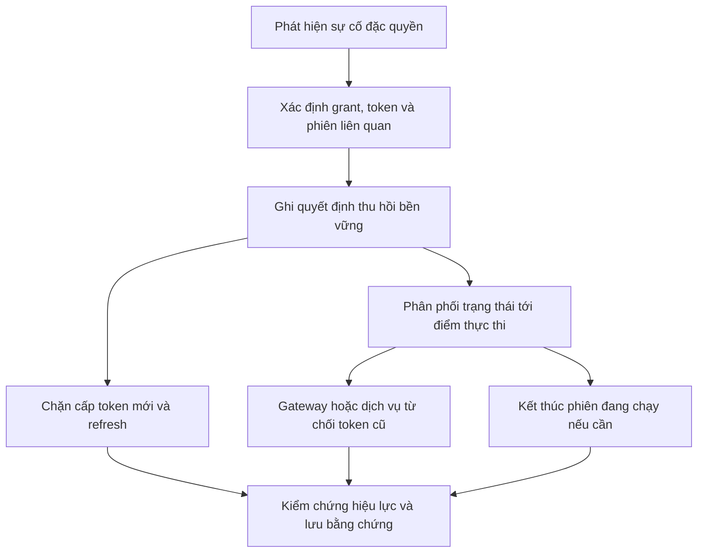

# Revoke active token trong ứng phó sự cố PAM

## 1. Vì sao phải thu hồi token đang hoạt động?

Trong hệ thống quản lý truy cập đặc quyền (Privileged Access Management — PAM), người quản trị thường không sử dụng mật khẩu gốc cho mọi thao tác. Sau khi xác thực, được phê duyệt và nhận quyền có thời hạn, họ có thể được cấp access token, refresh token, cookie phiên hoặc một loại thông tin xác thực ngắn hạn để truy cập hạ tầng nhạy cảm.

Khi phát hiện tài khoản bị chiếm quyền, một phiên quản trị có hành vi bất thường hoặc một token bị lộ, khóa tài khoản và đổi mật khẩu chưa đủ để kết luận truy cập đã bị cắt. Token đã được cấp có thể tiếp tục được chấp nhận bởi API, gateway hoặc dịch vụ đích cho tới khi hết hạn hay nhận được trạng thái thu hồi.

**Revoke active token** là làm cho token đang có hiệu lực không còn được phép tạo ra các hành động được bảo vệ, trước thời điểm hết hạn tự nhiên của nó. Trong một sự cố PAM, mục tiêu thực tế là chặn khả năng tiếp tục sử dụng quyền đặc biệt, bao gồm cả đường lấy token mới và đường sử dụng token cũ.

Ví dụ xuyên suốt bài học:

- Quản trị viên `ops-an` nhận quyền JIT để vận hành dịch vụ thanh toán trong 30 phút.
- PAM cấp quyền gắn với grant `grant-482` và phiên `pam-session-127`.
- Một access token được cấp cho API quản trị; một refresh token cho phép tiếp tục lấy access token trong thời hạn grant.
- SOC phát hiện API này được gọi từ một thiết bị ngoài dự kiến, đồng thời phiên quản trị xuất hiện thao tác trái với yêu cầu thay đổi.
- Đội ứng phó cần cắt truy cập đang diễn ra, giữ bằng chứng và chứng minh rằng các điểm thực thi đã ngừng chấp nhận quyền đó.

Bài học tập trung vào phần thu hồi quyền truy cập bằng token. Việc điều tra nguyên nhân, khôi phục dữ liệu và luân chuyển credential có liên quan nhưng là các công việc riêng, cần phối hợp trong cùng kế hoạch ứng phó.

## 2. Phân biệt token, grant và phiên

### 2.1. Access token

Access token được trình cho tài nguyên để thực hiện một thao tác. Token thường giới hạn bởi chủ thể, đối tượng nhận (`audience`), quyền hoặc scope, thời điểm hết hạn và có thể cả thiết bị hay cơ chế ràng buộc với bên gửi.

Token có thể là một chuỗi opaque được tra cứu ở phía máy chủ hoặc một cấu trúc tự chứa có chữ ký như JWT. Đây là hai cách biểu diễn; chúng không tự quyết định toàn bộ cơ chế thu hồi. Một JWT vẫn có thể được kiểm tra trạng thái trực tuyến, còn token opaque vẫn có thể bị chấp nhận quá lâu nếu dịch vụ đích giữ cache kết quả xác thực quá lâu.

### 2.2. Refresh token

Refresh token dùng để xin access token mới theo chính sách của bên cấp. Nó không nên được gửi cho mọi API nghiệp vụ như access token.

Thu hồi refresh token chặn một đường cấp access token mới, nhưng không mặc nhiên làm mất hiệu lực các access token đã phát hành. Ngược lại, thu hồi một access token chưa chắc chặn được refresh token đang còn hiệu lực. Khi xử lý sự cố, phải xác định cả hai đường này.

### 2.3. Grant hoặc quyền được cấp

Grant là quan hệ cấp quyền đứng sau token: ai được làm gì, trên tài nguyên nào, theo yêu cầu nào, trong bao lâu. Một grant có thể sinh nhiều access token hoặc nhiều phiên hoạt động.

Nếu chỉ thu hồi token vừa bị phát hiện, các token khác của cùng grant có thể vẫn hoạt động. Nếu ngừng cả grant, hệ thống có thể chặn toàn bộ quyền sinh từ quyết định cấp quyền đó, miễn là các thành phần phát hành và thực thi đều áp dụng trạng thái này.

### 2.4. Phiên PAM và phiên tại hệ thống đích

Phiên PAM có thể đại diện cho một luồng truy cập qua proxy, portal hoặc session broker. Hệ thống đích có thể tạo thêm phiên ứng dụng, kết nối SSH, kết nối cơ sở dữ liệu hoặc công việc nền dựa trên lần xác thực ban đầu.

Thu hồi token không đảm bảo mọi kết nối đã thiết lập đều tự đóng. Một kết nối chỉ xác thực khi bắt đầu có thể tiếp tục thực hiện lệnh nếu không có cơ chế kiểm tra lại hoặc buộc kết thúc phiên. Vì vậy cần phân biệt:

| Đối tượng | Thu hồi hoặc kết thúc nhằm đạt điều gì? | Điều chưa được bảo đảm chỉ bằng hành động này |
|---|---|---|
| Một access token | Chặn lần sử dụng tiếp theo của token tại điểm có kiểm tra thu hồi | Không chặn token khác hoặc đường refresh |
| Refresh token hoặc token family | Chặn việc tiếp tục cấp token từ chuỗi refresh bị ảnh hưởng | Không tự hủy access token đã cấp |
| Grant đặc quyền | Ngừng quyền được phê duyệt và các đường phát hành liên quan | Không tự đóng mọi phiên tại đích nếu thiếu tích hợp |
| Phiên PAM | Cắt luồng truy cập do PAM trực tiếp kiểm soát | Không bảo đảm phiên trực tiếp hoặc phiên ứng dụng khác đã đóng |
| Phiên tại tài nguyên | Chặn kết nối hoặc phiên đã được tài nguyên chấp nhận | Không tự chặn lần đăng nhập mới qua đường khác |
| Credential gốc | Chặn việc tiếp tục dùng bí mật cũ để xác thực mới | Không mặc nhiên thu hồi mọi token hay phiên hiện có |

Một phản ứng hiệu quả thường cần tác động tới nhiều đối tượng trong bảng, với phạm vi dựa trên dấu hiệu xâm nhập đã biết.

## 3. Thu hồi ở đâu mới thực sự có tác dụng?

### 3.1. Ba phần của một chuỗi thu hồi

Một hệ thống có thể ghi nhận “đã thu hồi” trong cơ sở dữ liệu nhưng tài nguyên vẫn chấp nhận token. Để tránh nhầm lẫn, cần nhìn thu hồi thành ba phần:

1. **Quyết định:** xác định token, grant, phiên hoặc chủ thể phải bị chặn.
2. **Phân phối:** đưa trạng thái thu hồi tới nơi phát hành và các điểm thực thi có liên quan.
3. **Thực thi:** các điểm đó từ chối sử dụng tiếp theo, ngăn cấp lại và kết thúc phiên nếu chính sách yêu cầu.



Nếu một API có đường truy cập trực tiếp bỏ qua gateway, việc cập nhật gateway chưa đủ. Nếu hệ thống có nhiều vùng hoặc nhiều cụm, xác nhận của một cụm chưa đại diện cho tất cả cụm phục vụ tài nguyên bị ảnh hưởng.

### 3.2. Token được tra cứu trạng thái trực tuyến

Với token được kiểm tra qua kho trạng thái hoặc dịch vụ introspection, nơi thực thi có thể biết token đã không còn hoạt động. Tuy nhiên, thời gian thu hồi thực tế còn phụ thuộc:

- Thời gian ghi và đọc nhất quán của kho trạng thái.
- Cache kết quả “active” ở gateway hoặc dịch vụ.
- Thời gian truyền sự kiện hoặc vô hiệu hóa cache.
- Cách xử lý khi không liên lạc được dịch vụ kiểm tra trạng thái.
- Các đường truy cập không sử dụng cùng cơ chế kiểm tra.

Nếu trạng thái token được cache là hợp lệ trong 5 phút, một thao tác thu hồi tức thời tại máy chủ cấp token có thể vẫn để lại khoảng chấp nhận token ở phía tài nguyên. Chính sách cache cần được thiết kế theo mức độ đặc quyền, không chỉ theo mục tiêu giảm tải.

### 3.3. Token tự chứa được xác thực ngoại tuyến

Giả sử tài nguyên chỉ kiểm tra chữ ký, issuer, audience và hạn dùng của JWT bằng khóa công khai đã có. Nó không truy vấn trạng thái token, không kiểm tra phiên bản grant và không nhận danh sách thu hồi.

Trong thiết kế này, việc đổi một cờ ở máy chủ cấp token không thể tự làm cho tài nguyên biết rằng JWT đã bị thu hồi. Token còn hạn vẫn có thể vượt qua các kiểm tra đang được triển khai.

Các cách bổ sung khả năng cắt quyền gồm:

- Kiểm tra danh sách thu hồi theo định danh token.
- Kiểm tra trạng thái hoặc phiên bản grant trước thao tác nhạy cảm.
- Áp dụng kiểm tra trực tuyến tại một điểm bắt buộc trên mọi đường truy cập.
- Dùng access token có thời hạn ngắn để giới hạn phần phơi nhiễm còn lại, đồng thời chặn cấp lại.
- Tạm chặn truy cập ở lớp mạng hoặc tài nguyên khi cơ chế thu hồi token chưa đáp ứng yêu cầu ứng phó.

Thời hạn ngắn là biện pháp giới hạn thời gian sử dụng token bị lộ; nó không tương đương với thu hồi tức thì. Nếu hệ thống chỉ có thể chờ token hết hạn, báo cáo sự cố phải thể hiện rõ giới hạn đó và biện pháp cô lập bù đắp.

### 3.4. Không dùng thay khóa ký như thao tác thu hồi thường lệ

Khóa ký thường được dùng cho nhiều token và nhiều chủ thể. Thay hoặc loại bỏ khóa có thể gây tác động rộng, trong khi tài nguyên còn cache khóa cũ vẫn tiếp tục chấp nhận token nếu thiết kế chưa xử lý trường hợp này.

Sự cố lộ khóa ký cần quy trình ứng phó riêng, có kiểm kê bên xác minh và kiểm chứng cập nhật khóa. Với một token hoặc một grant bị ảnh hưởng, cơ chế thu hồi theo đúng đối tượng thường cho phép kiểm soát phạm vi tốt hơn.

## 4. Chọn phạm vi thu hồi

### 4.1. Xác định điều đã biết và điều còn nghi ngờ

Một cảnh báo có thể cho biết chính xác token bị lộ, hoặc chỉ cho thấy tài khoản đang thực hiện hành vi bất thường. Phạm vi thu hồi phải phản ánh mức độ chắc chắn của bằng chứng.

| Tình huống | Phạm vi có thể cần thu hồi | Kiểm tra bổ sung |
|---|---|---|
| Xác định một token bị đưa vào log | Token đó và đường tạo lại nếu cũng có khả năng lộ | Token khác cùng grant, nơi lưu bản sao, truy cập vào log |
| Refresh token bị lộ | Refresh token hoặc family, access token liên quan theo khả năng nền tảng | Cấp lại do replay, phiên nguồn, thiết bị nguồn |
| Phiên quản trị bị chiếm quyền | Grant và các token của phiên; kết thúc phiên PAM và phiên tại đích | Phiên song song, token đã trao đổi, công việc đang chạy |
| Tài khoản đặc quyền bị chiếm quyền | Các grant và phiên liên quan của tài khoản; chặn cấp mới | MFA, thiết bị, credential khác, quyền trực tiếp ngoài PAM |
| Workload bị xâm nhập | Token của instance hoặc workload bị ảnh hưởng và đường phát hành | Replica khác, bí mật dùng chung, tác động gián đoạn dịch vụ |

Đây là khung lựa chọn, không phải một phép tự động “thu hồi tất cả”. Chỉ huy sự cố hoặc vai trò được ủy quyền quyết định phạm vi theo mức rủi ro, khả năng cô lập và ảnh hưởng vận hành.

### 4.2. Không chỉ dựa vào tên tài khoản

Một người có thể có nhiều grant hợp lệ cho nhiều mục đích. Một tài khoản dịch vụ có thể được nhiều instance sử dụng. Nếu dữ liệu chỉ có `username`, đội ứng phó khó thu hồi chính xác mà không gây gián đoạn rộng.

Các định danh nên liên kết được với nhau gồm:

- Chủ thể người dùng hoặc workload.
- Grant hoặc entitlement có thời hạn.
- Phiên PAM và phiên đích, nếu có.
- Định danh token hoặc refresh token family dưới dạng tham chiếu an toàn.
- Client, audience, scope và tài nguyên chịu ảnh hưởng.
- Ticket phê duyệt hoặc mã sự cố.
- Instance, thiết bị hoặc vùng phát hành khi cần phân biệt.

Không cần thu thập toàn bộ chuỗi token vào hồ sơ sự cố để có các liên kết này. Việc lưu token nguyên văn có thể tạo thêm một nơi làm lộ thông tin xác thực.

### 4.3. Token trao đổi hoặc quyền được ủy nhiệm

Token ban đầu có thể được dùng để lấy token khác cho tài nguyên khác. Một phiên quản trị cũng có thể tạo credential mới hoặc một phiên được ủy nhiệm tại hệ thống đích.

Không giả định rằng thu hồi token nguồn sẽ tự thu hồi mọi quyền phái sinh. Runbook cần kiểm tra khả năng lan truyền thu hồi của từng tích hợp. Nếu không có lan truyền tự động, phải liệt kê và xử lý các token hoặc phiên phái sinh có liên quan bằng cơ chế của hệ thống đích.

## 5. Quy trình thu hồi trong sự cố PAM

### Bước 1 — Mở ngữ cảnh sự cố và xác nhận mục tiêu

Gắn yêu cầu với mã sự cố, người hoặc cơ chế khởi tạo, lý do và phạm vi dự kiến. Xác nhận định danh từ nguồn tin cậy, thay vì sao chép một tên hiển thị có thể trùng hoặc một trường chưa được xác minh trong cảnh báo.

Trong ví dụ, mục tiêu ban đầu là `grant-482`, liên kết với `pam-session-127` và API quản trị dịch vụ thanh toán. SOC cần biết đây là phiên đang hoạt động, quyền được cấp còn hạn và sự kiện cảnh báo thực sự liên quan tới grant đó.

Các quyền thực hiện thu hồi phải được phân công trước khi có sự cố. Với hành động khẩn cấp đã được ủy quyền trong runbook, sử dụng luồng khẩn cấp có ghi vết; các yêu cầu kiểm soát bổ sung không nên vô tình tạo khoảng chờ cho truy cập trái phép tiếp tục.

### Bước 2 — Chặn đường nhận token mới

Tùy hệ thống, có thể cần:

- Đình chỉ grant JIT đang bị ảnh hưởng.
- Chặn refresh hoặc thu hồi refresh token family liên quan.
- Ngừng cấp token cho phiên hoặc workload bị cô lập.
- Hạn chế đăng nhập hoặc yêu cầu xác thực lại sau khi xử lý tài khoản, thiết bị.
- Ngừng các luồng ủy nhiệm có thể tái tạo quyền vừa bị cắt.

Việc chặn cấp mới và thu hồi token hiện có nên thuộc một quyết định ứng phó nhất quán. Nếu hai thao tác được thực hiện tách rời, phải xử lý khả năng refresh xảy ra ở giữa.

Không đặt lại grant về hoạt động chỉ để một thao tác quản trị dễ chạy hơn. Nếu cần truy cập cứu hộ, sử dụng đường break-glass được quản lý riêng, có phạm vi và bằng chứng độc lập.

### Bước 3 — Ghi trạng thái thu hồi bền vững

Trạng thái cần tồn tại sau restart, retry và mất kết nối tạm thời. Một thông báo trên hàng đợi hoặc một mục trong cache cục bộ không nên là bản ghi duy nhất của quyết định thu hồi.

Tùy thiết kế, trạng thái có thể là:

- Bản ghi token đã bị thu hồi tới khi không còn khả năng được chấp nhận.
- Grant bị chuyển sang trạng thái đình chỉ hoặc thu hồi.
- Phiên bản grant tăng lên, khiến token mang phiên bản cũ bị từ chối.
- Phiên hoặc token family bị đánh dấu không còn được dùng để phát hành.

Lưu mã yêu cầu, lý do, người thực hiện, thời điểm ghi nhận, phiên bản trạng thái và các đối tượng chịu ảnh hưởng. Thời điểm là bằng chứng vận hành; không nên dùng đồng hồ không đồng bộ làm cơ chế duy nhất để xác định token nào còn quyền.

### Bước 4 — Phân phối tới mọi điểm thực thi liên quan

Gửi trạng thái tới gateway, dịch vụ, broker hoặc thành phần quản lý phiên phù hợp với kiến trúc. Vô hiệu hóa cache “active” nếu hệ thống hỗ trợ, đồng thời giữ kiểm tra trạng thái bền vững để khôi phục sau khi một thành phần bị lỡ sự kiện.

Theo dõi riêng từng điểm cần áp dụng. Một kết quả như sau cho biết việc thu hồi chưa hoàn tất trên toàn phạm vi:

```text
request: revoke-ir-091
target: grant-482
issuance: BLOCKED
gateway-region-a: ENFORCED
gateway-region-b: ENFORCED
direct-admin-api: UNCONFIRMED
target-session: TERMINATION_PENDING
overall: PARTIALLY_ENFORCED
```

`PARTIALLY_ENFORCED` phải kích hoạt công việc xử lý phần thiếu, chẳng hạn cô lập đường trực tiếp hoặc kết thúc phiên tại đích. Không đổi tên trạng thái này thành “success” chỉ vì yêu cầu đã được tiếp nhận.

### Bước 5 — Xử lý phiên và thao tác đang chạy

Kiểm tra xem tài nguyên có đánh giá lại token cho từng yêu cầu hay chỉ khi tạo kết nối. Các trường hợp cần chú ý gồm:

- Kết nối dài qua WebSocket hoặc luồng tương tự.
- Phiên terminal, SSH hoặc cơ sở dữ liệu đã xác thực.
- Giao dịch đang xử lý sau khi đã vượt qua bước kiểm tra quyền.
- Công việc nền đã được xếp hàng hoặc đã khởi chạy.
- Quy trình tạo thêm tài khoản, khóa hoặc quyền lâu dài tại hệ thống đích.

Với phiên còn hoạt động, dùng khả năng kết thúc phiên của PAM hoặc tài nguyên theo runbook. Với công việc đang chạy, đánh giá riêng khả năng hủy, tác động tới tính nhất quán và thẩm quyền quyết định. Thu hồi token không hoàn tác thao tác đã được thực hiện hoặc dữ liệu đã bị đọc.

### Bước 6 — Kiểm chứng từ góc nhìn tài nguyên

Kiểm chứng cần bao gồm cả phía cấp và phía sử dụng:

1. Không cấp mới hoặc refresh thành công từ ngữ cảnh đã bị thu hồi.
2. Token cũ bị từ chối tại các đường truy cập thuộc phạm vi.
3. Phiên cần kết thúc đã thực sự đóng hoặc bị cô lập.
4. Không xuất hiện thao tác thành công mới từ quyền đã bị cắt sau mốc hiệu lực đã xác nhận.
5. Các tài khoản hoặc workload ngoài phạm vi tiếp tục hoạt động theo dự kiến.

Không dùng một thao tác gây thay đổi dữ liệu để thử token trong môi trường sản xuất. Ưu tiên công cụ kiểm chứng trạng thái, điểm kiểm tra quyền không có tác dụng phụ hoặc phép thử đã được chuẩn bị trong runbook. Nếu không thể tái sử dụng token bị nghi lộ một cách an toàn, dùng bằng chứng từ các điểm thực thi và cơ chế quan sát được phê duyệt, đồng thời ghi rõ giới hạn của phép kiểm chứng.

HTTP `401` hoặc `403` có thể xuất hiện tùy giao thức và thiết kế tài nguyên. Chỉ nhìn mã HTTP chưa đủ phân biệt token bị thu hồi, token sai audience, thiếu quyền hay dịch vụ đang lỗi. Cần đối chiếu mã lý do nội bộ và log có liên kết với yêu cầu thu hồi.

### Bước 7 — Giữ trạng thái chặn và chuẩn bị phục hồi

Sau khi xác nhận đã cắt truy cập, tiếp tục điều tra tài khoản, thiết bị hoặc workload nguồn. Xác định có cần đổi credential, đăng ký lại yếu tố xác thực, sửa quyền trực tiếp hoặc khắc phục điểm làm lộ token hay không.

Khi cho phép hoạt động lại, cấp một grant và token mới sau các kiểm tra cần thiết. Token đã bị thu hồi không nên được “mở lại” chỉ bằng cách xóa một mục khỏi danh sách chặn. Nếu dùng phiên bản grant, việc tái kích hoạt phải tiếp tục bảo đảm token mang phiên bản cũ không hợp lệ.

## 6. Xử lý race condition giữa phát hành và thu hồi

### 6.1. Vì sao thu hồi theo danh sách token có thể bỏ sót?

Xét chuỗi sự kiện:

```text
10:15:00.100  Worker ứng phó liệt kê token của grant-482.
10:15:00.120  Một yêu cầu refresh đang xử lý phát hành token mới.
10:15:00.150  Worker thu hồi các token trong danh sách đã lấy.
```

Nếu hệ thống chỉ chặn các token nằm trong danh sách ban đầu, token phát hành ở giữa có thể bị bỏ sót. Lặp lại việc liệt kê không tạo ra bảo đảm vững chắc nếu đường phát hành vẫn mở.

Một thiết kế mạnh hơn kết hợp ngừng grant và kiểm tra một trạng thái có thứ tự rõ ràng. Mục tiêu là token được cấp trước hoặc trong cuộc đua đều không thể tiếp tục mang quyền của grant đã bị thu hồi.

### 6.2. Ví dụ dùng phiên bản grant

Giả sử mỗi grant có `generation` tăng đơn điệu. Token được cấp gắn với grant và generation tương ứng. Các điểm thực thi kiểm tra token bằng trạng thái grant đáng tin cậy, có chính sách độ mới đáp ứng yêu cầu ứng phó.

Đoạn sau là mã giả mô tả thiết kế, không phải API của một sản phẩm PAM:

```text
issueToken(grantId, subject, audience):
    transaction with serialization for grantId:
        grant = readGrant(grantId)
        require grant.state == ACTIVE
        require grant.subject == subject
        require audience is allowed by grant
        require grant.validUntil has not passed

        claims = buildClaims(
            grantId = grant.id,
            grantGeneration = grant.generation,
            subject = subject,
            audience = audience,
            expiresAt = boundedByPolicyAndGrant(grant)
        )
        return mintToken(claims)

revokeGrant(grantId, requestId, incidentId):
    transaction with serialization for grantId:
        if requestId already recorded:
            require previous target and action match this request
            return previous decision

        grant = readGrant(grantId)
        grant.state = REVOKED
        grant.generation = grant.generation + 1
        disableRefreshForGrant(grant.id)
        saveGrant(grant)
        recordDecision(requestId, incidentId, grant.id, grant.generation)
        enqueueDurableRevocationEventInSameTransaction(grant)

    return DECISION_RECORDED

authorize(token, resource, action):
    claims = validateTokenCryptographicallyAndStructurally(token)
    require claims are valid for this issuer, audience and time

    grant = readTrustedGrantState(claims.grantId)
    require grant.state == ACTIVE
    require claims.grantGeneration == grant.generation
    require grant permits claims.subject, resource and action
    require grant and token are both within their validity windows

    allow request
```

Có hai ràng buộc quan trọng trong ví dụ:

- Phát hành và thu hồi có thứ tự nhất quán đối với cùng grant. Token phát hành trước quyết định thu hồi sẽ mang generation cũ; sau quyết định đó, grant không còn hoạt động để phát hành tiếp.
- Tài nguyên thực sự kiểm tra trạng thái và generation. Chỉ thêm claim vào token mà không kiểm tra ở nơi thực thi không tạo ra khả năng thu hồi.

Nếu `readTrustedGrantState` trả về cache cũ, khả năng chấp nhận token cũ vẫn tồn tại trong thời gian cache đó được dùng. Thiết kế phải quy định độ mới tối đa, hành vi khi không lấy được trạng thái và biện pháp cô lập khi độ trễ vượt ngưỡng.

Việc ghi sự kiện trong cùng giao dịch thể hiện mẫu lưu sự kiện bền vững trước khi phân phối. Nó tránh tình huống cơ sở dữ liệu đã cập nhật nhưng tiến trình chết trước khi gửi thông báo. Một bộ phân phối vẫn cần retry, chống xử lý lặp và đối soát các bên nhận.

Kể cả khi kiểm tra quyền có tính nhất quán mạnh, yêu cầu đã được cho phép trước thời điểm thu hồi vẫn có thể hoàn tất sau đó. Để kiểm soát hành động đặc biệt nhạy cảm, tài nguyên có thể cần kiểm tra lại tại ranh giới thực thi hoặc hỗ trợ hủy phiên, giao dịch theo chính sách.

## 7. Độ trễ thu hồi và tiêu chí hoàn tất

### 7.1. Tách các mốc thời gian

Nên ghi nhận ít nhất:

- `detected_at`: thời điểm hệ thống phát hiện dấu hiệu sự cố.
- `requested_at`: thời điểm yêu cầu thu hồi được gửi.
- `decision_committed_at`: thời điểm trạng thái thu hồi đã được lưu bền vững.
- `enforced_at` theo từng điểm: thời điểm xác nhận điểm thực thi đã áp dụng.
- `verified_at`: thời điểm hoàn tất kiểm chứng trong phạm vi sự cố.

Chênh lệch giữa phát hiện và yêu cầu cho biết độ trễ phản ứng. Chênh lệch giữa quyết định và thực thi cho biết độ trễ phân phối, cache và áp dụng. Nếu gộp tất cả vào một nhãn “revoked at”, việc đánh giá hiệu quả kiểm soát sẽ thiếu chính xác.

### 7.2. Ước lượng cửa sổ còn chấp nhận token

Với một điểm thực thi cụ thể, có thể ước lượng thận trọng:

```text
Độ trễ áp dụng trạng thái
≈ độ trễ phân phối + thời gian giữ cache cũ + độ trễ xử lý tại điểm thực thi
```

Đây là mô hình vận hành, không phải công thức bảo đảm cho mọi kiến trúc. Các bước có thể chồng lấp, một bên nhận có thể mất kết nối và đồng hồ giữa hệ thống có sai lệch. Muốn có giới hạn trên đáng tin cậy phải có chính sách thời gian chờ, cache, xử lý lỗi và cô lập được thực thi thực tế.

Ví dụ minh họa: access token còn hạn 8 phút, gateway giữ cache trạng thái trong tối đa 20 giây và có cơ chế nhận sự kiện để xóa cache sớm. Nếu sự kiện bị lỡ nhưng cache hết hạn đúng chính sách, lần tra cứu tiếp theo có thể nhận trạng thái đã thu hồi. Tuy nhiên, một API trực tiếp chỉ kiểm tra chữ ký vẫn có thể chấp nhận token tới khi hết hạn. Không được dùng con số 20 giây của gateway để mô tả hiệu lực trên toàn hệ thống.

### 7.3. Trạng thái báo cáo nên phản ánh bằng chứng

Một mô hình trạng thái vận hành có thể gồm:

| Trạng thái | Ý nghĩa |
|---|---|
| REQUESTED | Đã nhận yêu cầu, chưa chứng minh quyết định được lưu |
| DECISION_RECORDED | Đã ghi trạng thái bền vững, cần tiếp tục phân phối và kiểm chứng |
| PARTIALLY_ENFORCED | Một số điểm đã áp dụng, vẫn còn điểm chưa xác nhận |
| ENFORCED | Các điểm thực thi trong phạm vi đã xác nhận áp dụng |
| VERIFIED | Đã hoàn tất các phép kiểm chứng được yêu cầu và lưu bằng chứng |
| FAILED hoặc UNCONFIRMED | Có lỗi hoặc thiếu bằng chứng để kết luận |

Tên trạng thái có thể khác theo sản phẩm. Điều cần giữ là sự phân biệt giữa tiếp nhận yêu cầu và chặn truy cập thực tế. Một phản hồi thành công của endpoint thu hồi có thể chỉ xác nhận việc xử lý yêu cầu theo giao thức, không chứng minh mọi tài nguyên đã dừng chấp nhận token.

## 8. Khi thành phần thu hồi gặp lỗi

### 8.1. Không liên lạc được dịch vụ trạng thái

Nếu tài nguyên không truy vấn được trạng thái token hoặc grant, phải áp dụng chính sách đã được thiết kế cho loại thao tác đó.

Với quyền quản trị có rủi ro cao, một lựa chọn thường được xem xét là từ chối hoặc tạm dừng thao tác khi trạng thái không đủ mới. Với luồng phục vụ liên tục, tổ chức có thể có cơ chế xử lý riêng với giới hạn rõ ràng. Quyết định này cần được xác lập và kiểm thử trước, vì cả tiếp tục cho phép lẫn dừng dịch vụ đều có tác động.

Trong sự cố đang diễn ra, không được âm thầm chuyển sang chấp nhận mọi token chỉ để bỏ qua lỗi. Nếu một điểm không thể bảo đảm cắt quyền, sử dụng biện pháp cô lập đã được ủy quyền và đánh dấu điểm đó là chưa xác nhận cho tới khi có bằng chứng.

### 8.2. Yêu cầu bị gửi lặp hoặc không rõ kết quả

Mạng có thể ngắt sau khi máy chủ đã ghi quyết định nhưng trước khi trả phản hồi. Vì vậy thao tác thu hồi cần hỗ trợ retry an toàn:

- Dùng mã yêu cầu ổn định cho cùng một hành động.
- Liên kết mã yêu cầu với đúng mục tiêu và phạm vi; phát hiện việc dùng lại mã cho nội dung khác.
- Thu hồi lại một token đã bị thu hồi không làm nó có hiệu lực trở lại.
- Đọc trạng thái xử lý bằng tham chiếu yêu cầu để phân biệt “chưa chạy” với “đã chạy nhưng mất phản hồi”.

Không tạo vô hạn yêu cầu mới chỉ vì client gặp timeout. Điều đó làm khó đối soát, che mất quyết định gốc và có thể gây quá tải thành phần đang xử lý sự cố.

### 8.3. Dọn danh sách thu hồi quá sớm

Với denylist theo token, cần giữ bản ghi tới khi token không thể được chấp nhận nữa theo tất cả điểm liên quan, bao gồm hạn dùng và dung sai thời gian mà các điểm đó cho phép.

Nếu xóa bản ghi khi token vẫn còn khả năng được xác thực, token cũ có thể hoạt động lại. Với grant dùng generation, không khôi phục số generation cũ khi tái kích hoạt. Trạng thái bị thu hồi không nên biến mất chỉ vì tiến trình restart hoặc cache bị làm trống.

## 9. Bằng chứng cần giữ mà không làm lộ token

Hồ sơ thu hồi nên đủ để trả lời: ai quyết định, quyết định tác động tới đâu, nơi nào đã thực thi và có truy cập thành công nào tiếp tục sau đó hay không.

Ví dụ bản ghi minh họa, các định danh không phải token thật:

```json
{
  "incident_id": "IR-2026-091",
  "request_id": "revoke-ir-091",
  "actor": "incident-responder-07",
  "subject_ref": "ops-an",
  "grant_ref": "grant-482",
  "pam_session_ref": "pam-session-127",
  "reason": "suspected_session_compromise",
  "scope": "grant_and_related_sessions",
  "issuance_state": "BLOCKED",
  "enforcement": [
    {"point": "admin-gateway-a", "state": "ENFORCED"},
    {"point": "admin-gateway-b", "state": "ENFORCED"},
    {"point": "direct-admin-api", "state": "UNCONFIRMED"}
  ],
  "verification_state": "PARTIAL",
  "evidence_refs": ["evidence-441", "evidence-442"]
}
```

Không ghi access token, refresh token, cookie, khóa riêng hoặc header `Authorization` nguyên văn trong log, ticket, ảnh chụp hay cuộc hội thoại xử lý sự cố. Dùng định danh token không mang quyền truy cập hoặc tham chiếu do hệ thống cấp. Nếu phải tạo dấu vân tay từ token, dùng cơ chế được tổ chức phê duyệt, bảo vệ khóa khi có sử dụng và giới hạn khả năng liên kết dữ liệu.

Log kiểm toán phải phân quyền, giữ tính toàn vẹn và có thời hạn lưu phù hợp. Bằng chứng về lời gọi bị từ chối nên chỉ ra lý do như `GRANT_REVOKED` hoặc `TOKEN_REVOKED` trong kênh nội bộ, trong khi phản hồi ra bên ngoài chỉ cung cấp mức thông tin cần thiết theo thiết kế bảo mật.

Không kéo dài truy cập trái phép chỉ để thu thập đủ bằng chứng. Thu thập tối thiểu những dữ liệu cần thiết, thực hiện cắt quyền theo runbook và bảo toàn các nguồn log hoặc dấu vết còn lại song song khi có thể.

## 10. Minh họa xử lý sự cố theo dòng thời gian

Giả sử SOC kết luận cần thu hồi `grant-482`. Các thời điểm dưới đây chỉ minh họa cách ghi nhận, không phải cam kết độ trễ của PAM.

| Mốc | Diễn biến | Nhận định |
|---|---|---|
| 10:15:00 | Phát hiện truy cập quản trị bất thường | Sự cố bắt đầu được xử lý |
| 10:15:05 | Người ứng phó gửi yêu cầu thu hồi grant | Mới có yêu cầu, chưa thể kết luận truy cập đã bị cắt |
| 10:15:06 | Grant bị thu hồi; đường refresh bị chặn | Đã ngăn cấp mới trong phạm vi đã xác định |
| 10:15:08 | Hai gateway áp dụng trạng thái mới | Token cũ bị từ chối qua hai gateway |
| 10:15:10 | Phiên terminal qua PAM bị kết thúc | Luồng terminal đã đóng; vẫn cần kiểm tra phiên khác |
| 10:15:13 | Phát hiện API trực tiếp chưa nhận trạng thái | Thu hồi mới đạt hiệu lực một phần |
| 10:15:16 | Áp dụng biện pháp cô lập API trực tiếp theo runbook | Đường truy cập còn thiếu được chặn |
| 10:15:21 | Kiểm chứng không cấp mới; các đường cũ đều bị từ chối | Có thể xác nhận cắt quyền trong phạm vi đã kiểm chứng |

Sau mốc cuối, đội ứng phó vẫn cần điều tra các thao tác đã xảy ra trước đó. Nếu token đã được dùng để tạo một credential khác hoặc thiết lập một quyền lâu dài, việc chặn grant ban đầu không xóa được hậu quả này.

Khi dịch vụ cần quản trị để phục hồi, dùng một grant mới sau khi xác minh người, thiết bị và yêu cầu công việc. Hồ sơ phải liên kết việc cấp mới với quyết định phục hồi, tránh nhầm đây là phần tiếp tục của phiên đã bị thu hồi.

## 11. Các lỗi thiết kế và vận hành thường gặp

### Chỉ đổi mật khẩu rồi kết luận token mất hiệu lực

Token đã cấp có vòng đời và cơ chế kiểm tra riêng. Cần xác minh quan hệ giữa đổi mật khẩu, grant, refresh token và các phiên hiện hữu theo từng tích hợp.

### Chỉ thu hồi refresh token

Đường lấy token mới đã bị chặn nhưng access token cũ có thể còn dùng được. Cần cơ chế cắt access token hoặc biện pháp cô lập tới khi nó không còn khả năng được chấp nhận.

### Chỉ thu hồi một access token khi grant còn hoạt động

Client hoặc kẻ tấn công có thể lấy token mới qua đường refresh, đăng nhập hoặc ủy nhiệm vẫn còn mở. Phải kiểm tra đường cấp lại tương ứng với phạm vi xâm nhập.

### Tin vào chữ ký JWT như bằng chứng token chưa bị thu hồi

Chữ ký hợp lệ chứng minh token không bị sửa và do bên nắm khóa tương ứng ký theo mô hình tin cậy. Nó không tự chứng minh grant vẫn được phép hoạt động ở thời điểm hiện tại.

### Xác nhận thành công chỉ từ phản hồi của máy chủ cấp

Điểm thực thi có thể còn cache cũ, mất kết nối hoặc bỏ qua trạng thái. Cần bằng chứng tại các tài nguyên trong phạm vi.

### Bỏ qua phiên dài và công việc nền

Token có thể chỉ được dùng ở thời điểm tạo phiên hoặc khởi chạy công việc. Cần cơ chế kết thúc hoặc cô lập ở tài nguyên, đồng thời phân tích tác động của việc hủy.

### Thu hồi rộng mà không biết phụ thuộc workload

Thu hồi toàn bộ token của một tài khoản dịch vụ dùng chung có thể dừng nhiều hệ thống. Kiểm kê chủ sở hữu, instance và phụ thuộc giúp lựa chọn phạm vi đủ chặn sự cố mà vẫn kiểm soát ảnh hưởng.

### Tái kích hoạt grant làm token cũ hợp lệ trở lại

Nếu hệ thống chỉ đổi `REVOKED` về `ACTIVE` mà không giữ dấu vết phiên bản, token cũ còn hạn có thể lại được chấp nhận. Phục hồi phải tạo ngữ cảnh cấp quyền mới và giữ hiệu lực của quyết định thu hồi cũ.

## 12. Bài thực hành trên môi trường cô lập

### 12.1. Chuẩn bị

Dùng một môi trường thử nghiệm không có dữ liệu thật, có một bên cấp token, một gateway và một tài nguyên thử nghiệm. Chuẩn bị:

- Hai chủ thể thử nghiệm A và B với grant tách biệt.
- Một access token và một đường refresh cho A.
- Một token cho B để kiểm tra ảnh hưởng ngoài phạm vi.
- Một endpoint kiểm tra quyền không thay đổi dữ liệu.
- Log phát hành, log thực thi và khả năng liên kết theo grant hoặc request ID.
- Nếu môi trường hỗ trợ, một kết nối dài và một đường truy cập trực tiếp tới tài nguyên.

Không đưa token vào báo cáo. Dùng bí danh token trong ghi chép; công cụ thử nghiệm phải giữ chúng ở nơi được bảo vệ và không in ra đầu ra dùng chung.

### 12.2. Thực hiện

1. Xác nhận A và B đều gọi được endpoint thử nghiệm theo đúng quyền.
2. Ghi nhận thời hạn token, chính sách cache và các điểm sẽ kiểm tra thu hồi.
3. Thu hồi grant của A bằng mã yêu cầu cố định.
4. Kiểm tra đường refresh của A không còn cấp token mới.
5. Kiểm tra token cũ của A qua từng đường truy cập, ghi nhận thời gian và lý do bị từ chối.
6. Kiểm tra kết nối dài của A đã đóng hoặc không còn thực hiện được thao tác cần chặn.
7. Xác nhận token của B vẫn hoạt động đúng quyền.
8. Gửi lại yêu cầu thu hồi với cùng mã yêu cầu để kiểm tra tính lặp an toàn.
9. Giả lập một điểm nhận sự kiện bị gián đoạn, xác minh trạng thái “chưa áp dụng đủ” và cơ chế đối soát khi nó hoạt động lại.
10. Tạo một grant mới cho A sau quyết định phục hồi thử nghiệm; xác nhận token cũ không hợp lệ trở lại.

Nếu môi trường có hỗ trợ kiểm soát đồng thời, thực hiện thêm phép thử refresh và thu hồi cùng lúc. Điều cần kiểm tra là token phát sinh trong cuộc đua không tiếp tục sử dụng được quyền sau khi trạng thái thu hồi đã có hiệu lực theo cam kết của hệ thống.

### 12.3. Sản phẩm cần nộp

Báo cáo thực hành gồm sơ đồ các điểm phát hành và thực thi, phạm vi thu hồi, dòng thời gian từng điểm, kết quả kiểm tra cấp lại, kết quả kiểm tra phiên dài và giới hạn còn tồn tại. Tách rõ “đã ghi yêu cầu”, “đã áp dụng” và “đã kiểm chứng”.

Một kết quả chưa đạt vẫn có giá trị nếu xác định được nguyên nhân cụ thể, chẳng hạn API trực tiếp chỉ xác thực JWT ngoại tuyến hoặc cache không được vô hiệu hóa. Không gán nhãn thu hồi tức thì khi quan sát thực tế cho thấy phải chờ hết hạn.

## 13. Câu hỏi tự kiểm tra

**Vì sao token vẫn dùng được sau khi tài khoản đã bị khóa?**

Tài nguyên có thể chỉ kiểm tra chữ ký và hạn dùng, hoặc đang sử dụng cache trạng thái cũ. Khóa tài khoản không tự truyền thành quyết định thu hồi tới mọi điểm thực thi.

**Thu hồi refresh token giải quyết phần nào của sự cố?**

Nó chặn đường cấp access token mới gắn với refresh token theo cơ chế của hệ thống. Cần kiểm tra riêng access token đã phát hành và các đường cấp lại khác.

**Có thể kết luận đã cắt quyền khi endpoint thu hồi trả thành công không?**

Chưa đủ. Cần biết phản hồi đó biểu thị mức nào, kiểm tra các điểm thực thi, phiên đang hoạt động và đường phát hành liên quan.

**Tại sao chặn grant có thể cần thiết hơn chỉ liệt kê token để thu hồi?**

Grant đang hoạt động có thể tiếp tục sinh token trong lúc thu hồi danh sách cũ. Chặn grant và dùng cơ chế kiểm tra trạng thái nhất quán giúp giải quyết đường cấp mới và cuộc đua đó.

**Token đã thu hồi có nên hoạt động lại sau khi tài khoản được phục hồi?**

Không. Hoạt động phục hồi cần ngữ cảnh cấp quyền mới; dấu vết thu hồi hoặc generation phải tiếp tục khiến token cũ bị từ chối.

**Tiêu chí thực tế để xác nhận hoàn tất thu hồi trong một sự cố là gì?**

Đã chặn đường cấp lại trong phạm vi, các điểm thực thi liên quan đã áp dụng, phiên cần cắt đã được xử lý và có bằng chứng kiểm chứng kết quả. Những điểm chưa xác nhận phải được ghi rõ, đi kèm biện pháp cô lập hoặc công việc còn mở.
