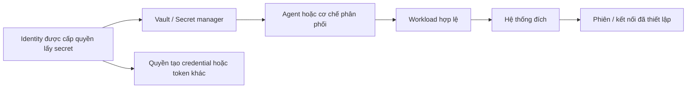

# Rotate credential khẩn cấp

## Mục tiêu bài học

Trong ứng phó sự cố Privileged Access Management (PAM), rotate credential khẩn cấp là thay thế thông tin xác thực bị lộ hoặc có khả năng đã bị chiếm dụng, đồng thời loại bỏ đường truy cập mà thông tin đó đã tạo ra. Credential có thể là mật khẩu quản trị, mật khẩu tài khoản dịch vụ, SSH key, API key hoặc thông tin dùng để lấy token.

Một thao tác đổi mật khẩu thành công chưa đủ để khẳng định sự cố đã được kiểm soát. Kẻ tấn công có thể còn phiên SSH, kết nối cơ sở dữ liệu, token đã được cấp hoặc quyền tạo credential mới. Ứng dụng hợp lệ cũng có thể tiếp tục giữ bản cũ trong bộ nhớ và gây gián đoạn khi kết nối lại.

Sau bài học, người học có thể:

- Phân biệt rotation định kỳ với rotation trong điều kiện bị xâm nhập.
- Chọn trình tự cô lập, thu hồi và thay thế phù hợp với mức độ khai thác.
- Xác định consumer và quan hệ phụ thuộc trước khi chuyển credential.
- Kiểm chứng cả khả năng hoạt động của credential mới và sự mất hiệu lực của credential cũ.
- Lập bằng chứng ứng phó mà không đưa secret vào ticket, log hoặc tài liệu.

Phạm vi bài là credential dùng để xác thực và thực thi quyền đặc biệt. Luân chuyển khóa mã hóa dữ liệu, thay khóa của cả cơ quan cấp chứng thư hay khôi phục toàn bộ miền định danh là các quy trình riêng; không tự động thực hiện những thay đổi đó chỉ vì một tài khoản dịch vụ bị lộ.

## 1. Rotation khẩn cấp khác rotation định kỳ ở đâu?

Rotation định kỳ thường giả định hệ thống cấp, lưu và nhận secret vẫn đáng tin cậy. Nhóm vận hành có thể chuẩn bị trước consumer, thử bản mới và bố trí thời gian chuyển đổi.

Trong sự cố, những giả định ấy phải được kiểm tra lại. Nếu máy đang chạy agent đã bị chiếm quyền, cập nhật secret trên chính máy đó có thể giao credential mới cho cùng người đang kiểm soát credential cũ. Nếu tài khoản điều khiển rotation bị lộ, một vòng rotation thành công vẫn không ngăn được việc tạo thêm khóa khác.

| Khía cạnh | Rotation định kỳ | Rotation khẩn cấp |
| --- | --- | --- |
| Mục tiêu chính | Giới hạn tuổi thọ và mức tích lũy của secret | Chặn khả năng tiếp tục khai thác và khôi phục truy cập hợp lệ |
| Điều kiện tin cậy | Thường đã biết và ổn định | Phải đánh giá lại thiết bị, identity, vault và hệ thống đích |
| Consumer | Có thời gian kiểm kê và thử chuyển đổi | Cần kiểm kê tối thiểu ngay, bổ sung song song |
| Credential cũ | Có thể có khoảng chuyển tiếp theo thiết kế | Phải thu hồi sớm theo rủi ro thực tế, không chờ lịch định kỳ |
| Phiên đang tồn tại | Thường không phải trọng tâm | Là đối tượng phải kiểm soát riêng |
| Rollback | Có thể quay lại cấu hình trước khi phù hợp | Không được khôi phục credential đã biết bị lộ |

Một quy trình rotation khẩn cấp cần trả lời bốn câu hỏi độc lập:

1. Ai hoặc thành phần nào còn có thể lấy credential mới?
2. Credential cũ còn được chấp nhận ở đâu?
3. Quyền truy cập đã phát sinh từ credential cũ còn tồn tại không?
4. Consumer hợp lệ có hoạt động với credential mới trong giới hạn quyền đã duyệt không?

Đánh dấu hoàn thành khi chỉ trả lời được câu hỏi cuối cùng sẽ tạo cảm giác an toàn sai.

## 2. Nhìn credential như một chuỗi quan hệ

Một đường sử dụng secret điển hình có thể gồm:



Mỗi cạnh có thể cần một hành động khác nhau. Chặn identity lấy secret không nhất thiết chấm dứt kết nối đã mở ở hệ thống đích. Đổi dữ liệu trong vault cũng không tự chứng minh hệ thống đích đã đổi mật khẩu.

Về nguyên tắc, rotation phải đồng bộ giá trị ở nơi lưu secret và nơi sử dụng credential để xác thực. AWS mô tả rotation trong Secrets Manager là cập nhật credential ở cả secret lẫn cơ sở dữ liệu hoặc dịch vụ liên quan. Đây là lý do không nên coi việc tạo một phiên bản secret mới là bằng chứng hoàn thành toàn bộ thao tác. [Tài liệu AWS Secrets Manager](https://docs.aws.amazon.com/secretsmanager/latest/userguide/rotating-secrets.html).

### Các lớp cần phân biệt

- **Credential gốc:** mật khẩu, private key hoặc API key dùng để xác thực.
- **Quyền phát hành:** quyền tạo API key, cấp token, đọc secret hoặc đổi mật khẩu người khác.
- **Credential dẫn xuất:** token, vé hoặc credential ngắn hạn được cấp sau một lần xác thực.
- **Phiên hoạt động:** phiên PAM, phiên SSH, cookie ứng dụng hoặc kết nối đã xác thực.
- **Bản sao phân phối:** bản trong agent, bộ nhớ tiến trình, cấu hình, pipeline hay kho lưu trữ.

Một credential ngắn hạn không có nghĩa phải chờ nó hết hạn. Có thể cần thu hồi ngay, hoặc chặn principal tại điểm thực thi quyền nếu cơ chế thu hồi không có hiệu lực tức thì.

Với Vault, dynamic secret có lease; KV lưu secret tùy ý không cung cấp cùng cơ chế lease đó. Vì vậy không thể áp dụng một thao tác revoke lease như cách xử lý chung cho mọi secret trong vault. [Tài liệu HashiCorp về lease và revoke](https://developer.hashicorp.com/vault/docs/concepts/lease).

## 3. Khi nào kích hoạt quy trình khẩn cấp?

Các tín hiệu sau thường đủ để đưa credential vào phạm vi điều tra và quyết định ứng phó:

- Secret xuất hiện ở log, ticket, repository hoặc gói build mà người không được phép có thể đọc.
- Có đăng nhập đặc quyền từ nguồn, thiết bị hoặc thời điểm bất thường.
- Thiết bị quản trị hoặc workload giữ credential bị xâm nhập.
- Phiên PAM thực thi hành động không khớp mục đích được phê duyệt.
- Có khóa, token hoặc phương thức xác thực mới không giải thích được.
- Mất khả năng kiểm soát một nơi lưu bản sao secret.

Không cần chờ chứng minh toàn bộ chuỗi tấn công mới chặn một credential đang bị sử dụng trái phép. Tuy nhiên, phạm vi hành động phải gắn với bằng chứng và quan hệ phụ thuộc, thay vì đổi hàng loạt mọi credential không liên quan.

| Tình huống | Ưu tiên trước mắt | Hướng xử lý |
| --- | --- | --- |
| Đang có truy cập trái phép bằng credential | Chặn đường truy cập và thu hồi quyền | Cắt trước, khôi phục consumer hợp lệ bằng credential sạch |
| Secret lộ trong log nhưng chưa thấy khai thác | Giảm khả năng sử dụng ngay, xác định consumer | Chuyển nhanh theo kế hoạch có giới hạn rõ |
| Host giữ secret bị chiếm quyền | Cô lập host và quyền lấy secret của host | Cấp mới từ môi trường sạch, không phân phối lại cho host cũ |
| Identity có quyền tạo secret bị chiếm quyền | Kiểm soát đường cấp phát và quyền quản trị | Khôi phục nguồn tin cậy trước hoặc song song với credential phụ thuộc |
| Chỉ thấy lỗi xác thực sau lần đổi trước | Đối soát trạng thái target, vault và consumer | Không tạo thêm vòng rotation mù để che lỗi đồng bộ |

Sự cố rò rỉ từ hệ thống log còn cần hạn chế quyền đọc và xử lý bản sao theo chính sách lưu giữ bằng chứng. Xóa dòng log không làm credential đã bị sao chép mất hiệu lực.

## 4. Chọn giữa cắt trước và chuyển tiếp có giới hạn

### 4.1. Cắt trước, khôi phục sau

Ưu tiên cách này khi đã thấy khai thác, khi quyền của credential quá lớn hoặc khi không thể tin vào nguồn đang giữ secret.

Trình tự điển hình:

1. Chặn identity, key hoặc đường truy cập tại nơi có hiệu lực.
2. Chấm dứt phiên và kết nối thuộc phạm vi sự cố.
3. Chặn quyền đọc lại secret và quyền tự tạo credential khác.
4. Tạo credential mới trong môi trường đã kiểm soát.
5. Khôi phục từng consumer hợp lệ và kiểm chứng.

Cách này có thể gây gián đoạn dịch vụ, nhưng thời gian gián đoạn phải được so với thiệt hại của việc duy trì đường đặc quyền đang bị khai thác. Người chỉ huy sự cố và chủ dịch vụ cần biết tác động, dựa trên cơ chế ứng cứu đã được phê duyệt.

### 4.2. Chuyển tiếp có giới hạn

Một số nền tảng hỗ trợ hai khóa hoặc hai identity cùng hoạt động trong quá trình đổi. Có thể tạo credential mới, chuyển consumer rồi thu hồi bản cũ, nhưng khoảng đồng tồn tại là một quyết định rủi ro.

Chỉ chọn cách này khi đã có biện pháp cô lập hiệu quả và có cơ sở để kiểm soát khả năng dùng credential cũ. Cần chỉ định:

- Phạm vi tài nguyên và nguồn được phép truy cập trong thời gian chuyển.
- Thời điểm bắt đầu, hạn kết thúc và người chịu trách nhiệm cắt bản cũ.
- Các tín hiệu buộc phải kết thúc chuyển tiếp ngay.
- Danh sách consumer phải hoàn tất trước hạn.
- Cách khôi phục dịch vụ bằng một credential sạch khác nếu chuyển đổi thất bại.

Nếu credential cũ vẫn cho phép người tấn công truy cập tài nguyên nhạy cảm, việc giữ nó hoạt động chỉ để giảm downtime không được mô tả là đã containment. Không đặt một thời lượng chồng lấn chung cho mọi hệ thống.

### 4.3. Không giả định mọi tài khoản có hai mật khẩu

Một tài khoản chỉ hỗ trợ một mật khẩu hiệu lực không thể được xử lý như API có hai access key độc lập.

Các lựa chọn thực tế có thể là dừng ngắn consumer để đổi đồng bộ, chuyển sang identity dự phòng đã được thiết kế trước, hoặc tạo identity thay thế được phê duyệt. Việc tạo identity khác phải giữ giới hạn quyền và tính truy vết; không cấp quyền quản trị rộng hơn để vượt qua lỗi triển khai.

## 5. Chuẩn bị quyền ứng cứu và kênh điều khiển sạch

Trước khi thực hiện, cần có một đường quản trị đã kiểm tra và nằm ngoài phạm vi nghi bị xâm nhập.

Ví dụ, nếu tài khoản dịch vụ triển khai bị lộ, nhóm ứng cứu không nên dùng lại chính token triển khai đó để phân phối credential mới. Nếu laptop quản trị bị xâm nhập, đổi mật khẩu từ laptop ấy không khôi phục được độ tin cậy của thao tác.

Các điều kiện tối thiểu gồm:

- Người điều phối xác định phạm vi, mức ưu tiên và người có quyền quyết định.
- Người vận hành PAM được cấp quyền JIT/JEA đúng target và đúng hành động.
- Chủ ứng dụng xác nhận các consumer và thao tác kiểm tra nghiệp vụ.
- Người theo dõi an ninh quan sát hành vi sử dụng credential cũ.
- Một đường break-glass được kiểm tra khi việc cắt quyền có thể khóa đường quản trị chính.
- Kênh lưu bằng chứng được bảo vệ và chỉ chứa metadata cần thiết.

Phân tách người thực hiện và người xác nhận giúp phát hiện chọn sai target hoặc phiên bản. Trong tình huống khẩn cấp, dùng quy trình phê duyệt nhanh đã được thiết kế trước; không dựng thêm thủ tục khiến việc chặn khai thác bị trì hoãn.

Quyền ứng cứu cũng phải có thời hạn. Sau sự cố, thu hồi quyền tạm, kết thúc phiên ứng cứu và rotate credential break-glass nếu credential đó đã được sử dụng hoặc có nguy cơ bị lộ.

## 6. Kiểm kê đủ để hành động, tiếp tục bổ sung trong sự cố

Bảng kiểm kê không lưu giá trị secret. Dùng định danh credential, principal, target, phiên bản hoặc tham chiếu chứng cứ phù hợp với cơ chế kiểm soát truy cập của tổ chức.

| Thành phần | Thông tin phải biết | Vì sao ảnh hưởng đến rotation |
| --- | --- | --- |
| Principal | Tên/ID, loại tài khoản, owner, quyền | Xác định đối tượng bị chặn và quyền phải bảo toàn |
| Hệ thống đích | Môi trường, endpoint, vùng, replica | Tránh đổi ở một nơi nhưng bỏ sót nơi khác |
| Nơi cấp và lưu secret | Vault path hoặc secret reference, version ID | Phân biệt bản đang dùng và bản thay thế |
| Consumer trực tuyến | Dịch vụ, replica, agent, connection pool | Xác định cách reload hoặc tạo lại kết nối |
| Consumer không liên tục | Cron, batch, DR job, tác vụ thủ công | Tránh kết luận thành công khi chúng chưa chạy |
| Credential dẫn xuất | Token, lease, phiên đã cấp | Lập kế hoạch thu hồi riêng |
| Quyền quản trị liên quan | Quyền tạo key, thêm SSH key, thay policy | Ngăn đường tái xâm nhập |
| Cơ chế khôi phục | Identity sạch, quy trình phát hành lại | Khôi phục dịch vụ mà không bật lại credential lộ |

Đừng chờ một bản inventory hoàn hảo để chặn truy cập đang diễn ra. Có thể containment trên đối tượng đã xác định rồi triển khai kiểm kê song song. Mọi consumer chưa xác minh phải được giữ ở trạng thái chưa hoàn tất, thay vì bị biến mất khỏi báo cáo.

### Ví dụ danh sách consumer

```yaml
incidentId: IR-DEMO-042
credentialRef: svc/order-writer
targetRef: database/orders-production
ownerTeam: order-platform
expectedPermissions:
  - orders.read
  - orders.update
consumers:
  - id: order-api
    instancesExpected: 4
    reloadMode: replace-connections
  - id: order-worker
    instancesExpected: 3
    reloadMode: controlled-restart
  - id: settlement-job
    instancesExpected: 1
    reloadMode: next-run-with-new-reference
oldCredentialState: blocked
verificationState: pending
```

Đây là mẫu metadata minh họa, không phải cấu hình của một sản phẩm cụ thể. Không thêm mật khẩu, private key hoặc token thật vào các trường này.

## 7. Runbook rotation khẩn cấp

Quy trình sau là đề xuất thiết kế vận hành ở mức trung lập sản phẩm. Cú pháp lệnh, tác dụng của disable/revoke và độ trễ thực tế phải được xác nhận theo nền tảng đang triển khai.

### Bước 1 — Mở sự cố và xác định phạm vi ban đầu

Ghi nhận thời điểm phát hiện, nguồn cảnh báo, principal, target và hành vi nghi ngờ. Phân biệt thời điểm secret có thể đã lộ với thời điểm bắt đầu thấy khai thác.

Lưu metadata như audit event ID, request ID và tham chiếu bản ghi đã được bảo vệ. Không sao chép giá trị credential từ nguồn lộ sang ticket mới để “làm bằng chứng”.

Nếu đang có hành vi trái phép, bắt đầu containment ngay trong lúc thu thập thông tin. Bảo toàn bằng chứng không đồng nghĩa với giữ đường tấn công mở cho đến khi điều tra xong.

### Bước 2 — Cô lập nơi lộ và nguồn có thể lấy lại credential

Tùy phạm vi sự cố, thực hiện các biện pháp đã được phê duyệt:

- Cô lập máy hoặc runner bị xâm nhập.
- Chặn principal đọc secret hoặc tự cấp credential mới.
- Dừng phiên PAM đáng ngờ và chặn đường đăng nhập tương ứng.
- Hạn chế quyền tại tài nguyên đích để giảm tác động.
- Tạm dừng tác vụ rotation tự động của đúng đối tượng nếu nó có thể tranh chấp với thao tác khẩn cấp.

Không dừng mọi cơ chế rotation của toàn tổ chức chỉ vì một secret. Cần ghi ai đã dừng, phạm vi nào và điều kiện bật lại.

Nếu chưa thể chặn một token còn hiệu lực, có thể cần chặn ở tài nguyên, gateway, policy hoặc identity nhận quyền. Phải kiểm tra hiệu lực thực tế, không chỉ trạng thái tại giao diện quản trị.

### Bước 3 — Giữ quyền điều phối độc quyền cho lần đổi

Hai tác vụ cùng đổi một mật khẩu có thể tạo trạng thái vault giữ bản A trong khi target đã nhận bản B.

Dùng cơ chế khóa hoặc generation có sẵn trong hệ thống điều phối. Ghi nhận phiên bản trước khi đổi và kiểm tra lại trước khi công bố bản mới. Nếu phiên bản đã thay đổi ngoài dự kiến, dừng thao tác tiếp theo để đối soát; không ghi đè theo giả định của lần đọc cũ.

Cơ chế khóa cũng phải có cách phục hồi khi worker vận hành bị ngắt. Không để một khóa treo buộc người khác dùng lại credential bị lộ.

### Bước 4 — Tạo credential mới từ nguồn sạch

Credential mới cần:

- Được tạo bằng cơ chế sinh ngẫu nhiên hoặc cấp phát thích hợp của nền tảng.
- Độc lập với giá trị bị lộ, không biến đổi đơn giản từ mật khẩu cũ.
- Có quyền tối thiểu và thời hạn phù hợp với nhiệm vụ.
- Được chuyển qua kênh secret delivery, không qua chat hay tham số hiển thị.
- Không được phân phối cho host hoặc identity đang bị cô lập.

Nếu sự cố bao gồm quyền quản trị vault hoặc quyền cấp credential, phải khôi phục đường cấp phát đáng tin cậy trước khi tin rằng credential mới đã an toàn. Đổi một secret con trong khi đối phương còn toàn quyền đọc mọi secret chỉ giải quyết triệu chứng.

### Bước 5 — Cập nhật hệ thống đích và kho secret theo cơ chế được hỗ trợ

Dùng workflow rotation của sản phẩm khi nó cung cấp việc cập nhật target, kiểm thử và công bố phiên bản. Nếu phải điều phối thủ công, cần xác định rõ thứ tự và các trạng thái trung gian.

Với tài khoản một mật khẩu, thường phải cập nhật target rồi công bố bản tương ứng cho consumer theo quy trình đã thử. Khoảng giữa hai thao tác là trạng thái chuyển tiếp có rủi ro, không phải một giao dịch nguyên tử trên mọi nền tảng.

Với hệ thống hỗ trợ hai credential độc lập, có thể cấp bản mới chưa phân phối, kiểm tra đúng quyền, chuyển consumer và vô hiệu hóa bản cũ trong phạm vi thời gian cho phép.

Ở cả hai trường hợp:

1. Xác minh target thực sự nhận credential mới.
2. Xác minh secret reference trỏ tới phiên bản tương ứng.
3. Không công bố thành công nếu chỉ một bên thay đổi.
4. Ghi rõ thao tác nào đã thực hiện và thao tác nào chưa xác nhận.

Nếu target đổi thành công nhưng ghi vault thất bại, dùng kênh ứng cứu sạch để đồng bộ lại hoặc phát hành một credential sạch tiếp theo. Không quay về giá trị đã lộ.

### Bước 6 — Chuyển consumer hợp lệ

Chuyển từng nhóm consumer có thể quan sát được. Bắt đầu bằng canary khi điều kiện containment cho phép, sau đó mở rộng đến các replica và job liên quan.

Phân biệt ba mức xác nhận:

- Consumer đã nhận thông báo có phiên bản mới.
- Consumer đã tải đúng phiên bản.
- Consumer đã tạo kết nối mới và thực hiện thành công thao tác được phép.

Mức đầu tiên không thay thế được hai mức sau. Với connection pool, kết nối cũ có thể vẫn hoạt động nên một API trả 200 chưa chứng minh đã dùng credential mới.

Nếu thay secret bằng restart hoặc rolling deployment, kiểm soát số instance còn phục vụ, lỗi xác thực và tải lên target. Không restart đồng loạt các dịch vụ quan trọng khi chưa biết giới hạn chịu lỗi.

### Bước 7 — Thu hồi credential cũ và các quyền truy cập liên quan

Nếu đã cắt credential ngay từ đầu, bước này xác nhận lại hiệu lực và xử lý các phần còn sót. Nếu có chuyển tiếp, đây là thời điểm kết thúc chồng lấn theo hạn đã định.

Ngoài credential gốc, xem xét:

- Refresh token, access token hoặc lease liên quan.
- Phiên PAM, phiên SSH và kết nối cơ sở dữ liệu.
- Token của ứng dụng và cookie do ứng dụng tự cấp.
- API key, SSH key hoặc tài khoản phụ được tạo trong thời gian bị xâm nhập.
- Quyền, policy hoặc phương thức khôi phục đã bị thay đổi.

Cần dùng cơ chế thu hồi phù hợp với từng lớp. Microsoft lưu ý ứng dụng có thể quản lý session token riêng, và việc thu hồi ở hệ thống định danh không mặc nhiên hủy ngay mọi phiên ứng dụng. [Tài liệu Microsoft Entra về thu hồi truy cập](https://learn.microsoft.com/en-us/entra/identity/users/users-revoke-access).

Không mặc định xóa tài khoản để chấm dứt phiên; một số hệ thống cần hủy phiên riêng. Cũng không mặc định đổi mật khẩu sẽ thu hồi mọi token từng được cấp bằng mật khẩu đó.

### Bước 8 — Xác minh và theo dõi hậu chuyển đổi

Thực hiện cả kiểm tra dương tính và âm tính, trên đúng target và đúng phạm vi mạng thực tế.

- Credential mới tạo được kết nối mới với quyền được phép.
- Credential mới không có thêm quyền ngoài phạm vi đã duyệt.
- Credential cũ không xác thực được ở các điểm liên quan.
- Các phiên và credential dẫn xuất thuộc phạm vi sự cố đã bị xử lý.
- Consumer trực tuyến hoạt động; consumer chưa chạy được ghi rõ và có biện pháp kiểm soát.
- Không có hoạt động phát hành credential bất thường sau containment.
- Không có thành phần bị cô lập nào đọc được secret mới.

Tạo khoảng theo dõi theo rủi ro, tần suất chạy consumer và độ trễ của hệ thống. Không dùng một khoảng chờ cố định làm bằng chứng thay thế cho kiểm thử.

## 8. Điều chỉnh theo loại credential

| Loại | Hành động chính | Phần dễ bỏ sót |
| --- | --- | --- |
| Tài khoản quản trị con người | Chặn truy cập, thay phương thức xác thực bị lộ, kiểm tra quyền | Phiên cũ, thiết bị tin cậy, phương thức MFA/khôi phục mới |
| Tài khoản dịch vụ | Đổi secret tại target và nơi phân phối, chuyển consumer | Scheduled task, pool kết nối, cấu hình nhúng, DR job |
| SSH key | Thay key pair và gỡ quyền chấp nhận public key cũ ở đúng target | Phiên SSH đang mở, bản sao authorized key, cơ chế cấp chứng thư SSH |
| API key | Cấp key sạch trong giới hạn quyền, chuyển consumer, disable/revoke key cũ | Key phụ, service principal khác, token dẫn xuất |
| Dynamic secret | Thu hồi lease phù hợp và cấp mới qua đường tin cậy | Lỗi revoke ở backend, consumer gia hạn, quyền xin lease mới |
| Access/refresh token | Thu hồi theo nền tảng và chặn tại điểm thực thi khi cần | Token tự chứa còn hiệu lực, cookie ứng dụng, độ trễ policy |
| Chứng thư client | Cấp key/chứng thư mới và xử lý sự tin cậy của chứng thư cũ | Bên xác minh có kiểm tra thu hồi không, session TLS còn mở |

### SSH key: đổi private key ở máy quản trị là chưa đủ

Credential cũ chỉ mất khả năng tạo kết nối mới khi các hệ thống xác minh không còn chấp nhận nó theo cơ chế triển khai thực tế. Chỉ tạo một key pair mới trên máy quản trị mà giữ public key cũ trên target sẽ không vô hiệu hóa key đã lộ.

Phiên đã mở cần xử lý riêng. Nếu hệ thống dùng chứng thư SSH, quy trình phải xét CA, principal, thời hạn và cơ chế thu hồi đang được hỗ trợ, thay vì chỉ tìm một file public key.

### Token: TTL là giới hạn thời gian, không phải bằng chứng containment

Nếu token còn quyền truy cập và chưa có cơ chế thu hồi hiệu quả, cửa sổ khai thác vẫn tồn tại. Có thể phải giảm quyền, khóa principal tại tài nguyên hoặc cô lập đường truy cập trong thời gian chờ hiệu lực.

Không áp dụng máy móc một thời lượng token của sản phẩm này cho sản phẩm khác. Ghi nhận TTL còn lại, khả năng thu hồi và nơi kiểm tra quyền của chính hệ thống đang xử lý.

### Credential có phạm vi gốc

Credential của tài khoản có thể thay đổi policy, cấp token hoặc đọc toàn bộ vault tạo ra phạm vi sự cố lớn hơn một secret đơn lẻ. Khi đó cần lập danh sách credential đã có thể bị đọc hoặc tạo ra, kiểm tra cơ chế duy trì truy cập và ưu tiên lại rotation theo ảnh hưởng.

Không tự động thay mọi khóa ký hoặc khóa mã hóa chỉ để làm báo cáo có vẻ đầy đủ. Quy trình mở rộng phải dựa trên quyền đã mất kiểm soát và kế hoạch khôi phục trust tương ứng.

## 9. Xử lý trạng thái lỗi một phần

Rotation trên nhiều hệ thống thường gồm nhiều thao tác có thể thành công hoặc thất bại độc lập. Cần lưu tiến độ để tiếp tục từ trạng thái đã xác nhận.

| Trạng thái | Rủi ro | Hành động phù hợp |
| --- | --- | --- |
| Đã tạo credential mới, chưa dùng ở đâu | Credential thừa tồn tại | Giữ kín, kiểm kê và thu hồi nếu không tiếp tục |
| Target đã đổi, vault chưa cập nhật | Consumer nhận bản cũ và lỗi xác thực | Đối soát target, đồng bộ bằng kênh sạch hoặc phát hành bản sạch tiếp theo |
| Vault có bản mới, target chưa đổi | Consumer tải secret không sử dụng được | Dừng công bố nhầm và sửa target theo workflow đã kiểm chứng |
| Một số replica chưa chuyển | Hoạt động thiếu nhất quán | Giữ replica chưa chuyển ngoài phục vụ nếu cần, theo dõi từng instance |
| Credential cũ đã vô hiệu nhưng phiên cũ còn | Truy cập trái phép vẫn tiếp diễn | Kết thúc phiên tại nơi quản lý phiên hoặc chặn quyền tại target |
| Revoke được yêu cầu nhưng backend báo lỗi | Credential có thể còn hiệu lực | Xác minh trực tiếp, dùng biện pháp chặn khác, giữ incident mở |
| Mất kết nối sau khi gửi lệnh đổi | Không biết target có nhận lệnh hay chưa | Đọc lại trạng thái bằng đường quản trị sạch trước khi retry |
| Job chưa đến lịch chạy | Chưa kiểm chứng được consumer | Chạy thử có kiểm soát hoặc giữ job tạm dừng với owner và hạn xử lý |

Một lời gọi trả timeout không có nghĩa thao tác chưa xảy ra. Retry mù có thể đổi credential thêm lần nữa và làm consumer vừa chuyển bị lỗi. Dùng operation ID, cơ chế idempotency hoặc đối soát phiên bản nếu sản phẩm hỗ trợ.

Nếu không có khả năng truy vấn trạng thái đủ tin cậy, ghi trạng thái chưa xác định và phối hợp chủ hệ thống. Không tự suy ra hoàn thành từ việc không còn thấy lỗi ở phía client.

### Pseudocode điều phối

```text
function emergencyRotate(plan):
    require validIncidentAuthority(plan.incidentId)
    require trustedControlPath(plan)
    require exclusiveRotationOwnership(plan.credentialRef)

    observeAndRecordMetadataOnly(plan)

    containment = applyContainment(plan)
    require containment.hasEffectiveControlForChosenStrategy

    try:
        currentState = inspectTargetAndSecretReferences(plan)
        require currentState.matchesApprovedBaseline

        candidate = issueCleanCredential(plan.allowedPermissions)
        recordReferenceOnly(candidate.reference)

        applyCandidateAtTarget(plan, candidate)
        require freshAuthenticationWorks(candidate)
        require permissionsMatchApprovedScope(candidate)

        publishCandidateToApprovedConsumers(plan, candidate)
        verifyConsumersWithFreshConnections(plan, candidate)

        disableOldCredentialAtAuthority(plan)
        revokeDerivedAccessAndTerminateSessions(plan)

        require oldCredentialRejectedForExpectedReason(plan)
        require consumerAndAccessEvidenceComplete(plan)
        markRotationVerified(plan.incidentId)

    catch failure:
        recordSanitizedStateAndFailure(failure)
        keepContainmentEffective(plan)
        reconcileKnownStateBeforeAnyRetry(plan)
        # Chỉ khôi phục bằng credential sạch; không bật lại bản đã lộ.

    finally:
        disposeTemporaryCredentialMaterial()
        releaseRotationOwnership()
```

Các hàm trên biểu diễn trách nhiệm và điều kiện, không phải API có sẵn. “Dispose” là yêu cầu giảm thời gian lưu và bản sao trong tiến trình; không phải lời bảo đảm rằng mọi runtime có thể xóa triệt để secret khỏi bộ nhớ.

Trường hợp đã cắt credential cũ ở bước containment vẫn phải xác minh lại việc thu hồi. Trường hợp cần chấm dứt phiên trước khi cấp mới phải làm ngay tại containment, không chờ đến cuối pseudocode.

## 10. Thiết kế kiểm chứng đủ sức kết luận

### 10.1. Kiểm tra dương tính phải dùng kết nối mới

Sau khi chuyển secret:

1. Tạo một kết nối xác thực mới từ consumer sạch.
2. Thực hiện một thao tác tối thiểu thuộc quyền được duyệt.
3. Xác minh principal và version reference đã dùng qua metadata an toàn.
4. Kiểm tra thao tác vượt quyền trong môi trường hoặc cơ chế kiểm chứng được phép.
5. Lặp lại cho các nhóm consumer có đường nhận secret khác nhau.

Một kiểm tra sức khỏe chỉ đọc cache không kiểm chứng được kết nối tới target. Một kết nối mở từ trước cũng không chứng minh rotation thành công.

### 10.2. Kiểm tra âm tính phải có nguyên nhân rõ

Kết quả “không kết nối được” có thể do DNS, firewall, target đang dừng hoặc chính credential đã bị thu hồi.

Do đó, nên dùng cùng điểm kiểm tra được phép để xác nhận:

- Đường tới target hoạt động với credential sạch.
- Credential cũ bị từ chối với nguyên nhân xác thực hoặc quyền truy cập phù hợp.
- Kết quả không phát sinh từ lockout ngoài dự kiến hay target không sẵn sàng.

Kiểm tra âm tính phải được giới hạn để tránh gây lockout, báo động hoặc gián đoạn thêm. Không mang credential cũ sang máy cá nhân chỉ để thử. Nếu không thể thử an toàn, dùng bằng chứng quản trị và giám sát thay thế đã được chủ hệ thống chấp nhận, đồng thời ghi rõ mức chắc chắn còn lại.

Không cần giữ credential cũ ở dạng đọc được lâu dài để làm bằng chứng. Nếu phải thử trực tiếp, dùng cơ chế kiểm thử bí mật có kiểm soát trong khoảng cần thiết và không ghi giá trị vào output.

### 10.3. Bao phủ consumer không trực tuyến

Cron chạy mỗi đêm, tác vụ cuối tháng hoặc hệ thống dự phòng có thể không xuất hiện trong dashboard sức khỏe hiện tại.

Mỗi consumer như vậy cần một trong các trạng thái rõ ràng:

- Đã chạy thử bằng phiên bản mới.
- Đã cập nhật tham chiếu, bị tạm dừng và có owner xác nhận trước khi bật lại.
- Đang bị cô lập và chưa đủ điều kiện phục hồi.

Không gọi consumer chưa được thử là đã xác minh. Có thể kết thúc phần containment trước khi mọi chức năng phục hồi, nhưng báo cáo phải tách hai trạng thái ấy.

## 11. Ví dụ xuyên suốt: lộ credential ghi đơn hàng

### Bối cảnh

Một tài khoản dịch vụ ghi đơn hàng xuất hiện trong log debug của một runner. Cùng lúc, SOC thấy tài khoản này mở kết nối từ nguồn không thuộc các workload đã biết.

Các consumer hợp lệ gồm bốn instance API, ba worker và một job quyết toán. Tài khoản có quyền ghi dữ liệu đơn hàng nhưng không cần quyền quản trị cơ sở dữ liệu. Runner nghi bị xâm nhập có quyền đọc secret đang dùng.

### Quyết định

Nhóm ứng cứu chọn cắt trước vì đã có dấu hiệu sử dụng trái phép. Một khoảng gián đoạn ghi đơn hàng được chấp nhận theo cơ chế ứng phó của dịch vụ. Chỉ đổi mật khẩu rồi đưa bản mới trở lại runner cũ sẽ không giải quyết việc nguồn cấp phát đã bị lạm dụng.

### Các bước thực hiện

1. Cô lập runner và thu hồi quyền đọc secret của identity chạy runner.
2. Vô hiệu hóa credential nghi bị lộ tại target, kết thúc các kết nối thuộc phạm vi theo runbook của cơ sở dữ liệu.
3. Ghi lại audit event ID, principal, nguồn truy cập và mốc thời gian, không sao chép mật khẩu từ log.
4. Từ môi trường quản trị sạch, cấp credential mới cho identity được phép dùng. Nếu chọn identity thay thế, tái kiểm tra đúng quyền đọc/ghi cần thiết.
5. Đồng bộ secret reference và xác minh target chấp nhận bản mới.
6. Khôi phục một instance API, tạo kết nối mới và thực hiện giao dịch kiểm tra được phép.
7. Mở rộng tới các instance API còn lại và ba worker, theo dõi lỗi xác thực và kết quả xử lý.
8. Cập nhật và chạy thử job quyết toán trong điều kiện được chủ dịch vụ chấp thuận; nếu chưa thể thử thì giữ job dừng và theo dõi riêng.
9. Xác nhận credential cũ bị từ chối và không có kết nối trái phép còn tồn tại.
10. Kiểm tra tài khoản phụ, thay đổi quyền và credential khác được tạo trong cửa sổ nghi bị xâm nhập.

### Kết quả cần báo cáo

Không chỉ báo “đã đổi mật khẩu”. Báo cáo cần thể hiện:

- Credential cũ bị vô hiệu tại target ở thời điểm nào.
- Các phiên và kết nối cũ được xử lý ra sao.
- Bảy consumer trực tuyến đã dùng kết nối mới; job thứ tám đã thử hay còn bị dừng.
- Runner cũ không thể đọc secret mới.
- Quyền của credential thay thế không rộng hơn phạm vi được duyệt.
- Các dấu hiệu duy trì truy cập đã kiểm tra và phần còn tiếp tục điều tra.

Ví dụ này cho thấy thời điểm cắt đường truy cập và thời điểm khôi phục đủ consumer có thể khác nhau. Cả hai đều phải được ghi nhận.

## 12. Bằng chứng và chỉ số vận hành

### 12.1. Ghi điều gì?

Một bản ghi rotation nên có incident ID, credential reference, target, owner, người thực hiện, quyền tạm được cấp, phiên bản trước/sau, action ID và các mốc thời gian.

Bằng chứng kiểm tra nên ghi kết quả và tham chiếu bản ghi nguồn, không chứa nội dung secret. Với SSH key hoặc chứng thư có thể dùng public fingerprint theo quy trình; không đưa hash thông thường của mật khẩu yếu vào ticket vì nó có thể tạo thêm dữ liệu phục vụ đoán mật khẩu ngoại tuyến.

Các thời điểm hữu ích:

| Mốc | Ý nghĩa |
| --- | --- |
| Phát hiện | Nhóm ứng cứu biết về tín hiệu |
| Containment có hiệu lực | Đường khai thác đã bị chặn bằng bằng chứng phù hợp |
| Credential cũ mất hiệu lực | Target không còn chấp nhận credential đó |
| Quyền dẫn xuất được xử lý | Phiên/token thuộc phạm vi đã thu hồi hoặc bị chặn |
| Consumer được phục hồi | Dịch vụ hợp lệ dùng credential sạch |
| Xác minh hoàn tất | Bằng chứng đủ cho phạm vi đã công bố |

Không gộp các mốc thành một thời gian duy nhất. Nếu đổi mật khẩu sau ba phút nhưng token cũ còn hoạt động thêm hai mươi phút, thời gian containment không được ghi là ba phút chỉ vì lệnh đổi mật khẩu đã trả thành công.

### 12.2. Theo dõi chỉ số nào?

Các chỉ số có ích cho cải tiến bao gồm:

- Thời gian từ phát hiện đến containment có hiệu lực.
- Thời gian từ phát hiện đến credential cũ bị từ chối.
- Thời gian đến khi quyền dẫn xuất trong phạm vi được xử lý.
- Số consumer đã xác minh trên tổng consumer đã kiểm kê.
- Tỷ lệ thất bại xác thực trong và sau chuyển đổi.
- Số consumer không có owner, không hỗ trợ reload hoặc chỉ được phát hiện trong sự cố.
- Số lần retry phải đối soát vì trạng thái target và vault không khớp.

Không lấy việc dashboard ít lỗi làm bằng chứng truy cập trái phép đã hết. Dịch vụ hoạt động tốt và credential bị lộ còn sử dụng được có thể xảy ra đồng thời.

## 13. Các lỗi vận hành thường gặp

### Chỉ sửa secret trong vault

Consumer tải được giá trị mới nhưng target vẫn nhận giá trị cũ. Cần đối soát cả hai nơi và kiểm tra xác thực mới, không dựa vào version ID trong kho secret.

### Phân phối lại cho host bị xâm nhập

Credential mới nhanh chóng bị lộ lại. Phải cô lập và khôi phục độ tin cậy của host hoặc chuyển workload sang môi trường sạch trước khi cấp secret.

### Tin rằng password reset thu hồi mọi phiên

Người tấn công giữ phiên hoặc token còn hiệu lực. Cần theo dõi lớp phiên, credential dẫn xuất và khả năng chặn tại target.

### Giữ credential cũ để rollback

Nếu credential đã lộ, khôi phục nó là khôi phục đường tấn công. Phục hồi bằng bản sạch tiếp theo hoặc identity sạch đã được duyệt.

### Chuyển consumer nhưng không dọn bản cũ

Một API key bị bỏ quên hoặc public key cũ vẫn còn hiệu lực. Mỗi bản cũ phải có kết quả vô hiệu hóa và bằng chứng, không chỉ có kế hoạch dọn sau.

### Đổi đồng loạt không theo quan hệ phụ thuộc

Có thể khóa cơ chế phân phối secret hoặc đường ứng cứu. Cần ưu tiên theo phạm vi xâm nhập, quyền cấp phát và dependency, đồng thời giữ đường quản trị sạch.

### Kết luận từ một lần kiểm tra thất bại

Credential cũ “không dùng được” chỉ vì mạng bị chặn ở máy thử, trong khi người tấn công còn đường khác. Cần xác định điểm thực thi quyền và nguyên nhân bị từ chối.

### Ghi secret vào log ứng cứu

Lệnh CLI, shell trace, lỗi HTTP hoặc bản chụp màn hình tạo một nguồn lộ mới. Dùng secret handle, cơ chế che output và bản ghi chỉ chứa metadata; không đưa secret vào command line hoặc ví dụ ticket.

## 14. Bài thực hành tình huống

### Đề bài

Một API key của dịch vụ đồng bộ dữ liệu bị lộ trong artifact. Key có thể đọc và cập nhật một tập tài nguyên sản xuất. Có ba replica đang chạy, một job hàng tuần và một môi trường dự phòng. Hệ thống hỗ trợ hai key cho cùng principal.

SOC thấy một yêu cầu đọc dữ liệu từ nguồn không thuộc inventory. Cùng principal có quyền tạo key bổ sung. Các replica đang dùng secret trong bộ nhớ và không tải lại tự động.

Hãy đề xuất kế hoạch ứng phó, không thực hiện thao tác trên hệ thống thật.

### Các đầu ra cần chuẩn bị

1. Quyết định cắt trước hay chuyển tiếp, kèm điều kiện containment.
2. Danh sách credential gốc, quyền phát hành và quyền dẫn xuất cần kiểm tra.
3. Cách chặn nguồn bị xâm nhập lấy key mới.
4. Cách chuyển ba replica mà vẫn biết replica nào đã dùng kết nối mới.
5. Cách xử lý job hàng tuần và môi trường dự phòng chưa chạy.
6. Bằng chứng để kết luận key cũ mất hiệu lực.
7. Phương án khi tạo key mới thành công nhưng phân phối thất bại.

### Gợi ý phân tích

Dấu hiệu sử dụng từ nguồn lạ cùng quyền tạo key bổ sung khiến việc chỉ cấp key thứ hai rồi chuyển dần chưa đủ. Cần chặn khả năng dùng key cũ và kiểm soát quyền phát hành; kiểm kê cả key bổ sung đã được tạo trong cửa sổ sự cố.

Ba replica phải được thay hoặc reload theo cơ chế đã được kiểm chứng, sau đó tạo yêu cầu xác thực mới. Job hàng tuần và môi trường dự phòng cần thử có kiểm soát hoặc được giữ ở trạng thái chưa phục hồi với owner rõ ràng.

Nếu phân phối thất bại, giữ containment, bảo vệ key mới và xử lý trạng thái dở dang. Không bật lại key đã lộ. Bản thân khả năng hỗ trợ hai key không phải lý do đủ để giữ key bị khai thác hoạt động.

## 15. Tự kiểm tra

- Vì sao vault có phiên bản mới chưa chứng minh rotation thành công?
- Khi nào cần cắt credential trước khi chuyển đủ consumer?
- Vì sao một host bị xâm nhập không được nhận secret mới ngay?
- Phân biệt thu hồi credential gốc, thu hồi token và kết thúc phiên.
- Làm sao chứng minh một connection pool đã chuyển sang credential mới?
- Vì sao phép thử credential cũ bị timeout chưa đủ để kết luận bị thu hồi?
- Nếu target đã đổi nhưng kho secret chưa cập nhật, phải ghi nhận và phục hồi thế nào?
- Vì sao cron, batch và DR consumer phải có trạng thái riêng?
- Quyền tạo key của principal bị lộ làm thay đổi phạm vi xử lý ra sao?
- Dữ liệu nào phù hợp để lưu bằng chứng mà không làm lộ secret lần nữa?

Một rotation khẩn cấp có thể được xác minh khi credential cũ và các đường truy cập liên quan trong phạm vi đã bị xử lý, credential mới chỉ đến các consumer đáng tin cậy, quyền được giữ tối thiểu và trạng thái phục hồi được ghi nhận rõ. Các phần chưa kiểm chứng phải tiếp tục xuất hiện trong hồ sơ sự cố với owner và biện pháp kiểm soát cụ thể.
