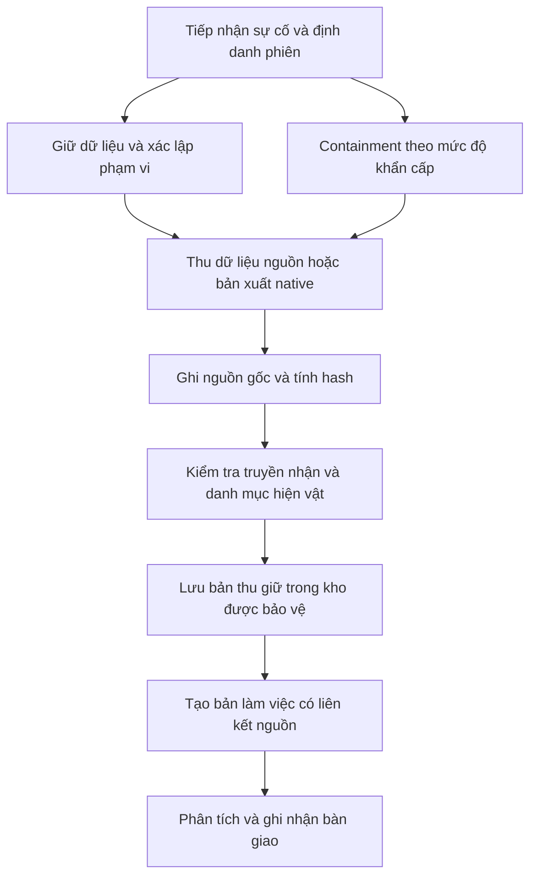

# Bảo toàn session evidence

## 1. Mục tiêu của việc bảo toàn bằng chứng phiên PAM

Trong hệ thống quản lý truy cập đặc quyền (Privileged Access Management — PAM), một phiên quản trị có thể để lại bản ghi màn hình, luồng terminal, sự kiện kết nối, thông tin cấp quyền và nhật ký thao tác. Khi xảy ra sự cố, các dữ liệu này giúp trả lời ai đã truy cập tài nguyên nào, quyền được cấp theo cơ chế nào và những hoạt động nào được quan sát trong khoảng thời gian đó.

Tuy nhiên, có bản ghi không đồng nghĩa với đã bảo toàn bằng chứng. Bản ghi còn nằm trong vùng lưu tạm có thể bị ghi đè; video xuất ra có thể thiếu phần cuối; file đã tải xuống có thể không còn thông tin phiên gốc; một lệnh được ghi nhận chưa chứng minh lệnh đó đã thực thi thành công trên máy đích. Bảo toàn session evidence là giữ lại dữ liệu, nguồn gốc, quan hệ giữa các dữ liệu và lịch sử xử lý để việc điều tra sau đó có thể kiểm tra được.

Trong phạm vi PAM, mục tiêu thực tế gồm:

- Giữ được các hiện vật liên quan trước khi chúng hết hạn, bị xoay vòng hoặc bị tác động bởi hoạt động ứng phó.
- Chứng minh các bản sao được sử dụng trong điều tra có quan hệ rõ ràng với dữ liệu đã thu giữ.
- Gắn phiên với danh tính, yêu cầu truy cập, phê duyệt, quyền JIT/JEA và tài nguyên đích.
- Bảo vệ thông tin nhạy cảm có trong bản ghi mà vẫn giữ được dữ liệu gốc phục vụ xác minh.
- Ghi rõ phần đã quan sát, phần chưa thu được và giới hạn tin cậy của từng nguồn.

Sau bài học, người học có thể lập một gói bằng chứng phiên, kiểm tra tính toàn vẹn khi bàn giao, tổ chức chuỗi quản lý bằng chứng và nhận diện những kết luận vượt quá dữ liệu đang có.

## 2. Session evidence bao gồm những gì?

### 2.1. Phiên là một tập dữ liệu có liên hệ

Một video phát lại thường là điểm khởi đầu dễ nhìn thấy nhất, nhưng không phải toàn bộ bằng chứng. Với phiên SSH, RDP, web console hoặc kết nối được PAM môi giới, cần xem xét ít nhất các nhóm sau:

| Nhóm dữ liệu | Ví dụ cần bảo toàn | Câu hỏi có thể hỗ trợ |
|---|---|---|
| Định danh phiên | Session ID, gateway, recorder, target ID, giao thức, thời điểm bắt đầu/kết thúc | Bản ghi thuộc kết nối nào? |
| Nội dung quan sát được | Bản ghi terminal, video, sự kiện bàn phím/chuột nếu hệ thống có thu, metadata các đoạn ghi | Những gì được quan sát trong phiên? |
| Danh tính và xác thực | User ID ổn định, IdP event ID, phương thức MFA, máy trạm hoặc thiết bị truy cập | Danh tính nào đã xác thực để mở phiên? |
| Cấp quyền và phê duyệt | Request ID, người duyệt, phạm vi tài nguyên, thời hạn JIT, policy/version áp dụng | Vì sao phiên được phép thực hiện? |
| Sử dụng credential | Checkout/lease ID, phiên bản credential, sự kiện inject/rotate/revoke | Phiên liên quan tới credential nào mà không cần lưu giá trị bí mật? |
| Nhật ký hạ tầng PAM | Broker/gateway audit, lỗi recorder, thay đổi policy, thao tác xóa hoặc export | Cơ chế ghi nhận có hoạt động bình thường không? |
| Nhật ký tài nguyên đích | Đăng nhập hệ điều hành, nâng quyền, process, audit ứng dụng, giao dịch cơ sở dữ liệu | Tài nguyên đích ghi nhận hoạt động và kết quả gì? |
| Nguồn đối chiếu độc lập | EDR, SIEM, network flow, IdP, nền tảng cloud | Có dấu vết ngoài chính nền tảng PAM không? |

Không phải mọi triển khai đều thu thập mọi loại dữ liệu trong bảng. Hồ sơ bằng chứng phải ghi đúng năng lực ghi nhận đã bật tại thời điểm sự kiện, thay vì giả định tính năng của sản phẩm đã luôn được sử dụng.

Ví dụ, clipboard hoặc truyền file có thể đi qua một kênh mà video không thể hiện đầy đủ. Một API token đã cấp trước đó có thể được sử dụng ngoài phiên tương tác. Nếu chỉ giữ video RDP, đội điều tra có thể bỏ sót cả hai hoạt động này.

### 2.2. Phân biệt dữ liệu nguồn, bản xuất và bản làm việc

Trong bài học này sử dụng ba khái niệm:

1. **Dữ liệu nguồn:** đối tượng còn nằm trong hệ thống sinh dữ liệu, ví dụ các đoạn recording và metadata tại recorder hoặc kho lưu trữ của PAM.
2. **Bản thu giữ:** bản xuất hoặc bản sao được tiếp nhận để bảo toàn, kèm phương thức thu thập và dấu kiểm tra tính toàn vẹn. Đây là mốc tham chiếu cho các lần bàn giao tiếp theo.
3. **Bản làm việc:** bản sao dùng để phát lại, trích xuất, che thông tin hoặc phân tích. Bản này phải truy ngược được về bản thu giữ.

Nếu công cụ export đóng gói, mã hóa lại hoặc chuyển định dạng, file xuất có thể khác byte so với dữ liệu nguồn. Không so sánh hai hash khác loại rồi kết luận việc truyền dữ liệu bị hỏng. Phải mô tả phép biến đổi, giữ bản xuất gốc do công cụ tạo và bảo toàn dữ liệu nguồn ở định dạng native khi khả thi.

Ảnh chụp màn hình, đoạn video cắt ngắn và transcript đã làm sạch là hiện vật dẫn xuất. Chúng hữu ích để trao đổi nhưng không thay thế toàn bộ dữ liệu thu giữ ban đầu.

## 3. Những thuộc tính cần giữ

### 3.1. Tính toàn vẹn

Tính toàn vẹn ở mức file có nghĩa là dữ liệu không bị thay đổi ngoài những biến đổi đã được ghi nhận. Có thể dùng SHA-256 để tạo dấu kiểm tra cho từng hiện vật sau khi thu giữ và kiểm tra lại khi chuyển kho hoặc bàn giao.

Hash có giới hạn rõ ràng:

- Hash khớp giúp kiểm tra tính nhất quán của byte giữa hai thời điểm hoặc hai bản sao đã đối chiếu.
- Hash không tự chứng minh ai đã tạo file, nội dung có đúng sự thật hay file đã đầy đủ trước lúc được băm.
- Hash tính trên dữ liệu đã bị sửa từ trước vẫn cho một kết quả hợp lệ về mặt thuật toán.
- Nếu cả hiện vật và danh sách hash đều có thể bị cùng một người sửa, danh sách đó không tạo ra sự bảo đảm độc lập.

Vì vậy, hash phải đi cùng nguồn gốc, lịch sử xử lý, kiểm soát quyền và nơi lưu manifest được bảo vệ. Chữ ký số hoặc dấu thời gian đáng tin cậy có thể bổ sung bằng chứng khi tổ chức có cơ chế triển khai phù hợp; chúng cũng phụ thuộc vào độ tin cậy của khóa và dịch vụ sử dụng.

### 3.2. Nguồn gốc và tính xác thực

Mỗi hiện vật cần cho biết được lấy từ hệ thống nào, đối tượng nào, bởi ai, lúc nào và bằng phương thức nào. Với bản ghi phiên, chỉ tên file như `recording.mp4` là không đủ. Cần có ít nhất Session ID, định danh recorder/gateway, đối tượng lưu trữ hoặc export job và mốc thời gian thu thập.

Nếu nghi ngờ PAM hoặc tài khoản quản trị PAM đã bị xâm nhập, nguồn gốc từ PAM không còn là điểm tin cậy tuyệt đối. Cần giữ cả audit quản trị PAM và đối chiếu các nguồn độc lập. Không dùng một chữ ký do chính thành phần đang bị nghi ngờ tạo ra để kết luận toàn bộ phiên là xác thực.

### 3.3. Tính đầy đủ và khả năng hiểu lại

Một recording không phát được hoặc mất metadata ánh xạ người dùng có thể giữ nguyên byte nhưng vẫn không hữu ích. Cần bảo toàn định dạng, thông tin phiên bản phần mềm/công cụ xem khi cần thiết, các đoạn recording, thứ tự ghép đoạn và thông tin cần để giải mã hợp lệ.

Đừng đưa khóa giải mã vào cùng gói bằng chứng chỉ để thuận tiện. Hãy ghi tham chiếu khóa và quy trình truy xuất được kiểm soát, đồng thời bảo đảm thời hạn giữ khóa tương thích với thời hạn giữ dữ liệu. File mã hóa bất biến nhưng khóa đã mất vẫn không đáp ứng mục tiêu sử dụng bằng chứng.

### 3.4. Tính bí mật và kiểm soát sử dụng

Session evidence có thể chứa dữ liệu khách hàng, cấu hình nội bộ, token xuất hiện trên terminal hoặc nội dung nhập từ clipboard. Bảo toàn không có nghĩa là nhân bản rồi mở quyền rộng cho mọi người tham gia sự cố.

Nên tách quyền thu thập, quyền quản lý kho, quyền phân tích và quyền phê duyệt xuất ra ngoài. Quyền truy cập bằng chứng vẫn phải theo least privilege, có thời hạn và có audit, kể cả với nhóm ứng phó sự cố.

## 4. Kích hoạt bảo toàn ngay khi tiếp nhận sự cố

### 4.1. Xác định phạm vi ban đầu

Từ cảnh báo hoặc báo cáo sự cố, ghi lại các định danh đã biết: mã sự cố, danh tính nghi vấn, tài nguyên, Session ID, request truy cập, thời gian phát hiện và nguồn cảnh báo. Định danh ổn định đáng tin cậy hơn tên hiển thị có thể đổi hoặc trùng.

Chọn cửa sổ thời gian đủ để bao phủ hoạt động trước và sau phiên. Không đặt cửa sổ chỉ bằng thời lượng video nếu credential có thể đã được checkout trước đó, token vẫn còn hạn sau khi phiên đóng hoặc đối tượng nghi vấn có thể mở nhiều phiên song song.

Khi chưa rõ phạm vi, ghi nhận đây là phạm vi ban đầu và lý do lựa chọn. Mở rộng có kiểm soát khi tìm thấy liên hệ mới; không thu gom vô hạn mọi phiên của cả tổ chức chỉ vì chưa xác định được giả thuyết.

### 4.2. Chặn mất dữ liệu do vòng đời lưu trữ

Các nguy cơ cần xử lý sớm gồm retention tự động, log rotation, dọn vùng spool trên gateway, expiration của bản export, xóa object version và thời hạn giữ khóa mã hóa. Lệnh giữ dữ liệu phải bao phủ đúng nguồn liên quan, không chỉ thư mục chứa video.

Một yêu cầu bảo toàn nên ghi rõ:

- Mã sự cố và phạm vi tài nguyên/phiên/thời gian.
- Đối tượng lưu trữ hoặc loại dữ liệu cần giữ.
- Người có trách nhiệm áp dụng và xác minh cơ chế giữ.
- Thời hạn rà soát và người được quyền giải phóng yêu cầu giữ.
- Cách xử lý các bản sao, bản backup, khóa và metadata liên quan.

Khi tổ chức áp dụng legal hold hoặc yêu cầu giữ phục vụ điều tra, sử dụng quy trình và người có thẩm quyền của tổ chức. Không mặc định một nhãn “hold” trong giao diện đã chặn được mọi đường xóa; cần xác minh tác dụng thực tế đối với các lớp lưu trữ đang dùng.

### 4.3. Phối hợp với containment

Bảo toàn bằng chứng và cô lập hoạt động nguy hiểm thường phải diễn ra song song. Nếu phiên đang gây hại, không trì hoãn chặn phiên chỉ để chờ video hoàn thiện. Người điều phối sự cố quyết định theo mức độ ảnh hưởng và ghi lại hành động, thời điểm cùng dữ liệu có thể mất do quyết định đó.

Khi an toàn và có sẵn cơ chế được hỗ trợ, thu nhận metadata phiên đang chạy, các đoạn recording đã hoàn tất và trạng thái recorder trước khi kết thúc phiên. Không tắt gateway đột ngột chỉ để “đóng băng bằng chứng”: phần chưa flush có thể mất và việc tắt có thể làm gián đoạn các hệ thống khác.

Nếu phải chặn khẩn cấp, sau containment cần kiểm tra đoạn cuối, sự kiện kết thúc và lý do thiếu dữ liệu. Không điền giả thời điểm kết thúc hay tuyên bố bản ghi hoàn chỉnh khi chỉ có một phần.

## 5. Quy trình thu giữ một gói session evidence



Sơ đồ biểu diễn các công việc chính, không buộc containment phải chờ xong việc giữ dữ liệu. Khi một bước không thực hiện được, ghi rõ giới hạn và chuyển phần dữ liệu còn có thể thu giữ sang bước tiếp theo.

### 5.1. Chuẩn bị đường thu thập tin cậy

Dùng tài khoản điều tra có quyền đọc/export đúng phạm vi, được cấp qua quy trình phù hợp và truy cập từ thiết bị quản trị đáng tin cậy. Không dùng chính tài khoản đang bị nghi ngờ để export bằng chứng nếu có phương án độc lập.

Ghi nhận công cụ, phiên bản, chế độ export, bộ lọc thời gian và timezone đã sử dụng. Các tham số này ảnh hưởng trực tiếp tới việc tái lập kết quả. Ví dụ, export theo giờ địa phương nhưng truy vấn SIEM theo UTC có thể làm mất một phần cửa sổ thu thập.

Nếu việc export tạo audit event mới, ghi lại sự kiện đó và tài khoản thực hiện để phân biệt hoạt động điều tra với hoạt động của đối tượng nghi vấn.

### 5.2. Thu recording và dữ liệu phụ trợ

Ưu tiên cơ chế được hỗ trợ để lấy bản ghi gốc/native và metadata thay vì quay màn hình trình phát. Với dữ liệu chia nhiều đoạn, giữ từng đoạn, chỉ mục ghép và quan hệ của chúng với Session ID.

Nếu bản ghi đang mở, xác định bản export là snapshot tại thời điểm nào, có được hỗ trợ với phiên đang chạy hay không và còn phần nào chưa được đóng. Snapshot volume không tự bảo đảm trạng thái ứng dụng nhất quán; chỉ giữ snapshot mà không mô tả điều kiện tạo có thể gây hiểu nhầm về tính đầy đủ.

Tiếp tục thu các audit liên quan tới xác thực, phê duyệt, cấp quyền JIT/JEA, checkout/inject credential, thay đổi policy và hành động trên tài nguyên đích. Chỉ lưu credential ID hoặc version cần thiết cho tương quan; không chủ động export mật khẩu hoặc private key vào gói điều tra.

Nếu bản ghi đã chứa bí mật, giữ nguyên bản thu giữ trong vùng hạn chế, ghi nhận vị trí xuất hiện và phối hợp thu hồi hoặc luân chuyển bí mật theo kế hoạch ứng phó. Che bí mật trên bản dùng để trao đổi, không sửa bản thu giữ ban đầu.

### 5.3. Lập manifest

Manifest là danh mục hiện vật, không phải bản phân tích kết luận nguyên nhân. Mỗi mục nên có:

- Evidence ID duy nhất và mã sự cố.
- Session ID hoặc các định danh liên kết.
- Hệ thống nguồn, tham chiếu đối tượng/version hoặc export job.
- Loại hiện vật, định dạng, kích thước byte và đường dẫn tương đối trong gói.
- Người thu thập, thời gian thu thập theo UTC và phương thức thu thập.
- SHA-256 của file đã tiếp nhận; hash phía nguồn nếu có và áp dụng cho cùng một chuỗi byte.
- Phạm vi thời gian dữ liệu, trạng thái hoàn chỉnh/một phần/chưa xác định.
- Các giới hạn, lỗi export, phụ thuộc trình phát hoặc tham chiếu khóa nếu cần.

Ví dụ metadata dưới đây là dữ liệu minh họa. Trường hash phải được điền bằng kết quả thực tế; không dùng chuỗi mô tả trong ví dụ như hash thật.

```yaml
caseId: IR-PAM-027
evidenceId: EV-027-001
sessionId: PAM-S-4821
artifact:
  relativePath: acquisition/session-4821.native
  mediaType: vendor-native-session-recording
  byteLength: 18432000
  sha256: "<64 ký tự hex SHA-256 tính từ file thu giữ>"
source:
  systemId: pam-recorder-02
  objectReference: recording/session-4821/version-3
  exportJobId: export-775
  exportMode: native
acquisition:
  collectorId: ir-collector-04
  collectedAtUtc: "2026-10-20T02:24:00Z"
  method: supported-native-export
coverage:
  startTimeRaw: "2026-10-20T09:02:00+07:00"
  endTimeRaw: "2026-10-20T09:17:00+07:00"
  completeness: partial
limitations:
  - "Recorder báo mất kết nối trong 12 giây; chưa có dữ liệu bù."
handling:
  classification: restricted-incident-evidence
  preservationRequestId: HOLD-027
  decryptionKeyReference: evidence-key-reference-only
```

Manifest cũng cần được bảo vệ và quản lý phiên bản. Khi bổ sung hiện vật, tạo phiên bản mới với lịch sử thay đổi hoặc bổ sung bản ghi theo cơ chế lưu trữ đã chọn; không âm thầm sửa thông tin của lần thu giữ trước.

### 5.4. Kiểm tra khi tiếp nhận

Sau khi dữ liệu được truyền sang kho điều tra, đối chiếu danh mục và kích thước, tính hash của file nhận được rồi so với hash của chính file đó trước khi truyền. Một lần tải báo thành công chưa đủ để kết luận gói bằng chứng nguyên vẹn.

Nếu nguồn cung cấp checksum, xác định checksum đó áp dụng cho file nào: đối tượng native, gói nén hay file export đã chuyển đổi. Nếu không có hash phía nguồn, có thể lập mốc hash đầu tiên ngay sau thu giữ và ghi rõ giới hạn này.

Với gói nén, nên giữ hash của cả gói nhận được. Nếu giải nén để phân tích, quản lý các file giải nén như bản làm việc hoặc lập danh mục file bên trong theo thiết kế của gói. Không bỏ gói thu giữ sau khi đã giải nén xong.

## 6. Kiểm tra hash: ví dụ PowerShell trên bản sao trong phòng lab

Đoạn lệnh sau minh họa kiểm tra một file đã được thu giữ. Lệnh chỉ đọc file và đối chiếu hash được cung cấp qua kênh manifest tin cậy; nó không tự thu thập phiên PAM, không kiểm tra nguồn gốc và không xác nhận recording đầy đủ.

Giả sử manifest đã được đọc và kiểm tra riêng, người vận hành nhập đúng hash SHA-256 64 ký tự hex. Đường dẫn dưới đây chỉ là đường dẫn mẫu trong môi trường lab.

```powershell
$artifactPath = 'D:\IR-Lab\IR-PAM-027\acquisition\session-4821.native'
$expectedSha256 = Read-Host 'SHA-256 từ manifest đã được xác minh'
$expectedSha256 = $expectedSha256.Trim()

if ($expectedSha256 -notmatch '\A[0-9a-fA-F]{64}\z') {
    throw 'Giá trị SHA-256 phải gồm đúng 64 ký tự hex.'
}

$artifact = Get-Item -LiteralPath $artifactPath -ErrorAction Stop
if ($artifact.PSIsContainer) {
    throw 'Đường dẫn phải trỏ tới một file.'
}

$actualSha256 = (Get-FileHash -LiteralPath $artifact.FullName `
    -Algorithm SHA256 -ErrorAction Stop).Hash

if (-not [string]::Equals(
    $actualSha256,
    $expectedSha256,
    [System.StringComparison]::OrdinalIgnoreCase
)) {
    throw 'Hash không khớp. Dừng sử dụng bản sao và lập biên bản sai lệch.'
}

[pscustomobject]@{
    FileName = $artifact.Name
    ByteLength = $artifact.Length
    Algorithm = 'SHA-256'
    IntegrityCheck = 'MATCH'
}
```

File cần ở trạng thái ổn định trong lúc kiểm tra; không băm file recorder còn đang ghi rồi dùng kết quả làm hash cho phiên đã hoàn tất sau đó. Với đối tượng có version, ghim đúng version đã thu giữ để lần đọc tiếp theo không lấy một nội dung khác cùng tên.

Khi hash không khớp, giữ bản bị sai lệch riêng để xem xét, kiểm tra lại version, cách export, bước truyền và manifest. Không sửa hash mong đợi cho bằng hash vừa tính để làm báo cáo PASS. Việc thu lại dữ liệu phải có Evidence ID hoặc bản ghi thu giữ mới, liên kết rõ với lần thất bại.

Hash chỉ giải quyết một câu hỏi về tính toàn vẹn. Việc đánh giá nội dung phiên vẫn cần metadata, audit độc lập và bối cảnh cấp quyền.

## 7. Chuỗi quản lý và bàn giao bằng chứng

### 7.1. Ghi hành động, không chỉ ghi chủ sở hữu hiện tại

Chain of custody là lịch sử ai đã tiếp nhận, truy cập, sao chép, di chuyển hoặc xử lý hiện vật. Chỉ ghi “đội IR đang giữ” không đủ để giải thích file từ recorder đã đi qua những đâu.

Mỗi lần bàn giao hoặc tạo bản sao nên ghi:

- Evidence ID và định danh chính xác của bản/đối tượng/version được giao.
- Bên giao, bên nhận, người hoặc dịch vụ thực hiện.
- Thời điểm UTC, mục đích và phương thức truyền.
- Vị trí nguồn, vị trí đích hoặc tham chiếu kho được kiểm soát.
- Kết quả đối chiếu hash và người xác nhận tiếp nhận.
- Bất kỳ biến đổi, lỗi hay ngoại lệ nào phát sinh.

Ví dụ nhật ký bàn giao rút gọn:

| Thời điểm UTC | Hành động | Người/dịch vụ | Hiện vật | Bằng chứng xác nhận |
|---|---|---|---|---|
| 02:24 | Thu bản native từ recorder | ir-collector-04 | EV-027-001 | Export job, kích thước và hash thu giữ |
| 02:27 | Chuyển vào kho hạn chế | evidence-ingest | EV-027-001 | Version đích và hash khớp |
| 02:34 | Cấp bản làm việc cho điều tra viên | evidence-custodian | WORK-027-001 | Nguồn EV-027-001, hash bản sao khớp |
| 03:10 | Tạo transcript phục vụ phân tích | analyst-02 | DER-027-001 | Công cụ/phiên bản, hash đầu ra và nguồn |

Một bản ghi truy cập đọc không nhất thiết là bàn giao quyền giữ hiện vật, nhưng vẫn phải truy vết được. Tự động hóa nhật ký từ kho lưu trữ giúp giảm thao tác tay; phải bảo vệ chính nhật ký đó và kiểm tra các hành động ngoài đường truy cập chuẩn.

### 7.2. Bản dẫn xuất cần giữ quan hệ nguồn

Khi tạo clip từ phút 04:20 đến 05:10, ghi timebase của trình phát, khoảng được chọn và cách trích xuất. Thời điểm trong video không tự đồng nhất với giờ UTC của sự kiện.

Với transcript, ghi công cụ, cấu hình xử lý ký tự điều khiển, bước chuẩn hóa và phần bị loại bỏ. Terminal có thể dùng ký tự quay lui hoặc điều khiển màn hình; transcript văn bản phẳng không luôn tái hiện đúng những gì người xem terminal đã thấy.

Nếu che dữ liệu nhạy cảm, giữ bản dẫn xuất được che riêng, ghi quy tắc và người thực hiện. Việc che nội dung có thể được mô tả bằng tham chiếu hạn chế, không chép lại bí mật vào nhật ký bàn giao.

## 8. Bảo toàn thời gian và tương quan phiên

### 8.1. Giữ timestamp gốc trước khi chuẩn hóa

Các nguồn có thể dùng UTC, giờ địa phương, thời gian tương đối trong recording hoặc đồng hồ bị lệch. Khi tạo timeline, giữ timestamp gốc, timezone/offset nếu biết, nguồn thời gian và thời điểm thu thập. Cột UTC chuẩn hóa là dữ liệu dẫn xuất, không thay thế giá trị gốc.

Phân biệt ít nhất ba loại thời gian:

- **Thời điểm sự kiện:** nguồn cho rằng hoạt động xảy ra khi nào.
- **Thời điểm tiếp nhận:** hệ thống log hoặc SIEM nhận sự kiện khi nào.
- **Thời điểm thu giữ:** đội điều tra lấy hiện vật khi nào.

Độ trễ ingest không đồng nghĩa đồng hồ máy đích bị lệch. Không lấy thời điểm SIEM tiếp nhận làm thời điểm thực thi nếu chưa có cơ sở.

Nếu phát hiện clock skew, ghi bằng chứng và mức độ chắc chắn của phép hiệu chỉnh. Khi không đủ dữ liệu để quy đổi chính xác, thể hiện khoảng thời gian hoặc độ bất định. Không sắp các sự kiện cách nhau vài mili giây thành một trình tự chắc chắn khi các đồng hồ lệch tới hàng chục giây.

### 8.2. Dùng nhiều khóa tương quan

Một liên kết điển hình có thể là:

```text
IdP event
  -> User ID ổn định
  -> Access request / phê duyệt / JIT grant
  -> PAM Session ID
  -> Gateway connection / target login ID
  -> Hoạt động và kết quả trên tài nguyên đích
```

Không phải lúc nào mọi nguồn cũng có cùng Session ID. Khi tương quan dựa vào tài khoản đích, IP, cổng và khoảng thời gian, cần ghi đây là phép liên kết suy ra. Với tài khoản quản trị dùng chung, tên tài khoản đích riêng lẻ không đủ để quy trách nhiệm cho một người.

Các khóa nên được giữ theo đúng giá trị gốc, kể cả khi sau này đổi tên người dùng hoặc tài nguyên. Đồng thời lưu mapping có nguồn và thời điểm hiệu lực, tránh dùng trạng thái danh bạ hiện tại để diễn giải sai dữ liệu lịch sử.

## 9. Tổ chức kho và vòng đời bằng chứng

### 9.1. Tách bản thu giữ khỏi vùng phân tích

Một cấu trúc logic có thể gồm:

```text
IR-PAM-027/
  acquisition/       # Bản tiếp nhận, bảo vệ khỏi sửa thông thường
  manifests/         # Danh mục hiện vật và phiên bản manifest
  custody/           # Bản ghi xử lý, tiếp nhận và bàn giao
  working/           # Bản sao dùng cho phân tích
  derived/           # Clip, transcript, bản che dữ liệu
  findings/          # Ghi chú điều tra, luôn dẫn về Evidence ID
```

Cấu trúc thư mục chỉ giúp tổ chức dữ liệu, không tự tạo tính bất biến. Cần cơ chế thực thi như quyền lưu trữ, versioning, retention lock/WORM nếu phù hợp, audit và phân tách trách nhiệm. Thuộc tính read-only của file đơn lẻ không đủ chống người có quyền quản trị kho.

Khi dùng object storage, lưu object ID/version cụ thể trong manifest. Khi sao chép sang vùng khác hoặc kho dự phòng, kiểm tra lại tính toàn vẹn và chính sách giữ. Bản sao không được bảo vệ tương đương có thể trở thành đường rò rỉ hoặc mất bằng chứng.

### 9.2. Quản lý khóa và khả năng truy xuất

Khóa cần được giữ trong cơ chế quản lý khóa riêng, cấp quyền theo vụ việc và có audit. Không dựa vào một tài khoản hoặc một thiết bị duy nhất mà việc mất tài khoản/thiết bị sẽ làm toàn bộ bằng chứng không giải mã được.

Nếu thay khóa hoặc chuyển hệ thống mã hóa, ghi nhận phiên bản và phép biến đổi, kiểm tra khả năng truy xuất trên bản làm việc và giữ quan hệ với hiện vật ban đầu. Đừng coi việc copy file mã hóa thành công là bằng chứng đã bảo toàn được khả năng đọc trong nhiều năm.

### 9.3. Kết thúc sự cố không tự động kết thúc yêu cầu giữ

Khi đóng ticket kỹ thuật, đánh giá riêng thời hạn giữ, yêu cầu điều tra, nghĩa vụ nội bộ và quyền phê duyệt giải phóng hold. Việc xóa phải theo quy trình áp dụng cho tất cả bản sao liên quan, nhưng không được vượt qua yêu cầu giữ đang có hiệu lực.

Ghi nhận quyết định kết thúc vòng đời và các ngoại lệ còn lại như backup chưa tới kỳ hết hạn. Không tuyên bố đã xóa hết nếu chưa xác minh được phạm vi bản sao.

## 10. Tình huống thực hành: phiên quản trị cơ sở dữ liệu đáng ngờ

### 10.1. Dữ kiện ban đầu

SOC phát hiện một tài khoản quản trị cơ sở dữ liệu truy xuất dữ liệu nhạy cảm lúc khoảng 09:12. PAM ghi nhận phiên RDP tới máy trung chuyển từ 09:02 đến 09:17. Phiên được cấp theo một yêu cầu bảo trì có thời hạn, còn gateway đang có lịch dọn recording theo retention thông thường.

Nhóm ứng phó chưa biết người dùng thực sự thao tác, phiên có bị chiếm quyền hay tác vụ cơ sở dữ liệu có xuất phát từ một tiến trình nền. Đây là giả thuyết điều tra, chưa phải kết luận.

### 10.2. Bảo toàn và thu thập

Người điều phối mở mã sự cố, yêu cầu giữ recording và audit tương ứng, đồng thời xác định liệu hoạt động truy xuất còn đang diễn ra. Nếu còn gây hại, nhóm thực hiện containment theo quyền được cấp, ghi nhận tác động lên khả năng thu bằng chứng.

Người thu thập giữ bản native của phiên, metadata đoạn ghi, export job, request/phê duyệt, JIT grant và credential reference. Nhóm cơ sở dữ liệu giữ audit truy vấn, connection ID, ứng dụng/client và thời điểm ghi nhận; nhóm endpoint giữ dấu vết tiến trình trên máy trung chuyển. IdP cung cấp các sự kiện xác thực để đối chiếu.

Mỗi nguồn được đặt Evidence ID riêng, không gom thành một file duy nhất rồi mất khả năng nhận diện từng nguồn. Các bản thu giữ được băm sau tiếp nhận, kiểm tra khi chuyển kho và có lịch sử bàn giao.

### 10.3. Giới hạn được phát hiện

Recorder có một khoảng mất kết nối 12 giây. Audit cơ sở dữ liệu ghi một truy vấn thành công trong khoảng thời gian gần đó, nhưng chưa liên kết chắc chắn với tiến trình cụ thể trên máy trung chuyển.

Cách ghi nhận phù hợp là: “Nguồn audit cơ sở dữ liệu ghi nhận truy vấn Q trong khoảng T. Recording PAM có khoảng trống tại vùng thời gian liên quan. Liên hệ giữa kết nối cơ sở dữ liệu và phiên PAM đang được xác minh.”

Không kết luận “người dùng không chạy truy vấn vì video không thấy” và cũng không kết luận “người dùng đã chạy truy vấn” chỉ vì tài khoản PAM được gán tên người đó. Cần phân biệt quan sát, tương quan và kết luận được hỗ trợ.

### 10.4. Bàn giao cho nhóm phân tích

Nhóm phân tích nhận bản làm việc, manifest và giới hạn dữ liệu. Clip đã che thông tin khách hàng được tạo riêng để phục vụ họp; bản thu giữ được giữ nguyên trong kho hạn chế. Mọi phát hiện dẫn về Evidence ID, timestamp gốc và nguồn liên quan.

Kết quả của bước bảo toàn là một tập bằng chứng có thể kiểm tra, không phải lời khẳng định rằng nguyên nhân sự cố đã được xác định xong.

## 11. Những sai sót thường gặp và cách xử lý

| Sai sót | Vì sao gây vấn đề | Cách xử lý |
|---|---|---|
| Chỉ chụp màn hình đoạn đáng ngờ | Mất dữ liệu trước/sau, tương tác và metadata nguồn | Giữ recording/native và nguồn liên quan; ảnh là bản dẫn xuất |
| Chỉ giữ video đã chuyển định dạng | Có thể mất metadata, thứ tự đoạn hoặc chi tiết trình phát | Giữ bản thu giữ trước chuyển đổi và ghi cách tạo bản dẫn xuất |
| Chờ đủ recording mới chặn phiên gây hại | Hoạt động nguy hiểm có thể tiếp tục | Containment theo mức độ khẩn cấp, ghi tác động lên bằng chứng |
| Chạy lệnh điều tra trong chính phiên nghi vấn | Tạo thêm hoạt động lẫn vào dấu vết đang xem xét | Dùng đường quản trị điều tra riêng khi khả thi, đánh dấu mọi thao tác |
| Hash khớp nên kết luận file “xác thực tuyệt đối” | Hash không chứng minh nguồn hoặc sự đầy đủ trước thu giữ | Kết hợp nguồn gốc, custody, audit độc lập và giới hạn tin cậy |
| Băm file đang được recorder ghi tiếp | Hash sẽ thay đổi theo nội dung mới | Thu bản snapshot/export ổn định và ghi thời điểm phạm vi |
| Che dữ liệu ngay trên bản thu giữ | Làm mất nội dung ban đầu để xác minh lại | Che trên bản dẫn xuất, giữ liên kết nguồn và hash riêng |
| Dùng tên hiển thị để quy trách nhiệm | Tên có thể đổi, trùng hoặc dùng chung | Giữ ID ổn định, mapping lịch sử và nhiều khóa tương quan |
| Giữ file mã hóa nhưng bỏ quên khóa | Không còn đọc được khi cần điều tra | Đồng bộ vòng đời khóa, lưu tham chiếu và kiểm tra khả năng truy xuất |
| Hold chỉ áp dụng trên video | Metadata, audit, object version hoặc khóa vẫn có thể mất | Xác lập hold theo toàn bộ gói dữ liệu cần thiết |
| Sửa manifest để khớp bản sao bị thay đổi | Xóa dấu vết sai lệch và làm suy yếu lịch sử xử lý | Cách ly bản sai lệch, giữ phiên bản manifest và lập bản ghi mới |

## 12. Bài tập tự thực hành

### 12.1. Chuẩn bị dữ liệu giả lập

Dùng dữ liệu tổng hợp trong lab: một recording mẫu không chứa bí mật thật, một file metadata phiên, vài dòng audit xác thực/phê duyệt và nhật ký tài nguyên đích. Tạo một khoảng trống recording có ghi chú để luyện cách mô tả giới hạn.

Đặt câu hỏi điều tra hẹp: “Phiên được cấp cho danh tính nào, trong phạm vi nào và có liên hệ gì với hoạt động trên tài nguyên đích?” Không đưa ra sẵn kết luận người dùng có lỗi.

### 12.2. Các việc cần thực hiện

1. Đặt mã vụ việc và Evidence ID cho từng hiện vật.
2. Ghi nguồn, phạm vi thời gian, phương thức thu, kích thước và SHA-256 vào manifest.
3. Sao chép bộ thu giữ sang vùng làm việc; kiểm tra hash của từng file giữa hai vùng.
4. Tạo một transcript hoặc clip ngắn dưới dạng hiện vật dẫn xuất, giữ tham chiếu nguồn.
5. Lập timeline có timestamp gốc, UTC chuẩn hóa và ghi rõ giả định về đồng hồ.
6. Lập biên bản bàn giao bản làm việc cho một vai trò phân tích giả lập.
7. Thay đổi một byte trong một bản sao thử nghiệm riêng rồi quan sát kiểm tra hash thất bại; giữ nguyên bộ thu giữ.
8. Viết hai đoạn nhận xét: điều gì đã có chứng cứ hỗ trợ và điều gì vẫn chưa biết do khoảng trống dữ liệu.

### 12.3. Tiêu chí tự đánh giá

Bài thực hành đạt mục tiêu khi người khác có thể dùng manifest để xác định từng hiện vật, kiểm tra tính toàn vẹn của bản được giao, tìm đúng nguồn cho bản dẫn xuất và hiểu rõ các hạn chế. Người nhận không cần dựa vào trí nhớ của người thu thập để giải thích file thuộc phiên nào.

Nếu chỉ có một thư mục file và lời nhắn “đây là recording”, phần bảo toàn chưa đầy đủ dù tất cả file vẫn phát được.

## 13. Điểm cần ghi nhớ

Bảo toàn session evidence là giữ cả nội dung phiên, metadata, nguồn đối chiếu và lịch sử xử lý. Hash giúp kiểm tra byte; nguồn gốc và chuỗi quản lý giúp giải thích hiện vật đến từ đâu và đã được sử dụng thế nào. Không thuộc tính nào thay thế được các thuộc tính còn lại.

Với PAM, phải nối phiên với danh tính ổn định, quyền được cấp, credential reference và tài nguyên đích. Các luồng API, truy cập trực tiếp hoặc hoạt động ngoài vùng được ghi nhận cần có nguồn khác để điều tra; sự vắng mặt trên video không chứng minh hoạt động không xảy ra.

Một gói bằng chứng tốt giữ nguyên bản thu giữ, dùng bản sao để phân tích, kiểm soát quyền và vòng đời, đồng thời mô tả trung thực phần dữ liệu bị thiếu. Đó là nền tảng để bước điều tra và kiểm toán tiếp theo có thể kiểm tra lại kết quả.
