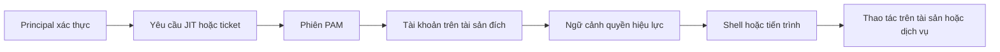

# Xác định lệnh đã chạy

## 1. Mục tiêu điều tra trong sự cố PAM

Khi một phiên đặc quyền bị nghi ngờ có hành vi bất thường, câu hỏi “người dùng đã chạy lệnh gì?” thường là điểm khởi đầu. Câu trả lời phục vụ những quyết định cụ thể: cô lập tài sản nào, thu hồi quyền nào, credential nào cần luân chuyển, phạm vi dữ liệu nào cần kiểm tra và bằng chứng nào cần giữ lại.

Trong Privileged Access Management (PAM), cần nối được danh tính đã xác thực với phiên truy cập, tài khoản đích, ngữ cảnh quyền và hoạt động trên tài sản. Một dòng chữ xuất hiện trong bản ghi terminal chưa đủ để hoàn thành chuỗi này. Người dùng có thể gõ rồi xóa, một lệnh có thể bị chính sách từ chối, script có thể chạy nhiều thao tác con, còn một yêu cầu API có thể tiếp tục xử lý sau khi phiên PAM đã đóng.

Sau bài học, người học cần có khả năng:

- Phân biệt ý định, dữ liệu đầu vào, yêu cầu được chấp nhận, thực thi và tác động đã quan sát.
- Chọn nguồn bằng chứng phù hợp cho phiên tương tác, phiên qua proxy và tác vụ tự động.
- Dựng timeline có danh tính, tài sản, mức quyền, quan hệ tiến trình và sai số thời gian.
- Xử lý các điểm khó như shell builtin, pipeline, script, truy cập nhiều chặng và thiếu log.
- Viết kết luận có dẫn chiếu tới bằng chứng và nêu rõ điều chưa xác định.

Mục tiêu là tái dựng hoạt động từ bằng chứng đã thu thập trong phạm vi sự cố. Việc chạy lại lệnh nghi vấn trên production có thể thay đổi hiện trường và không phải là phương pháp xác nhận lịch sử thực thi.

## 2. “Đã chạy” có nhiều mức ý nghĩa

### 2.1. Tách các mệnh đề cần chứng minh

Giả sử bản ghi terminal có dòng:

```text
sudo /usr/bin/systemctl reload inventory-demo.service
```

Từ dòng đó, có thể phát sinh nhiều mệnh đề khác nhau. Mỗi mệnh đề cần bằng chứng riêng.

| Mệnh đề | Bằng chứng có thể hỗ trợ | Giới hạn cần giữ lại |
|---|---|---|
| Chuỗi ký tự xuất hiện trong phiên | Bản ghi màn hình hoặc luồng terminal | Có thể là output, nội dung được dán hoặc dòng bị chỉnh sửa |
| Chuỗi được gửi tới shell | Bản ghi input có ranh giới và ngữ nghĩa thu thập rõ ràng | Không tự chứng minh shell chấp nhận hoặc chạy xong |
| Yêu cầu nâng quyền được chấp thuận | Sự kiện PAM/sudo có kết quả và tài khoản đích | Không tự chứng minh thao tác nghiệp vụ thành công |
| Chương trình được thực thi | Telemetry thực thi tiến trình gắn với host, đối số và định danh tiến trình | Phụ thuộc độ đầy đủ và ngữ nghĩa của nguồn thu thập |
| Chương trình báo thành công | Sự kiện kết thúc, exit status hoặc phản hồi ứng dụng | Thành công của chương trình không luôn đồng nghĩa mục tiêu nghiệp vụ đạt được |
| Dịch vụ nhận thao tác reload | Log dịch vụ hoặc hệ thống quản lý dịch vụ liên quan | Cần phân biệt yêu cầu được nhận và cấu hình mới thực sự có hiệu lực |
| Thay đổi nằm ngoài phê duyệt | Đối chiếu ticket, JIT/JEA, cửa sổ truy cập và phạm vi được cấp | Phê duyệt và kết quả thực thi là hai nhóm bằng chứng khác nhau |

Không nên gộp cả bảng thành một trường nhị phân `executed=true` nếu hệ thống chưa định nghĩa rõ ý nghĩa của trường đó.

### 2.2. Một cách ghi nhận mức xác nhận

Có thể dùng các nhãn nội bộ sau trong hồ sơ điều tra:

```text
OBSERVED_INPUT       Có bằng chứng về đầu vào của phiên.
REQUEST_ACCEPTED     Có bằng chứng yêu cầu được tầng kiểm soát chấp nhận.
EXECUTION_OBSERVED   Có bằng chứng phù hợp về thực thi.
RESULT_REPORTED     Có kết quả do chương trình hoặc dịch vụ báo về.
EFFECT_CORROBORATED  Có nguồn bổ sung xác nhận tác động liên quan.
UNRESOLVED           Chưa đủ bằng chứng để kết luận mệnh đề đang xét.
```

Đây là quy ước cho bài học, không phải schema mặc định của mọi sản phẩm PAM. Với hành động bị từ chối, ghi rõ `decision=denied`; với nguồn thiếu dữ liệu, ghi `unknown` và nguyên nhân. Không dùng `false` để thay cho “không biết”.

Các nhãn cũng không phải một chiếc thang bắt buộc có đủ mọi bậc. Có thể có telemetry thực thi nhưng mất bản ghi input. Trong trường hợp đó vẫn có thể xác nhận tiến trình đã thực thi, trong khi nguồn gốc thao tác từ phiên nào còn chưa chắc chắn.

## 3. Bản đồ nguồn bằng chứng

### 3.1. Mỗi nguồn trả lời một phần câu hỏi

| Nguồn | Giá trị điều tra | Điều không nên tự suy ra |
|---|---|---|
| Log đăng nhập và cấp phiên PAM | Principal, MFA, yêu cầu truy cập, tài sản đích, tài khoản được cấp, session ID | Chủ thể vật lý luôn là người sở hữu danh tính đó |
| Log command của gateway/proxy | Yêu cầu nhìn thấy tại tầng kiểm soát, quyết định cho phép hoặc từ chối | Mọi hoạt động trên đích đều đi qua tầng này |
| Session recording | Diễn biến tương tác, output, thông báo lỗi, các mốc trong phiên | Mỗi dòng hiển thị đều là lệnh được thực thi |
| Telemetry thực thi của hệ điều hành/EDR | Chương trình, đối số nếu được thu thập, quan hệ cha-con, danh tính thực thi | Telemetry luôn đầy đủ, không bị cắt ngắn hoặc gián đoạn |
| Log sudo hoặc cơ chế nâng quyền tương đương | Yêu cầu chuyển quyền, tài khoản nguồn/đích, quyết định chính sách | Mọi lệnh chạy trong shell đặc quyền đều được ghi riêng |
| Log shell/script được cấu hình trước | Nội dung script hoặc các thành phần thực thi mà cơ chế đó quan sát | Có đầy đủ ở mọi máy hoặc ghi lại mọi biến đã giải quyết |
| Audit của database, cloud hoặc ứng dụng | Hành động ngữ nghĩa, đối tượng đích, request ID, kết quả xử lý | Chuỗi command trên máy khách được lưu nguyên vẹn |
| Dấu vết file, cấu hình, dịch vụ và kết nối | Tác động hoặc trạng thái có thể đối chiếu | Chỉ có một nguyên nhân duy nhất tạo ra trạng thái đó |
| Shell history | Gợi ý để tìm hành động và mở rộng truy vấn | Là bản ghi đầy đủ, chống sửa đổi và đủ để quy kết |

Ưu tiên kiểm tra ngữ nghĩa thu thập của nguồn thực tế. “Command log” có thể là input thô, dòng đã được shell hook ghi lại, một quyết định chính sách hoặc bản tóm tắt từ recording. Tên trường giống nhau không bảo đảm ý nghĩa giống nhau.

### 3.2. Recording và process telemetry bổ sung cho nhau

Recording thường giải thích ngữ cảnh: người vận hành xem file nào, gặp thông báo gì, chuyển sang công cụ nào. Process telemetry có thể giúp xác nhận chương trình nào được thực thi dưới danh tính nào. Audit của dịch vụ đích giúp xác định yêu cầu đã tạo ra tác động gì.

Ba bản sao của cùng một sự kiện không trở thành ba nguồn độc lập. Nếu SIEM, dashboard PAM và báo cáo tải xuống đều lấy từ cùng gateway, chúng có thể cùng phụ thuộc một cảm biến. Hồ sơ cần ghi cả nguồn hiển thị lẫn nguồn phát sinh ban đầu.

### 3.3. Phân biệt phạm vi ghi nhận và phạm vi sự cố

Một phiên SSH được PAM ghi lại không có nghĩa mọi truy cập tới host đều được ghi lại. Cần xét các kênh có thể cùng tồn tại: phiên khác, tài khoản dịch vụ, tác vụ lịch, công cụ quản lý cấu hình, API, console hoặc truy cập khẩn cấp.

Nếu cấu hình chỉ ghi video cho phiên RDP, khả năng tìm command bằng text có thể hạn chế. Nếu proxy chỉ quan sát SSH, hoạt động tiếp theo qua kết nối database hoặc cloud API có thể cần nguồn audit khác. Các giới hạn này phải xuất hiện trong kết luận thay vì bị che bằng một danh sách command có vẻ đầy đủ.

## 4. Gắn lệnh với danh tính và ngữ cảnh quyền

### 4.1. Dựng chuỗi danh tính trước khi quy kết

Một mô hình liên kết thường gặp là:



Ở mỗi cạnh cần có bằng chứng liên kết. Session ID của PAM thường không tự xuất hiện trong tất cả log hệ điều hành; phải sử dụng mapping, sự kiện đăng nhập, kết nối hoặc telemetry phù hợp. Khi chỉ liên kết được bằng thời gian và tài khoản dùng chung, mức chắc chắn thấp hơn khi có khóa tương quan được ghi rõ.

Ví dụ: principal `ops.lan` mở phiên `PAM-S-0241`, PAM sử dụng tài khoản đích `pam-maint`, sau đó tài khoản này nâng quyền thành `root`. Báo cáo nên ghi riêng cả ba vai trò. Chỉ ghi “root thực hiện” sẽ mất dấu principal ban đầu; chỉ ghi “Lan thực hiện” có thể vượt quá bằng chứng nếu credential hoặc phiên của principal bị chiếm dụng.

### 4.2. Các trường quan trọng

Một bản ghi hoạt động nên giữ được, khi nguồn có cung cấp:

- Principal đã xác thực và phương thức xác thực liên quan.
- Mã yêu cầu truy cập, ticket, phê duyệt và thời hạn JIT/JEA.
- Session ID, connection ID và tài khoản mà PAM sử dụng trên đích.
- Định danh tài sản ổn định, hostname tại thời điểm sự cố và ngữ cảnh tenant/container nếu có.
- Danh tính đăng nhập, danh tính tiến trình và quyền hiệu lực khi hành động xảy ra.
- Định danh tiến trình, tiến trình cha, shell, thư mục làm việc và executable.
- Đối số hoặc chuỗi command với mô tả rõ nguồn và tình trạng cắt ngắn/che dữ liệu.
- Event ID/request ID, thời gian gốc, nguồn bằng chứng và vị trí trích dẫn.

PID có thể được tái sử dụng. Một số PID trên một host không phải định danh vĩnh viễn. Khi có thể, dùng định danh tiến trình của cảm biến hoặc kết hợp host, lần khởi động, PID và thời gian bắt đầu. Tương tự, tên host, IP và tên tài khoản có thể thay đổi hoặc được dùng lại.

### 4.3. Tài khoản dịch vụ và pipeline tự động

Với automation, actor có thể là workload thay vì người gõ terminal. Chuỗi cần tìm có thể là:

```text
Người phê duyệt hoặc sự kiện kích hoạt
→ pipeline run
→ runner/workload identity
→ lần lấy secret hoặc token
→ kết nối đích
→ tiến trình hoặc API request
```

Secret được checkout không chứng minh một command cụ thể đã chạy. Pipeline báo thành công cũng chưa chứng minh mọi thao tác nhạy cảm trong job đều được phê duyệt. Cần giữ pipeline run ID, phiên bản job, artifact/script tương ứng và request ID của hệ thống đích.

## 5. Bảo toàn dữ liệu trước khi diễn giải

### 5.1. Tách bản gốc và dữ liệu dẫn xuất

Giữ bản xuất gốc của log, recording, metadata phiên và các artifact liên quan theo quy trình bằng chứng của tổ chức. Ghi nhận ai thu thập, từ nguồn nào, thời điểm nào, phạm vi truy vấn nào và công cụ nào được dùng. Việc lọc, đổi timezone, che secret hoặc trích transcript phải tạo dữ liệu dẫn xuất có thể truy ngược tới bản gốc.

Một manifest bằng chứng có thể chứa:

```yaml
evidenceId: E-PAM-0241-01
sourceSystem: pam-gateway-a
sourceArtifact: session-export-PAM-S-0241
sessionId: PAM-S-0241
collectionTimeUtc: "2026-05-18T09:00:00Z"
collector: ir-analyst-02
collectionScope: "Full session export with metadata"
sha256: "<SHA-256 thực tế của artifact đã thu thập>"
originalTimeZone: "UTC"
derivedArtifacts:
  - transcript-redacted-v1
```

Placeholder trong ví dụ phải được thay bằng dữ liệu thu thập thực tế. Hash giúp kiểm tra artifact có thay đổi kể từ lần băm hay không; hash tự nó không chứng minh nguồn phát sinh là đáng tin cậy hoặc log đầy đủ từ trước khi thu thập.

### 5.2. Giữ dữ liệu thời gian gốc

Nên lưu riêng:

```text
event_time_raw        Thời gian được nguồn ghi.
event_time_utc        Thời gian quy đổi, nếu đủ thông tin.
ingest_time_utc       Thời điểm hệ thống tập trung nhận sự kiện.
clock_offset         Độ lệch đã đo hoặc ước lượng, nếu có.
time_uncertainty     Khoảng sai số và cơ sở xác định.
```

Không sắp xếp theo thời điểm ingest rồi coi đó là thứ tự thực thi. Log có thể được đệm, chuyển tiếp muộn hoặc đến không theo thứ tự. Nếu hai sự kiện nằm trong khoảng sai số của đồng hồ, không khẳng định thứ tự nhân quả chỉ dựa vào vài mili giây chênh lệch.

### 5.3. Dữ liệu command có thể chứa secret

Đối số, biến môi trường, output và recording có thể chứa token, password, khóa hoặc dữ liệu cá nhân. Bản gốc cần được bảo vệ bằng quyền truy cập theo vụ việc và ghi audit truy cập. Bản làm việc hoặc báo cáo rộng hơn nên che dữ liệu theo quy trình, đồng thời giữ liên kết tới bằng chứng gốc và mô tả phần đã che.

Không đưa command chưa được xử lý vào ticket có đông người xem, dịch vụ phân tích không được phê duyệt hoặc công cụ AI ngoài phạm vi điều tra. Nếu phát hiện credential đã lộ, chuyển thông tin cho nhánh xử lý credential của sự cố; việc che trong báo cáo không làm credential cũ trở lại an toàn.

## 6. Quy trình xác định lệnh đã chạy

### Bước 1 — Chốt câu hỏi và cửa sổ điều tra ban đầu

Ví dụ câu hỏi: “Trong phiên `PAM-S-0241`, có hoạt động đặc quyền nào thay đổi dịch vụ inventory trên `app-demo-02` ngoài phạm vi ticket không?”

Xác định phiên, tài sản, tài khoản, khoảng thời gian và hành động cần kiểm chứng. Mở rộng cửa sổ hợp lý trước/sau phiên để tìm đăng nhập liên quan, tiến trình khởi phát sớm và tác vụ tiếp tục chạy muộn. Ghi rõ đây là phạm vi tìm kiếm ban đầu, có thể điều chỉnh theo bằng chứng.

### Bước 2 — Kiểm tra độ phủ của nguồn

Xác nhận recording có đủ đầu/cuối phiên không, audit có hoạt động trong cửa sổ đó không, có dấu hiệu cảm biến ngừng gửi hay log bị cắt không. Phân biệt “truy vấn không trả kết quả” với “nguồn đã ghi đầy đủ và không có sự kiện phù hợp”.

Nếu chỉ có history và video rời rạc, kết quả nên là danh sách ứng viên kèm mức xác nhận. Không đặt tên báo cáo là “toàn bộ command đã thực thi” khi chưa có cơ sở về độ phủ.

### Bước 3 — Nối phiên PAM với hoạt động trên đích

Đối chiếu session metadata với sự kiện đăng nhập, tài khoản, địa chỉ/connection ID và định danh host. Xét các phiên đồng thời dùng chung tài khoản hoặc đi qua cùng gateway. Một IP gateway có thể đại diện nhiều phiên, vì vậy không dùng IP làm khóa duy nhất để quy command cho principal.

Sau đó nối shell hoặc tiến trình đầu phiên với các tiến trình con. Nếu không nối được một cạnh, giữ nó ở trạng thái chưa xác định thay vì bổ sung cạnh chỉ để sơ đồ trông hoàn chỉnh.

### Bước 4 — Lập danh sách hoạt động ứng viên

Thu thập các bản ghi liên quan từ recording, command audit, process telemetry và audit dịch vụ. Với mỗi hoạt động, giữ chuỗi gốc và nguồn phát sinh. Chỉ tạo chuỗi chuẩn hóa để tìm kiếm hoặc so sánh trên một bản dẫn xuất.

Một command trên terminal có thể tương ứng nhiều tiến trình; nhiều sự kiện audit có thể cùng mô tả một lần thực thi. Đừng ép quan hệ một dòng terminal bằng một sự kiện hệ điều hành.

### Bước 5 — Giải thích cách command được thực thi

Xem xét shell, executable, thư mục làm việc, biến, alias/function, script và quyền hiệu lực tại thời điểm đó. Đối số của chương trình ngoài thường phản ánh bước giải quyết đã diễn ra trước khi chương trình được thực thi, trong phạm vi nguồn có ghi lại. Chuỗi input của shell và tập đối số thu được có thể khác nhau một cách hợp lệ.

Không dùng trạng thái hiện tại của host để khẳng định trạng thái tại thời điểm sự cố. File script, symlink, biến môi trường, PATH hoặc binary có thể đã thay đổi. Khi cần nội dung lịch sử, tìm snapshot, artifact triển khai hoặc bản thu thập phù hợp về thời gian và kiểm tra tính liên quan.

### Bước 6 — Đối chiếu kết quả và tác động

Tìm sự kiện hoàn tất, output, audit ứng dụng và dấu vết thay đổi. Ghi riêng tác động được xác nhận và tác động vẫn là giả thuyết. Một request được chấp nhận có thể trả về job ID để xử lý bất đồng bộ; cần theo dõi job đó thay vì coi phản hồi ban đầu là kết quả cuối cùng.

Với command chạy nền, scheduler hoặc service được khởi phát, tiếp tục truy dấu ngoài thời điểm đóng phiên. Thu hồi quyền JIT hoặc kết thúc phiên PAM không tự chứng minh mọi tiến trình, token hoặc tác vụ được khởi tạo trước đó đều đã dừng.

### Bước 7 — Ghi kết luận có thể kiểm tra lại

Mỗi nhận định cần dẫn tới artifact và event/offset tương ứng. Báo cáo nên cho phép người khác tìm lại dữ liệu, hiểu cách liên kết và nhận biết khoảng trống mà không phải tin vào trí nhớ của analyst.

Nếu bằng chứng mới làm thay đổi kết luận, giữ lịch sử phiên bản phân tích. Đừng sửa dữ liệu gốc để đồng bộ với câu chuyện mới.

## 7. Những cấu trúc khiến việc đọc command dễ sai

### 7.1. Dòng terminal không phải lúc nào cũng là đầu vào cuối cùng

Terminal có thể chứa ký tự điều khiển, backspace, thao tác di chuyển con trỏ, dán nhiều dòng và nội dung ứng dụng toàn màn hình. Khi replay, chuỗi nhìn thấy trên màn hình có thể khác chuỗi byte được gửi hoặc dòng cuối cùng mà shell xử lý.

Không loại bỏ toàn bộ ký tự điều khiển bằng một biểu thức đơn giản rồi xem transcript mới là bằng chứng gốc. Nếu tạo transcript dễ đọc, ghi công cụ/phiên bản, phương pháp xử lý và offset của recording. Đối chiếu bằng nguồn có ngữ nghĩa rõ hơn khi mệnh đề thực thi là quan trọng.

### 7.2. Shell builtin, function và script

Ví dụ:

```sh
cd /srv/inventory-demo
export REGION=lab
printf '%s\n' "$REGION" | sort
```

Tùy shell và cấu hình, một số thao tác có thể được xử lý bên trong shell, không tạo một lần thực thi chương trình ngoài tương ứng. Vì vậy, chỉ tìm process creation theo tên `cd` hoặc `export` có thể bỏ sót hoạt động ảnh hưởng tới ngữ cảnh của các lệnh sau.

Một script tên `maintenance.sh` cũng không mô tả toàn bộ hành vi. Nội dung script, tham số, file được nạp, chương trình con và nhánh điều kiện đều có thể ảnh hưởng kết quả. Nếu chỉ biết script đã chạy mà không có phiên bản nội dung tại thời điểm đó, hãy nói rõ giới hạn này.

Không chạy `source` hoặc thực thi artifact nghi vấn trên máy điều tra để “xem nó làm gì”. Phân tích tĩnh trên bản sao và các kỹ thuật phân tích động được phê duyệt trong môi trường cô lập là những hoạt động riêng, không thay thế bằng chứng lịch sử.

### 7.3. Pipeline, điều kiện và chuyển hướng

Trong một dòng có pipeline, các thành phần có thể chạy ở nhiều tiến trình. Một exit status cuối dòng không tự mô tả kết quả từng thành phần; ngữ nghĩa còn phụ thuộc shell và các tùy chọn đang có hiệu lực.

Với `A && B`, việc thấy chuỗi input chứa B không chứng minh B đã chạy. Với `A || B`, cần biết kết quả A và ngữ cảnh xử lý. Chuyển hướng file có thể được shell xử lý trước khi chương trình ngoài thực thi; vì thế việc chương trình báo lỗi không luôn đồng nghĩa chưa có tác động nào lên file.

Điều tra cần quan sát từng hành động có ý nghĩa, không chỉ tìm từ khóa trên toàn dòng command. Khi dữ liệu không đủ để giải quyết nhánh hoặc kết quả từng phần, giữ nhận định ở mức phù hợp.

### 7.4. Lệnh bọc và phiên đặc quyền lồng nhau

Một bản ghi cho thấy người dùng mở shell đặc quyền chỉ xác nhận ranh giới chuyển quyền được quan sát. Các command bên trong có thể cần process telemetry, I/O recording hoặc audit bổ sung. Không suy rằng quyền kiểm soát command ở bước mở shell tự áp dụng tương đương cho mọi hoạt động trong shell đó.

Khi phiên đi từ gateway tới host A rồi sang host B, command nhìn thấy trên A có thể chỉ là yêu cầu mở kết nối. Cần bằng chứng tại B để xác nhận hoạt động tiếp theo. Gắn tài sản đích cho từng sự kiện, thay vì dùng host của phiên đầu tiên cho toàn bộ timeline.

### 7.5. PowerShell, RDP, database và cloud API

Với PowerShell, cmdlet và hành động trong runspace có thể diễn ra trong một tiến trình tồn tại sẵn. Chỉ có command line khởi động tiến trình PowerShell sẽ không đủ để tái dựng toàn bộ hoạt động. Cần đối chiếu telemetry script/module nếu đã được cấu hình và audit của tài nguyên đích.

Với RDP, thao tác GUI có thể tạo thay đổi mà không có dòng command do người dùng gõ. Session video hỗ trợ nhận biết thao tác, nhưng audit hệ thống hoặc ứng dụng mới giúp kiểm chứng các thay đổi cụ thể.

Với database, cần gắn truy vấn với phiên kết nối và danh tính database; tài khoản hệ điều hành khởi chạy client không luôn là principal mà database ghi nhận. Với cloud API, theo request ID, workload identity, hành động API, tài nguyên và kết quả xử lý. Không bắt mọi hoạt động này phải có hình thức command của shell.

## 8. Ví dụ tái dựng một phiên có command đặc quyền

### 8.1. Tình huống

Ticket `CHG-LAB-42` cấp cho `ops.lan` quyền vào `app-demo-02` để kiểm tra trạng thái dịch vụ. Trong phiên `PAM-S-0241`, hệ thống phát cảnh báo liên quan thao tác reload dịch vụ. Nhóm ứng phó cần xác định có thực thi ngoài phạm vi phê duyệt hay không.

Ví dụ dưới đây sử dụng dữ liệu giả lập, thời gian đã được biểu diễn ở UTC. Trong điều tra thật, phải giữ thời gian gốc và ghi nhận sai số trước khi so sánh các nguồn.

| Thời gian UTC | Nguồn / mã bằng chứng | Quan sát |
|---|---|---|
| 08:10:00 | PAM / P1 | Principal `ops.lan` được mở `PAM-S-0241` bằng tài khoản đích `pam-maint` |
| 08:10:03 | Host / H1 | Đăng nhập vào `app-demo-02`; mapping phiên và kết nối đã được đối chiếu |
| 08:12:01 | Recording / R1@00:02:01 | Hiển thị dòng `systemctl status inventory-demo.service` và output trạng thái |
| 08:12:02 | Host / H2 | Quan sát thực thi `/usr/bin/systemctl` với đối số `status`, `inventory-demo.service` |
| 08:15:10 | Recording / R1@00:05:10 | Input chứa yêu cầu `sudo /usr/bin/systemctl reload inventory-demo.service` |
| 08:15:10 | Privilege audit / S1 | Yêu cầu nâng quyền tương ứng được chấp thuận cho tài khoản đích `root` |
| 08:15:11 | Host / H3 | Quan sát thực thi `/usr/bin/systemctl` với đối số `reload`, `inventory-demo.service`; ngữ cảnh quyền hiệu lực là `root` |
| 08:15:11 | Service audit / V1 | Dịch vụ nhận yêu cầu reload tương ứng; kết quả xử lý được ghi thành công |
| 08:18:00 | PAM / P2 | Phiên đóng |

### 8.2. Kết luận theo từng mệnh đề

Về thực thi, R1, S1 và H3 hỗ trợ kết luận yêu cầu reload đã đi qua ranh giới nâng quyền và chương trình đã được thực thi dưới quyền `root`. V1 hỗ trợ kết luận dịch vụ đã xử lý reload thành công theo nội dung mà log dịch vụ ghi nhận.

Về phạm vi phê duyệt, cần đọc bản ticket/phê duyệt có hiệu lực tại thời điểm đó và đối chiếu chính sách truy cập. Nếu ticket chỉ cho kiểm tra trạng thái, reload là hành động cần được xem xét như vượt phạm vi được duyệt. Kết luận này không tự chứng minh ý đồ phá hoại hoặc chứng minh principal không bị chiếm dụng.

Về tác động nghiệp vụ, chưa thể nói toàn bộ cấu hình mong muốn đã được áp dụng hoặc không có gián đoạn chỉ vì V1 báo reload thành công. Muốn kết luận rộng hơn cần dữ liệu cấu hình, trạng thái vận hành và nguồn giám sát liên quan.

### 8.3. Nếu thiếu H3 thì viết gì?

Nếu chỉ có input R1 và log cho phép S1, kết luận phù hợp là: “Quan sát yêu cầu reload và quyết định nâng quyền chấp thuận; chưa có bằng chứng trực tiếp từ nguồn thực thi để xác nhận chương trình đã chạy trong tập dữ liệu được cung cấp.”

Nếu vẫn có V1, có thể xác nhận dịch vụ đã xử lý một reload, nhưng mức chắc chắn khi gắn tác động đó với chính phiên này phụ thuộc khóa tương quan và khả năng tồn tại tác nhân khác. Hai sự kiện xảy ra gần nhau là căn cứ tìm kiếm, chưa tự tạo thành quan hệ nhân quả.

## 9. Mẫu dữ liệu phân tích và truy vấn trên bản xuất

### 9.1. Lưu quan sát riêng với kết luận

Một bản ghi dẫn xuất có thể được tổ chức như sau:

```json
{
  "activity_id": "ACT-0241-03",
  "session_id": "PAM-S-0241",
  "target_asset_id": "asset-app-demo-02",
  "principal": "ops.lan",
  "target_account": "pam-maint",
  "effective_identity": "root",
  "event_time_utc": "2026-05-18T08:15:11Z",
  "process_instance_id": "host-sensor-proc-771",
  "executable_observed": "/usr/bin/systemctl",
  "argv_observed": ["systemctl", "reload", "inventory-demo.service"],
  "input_observed": "sudo /usr/bin/systemctl reload inventory-demo.service",
  "execution_state": "EXECUTION_OBSERVED",
  "result_state": "RESULT_REPORTED",
  "effect_state": "EFFECT_CORROBORATED",
  "evidence_refs": ["R1@00:05:10", "S1", "H3", "V1"],
  "correlation_basis": "session mapping, host process chain, service event",
  "limitations": ["business impact has not been established"]
}
```

Đây là schema minh họa, không phải khẳng định các trường tồn tại trong sản phẩm cụ thể. Khi nguồn không cung cấp đối số hoặc danh tính hiệu lực, để trống có giải thích; không tái tạo giá trị như thể cảm biến đã quan sát được.

Nên có phần nguồn gốc cho mỗi trường dẫn xuất nếu nhiều nguồn cùng đóng góp. Ví dụ, `principal` đến từ PAM, `effective_identity` đến từ host, còn `effect_state` là đánh giá dựa trên audit dịch vụ. Nhờ đó, người đọc phân biệt dữ liệu nguồn với kết luận của analyst.

### 9.2. Ví dụ lọc JSON Lines đã chuẩn hóa

Giả sử tổ chức đã xuất một file JSON Lines được chuẩn hóa theo schema phân tích, có các trường `event_time_utc`, `session_id`, `source`, `event_type`, `event_id` và `execution_state`. Trên bản sao làm việc, có thể dùng truy vấn chỉ đọc sau để xem sự kiện của một phiên:

```sh
jq -s --arg sid 'PAM-S-0241' '
  map(select(.session_id == $sid))
  | sort_by(.event_time_utc, .event_id)
  | .[]
  | {
      time: .event_time_utc,
      source: .source,
      event: .event_type,
      event_id: .event_id,
      execution_state: .execution_state
    }
' ./working-copy/events.normalized.jsonl
```

Truy vấn này chỉ lọc và trình bày dữ liệu; nó không xác nhận quan hệ nhân quả hoặc độ đầy đủ của nguồn. Cách sắp xếp chuỗi thời gian ở ví dụ đòi hỏi dữ liệu đã cùng một định dạng UTC có độ chính xác nhất quán. Với tập dữ liệu lớn, chọn công cụ phù hợp thay vì nạp toàn bộ bằng `-s`.

Chỉ lọc theo `session_id` cũng có thể bỏ sót sự kiện chưa được gắn mapping. Cần có truy vấn bổ sung theo host, tài khoản, tiến trình, request ID và cửa sổ thời gian để tìm ứng viên chưa được liên kết. Không tự gắn session ID cho các ứng viên đó chỉ để chúng xuất hiện trong báo cáo.

Nội dung log phải được coi là dữ liệu. Không đưa chuỗi command từ log vào `eval`, shell hoặc một công cụ thực thi để phân tích. Khi trích giá trị hiển thị, chú ý ký tự điều khiển và dữ liệu nhạy cảm trong kết quả.

## 10. Xử lý thiếu dữ liệu và bằng chứng mâu thuẫn

### 10.1. Không thấy sự kiện thực thi

Các giả thuyết cần phân biệt gồm: command không được gửi, bị từ chối, được shell xử lý nội bộ, chạy ở tài sản khác, nằm ngoài phạm vi cảm biến, log bị mất hoặc truy vấn chưa đúng. Danh sách này là hướng kiểm tra, không phải kết luận mặc định.

Đối chiếu cấu hình thu thập tại thời điểm sự cố, tình trạng cảm biến, bộ lọc, retention, phạm vi tài khoản và cửa sổ thời gian. Một khoảng log yên lặng có thể phản ánh thiếu telemetry chứ không phản ánh không có hoạt động.

### 10.2. Recording và log tiến trình không khớp

Khác biệt có thể đến từ shell expansion, alias, command bị cắt ngắn, nhiều command trong cùng dòng, tài sản khác hoặc lỗi mapping phiên. Cần kiểm tra chuỗi gốc, nguồn thu thập và quá trình chuẩn hóa trước khi kết luận log đã bị sửa.

Ví dụ input sử dụng tên ngắn `systemctl`, nhưng nguồn thực thi ghi đường dẫn `/usr/bin/systemctl`. Hai chuỗi khác nhau chưa phải mâu thuẫn. Ngược lại, nếu đường dẫn quan sát thuộc binary khác với giả định ban đầu, đó là một điểm cần điều tra chứ không nên tự sửa về tên công cụ quen thuộc.

### 10.3. Thời gian bị lệch hoặc sự kiện trùng lặp

Ghi nhận độ lệch đồng hồ bằng nguồn đáng tin cậy nếu có. Chỉ điều chỉnh trên dữ liệu dẫn xuất và giữ cách tính. Khi không đo được độ lệch, sử dụng khoảng thời gian và quan hệ nhân quả có bằng chứng thay vì tạo độ chính xác giả.

Với sự kiện trùng lặp, giữ nguồn gốc và khóa gộp rõ ràng. Không gộp chỉ bằng chuỗi command và timestamp tới giây vì hai lần thực thi hợp lệ có thể giống nhau. Cũng không đếm nhiều bản chuyển tiếp của một event thành nhiều lần chạy.

### 10.4. Bằng chứng về danh tính không đủ

Tài khoản dùng chung, phiên không có MFA phù hợp hoặc credential bị lộ có thể làm giảm khả năng quy kết đến con người. Khi đó vẫn có thể xác định tài khoản và tiến trình đã thực thi, nhưng phải tách kết luận về chủ thể điều khiển khỏi kết luận về hoạt động kỹ thuật.

Các bước như xác minh endpoint nguồn, token, lịch sử xác thực và dấu hiệu chiếm phiên có thể thuộc những nhánh điều tra liên quan. Không kéo dài câu “tài khoản X thực thi” thành “người X cố ý thực hiện” khi chưa có bằng chứng tương ứng.

## 11. Bàn giao kết quả để hỗ trợ ứng phó

Một danh sách command chỉ có giá trị vận hành khi người xử lý hiểu tài sản, quyền, tác động và giới hạn của nó. Với mỗi hoạt động quan trọng, nên bàn giao một đơn vị thông tin có cấu trúc:

```text
Hoạt động: ACT-0241-03
Mệnh đề: Quan sát thực thi systemctl reload trên app-demo-02.
Danh tính: principal ops.lan → pam-maint → quyền hiệu lực root.
Thời gian: 08:15:11Z; xem ghi nhận sai số tại hồ sơ timeline.
Bằng chứng: R1@00:05:10, S1, H3, V1.
Cơ sở liên kết: mapping phiên, quan hệ tiến trình, sự kiện dịch vụ.
Kết quả: Dịch vụ báo xử lý reload thành công.
Phạm vi phê duyệt: Ticket chỉ cho kiểm tra trạng thái; cần xử lý lệch phạm vi.
Chưa xác định: Tác động nghiệp vụ và danh tính người trực tiếp điều khiển.
Hướng xử lý liên quan: Đối chiếu cấu hình, kiểm tra tác vụ còn tồn tại,
                      đánh giá thu hồi phiên/quyền theo điều phối sự cố.
```

Quyết định cô lập, thu hồi, luân chuyển credential hoặc phục hồi phải dựa trên điều phối sự cố và mức rủi ro đã xác định. Kết quả phân tích command cung cấp căn cứ cho các quyết định này; bản thân nó không tự chứng minh rằng mọi session, tiến trình hoặc quyền liên quan đã được xử lý.

Nên tách ba phần trong báo cáo: quan sát từ nguồn, diễn giải của analyst và đề xuất hành động. Khi chuyển dữ liệu cho kiểm toán, giữ tham chiếu tới nguồn gốc, thông tin thu thập và lịch sử xử lý bằng chứng, đồng thời áp dụng quyền truy cập phù hợp với dữ liệu nhạy cảm trong command.

## 12. Lỗi thường gặp và cách điều chỉnh

| Lỗi | Hệ quả | Cách điều chỉnh |
|---|---|---|
| Dùng shell history làm danh sách thực thi đầy đủ | Bỏ sót hoặc quy kết sai hoạt động | Dùng history làm đầu mối và đối chiếu nguồn khác |
| Coi dòng trên video là command đã chạy | Nhầm output, dòng đã sửa hoặc yêu cầu bị từ chối | Xác định ngữ nghĩa recording và tìm bằng chứng thực thi |
| Chỉ tìm theo tài khoản `root` | Mất principal ban đầu và quan hệ nâng quyền | Giữ chuỗi principal, tài khoản đích, quyền hiệu lực |
| Gán mọi sự kiện từ IP gateway cho một phiên | Trộn nhiều người hoặc nhiều phiên | Sử dụng mapping phiên và khóa tương quan bổ sung |
| Dựa vào exit code để kết luận toàn bộ tác động | Bỏ qua pipeline, tác vụ bất đồng bộ hoặc hiệu ứng phụ | Kiểm tra kết quả từng phần và audit tài nguyên đích |
| Dùng nội dung script hiện tại để mô tả quá khứ | Suy sai hành vi tại thời điểm sự cố | Tìm artifact có phiên bản và mốc thời gian phù hợp |
| Sửa transcript gốc khi làm sạch dữ liệu | Mất khả năng kiểm chứng | Giữ bản gốc và tạo bản dẫn xuất có phương pháp |
| Xem hết phiên PAM là hết thực thi | Bỏ sót tiến trình nền, token hoặc job còn sống | Theo dõi các đối tượng đã được khởi phát |
| Xem không có log là không có hành động | Kết luận vượt khả năng thu thập | Báo rõ độ phủ và khoảng trống telemetry |
| Chạy lại command để xác minh | Thay đổi hiện trường hoặc tạo tác động mới | Phân tích bản sao và đối chiếu bằng chứng lịch sử |

## 13. Bài tập thực hành có hướng dẫn

### Tình huống A — Có input và quyết định từ chối

Bạn có recording cho thấy input yêu cầu một thao tác đặc quyền. Log gateway cùng correlation ID ghi `decision=denied`. Telemetry đích được cung cấp không có sự kiện thực thi tương ứng, nhưng chưa có báo cáo về độ phủ cảm biến.

Hãy viết một kết luận hai câu, phân biệt điều đã quan sát và điều chưa được chứng minh.

Hướng giải: Có thể xác nhận yêu cầu xuất hiện và bị gateway từ chối theo bằng chứng hiện có. Không nên kết luận mọi cách thực hiện hành động đều không xảy ra trên đích, vì chưa đánh giá độ phủ và các kênh truy cập khác. Ghi rõ chưa có sự kiện thực thi tương ứng trong tập dữ liệu đã xem.

### Tình huống B — Hai phiên dùng chung một tài khoản

Hai principal mở phiên đồng thời tới cùng host bằng tài khoản đích `pam-admin`. Một sự kiện thực thi chỉ chứa tên tài khoản, thời gian và PID; chưa có mapping tới tiến trình shell hoặc session.

Hãy xác định phần nào có thể báo cáo ngay và phần nào cần bổ sung bằng chứng.

Hướng giải: Có thể báo cáo hoạt động kỹ thuật của tài khoản và tiến trình theo nguồn quan sát. Chưa đủ cơ sở gán cho một principal cụ thể chỉ bằng khoảng thời gian trùng. Cần tìm định danh đăng nhập, kết nối, cây tiến trình, session metadata hoặc khóa tương quan thích hợp; nếu vẫn thiếu, giữ kết luận về principal ở mức chưa xác định.

### Tình huống C — Script còn chạy sau khi phiên đóng

Nguồn thực thi cho thấy phiên đặc quyền khởi phát một job. PAM ghi phiên đóng lúc 10:00, còn audit dịch vụ đích ghi job tạo thay đổi lúc 10:03.

Hãy giải thích vì sao thời điểm đóng phiên không loại trừ thay đổi sau đó.

Hướng giải: Vòng đời của phiên truy cập và vòng đời job có thể khác nhau. Cần đối chiếu job ID, tiến trình, danh tính và request ID để liên kết thay đổi với job được khởi phát. Nếu liên kết được, mở rộng timeline tới hoạt động sau phiên và bàn giao thông tin về job, token hoặc quyền còn tồn tại cho nhánh ứng phó liên quan.

### Tình huống D — Chỉ còn nội dung script mới

Bạn biết `maintenance.sh` đã được thực thi lúc 14:00. File hiện tại được sửa lúc 15:00, còn artifact triển khai tại 14:00 chưa tìm thấy.

Hướng giải: Báo cáo rằng một script tại đường dẫn quan sát đã được thực thi theo nguồn hiện có. Không khẳng định nội dung hiện tại là nội dung đã chạy lúc 14:00. Tìm nguồn lịch sử phù hợp, như artifact triển khai hoặc snapshot; nếu không có, ghi giới hạn về hành vi bên trong script và tiếp tục đối chiếu tiến trình con, audit dịch vụ và tác động đã quan sát.

## 14. Tiêu chí của một kết quả điều tra dùng được

Kết quả tốt phải trả lời được: hoạt động nào được quan sát, xảy ra ở tài sản nào, dưới ngữ cảnh quyền nào, liên kết với phiên và principal bằng cách nào, có tác động gì được xác nhận, và phần nào còn thiếu bằng chứng.

Trước khi bàn giao, kiểm tra rằng mọi khẳng định quan trọng có tham chiếu; thời gian và khóa tương quan có cơ sở; dữ liệu gốc được bảo toàn; secret được xử lý theo phạm vi chia sẻ; các hành động bị từ chối không bị trộn với hành động đã thực thi; và các tác vụ vượt ra ngoài vòng đời phiên đã được xem xét.

Xác định lệnh đã chạy trong sự cố PAM là xây dựng một chuỗi bằng chứng có thể kiểm tra lại. Danh sách command là một phần của chuỗi đó, cùng với danh tính, quyền, tiến trình, tài sản, kết quả và những giới hạn được ghi rõ.
