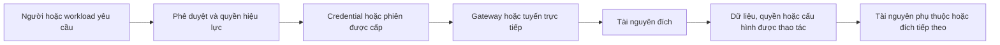

# Xác định tài nguyên bị tác động

## 1. Mục tiêu của việc khoanh vùng trong sự cố PAM

Khi một tài khoản đặc quyền, credential trong vault hoặc phiên quản trị bị nghi ngờ lạm dụng, câu hỏi “tài nguyên nào bị tác động?” không thể trả lời chỉ bằng danh sách máy mà tài khoản đó có quyền đăng nhập. Quyền truy cập mô tả điều có thể thực hiện; bằng chứng sự cố mô tả điều đã quan sát được. Hai phạm vi này liên quan nhưng không đồng nhất.

Ví dụ, một tài khoản vận hành có quyền quản trị 80 máy chủ. Nhật ký hiện có cho thấy tài khoản mở phiên trên hai máy và thực hiện thay đổi cấu hình trên một máy. Kết luận phù hợp là: một máy có thay đổi đã xác nhận, một máy có phiên truy cập cần đánh giá hành động, còn các máy khác thuộc phạm vi cần kiểm tra khả năng phơi nhiễm. Chưa có cơ sở gọi cả 80 máy là đã bị xâm nhập; cũng chưa đủ cơ sở tuyên bố 78 máy còn lại an toàn.

Mục tiêu của bài học là xây dựng một quy trình giúp nhóm ứng phó:

- Nhận diện tài nguyên trực tiếp và gián tiếp liên quan đến quyền đặc biệt.
- Nối bằng chứng từ danh tính, credential, phiên và thao tác với đúng tài nguyên.
- Phân biệt tác động đã xác nhận, khả năng tiếp cận và phần chưa xác định.
- Khoanh vùng theo thời gian, quyền thực tế và quan hệ phụ thuộc.
- Cập nhật phạm vi có kiểm soát để hỗ trợ cô lập, phục hồi và lưu bằng chứng kiểm toán.

Trong bài này, **tác động** có thể là đọc hoặc tiết lộ dữ liệu, thay đổi cấu hình, thay đổi quyền, thực thi lệnh, tạo cơ chế duy trì truy cập hoặc làm gián đoạn dịch vụ. Một phiên đăng nhập thành công là bằng chứng về truy cập; tự nó chưa chứng minh toàn bộ những loại tác động trên.

## 2. “Tài nguyên” rộng hơn một máy chủ

PAM quản lý đường đi của quyền đặc biệt đến các hệ thống nhạy cảm. Vì vậy, đối tượng cần kiểm tra không chỉ là đích đăng nhập cuối cùng mà còn gồm những thành phần có thể cấp quyền, chuyển tiếp quyền hoặc phát tán thay đổi.

| Nhóm tài nguyên | Ví dụ | Tác động cần xem xét |
|---|---|---|
| Máy tính và nền tảng chạy ứng dụng | Máy chủ, máy ảo, node, workload, thiết bị mạng | Lệnh đã chạy, tiến trình, cấu hình, dịch vụ và kết nối mới |
| Dữ liệu và kho lưu trữ | Cơ sở dữ liệu, bucket, file share, bản sao lưu | Đọc, xuất dữ liệu, thay đổi, xóa hoặc thay đổi quyền truy cập |
| Danh tính và hệ thống phân quyền | Tài khoản, nhóm, role, policy, quan hệ tin cậy | Cấp thêm quyền, thêm thành viên, tạo credential hoặc thay đổi người có thể nhận quyền |
| Thành phần PAM | Vault, broker, gateway, connector, kho bản ghi phiên | Truy xuất secret, đổi policy, thay đổi tuyến truy cập, can thiệp giám sát |
| Công cụ tự động hóa | Runner, pipeline, kho mã, kho artifact, lịch tác vụ | Chèn thay đổi có thể được triển khai sang nhiều đích |
| Hạ tầng hỗ trợ | DNS, chứng thư, cấu hình mạng, hệ thống log | Chuyển hướng, giả mạo điểm đến, mất khả năng quan sát hoặc gián đoạn |

Danh tính và credential thường được quản lý như thực thể riêng trong hồ sơ điều tra. Tuy vậy, hệ thống lưu chúng và cấu hình phân quyền cũng là tài nguyên có thể bị tác động. Nếu đối tượng tạo thêm credential cho một tài khoản dịch vụ, việc khóa phiên ban đầu không đủ để khẳng định đường truy cập đã bị loại bỏ.

Một tài nguyên vật lý cũng có nhiều lớp tác động. Trên cùng máy chủ cơ sở dữ liệu, có thể đã xác nhận đăng nhập hệ điều hành nhưng chưa xác nhận truy cập dữ liệu. Báo cáo phải giữ riêng hai nhận định đó.

## 3. Tách ba câu hỏi trước khi kết luận

### 3.1. Quyền nào đã tồn tại tại thời điểm sự kiện?

Xác định quyền hiệu lực tại thời điểm cần điều tra, không chỉ quyền đang hiển thị hiện tại. Các yếu tố cần đối chiếu gồm:

- Thành viên nhóm, role và policy đã được áp dụng lúc đó.
- Phạm vi tài nguyên mà quyền cho phép: một máy, một namespace, một project hay toàn bộ môi trường.
- Điều kiện đi kèm: thời hạn JIT, phê duyệt, nguồn kết nối, thiết bị hoặc tuyến qua gateway.
- Quyền được chuyển tiếp: assume role, tài khoản dịch vụ, credential được cấp từ vault hoặc quan hệ tin cậy khác.
- Giới hạn thao tác trong mô hình JEA: được phép chạy nhóm lệnh nào, với tham số và ngữ cảnh nào.

JIT có thể giảm thời gian quyền tồn tại; JEA có thể thu hẹp thao tác được phép. Nhưng trong điều tra, phải kiểm tra chúng có thực sự áp dụng cho đường truy cập đang xét hay không. Một đường truy cập trực tiếp ngoài broker có thể không chịu cùng điều kiện với phiên qua PAM.

### 3.2. Hoạt động nào thực sự được quan sát?

Tìm các sự kiện gắn với tài nguyên cụ thể: yêu cầu truy cập, cấp secret, tạo phiên, xác thực tại đích, gọi API, thực thi lệnh, truy vấn dữ liệu hoặc thay đổi cấu hình. Với mỗi sự kiện cần biết hành động có được thực hiện, bị từ chối, thất bại hay chưa rõ kết quả.

Sự kiện “yêu cầu mở phiên” không đồng nghĩa với phiên đã kết nối. Sự kiện “credential được trả về” không đồng nghĩa với credential đã được dùng. Sự kiện “API thành công” cũng cần được hiểu theo ý nghĩa của API: phản hồi chấp nhận một tác vụ bất đồng bộ chưa chắc có nghĩa tác vụ đã hoàn tất.

### 3.3. Hoạt động đó có liên quan đến sự cố không?

Không phải mọi thao tác của một tài khoản bị nghi ngờ đều do cùng một người thực hiện hoặc thuộc sự cố. Một tài khoản dùng chung có thể có nhiều phiên hợp lệ chạy đồng thời. Một runner có thể tự động tạo hoạt động sau thao tác của người vận hành.

Do đó, cần đối chiếu thêm người yêu cầu, phiên, nguồn kết nối, thiết bị, lý do truy cập, phê duyệt và trình tự thời gian. Với dấu vết còn thiếu, dùng cách diễn đạt “quan sát dưới danh tính X, chưa quy thuộc được người thao tác” thay vì khẳng định danh tính cá nhân.

## 4. Mô hình hồ sơ phạm vi

Một danh sách chỉ có tên tài nguyên và nhãn “bị ảnh hưởng” rất dễ gây hiểu nhầm. Hồ sơ nên tách ít nhất bốn chiều: bằng chứng, hành động, mức độ liên quan đến sự cố và độ bao phủ dữ liệu.

### 4.1. Mức bằng chứng về hoạt động

| Mức | Ý nghĩa | Ví dụ cách ghi |
|---|---|---|
| Đã xác nhận | Có bằng chứng đáng tin cậy về một hành động cụ thể trên tài nguyên | “Đã xác nhận thay đổi role lúc 09:16 từ session S-41” |
| Có dấu hiệu, cần xác minh | Có chỉ báo liên quan nhưng thiếu mắt xích hoặc kết quả | “Có kết nối từ máy trong phạm vi; chưa đối chiếu được xác thực tại đích” |
| Có thể tiếp cận do quyền hoặc credential | Có đường quyền hợp lệ tại thời điểm xét, chưa thấy hoạt động tại đích | “Credential được cấp có thể dùng trên cụm B; chưa có bằng chứng sử dụng” |
| Chưa xác định | Chưa đủ dữ liệu để đánh giá đường quyền hoặc hoạt động | “Thiếu audit log trong khoảng thời gian đang điều tra” |

Các mức trên là quy ước của hồ sơ điều tra trong bài, không phải thang điểm chuẩn của một sản phẩm PAM. Nhóm ứng phó có thể dùng tên khác nhưng phải thống nhất ý nghĩa.

Không gộp “chưa xác định” vào “không bị tác động”. Cũng không gộp “có thể tiếp cận” vào “đã xác nhận”. Một tài nguyên có thể mang nhiều nhận định: đã xác nhận đăng nhập, nghi ngờ đọc dữ liệu và chưa xác định có thay đổi cấu hình hay không.

### 4.2. Mức liên quan đến sự cố

Đây là chiều khác với độ chắc chắn của sự kiện:

- **Đã gắn với sự cố:** có chuỗi bằng chứng đủ để liên hệ hoạt động với sự cố đang xử lý.
- **Đang đánh giá:** sự kiện tồn tại nhưng chưa xác định thuộc hoạt động hợp lệ hay sự cố.
- **Đã giải thích bằng hoạt động hợp lệ:** có đối chiếu và bằng chứng về hoạt động được cho phép.

Ví dụ, audit log có thể xác nhận một thao tác đọc dữ liệu, nhưng việc thao tác đó do tác nhân của sự cố hay một tác vụ hợp lệ vẫn đang được đánh giá. Không làm mất sự phân biệt này khi tổng hợp số lượng.

### 4.3. Các trường nên có trong sổ phạm vi

| Trường | Nội dung cần lưu |
|---|---|
| `resource_key` | Định danh ổn định, có kèm môi trường và phạm vi quản lý |
| `resource_type`, `owner` | Loại tài nguyên, chủ sở hữu kỹ thuật hoặc nghiệp vụ |
| `identity_key`, `session_id` | Danh tính và phiên liên quan nếu xác định được |
| `action`, `result` | Hành động và kết quả cụ thể; dùng “chưa rõ” khi thiếu dữ liệu |
| `event_time`, `time_basis` | Thời gian sự kiện, múi giờ, độ lệch hoặc bất định đã biết |
| `evidence_level` | Đã xác nhận, có dấu hiệu, có thể tiếp cận hoặc chưa xác định |
| `incident_relation` | Đã gắn với sự cố, đang đánh giá hoặc đã giải thích hợp lệ |
| `evidence_refs` | Tham chiếu đến nguồn và bản sao bằng chứng được bảo quản |
| `visibility_gap` | Nguồn log thiếu, khoảng thời gian chưa có hoặc giới hạn của bộ lọc |
| `decision`, `next_check` | Quyết định hiện tại và phép kiểm tra tiếp theo |

Không đưa mật khẩu, private key hoặc token thật vào hồ sơ này. Dùng mã tham chiếu credential hoặc phiên; nơi lưu bằng chứng nhạy cảm phải có phân quyền riêng. Nội dung bản ghi phiên cũng có thể chứa dữ liệu mật, nên không sao chép tràn lan vào phiếu sự cố.

## 5. Xây dựng cửa sổ thời gian điều tra

Thời điểm cảnh báo không nhất thiết là thời điểm bắt đầu tác động. Đối tượng có thể đã lấy credential trước đó; một credential hoặc phiên được tạo trong cửa sổ đặc quyền có thể còn hiệu lực sau khi cửa sổ đó đóng.

### 5.1. Các mốc cần thu thập

1. Dấu hiệu sớm nhất có thể liên quan: xác thực bất thường, cấp quyền, cấp secret hoặc thay đổi policy.
2. Thời điểm các phiên và credential liên quan bắt đầu được dùng.
3. Thời điểm phát hiện và bắt đầu các biện pháp hạn chế truy cập.
4. Thời điểm từng biện pháp được áp dụng và được kiểm tra tại hệ thống thực thi.
5. Hoạt động tiếp diễn sau hạn chế: phiên cũ, token đã cấp, tác vụ nền hoặc credential mới tạo.

Ngày hết hạn quyền JIT, thời điểm đổi mật khẩu và thời điểm thu hồi token là các sự kiện khác nhau. Việc một mật khẩu đã được luân chuyển không tự chứng minh mọi phiên đang mở đã kết thúc. Cần kiểm tra cơ chế thực tế của từng hệ thống và bằng chứng tại đích.

### 5.2. Chuẩn hóa thời gian nhưng giữ bản gốc

Lưu thời gian gốc, múi giờ, thời gian thu nhận và thời gian đã chuẩn hóa để phân tích. Nếu hai hệ thống lệch đồng hồ, ghi lại độ lệch ước tính và nguồn xác định. Không sắp xếp một chuỗi sự kiện đến độ chính xác mili giây khi dữ liệu chỉ đáng tin đến phút.

Ví dụ, log gateway ghi 09:12:20 và log máy đích ghi 09:10:55. Nếu máy đích chậm khoảng 90 giây thì hai sự kiện có thể thuộc cùng phiên. Nhưng đó mới là khả năng tương quan; vẫn cần session ID, danh tính, endpoint và dấu vết xác thực để nối chúng.

Một cửa sổ điều tra có thể được mở rộng khi tìm thấy dấu vết sớm hơn. Mỗi lần mở rộng cần cập nhật các truy vấn, nguồn dữ liệu và tài nguyên đã đánh giá theo cửa sổ cũ; nếu không, phần đầu báo cáo và phần chi tiết có thể dùng hai phạm vi khác nhau.

## 6. Thu thập bằng chứng theo đường đi của quyền

Có thể bắt đầu từ một phiên, credential hoặc tài nguyên đã được cảnh báo rồi lần theo cả hai chiều. Chiều ngược giúp tìm nguồn cấp quyền; chiều xuôi giúp tìm các đích và thay đổi phát sinh.



Sơ đồ là khung phân tích, không khẳng định mọi hệ thống đều đi qua đầy đủ các bước. Một số workload gọi API trực tiếp; một số hệ thống PAM làm trung gian phiên mà không tiết lộ credential cho người sử dụng.

### 6.1. Từ PAM và hệ thống danh tính

Đối chiếu yêu cầu truy cập, phê duyệt, tài nguyên được cấp, credential reference, session ID, thời gian cấp và thời gian kết thúc. Kiểm tra thay đổi nhóm, role, policy và danh sách người có thể phê duyệt hoặc nhận quyền.

Với tài khoản dùng chung, tên tài khoản tại đích chưa đủ để quy thuộc người sử dụng. Cần nối tài khoản đó với người đã yêu cầu phiên, thiết bị, gateway và thời gian. Nếu có hai phiên trùng thời gian, giữ riêng các session ID thay vì gộp theo username.

### 6.2. Từ hệ thống đích

Tìm dấu vết xác thực và hành động tại chính nơi quyền được thực thi: hệ điều hành, cơ sở dữ liệu, nền tảng container, thiết bị mạng, dịch vụ lưu trữ hoặc API quản trị. Nhật ký PAM và nhật ký đích có thể bổ sung cho nhau nhưng không thay thế hoàn toàn nhau.

Bản ghi màn hình có thể cho thấy người vận hành nhập lệnh, song kết quả thực tế vẫn cần đối chiếu với trạng thái hoặc audit tại đích khi có thể. Ngược lại, một hoạt động tại đích không xuất hiện trong bản ghi PAM có thể đi qua tuyến khác hoặc thuộc tác vụ nền, chứ chưa đủ để kết luận bản ghi đã bị sửa.

### 6.3. Từ endpoint, mạng và tự động hóa

Dữ liệu tiến trình và kết nối giúp nhận diện thao tác được khởi phát từ máy nào, tiến trình nào. Dữ liệu pipeline và kho artifact giúp xác định thay đổi có được phát tán qua tự động hóa hay không.

Địa chỉ IP là một thuộc tính hỗ trợ, không phải định danh tài nguyên bền vững. NAT, proxy, gateway, DHCP và địa chỉ được tái sử dụng có thể làm nhiều thực thể dùng chung một IP hoặc một thực thể có nhiều IP. Cần đối chiếu mapping theo thời gian với định danh máy, workload hoặc tài nguyên của nền tảng.

### 6.4. Kiểm tra chất lượng và giới hạn nguồn

Với từng nguồn, ghi rõ:

- Nguồn có bật ghi loại hành động cần điều tra trong thời gian đó không?
- Log còn đủ thời gian lưu giữ và có khoảng gián đoạn không?
- Truy vấn đã lấy hết trang, shard, vùng và phạm vi quản lý liên quan chưa?
- Có bộ lọc loại bỏ hoạt động của tài khoản dịch vụ hoặc hoạt động thành công không?
- Người điều tra có đủ quyền đọc nguồn hay chỉ nhìn thấy một phần?
- Đường truy cập trực tiếp ngoài PAM có được giám sát tương đương không?

Một truy vấn trả về 0 dòng có thể do không có hoạt động, thiếu log, sai định danh hoặc thiếu quyền đọc. Kết quả đó phải được diễn giải cùng chất lượng nguồn.

## 7. Định danh tài nguyên và dựng chuỗi tương quan

### 7.1. Dùng khóa đủ phân biệt

Các tên như `db-prod`, `admin` hoặc `runner-01` có thể trùng giữa môi trường. Khóa tài nguyên nên kết hợp định danh ổn định của nền tảng với tenant/account/project, vùng hoặc cluster khi cần.

Ví dụ khóa nội bộ dùng trong bài:

```text
prod / project-payments / vm / vm-0482
prod / project-payments / database / db-019
prod / cluster-core / namespace-payments / workload / api-payment
prod / project-platform / runner / runner-07
```

Đây là cách biểu diễn minh họa, không phải định dạng ID bắt buộc. Giữ cả ID gốc để có thể truy vấn lại. Với tài nguyên đã bị xóa rồi tạo lại cùng tên, không coi hai phiên bản là một tài nguyên nếu định danh hoặc vòng đời khác nhau.

### 7.2. Nối sự kiện bằng nhiều thuộc tính

Ưu tiên khóa được hệ thống tạo và có thể kiểm chứng như session ID, request ID hoặc định danh credential được cấp. Khi không có khóa chung, tương quan theo một tập thuộc tính:

- Danh tính thực thi và danh tính người khởi phát nếu có.
- Thời gian cùng mức bất định đã biết.
- Gateway, máy nguồn, thiết bị và đích kết nối.
- Loại xác thực, loại hành động và tài nguyên được yêu cầu.
- Mã tác vụ, pipeline run hoặc bản ghi thay đổi liên quan.

Ghi lại vì sao chấp nhận một phép nối. “Cùng username trong vòng năm phút” thường chỉ là dấu hiệu cần kiểm tra thêm, đặc biệt với tài khoản tự động hóa hoạt động thường xuyên.

### 7.3. Giữ quan hệ nhân quả khác với quan hệ gần thời gian

Hai sự kiện xảy ra gần nhau không đủ chứng minh sự kiện thứ nhất gây ra sự kiện thứ hai. Ví dụ, sau một phiên quản trị có một deployment. Muốn gắn deployment vào phiên, cần tìm thay đổi pipeline, thao tác kích hoạt, revision, run ID hoặc bằng chứng khác nối được hai bước.

Trong hồ sơ, có thể ghi rõ ba loại cạnh:

| Quan hệ | Ý nghĩa |
|---|---|
| Quyền có hiệu lực | Danh tính có thể thao tác tài nguyên trong khoảng thời gian đã xác minh |
| Hoạt động quan sát được | Có sự kiện về truy cập hoặc hành động với kết quả xác định |
| Phụ thuộc hoặc phát tán | Một thay đổi có thể hoặc đã đi qua thành phần trung gian đến tài nguyên khác |

Không chuyển cạnh “có quyền” thành cạnh “đã truy cập” chỉ để làm đồ thị hoàn chỉnh.

## 8. Mở rộng phạm vi trực tiếp và gián tiếp

### 8.1. Phạm vi trực tiếp

Đây là các tài nguyên xuất hiện trong hoạt động liên quan: đích phiên, đối tượng API, cơ sở dữ liệu được truy vấn, file được sửa hoặc policy được thay đổi. Với mỗi tài nguyên, mô tả chính xác hành động và kết quả.

Ví dụ, một tài khoản gọi API liệt kê các bucket thành công. Điều đã xác nhận là hoạt động liệt kê trong phạm vi API đó. Chưa thể suy ra toàn bộ object đã bị tải xuống. Muốn xác định dữ liệu đã đọc hoặc xuất, cần thêm bằng chứng ở mức thao tác dữ liệu, truy vấn hoặc nguồn khác phù hợp.

### 8.2. Phạm vi theo quyền và credential

Khi một credential được xác nhận đã bị lộ hoặc được cấp trong ngữ cảnh đáng ngờ, xác định nơi credential đó có thể được dùng, thời gian hiệu lực và giới hạn thực tế.

Cần xem xét credential dùng chung, quyền kế thừa, tài khoản dịch vụ có nhiều consumer và khả năng nhận role khác. Không suy đoán giá trị secret để so sánh giữa các hệ thống. Dùng inventory, mapping của vault, metadata cấp phát và hồ sơ cấu hình được phép đọc.

Phạm vi này hỗ trợ quyết định kiểm tra và hạn chế truy cập, nhưng vẫn phải ghi là phạm vi có thể tiếp cận nếu chưa có bằng chứng hoạt động.

### 8.3. Phạm vi qua hệ thống điều khiển

Một thao tác trên thành phần điều khiển có thể tác động nhiều đích mà không cần đăng nhập từng đích. Các ví dụ gồm thay đổi policy, tạo bản triển khai, sửa pipeline, thay artifact, đổi cấu hình mạng hoặc lịch tác vụ.

Với mỗi thay đổi, theo dõi cả:

1. Nơi thay đổi được lưu.
2. Thời điểm thay đổi có hiệu lực.
3. Danh sách đích thực sự nhận thay đổi.
4. Trạng thái rollout hoặc thực thi ở từng đích.
5. Khả năng còn đích chưa đồng bộ hoặc tác vụ chờ chạy.

Một artifact đáng ngờ được xuất bản chưa đồng nghĩa mọi môi trường đã chạy artifact đó. Ngược lại, rollback cấu hình trung tâm chưa chắc đã phục hồi mọi đích nếu một số đích không nhận được cập nhật.

### 8.4. Phạm vi qua dữ liệu và sao chép

Nếu có thay đổi dữ liệu, cần kiểm tra các nơi có thể nhận thay đổi đó: replica, bộ nhớ đệm, hệ thống phân tích, export và bản sao lưu theo chu kỳ. Mỗi nơi có thời điểm đồng bộ và cơ chế phục hồi khác nhau.

Nếu chỉ có dấu hiệu đọc dữ liệu, không tự coi các replica là bị sửa. Nếu dữ liệu nguồn đã bị sửa và thay đổi được sao chép, ghi riêng bằng chứng về từng đích hoặc nhóm đích đã xác minh.

### 8.5. Phạm vi qua quyền được tạo thêm

Kiểm tra sự cố có tạo tài khoản, credential, quyền ủy nhiệm, phiên hoặc quan hệ tin cậy mới không. Các thực thể đó có thể hoạt động sau khi đường truy cập ban đầu bị chặn.

Việc mở rộng phải dựa trên quan hệ có ý nghĩa và có mốc thời gian. Không quét lan vô hạn toàn bộ hệ thống chỉ vì mọi tài nguyên đều nằm trong cùng mạng. Đối với nhánh quan trọng nhưng thiếu dữ liệu, ghi thành nhiệm vụ xác minh có chủ sở hữu và mức ưu tiên.

## 9. Quy trình khoanh vùng có thể thực hiện lại

### Bước 1 — Chốt giả thuyết ban đầu và đối tượng xuất phát

Ghi incident ID, dấu hiệu, tài khoản hoặc session ID xuất phát, cửa sổ thời gian ban đầu và những gì hiện đã biết. Phân biệt dữ kiện với giả thuyết ngay từ đầu.

Ví dụ: “Session S-41 được mở từ nguồn không khớp thiết bị đã đăng ký; chưa xác nhận người thao tác. Điều tra hoạt động của S-41 và các credential được cấp trong cùng yêu cầu.”

### Bước 2 — Bảo quản dữ liệu cần thiết

Thu thập các nguồn dễ mất trước, ghi thời điểm và cách thu thập, lưu bản gốc cùng tham chiếu kiểm tra tính toàn vẹn phù hợp. Ưu tiên dữ liệu ngắn hạn như trạng thái phiên, mapping địa chỉ và lịch sử cấp credential.

Nếu nguy cơ đang tiếp diễn, nhóm ứng phó có thể cần hạn chế truy cập song song với thu thập. Ghi rõ hành động ứng phó và thời điểm của nó để không nhầm dấu vết do người điều tra tạo ra với hoạt động của sự cố. Bài này tập trung xác định phạm vi, không yêu cầu trì hoãn cô lập chỉ để hoàn thiện hồ sơ.

### Bước 3 — Lập tập tài nguyên trực tiếp

Đọc sự kiện theo phiên, danh tính, request ID và credential reference. Chuẩn hóa đích thành khóa tài nguyên. Giữ các sự kiện bị từ chối hoặc thất bại như chỉ báo ý định và đường thử truy cập, nhưng không ghi chúng thành hành động thành công.

### Bước 4 — Xác minh hành động và kết quả tại đích

Đối chiếu log đích, lịch sử thay đổi và trạng thái liên quan. Tách “đã truy cập”, “đã đọc”, “đã sửa” và “đã gián đoạn”. Khi không quan sát được kết quả, giữ nhãn chưa rõ thay vì điền theo suy đoán.

### Bước 5 — Mở rộng theo quyền và quan hệ phụ thuộc

Xác minh quyền tại thời điểm sự kiện, credential dùng chung, các bước nhận quyền khác và các hệ thống điều khiển có thể phát tán thay đổi. Mỗi nhánh mới cần có lý do mở rộng và loại bằng chứng sẽ tìm.

### Bước 6 — Ưu tiên phép kiểm tra tiếp theo

Ưu tiên tài nguyên có khả năng gây tác động lớn, quyền rộng, credential còn hiệu lực, dữ liệu nhạy cảm, dấu hiệu duy trì truy cập hoặc khoảng trống quan sát đáng kể. Mức quan trọng của tài nguyên giúp sắp xếp công việc; nó không làm tăng độ chắc chắn của bằng chứng.

### Bước 7 — Đối chiếu với chủ sở hữu

Chủ sở hữu có thể giải thích lịch bảo trì, pipeline hợp lệ và quan hệ phụ thuộc mà inventory chưa phản ánh. Ghi lại bằng chứng đối chiếu. Một câu trả lời “chắc là tác vụ của đội vận hành” chưa đủ để loại tài nguyên khỏi phạm vi.

### Bước 8 — Phát hành phiên bản phạm vi

Mỗi phiên bản phải có thời điểm chốt dữ liệu, nguồn đã kiểm tra, tài nguyên theo từng mức bằng chứng, khoảng trống còn lại và việc cần làm. Giữ lịch sử thay đổi nhận định để người khác hiểu vì sao một tài nguyên được thêm, nâng mức hoặc loại khỏi phạm vi sự cố.

## 10. Ví dụ: credential triển khai bị nghi ngờ lạm dụng

### 10.1. Bối cảnh

Một doanh nghiệp dùng PAM cho tài khoản triển khai `svc-release`. Tài khoản có quyền quản trị cấu hình một runner và kích hoạt pipeline triển khai ứng dụng thanh toán. Trong một cửa sổ JIT, phiên S-41 xuất hiện từ nguồn kết nối bất thường.

Hồ sơ ban đầu ghi nhận các sự kiện sau. Thời gian trong ví dụ đã được chuẩn hóa cùng múi giờ; đây là dữ liệu giả lập.

| Thời gian | Sự kiện | Điều có thể kết luận ngay |
|---|---|---|
| 09:10 | PAM cấp phiên S-41 cho `svc-release` đến runner-07 | Phiên được cấp; cần kiểm tra kết nối tại đích |
| 09:12 | Runner ghi xác thực thành công, đối chiếu được với S-41 | Đã xác nhận truy cập runner-07 |
| 09:16 | Audit runner ghi thay đổi biến cấu hình pipeline từ tiến trình của phiên | Đã xác nhận thay đổi cấu hình; nội dung và liên quan sự cố đang được đánh giá |
| 09:18 | Pipeline run R-88 bắt đầu với revision vừa thay đổi | Có bằng chứng nối thay đổi với lần chạy cụ thể |
| 09:20 | R-88 yêu cầu credential cơ sở dữ liệu và vault trả về thành công | Đã xác nhận cấp credential; chưa xác nhận sử dụng tại cơ sở dữ liệu |
| 09:22 | Ba workload báo nhận revision mới, một workload rollout thất bại | Ba đích nhận revision đã xác nhận; đích thất bại cần kiểm tra trạng thái riêng |
| 09:23 | API lưu trữ ghi một yêu cầu đọc bị từ chối | Có lần thử đọc; chưa có bằng chứng đọc thành công từ sự kiện này |
| 09:25 | Nhóm ứng phó hạn chế đường truy cập ban đầu | Biện pháp đã được áp dụng; cần kiểm tra hiệu lực và đường truy cập khác |

### 10.2. Sổ phạm vi ban đầu

| Tài nguyên | Nhận định hiện tại | Điều chưa thể kết luận | Kiểm tra tiếp |
|---|---|---|---|
| runner-07 | Đã xác nhận truy cập và sửa cấu hình | Chưa xác định toàn bộ thay đổi hoặc tiến trình phát sinh | Đối chiếu thay đổi, tiến trình, kết nối và tác vụ nền |
| Định nghĩa pipeline | Đã xác nhận thay đổi được dùng bởi R-88 | Chưa xác định các lần chạy khác có dùng cùng thay đổi | Kiểm tra lịch sử revision và toàn bộ run trong cửa sổ |
| Ba workload nhận revision | Đã xác nhận nhận revision từ R-88 | Chưa xác định tác động nghiệp vụ hoặc truy cập dữ liệu bên trong | Xác minh revision thực chạy, log ứng dụng và trạng thái cấu hình |
| Workload rollout thất bại | Có liên quan đến lần triển khai, trạng thái thực tế cần xác minh | Không thể coi là hoàn toàn chưa thay đổi chỉ từ nhãn thất bại | Kiểm tra từng thành phần đã cập nhật và trạng thái đang chạy |
| Cơ sở dữ liệu db-019 | Credential có thể dùng đã được cấp cho R-88 | Chưa xác nhận đăng nhập, truy vấn hay xuất dữ liệu | Đối chiếu audit kết nối, hoạt động dữ liệu và mapping credential |
| Kho lưu trữ | Đã thấy yêu cầu đọc bị từ chối | Chưa xác nhận có đường hoặc lần đọc thành công khác | Kiểm tra đầy đủ các sự kiện và quyền liên quan |

Trong ví dụ này, không báo cáo “cơ sở dữ liệu đã bị đánh cắp” chỉ vì vault trả về credential. Cũng không loại cơ sở dữ liệu khỏi phạm vi chỉ vì truy vấn đầu tiên chưa tìm thấy sự kiện đăng nhập.

### 10.3. Khi có bằng chứng mới

Giả sử audit cơ sở dữ liệu sau đó xác nhận credential được dùng lúc 09:21 để đọc một bảng cấu hình. Nhóm điều tra cập nhật nhận định của db-019 thành “đã xác nhận kết nối và đọc bảng cấu hình”, kèm query ID hoặc tham chiếu bằng chứng tương ứng.

Nhận định này không tự mở rộng thành “đã đọc mọi bảng”. Nếu audit không ghi thao tác đọc ở một số schema, ghi phần đó là khoảng trống quan sát. Nếu phát hiện credential mới được tạo trong phiên, thêm credential và các tài nguyên mà nó có thể tiếp cận vào nhánh điều tra tiếp theo.

Trước khi thu hẹp phạm vi sau cô lập, kiểm tra các phiên còn mở, thời hạn và cơ chế thu hồi credential, các pipeline chờ chạy và trạng thái đích đã nhận thay đổi. Kết thúc cửa sổ JIT không thay thế các kiểm tra này.

## 11. Minh họa truy vấn và xử lý dữ liệu

### 11.1. Truy vấn sự kiện theo phiên đã xác minh

Ví dụ SQL dưới đây giả định nhóm điều tra đã có bản sao log được phép truy vấn trong một kho điều tra. Tên bảng và cột là minh họa; cần ánh xạ sang schema thực tế. Truy vấn chỉ đọc, không áp dụng thay đổi lên hệ thống vận hành.

```sql
SELECT
    event_id,
    event_time_utc,
    source_system,
    identity_key,
    session_id,
    resource_key,
    action,
    action_result,
    request_id
FROM investigation_events
WHERE incident_id = :incident_id
  AND event_time_utc >= :window_start_utc
  AND event_time_utc < :window_end_utc
  AND session_id = :verified_session_id
ORDER BY event_time_utc, event_id;
```

Các tham số được truyền bằng cơ chế bind của công cụ truy vấn, không ghép chuỗi từ dữ liệu nhập. Cửa sổ dùng đầu đóng, cuối mở để ghép các khoảng liên tiếp mà không đếm trùng sự kiện đúng mốc biên.

Truy vấn này chỉ trả về sự kiện có session ID tương ứng. Nó không chứng minh các hoạt động thiếu session ID hoặc hoạt động đi đường trực tiếp đã được bao phủ. Cần các truy vấn bổ sung theo credential reference, danh tính, request ID và tài nguyên sau khi xác minh được cách tương quan.

### 11.2. Tìm danh tính có cùng khả năng tiếp cận

Đôi khi mục tiêu là xác định phạm vi quyền tại thời điểm sự kiện. Dữ liệu quyền hiệu lực phải được dựng từ nguồn phù hợp, có tính đến điều kiện, giới hạn và lịch sử thay đổi; không coi một bảng cấp role đơn giản là toàn bộ quyền thực tế.

```sql
SELECT
    resource_key,
    permitted_action,
    valid_from_utc,
    valid_to_utc,
    evidence_ref
FROM verified_effective_access
WHERE identity_key = :identity_key
  AND valid_from_utc <= :event_time_utc
  AND (
      valid_to_utc IS NULL
      OR :event_time_utc < valid_to_utc
  );
```

Kết quả thuộc nhóm “có thể tiếp cận theo quyền đã xác minh”. Chỉ chuyển sang nhận định về hoạt động khi có bằng chứng riêng. Nếu quyền thay đổi trong cả cửa sổ điều tra, đánh giá theo các khoảng hiệu lực thay vì dùng một ảnh chụp thời điểm cho toàn bộ cửa sổ.

### 11.3. Mã giả để mở rộng phạm vi

```text
queue = các thực thể xuất phát đã có tham chiếu bằng chứng
visited = tập rỗng

while queue còn phần tử:
    lấy thực thể và khoảng thời gian cần xét
    nếu cặp thực thể-khoảng thời gian đã xét:
        tiếp tục

    ghi nhận đã xét
    lấy các quan hệ có nguồn và thời gian hiệu lực phù hợp

    với từng quan hệ:
        nếu là hoạt động:
            lưu hành động, kết quả, nguồn và độ chắc chắn của phép nối
        nếu là quyền:
            lưu khả năng tiếp cận, không suy thành hoạt động
        nếu là phụ thuộc:
            tạo phép kiểm tra sự phát tán hoặc trạng thái thực thi

        nếu cần điều tra tiếp và còn dữ liệu phù hợp:
            thêm thực thể đích cùng khoảng thời gian liên quan vào queue
        nếu thiếu dữ liệu:
            ghi khoảng trống, chủ sở hữu và việc cần xác minh
```

Mã giả mô tả tư duy điều tra, không phải thuật toán tự động kết luận xâm nhập. Không bỏ nhánh chỉ vì đã gặp cùng tên tài nguyên: thời gian, phiên bản tài nguyên và quan hệ có thể khác nhau. Nếu giới hạn khối lượng xử lý, ghi rõ nhánh chưa xét; không biến phần chưa xử lý thành tài nguyên sạch.

## 12. Ưu tiên xử lý và bàn giao phạm vi

### 12.1. Ưu tiên không đồng nghĩa với xác suất

Một hệ thống ít bằng chứng nhưng nắm quyền cấp credential toàn môi trường có thể cần kiểm tra trước một máy thử nghiệm đã xác nhận truy cập. Đây là ưu tiên theo hậu quả và khả năng lan rộng, không phải kết luận hệ thống thứ nhất chắc chắn bị tác động hơn.

Các yếu tố hữu ích để sắp xếp công việc gồm dữ liệu nhạy cảm, mức quyền, khả năng điều khiển đích khác, mức phụ thuộc nghiệp vụ, hoạt động còn tiếp diễn và độ dễ mất bằng chứng. Tránh cộng các con số tùy ý thành một điểm “chắc chắn bị xâm nhập” nếu chưa có cơ sở cho cách chấm.

### 12.2. Bàn giao cho nhóm cô lập và phục hồi

Thông tin bàn giao cần giúp người nhận chọn đúng biện pháp trên đúng đối tượng:

- Định danh tài nguyên và chủ sở hữu.
- Hành động đã xác nhận, bằng chứng và thời gian.
- Credential, phiên, quyền hoặc quan hệ tin cậy liên quan.
- Các đích phụ thuộc có thể bị gián đoạn khi hạn chế truy cập.
- Trạng thái quan sát còn thiếu và phép kiểm tra cần làm sau thay đổi.

Ví dụ, khi một credential dịch vụ được dùng bởi nhiều consumer, cần xác định các consumer trước khi luân chuyển hoặc thu hồi theo kế hoạch ứng phó. Nhưng danh sách consumer phục vụ tính toán tác động vận hành; nó không phải bằng chứng mọi consumer đã bị lạm dụng.

Sau mỗi biện pháp, kiểm tra tại nơi thực thi: phiên đã kết thúc chưa, credential cũ còn dùng được không theo cơ chế của hệ thống, quyền mới tạo đã được xử lý chưa, các thay đổi đã được loại bỏ và triển khai lại đủ chưa. Lưu các kiểm tra này như bằng chứng hiệu lực của ứng phó.

### 12.3. Bàn giao cho báo cáo quản lý

Một bản tóm tắt tốt có thể viết:

> Đến thời điểm chốt dữ liệu, đã xác nhận phiên quản trị truy cập một runner và thay đổi cấu hình pipeline; ba workload nhận revision liên quan. Credential cơ sở dữ liệu đã được cấp nhưng việc sử dụng đang được đối chiếu. Một nhánh audit còn thiếu dữ liệu trong cửa sổ điều tra. Nhóm đang kiểm tra phiên còn hiệu lực và các đích triển khai chưa xác minh.

Đoạn tóm tắt này cho biết mức chắc chắn, việc còn thiếu và bước tiếp theo. Tránh các câu tuyệt đối như “chỉ có ba hệ thống bị ảnh hưởng” khi còn đường truy cập hoặc khoảng trống chưa kiểm tra.

## 13. Khi nào có thể chốt một phiên bản phạm vi?

Chốt phiên bản phạm vi không có nghĩa khẳng định đã biết mọi điều. Nó có nghĩa hồ sơ đủ rõ để ra quyết định tại một thời điểm và có quy trình mở lại khi có bằng chứng mới.

Một phiên bản có thể được chấp nhận khi:

1. Các thực thể xuất phát và nhánh quyền quan trọng đã được đánh giá hoặc có nhiệm vụ theo dõi rõ ràng.
2. Nhận định về từng loại tác động đều có nguồn, kết quả và thời gian tương ứng.
3. Các log thiết yếu đã được kiểm tra về phạm vi, thời gian và khoảng trống.
4. Tài nguyên chưa xác định được giữ riêng, có chủ sở hữu và quyết định xử lý rủi ro.
5. Hoạt động hợp lệ được loại khỏi phạm vi có bằng chứng đối chiếu, không chỉ dựa vào lời đoán.
6. Các đường truy cập tiếp diễn và đích phụ thuộc đã được đưa vào kế hoạch cô lập hoặc phục hồi.

Nếu báo cáo một tỷ lệ bao phủ, phải nêu mẫu số. “Đã kiểm tra 90%” có thể là 90% tài nguyên trong inventory hiện có, không phải 90% mọi tài nguyên có thể tồn tại. Tương tự, “không thấy hoạt động trong log đã thu” là nhận định có điều kiện theo dữ liệu, không phải chứng minh không có tác động.

Các chỉ số phục vụ điều phối có thể gồm số tài nguyên đã xác minh theo loại hành động, số nhánh quyền chưa đánh giá, khoảng thời gian thiếu log và số việc đang chờ chủ sở hữu. Giữ số lượng tài nguyên duy nhất khác với số nhận định hoặc số sự kiện để tránh đếm một tài nguyên nhiều lần thành nhiều đích.

## 14. Sai lầm thường gặp

| Sai lầm | Hệ quả | Cách xử lý đúng |
|---|---|---|
| Đếm mọi tài nguyên tài khoản có quyền là đã bị tác động | Phóng đại kết luận, gây quyết định cô lập thiếu căn cứ | Tách khả năng tiếp cận khỏi hoạt động đã quan sát |
| Chỉ xem đích của phiên PAM | Bỏ sót tuyến trực tiếp, credential chuyển tiếp và tự động hóa | Lần theo nguồn quyền, đích thực thi và các quan hệ phát tán |
| Dùng quyền hiện tại thay cho quyền lúc sự kiện | Bỏ sót quyền đã được thêm rồi xóa | Dựng lịch sử quyền theo khoảng thời gian |
| Coi không có log là không có hoạt động | Thu hẹp phạm vi sai | Kiểm tra nguồn, quyền đọc, thời gian lưu và khoảng gián đoạn |
| Coi yêu cầu bị từ chối là đọc thành công | Báo sai loại tác động | Giữ kết quả của từng hành động và tìm sự kiện bổ sung |
| Chỉ nối sự kiện bằng IP hoặc username | Gộp nhầm nhiều người, máy hoặc phiên | Dùng khóa ổn định, mốc thời gian và nhiều thuộc tính |
| Coi rollout thất bại là chưa thay đổi gì | Bỏ sót trạng thái cập nhật một phần | Kiểm tra trạng thái thực tế ở từng đích |
| Khóa tài khoản rồi dừng điều tra | Bỏ sót phiên cũ, token, credential mới và tác vụ nền | Kiểm tra hiệu lực biện pháp và đường truy cập phát sinh |
| Đưa secret vào phiếu sự cố | Tạo thêm nơi lộ credential | Chỉ lưu tham chiếu và kiểm soát kho bằng chứng |
| Xóa tài nguyên khỏi phạm vi mà không giữ lý do | Mất khả năng giải thích và kiểm toán | Giữ lịch sử nhận định cùng bằng chứng và người xác nhận |

## 15. Bài tập thực hành

### Tình huống 1 — Tài khoản có quyền trên nhiều máy

Tài khoản A có quyền quản trị 40 máy tại thời điểm sự kiện. Có bằng chứng đăng nhập hai máy, một máy ghi nhận thay đổi cấu hình. Bốn máy trong inventory không có log trong cửa sổ điều tra.

**Yêu cầu:** Phân loại nhận định và xác định bước tiếp theo.

**Gợi ý trả lời:** Ghi riêng hai máy đã xác nhận truy cập và máy có thay đổi cấu hình; chúng có thể trùng nhau nên không cộng máy một cách máy móc. Các đích còn lại thuộc phạm vi quyền cần đối chiếu. Bốn máy thiếu log phải ghi khoảng trống quan sát và tìm nguồn bổ sung, không đánh dấu an toàn. Việc gắn các hành động vào sự cố còn cần đối chiếu phiên và hoạt động hợp lệ.

### Tình huống 2 — Có secret nhưng chưa có log cơ sở dữ liệu

Vault ghi cấp một credential cho phiên đáng ngờ. Truy vấn audit cơ sở dữ liệu trả về 0 dòng.

**Yêu cầu:** Có thể loại cơ sở dữ liệu khỏi phạm vi không?

**Gợi ý trả lời:** Chưa thể. Trước hết xác minh mapping credential, khoảng thời gian, loại audit đã bật, dữ liệu có được thu đủ và người điều tra có đủ quyền đọc hay không. Nếu vẫn thiếu bằng chứng, giữ nhận định credential có thể tiếp cận cơ sở dữ liệu và mô tả phần chưa xác định. Chưa có cơ sở khẳng định đã đọc hoặc xuất dữ liệu.

### Tình huống 3 — Quyền JIT đã hết hạn

Quyền JIT kết thúc lúc 10:00. Một token được cấp lúc 09:58 và một tác vụ triển khai bắt đầu lúc 09:59.

**Yêu cầu:** Cửa sổ tác động có chắc chắn kết thúc lúc 10:00 không?

**Gợi ý trả lời:** Không. Cần xác minh thời hạn và cơ chế thu hồi token, trạng thái phiên, trạng thái tác vụ và các thay đổi đã phát tán. Quyền nhận đặc quyền hết hạn không tự chứng minh mọi đối tượng được cấp trước đó hoặc mọi hành động đang chạy đã dừng.

### Tình huống 4 — Bị từ chối đọc kho lưu trữ

Một yêu cầu đọc object bị từ chối. Cùng danh tính có hoạt động liệt kê thành công, nhưng chưa có dữ liệu đầy đủ về các yêu cầu đọc khác.

**Yêu cầu:** Báo cáo điều gì?

**Gợi ý trả lời:** Đã xác nhận liệt kê và một lần thử đọc bị từ chối; chưa xác nhận nội dung object bị đọc từ các sự kiện đó. Giữ nhiệm vụ thu thập hoặc đối chiếu các yêu cầu còn thiếu. Không dùng một lần bị từ chối để kết luận mọi lần đọc đều thất bại.

## 16. Những điểm cần ghi nhớ

Khoanh vùng sự cố PAM là dựng chuỗi có bằng chứng từ danh tính và quyền đặc biệt đến hành động, tài nguyên và các đích phụ thuộc. Danh sách quyền giúp xác định nơi cần tìm; nhật ký và trạng thái tại đích giúp xác định điều đã xảy ra.

Một hồ sơ đáng tin cậy nêu rõ hành động nào đã xác nhận, điều gì mới là khả năng tiếp cận, điểm nào còn thiếu dữ liệu và vì sao hoạt động được gắn với sự cố. Giữ thời gian, nguồn, kết quả và lịch sử nhận định giúp các nhóm cô lập, luân chuyển credential, phục hồi và kiểm toán dùng cùng một phạm vi có thể kiểm chứng.
