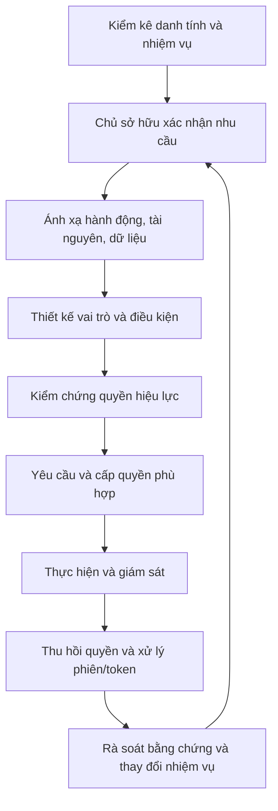

# Quyền tối thiểu theo nhiệm vụ

## Mục tiêu bài học

Trong chương **Least privilege**, quyền tối thiểu theo nhiệm vụ là cách xác định và cấp quyền dựa trên công việc cần hoàn thành. Bài học thuộc module `SECURITY_IDENTITY_ACCESS_MANAGEMENT_PRIVILEGED_ACCESS_MANAGEMENT`, áp dụng cho quản trị viên, tài khoản dịch vụ và hạ tầng nhạy cảm.

Sau bài học, bạn có thể:

- Chuyển một nhiệm vụ thành danh sách hành động, tài nguyên, dữ liệu và điều kiện truy cập.
- Phân biệt quyền cần thiết, quyền thuận tiện và quyền phát sinh gián tiếp.
- Chọn vai trò, giao diện tác vụ hoặc danh tính workload phù hợp.
- Kết hợp phạm vi quyền với JIT/JEA, vault và quản lý credential.
- Xác định bằng chứng chứng minh công việc hợp lệ thực hiện được và quyền ngoài phạm vi đã bị ngăn chặn.

## 1. Nguyên tắc: cấp quyền để hoàn thành việc đã xác định

**Quyền tối thiểu theo nhiệm vụ** là tập quyền cần thiết để một chủ thể thực hiện một công việc hợp lệ trong phạm vi đã xác định, cùng những điều kiện sử dụng phù hợp. Mục tiêu là hạn chế khả năng tác động vượt nhu cầu mà vẫn đáp ứng vận hành.

Ví dụ, nhiệm vụ “khởi động lại dịch vụ hóa đơn A” không tự đòi hỏi quyền quản trị toàn bộ máy chủ. Người thực hiện có thể chỉ cần xem trạng thái, khởi động lại đúng dịch vụ và kiểm tra kết quả. Quyền tạo tài khoản, đổi chính sách bảo mật hoặc đọc dữ liệu khách hàng cần một lý do khác.

Không nên hiểu “tối thiểu” là cấp càng ít càng tốt bất kể công việc có hoàn thành được hay không. Một thiết kế làm tác vụ hợp lệ luôn thất bại sẽ thúc đẩy người dùng xin quyền rộng, dùng tài khoản chung hoặc giữ credential ngoài quy trình.

Hai điều kiện phải được xem xét đồng thời:

1. Những bước hợp lệ của nhiệm vụ thực hiện được.
2. Những hành động, tài nguyên và dữ liệu ngoài nhiệm vụ không được mở ra chỉ để thuận tiện.

Không có một tập quyền nhỏ nhất duy nhất cho mọi cách triển khai. Một thao tác qua API chuyên biệt có thể cần ít quyền hơn mở shell, nhưng cũng có thể đòi hỏi xây dựng và bảo vệ thêm một thành phần trung gian.

## 2. Phân biệt nhiệm vụ, vai trò và quyền

| Khái niệm | Ý nghĩa | Ví dụ |
|---|---|---|
| Nhiệm vụ | Kết quả công việc cần đạt | Khôi phục hoạt động dịch vụ A |
| Hành động | Bước tác động cần thực hiện | Xem trạng thái, khởi động lại, kiểm tra sức khỏe |
| Quyền | Khả năng được cơ chế phân quyền cho phép | Đọc trạng thái của đúng dịch vụ |
| Vai trò | Tập quyền được gom cho một nhóm công việc | Người vận hành dịch vụ A |
| Điều kiện cấp quyền | Bối cảnh phải đáp ứng để sử dụng | Có yêu cầu hợp lệ, đúng môi trường, đúng thời hạn |
| Danh tính | Chủ thể nhận hoặc sử dụng quyền | Kỹ sư cá nhân hoặc workload cụ thể |

Chức danh “kỹ sư vận hành” thường chứa nhiều nhiệm vụ khác nhau. Không nên từ chức danh đó suy ra mọi người đều cần một vai trò quản trị toàn hệ thống.

Ngược lại, không nhất thiết tạo một vai trò mới cho từng lần bấm nút. Có thể gom các nhiệm vụ ổn định, có cùng phạm vi và mức rủi ro vào vai trò có thể quản lý được. Khi một nhiệm vụ có tác động khác biệt, như xuất dữ liệu nhạy cảm hoặc thay chính sách truy cập, cần cân nhắc tách riêng quyền và điều kiện kích hoạt.

## 3. Mô tả nhiệm vụ đủ rõ trước khi chọn quyền

Một yêu cầu như “cần admin để sửa lỗi” chưa cho biết quyền nào cần thiết. Cần làm rõ đầu vào, tài nguyên, kết quả và những bước được phép.

Mẫu mô tả minh họa:

```text
Nhiệm vụ: khôi phục invoice-api khi dịch vụ bị treo.
Chủ thể: kỹ sư trực ca được giao xử lý sự cố.
Tài nguyên: dịch vụ invoice-api trên nhóm máy sản xuất đã xác định.
Các bước dự kiến:
  - Xem trạng thái và chỉ số sức khỏe.
  - Đọc phần log chẩn đoán được giới hạn.
  - Khởi động lại dịch vụ nếu đúng điều kiện.
  - Kiểm tra dịch vụ hoạt động trở lại.
Phạm vi dữ liệu: dữ liệu chẩn đoán cần thiết, đã xử lý trường nhạy cảm.
Kết quả: dịch vụ hoạt động hoặc có thông tin rõ để chuyển cấp xử lý.
Thời hạn: cửa sổ xử lý được cấp theo chính sách.
Ngoài phạm vi: sửa cấu hình toàn máy, tạo tài khoản, xuất dữ liệu nghiệp vụ.
```

Việc ghi phần ngoài phạm vi giúp tránh một nhiệm vụ nhỏ dần mở rộng thành quản trị tùy ý. Nếu chẩn đoán cho thấy cần sửa cấu hình, đó là bước mở rộng cần được đánh giá và cấp quyền phù hợp, thay vì mặc định đã nằm trong quyền “xử lý sự cố”.

### Đừng bỏ quên tình huống thất bại

Nhiệm vụ có thể bao gồm kiểm tra trước thao tác, xác nhận sau thao tác và phục hồi khi thay đổi thất bại. Những bước này cũng phải được phân tích quyền.

Ví dụ, triển khai một phiên bản mới có thể cần khả năng quay về phiên bản đã phê duyệt. Điều đó chưa mặc nhiên cho phép xóa toàn bộ môi trường hoặc sửa cơ chế cấp quyền. Phạm vi phục hồi phải được xác định rõ như phạm vi triển khai.

## 4. Phân rã theo hành động, tài nguyên, dữ liệu và điều kiện

Với mỗi bước công việc, hãy phân tích các chiều sau:

| Chiều | Câu hỏi | Ví dụ giới hạn |
|---|---|---|
| Chủ thể | Ai hoặc workload nào thực hiện? | Người trực ca hoặc pipeline đã xác định |
| Hành động | Cần đọc, sửa, thực thi hay quản lý quyền? | Chỉ xem trạng thái và khởi động lại |
| Tài nguyên | Trên đối tượng nào? | Dịch vụ A ở môi trường staging |
| Dữ liệu | Cần thấy phần dữ liệu nào? | Log của một dịch vụ trong khoảng thời gian cần thiết |
| Điều kiện | Khi nào bối cảnh hợp lệ? | Đúng nguồn truy cập, xác thực và phê duyệt |
| Thời hạn | Quyền tồn tại đến khi nào? | Trong cửa sổ thực hiện nhiệm vụ |
| Quyền chuyển giao | Có được cấp quyền cho chủ thể khác không? | Không có nếu nhiệm vụ chỉ là vận hành dịch vụ |

Quyền quản lý quyền là một chiều đặc biệt quan trọng. Tài khoản không có quyền đọc dữ liệu nhưng tự gán được vai trò đọc dữ liệu vẫn có đường tiếp cận dữ liệu đó.

Cần xét cả hành động tưởng như vô hại. Quyền xem một tập cấu hình có thể lộ credential; quyền xem bản sao lưu có thể cho phép đọc lượng lớn dữ liệu. “Chỉ đọc” mô tả loại thao tác, không tự mô tả mức rủi ro.

## 5. Ví dụ xuyên suốt: từ nhiệm vụ đến ma trận quyền

Nhóm vận hành cần cho kỹ sư xử lý một dịch vụ bị treo. Ban đầu, mọi kỹ sư nhận quyền quản trị máy chủ để chạy vài lệnh kiểm tra.

Một ma trận theo nhiệm vụ có thể là:

| Bước | Khả năng cần có | Giới hạn tài nguyên/dữ liệu | Không tự cấp thêm |
|---|---|---|---|
| Kiểm tra tình trạng | Đọc trạng thái và chỉ số sức khỏe | invoice-api trên các máy đã duyệt | Đọc mọi thông tin hệ thống |
| Chẩn đoán | Đọc log phù hợp | Dịch vụ, khoảng thời gian và trường dữ liệu cần thiết | Tải toàn bộ log chứa dữ liệu nhạy cảm |
| Khởi động lại | Thực hiện thao tác restart | Đúng dịch vụ invoice-api | Dừng dịch vụ khác hoặc khởi động lại toàn máy |
| Xác nhận | Đọc trạng thái sau thao tác | Chỉ số liên quan nhiệm vụ | Xóa cảnh báo hoặc sửa hệ thống giám sát |
| Chuyển cấp | Ghi nhận kết quả và yêu cầu bổ sung | Hồ sơ công việc | Tự cấp quyền sửa cấu hình |

Từ ma trận này, có thể đánh giá ba cách triển khai:

- Vai trò chuyên biệt trên hệ thống đích nếu cơ chế phân quyền đủ chi tiết.
- Giao diện quản trị chỉ công bố những thao tác được phép.
- Workflow tự động nhận yêu cầu hợp lệ rồi thực hiện tác vụ đã định nghĩa.

Lựa chọn phụ thuộc khả năng nền tảng và chi phí vận hành. Trong cả ba cách, cần bảo vệ chính sách, đầu vào và danh tính thực thi. Nếu người được phép khởi động lại dịch vụ còn sửa được tệp thực thi hoặc cấu hình điều khiển hành vi của dịch vụ, tác động có thể rộng hơn dự kiến.

### Chính sách minh họa

Đây là mô tả logic, không phải cú pháp cấu hình của một sản phẩm:

```text
CHO PHÉP khi:
  chủ thể thuộc tập người được giao nhiệm vụ
  VÀ yêu cầu công việc hợp lệ
  VÀ điều kiện xác thực, nguồn truy cập và phê duyệt được đáp ứng
  VÀ đang trong cửa sổ được cấp
  VÀ tài nguyên thuộc tập máy được duyệt
  VÀ hành động là một trong:
       xem trạng thái invoice-api
       đọc log invoice-api theo phạm vi cho phép
       khởi động lại invoice-api

MẶC ĐỊNH:
  không cho phép hành động hoặc tài nguyên ngoài phạm vi trên

KHI KẾT THÚC:
  thu hồi quyền theo cơ chế thực tế
  xử lý phiên/token còn hiệu lực
  ghi nhận kết quả và bằng chứng
```

Khi chuyển sang cấu hình thật, phải tuân theo cơ chế đánh giá chính sách của nền tảng. Một mô tả cho phép ở đây không tự vô hiệu hóa quyền rộng nhận từ nơi khác.

## 6. Đánh giá quyền hiệu lực và các đường đi gián tiếp

Quyền được ghi trong một vai trò chưa chắc là toàn bộ khả năng của chủ thể. Cần xem các nguồn quyền khác và cách chúng kết hợp.

Các nguồn cần kiểm tra có thể gồm:

- Vai trò gán trực tiếp, nhóm và quan hệ nhóm lồng nhau.
- Chính sách trên tài nguyên và quyền được ủy quyền.
- Quyền nhận hoặc sử dụng credential của tài khoản khác.
- Khả năng chuyển vai trò hoặc sử dụng danh tính workload.
- Quyền sửa script, pipeline, cấu hình hoặc tác vụ chạy với đặc quyền.
- Quyền đặt lại credential, thêm yếu tố xác thực hoặc sửa thông tin phục hồi.
- Quyền thay đổi thuộc tính được dùng để quyết định truy cập.

Không có một phép cộng quyền chung cho mọi hệ thống. Quy tắc từ chối, điều kiện và ranh giới quyền có thể được áp dụng khác nhau. Cần đánh giá theo ngữ nghĩa của công nghệ đích và xác minh những khả năng quan trọng.

Ví dụ, một pipeline chỉ được triển khai staging có thể vẫn tác động tới sản xuất nếu nó được phép thay đổi cấu hình tin cậy để nhận danh tính triển khai sản xuất. Hoặc một người không có quyền quản trị trực tiếp nhưng được đọc secret quản trị từ vault vẫn có thể đăng nhập bằng tài khoản mạnh hơn.

Mỗi đường như vậy cần được xem là một phần của phạm vi đặc quyền, không phải ngoại lệ nằm ngoài bản thiết kế.

## 7. Thu thập thông tin: kết hợp mục tiêu công việc với dữ liệu sử dụng

Có hai nguồn thông tin bổ sung cho nhau:

| Nguồn | Giá trị | Giới hạn |
|---|---|---|
| Phân tích nhiệm vụ với chủ sở hữu | Cho biết quyền nào có lý do nghiệp vụ | Có thể bỏ sót phụ thuộc kỹ thuật hoặc bước phục hồi |
| Nhật ký và quan sát hoạt động | Cho biết quyền nào đã được sử dụng | Không chứng minh mọi quyền chưa dùng đều không cần |

Một thao tác phục hồi hiếm khi xuất hiện trong log nhưng có thể rất quan trọng. Ngược lại, một thao tác thường xuất hiện chưa chắc hợp lệ; nó có thể phản ánh thói quen dùng quyền rộng.

Quy trình hợp lý là mô tả nhiệm vụ, quan sát các lần thực hiện đại diện, đối chiếu cấu hình và xác nhận với chủ sở hữu. Sau đó kiểm chứng thiết kế mới trên các tình huống thành công, thất bại và phục hồi phù hợp.

Khi gặp lỗi thiếu quyền, cần xác định hành động và tài nguyên bị từ chối. Thêm ngay một wildcard hoặc vai trò quản trị toàn phần có thể che được lỗi nhưng làm mất cơ sở của quyền tối thiểu.

## 8. Chọn điểm thực thi và bảo vệ cơ chế cấp quyền

### Vai trò theo nhiệm vụ

Vai trò gom các quyền ổn định giúp việc cấp và rà soát dễ quản lý. Phạm vi nên phù hợp nhiệm vụ và tài nguyên thay vì gom mọi nhu cầu của cả một phòng ban.

Một vai trò có thể được dùng lại trên nhiều tài nguyên khi cơ chế cấp quyền cho phép ràng buộc phạm vi rõ ràng. Cần kiểm tra quyền trên tài nguyên mới có tự được mở rộng do kế thừa, tên hoặc nhãn hay không.

### Điều kiện theo thuộc tính hoặc ngữ cảnh

Các điều kiện có thể giới hạn môi trường, nguồn truy cập, loại chủ thể hoặc thuộc tính tài nguyên nếu nền tảng hỗ trợ. Phải bảo vệ nguồn thuộc tính: người dùng không nên tự đổi nhãn của tài nguyên để biến nó thành tài nguyên được phép quản trị.

### Giao diện tác vụ và workflow

Một tác vụ trung gian có thể cho người dùng thực hiện công việc mà không nhận shell hoặc credential rộng. Danh tính chạy tác vụ vẫn cần least privilege và không nên có quyền vượt toàn bộ phạm vi công việc của workflow.

Cần kiểm soát tham số, tài nguyên tham chiếu, mã thực thi và người có thể sửa workflow. Nếu người yêu cầu tự sửa được tác vụ chạy quyền cao, ranh giới giữa quyền yêu cầu và quyền thực thi có thể mất tác dụng.

### Thực thi tại tài nguyên đích

Ẩn chức năng trên giao diện không đủ nếu cùng credential vẫn gọi được API hoặc đăng nhập trực tiếp để thực hiện hành động đó. Thiết kế phải xét mọi đường truy cập thực tế và cơ chế phân quyền ở đích.

## 9. Đặt quyền theo nhiệm vụ vào vòng đời PAM

Quyền tối thiểu mô tả phạm vi cần cấp. PAM quản lý cả cách yêu cầu, cấp phát, sử dụng, giám sát và kết thúc quyền đó.



Các cơ chế phối hợp có vai trò khác nhau:

| Cơ chế | Đóng góp cho kiểm soát |
|---|---|
| Least privilege | Thu hẹp hành động, tài nguyên và dữ liệu theo nhiệm vụ |
| JIT | Giới hạn lúc quyền được kích hoạt và thời gian hiệu lực |
| JEA hoặc giao diện quản trị giới hạn | Thu hẹp những thao tác quản trị có thể thực hiện |
| Vault | Bảo vệ và kiểm soát cấp phát credential |
| Luân chuyển credential | Thay thế credential theo chính sách hoặc sự kiện, xử lý phụ thuộc |
| Giám sát phiên và log đích | Quan sát hoạt động, phát hiện bất thường và hỗ trợ truy nguyên |

Không thể dùng một cơ chế để thay thế mọi cơ chế còn lại. Một credential được bảo vệ tốt vẫn có thể thuộc tài khoản quá quyền. Một quyền rộng chỉ tồn tại ngắn vẫn có thể gây tác động lớn. Một bản ghi phiên không tự ngăn hành động vượt nhu cầu.

## 10. Ví dụ cho workload: triển khai một ứng dụng

Giả sử pipeline cần triển khai phiên bản đã được phê duyệt của `invoice-api` vào staging và kiểm tra kết quả.

Phân rã nhiệm vụ:

| Bước | Quyền cần xác định | Giới hạn |
|---|---|---|
| Lấy artifact | Đọc artifact cần triển khai | Kho và phiên bản phù hợp |
| Cập nhật ứng dụng | Thay phiên bản của invoice-api | Chỉ môi trường staging |
| Kiểm tra | Đọc trạng thái triển khai và sức khỏe | Không cần đọc dữ liệu nghiệp vụ |
| Quay lui khi thất bại | Chuyển về phiên bản đã được phép | Không mở thành quyền sửa mọi ứng dụng |
| Kết thúc | Ghi kết quả và kết thúc quyền tạm thời | Không giữ secret trong log hoặc artifact |

Danh tính workload cần riêng theo ranh giới vận hành phù hợp, có chủ sở hữu và điều kiện tin cậy rõ ràng. Nếu hạ tầng hỗ trợ, có thể cấp credential ngắn hạn có phạm vi và bên nhận dự kiến phù hợp.

Phải kiểm tra ai có thể sửa pipeline, thay danh tính thực thi hoặc sửa cơ chế tin cậy cấp credential. Người điều khiển những thành phần đó có thể tác động bằng quyền của workload.

Nếu hệ thống cũ cần secret tĩnh, vault và luân chuyển phải đi cùng bản đồ phụ thuộc. Thứ tự cập nhật, thời điểm vô hiệu hóa giá trị cũ và kiểm tra chức năng phụ thuộc công nghệ cụ thể. Không dùng tài khoản quản trị cá nhân chạy pipeline chỉ để giảm số danh tính phải quản lý.

## 11. Kiểm chứng cả khả năng thực hiện và khả năng từ chối

Một thiết kế cần được đánh giá từ hai phía. Kiểm tra đăng nhập thành công mới chỉ chứng minh chủ thể có thể mở phiên, chưa chứng minh quyền đủ dùng hoặc được giới hạn đúng.

Ma trận minh họa cho nhiệm vụ khởi động lại dịch vụ:

| Trường hợp | Kết quả mong đợi | Bằng chứng cần quan sát |
|---|---|---|
| Xem trạng thái đúng dịch vụ | Được phép | Danh tính, tài nguyên và kết quả |
| Khởi động lại dịch vụ trong phạm vi | Được phép | Quyết định cấp quyền và hoạt động tại đích |
| Đọc log cần thiết đã giới hạn | Được phép theo thiết kế | Phạm vi dữ liệu trả về |
| Khởi động lại dịch vụ khác | Bị từ chối | Kết quả tại điểm thực thi |
| Sửa vai trò hoặc tự cấp thêm quyền | Bị từ chối | Quyết định phân quyền và sự kiện liên quan |
| Đọc secret hoặc dữ liệu ngoài nhiệm vụ | Bị từ chối theo chính sách | Kiểm soát trên dữ liệu hoặc kho tương ứng |
| Truy cập trực tiếp để bỏ qua giao diện giới hạn | Bị ngăn theo yêu cầu thiết kế | Đường kết nối và quyền trên tài nguyên đích |
| Tiếp tục thao tác khi quyền đã kết thúc | Không còn đặc quyền theo thiết kế | Trạng thái quyền, token và phiên liên quan |

Các trường hợp phải nằm trong môi trường và phạm vi được phép. Ưu tiên thao tác không gây tác động, tài nguyên thử nghiệm hoặc phương pháp kiểm tra phù hợp; không thực hiện hành động phá hủy trên sản xuất chỉ để chứng minh nó bị từ chối.

Cần phân biệt rõ kiểm chứng logic của chính sách, cấu hình trên hệ thống và hành vi thực tế. Mỗi loại cung cấp bằng chứng khác nhau, và khoảng trống cần được ghi nhận.

### Thu hồi quyền phải xét ngữ cảnh đang tồn tại

Xóa một vai trò không luôn làm mọi token, kết nối cơ sở dữ liệu hoặc shell đang mở lập tức mất khả năng thao tác. Cần biết hành vi của nền tảng, cách kết thúc phiên và độ trễ có thể tồn tại.

Tương tự, đổi mật khẩu không tự hủy tất cả token đã phát hành. Bằng chứng kết thúc quyền phải phù hợp loại credential và hệ thống đích, thay vì chỉ chụp trạng thái vai trò sau khi xóa.

## 12. Bằng chứng kiểm toán và ứng phó sự cố

Một chuỗi bằng chứng nên nối được:

```text
Nhiệm vụ và người chịu trách nhiệm
    -> tập quyền đã xác nhận và phiên bản chính sách
    -> yêu cầu, điều kiện và quyết định cấp
    -> danh tính người/workload cùng mã phiên hoặc mã lần chạy
    -> hành động thực tế trên tài nguyên
    -> kết quả công việc
    -> thu hồi và xử lý phiên/token/credential khi có áp dụng
```

Đối với tài khoản đích dùng chung qua PAM, cần liên kết từ danh tính cá nhân tới tài khoản đích. Một bản ghi lấy mật khẩu không tự chứng minh người đó đã thực hiện mọi hành động sau đó; cần đối chiếu thêm nguồn kết nối, phiên và log đích.

Nhật ký cần được bảo vệ trước sửa/xóa trái phép, có thời gian đủ nhất quán và quyền truy cập phù hợp. Không ghi giá trị mật khẩu, khóa hoặc token để chứng minh sử dụng hoặc luân chuyển; dùng mã tham chiếu và sự kiện an toàn.

Khi nghi ngờ bị lạm dụng, tập quyền theo nhiệm vụ giúp phân biệt hành động dự kiến với hành động bất thường. Tuy nhiên, còn phải điều tra khả năng tài khoản đã tạo danh tính mới, thay chính sách, thêm khóa hoặc lấy credential khác. Chỉ thu hồi quyền ban đầu chưa chứng minh mọi đường truy cập tiếp theo đã được loại bỏ.

## 13. Nhiệm vụ phát sinh, ngoại lệ và đường khẩn cấp

Không phải sự cố nào cũng biết trước mọi bước xử lý. Có thể chia công việc thành các giai đoạn: chẩn đoán với quyền quan sát phù hợp, sau đó yêu cầu quyền thay đổi khi đã xác định hành động cần làm.

Để vận hành được, luồng bổ sung quyền cần có người chịu trách nhiệm và thời gian xử lý phù hợp mức khẩn cấp. Một quy trình quá chậm có thể tạo động lực duy trì quyền rộng ngoài luồng.

Khi cần ngoại lệ, nên xác định:

- Mục tiêu công việc và lý do quyền hiện tại chưa đáp ứng.
- Quyền bổ sung, tài nguyên và dữ liệu có thể bị tác động.
- Thẩm quyền chấp thuận và thời hạn.
- Cách giám sát, điều kiện thu hồi và người rà soát.
- Quyết định sau sự kiện: cập nhật thiết kế hay kết thúc ngoại lệ.

Danh tính break-glass có thể cần quyền rộng để phục hồi khi IAM/PAM không hoạt động. Đường này cần được chuẩn bị trước, tránh phụ thuộc vòng, bảo quản phương tiện truy cập và có quy trình xử lý sau sử dụng. Nó không nên trở thành quyền mặc định cho tác vụ thường ngày.

## 14. Rà soát định kỳ và đo hiệu quả

Quyền phù hợp hôm nay có thể thành quyền thừa khi ứng dụng được tách nhỏ, nhân sự đổi nhóm hoặc tác vụ chuyển sang tự động hóa. Rà soát nên gắn với thay đổi nhiệm vụ, tài nguyên, chủ sở hữu và kiến trúc, ngoài lịch định kỳ.

| Chỉ số gợi ý | Cách diễn giải |
|---|---|
| Tỷ lệ nhiệm vụ có ánh xạ quyền được chủ sở hữu xác nhận | Cho biết mức rõ ràng về nhu cầu, cần xem chất lượng ánh xạ |
| Số quyền rộng đã được thay bằng phạm vi phù hợp | Cần kiểm tra quyền cũ và đường gián tiếp đã được xử lý |
| Tỷ lệ công việc hợp lệ hoàn thành qua vai trò đã thiết kế | Phản ánh tính khả dụng của cơ chế cấp quyền |
| Tỷ lệ trường hợp ngoài phạm vi bị từ chối như dự kiến | Phản ánh hiệu lực của ranh giới truy cập |
| Ngoại lệ quá hạn hoặc không có chủ sở hữu | Cho thấy nơi quyền vượt nhu cầu có thể trở thành thường trực |
| Mức đầy đủ của bằng chứng cấp, dùng và thu hồi | Phản ánh khả năng giải thích và kiểm toán vòng đời quyền |

Không nên chỉ đếm số vai trò hoặc số tài khoản trong vault. Nhiều vai trò nhỏ vẫn có thể kết hợp thành quyền rất rộng, và credential được quản lý tập trung vẫn có thể thuộc tài khoản vượt nhu cầu.

## 15. Những sai lầm cần tránh

| Sai lầm | Cách xử lý phù hợp hơn |
|---|---|
| Suy quyền từ chức danh thay vì nhiệm vụ | Phân rã công việc và xác định tài nguyên cụ thể |
| Thấy lỗi thiếu quyền thì thêm quyền toàn phần | Tìm hành động bị từ chối và phụ thuộc thực tế |
| Coi quyền chỉ đọc luôn ít rủi ro | Xét secret, dữ liệu nhạy cảm, bản sao lưu và khả năng xuất |
| Chỉ xem quyền trong một vai trò | Kiểm tra quyền hiệu lực, credential và đường ủy quyền khác |
| Dựa hoàn toàn vào log gần đây để xóa quyền | Đối chiếu nhiệm vụ hiếm gặp và yêu cầu phục hồi |
| Dùng JIT để hợp thức hóa một vai trò quá rộng | Thu hẹp phạm vi song song với thời hạn |
| Giấu credential rồi coi phiên đã đủ hẹp | Kiểm tra khả năng thao tác thực tế trên đích |
| Rút quyền nhưng giữ đường truy cập cũ | Xử lý nhóm, credential, token, phiên và kết nối liên quan |
| Giữ ngoại lệ không có ngày xem lại | Gắn chủ sở hữu, thời hạn và điều kiện kết thúc |

## 16. Bài tập tự thực hành

### Tình huống

Một kỹ sư cần xuất báo cáo tổng hợp doanh thu theo tháng. Hiện tại, kỹ sư được dùng tài khoản quản trị cơ sở dữ liệu có thể đọc mọi bảng, sửa dữ liệu và tạo người dùng. Báo cáo chỉ cần dữ liệu tổng hợp của một hệ thống, không cần thông tin định danh khách hàng. Một tác vụ theo lịch cũng dùng tài khoản này để tạo cùng báo cáo.

Hãy xác định:

1. Nhiệm vụ, hành động, tài nguyên và phạm vi dữ liệu thực sự cần thiết.
2. Những quyền nào có lý do, những quyền nào vượt nhu cầu?
3. Có thể cung cấp dữ liệu qua view, chức năng báo cáo hoặc giao diện giới hạn như thế nào nếu công nghệ hỗ trợ?
4. Tác vụ theo lịch nên có danh tính và credential ra sao?
5. Cần kiểm chứng những trường hợp được phép, bị từ chối và kết thúc truy cập nào?

### Gợi ý phân tích

Nhiệm vụ là đọc dữ liệu tổng hợp và xuất kết quả được cho phép, không phải quản trị toàn bộ cơ sở dữ liệu. Quyền sửa dữ liệu, tạo người dùng và đọc các bảng ngoài phạm vi chưa có lý do từ nhiệm vụ đã nêu.

Có thể xem xét một giao diện dữ liệu giới hạn để chỉ trả các cột, dòng hoặc kết quả tổng hợp cần thiết. Khả năng đó phải được kiểm chứng theo công nghệ; chỉ tạo một view nhưng vẫn giữ quyền đọc bảng gốc không tự tạo ranh giới mong muốn.

Người dùng và tác vụ tự động cần được phân biệt về danh tính, vòng đời và bằng chứng. Tác vụ có chủ sở hữu, quyền theo mục đích và cơ chế quản lý credential phù hợp, không phụ thuộc tài khoản cá nhân của kỹ sư.

Kiểm chứng cần xác nhận báo cáo đúng thực hiện được, dữ liệu ngoài phạm vi và thao tác quản trị bị từ chối, đường truy cập cũ đã bị xử lý và quyền/phiên kết thúc theo thiết kế. Bằng chứng phải liên kết nhiệm vụ, quyết định cấp, danh tính, truy vấn hoặc hoạt động phù hợp và kết quả thu hồi.

## 17. Kiến thức cần ghi nhớ

Quyền tối thiểu theo nhiệm vụ bắt đầu từ công việc cần hoàn thành, rồi xác định hành động, tài nguyên, dữ liệu và điều kiện truy cập. Tập quyền phải bao gồm những bước hợp lệ cần thiết mà không mở thêm khả năng chỉ vì thuận tiện.

Thiết kế cần xét quyền hiệu lực, phụ thuộc và đường tác động gián tiếp. PAM đưa tập quyền đó vào vòng đời có chủ sở hữu, xác thực, cấp quyền, giám sát, thu hồi và bằng chứng. Kết quả đáng tin cậy là công việc hợp lệ thực hiện được, hành động ngoài phạm vi bị ngăn chặn và việc kết thúc quyền được xác nhận theo cơ chế thực tế.
