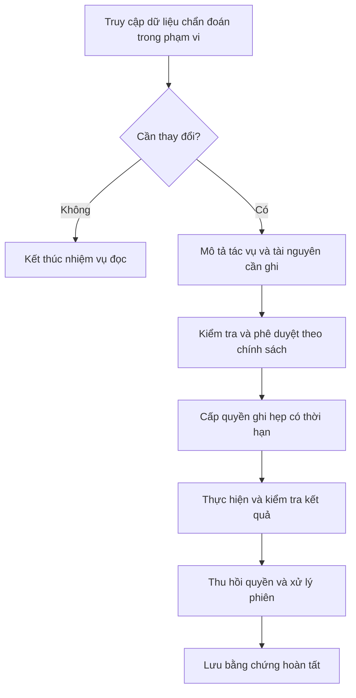

# Tách quyền đọc và ghi

## 1. Vì sao phải tách quyền đọc và ghi?

Trong quản lý truy cập đặc quyền (Privileged Access Management — PAM), **tách quyền đọc và ghi** là việc xác định và cấp riêng các khả năng quan sát thông tin, thay đổi dữ liệu, thay đổi cấu hình và quản trị quyền. Mục tiêu là giúp một danh tính hoàn thành nhiệm vụ với phạm vi tác động phù hợp, thay vì mặc nhiên có toàn quyền vì cần xem một hệ thống.

Ví dụ, kỹ sư trực cần xem trạng thái ứng dụng và log để chẩn đoán sự cố. Nhu cầu đó chưa tạo ra lý do để kỹ sư được sửa cấu hình production, cập nhật cơ sở dữ liệu hoặc xóa log. Khi tìm ra nguyên nhân và cần thay đổi, quyền ghi có thể được yêu cầu riêng cho tác vụ, tài nguyên và thời gian cụ thể.

Trong chương Least privilege, việc tách đọc và ghi là một bước thiết kế quyền theo nhiệm vụ. Nó cần được triển khai ở nơi thực sự kiểm soát hành động: hệ điều hành, ứng dụng, cơ sở dữ liệu, API hoặc nền tảng hạ tầng.

Bài học giúp người học:

- Phân loại hành động đọc, ghi, xóa và quản trị quyền.
- Xây dựng ma trận quyền theo tài nguyên, dữ liệu và tác vụ.
- Giới hạn quyền đọc nhạy cảm và phát hiện các đường nâng quyền gián tiếp.
- Tách luồng chẩn đoán khỏi luồng thay đổi có kiểm soát.
- Kết hợp vai trò, JIT, JEA, vault và bằng chứng để quản lý quyền ghi.
- Kiểm chứng cả hành động hợp lệ và hành động vượt phạm vi.

## 2. Đọc và ghi cần được phân loại theo hành vi thực tế

Tên vai trò như `Viewer` hoặc `Editor` chỉ là nhãn. Cần xem các thao tác phía sau nhãn và tài nguyên mà chúng tác động.

| Nhóm hành động | Ví dụ | Điều cần xem xét |
| --- | --- | --- |
| Liệt kê và xem metadata | Liệt kê máy, xem tên tài nguyên, trạng thái dịch vụ | Metadata có thể tiết lộ cấu trúc hệ thống hoặc thông tin nhạy cảm |
| Đọc nội dung | Đọc log, truy vấn bản ghi, tải tệp | Có thể làm lộ dữ liệu và secret dù không thay đổi nguồn |
| Tạo mới | Tạo bản ghi, tệp hoặc tài nguyên | Có thể phát sinh chi phí, dữ liệu sai hoặc đối tượng có quyền mới |
| Cập nhật | Sửa cấu hình, nội dung hoặc trạng thái | Phạm vi trường, bản ghi và điều kiện cần được giới hạn |
| Thực thi thao tác | Khởi động lại dịch vụ, chạy tác vụ bảo trì | Có thể thay đổi trạng thái mà không mang tên “ghi” |
| Xóa hoặc vô hiệu hóa | Xóa dữ liệu, tắt dịch vụ, bỏ cấu hình | Có thể gây mất dữ liệu hoặc gián đoạn |
| Quản trị quyền | Cấp vai trò, sửa chính sách, thay chủ sở hữu | Có thể mở đường đến cả đọc lẫn ghi |
| Quản lý bằng chứng | Thay cấu hình log, xóa hoặc xuất bản ghi phiên | Ảnh hưởng khả năng điều tra và dữ liệu được bảo vệ |

Một hành động “xem báo cáo” có thể đồng thời cập nhật metadata truy cập hoặc tạo sự kiện audit. Khi thiết kế, cần phân biệt các tác dụng phụ hệ thống đã chấp nhận với khả năng thay đổi dữ liệu nghiệp vụ hoặc cấu hình được bảo vệ.

Ngược lại, một tên thao tác nghe giống đọc không bảo đảm không làm thay đổi trạng thái. Nếu ứng dụng gọi một tác vụ hoặc hàm có hiệu ứng ghi, phân quyền phải dựa vào hành vi đó.

### 2.1. Tách thêm những hành động có mức tác động khác nhau

Không nên gom tạo, cập nhật, xóa và cấp quyền thành một loại “ghi” duy nhất nếu nhu cầu cho phép phân tách rõ hơn.

Ví dụ:

- Bộ phận hỗ trợ được cập nhật ghi chú xử lý nhưng không đổi số tiền giao dịch.
- Dịch vụ thu thập log được gửi bản ghi mới nhưng không sửa hoặc xóa lịch sử.
- Nhóm vận hành được khởi động lại một dịch vụ nhưng không sửa cấu hình xác thực.
- Người quản lý dữ liệu được điều chỉnh bản ghi theo quy trình nhưng không tạo người dùng quản trị.

Các giới hạn này cần được cơ chế thực thi hỗ trợ. Nếu hệ thống chỉ cung cấp một quyền rất rộng, phải ghi nhận giới hạn kỹ thuật và lựa chọn cách kiểm soát bổ sung.

### 2.2. Quyền đọc không tự động đi kèm quyền ghi và ngược lại

Một số hệ thống hỗ trợ tài khoản chỉ ghi vào một đích mà không đọc lại nội dung, chẳng hạn kênh tiếp nhận sự kiện. Tuy nhiên, hành vi thực tế phụ thuộc giao diện và nền tảng.

Một tác vụ cập nhật cũng có thể cần đọc trước metadata, phiên bản hoặc dữ liệu liên quan. Cần phân tích phần đọc thực sự cần thiết và cấp trong đúng phạm vi, thay vì thêm toàn bộ quyền đọc dữ liệu để xử lý một lỗi thiếu quyền.

## 3. Quyền đọc vẫn là quyền nhạy cảm

Tách đọc và ghi giúp giảm khả năng thay đổi trái phép, nhưng quyền đọc vẫn có thể gây tác động lớn về bảo mật.

### 3.1. Đọc dữ liệu và xuất dữ liệu

Một người chỉ đọc được thông tin khách hàng vẫn có thể chụp màn hình, sao chép hoặc sử dụng dữ liệu ngoài mục đích công việc. Giới hạn ghi tại hệ thống nguồn không ngăn được mọi hình thức lộ thông tin.

Có thể cần kết hợp giới hạn dữ liệu, che trường nhạy cảm, điều kiện thiết bị, kiểm soát xuất dữ liệu và giám sát phù hợp. Những kiểm soát này có mức bao phủ khác nhau; không nên giả định tắt nút tải xuống sẽ loại bỏ khả năng sao chép nội dung mà người dùng đã xem.

### 3.2. Đọc secret có thể dẫn đến đặc quyền khác

Quyền đọc mật khẩu, khóa riêng hoặc token có thể cho phép sử dụng quyền của danh tính sở hữu secret. Một vai trò chỉ được “đọc vault” nhưng đọc được credential quản trị có thể tạo ra khả năng tác động vượt rất xa việc quan sát.

Log, bản sao lưu, tệp cấu hình và bản ghi phiên cũng có thể chứa secret. Quyền xem chúng cần được đánh giá theo nội dung thực tế, với biện pháp tránh thu thập hoặc hiển thị bí mật không cần thiết.

### 3.3. Đọc rộng gây rủi ro ngay cả khi không có secret

Metadata có thể tiết lộ tên máy, cấu trúc mạng, vị trí dữ liệu và quan hệ giữa các hệ thống. Dữ liệu chẩn đoán có thể chứa thông tin nghiệp vụ hoặc thông tin cá nhân.

Cần giới hạn cả môi trường, tài nguyên, trường dữ liệu và khoảng thời gian. Một kỹ sư chỉ cần log lỗi của một ứng dụng không mặc nhiên cần toàn bộ log production của tổ chức.

## 4. Bắt đầu từ nhiệm vụ và ma trận quyền

### 4.1. Viết nhu cầu dưới dạng có thể kiểm chứng

Thay vì yêu cầu “cần quyền đọc và ghi hệ thống thanh toán”, hãy mô tả:

> Kỹ sư trực được xem trạng thái và log đã xử lý của ứng dụng thanh toán. Khi có thay đổi được duyệt, kỹ sư được cập nhật đúng tham số cấu hình của ứng dụng trong cửa sổ cho phép.

Mô tả này vẫn cần được chi tiết hóa: tham số nào, dữ liệu nào trong log, điều kiện kích hoạt và bằng chứng gì chứng minh thay đổi đúng phạm vi.

### 4.2. Ma trận quyền minh họa

| Danh tính hoặc vai trò | Đọc được gì? | Thay đổi được gì? | Giới hạn |
| --- | --- | --- | --- |
| Người trực chẩn đoán | Trạng thái và log ứng dụng được phép | Không được cấp thay đổi cấu hình từ vai trò này | Đúng ứng dụng, môi trường và dữ liệu cần thiết |
| Người thay đổi cấu hình | Cấu hình hiện tại trong phạm vi nhiệm vụ | Các tham số đã xác định | Kích hoạt theo yêu cầu có thời hạn |
| Nhân viên hỗ trợ nghiệp vụ | Các trường phục vụ hỗ trợ | Ghi chú hoặc trạng thái được cho phép | Giới hạn theo bản ghi và chức năng |
| Dịch vụ ghi log | Thông tin tối thiểu để xác nhận gửi | Gửi bản ghi mới | Không tự có quyền sửa hoặc xóa lịch sử |
| Người kiểm tra bằng chứng | Bản ghi và báo cáo được giao | Không được sửa bằng chứng từ vai trò này | Hạn chế xuất và bảo vệ dữ liệu nhạy cảm |
| Quản trị chính sách | Thông tin cần để quản lý quyền | Chính sách trong thẩm quyền | Phân tách việc duyệt, sử dụng và xóa bằng chứng |

Các vai trò trong bảng là mô hình nghiệp vụ. Hành vi thực tế phải được ánh xạ sang quyền của từng nền tảng và kiểm chứng tại đích.

### 4.3. Xem tổ hợp quyền của cùng một người

Một người có thể đồng thời là người trực chẩn đoán và người đủ điều kiện xin thay đổi. Việc đó không nhất thiết mâu thuẫn với least privilege, nếu chỉ những quyền cần thiết được kích hoạt trong từng ngữ cảnh.

Tuy nhiên, nếu hai vai trò luôn được gán và hoạt động cùng lúc, tách tên vai trò chưa tạo ra giới hạn thực tế. Cần xác định khi nào người dùng có quyền ghi, bằng cách nào và làm sao kết thúc.

Ngoài ra, quyền tự sửa chính sách hoặc tự thêm mình vào nhóm ghi có thể làm mất ý nghĩa của phân tách. Phải quản lý cả các quyền điều khiển việc cấp quyền.

## 5. Thực thi ở từng lớp của hệ thống

### 5.1. Ứng dụng và API

Ứng dụng cần kiểm tra quyền ở phía xử lý yêu cầu, gắn với hành động và tài nguyên cụ thể. Việc ẩn nút sửa trên giao diện chỉ hỗ trợ trải nghiệm người dùng; các đường API hoặc công cụ khác cũng phải tuân theo cùng giới hạn.

Phân loại theo phương thức HTTP đơn thuần thường không đủ. Ý nghĩa nghiệp vụ của một endpoint và cách nó được hiện thực mới quyết định đó là thao tác đọc, thay đổi trạng thái hay quản trị.

Với cập nhật có phạm vi hẹp, cần kiểm soát trường được sửa, đối tượng được sửa và điều kiện thay đổi. Quyền cập nhật ghi chú không nên đồng thời cho phép đổi chủ sở hữu hoặc thay số tiền chỉ vì các trường nằm trong cùng một bản ghi.

### 5.2. Cơ sở dữ liệu

Có thể phân tách quyền truy vấn, tạo, cập nhật, xóa, thực thi và quản trị theo cơ chế của hệ quản trị. Cũng có thể dùng lớp truy cập hoặc đối tượng dữ liệu được kiểm soát để chỉ cho thấy các trường và bản ghi cần thiết.

Cần xem xét quyền hiệu lực, quyền qua nhóm, quyền sở hữu, cơ chế thực thi dưới danh tính khác và các hàm hoặc thủ tục được gọi. Một đường truy vấn có thể dẫn tới thay đổi nếu hệ quản trị và cơ chế thực thi cho phép gọi thành phần có tác dụng ghi.

Tên tài khoản `report_reader` không chứng minh tài khoản chỉ đọc. Phải kiểm tra các quyền và đường thực thi thực tế.

### 5.3. Hệ điều hành và tệp

Quyền đọc, sửa, tạo, xóa và thực thi có quan hệ khác nhau tùy hệ thống tệp và cơ chế phân quyền. Không nên suy ra khả năng xóa hoặc thay thế một tệp chỉ từ quyền trên nội dung tệp đó; quyền tại thư mục hoặc đối tượng cha cũng có thể liên quan.

Tệp cấu hình, script hoặc thành phần mà dịch vụ đặc quyền sử dụng cần được bảo vệ riêng. Quyền ghi vào chúng có thể trở thành quyền điều khiển hành vi của dịch vụ.

### 5.4. Cloud và nền tảng hạ tầng

Cần phân biệt xem trạng thái tài nguyên, thay cấu hình, thực hiện thao tác vận hành, đọc dữ liệu và quản trị IAM. Quyền quản trị tài nguyên có thể tạo đường dẫn tới dữ liệu nếu người dùng được đổi chính sách, gắn danh tính hoặc sửa mã workload.

Các quyền kế thừa ở cấp tổ chức, dự án hoặc phạm vi cha phải được tính cùng quyền tại tài nguyên. Một vai trò đọc ở ứng dụng không giới hạn được quyền ghi rộng đã có từ nguồn khác.

### 5.5. Kho log và hệ thống PAM

Người xem bằng chứng, người vận hành hệ thống lưu log và người được thay chính sách xóa log có nhu cầu khác nhau. Nếu một người vừa thay đổi production vừa tự sửa hoặc xóa bằng chứng liên quan, việc điều tra sẽ khó tin cậy.

Quyền đọc bản ghi phiên cũng nhạy cảm vì có thể chứa dữ liệu và thông tin quản trị. Tách đọc và ghi phải áp dụng cho chính bằng chứng PAM.

## 6. Kiểm tra đường đi gián tiếp và các quyền bị che khuất

Tập quyền hiệu lực phụ thuộc nhiều nguồn: gán trực tiếp, nhóm, kế thừa, chuyển vai trò, quyền trên tài nguyên và credential mà danh tính có thể lấy được.

| Quyền nhìn thấy | Khả năng thực tế cần kiểm tra |
| --- | --- |
| Đọc tệp cấu hình | Có đọc được credential ghi dữ liệu không? |
| Xem bản sao lưu | Có lấy được dữ liệu nhạy cảm hoặc bí mật xác thực không? |
| Sửa cấu hình ứng dụng | Có đưa mã hoặc chỉ dẫn làm ứng dụng ghi dữ liệu khác không? |
| Sửa pipeline | Có điều khiển tác vụ dùng danh tính mạnh hơn không? |
| Sửa nhãn tài nguyên | Có tự đưa tài nguyên vào phạm vi quyền được cấp không? |
| Quản lý nhóm | Có tự thêm mình vào nhóm ghi hoặc quản trị không? |
| Ghi vào một thư mục | Có thay được thành phần mà tiến trình đặc quyền sẽ chạy không? |

Mỗi dòng là câu hỏi cần kiểm chứng trong môi trường cụ thể. Không nên kết luận mọi quyền đọc hoặc ghi đều tự dẫn tới quản trị toàn hệ thống; cũng không nên bỏ qua các đường tác động vì tên vai trò trông có vẻ hẹp.

Một bản sao dữ liệu chỉ đọc hoặc một endpoint báo cáo có thể hỗ trợ tách tải và hạn chế thay đổi nguồn. Nó vẫn cần phân quyền đọc và bảo vệ dữ liệu riêng. Nếu cùng danh tính có quyền sửa nguồn hoặc thay cấu hình tuyến truy cập, cần tính cả những quyền đó.

## 7. Tách luồng chẩn đoán và luồng thay đổi trong PAM

### 7.1. Luồng đọc để chẩn đoán

Người dùng xác thực bằng danh tính cá nhân và truy cập tập dữ liệu phục vụ nhiệm vụ. Phạm vi đọc có thể gồm trạng thái, chỉ số và log đã được giới hạn nội dung.

Quyền đọc cần có chủ sở hữu, điều kiện sử dụng và cách rà soát. Với dữ liệu rất nhạy cảm, ngay cả việc đọc cũng có thể cần cấp theo yêu cầu và có thời hạn.

### 7.2. Luồng ghi khi đã xác định tác vụ

Khi chẩn đoán cho thấy cần thay đổi, yêu cầu phải mô tả tài nguyên, hành động, giá trị hoặc phạm vi được phép, thời điểm, thời lượng và cách xác nhận kết quả.

Một luồng điển hình gồm:

1. Liên kết yêu cầu với nhiệm vụ hoặc ticket.
2. Kiểm tra người dùng có được yêu cầu loại thay đổi đó không.
3. Phê duyệt theo chính sách, với người duyệt độc lập khi cần phân tách nhiệm vụ.
4. Kích hoạt quyền ghi đủ dùng hoặc môi giới một tác vụ được giới hạn.
5. Ghi nhận thao tác và kết quả tại tài nguyên.
6. Kết thúc quyền, xử lý phiên liên quan và đối chiếu bằng chứng.



JIT giúp giới hạn thời gian quyền ghi khả dụng. JEA giúp thu hẹp hành động. Vault bảo vệ credential được sử dụng trong luồng. Giám sát và log hỗ trợ quy trách nhiệm. Mỗi cơ chế cần được kết nối với quyền thực thi tại hệ thống đích.

### 7.3. Chuyển vai trò hoặc mở phiên riêng

Có thể dùng một phiên hoặc vai trò ghi riêng để tránh nhầm thao tác trong bối cảnh chẩn đoán. Giao diện cần cho người dùng biết đang làm việc với quyền nào, trên môi trường nào và khi nào quyền kết thúc.

Tuy nhiên, giao diện khác màu hoặc tên tài khoản khác chỉ có ích nếu quyền hiệu lực thực sự khác nhau. Nếu cả hai phiên cùng có quyền quản trị rộng từ một nhóm kế thừa, ranh giới đọc và ghi chưa được thực thi.

### 7.4. Kết thúc quyền phải kiểm chứng tại nơi sử dụng

Gỡ quyền gán hoặc hết thời gian kích hoạt không luôn làm token, phiên hay tiến trình đã tạo mất hiệu lực ngay. Cần xác định cơ chế của hệ thống đích và xử lý các trạng thái còn tồn tại.

Nếu không thể thu hồi sớm một loại token, phải ghi rõ thời hạn còn lại và kiểm soát bổ sung. Một trạng thái “đã đóng yêu cầu” trong PAM không tự chứng minh không còn khả năng ghi.

## 8. Ví dụ: thay một tham số vận hành của dịch vụ

### 8.1. Bối cảnh

Kỹ sư Hương trực dịch vụ `report-worker`. Quyền chẩn đoán cho phép xem trạng thái, độ dài hàng đợi và log đã được xử lý. Qua điều tra, nhóm vận hành xác định cần thay tham số `maxConcurrentJobs` từ 2 sang 3 trong một cửa sổ được duyệt.

Các giá trị trong ví dụ chỉ mô tả một thay đổi giả định, không phải khuyến nghị cấu hình cho hệ thống thực tế. Việc thay đổi phải được đánh giá theo tài nguyên, năng lực xử lý và hành vi ứng dụng.

Hương không cần quyền sửa mọi tệp cấu hình, quản lý tài khoản hệ thống hoặc xóa log để thực hiện tác vụ này.

### 8.2. Tách ba khả năng

| Khả năng | Dữ liệu hoặc hành động | Phạm vi |
| --- | --- | --- |
| Chẩn đoán | Xem trạng thái, chỉ số và log được phép | Dịch vụ `report-worker` trong production |
| Thay đổi | Cập nhật tham số `maxConcurrentJobs` | Tác vụ và giá trị đã duyệt |
| Xác nhận | Đọc lại cấu hình và chỉ số kết quả | Thông tin cần để xác nhận thay đổi |

Phần đọc để xác nhận có thể đi kèm tác vụ ghi, nhưng chỉ cần dữ liệu phù hợp. Nó không tạo lý do để cấp quyền đọc toàn bộ cơ sở dữ liệu hoặc mọi secret của dịch vụ.

### 8.3. Mô tả ý định chính sách

Đoạn JSON dưới đây là **mô hình minh họa để trao đổi thiết kế**, không phải cấu hình có thể nạp trực tiếp vào một sản phẩm PAM. Cơ chế triển khai phải thực thi được giới hạn về trường, giá trị và tài nguyên.

```json
{
  "requestId": "CHG-2408",
  "subject": "admin-huong",
  "target": {
    "environment": "production",
    "service": "report-worker"
  },
  "readScope": [
    "approvedHealthMetrics",
    "approvedDiagnosticLogs",
    "maxConcurrentJobs"
  ],
  "change": {
    "action": "updateApprovedConfiguration",
    "field": "maxConcurrentJobs",
    "expectedCurrentValue": 2,
    "requestedValue": 3
  },
  "activation": {
    "mode": "justInTime",
    "maxDurationMinutes": 15,
    "requireApprovedChange": true
  },
  "evidence": [
    "decision",
    "beforeState",
    "changeResult",
    "afterState",
    "revocationOutcome"
  ]
}
```

Thời hạn 15 phút là giả định của ví dụ. Giá trị hiện tại được kiểm tra để tránh thực hiện mù một thay đổi khi trạng thái đã khác với lúc duyệt. Cách kiểm soát xung đột thực tế có thể dùng phiên bản hoặc điều kiện do hệ thống hỗ trợ.

Nếu hệ điều hành chỉ cung cấp quyền ghi toàn bộ tệp cấu hình, giới hạn “chỉ một trường” chưa được thực hiện bằng quyền tệp. Có thể cần một endpoint hoặc công cụ tác vụ kiểm soát trường được sửa, kiểm tra đầu vào và bảo vệ thành phần thực thi.

### 8.4. Kết quả cần quan sát

Luồng hợp lệ cho phép Hương xem dữ liệu chẩn đoán, thực hiện đúng thay đổi và đọc lại kết quả. Những hành động khác phải được kiểm soát:

- Sửa tham số ngoài yêu cầu.
- Đổi cấu hình của dịch vụ khác.
- Thay chính sách cấp quyền cho chính mình.
- Đọc secret không liên quan.
- Xóa bằng chứng của phiên hoặc tắt log.
- Tiếp tục thực hiện thay đổi mới sau khi quyền đã kết thúc.

Nếu cần khôi phục giá trị trước thay đổi, đó cũng là một thao tác ghi. Quy trình cần xác định điều kiện và quyền khôi phục phù hợp, không mặc nhiên cấp toàn quyền để xử lý mọi tình huống.

## 9. Tài khoản dịch vụ: tách theo luồng dữ liệu

Con người có thể yêu cầu quyền ghi cho từng nhiệm vụ; dịch vụ tự động thường cần hoạt động liên tục. Với dịch vụ, nên phân tích các luồng dữ liệu và cấp quyền cho từng danh tính workload.

### 9.1. Dịch vụ chỉ đọc

Một dịch vụ tạo báo cáo có thể chỉ cần đọc các trường và bản ghi phục vụ báo cáo. Có thể cung cấp tập dữ liệu hoặc giao diện đã được giới hạn thay vì toàn bộ dữ liệu nguồn.

Cần kiểm tra nó có đọc được credential ghi, gọi được thành phần có tác dụng cập nhật hoặc được nhận một vai trò rộng hơn hay không. Quyền đọc theo tên vai trò chưa đủ để kết luận dịch vụ không làm thay đổi dữ liệu.

### 9.2. Dịch vụ ghi kết quả

Một tác vụ xử lý có thể đọc vùng đầu vào và ghi vùng kết quả riêng. Phạm vi ghi cần xác định tạo mới, cập nhật, ghi đè hoặc xóa; những khả năng này không nên được gom lại khi không cần thiết.

Nếu tác vụ phải đọc lại để xác nhận kết quả, cấp phần đọc cần thiết. Nếu nền tảng hỗ trợ kênh chỉ gửi dữ liệu, có thể dùng mô hình đó cho một số luồng tiếp nhận, với giới hạn kích thước, tốc độ và nội dung phù hợp.

### 9.3. Dịch vụ ghi log

Tách khả năng gửi log khỏi quyền quản trị kho log giúp giảm nguy cơ một workload bị chiếm dụng tự sửa lịch sử. Tuy vậy, luồng cho phép tạo bản ghi vẫn cần được bảo vệ trước việc gửi dữ liệu sai, chứa bí mật hoặc gây đầy dung lượng.

Một nhãn “chỉ ghi thêm” cần được kiểm chứng: danh tính có xóa đối tượng, thay cấu hình lưu giữ hoặc lấy credential của quản trị viên kho log không? Bảo vệ lịch sử còn phụ thuộc vào cơ chế lưu trữ và quản trị bên ngoài danh tính gửi.

### 9.4. Quản lý credential theo danh tính

Không nên dùng chung một credential cho dịch vụ chỉ đọc và tác vụ thay đổi nếu cần quản lý hai phạm vi riêng. Vault, credential ngắn hạn và cơ chế danh tính workload có thể hỗ trợ quản lý, nhưng quyền tại đích vẫn phải được tách rõ.

Luân chuyển credential cần tính đến các bên phụ thuộc, cách cập nhật và xác nhận hoạt động. Đổi secret của một dịch vụ không tự làm phiên hoặc kết nối đã mở mất hiệu lực.

## 10. Triển khai từng bước và kiểm chứng ranh giới

### 10.1. Lộ trình triển khai

1. **Kiểm kê quyền hiệu lực:** liệt kê danh tính, tài nguyên, nhóm, vai trò, credential và đường chuyển quyền.
2. **Phân loại tác vụ:** xác định đọc nội dung nào, sửa dữ liệu nào, thao tác nào mang tính xóa hoặc quản trị.
3. **Xác nhận với chủ sở hữu:** đối chiếu nhu cầu thường xuyên, tác vụ hiếm và yêu cầu khôi phục.
4. **Thiết kế ma trận quyền:** ghi rõ hành động, dữ liệu, tài nguyên, điều kiện và thời hạn.
5. **Chọn nơi thực thi:** API, cơ sở dữ liệu, hệ điều hành, nền tảng hoặc tác vụ được kiểm soát.
6. **Kiểm chứng trong phạm vi phù hợp:** thực hiện các tình huống được phép và vượt phạm vi.
7. **Chuyển sang vận hành:** thu hồi quyền rộng cũ sau khi luồng mới đáp ứng nhiệm vụ.
8. **Theo dõi và điều chỉnh:** xem các yêu cầu bị chặn, ngoại lệ, quyền dư và kết quả thu hồi.

Dữ liệu sử dụng hỗ trợ thiết kế, nhưng không thấy một quyền được dùng trong thời gian ngắn chưa đủ để kết luận nó không cần thiết. Cần xem nhiệm vụ định kỳ, khôi phục và phụ thuộc trước khi loại bỏ.

### 10.2. Các tình huống kiểm chứng

| Tình huống | Điều cần xác nhận |
| --- | --- |
| Vai trò chẩn đoán xem đúng dữ liệu | Thực hiện được, không phải xin quyền ghi để xem thông tin hợp lệ |
| Vai trò chẩn đoán gọi API cập nhật trực tiếp | Bị chặn tại phía thực thi |
| Người ghi sửa đúng trường đã cấp | Thành công và có bằng chứng |
| Người ghi sửa trường hoặc tài nguyên khác | Bị chặn theo phạm vi |
| Người chỉ đọc thử lấy credential ghi | Không lấy được qua vault, log hoặc cấu hình ngoài nhu cầu |
| Có quyền ghi từ nhóm hoặc vai trò khác | Quyền hiệu lực được nhận diện và xử lý |
| Kết thúc thời gian quyền ghi | Quyền, phiên và token được xử lý theo thiết kế |
| Workload gửi log thử xóa lịch sử | Không có khả năng đó nếu thiết kế yêu cầu chỉ gửi |
| Đường truy cập thay thế ngoài PAM | Cũng tuân theo giới hạn hoặc được quản lý như ngoại lệ |

Phần này mô tả tiêu chí kiểm chứng cho một triển khai thực tế, không yêu cầu chạy lệnh từ bài học.

### 10.3. Chuyển đổi có phương án vận hành

Việc gỡ quyền rộng ngay khi chưa rõ phụ thuộc có thể làm gián đoạn công việc. Cần chọn phạm vi, triển khai có kiểm soát và định nghĩa cách xử lý khi tác vụ hợp lệ bị chặn.

Phương án tạm thời hoặc khôi phục quyền phải có người chịu trách nhiệm, phạm vi và thời hạn. Việc bật lại toàn quyền vô thời hạn sẽ làm mất kết quả phân tách đã thiết kế.

## 11. Ngoại lệ và thao tác khẩn cấp

Một số sự cố cần điều tra chưa rõ nguyên nhân hoặc thao tác ngoài tập quyền thông thường. Trường hợp đó cần một yêu cầu ngoại lệ có thể giải thích, thay vì âm thầm biến tài khoản chỉ đọc thành quản trị viên lâu dài.

Thông tin ngoại lệ nên gồm lý do, tài nguyên, người dùng, quyền bổ sung, thời hạn, điều kiện kết thúc và bằng chứng cần thu. Khi mở rộng phạm vi, cần xem cả dữ liệu nhạy cảm có thể bị đọc và trạng thái có thể bị thay đổi.

Nếu dùng break-glass, hay cơ chế truy cập khẩn cấp, phải có điều kiện sử dụng, phương án xác thực còn hoạt động khi thành phần chính bị lỗi và quy trình rà soát sau sự cố. Đường khẩn cấp không nên trở thành luồng ghi thường xuyên.

Phê duyệt không thay thế giới hạn kỹ thuật. Một người duyệt đồng ý cho thay một tham số không có nghĩa hệ thống được phép cấp quyền sửa mọi tài nguyên mà không ghi rõ phần rộng hơn.

## 12. Bằng chứng và chỉ số quản lý

### 12.1. Nối được quyết định với hành động

Bằng chứng nên liên kết:

**danh tính → nhiệm vụ → quyền đọc hoặc ghi được cấp → tài nguyên → hành động → kết quả → kết thúc quyền**.

Với thao tác ghi, trạng thái trước và sau có thể hữu ích nếu thu thập được một cách an toàn. Cần tránh đưa toàn bộ dữ liệu hoặc secret vào log chỉ để chứng minh thay đổi.

Với thao tác đọc nhạy cảm, cần biết dữ liệu nào hoặc phạm vi nào được truy cập trong khả năng ghi nhận của hệ thống. Một bản ghi “đăng nhập thành công” chưa mô tả nội dung đã xem.

Người thực hiện thay đổi không nên có khả năng tùy ý xóa bằng chứng liên quan. Quyền đọc, xuất, quản trị và lưu giữ bằng chứng cũng cần được phân tách theo trách nhiệm.

### 12.2. Theo dõi hiệu quả

| Chỉ số | Cách diễn giải |
| --- | --- |
| Danh tính có quyền đọc lẫn ghi thường trực theo tài nguyên | Nơi còn khả năng thay đổi liên tục cần rà soát |
| Tác vụ chẩn đoán được hoàn thành bằng quyền đọc phù hợp | Mức đáp ứng nhu cầu mà không phải mở rộng quyền |
| Yêu cầu quyền ghi theo nhiệm vụ và số lần gia hạn | Chất lượng thiết kế phạm vi và thời hạn |
| Quyền đọc dữ liệu nhạy cảm hoặc secret ngoài nhu cầu | Rủi ro về bảo mật và đường đến đặc quyền khác |
| Thao tác vượt phạm vi bị chặn | Bằng chứng về hiệu lực kiểm soát, cần đọc cùng tác vụ hợp lệ bị chặn |
| Quyền hoặc phiên ghi còn hiệu lực sau nhiệm vụ | Hiệu quả thu hồi thực tế |
| Ngoại lệ không có chủ sở hữu hoặc thời hạn | Khoảng trống quản trị vòng đời |
| Hành động không nối được với cá nhân hoặc workload | Khoảng trống quy trách nhiệm |

Số vai trò có tên `ReadOnly` tăng không chứng minh quyền ghi đã giảm. Cần kiểm tra quyền hiệu lực của người dùng và các đường thay đổi mà họ còn kiểm soát.

## 13. Sai lầm thường gặp

| Cách làm | Vấn đề | Hướng xử lý |
| --- | --- | --- |
| Coi đọc là ít rủi ro trong mọi trường hợp | Có thể làm lộ dữ liệu, secret hoặc cấu trúc hệ thống | Giới hạn nội dung và điều kiện đọc |
| Chỉ ẩn chức năng sửa trên giao diện | API hoặc đường khác có thể vẫn cho cập nhật | Kiểm tra quyền tại nơi xử lý yêu cầu |
| Tách tên vai trò nhưng giữ quyền ghi kế thừa | Quyền hiệu lực vẫn cho thay đổi | Rà soát nhóm, chính sách và đường chuyển vai trò |
| Cấp ghi toàn bộ để sửa một trường | Phạm vi tác động lớn hơn nhiệm vụ | Endpoint hoặc cơ chế thực thi cập nhật hẹp |
| Cho đọc secret của tài khoản ghi | Có thể bỏ qua vai trò chỉ đọc ban đầu | Tách quyền vault và bảo vệ nguồn chứa bí mật |
| Gộp ghi với xóa và cấp quyền | Làm tăng khả năng phá dữ liệu hoặc mở rộng quyền | Phân loại hành động theo tác động |
| Chỉ dùng JIT cho quyền rất rộng | Trong thời gian kích hoạt vẫn có quyền vượt nhu cầu | Kết hợp thời hạn với giới hạn hành động và tài nguyên |
| Đóng ticket rồi coi là hết quyền ghi | Phiên, token hoặc tiến trình có thể còn hiệu lực | Xác nhận thu hồi tại hệ thống đích |
| Cho người ghi xóa log của chính mình | Làm giảm độ tin cậy của bằng chứng | Phân tách vận hành và quản trị bằng chứng |

## 14. Thực hành xây dựng ma trận quyền

Một ứng dụng có ba nhu cầu:

- Nhân viên hỗ trợ xem trạng thái yêu cầu và thêm ghi chú.
- Kỹ sư vận hành đọc log, đôi khi thay một tham số dịch vụ.
- Tác vụ tự động đọc dữ liệu đầu vào và ghi kết quả vào vùng riêng.

Với mỗi nhu cầu, hãy xác định:

1. Dữ liệu và metadata thực sự cần đọc.
2. Trường, bản ghi hoặc tài nguyên được tạo hay sửa.
3. Quyền xóa, thực thi và quản trị có cần hay không.
4. Nơi thực thi giới hạn.
5. Quyền gián tiếp qua credential, nhóm, cấu hình hoặc pipeline.
6. Điều kiện cấp quyền ghi và cách kết thúc.
7. Bằng chứng cho hành động hợp lệ và hành động bị từ chối.

Sau đó chọn một trường hợp người chỉ đọc có thể nhìn thấy secret hoặc một trường hợp người ghi có thể sửa thành phần chạy với quyền cao. Mô tả cách thu hẹp đường tác động mà vẫn đáp ứng nhiệm vụ.

Mục tiêu là một ma trận có thể triển khai và kiểm chứng. Nếu nền tảng chưa hỗ trợ giới hạn cần thiết, ghi rõ khoảng trống và kiểm soát bổ sung thay vì gán nhãn “chỉ đọc” hoặc “ghi hẹp” cho một quyền rộng.

## 15. Ghi nhớ

Tách quyền đọc và ghi bắt đầu từ việc hiểu nội dung được xem, trạng thái được thay đổi và khả năng quản trị quyền. Quyền đọc có thể nhạy cảm; quyền ghi cần được chia theo tác vụ, tài nguyên và mức tác động.

Trong PAM, luồng chẩn đoán và luồng thay đổi có thể có điều kiện khác nhau, với quyền ghi đủ dùng và thời hạn rõ. Hiệu quả thực tế phụ thuộc vào nơi thực thi, các quyền gián tiếp, việc kết thúc phiên và bằng chứng liên kết được danh tính với hành động.
