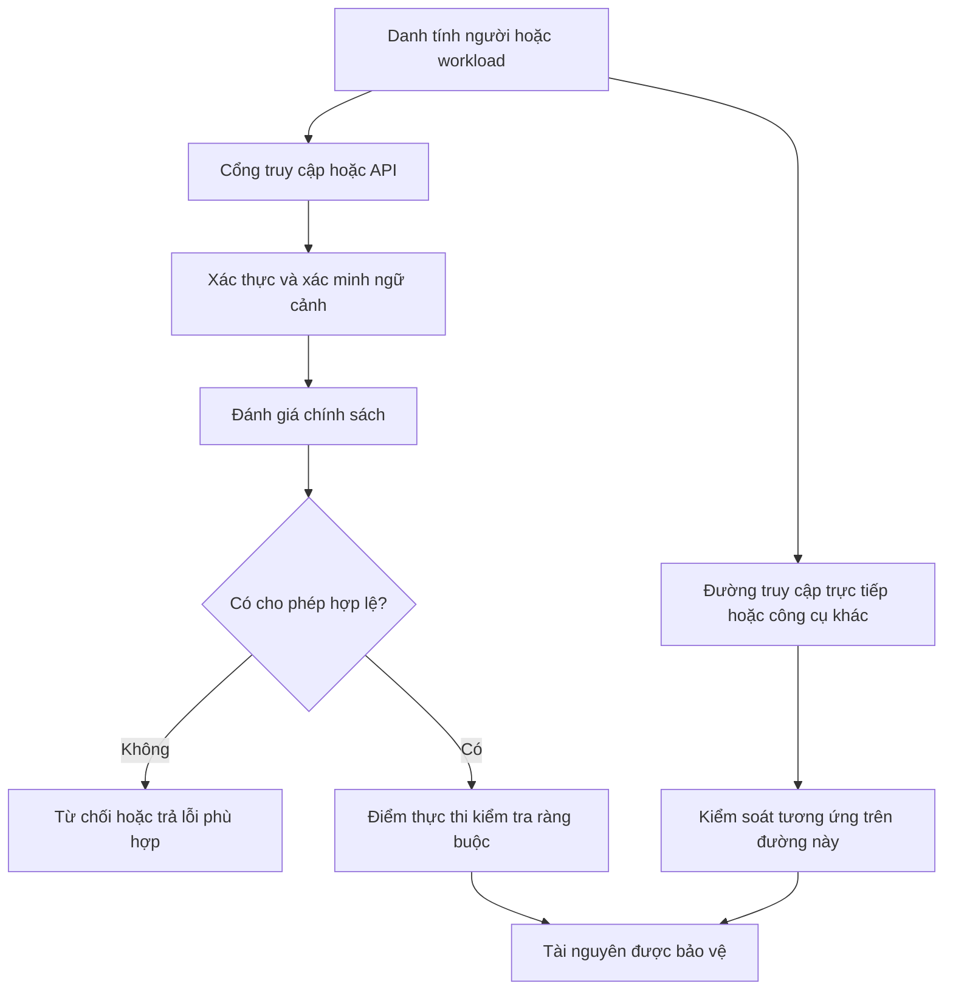

# Deny mặc định

## Mục tiêu bài học

Trong chương **Least privilege**, deny mặc định là nguyên tắc chỉ thực hiện một truy cập khi đã có cơ sở cho phép hợp lệ; những truy cập còn lại bị từ chối. Bài học thuộc module `SECURITY_IDENTITY_ACCESS_MANAGEMENT_PRIVILEGED_ACCESS_MANAGEMENT`, áp dụng cho tài khoản quản trị, dịch vụ và hạ tầng nhạy cảm.

Sau bài học, bạn có thể:

- Giải thích mặc định từ chối và mối liên hệ với quyền tối thiểu.
- Phân biệt deny mặc định, deny tường minh và xử lý fail-closed.
- Thiết kế điều kiện cho phép dựa trên danh tính, hành động, tài nguyên và ngữ cảnh.
- Nhận diện các đường bỏ qua kiểm soát, lỗi thiếu dữ liệu và vấn đề phiên/token còn hiệu lực.
- Xác định bằng chứng kiểm toán và các trường hợp cần kiểm chứng trong một luồng PAM.

## 1. Deny mặc định nghĩa là gì?

**Deny mặc định — default deny** nghĩa là truy cập không được thực hiện khi chưa có quyết định cho phép hợp lệ cho chính yêu cầu đó. Việc không tìm thấy lý do từ chối không được xem là lý do cho phép.

Ví dụ, kỹ sư được phép khởi động lại dịch vụ A trên một nhóm máy sản xuất. Quyền đó không tự mở rộng sang dịch vụ B, môi trường khác hoặc thao tác sửa chính sách. Khi có tài nguyên mới mà chính sách chưa xác định phạm vi, tài nguyên không nên tự trở thành đối tượng được quản trị chỉ vì nó vừa xuất hiện.

So sánh hai cách tư duy:

| Cách tiếp cận | Câu hỏi quyết định | Hệ quả khi xuất hiện thao tác mới |
|---|---|---|
| Cho phép mặc định, chặn ngoại lệ | Có quy tắc nào cấm thao tác này không? | Có thể được thực hiện nếu chưa kịp thêm quy tắc cấm |
| Từ chối mặc định, cho phép có điều kiện | Có quyết định hợp lệ cho phép đúng thao tác này không? | Không được thực hiện nếu chưa thuộc phạm vi cho phép |

Deny mặc định không có nghĩa là mọi công việc đều bị chặn hoặc mọi lần truy cập đều cần người duyệt thủ công. Những tác vụ đã được cho phép theo chính sách có thể được xử lý tự động, miễn là các điều kiện cấp quyền được kiểm tra đúng.

## 2. Quan hệ với least privilege

Least privilege xác định **cần cho phép những quyền nào để hoàn thành nhiệm vụ**. Deny mặc định xác định **cách xử lý những truy cập không nằm trong quyết định cho phép hợp lệ**.

Hai nguyên tắc bổ sung cho nhau:

- Nếu chỉ thu hẹp một vai trò nhưng còn một đường truy cập cho phép mặc định, quyền thừa có thể tồn tại ngoài vai trò đó.
- Nếu từ chối mặc định nhưng cấp một quyền quá rộng, chủ thể vẫn có thể thực hiện nhiều hành động không cần thiết.

Ví dụ, một chính sách chỉ có quy tắc cho phép quản trị tất cả tài nguyên không trở thành ít đặc quyền chỉ vì hệ thống gọi phần còn lại là mặc định từ chối. Cần đánh giá độ rộng của chính những quy tắc cho phép.

Mô hình mong muốn là xác định quyền theo nhiệm vụ, chỉ cho phép khi điều kiện phù hợp và từ chối những yêu cầu còn lại.

## 3. Phân biệt ba khái niệm quan trọng

| Khái niệm | Ý nghĩa | Ví dụ |
|---|---|---|
| Deny mặc định | Không có quyết định cho phép hợp lệ thì không truy cập | Không có quyền restart dịch vụ B nên yêu cầu không được thực hiện |
| Deny tường minh | Một quy tắc chủ động từ chối một phạm vi | Chính sách cấm một nhóm truy cập một loại dữ liệu trong điều kiện xác định |
| Fail-closed | Khi không thể quyết định an toàn do lỗi hoặc thiếu điều kiện cần, hệ thống không mở quyền vượt thiết kế | Dịch vụ quyết định quyền bị lỗi nên không tự cấp phiên quản trị mới |

Deny mặc định nói về cách xử lý yêu cầu không được cho phép. Fail-closed nói về hành vi khi cơ chế kiểm soát gặp lỗi hoặc không thể xác lập điều kiện cần. Một hệ thống có thể từ chối đúng các yêu cầu không có quyền nhưng lại mở quyền khi backend lỗi; khi đó nó chưa xử lý lỗi theo fail-closed.

### Không tự giả định thứ tự ưu tiên của quy tắc

Cách kết hợp allow và deny phụ thuộc công nghệ. Một số hệ thống có quy tắc deny ưu tiên, một số đánh giá theo thứ tự hoặc dùng thuật toán kết hợp khác.

Không nên thêm một quy tắc “deny tất cả” rồi giả định các allow cụ thể vẫn hoạt động. Nếu deny tường minh ưu tiên hơn allow trong hệ thống đó, cấu hình có thể khóa cả những truy cập hợp lệ.

Cần xác định rõ ngữ nghĩa chính sách: khi nào có quyết định cho phép cuối cùng, khi nào có từ chối và cách xử lý trường hợp không áp dụng hoặc không thể đánh giá. Deny mặc định là kết quả của mô hình phân quyền, không nhất thiết là một dòng cấu hình giống nhau trên mọi sản phẩm.

## 4. Định nghĩa yêu cầu cần được kiểm tra

Một yêu cầu quản trị nên được mô tả bằng dữ liệu đủ để quyết định:

| Thành phần | Câu hỏi cần trả lời | Ví dụ |
|---|---|---|
| Chủ thể | Danh tính nào thực hiện? | Kỹ sư cá nhân hoặc workload cụ thể |
| Hành động | Muốn làm gì? | Đọc trạng thái, lấy secret, restart dịch vụ |
| Tài nguyên | Tác động đối tượng nào? | Một dịch vụ, máy chủ hoặc secret đã định danh |
| Phạm vi dữ liệu | Có thể thấy hoặc thay đổi dữ liệu gì? | Log đã giới hạn hoặc phiên bản secret phù hợp |
| Ngữ cảnh | Điều kiện hiện tại có hợp lệ không? | Nguồn truy cập, xác thực, yêu cầu công việc |
| Thời gian | Quyền có đang hiệu lực không? | Cửa sổ JIT được cấp |
| Nguồn thẩm quyền | Quyền đến từ đâu? | Vai trò, chính sách, quyết định phê duyệt |

Thông tin phải đến từ nguồn đáng tin cậy. Không thể tin ngay một tham số `isAdmin=true`, tên nhóm do client gửi hoặc một nhãn tài nguyên mà chính người yêu cầu tùy ý sửa.

Xác thực và phân quyền cũng là hai bước khác nhau. Đăng nhập thành công chứng minh một điều về danh tính theo cơ chế xác thực, không tự chứng minh mọi hành động sau đó đều được phép.

## 5. Mô hình quyết định: chỉ thực hiện khi có cho phép hợp lệ

Mã giả dưới đây minh họa cách xử lý kết quả, không phải cú pháp của một sản phẩm:

```text
xử_lý(yêu_cầu):
    ngữ_cảnh = thu_thập_và_xác_minh_dữ_liệu_cần_thiết(yêu_cầu)

    nếu không thể xác minh dữ liệu bắt buộc:
        ghi nhận lỗi đánh giá theo chính sách
        không thực hiện thao tác được bảo vệ
        trả kết quả lỗi phù hợp

    quyết_định = đánh_giá_chính_sách_theo_thuật_toán_đã_xác_định(ngữ_cảnh)

    nếu quyết_định không phải CHO_PHÉP_HỢP_LỆ:
        ghi nhận lý do từ chối hoặc không thể quyết định
        không thực hiện thao tác được bảo vệ
        trả kết quả phù hợp

    kiểm tra phạm vi, thời hạn và ràng buộc của quyết định
    thực thi thao tác trong đúng phạm vi được cho phép
    ghi nhận kết quả
```

Ở bên trong, hệ thống có thể phân biệt các trạng thái như cho phép, từ chối, không có quy tắc áp dụng và không thể đánh giá. Những trạng thái này hữu ích cho vận hành và điều tra. Tại điểm thực thi, chỉ một quyết định cho phép hợp lệ mới mở đường cho thao tác được bảo vệ.

Lỗi không có quyền và lỗi dịch vụ phân quyền không nhất thiết phải trả cùng một loại thông báo. Cần giữ phân biệt để xử lý đúng, đồng thời tránh làm lộ thông tin tài nguyên nhạy cảm cho người không có quyền.

### Quyết định phải gắn đúng yêu cầu

Một quyết định cho phép restart dịch vụ A không được dùng để sửa dịch vụ B. Khi tái sử dụng quyết định hoặc kiểm tra qua bộ nhớ đệm, cần ràng buộc đúng chủ thể, hành động, tài nguyên, điều kiện và thời hạn.

Nếu thuộc tính quan trọng thay đổi giữa lúc kiểm tra và lúc thực thi, kết quả có thể không còn đúng. Cần thiết kế cơ chế phù hợp để hạn chế khoảng cách đó, chẳng hạn kiểm tra lại ở đích, ràng buộc phiên bản hoặc thực hiện trong một giao dịch khi công nghệ cho phép.

## 6. Thực thi ở mọi đường dẫn đến tài nguyên

Một giao diện không hiển thị nút quản trị không chứng minh thao tác đó bị cấm. Người dùng có thể truy cập qua API, công cụ dòng lệnh, giao thức khác hoặc credential đã biết.



Cần kiểm kê ít nhất các đường tương tác của con người, API, tác vụ nền, truy cập trực tiếp và đường khẩn cấp. Nếu yêu cầu chỉ được quản trị qua PAM, phải xử lý những đường có thể dùng credential để bỏ qua PAM.

Deny mặc định trong một lớp mạng không thay thế phân quyền ứng dụng. Cho phép kết nối đến cổng cơ sở dữ liệu không có nghĩa là được đọc mọi bảng. Ngược lại, ứng dụng phân quyền đúng cũng không loại bỏ yêu cầu bảo vệ đường quản trị hạ tầng bên dưới.

Cơ chế trung gian và hệ thống đích cần có trách nhiệm rõ ràng. Không nhất thiết mọi lớp đều sao chép cùng chính sách, nhưng không được để một đường thực tế trở thành đường cho phép mặc định ngoài thiết kế.

## 7. Ví dụ: kỹ sư vận hành một dịch vụ sản xuất

### Bối cảnh

Kỹ sư Mai được giao xử lý sự cố của `payment-api`. Nhiệm vụ chỉ cần xem trạng thái, đọc log chẩn đoán đã giới hạn và khởi động lại đúng dịch vụ trên các máy được duyệt.

### Phạm vi cho phép

```text
Chủ thể: danh tính quản trị cá nhân của Mai
Nhiệm vụ: yêu cầu xử lý sự cố hợp lệ
Tài nguyên: payment-api trên các máy đã định danh
Hành động:
  - xem trạng thái
  - đọc log trong phạm vi cho phép
  - khởi động lại dịch vụ
Điều kiện:
  - xác thực và nguồn truy cập phù hợp
  - phê duyệt theo chính sách
  - quyền JIT đang hiệu lực
Phần còn lại: không có cho phép từ nhiệm vụ này
```

Kết quả mong đợi:

| Yêu cầu | Kết quả theo thiết kế |
|---|---|
| Xem trạng thái payment-api trên máy đã duyệt | Được phép nếu các điều kiện đều hợp lệ |
| Khởi động lại dịch vụ khác | Bị từ chối |
| Dùng cùng vai trò vào môi trường ngoài phạm vi | Bị từ chối |
| Đọc secret hoặc xuất dữ liệu khách hàng | Không được phép từ quyền vận hành này |
| Sửa chính sách để tự thêm quyền | Bị từ chối nếu không có thẩm quyền riêng |
| Thực hiện sau khi cửa sổ cấp quyền kết thúc | Không còn được mở quyền theo quyết định đã hết hạn |

Cần kiểm tra cả quyền nhận từ nguồn khác. Nếu Mai vẫn có một vai trò quản trị toàn phần, quy tắc hẹp cho nhiệm vụ này không tự làm mất quyền rộng đó. Trong hệ thống kết hợp nhiều nguồn chính sách, phải đánh giá kết quả cuối cùng theo ngữ nghĩa thực tế.

## 8. Áp dụng cho vault và credential

Vault là nơi deny mặc định đặc biệt quan trọng. Một danh tính có thể được phép dùng một secret cho một tác vụ mà không được đọc mọi secret trong cùng kho.

Phạm vi cần xem xét gồm:

- Danh tính nào được lấy hoặc sử dụng credential.
- Secret, phiên bản hoặc chức năng nào thuộc quyền cho phép.
- Có được liệt kê tên, đọc metadata, thay giá trị hoặc thay quyền truy cập không.
- Điều kiện và thời hạn cấp phát.
- Khả năng sử dụng credential ngoài luồng được kiểm soát.

Quyền liệt kê hoặc đọc metadata cũng có thể tiết lộ thông tin nhạy cảm. Quyền quản trị chính sách vault có thể tạo đường tiếp cận secret dù người dùng hiện chưa có quyền đọc trực tiếp.

### Không cho phép dự phòng bằng secret dùng chung ngoài kiểm soát

Nếu vault lỗi, một ứng dụng không nên tự chuyển sang mật khẩu quản trị được ghi sẵn trong mã hoặc cấu hình như một cách xử lý chung. Điều đó biến lỗi của cơ chế bảo vệ thành đường mở quyền.

Khả năng tiếp tục vận hành phải được thiết kế rõ: credential còn hợp lệ đang được giữ theo chính sách, cơ chế dự phòng được kiểm soát hoặc quy trình phục hồi phù hợp. Một ngoại lệ không được thiết kế trước không nên phát sinh từ câu lệnh xử lý lỗi.

### Luân chuyển cần đi cùng phạm vi quyền

Luân chuyển credential giảm rủi ro từ giá trị cũ nhưng không tự thu hẹp quyền của tài khoản đích. Cần cập nhật các phụ thuộc, kiểm tra chức năng và vô hiệu hóa giá trị cũ theo công nghệ áp dụng.

Nếu một credential mới vẫn cho phép quản trị mọi hệ thống, deny mặc định tại vault chỉ kiểm soát ai lấy được credential đó. Nó chưa tạo ra quyền tối thiểu cho các hành động sau khi credential được sử dụng.

## 9. Áp dụng cho workload và tác vụ nền

Workload cần chính sách dựa trên danh tính và nhiệm vụ, thay vì được tin cậy chỉ vì chạy trong mạng nội bộ.

Ví dụ, pipeline triển khai `payment-api` vào staging có thể được phép cập nhật đúng ứng dụng và đọc trạng thái triển khai. Yêu cầu triển khai sản xuất, sửa vai trò hoặc lấy secret của ứng dụng khác phải được đánh giá riêng.

Một chuỗi kiểm soát có thể là:

1. Xác minh danh tính workload và điều kiện tin cậy của lần chạy.
2. Xác định ứng dụng, môi trường, hành động và phiên bản cần triển khai.
3. Chỉ cấp quyền hoặc credential phù hợp với phạm vi đó.
4. Hệ thống đích thực thi phân quyền cho từng hoạt động được bảo vệ.
5. Kết thúc quyền theo vòng đời, lưu mã lần chạy và kết quả.

Nếu không xác minh được nguồn workload hoặc điều kiện bắt buộc, không tự cấp một danh tính dùng chung có quyền rộng hơn.

Với hàng đợi hoặc workflow nhiều bước, quyết định cho phép gửi yêu cầu không tự chứng minh mọi thao tác xảy ra sau đó đều hợp lệ. Cần xác định dữ liệu ủy quyền được chuyển tiếp ra sao, ai có thể sửa nội dung tác vụ và thời điểm cần đánh giá lại trước khi thực hiện tác động.

Danh tính workload, người sửa pipeline và danh tính chạy tác vụ đều thuộc phạm vi kiểm kê đặc quyền. Một người có thể không có quyền triển khai trực tiếp nhưng vẫn điều khiển được workload triển khai qua quyền sửa cấu hình.

## 10. Khi dịch vụ phân quyền hoặc dữ liệu ngữ cảnh bị lỗi

Các trường hợp dễ dẫn tới mở quyền sai gồm timeout, không tải được chính sách, thiếu nhãn tài nguyên, không xác minh được trạng thái thiết bị hoặc lỗi đọc vai trò.

| Tình huống | Hành vi cần tránh | Hướng thiết kế |
|---|---|---|
| Không tải được chính sách | Cho phép vì danh sách cấm đang trống | Không cấp truy cập mới khi chưa có cơ sở cho phép hợp lệ |
| Thiếu thuộc tính tài nguyên | Coi tài nguyên là công khai hoặc thuộc mọi phạm vi | Xử lý thiếu dữ liệu theo chính sách, không tự mở rộng |
| Timeout khi kiểm tra quyền | Dùng quyền quản trị mặc định | Trả lỗi hoặc dùng cơ chế đã được thiết kế và giới hạn rõ |
| Không đọc được vai trò | Tin vai trò do client gửi | Lấy từ nguồn đáng tin cậy hoặc không thực hiện thao tác |
| Log tạm thời không ghi được | Âm thầm bỏ điều kiện kiểm toán bắt buộc | Áp dụng quy tắc xử lý lỗi log đã được xác định |

### Quyết định được lưu đệm

Lưu đệm có thể giảm độ trễ và hỗ trợ tính sẵn sàng. Một quyết định đã lưu chỉ nên dùng trong phạm vi, thời hạn và điều kiện mà thiết kế cho phép. Cần xác định phiên bản chính sách, thời gian hiệu lực và cách xử lý thay đổi hoặc thu hồi quyền.

Sử dụng một quyết định còn hợp lệ theo thiết kế khác với tự cho phép mọi yêu cầu khi backend lỗi. Nhưng quyết định lưu quá lâu hoặc không gắn đúng tài nguyên có thể trở thành nguồn quyền vượt nhu cầu.

### Khả năng quan sát gặp lỗi

Nếu yêu cầu phải có bằng chứng trước khi cấp phiên, không ghi được bằng chứng là một điều kiện cần được xử lý. Có thể dùng hàng đợi hoặc bộ đệm bền vững theo thiết kế; nếu vẫn không đáp ứng điều kiện bắt buộc, hệ thống phải làm theo chính sách đã xác định.

Không có một cách xử lý lỗi ghi log duy nhất phù hợp mọi dịch vụ. Điều quan trọng là yêu cầu kiểm toán, giới hạn dự phòng và hành vi khi hết khả năng dự phòng được quyết định rõ, không trở thành một nhánh mở quyền không được quản lý.

## 11. Phiên, token và quyền đã cấp trước đó

Deny mặc định ở thời điểm cấp quyền mới không tự chấm dứt khả năng truy cập đã tồn tại. Người dùng có thể đang giữ token, shell hoặc kết nối còn hiệu lực.

Cần phân biệt:

- Không cho phép tạo quyền hoặc phiên mới.
- Thu hồi vai trò hoặc điều kiện đủ nhận quyền.
- Xử lý phiên/token đã phát hành.
- Vô hiệu hóa hoặc luân chuyển credential đã bị tiết lộ.
- Kiểm tra những đường truy cập khác có thể đã được tạo.

Ví dụ, hết thời hạn JIT có thể chặn lần cấp tiếp theo nhưng phiên đích đang mở cần cơ chế xử lý riêng. Cách thức phụ thuộc nền tảng; không nên coi một sự kiện xóa vai trò là bằng chứng mọi khả năng thao tác đã kết thúc.

Trong ứng phó sự cố, cần đánh giá độ trễ thu hồi và phạm vi mà quyết định cũ còn hiệu lực. Credential ngắn hạn giảm cửa sổ rủi ro nhưng không loại bỏ nhu cầu kiểm soát trước khi hết hạn.

## 12. Ngoại lệ và break-glass

Deny mặc định cần một luồng cấp quyền khả dụng để công việc hợp lệ không bị đẩy sang đường ngoài kiểm soát. Yêu cầu mới nên có chủ sở hữu, phạm vi, lý do và quyết định rõ ràng.

Nếu phải có ngoại lệ, cần ghi nhận:

- Nhiệm vụ và lý do chính sách hiện tại chưa đáp ứng.
- Hành động, tài nguyên, dữ liệu và chủ thể được phép.
- Điều kiện kích hoạt, thời hạn và thẩm quyền quyết định.
- Cách giám sát, thu hồi và rà soát sau sử dụng.

Break-glass là đường truy cập khẩn cấp được chuẩn bị cho kịch bản phù hợp, không phải nhánh “lỗi thì allow”. Danh tính, phương tiện xác thực, quyền và đường kết nối phải tránh phụ thuộc vòng vào thành phần đang cần phục hồi.

Nếu đường khẩn cấp cần quyền rộng, phải thừa nhận mức rủi ro đó, bảo quản credential phù hợp, cảnh báo sử dụng và xử lý sau sự kiện. Khi trở lại vận hành bình thường, ngoại lệ và thay đổi tạm thời cần được giải quyết rõ ràng.

## 13. Triển khai deny mặc định trên hệ thống đang vận hành

Chuyển một hệ thống vốn cho phép rộng sang deny mặc định có thể làm lộ ra các phụ thuộc chưa được biết. Cần triển khai có kế hoạch thay vì thêm một quy tắc chặn toàn bộ rồi xử lý gián đoạn theo phản xạ.

Một trình tự thực tế:

1. Kiểm kê các chủ thể, tài nguyên, giao thức và đường truy cập.
2. Xác nhận nhiệm vụ hợp lệ với chủ sở hữu và ánh xạ quyền cần thiết.
3. Thu thập dữ liệu hoạt động đại diện, bao gồm tác vụ nền và phục hồi hiếm gặp.
4. Thiết kế các quyết định cho phép cùng cơ chế kết hợp chính sách đúng công nghệ.
5. Kiểm chứng trong môi trường phù hợp và áp dụng theo phạm vi có thể kiểm soát.
6. Theo dõi cả lỗi công việc hợp lệ lẫn các yêu cầu ngoài phạm vi bị chặn.
7. Loại quyền rộng cũ và đường truy cập bỏ qua sau khi xác nhận luồng mới hoạt động.
8. Rà soát ngoại lệ, quyền thừa và dữ liệu kiểm toán.

Chế độ chỉ quan sát có thể hỗ trợ phát hiện yêu cầu sẽ bị chặn, nhưng khi chưa thực thi từ chối thì chưa tạo ranh giới deny mặc định cho phạm vi đó. Cần phân biệt rõ dữ liệu mô phỏng với kết quả kiểm soát đang có hiệu lực.

Phương án khôi phục sau thay đổi phải có phạm vi và thời hạn. Không giữ vô thời hạn một tài khoản toàn quyền hoặc một quy tắc allow rộng như cơ chế dự phòng không có chủ sở hữu.

## 14. Kiểm chứng các trường hợp được phép và bị từ chối

Một ma trận minh họa:

| Trường hợp | Kết quả cần xác minh |
|---|---|
| Danh tính hợp lệ, hành động/tài nguyên đúng phạm vi, điều kiện đầy đủ | Thao tác hợp lệ thực hiện được |
| Danh tính đã xác thực nhưng chưa có quyền | Thao tác không được thực hiện |
| Đúng vai trò nhưng sai tài nguyên hoặc môi trường | Bị từ chối theo phạm vi |
| Thiếu thuộc tính bắt buộc hoặc nguồn dữ liệu không đáng tin cậy | Không tự mở quyền |
| Hành động mới chưa có quy tắc cho phép | Không được phép mặc định |
| Tài nguyên mới chưa thuộc phạm vi được duyệt | Không tự nhận quyền rộng |
| Gọi API hoặc đường trực tiếp để bỏ qua giao diện | Được kiểm soát theo thiết kế |
| Backend phân quyền lỗi | Không phát sinh quyền vượt cơ chế dự phòng đã xác định |
| Dùng quyết định lưu đệm quá hạn hoặc sai tài nguyên | Không được chấp nhận |
| Tiếp tục thao tác sau thu hồi | Được xử lý theo yêu cầu về phiên/token và cơ chế đích |

Kiểm tra phải nằm trong phạm vi được phép. Ưu tiên thao tác an toàn hoặc tài nguyên thử nghiệm phù hợp; không gây tác động phá hủy chỉ để chứng minh một hành động bị chặn.

Cần quan sát điểm thực thi và trạng thái tài nguyên, không chỉ thông báo giao diện. Một nút báo lỗi trong khi tác động đã xảy ra phía sau không phải là bằng chứng từ chối thành công.

## 15. Bằng chứng kiểm toán và giám sát

Một sự kiện quyết định nên đủ để giải thích ai muốn làm gì, chính sách nào được áp dụng và kết quả thực thi ra sao.

```text
Mã yêu cầu hoặc công việc
    -> danh tính và nguồn ngữ cảnh đáng tin cậy
    -> hành động cùng tài nguyên đích
    -> chính sách/phiên bản và kết quả đánh giá
    -> lý do cho phép, từ chối hoặc lỗi
    -> mã phiên hoặc mã lần chạy nếu có
    -> kết quả thực tế tại tài nguyên
    -> thu hồi và xử lý quyền sau sử dụng
```

Không đưa secret thật vào sự kiện. Lý do từ chối có thể cần chi tiết cho người vận hành, nhưng dữ liệu trả về cho người yêu cầu phải phù hợp quyền của họ.

Nhật ký từ chối có thể tăng rất nhanh khi có lỗi cấu hình hoặc yêu cầu bất thường. Cần quản lý dung lượng, giới hạn phù hợp và bảo vệ hệ thống ghi nhận, đồng thời tránh làm mất dữ liệu quan trọng cho điều tra.

Các chỉ số hữu ích gồm phạm vi đường truy cập đã áp dụng kiểm soát, tỷ lệ công việc hợp lệ thành công, số ngoại lệ quá hạn, trường hợp lỗi làm mở quyền và chất lượng bằng chứng thu hồi. Số lần từ chối cao không tự chứng minh kiểm soát tốt; nó có thể phản ánh một chính sách gây cản trở công việc hợp lệ.

## 16. Bài tập tình huống

### Đề bài

Một cổng PAM chỉ cho phép nhóm vận hành restart `payment-api`. Tuy nhiên:

- Khi dịch vụ phân quyền timeout, cổng cho phép để tránh gián đoạn.
- Kỹ sư có thể lấy mật khẩu tài khoản đích từ vault và kết nối trực tiếp.
- Khi JIT hết hạn, vai trò được xóa nhưng phiên trên máy chủ vẫn mở.
- Một API mới chưa có cấu hình quyền nên mặc định cho người đã đăng nhập sử dụng.

Hãy xác định:

1. Những điểm nào vi phạm hoặc làm suy yếu deny mặc định?
2. Cần tách lỗi quyết định quyền khỏi từ chối truy cập như thế nào?
3. Phải kiểm soát thêm các đường nào ngoài cổng PAM?
4. Cần bằng chứng gì để xác nhận quyền đã kết thúc?

### Gợi ý phân tích

Nhánh timeout đang mở quyền khi không có quyết định hợp lệ. API mới đang coi xác thực thành công là đủ để truy cập. Cả hai cần cơ chế quyết định và xử lý lỗi rõ ràng, trong đó thao tác được bảo vệ chỉ thực hiện khi có cơ sở cho phép phù hợp.

Vault và truy cập trực tiếp tạo một đường khác cần được kiểm soát. Phải xác định ai được lấy credential, tài khoản đích có quyền gì và đường mạng/giao thức nào có thể bỏ qua các ràng buộc tại cổng.

Xóa vai trò JIT chưa giải quyết phiên đang tồn tại. Cần kiểm tra ngữ cảnh quyền tại đích, cơ chế kết thúc phiên/token và hành vi sau thu hồi. Bằng chứng phải nối quyết định cấp, hoạt động, thời điểm thu hồi và kết quả xử lý thực tế.

Lỗi hạ tầng và thiếu quyền nên được phân biệt trong dữ liệu vận hành để sửa đúng nguyên nhân. Tuy nhiên, cả hai đều không tạo ra lý do tự động cho phép một thao tác chưa được xác lập quyền.

## 17. Kiến thức cần ghi nhớ

Deny mặc định yêu cầu có quyết định cho phép hợp lệ trước khi thực hiện truy cập được bảo vệ. Nguyên tắc này phải áp dụng trên các đường truy cập thực tế, với danh tính và ngữ cảnh đáng tin cậy, thay vì chỉ xuất hiện trên giao diện hoặc một lớp trung gian.

Least privilege thu hẹp những gì được cho phép; JIT/JEA, vault, luân chuyển credential và giám sát hỗ trợ kiểm soát vòng đời. Cần đặc biệt chú ý xử lý lỗi, quyền từ nguồn khác, quyết định lưu đệm và phiên/token đã tồn tại. Ngoại lệ khẩn cấp phải được thiết kế, theo dõi và kết thúc có bằng chứng.
