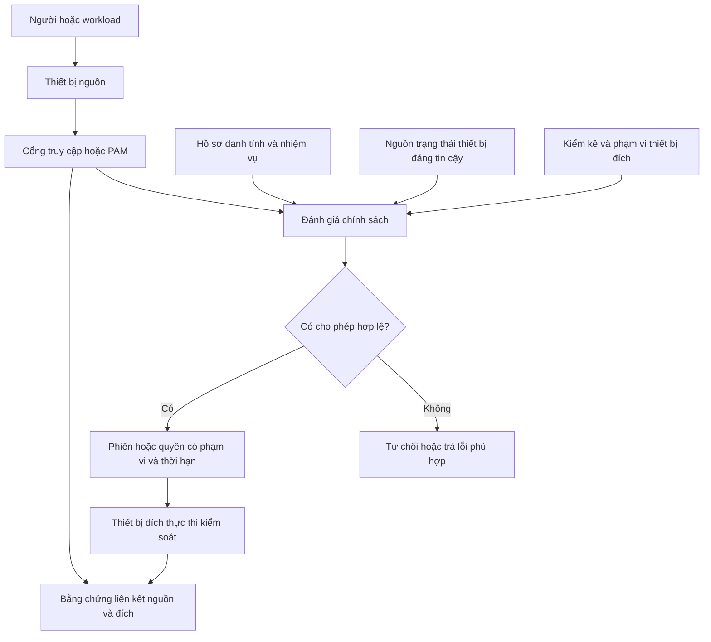

# Permission theo thiết bị

## Mục tiêu bài học

Trong chương **Least privilege**, permission theo thiết bị là cách giới hạn quyền dựa trên những thiết bị được phép quản trị và những thiết bị được chấp nhận làm nguồn truy cập. Bài học thuộc module `SECURITY_IDENTITY_ACCESS_MANAGEMENT_PRIVILEGED_ACCESS_MANAGEMENT`, áp dụng cho tài khoản quản trị, tài khoản dịch vụ và hạ tầng nhạy cảm.

Sau bài học, bạn có thể:

- Phân biệt thiết bị nguồn với thiết bị đích trong một quyết định cấp quyền.
- Ánh xạ nhiệm vụ thành quyền trên từng thiết bị hoặc nhóm thiết bị có phạm vi rõ ràng.
- Giải thích khác biệt giữa định danh thiết bị, trạng thái bảo vệ và quyền của người sử dụng.
- Phối hợp chính sách theo thiết bị với JIT/JEA, vault, luân chuyển credential và giám sát phiên.
- Xử lý vòng đời thiết bị, mất tin cậy và bằng chứng kiểm toán mà không biến một thiết bị được quản lý thành lý do cấp quyền quá rộng.

## 1. Hai chiều của permission theo thiết bị

Một yêu cầu quản trị luôn có câu hỏi “được quản trị thiết bị nào?”. Trong nhiều hệ thống, còn có câu hỏi “được truy cập từ thiết bị nào?”. Hai chiều này cần được phân biệt.

| Chiều kiểm soát | Câu hỏi | Ví dụ |
|---|---|---|
| Thiết bị đích | Chủ thể được làm gì trên những thiết bị nào? | Chỉ khởi động lại dịch vụ A trên hai máy chủ thuộc phạm vi phụ trách |
| Thiết bị nguồn | Thiết bị dùng để yêu cầu hoặc thực hiện truy cập có đáp ứng điều kiện không? | Chỉ mở phiên quản trị sản xuất từ môi trường quản trị được chấp thuận |

Thiết bị đích có thể là máy chủ, máy trạm, máy ảo, thiết bị mạng hoặc một tài nguyên tính toán có định danh trong hạ tầng. Thiết bị nguồn có thể là máy trạm quản trị, máy dùng để hỗ trợ từ xa hoặc máy thực thi tác vụ tự động.

**Permission theo thiết bị không phải là cấp mọi quyền cho một người chỉ vì người đó sử dụng thiết bị của công ty.** Thiết bị phù hợp là một điều kiện của truy cập, còn danh tính, nhiệm vụ, hành động, tài nguyên và thời hạn vẫn cần được xác định.

Ví dụ, cùng một máy trạm quản trị, kỹ sư vận hành ứng dụng chỉ được xử lý nhóm máy ứng dụng được giao; người quản trị danh tính có thể có phạm vi khác. Việc dùng chung loại máy không tạo ra quyền giống nhau.

## 2. Mô tả một yêu cầu truy cập đầy đủ

Một yêu cầu theo thiết bị nên liên kết các dữ kiện sau:

```text
Ai hoặc workload nào yêu cầu?
    -> Từ thiết bị nguồn nào?
    -> Thiết bị nguồn có đáp ứng điều kiện cần không?
    -> Muốn thực hiện hành động gì?
    -> Trên thiết bị đích nào?
    -> Theo nhiệm vụ và quyết định cấp quyền nào?
    -> Trong thời hạn nào?
```

Ví dụ:

```text
Chủ thể: kỹ sư trực ca của dịch vụ inventory-api
Nguồn: máy trạm quản trị đã định danh và được chấp thuận
Đích: hai máy chủ sản xuất thuộc phạm vi inventory-api
Hành động: xem trạng thái, đọc log đã giới hạn, khởi động lại dịch vụ
Nhiệm vụ: yêu cầu xử lý sự cố hợp lệ
Thời hạn: cửa sổ quyền được cấp theo chính sách
Bằng chứng: danh tính, nguồn, đích, quyết định, mã phiên và kết quả
```

Một quyết định cho phép cần ràng buộc các dữ kiện quan trọng với nhau. Không nên lấy một kết quả “thiết bị tốt” rồi áp vào mọi người dùng, mọi hành động hoặc mọi tài nguyên.

## 3. Giới hạn quyền trên thiết bị đích

### 3.1. Bắt đầu từ nhiệm vụ

Nhiệm vụ “kiểm tra dịch vụ A” không đồng nghĩa với quản trị toàn bộ máy đang chạy dịch vụ. Cần phân tích hành động và dữ liệu thực sự cần dùng.

| Nhiệm vụ | Quyền cần xem xét | Phạm vi thiết bị đích |
|---|---|---|
| Xem sức khỏe dịch vụ | Đọc trạng thái và chỉ số liên quan | Máy hoặc nhóm máy chạy đúng dịch vụ |
| Khởi động lại dịch vụ | Thực hiện thao tác restart được giới hạn | Những máy đã được chủ sở hữu xác nhận |
| Cập nhật cấu hình mạng | Sửa phần cấu hình thuộc nhiệm vụ | Thiết bị hoặc miền cấu hình được giao |
| Hỗ trợ máy trạm người dùng | Tác vụ hỗ trợ theo quy trình | Máy đang được phân công xử lý |
| Triển khai ứng dụng | Cập nhật đúng ứng dụng, kiểm tra kết quả | Đúng môi trường và nhóm tài nguyên |

Một tài khoản được quyền trên một máy không nên mặc nhiên được quyền trên mọi máy cùng hệ điều hành, cùng mạng hoặc có tên gần giống nhau.

### 3.2. Thiết bị chỉ là một chiều phạm vi

Ngay cả khi giới hạn đúng máy, quyền vẫn có thể quá rộng. Ví dụ, quyền quản trị hệ điều hành trên một máy chủ cơ sở dữ liệu có thể tác động đến nhiều ứng dụng và dữ liệu hơn nhiệm vụ hỗ trợ một dịch vụ.

Cần phối hợp giới hạn thiết bị với giới hạn hành động, dịch vụ, dữ liệu và thời hạn. Nếu nền tảng chỉ cung cấp quyền quá rộng, có thể xem xét vai trò chuyên biệt, giao diện tác vụ hoặc workflow quản trị phù hợp.

### 3.3. Kiểm tra quyền gián tiếp

Quyền khởi động lại một dịch vụ không còn hẹp như dự kiến nếu người dùng còn sửa được tệp thực thi hoặc cấu hình làm thay đổi hành vi của dịch vụ. Quyền trên một thiết bị quản lý cũng có thể tạo khả năng tác động đến nhiều thiết bị khác.

Phạm vi phải được đánh giá theo khả năng thực tế, gồm tài nguyên được điều khiển gián tiếp, credential có thể đọc và công cụ chạy với quyền cao.

## 4. Định danh thiết bị: không chỉ nhìn hostname hoặc địa chỉ IP

Một tên máy hoặc địa chỉ mạng có thể đổi, được tái sử dụng hoặc không đủ để chứng minh thiết bị đang kết nối là thiết bị được quản lý. MAC, hostname và địa chỉ IP có ích cho vận hành nhưng không nên được coi riêng lẻ là bằng chứng mạnh về danh tính thiết bị.

Các dữ liệu có thể cần liên kết gồm:

| Dữ liệu | Giá trị | Điều cần kiểm tra |
|---|---|---|
| Mã tài sản hoặc mã thiết bị quản lý | Liên kết thiết bị với hồ sơ sở hữu | Có bị tái sử dụng hoặc sửa ngoài kiểm soát không? |
| Định danh tài nguyên trên nền tảng | Xác định một máy ảo hoặc tài nguyên cụ thể | Có đúng môi trường và vòng đời hiện tại không? |
| Chứng thư hoặc khóa của thiết bị | Hỗ trợ chứng minh quyền sử dụng danh tính thiết bị | Ai cấp, khóa được bảo vệ thế nào, thu hồi ra sao? |
| Hostname, IP, vị trí mạng | Hỗ trợ định tuyến và điều tra | Có đổi hoặc trùng theo thời gian không? |
| Chủ sở hữu và vai trò thiết bị | Giải thích mục đích sử dụng | Dữ liệu có được xác nhận và cập nhật không? |

Chứng thư thiết bị có thể chứng minh một phía đang sử dụng khóa tương ứng theo giao thức được triển khai. Nó không tự chứng minh máy đã được vá, không có phần mềm độc hại hoặc người đang thao tác có quyền quản trị.

Nếu thiết bị được cài lại hoặc thay thế, cần xác định đây là cùng tài sản trong vòng đời mới hay một thiết bị khác. Máy mới có cùng hostname không nên tự nhận mọi đặc quyền chỉ dựa trên tên cũ.

## 5. Nhóm thiết bị và rủi ro mở rộng phạm vi âm thầm

Quản lý từng thiết bị riêng lẻ có thể khó khi số lượng lớn. Có thể cấp quyền cho nhóm thiết bị theo ứng dụng, môi trường hoặc trách nhiệm vận hành, nhưng phải bảo vệ điều kiện xác định thành viên nhóm.

Ví dụ nhóm đích:

```text
Nhóm quản trị: inventory-api-prod
Điều kiện phạm vi:
  - thuộc môi trường sản xuất đã định danh
  - phục vụ inventory-api
  - chủ sở hữu xác nhận là tài nguyên do nhóm vận hành quản lý
  - được đưa vào nhóm qua quy trình kiểm soát
Quyền: những thao tác vận hành đã xác định
```

Cần làm rõ những điểm sau:

- Ai được thêm thiết bị hoặc thay nhãn quyết định thành viên nhóm?
- Thiết bị mới có tự vào phạm vi hay cần xác nhận?
- Thiết bị thiếu nhãn hoặc dữ liệu mâu thuẫn được xử lý thế nào?
- Khi đổi chủ sở hữu hoặc chuyển môi trường, quyền cũ có được rút không?
- Người sử dụng quyền có thể tự mở rộng tập đích không?

Một điều kiện như “mọi máy có nhãn ứng dụng A” có thể hữu ích, nhưng nếu chính người nhận quyền được tùy ý đổi nhãn của mọi máy thì ranh giới trở nên yếu.

Tài nguyên chưa được phân loại không nên tự trở thành tài nguyên được quản trị rộng. Hãy xác định cách từ chối hoặc đưa vào luồng xử lý phù hợp khi thiếu dữ liệu bắt buộc.

## 6. Điều kiện đối với thiết bị nguồn

Thiết bị nguồn là nơi có thể xuất hiện credential, token, dữ liệu quản trị hoặc thao tác điều khiển phiên. Vì vậy, quyền đặc quyền cần xem xét độ tin cậy của môi trường nguồn.

Các tín hiệu có thể gồm:

- Thiết bị đã được đăng ký và quản lý theo chính sách.
- Cấu hình bảo vệ phù hợp với nhiệm vụ.
- Trạng thái cập nhật, mã hóa lưu trữ và cơ chế bảo vệ đầu cuối theo yêu cầu.
- Tình trạng khóa, mất, thu hồi hoặc có dấu hiệu rủi ro.
- Mức mới của thông tin đánh giá.
- Mục đích thiết bị: máy làm việc thường ngày hay môi trường chuyên quản trị.

Không phải mọi tín hiệu đều có sẵn hoặc đáng tin ngang nhau. Chính sách phải xác định nguồn dữ liệu, yêu cầu tối thiểu và cách xử lý trường hợp không thể đánh giá.

### Đã đăng ký không có nghĩa luôn an toàn

Việc thiết bị thuộc hệ thống quản lý chỉ là một dữ kiện. Máy có thể bị mất, bị chiếm hoặc không còn gửi trạng thái mới. Một nhãn “compliant” quá cũ không đủ để kết luận trạng thái hiện tại.

Tương tự, thông tin do trình duyệt hoặc client tự khai không nên được tin như dữ liệu đã được hệ thống có thẩm quyền xác minh. Cần kiểm tra nguồn phát hành, tính toàn vẹn, thời hạn và liên kết với phiên yêu cầu khi cơ chế hỗ trợ.

### Thiết bị tốt không thay thế danh tính người dùng

Trên một máy dùng chung, nhiều người có thể thao tác. Quyền cần gắn với danh tính người thực hiện hoặc workload cụ thể, không chỉ máy. Một máy trạm quản trị bị bỏ mở cũng không nên trở thành lý do bỏ qua kiểm soát xác thực và thời hạn phiên.

## 7. Phối hợp nguồn, đích và quyền theo nhiệm vụ

Một ma trận minh họa giúp tránh gộp mọi trường hợp vào một điều kiện “thiết bị công ty”:

| Thiết bị nguồn | Chủ thể/nhiệm vụ | Thiết bị đích | Kết quả thiết kế minh họa |
|---|---|---|---|
| Máy trạm quản trị được chấp thuận | Kỹ sư có quyền xử lý inventory-api | Nhóm máy inventory-api đã duyệt | Có thể cấp quyền đủ dùng khi các điều kiện khác hợp lệ |
| Cùng máy trạm quản trị | Kỹ sư chưa có nhiệm vụ trên tầng danh tính | Máy chủ danh tính | Không tự được phép vì nguồn tốt |
| Máy làm việc thông thường | Yêu cầu quản trị sản xuất | Máy chủ sản xuất | Chuyển sang luồng/môi trường phù hợp nếu chính sách không chấp nhận nguồn này |
| Thiết bị cá nhân chưa được đánh giá | Yêu cầu đặc quyền | Tài nguyên nhạy cảm | Không tự mở quyền; xử lý theo chính sách được xác định |
| Máy có tín hiệu rủi ro | Người vốn đủ điều kiện nhận quyền | Đích trong phạm vi | Không coi quyền trước đây là đủ để bỏ qua trạng thái rủi ro |
| Runner tự động đã định danh | Pipeline triển khai staging | Đúng ứng dụng staging | Đánh giá danh tính workload và phạm vi của lần chạy |

Ma trận là ví dụ thiết kế, không phải quy định bắt buộc cho mọi tổ chức. Điều quan trọng là mỗi ô có cơ sở từ nhiệm vụ, mức rủi ro và khả năng thực thi.

## 8. Mô hình chính sách minh họa

Đây là mô tả logic, không phải cú pháp cấu hình của một sản phẩm:

```text
CHO PHÉP yêu cầu vận hành khi:
  danh tính người/workload đã được xác minh
  VÀ có nhiệm vụ và quyền phù hợp
  VÀ hành động thuộc tập thao tác được phép
  VÀ thiết bị đích thuộc phạm vi đã được chủ sở hữu xác nhận
  VÀ thiết bị nguồn được định danh theo cơ chế đáng tin cậy
  VÀ điều kiện bảo vệ bắt buộc của nguồn được đáp ứng
  VÀ dữ liệu đánh giá còn đủ mới theo chính sách
  VÀ xác thực, phê duyệt và thời hạn cấp quyền đều hợp lệ

NẾU THIẾU CƠ SỞ CHO PHÉP:
  không thực hiện thao tác được bảo vệ
  ghi nhận từ chối hoặc lỗi đánh giá phù hợp

KHI KẾT THÚC:
  xử lý quyền, phiên/token và credential theo thiết kế
  lưu bằng chứng liên kết người, nguồn, đích và hành động
```

Trong hệ thống thực, cần đánh giá cả những nguồn quyền khác: nhóm, vai trò, chính sách tài nguyên và credential có thể sử dụng. Một điều kiện thiết bị ở một cổng không tự làm mất quyền truy cập trực tiếp nhận từ nơi khác.

Không nên tự giả định quy tắc deny và allow kết hợp theo cùng thứ tự trên mọi nền tảng. Cần xác định ngữ nghĩa chính sách và kiểm chứng kết quả cuối cùng.

## 9. Kiến trúc thực thi và giữ ngữ cảnh qua trung gian



Nếu kết nối đi qua bastion hoặc proxy, hệ thống đích có thể chỉ nhìn thấy máy trung gian. Không nên coi điều đó là bằng chứng rằng thiết bị nguồn ban đầu đáp ứng điều kiện.

Cần xác định nơi đánh giá nguồn và cách bảo vệ ngữ cảnh khi truyền qua trung gian. Dữ liệu về người dùng, thiết bị và quyết định phải được xác minh phù hợp; một header hoặc tham số do client tự đặt không đủ làm bằng chứng.

Đối với đường truy cập trực tiếp, phải có kiểm soát tương ứng hoặc chặn đường đó theo thiết kế. Nếu người dùng lấy được credential đích rồi kết nối ngoài PAM, điều kiện thiết bị tại PAM có thể bị bỏ qua.

## 10. Phiên quản trị, token và thay đổi trạng thái thiết bị

Kiểm tra nguồn lúc đăng nhập chỉ cho biết điều kiện tại thời điểm đó. Phiên có thể kéo dài trong khi máy mất liên lạc, bị đánh dấu rủi ro hoặc quyền người dùng thay đổi.

Cần xác định:

- Khi nào phải đánh giá lại trạng thái nguồn?
- Hành động nhạy cảm nào cần kiểm tra bổ sung?
- Kết quả đánh giá được giữ trong bao lâu?
- Mất dữ liệu trạng thái thì phiên hiện tại xử lý ra sao?
- Khi thiết bị bị thu hồi, hệ thống nào có thể chặn phiên hoặc token?

Không nên hứa rằng mọi thay đổi đều có tác dụng tức thời nếu hạ tầng không hỗ trợ. Cần ghi nhận độ trễ, thời hạn token và khả năng ngắt phiên theo hệ thống thực tế.

### Token không tự gắn với thiết bị chỉ vì được cấp trên thiết bị đó

Một token hoặc cookie có thể bị sao chép tùy cơ chế bảo vệ. Việc yêu cầu thiết bị phù hợp khi phát hành không tự chứng minh token sẽ không được dùng từ nơi khác.

Cần đánh giá cơ chế bảo vệ token, liên kết với phiên hoặc thiết bị nếu nền tảng hỗ trợ, phạm vi tài nguyên và thời hạn. Cơ chế dùng khóa thiết bị hoặc chứng thư cần được triển khai và kiểm tra theo đúng khả năng công nghệ, không suy từ tên tính năng.

### Môi trường từ xa vẫn có phụ thuộc vào nguồn

Máy trạm ảo hoặc phiên quản trị từ xa có thể giúp tách môi trường làm việc, nhưng thiết bị nguồn vẫn có thể ảnh hưởng đến đầu vào, màn hình hoặc dữ liệu chuyển qua phiên. Cần đánh giá clipboard, truyền tệp, thiết bị ngoại vi và quyền quản lý máy chủ môi trường đó.

## 11. Vault, credential và quyền theo từng thiết bị

Một lỗi phổ biến là giới hạn quyền trên giao diện nhưng dùng cùng credential quản trị cho cả một tập máy. Nếu credential bị lộ ở một nơi và được chấp nhận ở nơi khác, phạm vi ảnh hưởng có thể vượt thiết bị đang được xử lý.

Khi công nghệ cho phép, nên quản lý credential theo ranh giới thiết bị hoặc mục đích phù hợp, có chủ sở hữu và cơ chế luân chuyển. Người xử lý một máy không mặc nhiên cần lấy secret của mọi máy trong cùng kho.

Vault cần kiểm soát cả:

- Ai được lấy hoặc sử dụng credential.
- Credential thuộc thiết bị và mục đích nào.
- Có được đọc trực tiếp hay chỉ dùng qua môi giới.
- Thời hạn, phê duyệt và nguồn truy cập.
- Quyền thay secret, thay chính sách hoặc đọc phiên bản cũ.

Luân chuyển cần kiểm tra các phụ thuộc như dịch vụ, tác vụ hoặc công cụ quản lý đang dùng credential. Sau thay đổi, cần xác nhận chức năng và khả năng sử dụng giá trị cũ theo thiết kế. Thao tác này không tự chấm dứt mọi phiên/token đã được tạo trước đó.

Tài khoản domain hoặc tài khoản quản trị nền tảng có thể tác động tới nhiều thiết bị. Việc mở phiên vào một máy không làm quyền nền của tài khoản tự thu hẹp về máy đó. Cần giới hạn tại cơ chế phân quyền thực tế, không chỉ trong danh sách đích trên giao diện.

## 12. Tài khoản dịch vụ và máy thực thi tự động

Với workload, cần phân biệt **danh tính của tác vụ** và **thiết bị đang chạy tác vụ**. Một runner được quản lý có thể thực thi nhiều pipeline với quyền khác nhau; việc chạy trên runner đó không đủ làm căn cứ cho mọi đặc quyền.

Ví dụ pipeline triển khai staging:

| Thành phần | Phạm vi cần xác định |
|---|---|
| Danh tính workload | Luồng triển khai cụ thể và điều kiện tin cậy của lần chạy |
| Nguồn thực thi | Runner hoặc môi trường được chấp thuận |
| Thiết bị/tài nguyên đích | Các tài nguyên staging của ứng dụng được giao |
| Hành động | Triển khai, kiểm tra và phục hồi trong phạm vi đã xác nhận |
| Credential | Cấp ngắn hạn nếu phù hợp, hoặc quản lý secret tĩnh có phối hợp |
| Bằng chứng | Mã lần chạy, danh tính, nguồn, artifact, đích và kết quả |

Cần kiểm tra ai có thể sửa pipeline, cấu hình runner, danh tính thực thi và nhóm thiết bị đích. Một người quản trị các thành phần đó có thể tạo đường tác động mà không có quyền triển khai trực tiếp.

Với hạ tầng tự tạo và hủy máy thường xuyên, không nên giữ quyền hoặc credential của máy đã kết thúc vòng đời. Việc đưa máy mới vào phạm vi cần dựa trên nguồn cấp tài nguyên và dữ liệu tin cậy, không chỉ tên được tái sử dụng.

## 13. Vòng đời thiết bị và sự kiện mất tin cậy

Một chính sách theo thiết bị cần bao phủ từ đăng ký đến loại bỏ:

| Giai đoạn | Kiểm soát cần xem xét |
|---|---|
| Đưa vào sử dụng | Định danh, chủ sở hữu, mục đích, cấu hình và nguồn xác minh |
| Cấp phạm vi | Xác nhận nhóm nguồn/đích và quyền theo nhiệm vụ |
| Vận hành | Cập nhật trạng thái, giám sát, rà soát quyền và credential |
| Đổi mục đích hoặc chủ sở hữu | Đánh giá lại nhóm, vai trò và đường truy cập |
| Mất hoặc nghi bị chiếm | Ngăn quyền mới, xử lý phiên/token/credential và điều tra |
| Cài lại hoặc thay thế | Xác nhận định danh và phương tiện tin cậy của vòng đời mới |
| Ngừng sử dụng | Thu hồi phương tiện xác thực, quyền, secret và hồ sơ liên quan theo chính sách |

Nếu máy trạm quản trị bị mất, cần xác định danh tính, token và credential có thể đã hiện diện trên máy. Thu hồi chứng thư thiết bị hoặc khóa hồ sơ quản lý có thể là một phần xử lý, nhưng không tự bảo đảm mọi dịch vụ đã kết thúc phiên.

Khả năng khóa hoặc xóa từ xa cũng phụ thuộc việc thiết bị còn kết nối và cơ chế quản lý còn hoạt động. Không nên lấy một lệnh đã gửi làm bằng chứng duy nhất rằng dữ liệu hoặc khả năng truy cập đã bị loại bỏ.

Khi một thiết bị đích đổi chủ sở hữu hoặc vai trò, quyền của nhóm vận hành cũ cần được rà soát. Tài khoản, credential và chính sách còn sót có thể giữ lại đường truy cập ngoài nhu cầu mới.

## 14. Mất dữ liệu trạng thái và truy cập khẩn cấp

Hệ thống quản lý thiết bị hoặc dịch vụ đánh giá có thể bị gián đoạn. Thiếu dữ liệu không nên tự biến thành trạng thái tin cậy.

Thiết kế cần xác định thời hạn tối đa chấp nhận dữ liệu cũ, phạm vi được tiếp tục dùng quyết định còn hợp lệ và trường hợp phải từ chối hoặc yêu cầu luồng khác. Những giới hạn đó phải dựa trên mức rủi ro, không phải một nhánh xử lý lỗi mở toàn quyền.

Có thể cần máy trạm dự phòng hoặc đường break-glass cho kịch bản mất môi trường quản trị chính. Phương án phải được chuẩn bị, bảo quản và diễn tập; không mặc định cho phép dùng bất kỳ máy cá nhân nào khi nguồn đánh giá bị lỗi.

Truy cập khẩn cấp cần có điều kiện kích hoạt, người có thẩm quyền, phạm vi quyền, bằng chứng và xử lý sau sử dụng. Nếu phải chấp nhận rủi ro bổ sung, cần ghi rõ và rà soát thay vì âm thầm bỏ điều kiện thiết bị.

## 15. Kiểm chứng và bằng chứng kiểm toán

Một ma trận kiểm chứng nên bao phủ cả hai chiều nguồn và đích:

| Trường hợp | Kết quả mong đợi |
|---|---|
| Đúng người, nguồn được chấp thuận, đích và hành động đúng phạm vi | Công việc hợp lệ thực hiện được |
| Nguồn tốt nhưng người không có quyền | Bị từ chối |
| Người có quyền nhưng nguồn không đáp ứng điều kiện bắt buộc | Không tự được cấp đặc quyền |
| Đúng người và nguồn nhưng sai thiết bị đích | Bị từ chối theo phạm vi |
| Thiết bị mới dùng lại hostname cũ | Không tự nhận quyền chỉ từ tên |
| Client tự khai trạng thái tin cậy | Không được chấp nhận nếu chưa xác minh phù hợp |
| Tự đổi nhãn để mở rộng nhóm đích | Bị ngăn hoặc phải qua thẩm quyền phù hợp |
| Nguồn bị thu hồi trong khi phiên đang tồn tại | Được xử lý theo thiết kế, có ghi nhận độ trễ và trạng thái thực tế |
| Dùng credential hoặc API để bỏ qua cổng | Có kiểm soát tương ứng trên đường thực tế |

Kiểm tra phải nằm trong phạm vi được phép, dùng thao tác an toàn hoặc môi trường phù hợp. Cần quan sát cả kết quả tại tài nguyên, không chỉ thông báo trên giao diện.

Một chuỗi bằng chứng hữu ích gồm:

```text
Người hoặc workload
    -> nhiệm vụ và quyết định cấp quyền
    -> mã thiết bị nguồn và nguồn đánh giá trạng thái
    -> thời điểm/độ mới dữ liệu và phiên bản chính sách
    -> mã thiết bị đích, hành động và phạm vi dữ liệu
    -> mã phiên hoặc mã lần chạy
    -> kết quả tại đích
    -> thu hồi và xử lý phiên/token/credential khi có áp dụng
```

Không cần sao chép mọi dữ liệu giám sát đầu cuối vào hồ sơ PAM. Chỉ lưu phần cần thiết để giải thích quyết định, bảo vệ dữ liệu nhận diện thiết bị và hạn chế quyền xem/xuất. Không đưa secret hoặc token thật vào bằng chứng.

Nếu có sự cố, dữ liệu nguồn và đích giúp khoanh vùng máy nào có thể đã lưu credential, máy nào đã bị tác động và phiên nào cần xử lý. Nhật ký phải đủ nhất quán về thời gian để đối chiếu qua cổng trung gian và hệ thống đích.

## 16. Bài tập tình huống

### Đề bài

Một nhóm chỉ được vận hành dịch vụ trên ba máy staging. Cổng PAM cho phép mọi người thuộc nhóm mở phiên từ máy công ty. Nhóm đích được chọn theo hostname có tiền tố `stg-`, và kỹ sư được tự sửa hostname trong hồ sơ. Mật khẩu quản trị dùng chung cho cả staging lẫn sản xuất. Cổng chỉ kiểm tra trạng thái thiết bị nguồn lúc đăng nhập, còn API trực tiếp không kiểm tra điều kiện này.

Hãy phân tích:

1. Phạm vi thiết bị đích có được bảo vệ đúng không?
2. Vì sao “máy công ty” chưa đủ để mô tả điều kiện nguồn?
3. Credential dùng chung và API trực tiếp tạo những đường vượt phạm vi nào?
4. Cần kiểm chứng gì khi thiết bị nguồn bị đánh dấu rủi ro hoặc một máy staging bị thay thế?
5. Bằng chứng nào giúp chứng minh quyền đã được thu hẹp?

### Gợi ý phân tích

Tiền tố hostname và khả năng tự sửa dữ liệu dùng để chọn nhóm có thể làm mở rộng phạm vi. Cần định danh đáng tin cậy, xác nhận chủ sở hữu và bảo vệ cơ chế thay đổi thành viên nhóm đích. Máy thay thế không nên tự kế thừa quyền chỉ vì dùng lại tên.

Điều kiện nguồn phải chỉ rõ định danh, trạng thái bảo vệ cần thiết, nguồn xác minh và mức mới của dữ liệu. Một máy thuộc công ty có thể đang rủi ro hoặc không còn được quản lý đúng. Dù nguồn đáp ứng điều kiện, người dùng vẫn cần quyền theo nhiệm vụ.

Credential dùng chung có thể được sử dụng ngoài tập máy staging nếu tài nguyên khác chấp nhận nó. API trực tiếp là đường cần kiểm soát tương ứng; điều kiện tại PAM không tự bao phủ đường này. Cần xử lý phạm vi credential và quyền trên đích cùng với đường truy cập.

Khi trạng thái nguồn đổi, phải kiểm tra cấp quyền mới, quyết định lưu đệm, token và phiên đang tồn tại theo thiết kế. Bằng chứng gồm phạm vi trước/sau, dữ liệu nguồn đáng tin cậy, kết quả thao tác hợp lệ và từ chối ngoài phạm vi, cùng xác nhận thu hồi thực tế.

## 17. Kiến thức cần ghi nhớ

Permission theo thiết bị cần xem cả **thiết bị đích được phép quản trị** và **thiết bị nguồn được chấp nhận để truy cập**. Hai chiều này bổ sung cho quyền của người hoặc workload, không thay thế nhiệm vụ, hành động và thời hạn.

Hiệu quả phụ thuộc định danh đáng tin cậy, dữ liệu trạng thái đủ mới, nhóm tài nguyên được bảo vệ và kiểm soát trên mọi đường truy cập thực tế. JIT/JEA, vault, luân chuyển credential và giám sát phiên phải phối hợp với vòng đời thiết bị, xử lý mất tin cậy và bằng chứng liên kết nguồn, đích, chủ thể và kết quả.
