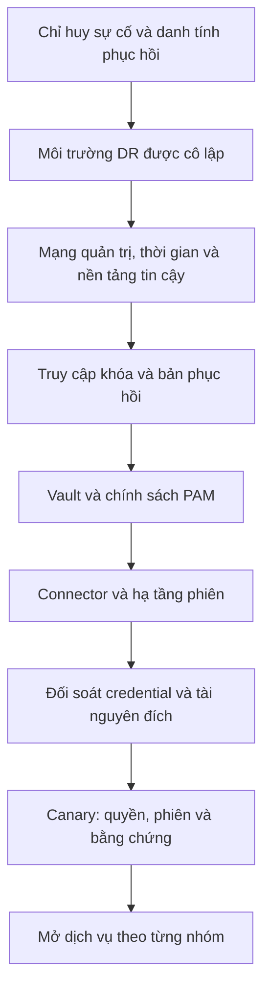

# PAM disaster recovery

## 1. Mục tiêu của khôi phục thảm họa PAM

Privileged Access Management (PAM) là tập hợp các kiểm soát dành cho tài khoản và thao tác đặc quyền: lưu giữ bí mật trong vault, cấp quyền có thời hạn, môi giới phiên quản trị, luân chuyển credential và ghi nhận bằng chứng. Khi PAM ngừng hoạt động, tổ chức có thể đồng thời mất khả năng quản trị hệ thống và mất lớp kiểm soát đối với những quyền mạnh nhất.

**PAM disaster recovery (PAM DR)** là khả năng khôi phục những dịch vụ đặc quyền thiết yếu sau một sự kiện vượt quá khả năng xử lý tại chỗ, theo thời gian và mức mất dữ liệu đã thỏa thuận, trong khi vẫn duy trì ranh giới tin cậy và khả năng truy vết.

Đối tượng được phục hồi không chỉ là máy chủ PAM. Một dịch vụ PAM chỉ thực sự hoạt động khi người được phép có thể tiếp cận đúng tài nguyên, bằng credential còn hợp lệ, qua một đường truy cập được kiểm soát và có bằng chứng tương ứng.

Ví dụ, một tổ chức phục hồi được cơ sở dữ liệu vault trong 30 phút nhưng vẫn không thể mở phiên quản trị vì IdP chưa hoạt động. Một tổ chức khác đăng nhập được vào giao diện PAM, nhưng password trong bản phục hồi đã cũ so với password trên máy đích. Cả hai đều chưa đạt mục tiêu phục hồi dịch vụ.

Sau bài học này, người học cần có khả năng:

- Phân biệt backup, high availability, failover và disaster recovery trong PAM.
- Lập bản đồ phụ thuộc, xác định RTO/RPO và phạm vi dịch vụ cần phục hồi trước.
- Thiết kế đường truy cập khẩn cấp không phụ thuộc hoàn toàn vào hệ thống đang gặp sự cố.
- Khôi phục vault, chính sách, credential, phiên và bằng chứng theo một trình tự có kiểm soát.
- Kiểm thử failover, phục hồi sau xâm nhập và failback bằng tiêu chí quan sát được.

## 2. Backup, HA và DR giải quyết những vấn đề khác nhau

| Cơ chế | Vấn đề chính được giải quyết | Giới hạn cần nhớ |
| --- | --- | --- |
| Backup | Tạo bản dữ liệu có thể dùng để phục hồi về một thời điểm | Có bản sao chưa chứng minh được khả năng giải mã, tính nhất quán hoặc khả năng dùng credential |
| High availability (HA) | Duy trì dịch vụ khi một số thành phần trong kiến trúc gặp lỗi | Các thành phần có thể cùng phụ thuộc một IdP, một vùng hoặc cùng nhận dữ liệu bị phá hủy |
| Failover | Chuyển vai trò phục vụ sang một hệ thống dự phòng | Chuyển sang bản sao đã bị nhiễm độc không giải quyết được sự cố an ninh |
| Disaster recovery | Khôi phục dịch vụ sau gián đoạn nghiêm trọng hoặc mất miền tin cậy | Cần con người, quy trình, phụ thuộc, dữ liệu, quyền truy cập và diễn tập |
| Cyber recovery | Khôi phục trong bối cảnh nghi ngờ hoặc đã xác nhận xâm nhập | Phải xử lý nguồn xâm nhập và đánh giá độ tin cậy trước khi đưa hệ thống trở lại phục vụ |

Replication giúp giảm độ trễ dữ liệu giữa các địa điểm, nhưng cũng có thể sao chép thao tác xóa, cấu hình sai hoặc dữ liệu đã bị sửa. Vì vậy, một replica đồng bộ không thay thế cho bản phục hồi độc lập có lịch sử và chính sách bảo vệ phù hợp.

HA và DR cũng có thể dùng chung một số thành phần, nhưng phải đánh giá miền lỗi thực tế. Hai máy chủ ở hai địa điểm không tạo ra hai miền phục hồi độc lập nếu cả hai đều cần cùng một khóa mà chỉ IdP đang ngừng hoạt động mới cho phép truy cập.

## 3. Xác định dịch vụ cần phục hồi trước

Không phải mọi chức năng PAM đều có mức ưu tiên bằng nhau. Cần xác định dịch vụ theo nhu cầu vận hành và tác động khi ngừng hoạt động, thay vì chỉ theo danh sách máy chủ.

Ví dụ về các nhóm phục hồi:

| Nhóm | Dịch vụ cần có | Phụ thuộc tối thiểu | Điều kiện mở lại |
| --- | --- | --- | --- |
| Quản trị hạ tầng khẩn cấp | Truy cập mạng, nền tảng ảo hóa, dịch vụ tên miền hoặc hệ thống khôi phục | Danh tính phục hồi, đường mạng quản trị, credential được kiểm soát | Có người chịu trách nhiệm, phê duyệt và ghi nhận hoạt động |
| Truy cập quản trị sản xuất trọng yếu | Cấp quyền cho nhóm trực vận hành một số hệ thống ưu tiên | Vault, policy, connector, MFA hoặc cơ chế khẩn cấp đã được phê duyệt | Credential đối soát thành công và có bằng chứng phiên |
| Cấp secret cho ứng dụng | Trả secret cho workload đã xác định | Danh tính workload, kênh phân phối, secret hợp lệ và chính sách | Ứng dụng kiểm tra kết nối thành công với quyền tối thiểu |
| Vận hành PAM đầy đủ | Luân chuyển diện rộng, báo cáo, quản lý vòng đời, phân tích | Các dịch vụ nền và tích hợp liên quan | Hoàn tất kiểm tra chức năng và xử lý tồn đọng |

Nhóm ưu tiên cao nhất phụ thuộc tổ chức. Không nên mặc định mọi tài khoản được gắn nhãn “admin” đều được khôi phục cùng một lúc.

Với mỗi dịch vụ, ghi rõ:

1. Tài nguyên và nghiệp vụ nào phụ thuộc vào dịch vụ đó.
2. Ai có thể sử dụng sau khi phục hồi.
3. Chức năng tối thiểu nào được chấp nhận trong chế độ suy giảm.
4. Những kiểm soát nào bắt buộc phải còn hiệu lực.
5. Thời hạn tối đa của chế độ suy giảm và người có quyền kết thúc hoặc gia hạn.

“Vault đã chạy” là một mốc kỹ thuật. “Nhóm trực được mở phiên quản trị vào hệ thống thanh toán, chỉ trong phạm vi được duyệt, và tìm được bằng chứng tương ứng” mới là một kết quả dịch vụ.

## 4. Thiết kế RTO và RPO phù hợp với PAM

### 4.1. RTO đo thời gian phục hồi dịch vụ

**Recovery Time Objective (RTO)** là thời gian gián đoạn tối đa được đặt ra cho một dịch vụ. Tổ chức phải quy định rõ mốc bắt đầu và mốc kết thúc phép đo; nếu không, các nhóm có thể báo cáo những con số khác nhau cho cùng một sự cố.

Trong bài này, phép đo bắt đầu từ lúc dịch vụ được xác nhận gián đoạn và kết thúc khi dịch vụ ưu tiên đã vượt qua cổng chấp nhận, không phải lúc máy ảo khởi động xong.

Một RTO PAM cần tính cả thời gian:

- Phát hiện, đánh giá và tuyên bố DR.
- Kích hoạt người trực, phê duyệt và truy cập tài liệu phục hồi.
- Cô lập hệ thống cũ, chuẩn bị môi trường đích và phục hồi các phụ thuộc.
- Phục hồi dữ liệu, khóa, cấu hình và thành phần xử lý phiên.
- Đối soát credential, kiểm tra quyền và kiểm tra bằng chứng.
- Mở lại dịch vụ theo phạm vi đã được phê duyệt.

Các việc có thể diễn ra song song không nên cộng cơ học. Cần đo đường phụ thuộc quyết định thời điểm dịch vụ thực sự dùng được.

### 4.2. RPO không đủ để bảo đảm credential sử dụng được

**Recovery Point Objective (RPO)** thể hiện mức mất dữ liệu có thể chấp nhận, thường diễn tả bằng khoảng thời gian giữa điểm dữ liệu có thể phục hồi và thời điểm sự cố.

Đối với PAM, RPO cần áp dụng cho nhiều loại dữ liệu:

- Nội dung vault và trạng thái luân chuyển.
- Cấu hình chính sách, nhóm quyền và yêu cầu phê duyệt.
- Credential của connector và danh tính dịch vụ PAM.
- Nhật ký truy cập và bản ghi phiên.
- Cấu hình tích hợp với ứng dụng, API và secret delivery.

Các nhóm này có thể có RPO khác nhau. Không được suy từ “RPO cơ sở dữ liệu là 15 phút” thành “mọi bằng chứng phiên cũng chỉ mất tối đa 15 phút”.

Xét tình huống:

| Thời điểm | Sự kiện |
| --- | --- |
| 09:00 | Điểm dữ liệu nhất quán của bản backup vault |
| 09:04 | PAM đổi password trên máy đích và ghi giá trị mới vào vault đang chạy |
| 09:10 | Địa điểm chính gặp thảm họa |
| Sau restore | Vault được phục hồi về 09:00, máy đích vẫn giữ password từ 09:04 |

Khoảng cách dữ liệu là 10 phút, có thể đáp ứng RPO 15 phút của vault. Tuy nhiên, password được phục hồi không còn đăng nhập được.

Ngược lại, nếu cả máy đích cũng được phục hồi, nó có thể trở về một phiên bản credential khác. Vì vậy, phải xem xét trạng thái của cả vault và tài nguyên đích; không mặc định một bên luôn mới hơn hoặc luôn đúng.

### 4.3. Theo dõi độ lệch trạng thái đặc quyền

Ngoài RTO/RPO, nên ghi nhận các chỉ báo vận hành:

- Số tài khoản trọng yếu chưa xác minh được credential.
- Số tài khoản có trạng thái rotation chưa rõ.
- Số ứng dụng chưa đồng bộ secret sau phục hồi.
- Số quyền khẩn cấp còn hiệu lực.
- Khoảng thời gian và phạm vi thiếu bằng chứng.
- Số phiên hoặc token cũ chưa xử lý dứt điểm.

Đây là chỉ báo bổ sung cho quyết định vận hành, không thay thế định nghĩa RTO/RPO đã thống nhất.

## 5. Bản đồ phụ thuộc: phục hồi từ đâu khi PAM bảo vệ chính hệ thống phục hồi?

PAM thường phụ thuộc các hệ thống mà chính PAM lại dùng để quản lý. Điều này có thể tạo vòng phụ thuộc:

- Muốn mở vault cần khóa trong KMS.
- Muốn vào KMS cần IdP.
- Muốn phục hồi IdP cần tài khoản được lưu trong vault.

Một kế hoạch DR phải phá được vòng này bằng một đường bootstrap đã được thiết kế và thử trước.

### 5.1. Các nhóm phụ thuộc cần kiểm kê

| Nhóm phụ thuộc | Ví dụ | Câu hỏi kiểm tra |
| --- | --- | --- |
| Danh tính | IdP, thư mục, MFA, nhóm quản trị | Nếu IdP chính ngừng hoạt động, ai xác thực người phục hồi? |
| Mật mã | KMS, HSM, recovery key, chứng thư, khóa giải mã backup | Có thể truy cập vật liệu phục hồi khi mất địa điểm hoặc tenant chính không? |
| Hạ tầng | Compute, storage, nền tảng container hoặc ảo hóa | Có đủ tài nguyên và quyền triển khai ở địa điểm DR không? |
| Mạng | DNS, routing, firewall, proxy, load balancer | PAM DR có tiếp cận được IdP, KMS, máy đích và kho log không? |
| Thời gian và tin cậy | Nguồn thời gian, PKI, chuỗi CA | Token, TLS và dấu thời gian có hoạt động chính xác không? |
| Giấy phép và gói cài đặt | License, image, cấu hình phiên bản, artifact | Có khởi chạy và hỗ trợ phiên bản cần phục hồi mà không cần hệ thống chính không? |
| Bằng chứng | Kho log, lưu phiên, SIEM, ticket | Có ghi nhận được hoạt động phục hồi ngay từ đầu không? |
| Con người | Người duyệt, người giữ khóa, vận hành, ứng cứu | Có người thay thế và kênh liên lạc ngoài hệ thống đang hỏng không? |

### 5.2. Trình tự phục hồi dựa trên quan hệ phụ thuộc

Một trình tự tham khảo:

Đây là mô hình minh họa. Trong thực tế, một số bước có thể song song và vị trí IdP/KMS có thể khác. Bản đồ của tổ chức phải chỉ rõ những phụ thuộc thực tế và đường truy cập khẩn cấp tương ứng.

Tài liệu bootstrap cần truy cập được khi PAM, wiki nội bộ và hệ thống SSO chính cùng ngừng hoạt động. Bản tài liệu ngoại tuyến phải được bảo vệ, có phiên bản và quy trình cập nhật; không nhúng secret trực tiếp vào runbook.

## 6. Thiết kế các thành phần phục hồi

### 6.1. Mặt phẳng điều khiển

Mặt phẳng điều khiển chứa vault, chính sách, danh mục tài khoản, quy trình phê duyệt và trạng thái quản lý.

Bản phục hồi cần bao gồm những dữ liệu mà sản phẩm PAM thực tế yêu cầu để đạt một trạng thái nhất quán. Tùy giải pháp, chỉ chép các file cơ sở dữ liệu đang mở có thể không tạo ra bản phục hồi hợp lệ. Phương thức backup và restore phải dựa trên cơ chế được sản phẩm hỗ trợ.

Cần lưu thông tin phiên bản phần mềm, cấu trúc dữ liệu, cấu hình mã hóa và trình tự nâng cấp có liên quan. Không giả định một bản backup cũ có thể nạp trực tiếp vào bất kỳ phiên bản mới nào.

### 6.2. Mặt phẳng truy cập và thực thi

Connector, session broker, jump host, dịch vụ rotation và secret delivery quyết định PAM có thể làm gì trên máy đích.

Sau restore, các thành phần này có thể vẫn mang credential, chứng thư hoặc danh tính máy đã cũ. Một connector khởi động thành công chưa chứng minh được nó có quyền quản lý đúng tài khoản.

Nên chuẩn bị khả năng triển khai lại từ nguồn sạch, với cấu hình được kiểm soát và danh tính phù hợp. Trong kịch bản xâm nhập, không tái sử dụng máy môi giới phiên hoặc image nghi bị cài cắm chỉ vì việc đó nhanh hơn.

### 6.3. Mặt phẳng bằng chứng

Nhật ký, bản ghi phiên và metadata liên kết phải phục hồi được cả nội dung lẫn khả năng tra cứu.

Ví dụ, file video phiên còn tồn tại nhưng bản ghi ánh xạ giữa video, người dùng, tài khoản đích và yêu cầu phê duyệt đã mất thì giá trị điều tra bị giảm đáng kể.

Cần phân biệt:

- Có thể đọc bản ghi cũ.
- Có thể tiếp tục ghi bản ghi mới.
- Có thể chứng minh liên kết giữa hành động, danh tính và tài nguyên.
- Có thể phát hiện khoảng trống hoặc sự thay đổi của bằng chứng.

Nếu hệ thống ghi nhận trung tâm chưa sẵn sàng, cơ chế ghi cục bộ phải được bảo vệ, có dung lượng, đồng bộ thời gian và quy trình chuyển giao sau đó. Phải thử xem sản phẩm thực tế có hỗ trợ cách vận hành này hay không.

### 6.4. Miền lưu trữ và miền quản trị bản phục hồi

Bản phục hồi cần chống được các sự cố nằm trong mô hình đe dọa đã chọn. Các biện pháp có thể gồm bản sao tại địa điểm khác, bản sao ngoại tuyến hoặc lưu trữ có cơ chế chống sửa/xóa phù hợp.

Tính độc lập không chỉ là khác bucket hay khác storage account. Cần xem xét:

- Có dùng chung tài khoản quản trị với PAM sản xuất không?
- Tài khoản bị xâm nhập có thể xóa cả backup lẫn khóa giải mã không?
- Chính sách retention có bị chính người quản trị sản xuất thay đổi được không?
- Có thể phục hồi khi tenant, mạng hoặc tài khoản thanh toán chính gặp sự cố không?
- Người phục hồi có thật sự lấy được bản sao và dùng được khóa không?

Lưu trữ bất biến giúp bảo vệ theo khả năng của cơ chế đó, nhưng không bảo đảm dữ liệu đầu vào sạch, khóa còn dùng được hoặc bản backup nhất quán.

## 7. Phân loại sự cố trước khi quyết định phục hồi

Không phải sự cố nào cũng nên chuyển sang địa điểm dự phòng ngay lập tức.

| Kịch bản | Điều cần xác minh | Hướng xử lý có thể phù hợp |
| --- | --- | --- |
| Một node lỗi, miền tin cậy vẫn nguyên vẹn | Cluster và cơ chế HA có vận hành đúng không? | Xử lý HA theo thiết kế, chưa cần tuyên bố DR toàn diện |
| Mất địa điểm chính, chưa có dấu hiệu xâm nhập | Địa điểm dự phòng, kết nối và trạng thái sao chép có đủ điều kiện không? | Failover có kiểm soát và đối soát credential |
| Dữ liệu bị hỏng hoặc xóa nhầm | Thời điểm bắt đầu hỏng, replica có bị ảnh hưởng không? | Phục hồi đến điểm dữ liệu phù hợp |
| Nghi vault hoặc tài khoản quản trị bị xâm nhập | Phạm vi ảnh hưởng, điểm phục hồi tin cậy, khóa và secret nào có thể lộ? | Cyber recovery trong môi trường sạch kết hợp ứng cứu |
| IdP hoặc KMS không sẵn sàng | Hệ thống nào hỏng trước, đường bootstrap có hoạt động không? | Phục hồi phụ thuộc hoặc kích hoạt cơ chế khẩn cấp đã duyệt |
| Kho log hoặc ghi phiên ngừng hoạt động | Chính sách có cho phép vận hành suy giảm không? | Hạn chế truy cập hoặc dùng cơ chế bằng chứng thay thế đã thử |

Trong kịch bản an ninh, bản mới nhất có thể không phải bản đáng tin nhất. Việc chọn recovery point phải dựa trên đánh giá sự cố và bằng chứng hiện có.

Một điểm dữ liệu cũ hơn có thể vượt mức RPO mong muốn nhưng vẫn là lựa chọn cần thiết. Khi đó phải ghi rõ mức mất dữ liệu, ảnh hưởng và người chấp nhận rủi ro; không thay đổi phép đo để báo cáo rằng RPO đã đạt.

## 8. Quyền chỉ huy và đường truy cập khẩn cấp

### 8.1. Phân vai để tránh một người tự làm toàn bộ

Một mô hình phân vai tham khảo:

| Vai trò | Trách nhiệm |
| --- | --- |
| Chỉ huy sự cố | Tuyên bố DR, điều phối, quyết định ưu tiên và giao tiếp |
| Người phê duyệt an ninh | Đánh giá miền tin cậy, phạm vi suy giảm và điều kiện mở quyền |
| Nhóm phục hồi PAM | Restore, kiểm tra kỹ thuật, đối soát và báo cáo |
| Người giữ vật liệu phục hồi | Cấp quyền truy cập khóa hoặc vật liệu bootstrap theo quy trình |
| Chủ hệ thống đích | Xác nhận credential, chức năng và tác động đến ứng dụng |
| Người quản lý bằng chứng | Thu thập timeline, log, ticket và kết quả kiểm thử |

Một người có thể kiêm vai trong tổ chức nhỏ, nhưng phải ghi nhận nơi thiếu phân tách trách nhiệm và bổ sung kiểm tra bù phù hợp. Không nên để cùng một cá nhân tự lấy recovery key, tự mở mọi quyền và tự xác nhận kết quả mà không có dấu vết kiểm tra độc lập.

### 8.2. Break-glass phải sống sót qua chính sự cố dự kiến

Đường truy cập khẩn cấp cần được thiết kế cho những hệ thống thực sự phải phục hồi. Tài khoản emergency chỉ tồn tại trong vault đang mất khả dụng sẽ không giải quyết được tình huống cần mở vault.

Các thuộc tính cần xác định:

- Danh tính cá nhân hoặc cơ chế quy trách nhiệm khi phải dùng một tài khoản dùng chung.
- Phạm vi quyền đủ để bootstrap, với ít tài nguyên nhất có thể.
- Cách lưu giữ và mở vật liệu phục hồi, chẳng hạn quy trình nhiều người tham gia.
- Khả năng xác thực khi IdP chính không hoạt động.
- Thời hạn sử dụng và cơ chế giám sát.
- Cách thu hồi, luân chuyển và đối soát sau sử dụng.

Không mặc định rằng khôi phục nhanh cho phép tắt MFA, chia sẻ password qua chat hoặc mở toàn bộ mạng quản trị. Nếu một kiểm soát không thể duy trì, phải có chế độ suy giảm cụ thể, người chịu trách nhiệm, giới hạn thời gian và bằng chứng bù đã được chuẩn bị.

### 8.3. Duy trì audit trong thời gian bootstrap

Giai đoạn đầu có thể xảy ra trước khi PAM ghi phiên hoạt động lại. Cần chuẩn bị cơ chế ghi nhận phù hợp:

- Nhật ký hành động theo người thực hiện, thời điểm và tài nguyên.
- Phê duyệt gắn với mã sự cố.
- Ghi nhận việc cấp và thu hồi quyền khẩn cấp.
- Bằng chứng hệ thống từ hạ tầng và máy đích.
- Nơi lưu tạm được bảo vệ và cách chuyển về kho chính.

Không ghi password, private key, mã khôi phục hoặc token vào ticket, log lệnh hay ảnh chụp dùng làm bằng chứng.

## 9. Runbook PAM DR theo các cổng quyết định

Runbook nên tách hành động, bằng chứng và điều kiện chuyển bước. Một danh sách chỉ ghi “restore database, restart service” không đủ để dùng trong áp lực sự cố.

### Giai đoạn 0 — Tuyên bố và xác định phạm vi

Xác nhận dịch vụ nào mất khả dụng, bắt đầu phép đo thời gian và lập mã sự cố. Xác định đây chủ yếu là sự cố khả dụng, dữ liệu hay an ninh.

Ghi nhận:

- Dịch vụ ưu tiên cần phục hồi.
- RTO/RPO và tiêu chí kết thúc phép đo.
- Địa điểm hoặc môi trường đích.
- Người chỉ huy, người phê duyệt và nhóm thực hiện.
- Những điều chưa biết có thể ảnh hưởng đến độ tin cậy.

**Cổng chuyển bước:** có quyết định kích hoạt, phạm vi và trách nhiệm rõ ràng.

### Giai đoạn 1 — Cô lập và ngăn hai bên cùng điều khiển

Trước khi cho hệ thống DR thực hiện rotation hoặc cấp quyền, phải kiểm soát hệ thống chính để tránh hai bên cùng quản lý một tài khoản đích.

Fencing có thể liên quan tới mạng, vai trò cluster, quyền ghi, dịch vụ rotation, hàng đợi tác vụ hoặc các cơ chế chuyên biệt của sản phẩm.

Không chỉ kiểm tra “site chính không phản hồi”. Một site bị mất kết nối từ phía người vận hành vẫn có thể đang kết nối với máy đích và tiếp tục đổi password.

Trong sự cố an ninh, phối hợp với nhóm ứng cứu để bảo toàn bằng chứng và ngăn kẻ tấn công tiếp tục tiếp cận môi trường DR.

**Cổng chuyển bước:** có bằng chứng một miền điều khiển duy nhất được phép thay đổi trạng thái đặc quyền, hoặc đã ngắt mọi tác vụ tự động cho tới khi điều kiện này được thiết lập.

### Giai đoạn 2 — Chuẩn bị nền tảng và niềm tin

Kiểm tra compute, storage, nguồn thời gian, DNS, routing, firewall, PKI và đường truy cập khóa.

Sử dụng gói cài đặt, image và cấu hình từ nguồn được kiểm soát. Chỉ mở các luồng mạng phục hồi cần thiết, có ghi nhận thay đổi.

Nếu chưa thể dùng IdP hoặc KMS chính, kích hoạt đường bootstrap theo thiết kế. Không tự thay đổi phương pháp mã hóa hoặc bỏ bước kiểm tra chỉ để nạp bản backup.

**Cổng chuyển bước:** môi trường đích đủ điều kiện chạy PAM và đội phục hồi lấy được vật liệu cần thiết theo quy trình.

### Giai đoạn 3 — Chọn và kiểm tra bộ phục hồi

Xác định điểm dữ liệu, phiên bản và các thành phần phải đi cùng nhau. Kiểm tra khả năng truy cập, tính toàn vẹn theo cơ chế đã thiết kế và khả năng giải mã.

Một bộ phục hồi có thể bao gồm cơ sở dữ liệu, khóa cần thiết, cấu hình, metadata phiên, chứng thư và thông tin phiên bản. Danh sách thực tế phải theo sản phẩm; không tự tạo quy trình ghép dữ liệu từ các thời điểm khác nhau.

Trong kịch bản xâm nhập, việc kiểm tra hash chỉ chứng minh dữ liệu khớp với giá trị tham chiếu được tin cậy. Nó không tự chứng minh dữ liệu không chứa cấu hình độc hại.

**Cổng chuyển bước:** có recovery point được chấp thuận và bộ dữ liệu tương thích, giải mã được, không có mâu thuẫn chưa xử lý.

### Giai đoạn 4 — Phục hồi PAM trong trạng thái hạn chế

Khôi phục các thành phần theo trình tự được hỗ trợ. Giữ các tác vụ có thể thay đổi máy đích ở trạng thái chưa hoạt động cho đến khi đối soát và fencing đạt yêu cầu.

Các tác vụ cần xem xét gồm:

- Rotation và reconciliation tự động.
- Cấp credential hoặc secret cho ứng dụng.
- Job provisioning, thu hồi quyền và đồng bộ thư mục.
- Tác vụ tồn trong hàng đợi trước sự cố.
- Connector có quyền thay đổi mật khẩu hoặc cấu hình tài khoản.

Một yêu cầu cấp quyền trong queue có thể đã hết hạn hoặc đã được xử lý trước sự cố. Không phát lại hàng loạt chỉ vì queue được phục hồi thành công.

**Cổng chuyển bước:** vault và cấu hình hoạt động trong môi trường hạn chế; chưa có thay đổi tự động ngoài phạm vi kiểm soát.

### Giai đoạn 5 — Đối soát credential, danh tính và chính sách

Đối soát nhóm tài khoản và dịch vụ ưu tiên trước. Xác nhận credential nào dùng được, tài khoản nào bị khóa, quyền nào đang dư và đối tượng nào cần reconciliation.

Kiểm tra cả:

- Thành viên nhóm và quyền được phục hồi từ bản cũ.
- Tài khoản đã bị vô hiệu hóa hoặc người đã rời tổ chức sau recovery point.
- Phê duyệt đã hết hạn.
- Secret của connector và workload.
- Chứng thư hoặc token có thể đã được cấp hoặc thu hồi sau recovery point.

Nếu nguồn danh tính chính chưa sẵn sàng, chỉ mở phạm vi danh tính đã xác nhận; không mặc định danh sách người dùng trong bản backup vẫn còn hợp lệ.

**Cổng chuyển bước:** từng nhóm dịch vụ có danh sách trạng thái rõ ràng và các mục chưa xác minh đã được cách ly.

### Giai đoạn 6 — Kiểm thử canary và mở dịch vụ hạn chế

Dùng một tập tài khoản và tài nguyên đại diện, có thể kiểm soát tác động, để kiểm tra toàn bộ đường đi:

1. Người được phép xác thực và nhận đúng quyền.
2. Người không được phép bị từ chối.
3. Phiên mở vào đúng tài nguyên với tài khoản đúng.
4. Các giới hạn như thời hạn quyền hoặc phạm vi lệnh có hiệu lực theo thiết kế.
5. Credential hoạt động; tác vụ rotation thử nghiệm có kết quả được đối soát.
6. Bằng chứng mới được tạo và có thể tìm lại.
7. Quyền hoặc phiên thử nghiệm được kết thúc, thu hồi theo yêu cầu.

Một lần đăng nhập thành công không thay thế kiểm thử từ chối. Một lần rotation thành công cũng chưa chứng minh ứng dụng sử dụng secret đã nhận được phiên bản mới.

**Cổng chuyển bước:** nhóm dịch vụ vượt qua các kiểm thử đã định và người có thẩm quyền chấp nhận phạm vi mở lại.

### Giai đoạn 7 — Mở rộng, giám sát và xử lý tồn đọng

Mở theo từng nhóm tài nguyên. Giám sát lỗi đăng nhập, khóa tài khoản, rotation, tải connector, độ trễ secret delivery và khả năng ghi bằng chứng.

Ghi rõ dịch vụ nào còn suy giảm và khi nào sẽ xử lý. Nếu phát hiện lỗi, có thể giữ nguyên hoặc thu hẹp phạm vi; không nhất thiết khôi phục toàn bộ snapshot để quay lại một bước vận hành.

**Cổng kết thúc phục hồi dịch vụ:** đạt tiêu chí dịch vụ đã thống nhất, đồng thời còn lưu được danh sách việc hậu sự cố và trách nhiệm xử lý.

## 10. Đối soát credential sau restore

Đây là một trong những phần dễ làm hỏng dịch vụ nhất nếu xử lý như thao tác đồng bộ thông thường.

### 10.1. Phân nhóm trước khi thử đăng nhập

| Trạng thái | Ý nghĩa | Hành động dự kiến |
| --- | --- | --- |
| Đã xác nhận khớp | Credential được kiểm tra hợp lệ với tài nguyên đích | Cho phép dùng trong phạm vi đã mở |
| Chưa rõ | Không đủ bằng chứng về phiên bản hoặc chưa thể kiểm tra | Giữ cách ly hoặc chỉ kiểm tra có kiểm soát |
| Xác nhận không khớp | Credential trong vault không khớp trạng thái máy đích | Dùng quy trình reconciliation hoặc reset được hỗ trợ |
| Nghi bị lộ | Credential có thể bị truy cập trái phép | Xử lý như secret bị lộ, phối hợp ứng cứu và thay thế |
| Không thể quản lý | Thiếu quyền khôi phục hoặc máy đích không sẵn sàng | Giao chủ hệ thống, duy trì hạn chế và theo dõi riêng |

Không thử tuần tự nhiều password cũ trên hàng loạt máy. Cách đó có thể gây khóa tài khoản, tạo nhiễu và làm gián đoạn thêm.

### 10.2. Reconciliation cần một nguồn quyền độc lập

Nếu dùng tài khoản reconciliation hoặc recovery để đặt lại password, phải xác minh chính tài khoản đó còn hợp lệ, có đúng phạm vi và không cùng chịu vấn đề lệch trạng thái.

Một trình tự tham khảo cho từng tài khoản:

1. Kiểm tra chủ sở hữu, tài nguyên đích và trạng thái sự cố.
2. Xác nhận chỉ một hệ thống PAM được phép quản lý tài khoản.
3. Kiểm tra hoặc khôi phục credential bằng cơ chế được hỗ trợ, với giới hạn thử phù hợp.
4. Đặt credential mới nếu cần và xác nhận vault lưu đúng trạng thái thành công.
5. Kiểm tra sử dụng ở máy đích và các bên phụ thuộc.
6. Ghi nhận kết quả bằng metadata, không ghi giá trị secret.
7. Cho phép rotation định kỳ trở lại sau khi hoàn tất các điều kiện cần thiết.

Không đẩy password cũ từ backup xuống máy đích để “làm cho hai bên giống nhau”, đặc biệt khi password đó có thể đã bị lộ hoặc đã được thu hồi.

### 10.3. Service account cần xét các bên tiêu thụ secret

Đổi password cho một service account có thể ảnh hưởng nhiều ứng dụng và tác vụ định kỳ. Đối soát cần biết ai đang dùng secret, ai nhận được phiên bản mới và có cửa sổ chuyển đổi hay không.

Tùy hệ thống, phương án có thể là thay credential, tạo credential mới song song trong một thời gian được kiểm soát hoặc thay danh tính dịch vụ. Không giả định mọi máy đích hỗ trợ hai credential cùng lúc.

Nếu cơ chế chuyển đổi cần chồng lấn, xác định thời hạn, quyền của cả hai phiên bản và điều kiện thu hồi bản cũ. Mục tiêu là phục hồi ứng dụng mà không để lại một secret cũ tồn tại vô thời hạn.

### 10.4. Password không phải loại trạng thái duy nhất

Token API, khóa SSH, chứng thư, lease của secret động và phiên đang mở có cơ chế hiệu lực khác nhau.

- Restore một bản ghi “đã thu hồi” không bảo đảm bên phát hành hoặc bên kiểm tra đã thu hồi token.
- Xóa khóa khỏi vault không tự xóa public key tương ứng trên máy đích.
- Đổi password không nhất thiết kết thúc mọi phiên đã xác thực.
- Khôi phục cơ sở dữ liệu lease không chứng minh secret động còn hợp lệ ở hệ thống phát hành.
- Khôi phục một chứng thư không chứng minh khóa riêng và chuỗi tin cậy vẫn phù hợp.

Cần xử lý tại nơi thực thi hiệu lực thực tế: máy đích, bên phát hành, proxy phiên hoặc hệ thống ứng dụng tương ứng.

## 11. Ví dụ phục hồi một dịch vụ quản trị trọng yếu

Một doanh nghiệp giả định đặt các mục tiêu sau cho nhóm truy cập quản trị sản xuất trọng yếu:

- RTO: 180 phút.
- RPO cho dữ liệu vault: 15 phút.
- Chỉ mở lại khi có MFA hoặc đường khẩn cấp đã được phê duyệt, đúng quyền và bằng chứng truy cập.
- Chưa yêu cầu mọi tài khoản và báo cáo của PAM hoạt động đầy đủ trong 180 phút.

Các giá trị này chỉ minh họa; chúng không phải mức mặc định cho PAM.

Diễn tập ghi nhận timeline:

| Khoảng thời gian tính từ gián đoạn | Công việc chính | Kết quả |
| --- | --- | --- |
| Phút 0–15 | Phát hiện, phân loại, tuyên bố DR | Phạm vi và người chịu trách nhiệm được chốt |
| Phút 15–30 | Fencing hệ thống chính, xác nhận môi trường đích | Không còn hai bộ rotation cùng quản lý máy đích |
| Phút 30–60 | Khôi phục đường tin cậy và truy cập khóa | Đội phục hồi dùng được vật liệu cần thiết |
| Phút 60–100 | Restore vault và cấu hình trong trạng thái hạn chế | Dịch vụ PAM nội bộ hoạt động |
| Phút 100–135 | Đối soát nhóm tài khoản ưu tiên | Credential và quyền của nhóm canary được xác nhận |
| Phút 135–155 | Kiểm thử canary, kiểm tra bằng chứng và phê duyệt | Mở nhóm dịch vụ ưu tiên |
| Sau phút 155 | Mở rộng các nhóm còn lại | Tiếp tục theo dõi như công việc phục hồi còn tồn |

Thời gian phục hồi nhóm dịch vụ ưu tiên là 155 phút theo định nghĩa đã đặt, đáp ứng RTO 180 phút. Điều này không có nghĩa toàn bộ PAM đã phục hồi đầy đủ.

Nếu điểm dữ liệu dùng để restore cách sự cố 10 phút, RPO vault 15 phút cũng đạt. Tuy nhiên, các tài khoản có rotation trong khoảng 10 phút vẫn cần đối soát. Báo cáo phải ghi riêng kết quả RPO và số tài khoản lệch trạng thái đã xử lý.

Giả sử sau 155 phút một ứng dụng ưu tiên chưa nhận được secret mới. Nếu ứng dụng đó nằm trong phạm vi dịch vụ phải có để kết thúc RTO, phép đo chưa được kết thúc. Không thể loại ứng dụng khỏi phạm vi sau sự cố chỉ để làm đẹp kết quả.

## 12. Khôi phục sau xâm nhập PAM

Khi nghi ngờ kẻ tấn công đã truy cập vault hoặc quản trị PAM, cần phối hợp DR với ứng cứu sự cố. Restore giúp tái tạo hệ thống; nó không tự loại bỏ quyền truy cập mà kẻ tấn công đã có.

Các vấn đề cần giải quyết gồm:

- Điểm phục hồi nào có thể tin cậy và cơ sở nào cho quyết định đó.
- Danh tính quản trị, API token, connector, khóa và chứng thư nào có thể bị lộ.
- Có tồn tại policy, nhóm quyền, job hoặc cấu hình cho phép truy cập trái phép không.
- Máy đích nào có thể đã bị thay đổi ngoài PAM.
- Cần thay thế credential theo thứ tự nào để không gây gián đoạn diện rộng.
- Phiên, token và khóa cũ phải thu hồi ở đâu.

Không mặc định rằng tất cả secret đều đã lộ nếu chưa có kết luận, nhưng cũng không coi “không thấy log đọc secret” là bằng chứng đủ để xác nhận an toàn khi độ tin cậy của log đang bị nghi ngờ.

Trong phạm vi ảnh hưởng được đánh giá, ưu tiên những credential có sức ảnh hưởng lớn hoặc tạo đường vào hệ thống phục hồi. Kế hoạch thay thế cần phối hợp với chủ ứng dụng, vì rotation hàng loạt không có điều phối có thể làm mất thêm dịch vụ.

Một môi trường PAM mới vẫn có thể tái nhiễm nếu dùng lại danh tính quản trị đã bị chiếm quyền hoặc mở kết nối với hạ tầng đích chưa xử lý. Do đó, điều kiện mở dịch vụ phải bao gồm cả độ tin cậy của các phụ thuộc nằm trên đường truy cập.

## 13. Failback: chuyển về hệ thống chính một cách có kiểm soát

Sau khi địa điểm chính hoạt động lại, dữ liệu tại đó thường không còn là nguồn chuẩn. Nó có thể thiếu rotation, thay đổi policy, audit và giao dịch đã xảy ra tại DR.

Failback cần một kế hoạch riêng:

1. Xác định hệ thống đang giữ trạng thái chuẩn và khoảng thời gian DR đã phục vụ.
2. Khôi phục hoặc dựng lại địa điểm chính từ trạng thái được tin cậy.
3. Đồng bộ dữ liệu theo cơ chế được sản phẩm hỗ trợ.
4. Đối chiếu thay đổi policy, quyền, credential và bằng chứng phát sinh tại DR.
5. Chọn cửa sổ chuyển đổi và cách xử lý job, phiên, token còn hiệu lực.
6. Fencing phía đang phục vụ trước khi phía mới nhận quyền thay đổi máy đích.
7. Kiểm thử canary và xác nhận một miền điều khiển duy nhất.
8. Thu hồi quyền khẩn cấp, luân chuyển vật liệu đã dùng và hoàn tất báo cáo.

Không bật nguyên trạng site cũ và cho hai site tự “đồng bộ rồi ổn”. Không trộn thủ công hai cơ sở dữ liệu vault nếu sản phẩm không hỗ trợ quy trình đó.

Nếu failback gặp lỗi, quyết định quay lại DR phải xét các thay đổi đã diễn ra sau chuyển đổi. “Rollback về snapshot” không tự hoàn tác password, khóa, token hoặc thao tác đã thực hiện trên máy đích.

## 14. Diễn tập DR phải tạo ra bằng chứng sử dụng được

### 14.1. Tăng dần mức độ diễn tập

| Mức diễn tập | Kiểm tra được gì | Điều chưa chứng minh |
| --- | --- | --- |
| Tabletop | Vai trò, quyết định, phụ thuộc, tài liệu và liên lạc | Thời gian restore thực tế hoặc credential có dùng được không |
| Restore trong môi trường cô lập | Bản backup, giải mã, tương thích và khởi chạy | Toàn bộ đường truy cập sản xuất |
| Kiểm thử dịch vụ đại diện | Danh tính, connector, credential, policy, ứng dụng và bằng chứng | Mọi tải và mọi phụ thuộc sản xuất |
| Failover có kế hoạch | Chuyển vai trò, fencing, vận hành tại DR và failback | Toàn bộ điều kiện của thảm họa bất ngờ hoặc xâm nhập |
| Kịch bản cyber recovery | Điểm phục hồi tin cậy, nguồn sạch, xử lý secret và điều kiện mở lại | Không thay thế đánh giá một sự cố thật với bằng chứng riêng |

Cần có biện pháp ngăn môi trường diễn tập tự động đổi password trên máy sản xuất, gửi secret tới bên tiêu thụ thật hoặc phát lại tác vụ cũ.

Một môi trường restore có bản sao credential sản xuất vẫn chứa dữ liệu nhạy cảm. Cô lập mạng, hạn chế quyền, bảo vệ log và xử lý dữ liệu sau diễn tập phải nằm trong kế hoạch.

### 14.2. Tiêu chí PASS/FAIL cụ thể

Một bộ tiêu chí tham khảo:

- Mở được bộ phục hồi bằng quy trình quản lý khóa đã định.
- Có thể xác thực đội phục hồi khi phụ thuộc chính được giả lập là không sẵn sàng.
- Chứng minh fencing hoạt động trước khi bật các tác vụ thay đổi máy đích.
- Tài khoản được phép truy cập đúng tài nguyên; tài khoản không đủ quyền bị từ chối.
- Xử lý được một trường hợp credential lệch trạng thái.
- Một ứng dụng đại diện nhận được secret hợp lệ sau chuyển đổi.
- Bản ghi phiên mới có thể tra cứu cùng danh tính, tài nguyên và phê duyệt.
- Các khoảng trống bằng chứng được định lượng và xử lý theo chính sách.
- Đạt RTO/RPO theo phạm vi và mốc đo đã thống nhất.
- Thu hồi được quyền khẩn cấp và hoàn tất failback hoặc kết thúc diễn tập an toàn.

Đừng chỉ ghi “restore thành công”. Ghi thời điểm, kết quả quan sát, tài nguyên đại diện và người xác nhận.

### 14.3. Khi nào cần diễn tập lại?

Tần suất diễn tập dựa trên yêu cầu nghiệp vụ, mức rủi ro và chính sách của tổ chức. Ngoài lịch định kỳ, cần xem xét diễn tập lại sau những thay đổi ảnh hưởng đến khả năng phục hồi, chẳng hạn:

- Thay phiên bản PAM hoặc kiến trúc vault.
- Đổi IdP, MFA, KMS/HSM, PKI hoặc cơ chế quản lý khóa.
- Thay địa điểm DR, DNS, routing hoặc đường quản trị.
- Đổi cơ chế rotation, danh tính connector hoặc secret delivery.
- Thay chính sách backup, retention hay quyền quản trị kho phục hồi.
- Thay nhân sự giữ khóa và người có thẩm quyền phê duyệt.

Một kết quả PASS từ trước thay đổi lớn không đủ chứng minh kiến trúc mới vẫn đạt mục tiêu.

## 15. Hồ sơ và chỉ số cần giữ sau phục hồi

Hồ sơ phục hồi nên liên kết về mã sự cố hoặc mã diễn tập, bao gồm:

| Nhóm bằng chứng | Nội dung cần giữ |
| --- | --- |
| Quyết định | Lý do kích hoạt, phạm vi, người duyệt, mức suy giảm được chấp nhận |
| Timeline | Mốc gián đoạn, tuyên bố DR, từng cổng kỹ thuật, mở dịch vụ và failback |
| Bộ phục hồi | Định danh bản backup, điểm dữ liệu, phiên bản, kết quả kiểm tra và giải mã |
| Fencing | Thành phần bị ngắt, cách xác nhận, thời điểm chuyển quyền điều khiển |
| Credential | Tài khoản đã đối soát, kết quả, thời điểm và người xác nhận; không chứa secret |
| Quyền truy cập | Ai được cấp quyền khẩn cấp, phạm vi, thời hạn và bằng chứng thu hồi |
| Bằng chứng phiên | Vị trí lưu, khả năng tìm kiếm, liên kết danh tính và khoảng trống đã phát hiện |
| Kết quả | RTO/RPO thực tế, tiêu chí chưa đạt, việc tồn đọng và người xử lý |

Các chỉ số có ích gồm thời gian tới phiên quản trị được kiểm soát đầu tiên, tỷ lệ tài khoản ưu tiên đã đối soát, thời gian thu hồi quyền khẩn cấp và số lỗi lặp lại từ các lần diễn tập trước.

Không dùng số máy chủ đã khởi động thay cho kết quả dịch vụ. Cũng không gộp mọi loại dữ liệu thành một RPO nếu chúng có cơ chế phục hồi và độ trễ khác nhau.

## 16. Những sai lầm thường gặp

| Sai lầm | Hậu quả | Cách khắc phục trong thiết kế |
| --- | --- | --- |
| Chỉ backup cơ sở dữ liệu vault | Thiếu khóa, cấu hình hoặc thành phần phụ thuộc để restore | Xác định và thử cả bộ phục hồi theo sản phẩm |
| Recovery key chỉ truy cập được qua PAM/IdP chính | Không bootstrap được khi chính các hệ thống đó hỏng | Thiết kế đường phục hồi độc lập có kiểm soát |
| Bật rotation ngay sau restore | Gây xung đột, khóa tài khoản hoặc làm ứng dụng mất kết nối | Fencing, cách ly tác vụ và đối soát trước khi mở lại |
| Coi replica là bản sạch | Phục hồi cả thao tác phá hủy hoặc cấu hình bị sửa | Có lịch sử phục hồi và đánh giá điểm dữ liệu |
| Cho hai site cùng quản lý tài khoản | Password bị đổi qua lại, trạng thái không xác định | Một miền điều khiển có quyền thay đổi tại một thời điểm |
| Chỉ kiểm tra người được phép đăng nhập | Có thể bỏ sót quyền dư hoặc policy sai | Thêm kiểm thử từ chối và kiểm tra thời hạn quyền |
| Mở quyền khẩn cấp không có hạn | Để lại đường truy cập lâu dài sau sự cố | Quy định phạm vi, thời hạn và bằng chứng thu hồi |
| Khôi phục hệ thống nhưng bỏ qua log/phiên | Mất khả năng truy vết hoạt động đặc quyền | Đưa khả năng ghi và tra cứu bằng chứng vào cổng mở dịch vụ |
| Failback bằng cách bật site cũ | Mất trạng thái mới và tái tạo split-brain | Lập kế hoạch chuyển nguồn chuẩn, đồng bộ và fencing |
| Báo đạt RTO ngay khi giao diện lên | Che khuất việc credential hoặc ứng dụng chưa hoạt động | Đo tới tiêu chí dịch vụ đã thống nhất |

## 17. Bài tập tình huống

Một doanh nghiệp có vault chính tại địa điểm A và bản dự phòng tại B. Địa điểm A mất kết nối. B có thể khởi chạy vault nhưng chưa xác định A có tiếp tục đổi password trên máy đích hay không. Backup gần nhất chứa trạng thái trước một đợt rotation; IdP chính và kho ghi phiên cũng đang không truy cập được.

Hãy lập kế hoạch trả lời các vấn đề sau:

1. Những điều kiện nào phải xác minh trước khi B được phép đổi password?
2. Đội phục hồi xác thực và lấy vật liệu giải mã bằng đường nào?
3. Tài khoản nào được đối soát trước, dựa trên ưu tiên dịch vụ nào?
4. Nếu credential cũ không khớp, ai có quyền reconciliation và xử lý bên tiêu thụ secret?
5. Khi chưa ghi phiên tập trung được, chế độ vận hành nào đã được tổ chức chấp nhận và cần bằng chứng gì?
6. Thử nghiệm nào chứng minh người không có quyền vẫn bị từ chối?
7. Khi A hoạt động lại, trạng thái nào là nguồn chuẩn và chuyển về ra sao?

Một lời giải có cơ sở phải nhận ra rằng việc B khởi động được chưa đủ để mở rộng quyền. Cần fencing, bootstrap, đối soát, kiểm tra quyền và bằng chứng theo từng cổng. Nếu thiếu một điều kiện bắt buộc, giữ nhóm dịch vụ tương ứng ở trạng thái hạn chế và xử lý điểm thiếu, thay vì mở toàn bộ PAM rồi kiểm tra sau.

## 18. Các nguyên tắc cần nhớ

PAM DR khôi phục một dịch vụ kiểm soát đặc quyền, bao gồm dữ liệu, danh tính, khóa, kết nối, trạng thái tài khoản đích và bằng chứng.

RTO phải đo tới khả năng sử dụng dịch vụ trong phạm vi đã thống nhất. RPO đạt không có nghĩa credential sau restore đã khớp máy đích.

Trước khi mở tác vụ thay đổi trạng thái, phải xác nhận chỉ có một miền điều khiển hợp lệ. Sau restore, đối soát credential và quyền theo ưu tiên; trước khi mở rộng, thử cả đường được phép lẫn đường bị từ chối.

Kế hoạch có thể thực thi cần được diễn tập với những phụ thuộc thực sự bị mất, có failback, có thu hồi quyền khẩn cấp và có bằng chứng để đối chiếu.
