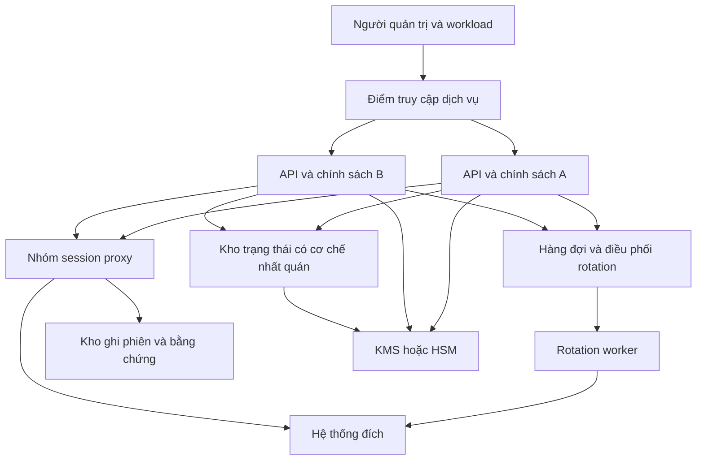

# PAM cluster

## 1. PAM cluster giải quyết vấn đề gì?

Privileged Access Management (PAM) đứng giữa người hoặc workload và các tài khoản có quyền cao trên máy chủ, cơ sở dữ liệu, thiết bị mạng và dịch vụ nhạy cảm. Một nền tảng PAM có thể lưu credential trong vault, xử lý yêu cầu cấp quyền, mở phiên truy cập qua proxy, luân chuyển mật khẩu và thu thập bằng chứng kiểm toán.

Nếu toàn bộ chức năng đó phụ thuộc vào một máy duy nhất, lỗi máy PAM có thể khiến đội vận hành không lấy được credential hoặc không mở được phiên để xử lý chính sự cố hạ tầng đang diễn ra. Ngược lại, nếu triển khai dự phòng bằng cách cho mọi máy đều có quyền ghi và tự hoạt động khi mất kết nối, hai máy có thể luân chuyển cùng một tài khoản theo hai giá trị khác nhau. Hệ thống có thêm máy nhưng credential lại mất nhất quán.

**PAM cluster là một nhóm thành phần PAM phối hợp để cung cấp dịch vụ, duy trì trạng thái cần thiết và tiếp nhận công việc khi một thành phần gặp lỗi.** Mục tiêu không chỉ là giữ giao diện truy cập được mà còn bảo toàn các quy tắc bảo mật khi lỗi xảy ra.

Một cluster hữu ích cần trả lời đồng thời bốn câu hỏi:

- Khi một node lỗi, người dùng và workload còn thực hiện được những thao tác nào?
- Bản trạng thái nào có thẩm quyền quyết định quyền truy cập và phiên bản credential?
- Làm thế nào ngăn node cũ tiếp tục thực hiện thao tác nhạy cảm sau khi quyền điều phối đã chuyển?
- Sau sự cố, có xác định được ai đã nhận quyền, credential nào đã được dùng và bằng chứng nằm ở đâu không?

Ví dụ, một tổ chức dùng PAM cho tài khoản quản trị Linux và tài khoản dịch vụ của ứng dụng thanh toán. Cluster phải duy trì đường truy cập quản trị trong phạm vi thiết kế, đồng thời tránh việc hai rotation worker đổi mật khẩu tài khoản dịch vụ cùng lúc. Khả dụng và tính đúng của credential là hai yêu cầu phải được xem xét cùng nhau.

## 2. Những khái niệm cần phân biệt

| Khái niệm | Ý nghĩa trong PAM | Điều không thể suy ra chỉ từ khái niệm đó |
| --- | --- | --- |
| Node | Một thực thể tham gia cung cấp một hoặc nhiều chức năng PAM | Mỗi node đều có thể giữ vault hoặc nhận vai trò leader |
| Cluster | Tập hợp thành phần có cơ chế phối hợp và quản lý trạng thái | Chỉ cần nhân bản máy ảo là có cluster đúng |
| High availability (HA) | Duy trì hoặc khôi phục dịch vụ trong mục tiêu đã xác định khi có những lỗi được thiết kế để chịu đựng | Không mất bất kỳ phiên nào hoặc không có thời gian gián đoạn |
| Replication | Sao chép trạng thái giữa các bản lưu | Bản sao luôn mới, hợp lệ và đủ điều kiện cấp quyền |
| Failover | Chuyển lưu lượng, vai trò hoặc công việc sang thành phần đủ điều kiện | Mọi kết nối đang mở đều được chuyển nguyên vẹn |
| Backup | Bản dữ liệu phục vụ khôi phục tại một thời điểm hoặc chuỗi thời điểm | Có thể lập tức dùng như một node đang hoạt động |
| Disaster recovery (DR) | Khôi phục dịch vụ sau sự cố lớn vượt khả năng chịu lỗi của triển khai thông thường | Một cluster trong cùng địa điểm đã đáp ứng DR |
| Fault domain | Nhóm thành phần có thể cùng lỗi bởi một nguyên nhân chung | Hai máy khác tên đã thuộc hai miền lỗi độc lập |

HA và DR có liên hệ nhưng khác phạm vi. Hai node đặt cùng một host vật lý có thể chịu được lỗi tiến trình PAM nhưng không chịu được lỗi host đó. Hai node ở hai rack vẫn có thể cùng phụ thuộc vào một thiết bị mạng, một hệ thống lưu trữ hoặc một nguồn cấp điện.

Vì vậy, số node là thông tin đầu vào; **khả năng tiếp tục thực hiện một nghiệp vụ PAM dưới một kiểu lỗi cụ thể** mới là điều cần chứng minh.

## 3. Tách cluster theo chức năng thay vì chỉ đếm appliance

Trong một sản phẩm, nhiều chức năng có thể được đóng gói chung trong một appliance. Khi phân tích kiến trúc, vẫn nên tách chúng thành những vai trò logic vì mỗi vai trò có yêu cầu trạng thái và cách chuyển đổi khác nhau.

### 3.1. Cổng truy cập và API

Portal hoặc API nhận yêu cầu, xác thực ngữ cảnh người dùng, gọi dịch vụ chính sách và trả kết quả. Nếu trạng thái cần thiết được đặt trong một backend có cơ chế nhất quán phù hợp, tầng này có thể được nhân bản để phân phối lưu lượng.

Tuy nhiên, không nên mặc định tầng API hoàn toàn stateless. Sản phẩm có thể giữ session đăng nhập, token chống giả mạo yêu cầu, cache quyết định hoặc job đang xử lý trong bộ nhớ. Cần xác định khi node bị thay thế thì trạng thái nào được khôi phục, trạng thái nào phải tạo lại.

### 3.2. Dịch vụ chính sách và phê duyệt

Thành phần này quyết định ai được làm gì, trên tài nguyên nào, trong khoảng thời gian nào, với điều kiện nào. Nó liên quan trực tiếp đến least privilege, JIT/JEA, phê duyệt, thu hồi quyền và phân tách nhiệm vụ.

Một bản sao chưa nhận chính sách thu hồi mới có thể vẫn cho phép yêu cầu mà hệ thống đã cấm. Do đó, phục vụ được API chưa đủ để chứng minh node đủ điều kiện cấp quyền. Cần ràng buộc việc cấp quyền với phiên bản chính sách và trạng thái có thẩm quyền.

### 3.3. Vault và kho trạng thái

Vault quản lý secret cùng metadata như phiên bản, quyền đọc, lịch sử thay đổi và trạng thái rotation. Nền tảng có thể dùng kho dữ liệu nhúng, cơ sở dữ liệu bên ngoài hoặc một dịch vụ vault riêng.

Cần phân biệt ba thứ:

1. Dữ liệu secret đã mã hóa.
2. Metadata và trạng thái giao dịch của secret.
3. Khả năng sử dụng khóa để giải mã hoặc thực hiện thao tác mật mã hợp lệ.

Có bản sao dữ liệu không đồng nghĩa node mới có thể mở vault. Ngược lại, sao chép vật liệu khóa một cách tùy tiện có thể làm tăng phạm vi lộ lọt. Cơ chế dự phòng khóa phải tuân theo thiết kế của hệ thống quản lý khóa hoặc HSM được sử dụng.

### 3.4. Session proxy và bộ ghi phiên

Session proxy duy trì kết nối với người dùng và đích truy cập. Bộ ghi phiên lưu bằng chứng như sự kiện, lệnh, video hoặc metadata tương ứng với khả năng của nền tảng.

Đây thường là phần có trạng thái gắn với kết nối đang mở. Cho node proxy thứ hai hoạt động không tự làm cho luồng SSH/RDP đang đi qua node thứ nhất có thể di chuyển sang node thứ hai. Khả năng tiếp tục phiên phải được xác minh riêng.

### 3.5. Rotation worker và connector

Worker truy cập hệ thống đích để đổi mật khẩu, cập nhật credential của ứng dụng hoặc kiểm tra kết quả. Nó cần quyền đủ dùng trên đích nhưng không nên có quyền đọc mọi secret trong module PAM.

Rotation còn tạo ra thay đổi ngoài kho dữ liệu của cluster. Đây là lý do đặc biệt quan trọng để kiểm soát quyền sở hữu công việc, tránh thực thi trùng và xử lý kết quả không chắc chắn.

### 3.6. Những phụ thuộc bên ngoài

Danh tính, MFA, DNS, đồng bộ thời gian, cơ sở dữ liệu, KMS/HSM, object storage, mạng tới đích và hệ thống thu thập log đều có thể ảnh hưởng đến một nghiệp vụ PAM.

Nếu cả hai node PAM cùng gọi một dịch vụ MFA không có dự phòng, lỗi MFA vẫn có thể làm ngừng toàn bộ yêu cầu mới. Một phân tích HA đúng phải đi đến các phụ thuộc chung này thay vì dừng ở biên của cụm máy PAM.

## 4. Một kiến trúc logic để thảo luận

Sơ đồ sau minh họa cách tách chức năng. Đây là mô hình học tập, không phải topology bắt buộc hoặc cấu hình có thể áp dụng trực tiếp cho mọi sản phẩm.



Không nên hiểu sơ đồ là mọi mũi tên đều phải đi qua cùng một leader. Cách phối hợp cụ thể phụ thuộc vào từng thành phần. Tầng API có thể có nhiều node cùng phục vụ, trong khi một nhóm dữ liệu chỉ có một leader nhận ghi tại một thời điểm.

Điểm truy cập dịch vụ cũng cần được đánh giá HA. Một load balancer đơn lẻ có thể trở thành điểm lỗi duy nhất dù phía sau có nhiều node. DNS có thể cung cấp một phần cơ chế điều hướng nhưng còn phụ thuộc TTL, cache và hành vi client; thay đổi bản ghi DNS không lập tức chuyển tất cả kết nối.

Các đường quản trị cluster, đồng bộ nội bộ và phục vụ người dùng nên có kiểm soát truy cập phù hợp. Tách vai trò không nhất thiết đòi hỏi một mạng vật lý riêng cho mỗi chức năng, nhưng phải xác định rõ ai được kết nối và danh tính nào được chấp nhận trên từng đường.

## 5. Active-passive và active-active trong PAM

### 5.1. Active-passive

Ở mô hình active-passive, một thành phần đang phục vụ vai trò chính; thành phần dự phòng tiếp nhận vai trò khi các điều kiện failover được đáp ứng.

Ví dụ, vault có một node ghi chính và một bản dự phòng. Khi node chính lỗi, hệ thống cần xác minh bản dự phòng đủ mới, có quyền sử dụng khóa và được cơ chế điều phối cho phép trở thành node ghi.

Ưu điểm của cách tổ chức này là dễ xác định chủ thể có quyền thay đổi trạng thái. Đổi lại, phải tính thời gian phát hiện lỗi, chuyển vai trò, làm nóng dịch vụ và client kết nối lại. Một standby chưa từng được diễn tập có thể thiếu chứng chỉ, cấu hình mạng hoặc quyền tới KMS mà bình thường chưa ai phát hiện.

### 5.2. Active-active

Ở mô hình active-active, nhiều thành phần cùng phục vụ công việc trong trạng thái bình thường. Điều đó phù hợp với các tầng có thể phân phối yêu cầu hoặc chia tải theo tài nguyên, nhưng không có nghĩa mọi bản sao được ghi cùng một secret theo cách độc lập.

Ví dụ:

- Hai API node cùng nhận yêu cầu nhưng dùng chung kho chính sách có cơ chế nhất quán.
- Nhiều session proxy cùng mở những phiên khác nhau.
- Nhiều rotation worker cùng xử lý những tài khoản khác nhau, trong khi mỗi tài khoản chỉ có một chủ thể thực hiện rotation tại một thời điểm.

Một sản phẩm có thể được gọi là active-active ở tầng giao diện nhưng vẫn dùng leader ở tầng vault hoặc cơ sở dữ liệu. Khi đánh giá, phải ghi rõ active-active cho chức năng nào.

### 5.3. Chọn theo đơn vị trạng thái và phạm vi lỗi

| Câu hỏi thiết kế | Điều cần xác định |
| --- | --- |
| Hai node có thể phục vụ đồng thời không? | Với yêu cầu nào và dữ liệu nào |
| Ai có quyền thay đổi một credential? | Chủ thể có thẩm quyền trong mỗi thời điểm |
| Bản dự phòng chậm hơn nguồn bao nhiêu? | Mức trễ và điều kiện cho phép phục vụ |
| Node bị cô lập có tiếp tục làm việc không? | Cơ chế từ chối, lease và fencing |
| Khi một node mất, tải còn lại có chịu được không? | Dung lượng sau lỗi, không chỉ tổng công suất |
| Khi node cũ quay lại thì sao? | Đồng bộ lại trước khi nhận vai trò phù hợp |

Không nên chọn topology chỉ vì nhãn active-active nghe có vẻ khả dụng hơn. Kiến trúc phải phù hợp với đặc tính của từng workload và cơ chế bảo toàn trạng thái mà nền tảng thực sự cung cấp.

## 6. Quorum, leader, lease và fencing

### 6.1. Vì sao không thể chỉ dựa vào heartbeat?

Heartbeat giúp một node quan sát rằng nó không nhận được phản hồi đúng hạn. Tuy nhiên, không nhận được phản hồi có thể do node kia đã chết, đường truyền đứt, máy bị quá tải hoặc hệ thống tạm dừng.

Giả sử node A không liên lạc được với B. A không thể chỉ từ quan sát đó kết luận B đã ngừng mọi hoạt động. B có thể vẫn kết nối được với máy chủ đích và tiếp tục đổi mật khẩu.

Nếu cả hai cùng tự nhận mình là node chính, cluster rơi vào **split-brain**: có nhiều phía cùng hành động như nguồn có thẩm quyền cho cùng một trạng thái.

### 6.2. Quorum xác định phía đủ thẩm quyền

Trong một thiết kế consensus dùng đa số phiếu, quorum yêu cầu hơn một nửa số thành viên bỏ phiếu để ra quyết định. Với ba voting member, đa số là hai. Khi mạng chia thành nhóm hai và nhóm một, chỉ nhóm hai có thể tiếp tục ra những quyết định cần quorum theo giao thức đó.

Điều này không có nghĩa mọi triển khai PAM đều phải có ba appliance giống nhau. Kho dữ liệu có thể dùng cơ chế cluster riêng; có thiết kế dùng witness theo những ràng buộc cụ thể. Witness không mặc nhiên là một bản sao vault có thể phục vụ secret. Phải phân biệt vai trò bỏ phiếu với vai trò lưu và phục vụ dữ liệu.

Khả năng chịu một lỗi còn phụ thuộc cách bố trí phiếu. Ba voting member đặt trên cùng một miền lỗi không đem lại khả năng chịu mất miền lỗi đó.

### 6.3. Lease giới hạn thời gian sở hữu

Lease là quyền sở hữu có thời hạn đối với một vai trò hoặc công việc. Chủ sở hữu phải gia hạn theo cơ chế được thiết kế; khi không gia hạn được, nó không còn được phép tiếp tục hành động như trước.

Ví dụ, rotation worker giữ lease cho tài khoản `svc-reporting`. Lease giúp ngăn worker khác cùng nhận tài khoản trong thời gian sở hữu hợp lệ. Nhưng một worker bị treo rồi tỉnh lại vẫn có thể tiếp tục đoạn mã cũ nếu không có kiểm tra và cơ chế ngăn tác động muộn.

Lease vì vậy không thay thế toàn bộ cơ chế bảo vệ thao tác bên ngoài.

### 6.4. Fencing ngăn chủ thể cũ tiếp tục gây tác động

Fencing là cơ chế ngăn node hoặc worker đã mất quyền sở hữu tiếp tục ghi hoặc tiếp tục điều khiển tài nguyên.

Một phương án là gắn số thế hệ tăng dần, thường gọi là fencing token, vào mỗi lần cấp quyền sở hữu. Hệ thống nhận thao tác chỉ chấp nhận token còn hợp lệ và từ chối token cũ. Cách này có tác dụng khi tài nguyên đích hoặc một lớp trung gian có thẩm quyền thực sự kiểm tra token.

Nhiều hệ thống đích chỉ cung cấp thao tác đổi mật khẩu và không hiểu fencing token của PAM. Trong trường hợp đó, việc kiểm tra token ở cơ sở dữ liệu nội bộ chưa đủ để ngăn một lệnh đổi mật khẩu đã rời worker. Thiết kế cần biện pháp phù hợp như thu hồi đường truy cập của node cũ, cô lập nó trước khi chuyển vai trò, hoặc cơ chế độc quyền được đích hỗ trợ, kèm đối soát khi kết quả không chắc chắn.

**Không nên cho node mới thực hiện thao tác nhạy cảm chỉ vì thời gian chờ đã hết, nếu node cũ vẫn có thể thực hiện cùng thao tác mà không bị kiểm soát.**

### 6.5. Không có quorum thì nghiệp vụ nào được phép tiếp tục?

Câu trả lời phải nằm trong chính sách và khả năng của nền tảng. Một nguyên tắc thiết kế là không để thành phần mất thẩm quyền tự cấp quyền mới hoặc ghi credential như thể trạng thái vẫn bình thường.

Đối với đọc secret, cần xem việc đọc đó có phụ thuộc phiên bản mới nhất, quyền đã thu hồi, TTL hoặc audit bắt buộc hay không. Không thể mặc định mọi thao tác đọc đều an toàn chỉ vì không sửa dữ liệu.

Một số chức năng có thể tiếp tục trong chế độ suy giảm đã được định nghĩa trước. Ví dụ, phiên hiện hữu có thể tiếp tục hoặc phải kết thúc tùy khả năng của proxy và chính sách giám sát. Mỗi quyết định phải có giới hạn và bằng chứng tương ứng.

## 7. Replication phải bảo toàn những trạng thái nào?

### 7.1. Credential và phiên bản

Đối với một tài khoản được quản lý, dữ liệu cần theo dõi có thể gồm:

- Định danh tài khoản và hệ thống đích.
- Phiên bản credential hiện hành và những phiên bản cần giữ theo chính sách.
- Thời điểm cập nhật, trạng thái xác minh và tham chiếu khóa mã hóa.
- Những consumer cần nhận credential mới.
- Trạng thái của lần rotation chưa kết thúc.

Không nên chỉ kiểm tra rằng “bản ghi secret đã tồn tại ở node dự phòng”. Cần xác định phiên bản đó có khớp trạng thái đích và có đủ metadata để tiếp tục quy trình hay không.

### 7.2. Chính sách, phê duyệt và thu hồi

Các bản sao phải xử lý được thứ tự thay đổi chính sách. Một yêu cầu được phê duyệt trước sự cố không có nghĩa luôn được phép mở phiên sau sự cố: thời hạn có thể đã hết, tài khoản đã bị khóa hoặc quyền đã bị thu hồi.

Cần xác định khi nào phê duyệt được coi là đã lưu bền vững và khi nào node khác được phép sử dụng nó. Việc trả “thành công” cho client trước khi trạng thái cần thiết được bảo toàn có thể tạo ra khác biệt khó xử lý sau failover.

### 7.3. Lease, khóa và công việc đang chạy

Hàng đợi và worker phải giải quyết tình huống một công việc được giao lại sau khi worker cũ mất liên lạc. Một thông điệp được xử lý lại không nên tự động tạo thêm một quyền truy cập hoặc thêm một lần đổi mật khẩu.

Idempotency key giúp nhận diện cùng một yêu cầu khi client hoặc worker gửi lại. Tuy nhiên, chỉ ghi idempotency key trong PAM không biến thao tác bên ngoài thành giao dịch đúng một lần. Cần kết hợp với trạng thái thực thi, khả năng của hệ thống đích và quy trình đối soát.

### 7.4. Audit và dữ liệu ghi phiên

Bằng chứng có thể được lưu ở một hệ thống khác với kho secret. Khi kiểm tra HA, phải xem cả dữ liệu nội dung lẫn liên kết từ phiên tới dữ liệu đó.

Ví dụ, sau failover vẫn xem được danh sách phiên nhưng file ghi phiên đã nằm trên ổ đĩa của node bị hỏng. Khi đó giao diện phục hồi không đồng nghĩa bằng chứng phục hồi.

Chính sách cần chỉ rõ độ trễ chấp nhận được của audit, cách phát hiện khoảng trống và hành vi khi không thể lưu bằng chứng. Nếu bắt buộc có ghi phiên, không nên âm thầm mở một phiên không được ghi rồi vẫn báo đáp ứng chính sách.

### 7.5. Đồng bộ và bất đồng bộ

Replication đồng bộ có thể yêu cầu một số bản sao xác nhận trước khi thao tác được coi là thành công; điều đó thường gắn độ trễ ghi và khả năng tiếp tục ghi với tình trạng các bản sao theo cấu hình.

Replication bất đồng bộ có thể giảm độ trễ trên đường ghi nhưng bản dự phòng có thể chưa nhận thay đổi mới nhất khi nguồn lỗi. Khoảng dữ liệu có thể mất phải được xem xét theo từng loại trạng thái.

Không nên gán một RPO duy nhất cho toàn hệ thống mà bỏ qua việc secret, chính sách, job và recording có đường lưu khác nhau. Cũng không nên suy ra “RPO bằng không cho toàn PAM” chỉ từ một cơ sở dữ liệu có replication đồng bộ.

## 8. Một lần failover PAM diễn ra như thế nào?

Một chuỗi chuyển vai trò có kiểm soát có thể gồm những bước sau. Trật tự cụ thể và điều kiện tự động hóa phải phù hợp với nền tảng.

1. **Phát hiện dấu hiệu lỗi:** thu thập heartbeat, trạng thái dịch vụ, khả năng tới phụ thuộc và lỗi từ client.
2. **Xác định thẩm quyền:** cơ chế điều phối xác định phía nào đủ điều kiện quyết định tiếp tục hoạt động.
3. **Kiểm soát chủ thể cũ:** ngăn node cũ thực hiện thao tác thuộc vai trò đã mất khi thiết kế yêu cầu fencing.
4. **Kiểm tra trạng thái node nhận vai trò:** phiên bản dữ liệu, chính sách, khả năng dùng khóa, chứng chỉ và kết nối tới đích phải đáp ứng điều kiện.
5. **Chuyển vai trò hoặc lưu lượng:** chỉ đưa thành phần đủ điều kiện vào phục vụ nghiệp vụ tương ứng.
6. **Đối soát công việc chưa rõ kết quả:** đặc biệt là rotation, checkout secret và các tác vụ thay đổi quyền trên đích.
7. **Ghi bằng chứng:** lưu ai hoặc cơ chế nào quyết định chuyển vai trò, thời điểm và các trạng thái còn suy giảm.

Failover không nhất thiết là một nút bấm chuyển toàn bộ PAM từ A sang B. Tầng API có thể chuyển lưu lượng trước, trong khi rotation phải chờ đối soát và một phần recording vẫn đang phục hồi.

### Ví dụ thời gian khôi phục

Giả sử một kịch bản diễn tập đặt mục tiêu khôi phục việc mở phiên mới trong 90 giây. Đây chỉ là mục tiêu minh họa.

| Phần công việc | Thời gian đo trong một lần diễn tập |
| --- | --- |
| Phát hiện và xác nhận lỗi | 12 giây |
| Xác lập vai trò, kiểm soát node cũ | 18 giây |
| Dịch vụ mới sẵn sàng với phụ thuộc | 15 giây |
| Client kết nối lại và mở được phiên mới | 10 giây |
| Tổng quan sát của luồng đã chọn | 55 giây |

Kết quả 55 giây chỉ có ý nghĩa cho kịch bản và luồng đã đo. Nó không chứng minh rotation hoàn thành trong 55 giây hoặc phiên cũ được duy trì. Các phần công việc có thể chồng lấn trong triển khai thực tế; cần dùng dấu thời gian của trải nghiệm đầu cuối để kết luận.

RTO là mục tiêu về thời gian khôi phục, còn RPO là mục tiêu về mức mất dữ liệu theo thời gian. Với PAM, cũng cần kiểm tra những bất biến bảo mật: không xuất hiện quyền ngoài chính sách, không có hai chủ thể đổi cùng credential không kiểm soát và không mất dấu bằng chứng bắt buộc.

## 9. Tình huống quan trọng: failover giữa chừng rotation

Giả sử PAM quản lý mật khẩu tài khoản `svc-reporting` trên một cơ sở dữ liệu. Vault đang lưu phiên bản `v17`. Một job bắt đầu chuyển sang `v18`.

Quy trình logic đơn giản có thể là:

```text
Nhận quyền sở hữu job
    -> Chuẩn bị thay đổi
    -> Đổi credential ở hệ thống đích
    -> Xác minh credential mới
    -> Lưu và hoàn tất trạng thái theo cơ chế của nền tảng
    -> Cập nhật consumer liên quan
```

Các sản phẩm có thể dùng thứ tự và cách lưu trạng thái khác nhau. Điều cần quan tâm là các điểm mà PAM và hệ thống đích không còn nằm trong cùng một giao dịch nguyên tử.

### 9.1. Node lỗi trước khi gửi lệnh đổi mật khẩu

Nếu có bằng chứng chắc chắn thao tác chưa được gửi và quyền sở hữu cũ đã được thu hồi, hệ thống có thể đưa job về trạng thái phù hợp để thực hiện lại.

Chỉ việc không nhận được phản hồi từ worker không đủ chứng minh lệnh chưa được gửi.

### 9.2. Đích đã đổi mật khẩu nhưng worker chưa xác nhận hoàn tất

Đây là khoảng không chắc chắn. Nếu worker mới lấy `v17` từ vault và tự kết luận đó vẫn là credential đang hoạt động, nó có thể không đăng nhập được. Nếu nó lại tạo `v19` mà chưa kiểm soát worker cũ, hai phía có thể tiếp tục ghi đè nhau.

Cách xử lý cần dựa vào trạng thái job đã lưu bền vững, khả năng xác minh credential ở đích và cơ chế reconciliation được phê duyệt. Nếu không xác minh được, nên đưa tài khoản hoặc job vào trạng thái cần đối soát, áp dụng chính sách truy cập tương ứng và phát cảnh báo.

Reconciliation không có nghĩa thử vô hạn nhiều mật khẩu hoặc dùng một tài khoản quản trị chung không kiểm soát. Tài khoản đối soát, nếu có, cần phạm vi quyền, kiểm toán và bảo vệ riêng.

### 9.3. Vault đã có phiên bản mới nhưng consumer chưa được cập nhật

Credential có thể đúng ở đích và vault nhưng ứng dụng vẫn dùng bản cũ. Cluster cần theo dõi trạng thái cập nhật của từng consumer thay vì đánh dấu toàn bộ quy trình hoàn tất ngay khi vault ghi thành công.

Trường hợp này cho thấy tính sẵn sàng của ứng dụng phụ thuộc vào cả chuỗi tích hợp, không chỉ vào khả năng lấy secret.

### 9.4. Những bất biến cần giữ

- Một tài khoản chỉ có một chủ thể được phép thực hiện bước thay đổi tại thời điểm tương ứng.
- Kết quả không rõ phải được nhận diện và đối soát trước khi tiếp tục theo cách có thể gây xung đột.
- Retry phải gắn với định danh job và kiểm tra trạng thái, không chỉ lặp lại lệnh đổi mật khẩu.
- Audit phải nối được yêu cầu, chủ thể, phiên bản và kết quả xác minh mà không ghi plaintext secret.

Đây là trọng tâm của HA cho rotation: tiếp tục đúng quy trình khi lỗi xảy ra, không chỉ khởi chạy thêm worker.

## 10. Phiên đang mở, phiên mới và chế độ suy giảm

### 10.1. Phiên đang mở

Nếu proxy đang giữ luồng kết nối bị dừng, phiên có thể bị ngắt. Việc phục hồi nguyên trạng phụ thuộc vào cơ chế mà sản phẩm và giao thức hỗ trợ; không được mặc định có khả năng di chuyển phiên.

Nếu proxy vẫn hoạt động nhưng mất control plane, cần biết nó xử lý thời hạn quyền, yêu cầu thu hồi, giới hạn lệnh và ghi phiên thế nào. Một phiên tiếp tục chạy vượt thời hạn được cấp có thể gây rủi ro dù người dùng không thấy gián đoạn.

### 10.2. Phiên mới

Mở phiên mới thường cần xác thực, kiểm tra chính sách hiện hành, lấy credential hợp lệ và khởi tạo audit. Nếu một điều kiện bắt buộc không đáp ứng, hệ thống cần trả trạng thái thất bại hoặc suy giảm rõ ràng theo chính sách.

Không nên biến lỗi hệ thống thành cho phép truy cập mặc định. Đường truy cập khẩn cấp là một quy trình được thiết kế trước, có người chịu trách nhiệm và có bằng chứng, chứ không phải một hành vi ngầm khi cluster mất kết nối.

### 10.3. Ma trận hành vi minh họa

| Tình trạng | Câu hỏi phải có câu trả lời trước khi vận hành |
| --- | --- |
| Mất một API node | Client có tự gửi lại không, yêu cầu cũ có bị thực hiện trùng không? |
| Mất một proxy | Phiên trên proxy đó ra sao, phiên mới được đưa tới đâu? |
| Mất thẩm quyền ghi vault | Những thao tác nào bị chặn, thông báo nào được trả về? |
| Kho recording không ghi được | Có chặn phiên mới không, buffer giới hạn ở đâu và đầy thì làm gì? |
| Dịch vụ danh tính hoặc MFA lỗi | Ai còn được truy cập theo quy trình khẩn cấp đã duyệt? |
| Mất kết nối đến đích | Có phân biệt lỗi PAM với lỗi tài nguyên đích không? |
| Chính sách chưa đồng bộ | Node có được phép cấp quyền mới và dựa trên phiên bản nào? |

Ma trận không được xem là lý do nới chính sách trong lúc sự cố. Nó là cách chuyển yêu cầu bảo mật thành hành vi có thể kiểm thử trước.

## 11. Sức khỏe cluster phải được đo theo nghiệp vụ

Một tiến trình đang chạy chưa chắc phục vụ được yêu cầu PAM. Có thể phân biệt các lớp quan sát:

- **Liveness:** tiến trình có hoạt động và phản hồi ở mức tối thiểu không?
- **Readiness:** node có đủ điều kiện nhận loại lưu lượng dự kiến không?
- **Trạng thái vai trò:** node đang là leader, follower, standby hay đang đồng bộ lại?
- **Thẩm quyền và nhất quán:** node có quorum hoặc điều kiện thẩm quyền cần thiết, dữ liệu và chính sách có đáp ứng giới hạn phục vụ không?
- **Khả năng đầu cuối:** một tài khoản kiểm thử có thể hoàn thành luồng cho phép, mở phiên hoặc lấy secret đúng chính sách không?

Liveness không nên thay thế readiness. Một node còn phản hồi health endpoint nhưng không dùng được khóa để mở vault có thể không đủ điều kiện phục vụ secret.

Ngược lại, chỉ vì một phụ thuộc tạm thời lỗi mà liên tục khởi động lại mọi node có thể làm sự cố nghiêm trọng hơn. Hành động restart, loại khỏi lưu lượng và chuyển vai trò cần có mục đích khác nhau.

### Những tín hiệu đáng theo dõi

| Nhóm tín hiệu | Ví dụ giá trị cần quan sát |
| --- | --- |
| Vai trò và phối hợp | Số lần bầu leader, thành viên có thẩm quyền, lỗi gia hạn lease |
| Replication | Độ trễ bản sao, trạng thái đồng bộ, lỗi áp dụng log |
| Vault và khóa | Khả năng truy cập KMS/HSM, lỗi giải mã, trạng thái mở vault |
| Truy cập | Tỷ lệ mở phiên thành công, thời gian lấy secret, lỗi theo loại |
| Rotation | Job treo, job bị giao lại, tài khoản chưa đối soát, consumer chưa cập nhật |
| Bằng chứng | Độ trễ ghi audit, lỗi recording, dung lượng buffer và khoảng trống dữ liệu |
| Hạ tầng | Mạng giữa node, dung lượng đĩa, độ lệch thời gian, chứng chỉ sắp hết hạn |

Bản thân log và metric cũng phải tránh chứa secret. Có thể dùng định danh job, phiên, tài khoản nội bộ hoặc phiên bản credential để nối sự kiện; không cần ghi mật khẩu để chứng minh failover.

Các bài kiểm tra tổng hợp phải dùng danh tính và tài nguyên kiểm thử với quyền giới hạn. Một health check lặp lại bằng tài khoản quản trị sản xuất có thể tạo thêm rủi ro và gây tác động ngoài ý muốn.

## 12. Phân bố miền lỗi và dung lượng sau lỗi

### 12.1. Tránh những phụ thuộc cùng lỗi

Khi phân bố node, cần kiểm kê tối thiểu:

- Host ảo hóa hoặc nhóm host chứa node.
- Nguồn điện, rack, switch và đường mạng.
- Kho lưu trữ mà các node cùng sử dụng.
- Dịch vụ danh tính, khóa, chứng chỉ và phân giải tên.
- Đường tới hệ thống đích và kho bằng chứng.
- Quy trình triển khai cấu hình hoặc cập nhật có thể tác động đồng thời.

Một cấu hình sai được phân phối tự động tới mọi node có thể gây lỗi toàn cluster dù phần cứng nằm ở các miền khác nhau. HA cần cả khả năng cô lập thay đổi và phục hồi cấu hình.

### 12.2. Dung lượng còn lại mới quyết định có tiếp nhận được tải hay không

Giả sử có hai proxy, mỗi proxy được kiểm chứng chịu được 400 phiên đồng thời trong điều kiện kiểm thử cụ thể. Tổng tải đang chạy là 600 phiên. Nếu mất một proxy, proxy còn lại không có đủ năng lực để duy trì tải tương đương hoặc mở lại toàn bộ phiên bị ngắt.

Đây là ví dụ minh họa, không phải thông số sản phẩm. Công suất thực tế phụ thuộc giao thức, độ phân giải ghi hình, băng thông, mã hóa, loại thao tác và tài nguyên đích.

Kế hoạch HA cần xét tải sau lỗi, tải khi bảo trì và tải tăng đột biến lúc người dùng kết nối lại. Nên có giới hạn hàng đợi, admission control và ưu tiên được định nghĩa trước cho các nhu cầu khẩn cấp.

### 12.3. Không kéo cluster qua nhiều địa điểm chỉ bằng việc mở mạng

Khoảng cách và độ trễ có thể ảnh hưởng cơ chế phối hợp, thời gian ghi, phát hiện lỗi và khả năng đạt quorum. Một topology hoạt động tốt trong mạng cục bộ không tự đáp ứng yêu cầu khi trải qua nhiều địa điểm.

Cần dùng topology được nền tảng hỗ trợ, đặt voting member theo failure model và phân biệt failover nội bộ với kích hoạt DR. Trong một số kiến trúc, cụm HA tại chỗ cùng một hệ thống DR riêng rõ ràng hơn việc cố biến mọi node ở mọi nơi thành một cluster ghi duy nhất.

## 13. Bảo vệ chính cluster PAM

Cluster PAM tập trung quyền nhạy cảm nên mạng nội bộ cluster không được mặc định là đáng tin chỉ vì nằm trong cùng trung tâm dữ liệu.

### Danh tính và kết nối giữa node

Mỗi node cần danh tính có thể kiểm chứng. Kênh đồng bộ và điều phối phải được bảo vệ về tính bí mật, toàn vẹn và xác thực phù hợp với thiết kế, chẳng hạn bằng chứng chỉ và mTLS khi nền tảng hỗ trợ.

Quy trình thêm node cần kiểm tra nguồn, cấp danh tính đúng phạm vi và ghi audit. Một node giả được gia nhập có thể gây rủi ro lớn hơn một client thông thường vì nó có thể tiếp cận trạng thái nội bộ hoặc vật liệu nhạy cảm.

### Phân quyền quản trị

Người quản trị cluster không nhất thiết được đọc mọi secret hoặc tự phê duyệt quyền cho mình. Cần phân biệt quản lý thành viên, quản lý chính sách, sử dụng credential và xem bằng chứng.

Tương tự, rotation worker chỉ cần quyền trên những tài khoản hoặc hệ thống được giao. Không nên cấp một tài khoản quản trị toàn cục cho mọi worker chỉ để chúng có thể thay thế lẫn nhau.

### Khóa và chứng chỉ

Dự phòng phải bao gồm khả năng dùng khóa hợp lệ và xử lý chứng chỉ hết hạn. Việc đổi chứng chỉ hoặc thay khóa cần xét đồng thời khả năng tương thích giữa các node và khả năng phục hồi dữ liệu cũ.

Không sao chép private key vào file chia sẻ không được bảo vệ để “làm cho failover chạy được”. Nếu cơ chế khóa có yêu cầu khôi phục, cần bảo vệ vật liệu khôi phục theo quy trình riêng.

### Thu hồi node

Node bị loại khỏi cluster cần được thu hồi danh tính, quyền truy cập phụ thuộc và quyền trên hệ thống đích theo phạm vi đã cấp. Xóa nó khỏi danh sách load balancer không đủ để ngăn nó tiếp tục hoạt động.

Với node quay lại sau lỗi, phải xác định còn đáng tin hay không, đồng bộ trạng thái theo cơ chế chuẩn và chỉ nhận công việc sau khi đạt điều kiện. Không sao chép mù dữ liệu từ node cũ vào nguồn đang có thẩm quyền.

## 14. Diễn tập và thu bằng chứng cho một PAM cluster

Một bài diễn tập nên xác định rõ giả thuyết trước khi gây lỗi. Ví dụ: “mất một API node không tạo phê duyệt trùng và client có thể mở phiên mới trong mục tiêu đã đặt”.

Thực hiện trên môi trường kiểm thử hoặc phạm vi được phê duyệt. Không dùng secret sản xuất trong ví dụ học tập, không tự ý ngắt node sản xuất để kiểm tra lý thuyết.

### 14.1. Chuẩn bị bài kiểm thử

Ghi lại topology, vai trò hiện hành, phiên bản cấu hình, giới hạn kỳ vọng và các tài nguyên thử nghiệm. Tạo ít nhất ba luồng quan sát độc lập:

1. Một yêu cầu mở phiên mới qua chính sách và phê duyệt thích hợp.
2. Một phiên đang chạy với mã phiên và trạng thái ghi bằng chứng.
3. Một job rotation trên tài khoản thử nghiệm có consumer kiểm tra.

Đồng bộ cách ghi nhận thời gian giữa các nguồn quan sát. Không lưu giá trị secret vào biên bản; dùng phiên bản hoặc định danh tham chiếu.

### 14.2. Những kịch bản nên chứng minh

| Kịch bản | Điều cần quan sát | Tiêu chí bảo mật đi cùng khả dụng |
| --- | --- | --- |
| Dừng tiến trình API | Client đổi đường, thời gian mở phiên mới | Không thực hiện trùng yêu cầu đã nhận |
| Mất node giữ vai trò ghi | Bầu hoặc chuyển vai trò, độ mới dữ liệu | Node cũ mất quyền ghi trước khi gây xung đột |
| Chia cắt mạng giữa các thành viên | Phía nào đủ thẩm quyền, phản hồi phía còn lại | Không xuất hiện hai phía cùng ghi không kiểm soát |
| Dừng proxy có phiên đang chạy | Kết quả phiên cũ, đường mở phiên mới | Không bỏ qua ghi phiên hoặc thời hạn quyền |
| Mất kho recording | Buffer, cảnh báo và hành vi cấp phiên | Thực thi đúng chính sách khi không lưu được bằng chứng |
| Rotation bị gián đoạn | Trạng thái đích, vault, job và consumer | Kết quả không rõ được đối soát trước khi tiếp tục |
| Node cũ quay lại | Đồng bộ và điều kiện nhận việc | Không hồi sinh lease hoặc chính sách hết hiệu lực |

Đối với partition, cần chú ý node bị cô lập với cluster vẫn có thể tới hệ thống đích. Đây là kịch bản khác với tắt nguồn node và thường bộc lộ thiếu sót fencing.

### 14.3. Bằng chứng tối thiểu

Một báo cáo kỹ thuật có thể ghi:

```yaml
scenario: leader-network-partition
environment: pam-lab
request_id: req-lab-1042
credential_reference: svc-reporting
credential_version_before: v17
credential_version_after: v18
old_owner: rotation-a
new_owner: rotation-b
observations:
  old_owner_blocked: true
  new_request_completed: true
  uncertain_rotation_jobs: 0
  required_audit_available: true
secrets_included: false
```

Đây là mẫu minh họa của bằng chứng diễn tập, không phải cấu hình PAM. Giá trị `true` hoặc `0` chỉ được ghi khi có quan sát hỗ trợ; cần đính kèm tham chiếu log, thời điểm, phiên hoặc kiểm tra trạng thái phù hợp.

Để kết luận, so sánh kết quả với mục tiêu ban đầu và ghi rõ giới hạn. Một kịch bản PASS không thay thế kiểm thử mọi failure domain, loại phiên hoặc loại tài khoản.

## 15. Những hiểu nhầm thường gặp

**“Có hai node là đã HA.”** Hai node có thể cùng lỗi vì nguồn điện, storage, DNS hoặc cấu hình. Cần chứng minh đường nghiệp vụ còn hoạt động dưới kiểu lỗi đã chọn.

**“Load balancer thấy cổng TCP mở thì node đã sẵn sàng.”** Cổng mở không chứng minh chính sách mới, khóa hoặc vault đã sẵn sàng. Readiness phải phù hợp với loại yêu cầu.

**“Active-active nghĩa là mọi node được đổi cùng một secret.”** Cùng phục vụ không loại bỏ nhu cầu điều phối ghi, kiểm soát ownership và xử lý thao tác bên ngoài.

**“Mất heartbeat nghĩa là node kia đã chết.”** Node kia có thể chỉ mất đường liên lạc với cluster nhưng vẫn tới được hệ thống đích. Cần xem thẩm quyền và fencing.

**“Bản sao vault thay thế được backup.”** Replication cũng có thể lan truyền thay đổi sai hoặc xóa nhầm. Backup và kiểm thử khôi phục giải quyết một nhóm rủi ro khác.

**“Đã failover thành công thì mọi phiên tiếp tục.”** Một kết nối đang mở có thể gắn với proxy đã mất. Cần đo riêng phiên hiện hữu và yêu cầu mới.

**“Không truy cập được audit thì cứ cho vào trước.”** Hành vi khi thiếu bằng chứng phải được quy định từ trước. Không âm thầm hạ điều kiện bảo mật trong quá trình phục hồi.

**“Node cũ trở lại thì lập tức đưa vào tải.”** Node phải được kiểm tra danh tính, đồng bộ và vai trò trước khi phục vụ, đặc biệt nếu còn job hoặc lease cũ.

## 16. Bài tập tự kiểm tra

### Tình huống 1: Hai API cùng hoạt động, vault chỉ có một máy

Một tổ chức có hai API node sau load balancer nhưng chỉ có một kho vault. Khi máy vault lỗi, API vẫn phản hồi trang đăng nhập nhưng không cấp được credential.

Hãy giải thích vì sao đây chưa phải HA cho luồng truy cập quản trị. Vẽ đường phụ thuộc từ yêu cầu mở phiên tới secret và chỉ ra thành phần cần được đánh giá dự phòng. Phân biệt trạng thái giao diện còn chạy với nghiệp vụ đã phục hồi.

### Tình huống 2: Node chính mất mạng nội bộ

Node A mất liên lạc với các thành viên nhưng vẫn truy cập được cơ sở dữ liệu đích. Node B được chọn tiếp nhận rotation. A đang giữ một lệnh đổi mật khẩu chưa rõ đã hoàn thành hay chưa.

Hãy xác định bằng chứng cần có trước khi B thực hiện thay đổi mới. Phân tích vì sao timeout đơn thuần không đủ và idempotency key trong hàng đợi không tự ngăn được lệnh của A tác động lên đích.

### Tình huống 3: Phiên tiếp tục nhưng ghi hình dừng

Một proxy vẫn giữ được phiên sau khi mất kết nối với kho recording. Nó ghi tạm lên đĩa cục bộ nhưng dung lượng chỉ đủ trong một thời gian giới hạn.

Hãy đề xuất những trạng thái cần hiển thị, cảnh báo và hành vi khi buffer đầy theo một chính sách giả định. Nêu dữ liệu cần thu để kiểm chứng rằng phiên tuân thủ chính sách, kể cả khi người dùng không nhận thấy gián đoạn.

### Tình huống 4: Đạt RTO nhưng credential không nhất quán

Sau diễn tập, đội vận hành báo mở phiên mới được trong 40 giây, đạt mục tiêu 60 giây. Tuy nhiên, một tài khoản dịch vụ có mật khẩu ở đích khác với phiên bản được coi là hiện hành trong vault.

Hãy giải thích vì sao chưa thể kết luận cluster đáp ứng mục tiêu vận hành. Xác định tài khoản phải được đưa vào trạng thái nào theo quy trình của tổ chức, ai xử lý đối soát và bằng chứng nào chứng minh đã khôi phục đúng.

## 17. Các điểm cần nắm vững

PAM cluster kết hợp nhiều thành phần có đặc tính trạng thái khác nhau: API, chính sách, vault, proxy, rotation và kho bằng chứng. Mỗi thành phần cần cơ chế chịu lỗi và điều kiện phục vụ phù hợp.

Đánh giá một cluster bằng ba nhóm kết quả đồng thời: nghiệp vụ nào phục hồi và trong bao lâu; trạng thái nhạy cảm nào còn nhất quán và có thẩm quyền; bằng chứng nào còn đủ để giải thích mọi quyền truy cập và thay đổi credential.

Khi thiết kế hoặc vận hành, luôn nối câu hỏi “node nào tiếp nhận?” với “vì sao node đó có quyền tiếp nhận, node cũ đã bị kiểm soát thế nào và những công việc chưa rõ kết quả được đối soát ra sao?”. Đó là nền tảng để xây dựng khả dụng cao cho PAM mà vẫn giữ được least privilege, kiểm soát credential và khả năng kiểm toán.
