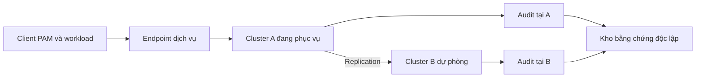

# Vault replication trong hệ thống PAM

## 1. Vì sao vault cần replication?

Trong hệ thống Privileged Access Management (PAM), vault bảo vệ credential quản trị, mật khẩu tài khoản dịch vụ, khóa SSH và những thông tin cho phép truy cập hạ tầng nhạy cảm. Vault còn lưu chính sách xác định ai được lấy credential, điều kiện cấp quyền và trạng thái của các thao tác quản lý bí mật.

Nếu trung tâm dữ liệu chứa vault ngừng hoạt động, tác động không chỉ là “không xem được mật khẩu”. Một dịch vụ có thể không lấy được credential để khởi động, tác vụ rotation có thể dừng giữa chừng, và đội ứng phó sự cố có thể không mở được phiên quản trị cần thiết để khôi phục hệ thống.

**Vault replication là quá trình duy trì bản sao dữ liệu và trạng thái vault tại các thành phần khác theo một cơ chế nhất quán được xác định trước.** Mục tiêu là giúp hệ thống tiếp tục cung cấp quyền truy cập được kiểm soát khi một thành phần hoặc một địa điểm gặp sự cố.

Một thiết kế replication tốt phải trả lời đồng thời:

- Bản sao chứa những gì và không chứa những gì?
- Khi nào một thay đổi được coi là bền vững?
- Bản sao có thể phục vụ loại yêu cầu nào?
- Ai có quyền quyết định chuyển vai trò?
- Sau khi chuyển, credential, policy và trạng thái rotation còn khớp với hệ thống đích không?
- Bằng chứng truy cập và thay đổi quyền có tiếp tục được ghi nhận không?

Trong bài này, “vault” là thành phần lưu trữ và quản lý bí mật của PAM. Các nguyên tắc kiến trúc được trình bày theo hướng tổng quát. Phần riêng về HashiCorp Vault sử dụng đúng tên cơ chế của sản phẩm; không mặc định mọi sản phẩm PAM có hành vi giống nhau.

## 2. Phân biệt replication, high availability, backup và disaster recovery

Các khái niệm liên quan nhưng không thay thế cho nhau.

| Khái niệm | Câu hỏi chính | Cách tiếp cận điển hình | Giới hạn cần nhớ |
| --- | --- | --- | --- |
| Replication | Làm sao duy trì nhiều bản sao trạng thái? | Sao chép thay đổi giữa node hoặc giữa cluster | Có thể sao chép cả thay đổi sai hoặc xóa nhầm |
| High availability — HA | Làm sao tiếp tục phục vụ khi thành phần hỏng? | Nhiều node, phát hiện lỗi, chuyển node phục vụ | Các node cùng địa điểm vẫn có thể mất đồng thời |
| Backup | Làm sao lấy lại dữ liệu ở một thời điểm trước? | Snapshot hoặc bản sao có lịch sử, retention và kiểm thử khôi phục | Khôi phục thường mất thời gian; bản mới nhất có thể chưa có thay đổi gần nhất |
| Disaster recovery — DR | Làm sao phục hồi dịch vụ sau sự cố lớn? | Hạ tầng dự phòng, replication/backup, runbook, nhân sự và diễn tập | Có dữ liệu dự phòng chưa đủ để có dịch vụ sử dụng được |

Ví dụ, ba node vault cùng chạy trong một phòng máy giúp chịu lỗi một máy chủ theo thiết kế phù hợp. Nếu cả phòng máy mất điện và hệ thống dự phòng cũng phụ thuộc cùng nguồn điện, số lượng node không giải quyết được lỗi chung đó.

Tương tự, bản sao nhận thay đổi liên tục có thể nhận ngay thao tác xóa một secret do quản trị viên thực hiện nhầm. Muốn quay lại trạng thái trước khi xóa, vẫn cần cơ chế lịch sử hoặc backup đã được bảo vệ.

Đối với PAM, tiêu chí phục hồi phải đi đến hành vi nghiệp vụ: người có quyền hợp lệ lấy được credential cần thiết hoặc mở được phiên được cấp phép, người đã bị thu hồi quyền tiếp tục bị từ chối, và các thao tác đó tạo được bằng chứng.

## 3. Hai tầng replication thường gặp

### 3.1. Sao chép trong một cluster

Một cluster có thể gồm nhiều node cùng duy trì trạng thái thông qua storage backend. Khi backend sử dụng cơ chế đồng thuận, các node tham gia biểu quyết về trạng thái được chấp nhận.

Với một nhóm gồm N voting node sử dụng biểu quyết đa số:

```text
quorum = floor(N / 2) + 1
```

Ba voting node cần ít nhất hai node để có đa số; năm voting node cần ít nhất ba. Đây là phép tính về voting node của nhóm đồng thuận, không phải phép tính áp dụng cho mọi node xuất hiện trong sơ đồ triển khai.

Phân bố lỗi quan trọng không kém số node. Nếu hai trong ba voting node cùng nằm ở một failure domain, việc mất domain đó có thể làm nhóm mất quorum. Một node ở xa nhưng không có quyền biểu quyết cũng không tự động làm tăng khả năng chịu lỗi theo công thức trên.

Trong HashiCorp Vault, Integrated Storage sử dụng giao thức đồng thuận để sao chép dữ liệu giữa các node thuộc cùng cluster. Cơ chế này phục vụ lưu trữ và HA bên trong cluster; không nên gọi nó là quan hệ DR giữa hai cluster độc lập. Xem [Integrated Storage](https://developer.hashicorp.com/vault/docs/concepts/integrated-storage).

### 3.2. Sao chép giữa các cluster

Ở tầng này, cluster A và cluster B có storage, vòng đời vận hành và vai trò phục hồi riêng. Dữ liệu được truyền qua liên kết replication theo khả năng sản phẩm.

Một mô hình dễ kiểm soát là:



Sơ đồ chỉ biểu diễn đường đi logic. Không có nghĩa endpoint tự động được phép chuyển tới B, hoặc B đã có quyền phục vụ mọi API. Cơ chế chuyển vai trò phải được thiết kế riêng.

Mỗi cluster cũng có thể cần HA nội bộ. Một cluster dự phòng chỉ có một node có thể trở thành điểm lỗi đơn ngay sau khi được đưa vào phục vụ.

## 4. Xác định phạm vi dữ liệu được sao chép

Không dùng câu “đã bật replication” làm bằng chứng rằng toàn bộ PAM đã có bản sao đầy đủ. Cần lập ma trận dữ liệu, cơ chế sao chép và cách xác minh.

| Nhóm trạng thái | Cần xác định | Nguy cơ khi thiếu hoặc trễ |
| --- | --- | --- |
| Secret và phiên bản | Giá trị, metadata, phiên bản, trạng thái xóa/hủy | Bản dự phòng trả credential cũ hoặc thiếu secret |
| Policy và quyền | ACL, mapping nhóm, điều kiện cấp quyền | Quyền mới không có hiệu lực hoặc quyền đã thu hồi vẫn còn |
| Cấu hình xác thực | Auth method, role, trust và phụ thuộc IdP | Có secret nhưng người dùng/workload không đăng nhập được |
| Token và lease | Có được sao chép không, hiệu lực ở cluster nào | Token bị từ chối, lease hết hạn hoặc không quản lý được vòng đời |
| Rotation và reconciliation | Lịch, quyền sở hữu job, trạng thái bước đang chạy | Hai job đổi cùng một mật khẩu hoặc bỏ sót lần đổi |
| Khóa và seal | Cơ chế khởi động, quyền dùng KMS/HSM, khả năng giải mã | Có dữ liệu nhưng cluster không mở được |
| Audit và bằng chứng | Nơi ghi, nơi lưu, khả năng truy xuất sau sự cố | Khôi phục được truy cập nhưng thiếu lịch sử kiểm toán |
| Cấu hình vận hành | Chứng chỉ TLS, DNS, LB, firewall, plugin, connector | Cluster khỏe nhưng client hoặc hệ thống đích không kết nối được |

Ma trận này là danh sách cần khảo sát, không phải cam kết rằng mọi sản phẩm đều sao chép mọi hàng.

Đặc biệt, cần tách trạng thái **bên trong vault** và trạng thái **bên ngoài vault**:

- Vault có thể lưu mật khẩu một tài khoản, nhưng tài khoản thực tế nằm trên database hoặc máy chủ.
- Vault có thể lưu cấu hình dùng KMS, nhưng quyền IAM và tính sẵn sàng của KMS nằm ngoài storage vault.
- Vault có thể ghi sự kiện audit, nhưng kho lưu trữ audit tập trung có vòng đời và cơ chế bảo vệ riêng.
- PAM có thể tham chiếu một bản ghi phiên, nhưng video hoặc luồng dữ liệu phiên nằm ở dịch vụ khác.

Bản sao của vault chỉ có giá trị khi những phụ thuộc cần thiết cũng hoạt động và quan hệ giữa chúng còn đúng.

## 5. Mô hình đồng bộ và bất đồng bộ

### 5.1. Replication đồng bộ

Trong một thiết kế đồng bộ, điều kiện trả lời thành công cho thao tác ghi có liên quan đến việc bản sao cần thiết đã xác nhận thay đổi theo contract của hệ thống.

Ưu điểm là có thể giảm khoảng dữ liệu đã được xác nhận nhưng chưa tới tập bản sao bắt buộc. Đổi lại, đường truyền hoặc thành phần tham gia xác nhận có thể ảnh hưởng đến độ trễ và khả năng chấp nhận ghi.

Không được suy ra rằng cứ “đồng bộ” là RPO bằng 0 cho mọi sự cố. Cần biết rõ:

- Xác nhận đến từ bộ nhớ hay lưu trữ bền vững?
- Những bản sao nào nằm trong điều kiện xác nhận?
- Phạm vi chịu lỗi là một node, một cluster hay cả vùng?
- Có chế độ vận hành suy giảm làm thay đổi điều kiện xác nhận không?

### 5.2. Replication bất đồng bộ

Trong một thiết kế bất đồng bộ, hệ thống nguồn có thể xác nhận ghi trước khi bản sao ở xa nhận và áp dụng thay đổi.

Mô hình này giảm sự phụ thuộc trực tiếp của thao tác ghi vào đường truyền xa, nhưng tạo ra một khoảng thời gian mà nguồn và bản sao chưa có cùng trạng thái.

Ví dụ minh họa:

```text
10:00:00  Nguồn xác nhận ghi policy phiên bản 18.
10:00:02  Nguồn xác nhận ghi secret phiên bản 42.
10:00:03  Nguồn ngừng hoạt động.
10:00:03  Bản dự phòng mới áp dụng tới policy 18, secret 41.
```

Bản dự phòng có thể có policy mới nhưng vẫn chưa có secret mới nhất. Các hệ thống có thứ tự transaction hoặc cơ chế đóng gói khác nhau sẽ có hành vi khác; ví dụ trên chỉ nhằm cho thấy không thể nhìn một tín hiệu “link connected” để kết luận mọi dữ liệu nghiệp vụ đã đồng bộ.

Với workload cần đọc ngay sau ghi, phải biết thao tác đọc ở bản sao có bảo đảm thấy thay đổi vừa ghi hay không. Retry có giới hạn, định tuyến về nguồn hoặc cơ chế consistency của sản phẩm có thể là một phần thiết kế. Không giải quyết bằng cách bỏ qua kiểm tra quyền khi replica chưa có trạng thái mới.

### 5.3. Lag là tín hiệu, không phải kết luận đầy đủ

Các chỉ số hữu ích gồm trạng thái liên kết, độ trễ áp dụng, backlog, tốc độ sinh thay đổi, tốc độ xử lý và thời điểm tiến triển gần nhất.

Chỉ so sánh các log index hoặc sequence number nếu tài liệu sản phẩm xác nhận chúng thuộc cùng quan hệ và có thể so sánh. Index trong một nhóm Raft không mặc nhiên có cùng ý nghĩa với index của quan hệ replication giữa cluster.

Một khoảng chênh số bản ghi cũng không tự động đổi được thành số giây mất dữ liệu. Để đánh giá RPO thực tế, cần liên hệ mốc ghi đã được xác nhận với mốc trạng thái đã được phục hồi và kiểm chứng.

## 6. Đặt RPO và RTO cho quyền truy cập đặc quyền

**RPO — Recovery Point Objective** là mục tiêu về khoảng mất dữ liệu có thể chấp nhận khi phục hồi.

**RTO — Recovery Time Objective** là mục tiêu về thời gian đưa dịch vụ trở lại mức sử dụng được đã thống nhất.

Với PAM, nên đặt mục tiêu theo luồng công việc, không chỉ theo tiến trình vault:

| Luồng công việc | Ví dụ mục tiêu giả định | Điều cần đo trong diễn tập |
| --- | --- | --- |
| Lấy secret phục vụ workload trọng yếu | RTO không quá 10 phút | Thời điểm workload lấy được secret và kết nối thành công tới đích |
| Thu hồi quyền người vận hành | RPO không quá 1 phút | Thay đổi thu hồi có tồn tại và thực sự chặn truy cập ở điểm phục hồi |
| Rotation tài khoản quản trị | Không chấp nhận hai bộ điều phối cùng ghi | Trạng thái chủ sở hữu và sự khớp credential với hệ thống đích |
| Lưu bằng chứng | Khôi phục đường ghi audit trước khi mở lại luồng quản trị thông thường | Ghi và truy xuất được sự kiện kiểm thử từ cluster mới |

Các con số trên là dữ liệu bài tập, không phải khuyến nghị mặc định cho mọi tổ chức. Mục tiêu thực tế phải phản ánh mức quan trọng của hệ thống, khả năng sản phẩm và điều kiện vận hành.

RTO thường bao gồm nhiều phần:

```text
RTO thực đo =
    thời gian phát hiện
  + thời gian đánh giá và quyết định
  + thời gian cô lập nguồn cũ
  + thời gian chuyển vai trò
  + thời gian chuyển endpoint/client
  + thời gian xác minh nghiệp vụ
```

Các hoạt động có thể chồng lấp, nên tổng trên là cách phân rã để phân tích chứ không phải công thức bắt buộc cho mọi phép đo.

Một lần promote mất vài giây không có nghĩa RTO của PAM chỉ vài giây. Nếu client giữ DNS cache cũ hoặc hệ thống mới không tới được database, luồng truy cập vẫn chưa phục hồi.

## 7. Kiến trúc tham chiếu cho vault của PAM

Giả sử tổ chức có hai địa điểm A và B. A phục vụ chính; B phục hồi khi mất A.

Thiết kế có thể gồm:

1. Mỗi địa điểm có cluster vault đủ khả năng HA nội bộ theo thiết kế của sản phẩm.
2. A truyền dữ liệu tới B bằng quan hệ replication được hỗ trợ.
3. Client truy cập qua endpoint đã có phương án chuyển đổi, timeout và retry.
4. Đường quản trị phục hồi được giới hạn cho nhóm vận hành có thẩm quyền.
5. Hai địa điểm có đường kết nối tới IdP, KMS/HSM, hệ thống đích và kho audit theo yêu cầu của từng luồng.
6. Backup có lịch sử được bảo vệ độc lập với luồng replication.

Tính độc lập phải được kiểm tra ở các lớp thực tế: nguồn điện, mạng, tài khoản quản trị hạ tầng, dịch vụ khóa và miền lưu trữ. Hai cluster ở hai địa chỉ IP khác nhau vẫn có thể phụ thuộc cùng một thiết bị mạng hoặc cùng một quyền quản trị bị xâm phạm.

Đường replication cần bảo vệ tính bí mật và tính xác thực của hai đầu theo cơ chế sản phẩm hỗ trợ. Quyền thiết lập, thay đổi hoặc hủy quan hệ replication là quyền nhạy cảm, cần cấp tối thiểu, phê duyệt phù hợp và có audit.

Không dùng cùng một tài khoản quyền cao không giới hạn cho mọi việc: vận hành thường ngày, thiết lập replication, promote DR, chỉnh policy và đọc secret. Tách các trách nhiệm này giúp giảm phạm vi ảnh hưởng của lỗi thao tác hoặc tài khoản bị chiếm.

## 8. Ví dụ sản phẩm: ba cơ chế trong HashiCorp Vault

Cần phân biệt cơ chế nội bộ cluster và hai loại replication giữa cluster trong HashiCorp Vault.

| Cơ chế | Phạm vi và mục tiêu | Điểm cần hiểu |
| --- | --- | --- |
| Integrated Storage | Sao chép storage giữa node cùng cluster | Hỗ trợ HA nội bộ; không tự tạo một cluster DR độc lập |
| DR replication | Chuẩn bị cluster dự phòng để thay thế nguồn | DR secondary không phục vụ yêu cầu client thông thường trước khi được promote |
| Performance replication | Phân bố một số xử lý tới các cluster gần client | Không phải bản thay thế đầy đủ cho DR |

DR replication và performance replication là các tính năng thuộc phạm vi sản phẩm/giấy phép được HashiCorp công bố; không mặc định một bản cài đặt bất kỳ có sẵn hai tính năng này. Quan hệ giữa các cluster truyền thay đổi bất đồng bộ. Xem [Vault Enterprise replication](https://developer.hashicorp.com/vault/docs/enterprise/replication).

### 8.1. DR replication

DR secondary giữ bản sao phục vụ phục hồi, bao gồm trạng thái token và lease của nguồn theo cơ chế của Vault. Secondary phải được promote trước khi tiếp nhận luồng client thông thường. Vault không tự quyết định promote DR secondary.

Cơ chế này giúp duy trì trạng thái xác thực khi chuyển sang cluster phục hồi, nhưng vẫn cần kiểm tra hạn token, TTL, kết nối và trạng thái các hệ thống ngoài vault. Replication cũng không thay thế backup có lịch sử. Xem [Disaster recovery replication](https://developer.hashicorp.com/vault/docs/enterprise/replication/disaster-recovery).

### 8.2. Performance replication

Performance secondary có thể xử lý một số yêu cầu tại chỗ, nhưng token và lease được quản lý cục bộ theo cluster; không phải toàn bộ trạng thái đều được sao chép như mô hình DR. Các thao tác ghi vào dữ liệu được replicate thường cần chuyển tới primary, còn local mount có hành vi riêng.

Do đó, không được coi performance secondary như một DR secondary có thể thay nguồn mà không cần đánh giá khác biệt trạng thái. Xem [Performance replication](https://developer.hashicorp.com/vault/docs/enterprise/replication/performance).

Bài học kiến trúc là phải kiểm kê **loại yêu cầu**, **loại dữ liệu** và **phạm vi hiệu lực** của credential/token. Nhãn “secondary” đứng một mình chưa cho biết một cluster có thể làm gì.

## 9. Replication và tính đúng đắn của rotation

Rotation có ít nhất hai phía cần nhất quán:

- Credential mà vault cho là hiện hành.
- Credential mà hệ thống đích thực sự chấp nhận.

Ngoài ra còn có chủ sở hữu tác vụ, trạng thái kiểm chứng, thời điểm lần chạy và các workload đang dùng credential.

### 9.1. Kịch bản credential bị lệch sau sự cố

Xét mật khẩu của tài khoản dịch vụ `svc-reporting` trên database thử nghiệm. W1 và W2 là nhãn phiên bản, không phải giá trị mật khẩu.

```text
t0: Vault A và Vault B biết phiên bản W1; database chấp nhận W1.
t1: Bộ điều phối rotation tại A đổi database sang W2.
t2: A ghi nhận W2; thay đổi chưa được áp dụng tại B.
t3: A mất hoàn toàn.
t4: B được chuyển sang phục vụ và vẫn biết W1.
```

Lúc này, lấy secret từ B có thể thành công về mặt API nhưng ứng dụng dùng W1 vẫn đăng nhập thất bại vào database.

Không thể giải quyết chắc chắn bằng cách “replicate lại từ A” khi A chưa phục hồi. Cũng không nên thực hiện thêm một lần rotation thiếu kiểm soát để che triệu chứng.

Cần xử lý tài khoản bị ảnh hưởng theo runbook reconciliation đã được phê duyệt:

1. Xác định tác vụ rotation cuối cùng có thể đã thay đổi hệ thống đích.
2. Dừng hoặc khóa điều phối với đúng tài khoản bị ảnh hưởng để tránh ghi đồng thời.
3. Dùng kênh phục hồi được ủy quyền để kiểm tra hoặc thiết lập credential mới theo khả năng hệ thống đích.
4. Cập nhật vault đang có thẩm quyền, kiểm chứng đăng nhập bằng thao tác tối thiểu.
5. Cho phép workload lấy phiên bản đúng; thu hồi credential cũ khi cơ chế đích cho phép và theo quy trình.
6. Mở lại lịch rotation sau khi xác nhận trạng thái đã khớp và có bằng chứng.

Không lưu mật khẩu vào ticket, log hoặc ảnh chụp kết quả. Bằng chứng có thể sử dụng account ID, version ID, thời gian, operation ID và kết quả kiểm chứng.

### 9.2. Bảo đảm một chủ thể điều phối cho mỗi tài khoản

Hai vault có dữ liệu giống nhau không có nghĩa hai bộ điều phối được phép cùng đổi một tài khoản.

Một nguyên tắc vận hành hữu ích là: **tại một thời điểm, mỗi tài khoản được quản lý chỉ có một bên có thẩm quyền thực hiện rotation/reconciliation.**

Việc bảo đảm nguyên tắc đó phụ thuộc sản phẩm: cơ chế leadership, khóa phân tán, fencing token, kiểm soát connector hoặc quyền tại hệ thống đích. Nếu gọi một cơ chế là “fencing”, phải chứng minh bên cũ thực sự không thể ghi tiếp; một nhãn trong dashboard chưa đủ.

Trong thời gian chuyển vai trò, một khoảng dừng rotation có kiểm soát có thể phù hợp hơn việc cho hai bộ điều phối chạy đồng thời. Khoảng dừng cần được theo dõi, có giới hạn và có phương án xử lý cho credential sắp hết hạn hoặc bị nghi lộ.

## 10. Ngăn split-brain khi liên kết bị đứt

Split-brain trong ngữ cảnh vận hành này xảy ra khi hai phía cùng tự coi mình là bên có thẩm quyền và tạo ra các thay đổi không tương thích.

Ví dụ, A vẫn kết nối được với database nhưng không kết nối được với B. Đội tại B thấy A “mất liên lạc”, promote B và mở lại rotation. Nếu A vẫn còn quyền đổi password trên cùng database, hai phía có thể ghi đè kết quả của nhau.

Phát hiện A không truy cập được từ một vị trí không chứng minh A đã dừng hoạt động.

Trước khi cho B nhận quyền ghi, phải có bằng chứng theo thiết kế về việc cô lập hoặc thu hồi thẩm quyền của A. Biện pháp có thể liên quan đến đường mạng tới hệ thống đích, trạng thái dịch vụ, connector, quyền của bộ điều phối hoặc cơ chế fencing được sản phẩm hỗ trợ.

Việc cô lập phải bao phủ các đường có khả năng thay đổi trạng thái. Chỉ chuyển DNS của người dùng sang B không cắt quyền của job nền tại A.

Cũng cần phân biệt hai tình huống:

- **Phân hoạch trong một nhóm đồng thuận:** quorum và giao thức storage quyết định phía nào còn được ghi.
- **Chuyển quyền giữa hai cluster:** cần quy tắc chuyển vai trò của replication và các biện pháp vận hành; không mặc định quorum của cluster A giải quyết được quyền của cluster B.

Trong thiết kế có một nguồn ghi có thẩm quyền, nếu chưa chứng minh được quyền ghi đã chuyển an toàn, cần giữ trạng thái hạn chế theo runbook và sử dụng kênh khẩn cấp đã chuẩn bị cho nhu cầu bắt buộc.

## 11. Quy trình chuyển vai trò có kế hoạch

Chuyển có kế hoạch phù hợp khi bảo trì địa điểm hoặc di chuyển dịch vụ. Vì nguồn còn hoạt động, có cơ hội giảm thay đổi đang dở và xác minh trạng thái trước khi chuyển.

### Bước 1 — Chốt phạm vi và điều kiện thành công

Xác định rõ cluster chuyển đi, cluster nhận vai trò, nhóm client, tài khoản đặc quyền và hệ thống đích trong phạm vi.

Điều kiện thành công phải gồm kiểm chứng luồng truy cập hợp lệ, từ chối truy cập không hợp lệ, trạng thái rotation và đường audit. Lưu mốc thời gian bắt đầu và người phê duyệt.

### Bước 2 — Kiểm tra đích và phụ thuộc

Kiểm tra sức khỏe cluster dự phòng, khả năng mở vault, dung lượng, replication, đồng hồ, TLS, IdP, hệ thống đích và audit.

Không chỉ kiểm tra kết nối TCP. Với phụ thuộc quan trọng, cần xác minh hoạt động tương ứng bằng danh tính thử nghiệm được giới hạn.

### Bước 3 — Kiểm soát thay đổi

Theo runbook, tạm dừng hoặc giới hạn các thay đổi có thể tạo bất nhất trong cửa sổ chuyển: rotation đang chạy, tác vụ cấp secret nhạy cảm và thay đổi policy.

Không áp dụng quy tắc dừng giống nhau cho mọi sản phẩm. Cần biết cơ chế nào tự bảo đảm thứ tự và cơ chế nào cần phối hợp thủ công.

### Bước 4 — Xác minh mốc dữ liệu

Ghi nhận mốc thay đổi đã được nguồn xác nhận, trạng thái áp dụng tại đích và giới hạn của phép đo. Dùng đối tượng canary không chứa secret thật để xác nhận trạng thái cần thiết.

“Mọi biểu đồ đang xanh” chưa đủ nếu không biết biểu đồ phản ánh tình trạng ở thời điểm nào.

### Bước 5 — Chuyển thẩm quyền và endpoint

Thực hiện demote/promote hoặc quy trình chuyển được sản phẩm hỗ trợ; xác minh nguồn cũ đã mất quyền ghi liên quan trước khi mở ghi tại đích mới.

Chuyển endpoint và xử lý kết nối tồn tại, cache, retry và client pinning. Không coi thay DNS là toàn bộ thao tác failover.

### Bước 6 — Kiểm chứng và khôi phục nhịp vận hành

Kiểm thử có kiểm soát việc đăng nhập, lấy secret, từ chối truy cập sai quyền, kết nối tới một đích thử nghiệm và ghi audit.

Mở lại rotation theo thứ tự ưu tiên sau khi xác nhận một bên có thẩm quyền. Kết thúc cửa sổ chuyển khi các tiêu chí nghiệp vụ đạt, không chỉ khi lệnh chuyển vai trò trả thành công.

## 12. Failover khẩn cấp khi nguồn không còn truy cập được

Trong sự cố thật, không phải lúc nào cũng biết chính xác thay đổi cuối cùng của nguồn. Quyết định cần thể hiện phần đã biết, phần chưa biết và rủi ro được chấp nhận.

Một bản ghi quyết định tối thiểu có thể theo mẫu:

```yaml
# Mẫu hồ sơ vận hành minh họa; không phải cấu hình của sản phẩm vault.
incident_id: PAM-DR-EXERCISE-021
source_cluster: site-a
candidate_cluster: site-b
source_last_confirmed_reachable: "2026-01-15T10:00:03Z"
replica_observation_time: "2026-01-15T10:00:10Z"
replica_last_verified_canary: canary-1042
source_fenced: true
fencing_evidence_ref: exercise-evidence-021-fence
possible_unreplicated_changes:
  - privileged-policy-changes
  - rotations-in-flight
decision:
  authorized_by: exercise-incident-lead
  action: promote-according-to-approved-runbook
validation_required:
  - permitted-access
  - denied-access
  - target-credential-consistency
  - audit-pipeline
```

Không đưa token promote, credential hoặc dữ liệu secret vào hồ sơ này.

Sau failover, ưu tiên kiểm tra các nhóm dễ có sai lệch:

- Credential vừa rotation hoặc đang reconciliation trước sự cố.
- Quyền vừa cấp hoặc vừa thu hồi.
- Token/lease sắp hết hạn và workload cần renew.
- Tài khoản có tác vụ đang chạy từ địa điểm cũ.
- Đối tượng chưa xác minh được trạng thái sao chép.

Đối với thông tin không có bằng chứng, ghi rõ “chưa xác định”, không tự chuyển thành “đã đồng bộ”. Nếu rủi ro của một tài khoản quá cao, có thể cần giới hạn truy cập hoặc reconciliation trước khi mở lại theo quyết định ứng phó sự cố.

Quy trình khẩn cấp phải có kênh break-glass độc lập với thành phần đang hỏng, nhưng quyền khẩn cấp vẫn cần giới hạn, theo dõi, thu hồi và rà soát sau sử dụng.

## 13. Failback: đưa hệ thống trở về trạng thái mục tiêu

Failback không phải chỉ trỏ DNS về địa điểm cũ.

Sau khi B đã nhận ghi, B có thể chứa thay đổi mà A chưa có. Đưa A quay lại phục vụ từ trạng thái cũ có thể làm mất policy mới, trả credential cũ hoặc tái kích hoạt công việc đã được chuyển sang B.

Trình tự tổng quát:

1. Giữ A ngoài luồng phục vụ ghi trong khi đánh giá.
2. Xác định B hiện là nguồn trạng thái có thẩm quyền.
3. Kiểm tra tình trạng hạ tầng A và nguyên nhân sự cố.
4. Đưa A về vai trò dự phòng từ B bằng quy trình sản phẩm hỗ trợ; có thể cần tái đồng bộ hoặc khởi tạo lại phần dữ liệu đích theo runbook.
5. Xác minh dữ liệu, phụ thuộc và quyền tại A.
6. Nếu cần chuyển vai trò về A, thực hiện một lần chuyển có kế hoạch với điều kiện thành công rõ ràng.

Không tự ghép hai tập dữ liệu vault bằng sao chép file hoặc chọn “bản mới hơn” theo thời gian sửa file. Hệ thống mã hóa, storage đồng thuận và replication có contract riêng; thao tác ngoài contract có thể tạo trạng thái không hợp lệ.

Nếu phát hiện hai phía đã thay đổi cùng tài khoản, xử lý như một tình huống bất nhất cần reconciliation và phân tích bằng chứng. Không coi resync thành công là bằng chứng rằng mọi credential ở hệ thống đích đã đúng.

## 14. Giám sát để biết replica có thể phục hồi hay không

Mục tiêu giám sát không dừng ở “replication có kết nối”.

| Nhóm tín hiệu | Cần quan sát | Hành động có ý nghĩa |
| --- | --- | --- |
| Liên kết | Ngắt kết nối, lỗi xác thực, lỗi TLS | Kiểm tra đường truyền, trust và thời điểm bắt đầu lỗi |
| Tiến triển | Trạng thái áp dụng không tiến, backlog tăng | Phân biệt nguồn không có thay đổi với replica bị kẹt |
| Năng lực | Disk, IOPS, CPU, bộ nhớ, băng thông | Xử lý nguyên nhân khiến replica không theo kịp |
| HA nội bộ | Quorum, node lỗi, trạng thái seal | Đánh giá đích có đủ khả năng phục vụ sau promote |
| Phụ thuộc | IdP, KMS/HSM, đích quản lý, audit | Xác minh luồng nghiệp vụ và chuẩn bị đường phục hồi |
| An toàn vận hành | Hai bên cùng chạy rotation, thay đổi vai trò bất thường | Ngăn ghi đồng thời và kiểm tra tính hợp lệ của quyết định |
| Bằng chứng | Độ trễ hoặc mất sự kiện audit | Khôi phục đường bằng chứng và ghi nhận khoảng thiếu |

Ngưỡng cảnh báo cần gắn với mục tiêu phục hồi. Ví dụ, nếu RPO của một luồng là một phút, cảnh báo sau nhiều giờ không giúp đáp ứng mục tiêu đó. Tuy nhiên không được lấy “lag báo 20 giây” làm bằng chứng chắc chắn rằng toàn bộ rủi ro mất dữ liệu chỉ là 20 giây.

Canary nên là đối tượng riêng, không chứa credential thật và có policy tối thiểu. Có thể cập nhật một mã kiểm thử tại nguồn, kiểm tra mã tương ứng ở bản sao qua giao diện được hỗ trợ, rồi ghi thời điểm quan sát. Với replica không cho đọc dữ liệu ứng dụng trước promote, cần dùng telemetry phù hợp hoặc kiểm chứng trong diễn tập.

Canary chỉ kiểm chứng phạm vi của nó. Một canary KV không tự chứng minh token, lease, local data, policy hay session recording đều đã được bảo vệ.

## 15. Bảo vệ quyền và bằng chứng của hệ thống replication

### 15.1. Least privilege cho vận hành

Danh tính thiết lập replication, danh tính thực hiện chuyển vai trò và danh tính workload có nhu cầu khác nhau.

Workload cần đọc secret không nên có quyền thay đổi topology. Người theo dõi sức khỏe không mặc định cần xem giá trị secret. Người phê duyệt failover không nhất thiết phải giữ vật liệu khóa phục hồi.

Nếu hệ thống hỗ trợ JIT/JEA, có thể chỉ cấp quyền vận hành nhạy cảm trong cửa sổ đã duyệt và giới hạn tới thao tác cần thiết. Cơ chế cấp quyền này cũng phải có phương án khi IdP hoặc kênh quản trị thông thường mất.

### 15.2. Vật liệu khôi phục và khóa

Cần biết cluster dự phòng mở vault bằng cơ chế nào, phụ thuộc vào tài nguyên khóa nào và ai có quyền sử dụng chúng.

Không coi recovery key, unseal key, credential KMS và token thao tác DR là những thứ có thể thay thế cho nhau. Tên gọi và chức năng cụ thể phụ thuộc sản phẩm/cấu hình. Runbook phải chỉ rõ loại vật liệu cần thiết và cách lưu giữ được kiểm soát.

Diễn tập phải kiểm chứng khả năng sử dụng cơ chế phục hồi, không chỉ kiểm kê rằng “có một phong bì” hoặc “có secret chứa khóa”. Nếu vật liệu phục hồi chỉ lấy được từ chính vault đang hỏng, chuỗi phục hồi có thể bị vòng lặp.

### 15.3. Audit độc lập với sự tồn tại của nguồn

Lưu thông tin quyết định, thay đổi vai trò, người thực hiện và kết quả kiểm chứng tại nơi có thể truy xuất khi nguồn không còn.

Nên có đủ định danh để liên kết sự kiện giữa cluster, PAM gateway, bộ điều phối rotation và hệ thống đích. Đồng bộ thời gian giúp phân tích nhưng không thay thế các operation ID hoặc request ID.

Bằng chứng không cần chứa secret. Các trường như account ID, policy version, cluster ID, thời gian, thao tác, kết quả và tham chiếu phê duyệt thường phù hợp hơn việc chụp màn hình mật khẩu.

## 16. Bài thực hành: chứng minh khả năng phục hồi

Bài thực hành dùng môi trường cô lập, tài khoản thử nghiệm và cơ chế replication được sản phẩm hỗ trợ. Không sử dụng credential production.

### 16.1. Chuẩn bị

Chuẩn bị hai cluster hoặc hai vai trò theo mô hình được cấp phép/hỗ trợ, một hệ thống đích thử nghiệm, tài khoản đọc secret hợp lệ và một danh tính không có quyền đọc secret đó.

Tạo các đối tượng thử nghiệm:

- Một secret giả với version ID.
- Một policy cho phép danh tính A đọc secret.
- Một danh tính B bị từ chối đọc.
- Một tài khoản đích có thể kiểm chứng credential bằng thao tác tối thiểu.
- Một canary có mã thay đổi và thời gian ghi nhận.
- Nơi thu nhận audit của cả hai phía.

Chốt mục tiêu RPO/RTO giả định trước khi bắt đầu. Ghi rõ những phần dữ liệu nào có hoặc không thuộc cơ chế replication đang thử.

### 16.2. Thử lỗi một node

Dừng có kiểm soát một node trong cluster phục vụ theo quy trình phòng lab. Kiểm tra cluster còn khả năng đáp ứng hay không và thời gian gián đoạn thực tế.

Mục tiêu là phân biệt failover node trong cluster với DR giữa cluster. Không promote cluster dự phòng chỉ vì một node đã được HA nội bộ xử lý.

### 16.3. Thử gián đoạn liên kết replication

Ngắt có kiểm soát liên kết giữa hai phía nhưng giữ khả năng quan sát.

Ghi một thay đổi canary tại nguồn nếu mô hình cho phép; quan sát backlog, cảnh báo và hành vi của replica. Kiểm tra luồng nào tiếp tục được phục vụ và luồng nào phụ thuộc nguồn.

Không promote chỉ để thử “xem có được không” khi chưa cô lập quyền ghi của nguồn theo thiết kế.

### 16.4. Thử chuyển có kế hoạch

Khôi phục liên kết, đợi tiến triển và xác minh mốc dữ liệu. Thực hiện quy trình chuyển có kế hoạch đã nêu ở trên.

Sau chuyển, thực hiện các kiểm chứng:

| Phép kiểm | Kết quả mong đợi |
| --- | --- |
| Danh tính A lấy secret | Thành công theo policy |
| Danh tính B lấy secret | Bị từ chối |
| Workload thử nghiệm dùng credential | Kết nối được với hệ thống đích |
| Thao tác thay đổi thử nghiệm | Chỉ bên có thẩm quyền thực hiện |
| Audit của thao tác thành công và bị từ chối | Truy xuất được tại kho bằng chứng |
| Client còn kết nối/cache cũ | Hành vi được ghi nhận và xử lý theo thiết kế |
| Rotation thử nghiệm sau khi mở lại | Hoàn tất một lần, credential khớp đích |

### 16.5. Thử tình huống lệch credential

Trong phòng lab, tạo một cửa sổ replication bị gián đoạn và thực hiện rotation trên tài khoản thử nghiệm theo kịch bản được kiểm soát. Mục tiêu là tạo được trạng thái “đích đã đổi nhưng replica chưa biết” nếu sản phẩm/mô hình cho phép.

Thực hiện failover theo runbook rồi chứng minh vì sao API đọc secret thành công chưa đủ. Dùng quy trình reconciliation của sản phẩm để đưa tài khoản về trạng thái khớp.

Nếu môi trường không cho tái hiện an toàn, thực hiện tabletop bằng bảng trạng thái W1/W2, quyền của từng phía và bằng chứng cần thu. Không phá cơ chế storage để ép tạo lỗi.

### 16.6. Hồ sơ kết quả

Báo cáo nên ghi:

- Topology, vai trò, phiên bản và phạm vi tính năng được thử.
- Mốc thời gian phát hiện, quyết định, cô lập, chuyển vai trò và phục hồi luồng nghiệp vụ.
- Mốc dữ liệu đã xác minh, thay đổi có thể mất và cách kết luận RPO thực đo.
- Kết quả cho phép/từ chối truy cập, credential consistency và audit.
- Những bước thủ công, phụ thuộc hoặc quyền còn gây chậm.
- Cách failback và trạng thái cuối cùng của hai phía.

Chỉ kết luận đạt khi phép đo thực tế đáp ứng mục tiêu đã đặt. Một lần diễn tập thành công cũng không chứng minh mọi kiểu sự cố đều đã được bao phủ.

## 17. Các hiểu nhầm cần tránh

| Hiểu nhầm | Cách đánh giá đúng |
| --- | --- |
| Nhiều node nghĩa là đã có DR | Kiểm tra failure domain và khả năng mất cả cluster |
| Replica kết nối nghĩa là dữ liệu luôn mới | Kiểm tra tiến triển áp dụng và mốc nghiệp vụ |
| Replication thay cho backup | Giữ khả năng phục hồi về thời điểm trước thay đổi sai |
| Hai bên có secret giống nhau thì cùng rotation được | Bảo đảm một bên có thẩm quyền cho từng tài khoản |
| Promote thành công nghĩa là PAM phục hồi | Kiểm chứng client, IdP, đích quản lý và audit |
| Chuyển DNS đã cô lập nguồn cũ | Kiểm tra mọi đường ghi, kể cả job nền và connector |
| Mọi secondary đều giữ token/lease như nhau | Đọc contract của đúng loại replication và loại dữ liệu |
| Failback chỉ là quay lại địa chỉ cũ | Đồng bộ từ nguồn hiện có thẩm quyền rồi chuyển có kế hoạch |
| Backup được chép sang B nên chắc chắn phục hồi được | Thử mở, giải mã và khôi phục trong điều kiện dự kiến |
| Audit nằm trong vault nên không cần kiểm tra riêng | Xác minh toàn bộ đường ghi, lưu trữ và truy xuất bằng chứng |

## 18. Tự kiểm tra

**Vì sao sao chép thành công secret vẫn chưa bảo đảm một ứng dụng đăng nhập được?**

Vì credential trên hệ thống đích có thể đã thay đổi khác với bản vault đang phục vụ; ứng dụng cũng có thể gặp lỗi xác thực, mạng hoặc quyền. Cần kiểm chứng luồng sử dụng credential tới đích, không chỉ API đọc secret.

**Một replica trễ có thể gây rủi ro gì ngoài việc trả mật khẩu cũ?**

Nó có thể chưa nhận thay đổi thu hồi quyền, cấu hình xác thực hoặc trạng thái quản lý vòng đời liên quan. Phải đánh giá theo loại dữ liệu và contract replication.

**Tại sao không tự động promote mỗi khi mất kết nối tới nguồn?**

Mất liên lạc không chứng minh nguồn đã ngừng ghi. Nếu hai phía cùng thay đổi credential hay policy, bất nhất có thể làm gián đoạn hoặc mở sai quyền truy cập.

**Bằng chứng nào giúp kết luận failover thành công?**

Bên mới có thẩm quyền rõ ràng, dữ liệu được đánh giá theo RPO, luồng hợp lệ hoạt động, luồng sai quyền bị từ chối, credential khớp hệ thống đích và audit có thể truy xuất. Đồng thời phải xác nhận bên cũ không tiếp tục thực hiện các thao tác ghi gây xung đột.
